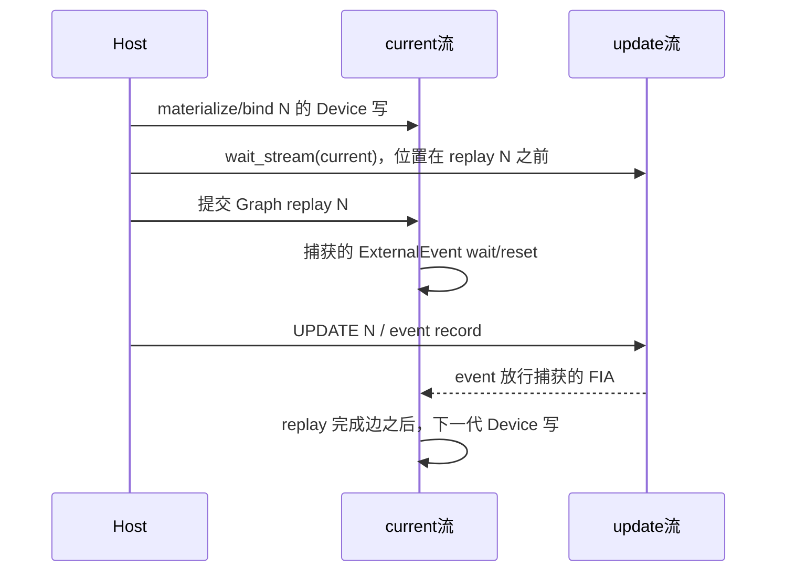

# 正常 UPDATE/backing 顺序：已查明的依赖与剩余条件

本轮 C12→C17 的整个 vllm_ascend Git 子树相同（714c66dac1a25188feff466dea652277b21747c8）。新增内容是默认关闭的诊断/工具；没有把逐代 LIFE 同步加入正常 production。完整身份见生产源码影响核验.json。

## 1. 项目实际顺序

图中最后一条边是否覆盖所有内部消费者，仍依赖实际 Runtime 分支和版本合同；它不是从 Host return 推导。

- 本代 update_stream.wait_stream(current) 在 replay 前建立，若人为移到 replay 后可能与捕获等待组成不同依赖，未作这种改动。
- 更新流串行：UPDATE N-1 → event record N-1 → wait-current N → UPDATE N → event record N。
- 当前流上的下一代 Device copy/zero 与前一次 replay 有流内先后，不需要假设 Host retire 等于设备完成。
- P3 workspace 与持久 Graph carrier 不同址。精确长度 CPU 快照是已有操作；不能仅因某 CPU workspace 后来清零就断言正在覆盖 FIA 的裸 Host 参数。

## 2. Native 参数寿命的具体依据

实际 FIA workspace 更新走 op-plugin 8b9c8534fa41eff367a41c155843daa530ab3a08 中 EXEC_UPDATE_NPU_NO_FORMAT_CHECK_CMD 专用路径；不是此前泛读的通用宏。CopyTypesV2 复制长度 vector，队列 lambda 持有拷贝；两种队列路径均分析，aclIntArray 在 API 后释放。因而“传入 Python/CPU tensor 裸地址一直被设备读”不是当前已查到的实现。

torch_npu 5dd8ef3f9b375b5ae4a83538d5785754148c3302 的 NPUGraph UPDATE begin/end 为 CANN 薄调用；replay 在 current stream 调用 RIExecuteAsync。NPUStream 取 stream 时清空 Host task queue，不等价于设备完成。未设置 ASCEND_LAUNCH_BLOCKING 等隐含串行标志；实际 worker 来源见 environment/C15_actual_worker_provenance.json。

## 3. CANN 9.1 完成边有新增源码支持

官方 Runtime v9.1.0 0b4af8a31c75a1f1f43638a8f75b9e3c6182e031：CaptureModel::ExecuteCommon 设置执行前后 notify；Model::GetStreamToAsyncExecute 的 Stars 非 AICPU 分支在执行流提交 endGraphNotify_ 的 NtyWait。它提供可讨论的内部模型完成→执行流后续任务依赖，且不是 Host 同步。

适用性：公开 acl_rt.h 与安装字节相同，tag 日期与安装版同日；未声称已重建整个 Runtime 或证实该 MRV2 二进制的每个条件分支。下一步需确认本 hardware/build 的实际分支、notify 覆盖的最后 consumer，以及跨轮 task-group UPDATE/ExternalEvent 的版本选择点。详见平台问题单.md问题1。

官方9.1 Task Update 指南明确 replay→UPDATE→record，例子每轮同步两个流；UpdateEnd 明确异步成功不等于更新已完成。因此顺序本身有官方依据，逐代无显式 drain 的完整安全合同仍不能靠同步示例代证。

## 4. 正常观察、串行诊断、native 快照各自能证明什么

| 证据 | 已观察 | 不能推导 |
|---|---|---|
| C8 NORMAL_ORDER 47条 | OBSERVED_NORMAL_ORDER_WITH_DEVICE_COPIES，最终event drain | 原始无额外观测正常路径复用已证明 |
| C15 LIFE 21代 | 多代 source/bind/replay/update/retire、明确event/sync/D2H | 无同步正常路径的普遍安全 |
| C15完整12数值与ABA | 同Window独立连续参考、区分与恢复、零最大绝对差 | native occurrence/generation ID |
| C15 native 15FIA | Device kernel参数块、table地址字、长度值区别capture/匹配last Host值 | FIA实际KV物理读集合、具体replay消费代际 |
| C19 LIFE_TASK_BIND（真实完成） | 15个FIA参数块以handle+event/KV pair关联层并交叉校验 | post-drain参数块不等于本次replay消费版本或physical read |

Stream::SetTraceKernelArgs 内部同步D2H读取参数块。DebugJson ts/dur是常量生成的布局。C17对此显式披露；所有这些导出只允许成功LIFE已drain后，未知提交/quarantine路径禁止取证设备操作。

## 5. 异常处理与实现决定

C1保守区分“完成状态未知”的异常：实际 proposal finally 调用 quarantine_generation、保留 backing、设置 uncertain/poisoned，后续Host guard拒绝使用。C13/C15四个Python展开已分别真实进入该代码。四个原有 os._exit ABORT 只证明独立子进程隔离，单独裁决。

正常成功路径不进入 quarantine；状态中只有当前/最后/待退役身份与 quarantine引用，没有新增历史无限列表。有限Host/设备实验支持该范围，不以此宣布长期内存上界已形式化证明。

Runtime StreamEndTaskUpdate 所查路径检查任务数量并可报告部分失败，没有展示整组rollback。因此不缩小C1保护，不制造共享native故障，不在未知状态恢复KV或复用可疑backing。

目前没有取得足够依据将正常路径改成逐代同步；也没有证据支持删除精确长度、替换upper_bound或放宽Window数学。已证明的入口/诊断/工具缺陷已修，平台合同问题有具名问题单。public Graph Gate继续冻结。

## 索引

platform_sources 下精确版本源文件、安装头文件/内核metadata和原始官方说明均带索引/hash；C15_native长度值_C16只读复核.json明确producer/checker；C1_实际异常展开逐点结论.csv逐点绑定commit与run。早期审计原文在history保留，本文是当前综合结论。

## 16:48 UTC 新增可判别源码事实

`runtime910_device_sources.json`对应官方9.1.0同tag：Device::IsStarsPlatform读取GetDevProperties().isStars；CHIP_910_B_93注册.isStars=true且平台库libruntime_v100.so。C17实际LIFE worker301679已加载libruntime_v100.so，见environment/C17_actual_worker_provenance_complete.json（完整10个必要库，不是首次过早采样的6库快照）。

`model.cc:1366`的Model::ExecuteAsync显式拒绝EXECUTOR_AICPU，成功replay在匹配该实现的前提下不会静默走AICPU executor。因而“非Stars/未知executor”不再作为无依据的等可能假设。MRV2配置及实际库与Stars路径相符，endGraphNotify→后续current Device写的源码论证进一步增强。仍须区分源码适用性/合同审查与具体replay occurrence或physical read实测；后两者没有由这条推导产生。

P3 .copy_未显式设置non_blocking=True，CPU exact/upper为独立workspace且op-plugin复制metadata vector；没有发现可据以修复的CPU异步源被Host提前覆盖的反例。没有为了“修复”而加入新同步或改变源数据。

## C19已取得的新设备绑定证据（17:00 UTC）

C19 da5b0f054c4b94362ff3539de911b26b4074052a，Phy0 TP1，worker320270，LIFE_TASK_BIND runner与专用native checker共同接受。真实采集3个bucket、15个FIA参数块，通过capture handle/event确定执行层，再按K/V地址pair匹配native task，并交叉核对Q/table/output地址与形状dtype。三个bucket参数KV末值28区别capture1151，并唯一匹配Host末代6/13/20；没有按task顺序硬配层。

索引：C19_native逐层参数绑定.csv；raw/C19_prepare_01/LIFE_TASK_BIND/native-bindings-joint.json（status=PASS_DIAGNOSTIC_NATIVE_PARAMETER_BINDING，task_operand=POST_DRAIN_EXPORTED_PARAMETERS_ONLY）。此项已由Host设计推进为真实NPU后的设备参数块证据；执行occurrence_generation、normal_backing_reuse、physical_read字段仍UNPROVEN。不得把Host末代值匹配重命名native执行代际。C17原失败仍保留。

## 多代依赖的可审查推导（不以Host返回代替设备完成）

需确认的最小合同：A，RI执行流的endGraphNotify边覆盖所捕获模型内部消费者；B，官方ExternalEvent wait/reset/record与task update保证放行后的FIA看到该更新。A已有匹配版本Stars源码支持，B已有9.1任务更新指南及实际诊断值支持。这里列出推导，供维护者确认适用性；不自签正式Gate。

1. 在current流中，N-1次RI完成边先于materialize(N)的Device写；所以旧consumer不会与这次覆盖并行（依赖A）。
2. update_stream.wait_stream(current)排在本代replay(N)之前，故UPDATE(N)等待的current前缀包含写(N)及上一代RI完成，不包含正在等待UPDATE(N)的本代replay；没有借此引入循环等待。
3. UPDATE(N)与本层event.record在同一update流顺序排队；本代捕获wait在FIA前，收到该事件后执行参数消费（依赖B）。Host长度vector已由专用宏复制，不被下一代CPU workspace清零直接覆盖。
4. UPDATE(N+1)还要等待current前缀，其中包括RI(N)完成和写(N+1)。因此未来更新/record不会越过RI(N)去放行错误代际；上代捕获reset也已在上代完成边之前完成。
5. 相同固定地址的Device carrier可以在上述顺序下复用，无需从Host retire或Target较早输出copy事件假造完成。若A/B有例外，必须指出是哪条consumer/版本边，才可设计准确修复。

这一推导比重复压力无报错有判别力，也不要求对所有未知平台进行无界采集。C19post-drain参数绑定支持更新数组确实被写入，但不是该推导的正常执行occurrence实测。正式结论还受既定task operand/physical-read验收合同约束，未自行降低要求。
