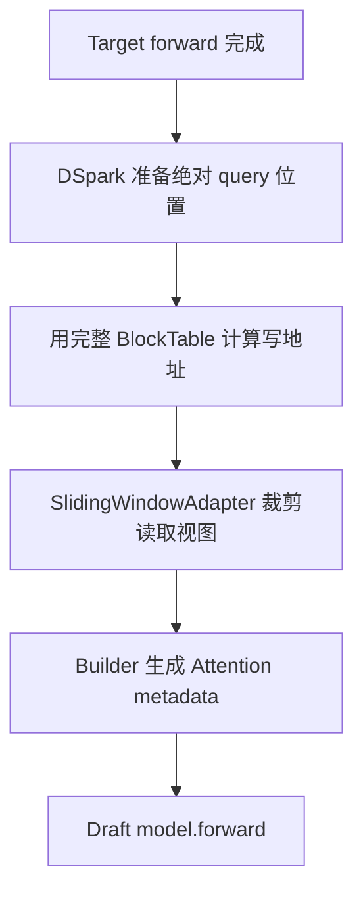
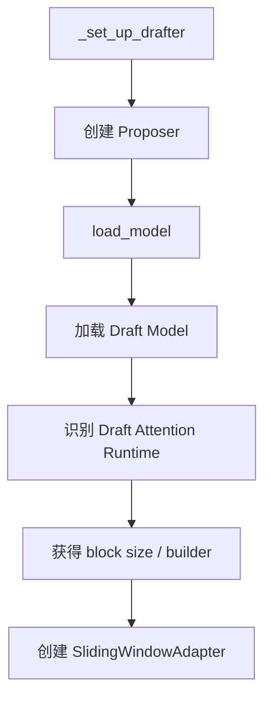
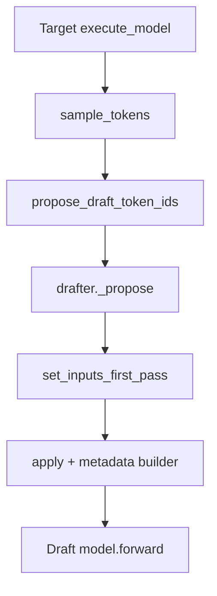
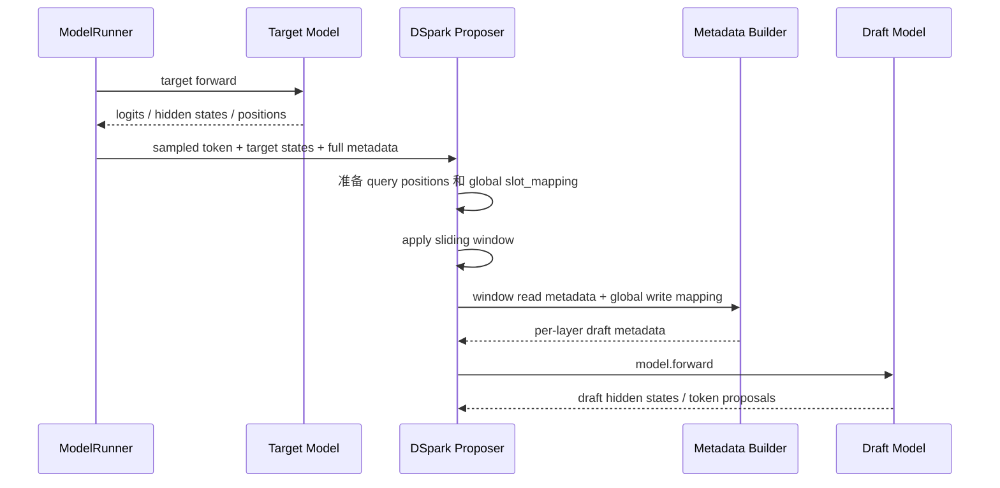
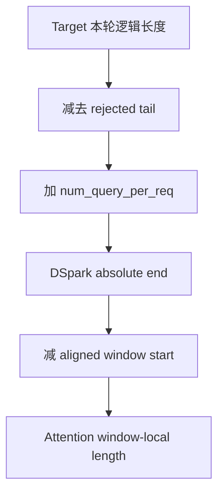
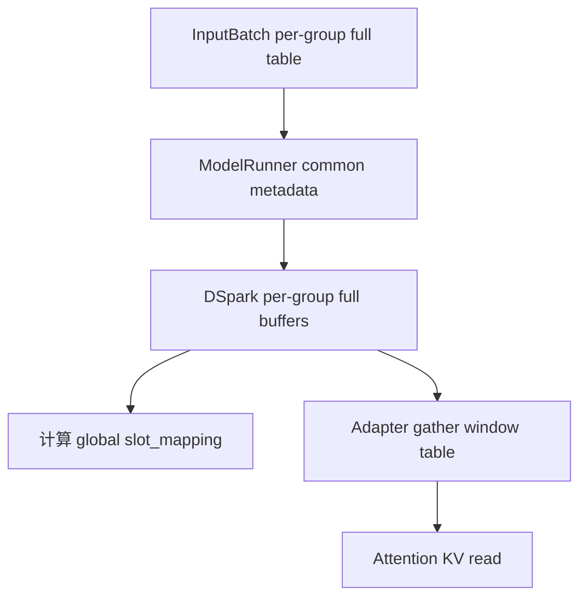
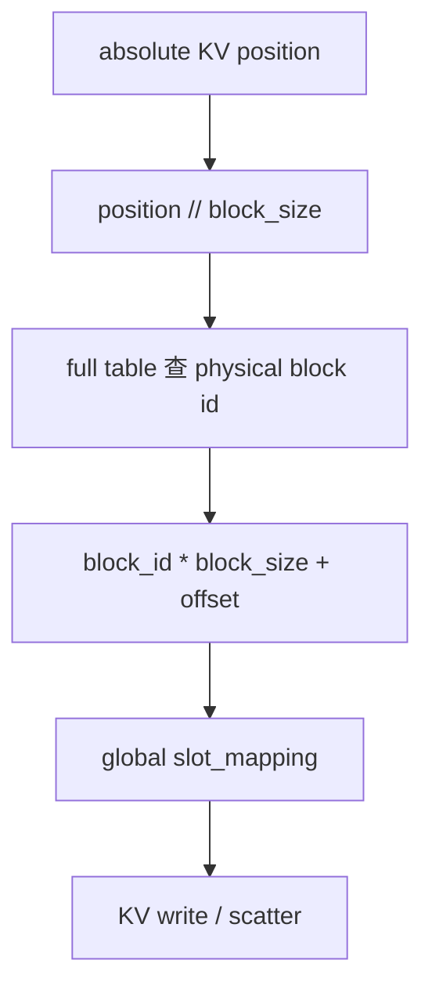
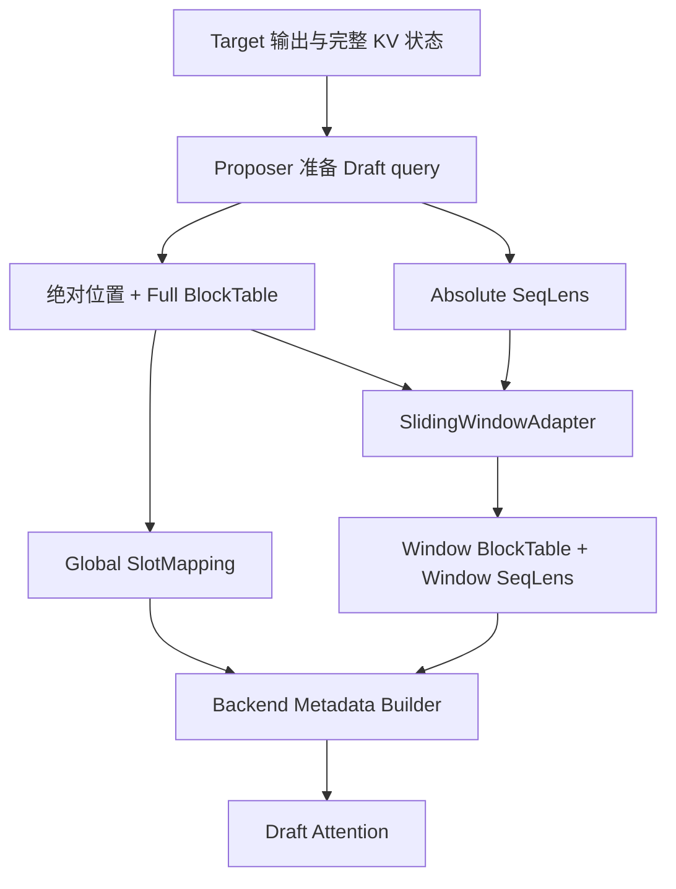

# 阶段 1：`SlidingWindowAdapter`——吃透 MRV1 窗口数学（系统增强版）

> 目标：不是背 MRV1 源码，而是建立一套以后能迁移到 MRV2 的“行为模型”。
>
> 本阶段要做到：
> 1. 看懂 Sliding Window 的数学。
> 2. 知道 `seq_lens / block_table / slot_mapping` 分别代表什么。
> 3. 明白为什么 read 可以 window，而 write 必须保持 global。
> 4. 知道 Adapter 在 MRV1 中何时创建、何时 apply、最终被谁消费。
> 5. 能把 DSpark 的完整数据流画出来。
> 6. 能回答迁移 MRV2 时必须保持哪些不变式。

> 阅读建议：第一次先读“0、4、10、12、13、28”，先形成整体感觉；第二次再读初始化、源码位置和函数卡；真正改 MRV2 代码前，再复习数据生命周期、错误案例和调试清单。

---

## 0. 一页总览：这项功能究竟做了什么

### 0.1 一句话理解

> `SlidingWindowAdapter` 不负责生成 token，也不搬动真实 KV；它把 Draft Attention 使用的 metadata 从“完整历史视图”转换成“最近窗口视图”。

它改变的是 Draft Attention 的读取范围：

```text
完整历史：0 ........................................ 101

窗口视图：                        64 ............... 101
```

它绝不能错误改变新 KV 的真实写入地址：

```text
READ：windowed block_table + windowed seq_lens
WRITE：full-table-based slot_mapping
```

### 0.2 最核心的故事



把它翻译成人话：

1. Target 先正常推理。
2. DSpark 确定本轮 Draft query 位于全局序列的哪些绝对位置。
3. 在完整 KV 世界里，为这些位置算好真实写地址 `slot_mapping`。
4. 再把 Draft Attention 能读取的旧 KV 限制在最近窗口内。
5. Builder 同时接收“局部读取视图”和“全局写地址”。
6. Draft Model 执行时，读历史只读窗口，写新 KV 仍写到全局正确位置。

### 0.3 三种数据绝不能混

| 数据 | 回答的问题 | 是否被窗口化 | 最终消费者 |
|---|---|---:|---|
| `seq_lens` | Attention 认为当前可见 KV 有多长？ | 是 | Attention read |
| `block_table` | 逻辑 KV block 映射到哪个物理 block？ | 是 | Attention read |
| `slot_mapping` | 新 token 的 KV 写到哪个物理 slot？ | 否 | KV write/scatter |

### 0.4 阶段 1 的 Feature Contract

迁移到 MRV2 时必须保持下面这些行为，而不是机械复制 MRV1 类名：

```text
输入：
  absolute seq_lens
  full block table
  global slot_mapping
  window_size
  block_size
  proposer-specific future_offset

输出：
  windowed seq_lens
  windowed block table
  unchanged global slot_mapping

不应改变：
  Target Attention
  真实 KV Cache 内容
  已分配的物理 block
  新 KV 的全局写地址
```

---

## 1. 三个最重要的对象

### 1.1 Proposer

`Proposer` 是草稿推理的总控制器。

```text
NPUModelRunner
    │
    ▼
Proposer
    ├─ Draft Model
    ├─ 输入准备
    ├─ Attention metadata builder
    ├─ KV / slot mapping
    ├─ draft forward
    ├─ draft sampling
    └─ SlidingWindowAdapter
```

记忆：

```text
Proposer = 草稿推理“老板”
Draft Model = 真正做神经网络 forward 的“工人”
SlidingWindowAdapter = 在窗口场景下改 metadata 的“工具”
```

### 1.2 Draft Model

真正执行：

```python
self.model(...)
```

负责 Attention、MLP、hidden states 等模型计算。

### 1.3 SlidingWindowAdapter

它不是模型，只负责：

```text
完整 sequence metadata
        ↓
滑动窗口局部 metadata
```

它不会预测 token，也不会替代 Attention kernel。

---

## 2. `SlidingWindowAdapter.__init__`

```python
def __init__(
    self,
    window_size: int,
    block_size: int,
    max_num_reqs: int,
    future_offset: int,
    device: torch.device,
) -> None:
    self.window_size = window_size
    self.block_size = block_size
    self.window_blocks = (window_size + block_size - 1) // block_size
    self.max_window_blocks = self.window_blocks + 1
    self._future_offset = future_offset
    self._block_table_clone = torch.zeros(
        (max_num_reqs, self.max_window_blocks),
        dtype=torch.int32,
        device=device,
    )
```

| 参数 | 含义 |
|---|---|
| `window_size` | Sliding Window 最多保留多少 token |
| `block_size` | 一个 KV block 包含多少 token |
| `max_num_reqs` | 最大 request 数 |
| `future_offset` | 为得到正确窗口逻辑右边界，当前 `seq_lens` 还差多少 position |
| `device` | 工作 tensor 所在设备 |

### 2.1 `window_blocks`

```python
(window_size + block_size - 1) // block_size
```

就是：

```text
ceil(window_size / block_size)
```

例如：

```text
window_size = 32
block_size = 16
→ window_blocks = 2
```

### 2.2 为什么 `max_window_blocks = window_blocks + 1`

逻辑窗口通常不和 block 边界对齐。

```text
逻辑窗口：
72 ---------------- 103

KV block：
Block 4: 64~79
Block 5: 80~95
Block 6: 96~111
```

虽然窗口只有 32 token，却横跨 3 个 block，所以最坏情况需要多 1 个 block。

### 2.3 `_block_table_clone`

预分配：

```text
[max_num_reqs, max_window_blocks]
```

保存每个 request 当前窗口对应的小型 block table。

```text
完整：
[10,11,12,13,14,15,16]

窗口：
[14,15,16]
```

---

## 3. `future_offset`：最容易误解的变量

### 3.1 它不代表“未来 token 已经存在”

例如：

```text
seq_lens = 100
future_offset = 4
```

未来：

```text
position:
100 101 102 103

token value:
 ?   ?   ?   ?
```

程序知道的是位置，不知道内容。

所以：

> 提前知道未来位置 ≠ 提前知道未来内容。

它不会让当前 token 看见未来 KV，也不会破坏 causal attention。

### 3.2 最准确的定义

> `future_offset` = 为了得到正确的窗口逻辑右边界，当前 `seq_lens` 还差多少 position。

不同 proposer 的 `seq_lens` 语义不同：

```text
EAGLE3:
seq_lens 只包含 context
未来 K 个位置尚未计入
→ future_offset = K

DFlash / DSpark:
input preparation 已把 query stretch 加入 seq_lens
→ future_offset = 0

MTP:
复用 target layer，不直接创建该 Adapter
```

---

## 4. 窗口数学

核心公式：

```python
start = (
    (seq_lens + future_offset - window_size).clamp(min=0)
    // block_size
) * block_size
```

拆开：

```text
seq_lens
   │
   │ + future_offset
   ▼
logical_right
   │
   │ - window_size
   ▼
logical_start
   │
   │ clamp(min=0)
   ▼
非负 logical_start
   │
   │ // block_size * block_size
   ▼
block-aligned actual start
```

### 4.1 完整数值例子

```text
seq_lens = 100
future_offset = 4
window_size = 32
block_size = 16
```

逻辑右边界：

```text
100 + 4 = 104
```

逻辑窗口：

```text
[72, 104)
```

即 token：

```text
72 ~ 103
```

block 对齐：

```text
72 // 16 * 16 = 64
```

因此实际从 absolute token 64 所在 block 开始取。

### 4.2 为什么窗口必须向右推进？

Sliding Window 的定义：

```text
当前位置向右移动
→ 可见历史窗口也向右移动
```

如果实际会走到 127，却仍按旧 `seq_lens=120`：

```text
错误窗口：
88~119

正确窗口：
96~127
```

窗口会整体落后。

---

## 5. `compute_sliding_window_block_table()`

一句话：

> 从 full block table 中裁出当前 window 真正需要的 block。

流程：

```text
seq_lens
  ↓
算 block-aligned start token
  ↓
start_block_index
  ↓
构造 [0,1,2,...]
  ↓
得到每个 req 的 src_cols
  ↓
torch.gather(full_block_table)
  ↓
valid_mask
  ↓
windowed block table
```

### 5.1 完整例子

```text
window_size = 32
block_size = 16
future_offset = 4
seq_len = 100

full block table:
[10,11,12,13,14,15,16]
```

逻辑起点：

```text
100 + 4 - 32 = 72
```

block 对齐：

```text
72 // 16 * 16 = 64
```

起始列：

```text
64 // 16 = 4
```

最多取 3 个 block：

```text
cols = [0,1,2]
```

真实 source columns：

```text
src_cols = [4,5,6]
```

gather：

```text
full:
[10,11,12,13,14,15,16]
             ↑  ↑  ↑

window:
[14,15,16]
```

窗口局部长度：

```text
_windowed_seq_lens
= 100 - 64
= 36
```

注意：

```text
start_block_indices
```

是 block table 的列索引；真正物理 KV block id 是 table 中的值。

---

## 6. `apply()`：把 metadata 变成窗口视图

`apply()` 核心做三件事。

### 6.1 保存 full table

```python
self.full_block_table = common_attn_metadata.block_table_tensor
```

因为后面仍需要 full table 做绝对坐标相关计算。

### 6.2 替换 block table

```text
full:
[10,11,12,13,14,15,16]

→

window:
[14,15,16]
```

### 6.3 替换 `seq_lens`

```text
global seq_len = 100
window-aligned start = 64
windowed seq_len = 36
```

真实 sequence 没变短，只是 Attention 局部坐标变成：

```text
global:
64 65 ... 99

local:
0  1  ... 35
```

同时同步：

```text
seq_lens_cpu
_seq_lens_cpu
seq_lens_cpu_upper_bound
```

避免 NPU/CPU 认知不一致。

一句话：

> `apply()` 把 Attention metadata 从“全局 sequence 视角”改成“滑动窗口局部视角”。

---

## 7. MRV1 初始化链

```text
NPUModelRunner._set_up_drafter()
    ↓
根据 speculative method
创建 Proposer
    ↓
此时还没有 SlidingWindowAdapter


NPUModelRunner.load_model()
    ↓
加载 Target Model
    ↓
drafter.load_model(target_model)
    ↓
加载 Draft Model
    ↓
识别 Draft Attention Runtime Layers
    ↓
得到 backend / KV spec / metadata builder / kernel block size
    ↓
读取 draft_window_size
    ↓
决定 future_offset
    ↓
创建 SlidingWindowAdapter
```

### 7.1 为什么 Proposer 可以先创建？

因为它已经知道：

```text
method
K
device
runner
draft model config
```

### 7.2 为什么 Adapter 必须后创建？

因为需要等 Draft Attention backend 确定后才能知道：

```text
kernel_block_size
```

---

## 8. 为什么 `drafter.load_model(target_model)` 需要 Target Model？

不只是为了 block size。

Draft 与 Target 可能共享：

```text
embedding
lm_head
多模态 token config
部分 runtime state
MTP / EAGLE 结构资源
```

所以 target model 是 Draft Runtime 建立的一部分输入。

---

## 9. 为什么要“找 Draft Attention Layers”？

不是找权重，而是在 vLLM Runtime 中找：

```text
AttentionLayerBase
```

这些对象携带：

```text
attention backend
KV cache spec
metadata builder
kernel block size
attention group
```

典型做法：

```text
加载 Draft 前：
registry = Target attention layers

加载 Draft 后：
registry = Target + Draft attention layers

集合差：
Draft attention layers
```

本质：

> 建立 Draft Attention Runtime。

---

## 10. MRV1 DSpark 最终纵向调用链

```text
NPUModelRunner.execute_model()
        │
        ▼
Target model forward
        │
        ├─ token
        ├─ positions
        ├─ hidden states
        └─ full common metadata
        │
        ▼
sample_tokens()
        │
        ▼
propose_draft_token_ids()
        │
        ▼
drafter._propose()
        │
        ▼
DSpark.set_inputs_first_pass()
        │
        ├─ 修正 rejected tail
        ├─ 生成 DSpark query positions
        ├─ 更新 seq_lens
        ├─ 用 FULL per-group block table
        │   计算 query slot_mapping
        └─ 准备 draft inputs
        │
        ▼
build_draft_attn_metadata()
        │
        ├─ 当前 group FULL block table
        ├─ 当前 group query slot_mapping
        │
        ▼
SlidingWindowAdapter.apply()
        │
        ├─ FULL block_table
        │     ↓
        │   WINDOW block_table
        │
        └─ global seq_lens
              ↓
            windowed seq_lens
        │
        ▼
AscendDSAMetadataBuilder.build_for_drafting()
        │
        ├─ windowed block_table
        ├─ windowed seq_lens
        └─ full-table-based slot_mapping
        │
        ▼
AscendDSAReqMetadata
        │
        ▼
set_ascend_forward_context()
        │
        ▼
draft model.forward()
        │
        ├─ KV READ
        │   → window table + window len
        │
        └─ KV WRITE
            → absolute slot_mapping
```

---

## 11. 三类关键数据：一定不要混

### 11.1 `seq_lens`

回答：

> Attention 当前认为有效 KV 长度是多少？

DSpark 生命周期：

```text
Target seq_len
    ↓
减 rejected tail
    ↓
+ num_query_per_req
    ↓
得到 DSpark 本轮绝对 KV 终点
    ↓
SlidingWindowAdapter
    ↓
变成 window-local seq_len
    ↓
Attention read length
```

### 11.2 `block_table`

回答：

> 逻辑 block 对应哪个物理 KV block？

```text
InputBatch full block table
    ↓
per-group full block table
    ↓
先用于计算 absolute slot_mapping
    ↓
当前 group 进入 apply()
    ↓
windowed block table
    ↓
Attention read
```

### 11.3 `slot_mapping`

回答：

> 新 token 的 KV 到底写到哪个物理 slot？

```text
absolute_kv_position
    ↓
column = position // block_size
    ↓
block_id = full_block_table[column]
    ↓
slot = block_id * block_size + offset
```

它必须基于 full table。

---

## 12. 最重要的不变式：READ windowed，WRITE global

### READ

Attention 只需要最近的可见 KV：

```text
windowed block_table
+
windowed seq_lens
```

### WRITE

新 token 的 KV 必须写到真实全局物理位置：

```text
full-table-based slot_mapping
```

一句话：

> **Sliding Window 改的是“Draft Attention 可以回头看多远”，不是“新产生的 KV 在整个 KV Cache 世界里写到哪里”。**

---

## 13. 一个完整数字例子：Target → DSpark → Sliding Window → Attention

假设：

```text
Target metadata seq_len = 100
rejected = 2
num_query_per_req = 4
window_size = 32
block_size = 16
```

### 第一步：有效 Target 长度

```text
100 - 2 = 98
```

### 第二步：DSpark query positions

```text
98
99
100
101
```

所以：

```text
cad.seq_lens
= 98 + 4
= 102
```

这不代表 4 个 draft token 内容已存在，只代表本轮 KV 布局规划的逻辑终点。

### 第三步：先算 WRITE 地址

对 position 100：

```text
100 // 16 = 6
```

去 full block table column 6 查物理 block id：

```text
slot = block_id * 16 + 100 % 16
```

得到 `slot_mapping`。

### 第四步：再裁 READ window

```text
102 - 32 = 70
70 // 16 * 16 = 64
```

窗口局部长度：

```text
102 - 64 = 38
```

Adapter 后：

```text
seq_lens:
102 → 38

block_table:
FULL → absolute 64 开始的 WINDOW table

slot_mapping:
保持不变
```

### 第五步：Attention

```text
KV READ:
window table + window len

KV WRITE:
slot_mapping
```

---

## 14. 为什么 DSpark 的 apply 比 EAGLE/DFlash 晚？

DSpark 有 per-group full block table。

如果过早：

```text
FULL
↓
apply
↓
WINDOW
```

后面 DSpark 又：

```text
block_table_tensor = per_group_full_table
```

就会把窗口表覆盖回 FULL。

更糟的是：

```text
seq_lens 已 windowed
+
block_table 又 FULL
```

坐标系不一致。

所以必须：

```text
先选当前 group FULL table
↓
装入当前 group query slot_mapping
↓
apply()
↓
立刻 builder
```

本质：

> DSpark 不是窗口数学不同，而是 per-group block table 的选择时机更晚。

---

## 15. Metadata Builder 是干什么的？

Adapter 只是改：

```text
common_attn_metadata
```

Builder 把：

```text
seq_lens
block_table
slot_mapping
```

翻译成 backend 真正认识的：

```text
AscendDSAReqMetadata
```

即：

> 通用 metadata → DSA kernel metadata。

---

## 16. `set_forward_context()` 是干什么的？

`self.model(...)` 并没有显式传 `attn_metadata`。

所以系统先：

```text
set_ascend_forward_context()
```

把 per-layer metadata 放到执行上下文。

模型内部 Attention 层：

```text
get_forward_context()
↓
按 layer_name 取 metadata
```

可以理解为：

> “先把 Attention 参数放桌面上，model.forward 内部的 Attention 层自己来取。”

---

## 17. 阶段 1 最核心的 6 条结论

1. `future_offset` 是**为了得到正确窗口右边界，当前 `seq_lens` 还差多少 position**。
2. DSpark 进入 Adapter 前已把 `num_query_per_req` 加入 `seq_lens`，所以 `future_offset=0`。
3. DSpark 必须先用 full per-group block table + absolute KV position 算 `slot_mapping`。
4. `SlidingWindowAdapter` 修改 read 侧：`block_table + seq_lens`；不改 `slot_mapping`。
5. DSpark 必须在选定当前 per-group full block table 后再 apply。
6. 最终 Attention：
   - READ → windowed table + windowed length
   - WRITE → full-table-based slot mapping

---

## 18. 阶段 1 停止条件

进入 MRV2 前，只需能回答：

```text
1. Target output 怎么进入 drafter？
2. DSpark input_ids / positions 怎么生成？
3. common_attn_metadata 从哪里来？
4. apply 前 seq_lens 的准确语义是什么？
5. full block table 从哪里来？
6. slot_mapping 为什么必须提前用 full table 生成？
7. SlidingWindowAdapter.apply() 在哪里调用？
8. windowed metadata 被哪个 builder 消费？
9. set_forward_context 起什么作用？
10. Draft model.forward 内 READ / WRITE 最终分别消费什么？
```

能回答这些：

> 阶段 1 就够了，不需要继续横向学习 MRV1。

---

## 19. 下一阶段：MRV2 推荐阅读路径

```text
阶段 2：MRV2 architecture

2.1 MRV2 ModelRunner → Speculator 总入口
2.2 AscendDSparkSpeculator
2.3 _build_attn_metadata / builder inputs
2.4 AscendBlockTables
    - full table
    - kernel table
    - slot_mapping
2.5 AscendInputBuffers / request state
    - NPU seq_lens
    - CPU seq_lens
    - NumPy mirror
    - authoritative state

阶段 3：
先设计 Eager sliding-window path

阶段 4：
ACL Graph / persistent buffer / static address

阶段 5：
边界、精度、eager/graph、性能验证
```

---

## 20. 后续增量维护约定

后续继续讨论时：

- 新 MRV1 细节：补到“阶段 1”对应小节。
- 进入 MRV2：新增“阶段 2：MRV2 调用链和映射”。
- 开始修改代码：新增“阶段 3：设计与修改点”。
- 完成测试：新增“阶段 4：验证、性能、问题与结论”。

本文件保持“看一遍就能重新建立完整心智模型”的结构化风格。

---

## 21. 源码导航：从哪里开始看、每处看什么

> 行号来自本次学习时的 checkout。源码后续增删会导致行号漂移，因此应优先用“文件 + 类名/函数名 + 关键语句”定位。

| 顺序 | 文件 | 类/函数 | 阅读目的 |
|---:|---|---|---|
| 1 | `vllm_ascend/worker/model_runner_v1.py` | `_set_up_drafter()` | 看不同 speculative method 如何选择 Proposer |
| 2 | `vllm_ascend/worker/model_runner_v1.py` | `load_model()` | 看 Target 加载后如何触发 `drafter.load_model(target_model)` |
| 3 | `vllm_ascend/spec_decode/llm_base_proposer.py` | `AscendSpecDecodeBaseProposer.load_model()` | 看 Draft Attention Runtime 和 Adapter 初始化 |
| 4 | `vllm_ascend/worker/model_runner_v1.py` | `execute_model()` | 看 Target forward 和 `ExecuteModelState` |
| 5 | 同上 | `sample_tokens()` | 看采样后如何触发 draft proposal |
| 6 | 同上 | `propose_draft_token_ids()` | 看 ModelRunner 跨入 Proposer 的桥梁 |
| 7 | `vllm_ascend/spec_decode/llm_base_proposer.py` | `_propose()` | 看 Draft 流程总编排 |
| 8 | `vllm_ascend/spec_decode/dspark_proposer.py` | `set_inputs_first_pass()` | 看 DSpark query、长度和写地址如何准备 |
| 9 | `vllm_ascend/ops/triton/spec_decode/utils.py` | `copy_and_expand_dflash_and_dspark_inputs_kernel()` | 看 absolute position 如何变成 `slot_mapping` |
| 10 | `vllm_ascend/spec_decode/llm_base_proposer.py` | `build_draft_attn_metadata()` | 看 DSpark 的真实 `apply()` 时机 |
| 11 | `SlidingWindowAdapter` 所在文件 | `compute_sliding_window_block_table()` / `apply()` | 看窗口数学和 metadata 改写 |
| 12 | `vllm_ascend/attention/dsa_v1.py` | `AscendDSAMetadataBuilder.build_for_drafting()` | 看窗口结果如何进入 backend metadata |
| 13 | `vllm_ascend/ascend_forward_context.py` | `set_ascend_forward_context()` | 看 metadata 如何安装进执行上下文 |
| 14 | `vllm_ascend/spec_decode/llm_base_proposer.py` | `_run_merged_draft()` | 看 Draft Model 真正 forward |
| 15 | `vllm_ascend/ops/dsa.py`、`attention/dsa_v1.py` | `dsa_forward()` / `_forward_attention()` | 看 read/write 各自消费什么 |

推荐的搜索方式：

```bash
rg -n "class SlidingWindowAdapter|def apply|compute_sliding_window" vllm_ascend
rg -n "def _set_up_drafter|def propose_draft_token_ids" vllm_ascend
rg -n "set_inputs_first_pass|build_draft_attn_metadata" vllm_ascend/spec_decode
rg -n "build_for_drafting|build_req_metadata_for_drafting" vllm_ascend/attention
rg -n "set_ascend_forward_context|get_forward_context" vllm_ascend
```

### 21.1 初始化链和运行链要分开看

初始化链回答“工具怎么准备好”：



运行链回答“每轮怎么使用”：



不要把两条链混起来：Adapter 在初始化期被创建，在运行期被反复调用。

---

## 22. 初始化期详解：为什么先有 Proposer，后有 Adapter

### 22.1 Proposer 是“系统”，Adapter 是“零件”

创建 Proposer 时，已经知道：

```text
speculative method
num_speculative_tokens
device
draft model config
ModelRunner 引用
```

所以可以先建立“草稿推理控制器”。

但 Adapter 还缺一个关键参数：

```text
Draft Attention kernel 使用的 block_size
```

这个值必须等 Draft Model 加载、Draft Attention 层注册、backend 确定以后才能可靠获取。因此初始化顺序是：

```text
先创建 Proposer 壳子
    ↓
加载 Target Model
    ↓
drafter.load_model(target_model)
    ↓
加载 Draft Model
    ↓
找出 Draft Attention Runtime Layers
    ↓
获得 backend / KV spec / builder / kernel block size
    ↓
创建 SlidingWindowAdapter
```

### 22.2 为什么 `drafter.load_model(target_model)` 要传 Target Model

它并不只是为了读取 block size。Draft Runtime 可能复用或依赖 Target 的：

```text
embedding
lm_head
辅助 hidden states
多模态配置
MTP/EAGLE 共享结构
部分运行时资源
```

所以更准确的理解是：

> `target_model` 是建立 Draft Runtime 的输入之一，而不仅是一个查询参数的对象。

### 22.3 为什么要找 Draft Attention Layers

这里找的不是 checkpoint 里的权重名字，而是运行时的 `AttentionLayerBase` 对象。它们携带：

```text
attention backend
KV cache spec
metadata builder
kernel block size
attention group / layer names
```

一种常见识别思路是：

```text
加载 Draft 前 registry = Target Attention layers
加载 Draft 后 registry = Target + Draft Attention layers
集合差             = Draft Attention layers
```

这一步的本质是：建立 Draft Attention 的运行时环境。

---

## 23. 窗口数学再拆一遍：四个边界、两个坐标系

### 23.1 四个边界

核心公式：

```python
logical_right = seq_lens + future_offset
logical_start = max(logical_right - window_size, 0)
aligned_start = logical_start // block_size * block_size
windowed_seq_len = seq_lens - aligned_start
```

注意这里存在四个不同概念：

| 名称 | 含义 |
|---|---|
| `seq_lens` | 当前 metadata 已经表达到的序列长度 |
| `logical_right` | 本轮窗口逻辑上必须考虑到的右边界（右开） |
| `logical_start` | 恰好保留 `window_size` 个位置时的理想左边界 |
| `aligned_start` | 为了按 block 取数据而向左对齐后的实际起点 |

### 23.2 为什么使用右开区间

当：

```text
logical_right = 104
window_size = 32
```

逻辑窗口写成：

```text
[72, 104)
```

包含的 token position 是：

```text
72, 73, ..., 103
```

个数：

```text
104 - 72 = 32
```

右开区间能让“长度 = 右边界 - 左边界”，减少 off-by-one 错误。

### 23.3 两个坐标系

全局坐标：

```text
absolute position: 64 65 66 ... 100 101
```

窗口局部坐标：

```text
local position:     0  1  2 ...  36  37
```

Adapter 做的是建立一个局部视图：

```text
global position 64  → local position 0
global position 100 → local position 36
```

真实请求没有变短，真实 token position 也没有重新编号；变化的只是 Attention metadata 的视角。

---

## 24. 五个完整数字例子

### 24.1 例子 A：短序列，小于窗口

```text
seq_lens = 20
future_offset = 0
window_size = 32
block_size = 16
```

计算：

```text
logical_right = 20
logical_start = max(20 - 32, 0) = 0
aligned_start = 0
windowed_seq_len = 20 - 0 = 20
```

结论：尚未超过窗口，不需要丢弃任何历史 block。

```text
原始：  [0........................19]
窗口：  [0........................19]
```

### 24.2 例子 B：逻辑起点刚好 block 对齐

```text
seq_lens = 96
future_offset = 0
window_size = 32
block_size = 16
```

计算：

```text
logical_start = 96 - 32 = 64
aligned_start = 64
windowed_seq_len = 96 - 64 = 32
```

恰好需要两个 block：

```text
Block 4: 64~79
Block 5: 80~95
```

此时不需要额外的 `+1 block`，但 buffer 必须为最坏的不对齐情况预留空间。

### 24.3 例子 C：逻辑起点不对齐，因此多保留一小段

```text
seq_lens = 100
future_offset = 4
window_size = 32
block_size = 16
```

计算：

```text
logical_right = 104
logical_start = 72
aligned_start = 64
```

逻辑真正需要：

```text
72~103，共 32 个位置
```

物理 block 必须取：

```text
Block 4: 64~79
Block 5: 80~95
Block 6: 96~111
```

因此取了三个 block。多取到的 `64~71` 不代表一定对 Attention 可见；后端仍可结合准确序列长度、mask 或索引限制逻辑窗口。Adapter 首先解决的是 block 粒度的数据可达性。

### 24.4 例子 D：完整 BlockTable 裁成窗口表

假设：

```text
full block table = [10, 3, 21, 8, 14, 6, 19]
start_block_index = 4
max_window_blocks = 3
```

注意，表的“列”和表中的“物理 block id”不是一回事：

```text
逻辑列：          0   1   2  3   4  5   6
物理 block id： [10,  3, 21, 8, 14, 6, 19]
                              ↑  ↑   ↑
```

gather 后：

```text
window block table = [14, 6, 19]
```

`start_block_index=4` 的含义是“从完整表第 4 列开始”，并不是“物理 block id 为 4”。

### 24.5 例子 E：为什么窗口表不能计算全局写地址

假设：

```text
block_size = 4
absolute position = 5
full block table = [9, 17, 3, ...]
```

正确写地址：

```text
block column = 5 // 4 = 1
physical block id = full_block_table[1] = 17
offset in block = 5 % 4 = 1
slot = 17 * 4 + 1 = 69
```

现在假设窗口从 full table 第 1 列开始：

```text
window table = [17, 3, ...]
```

窗口表的列 0 才对应全局列 1。如果仍用绝对位置 5：

```text
5 // 4 = 1
```

程序会错误读取：

```text
window_table[1] = 3
```

错误 slot：

```text
3 * 4 + 1 = 13
```

正确是 69，错误变成 13。这不是轻微偏差，而是把 KV 写进了完全不同的物理位置。

---

## 25. `future_offset` 的物理意义与方法差异

### 25.1 最准确的判断问题

不要问：

> 这个 method 一次 draft 几个 token，所以 offset 是多少？

应该问：

> Adapter 执行这一刻，`seq_lens` 已经包含本轮将参与 Draft Attention 的 query stretch 了吗？

如果没包含，需要 `future_offset` 补上；如果已经包含，offset 就是 0。

### 25.2 对照

| Method | Adapter 执行前 `seq_lens` 的典型语义 | `future_offset` |
|---|---|---:|
| EAGLE3 | 仍偏向 context-only，未来 K 个 draft positions 尚未体现在长度里 | `K` |
| DFlash | input preparation 已把 query stretch 加入 | `0` |
| DSpark | `effective_seq_lens + num_query_per_req` | `0` |
| MTP | 当前 MRV1 路径不直接创建该 Adapter | 不适用 |

这里描述的是本次 checkout 的行为模型。以后源码变动时，应重新检查 `apply()` 前的实际长度语义，不能死记方法名。

### 25.3 为什么不破坏因果性

`future_offset` 只参与 metadata 的窗口边界计算：

```text
知道未来要使用 position 100、101、102、103
```

不等于：

```text
知道这些位置未来会是什么 token
```

真正能否互相看见，仍由 Draft Attention 的 query layout、causal/non-causal 语义和 mask 决定。位置规划和内容可见性是两件不同的事情。

---

## 26. DSpark 运行期：完整时序与数据流



### 26.1 Target 阶段

`NPUModelRunner.execute_model()` 完成：

```text
准备 target inputs
构造 target attention metadata
安装 target forward context
执行 target model forward
保存 logits / hidden states / aux hidden states / positions
```

这些输出暂存在 `ExecuteModelState`，供 `sample_tokens()` 使用。

### 26.2 ModelRunner 跨入 Proposer

```text
sample_tokens()
  → target sampler / rejection sampler
  → propose_draft_token_ids()
  → self.drafter._propose(...)
```

`propose_draft_token_ids()` 负责把下面几类数据成套传入：

| 数据 | 来源 | DSpark 用途 |
|---|---|---|
| `next_token_ids` | Target 采样结果 | 第一个真实 Draft query token |
| `target_positions` | Target input buffer | 生成后续 query positions |
| `target_hidden_states` | Target 辅助层输出 | 合并后预计算 Draft context KV |
| `common_attn_metadata` | Target metadata 构造过程 | 提供长度、块表、slot 等基础状态 |
| rejection 信息 | rejection sampler | 修正仍留在 padding 中的无效尾部 |

### 26.3 DSpark 第一轮输入准备

`set_inputs_first_pass()` 做的不是“直接推理”，而是布置 Draft 世界：

```text
修正有效 Target 终点
生成 DSpark query input_ids
生成 context/query positions
按 group 保存完整 block table
用完整 block table 生成 query slot_mapping
更新 seq_lens 为 query block 结束后的绝对长度
准备采样索引和 query layout
```

DSpark query block 通常可以理解为：

```text
第 0 个 query：真实 next token
后续 query：并行 drafting 占位 token
```

### 26.4 为什么 Target hidden states 还要写 Draft context KV

DSpark 不只拿 Target 的 token。它还会把 Target 辅助层 hidden states：

```text
aux hidden states
  → concatenate / combine_hidden_states
  → Draft 所需 hidden size
  → precompute_and_store_context_kv
  → Draft KV Cache
```

这条路径使用 context slot mapping 写 KV，同样要求全局物理地址正确。

### 26.5 DSpark 的真实 apply 点

每个 Draft Attention/KV group 都要执行：

```text
选当前 group 的 full block table
    ↓
选当前 group 的 query slot_mapping
    ↓
SlidingWindowAdapter.apply()
    ↓
当前 group 的 metadata builder
```

伪代码：

```python
cad = copy.copy(common_attn_metadata)
cad.block_table_tensor = per_group_full_block_table
cad.slot_mapping = per_group_query_slot_mapping

self.sliding_window.apply(cad)

attn_metadata = builder.build_for_drafting(cad, ...)
```

这里的浅拷贝主要隔离当前 group 对 metadata 字段引用的替换；它不会深拷贝所有 tensor。

### 26.6 为什么不能在公共位置提前 apply

如果提前窗口化：

```text
FULL table
  → apply
WINDOW table
```

但 DSpark 后面又覆盖：

```text
cad.block_table_tensor = per_group_full_block_table
```

就会得到危险组合：

```text
windowed seq_lens
+
full block table（从全局列 0 开始）
```

Builder 会把最近窗口误映射到序列开头。因此 DSpark 必须在“最后一次选择当前 group 完整表”之后 apply，并立刻交给 Builder。

---

## 27. 三类数据的完整生命周期

### 27.1 `seq_lens`



详细语义：

```text
ModelRunner._prepare_inputs
  → target 本轮调度后的逻辑长度

prepare_inputs_padded
  → 被拒绝的尾部可能暂时仍作为 padding 保留

DSpark.set_inputs_first_pass
  → effective = seq_lens - rejected
  → seq_lens = effective + num_query_per_req

SlidingWindowAdapter.apply
  → seq_lens = absolute_end - aligned_start

Metadata Builder / Attention
  → 作为窗口局部 KV read length
```

### 27.2 `block_table`



一个完整表同时有两种用途：

```text
用途 1：在裁窗前，根据 absolute position 计算写地址
用途 2：裁出窗口表，供 Draft Attention 读取历史
```

### 27.3 `slot_mapping`



生命周期中 Adapter 不应修改它：

```text
query absolute position
  → full per-group block table
  → query slot_mapping buffer
  → common metadata.slot_mapping
  → Adapter 原样保留
  → Backend metadata
  → KV write
```

---

## 28. 一个从 Target 到 Draft Attention 的端到端例子

假设一条请求在 Target metadata 中：

```text
seq_len = 100
rejected = 2
num_query_per_req = 4
window_size = 32
block_size = 16
```

为了让物理地址更具体，再假设 full block table 是：

```text
逻辑列：          0   1   2   3   4   5   6
物理 block id： [41,  7, 28, 13, 52,  9, 34]
```

### Step 1：修正被拒绝的尾部

```text
effective_seq_len = 100 - 2 = 98
```

这里的 98 表示真正保留的 Target 序列长度，最后一个已有 position 是 97。

### Step 2：建立四个 DSpark query 位置

```text
query positions = 98, 99, 100, 101
```

本轮结束后的绝对右边界：

```text
seq_lens = 98 + 4 = 102
```

这表示布局规划到 position 101，并不表示四个 token 的最终内容已经被 Target 接受。

### Step 3：先计算全局写地址

以 position 100 为例：

```text
block column = 100 // 16 = 6
physical block id = full_table[6] = 34
offset = 100 % 16 = 4
slot = 34 * 16 + 4 = 548
```

所以 position 100 的 Draft KV 应写入物理 slot 548。

四个 query 的写地址全部在完整表坐标系中确定并保存。

### Step 4：计算读取窗口

DSpark 的 `seq_lens=102` 已含 query stretch，所以 `future_offset=0`：

```text
logical_start = 102 - 32 = 70
aligned_start = 70 // 16 * 16 = 64
start_block_column = 64 // 16 = 4
```

从完整表第 4 列开始 gather：

```text
full:   [41, 7, 28, 13, 52, 9, 34]
                         ↑   ↑  ↑
window:                 [52, 9, 34]
```

窗口局部长度：

```text
windowed_seq_len = 102 - 64 = 38
```

### Step 5：Builder 看到的最终组合

```text
block_table = [52, 9, 34]       # 读取窗口
seq_lens = 38                   # 从 absolute 64 起的局部长度
slot_mapping(position 100)=548  # 全局写地址
```

### Step 6：Draft Attention 真正执行

```text
READ：
Q(position 100)
  → window table [52, 9, 34]
  → window-local length 38
  → 最近历史 KV

WRITE：
K/V(position 100)
  → slot_mapping 548
  → 全局物理 KV Cache
```

这个例子把整个功能浓缩为：

> **先在完整世界确定门牌号，再裁一张局部地图供 Attention 看历史。**

---

## 29. Adapter 前后状态对照

| 字段 | `apply()` 前 | `apply()` 后 | 真实世界是否改变 |
|---|---|---|---:|
| `seq_lens` | 本轮 Draft 布局的绝对右边界 | 从对齐窗口起点计算的局部长度 | 否 |
| `block_table_tensor` | 当前 group 的完整块表 | 当前 group 的窗口块表 | 否，只换视图 |
| `slot_mapping` | 基于完整表生成的全局写地址 | 原样保留 | 否 |
| `positions` | Draft query 的绝对位置 | 原样保留 | 否 |
| KV Cache 内容 | 已有全局 KV | 不移动、不复制 | 否 |
| Target metadata | Target forward 所需视图 | 不应被 Draft 窗口污染 | 否 |

### 29.1 `apply()` 为什么要同步 CPU 字段

如果只改 NPU tensor，不同步：

```text
NPU 认为 seq_len = 38
CPU 认为 seq_len = 102
```

后续 Builder、shape 选择、图捕获或辅助逻辑可能使用不同来源，形成隐蔽错误。因此 MRV1 `apply()` 还要维护相关 CPU/private mirror 和 upper-bound 字段的一致语义。

这里要记住：同步不是“多做几次同样的赋值”，而是保证不同消费者看到的是同一个窗口世界。

---

## 30. Metadata Builder、Forward Context、Attention 的职责边界

### 30.1 Adapter

```text
职责：改通用 metadata 的视图
不负责：调用 kernel、执行 Attention、生成 token
```

### 30.2 Metadata Builder

```text
输入：
  windowed seq_lens
  windowed block_table
  global slot_mapping

输出：
  backend-specific request metadata
  例如 AscendDSAReqMetadata
```

可以把它理解为“翻译器”：

```text
通用调度/缓存语言
       ↓
Attention backend 能直接消费的语言
```

### 30.3 Forward Context

`self.model(input_ids=..., positions=...)` 通常没有显式传入 `attn_metadata`，因为 metadata 已经提前安装进执行上下文：

```text
set_ascend_forward_context(...)
      ↓
forward_context.attn_metadata
      ↓
每个 Attention layer 按 layer_name 取自己的 metadata
```

通俗比喻：

> Builder 把资料整理成每个部门能看的表；Forward Context 把表放到共享工作台；Attention 层执行时按自己的名字把表取走。

### 30.4 Attention kernel

最终分工：

```text
KV write/prolog：slot_mapping
KV read：block_table + seq_lens / seqused_kv
```

这就是 READ/WRITE 不变式能够在底层落地的证据。

---

## 31. 真实对话中最容易形成的误区

### 误区 1：`future_offset` 表示已经生成的未来 token

**错误理解：** offset 为 4，就好像未来四个 token 已经存在。

**正确理解：** 已知的是未来位置范围，不是 token 内容；offset 只补偿窗口右边界。

### 误区 2：Sliding Window 把真实序列截断了

**错误理解：** `seq_lens` 从 102 变成 38，说明前 64 个 token 被删除。

**正确理解：** 真实 sequence 和 KV Cache 都还在，只是 Draft Attention 使用从 absolute 64 开始的局部视图。

### 误区 3：window size 是 32，就永远只需 2 个 16-token block

**错误理解：** `32 / 16 = 2`，buffer 两列足够。

**正确理解：** 窗口起点可能落在 block 中间，因此最坏横跨 3 个 block，需要 `ceil(window/block)+1`。

### 误区 4：`start_block_indices` 是物理 block id

**错误理解：** `start_block_index=4` 就去找物理 block 4。

**正确理解：** 它是完整 block table 的列号；物理 block id 是该列中的值。

### 误区 5：窗口表也能算 `slot_mapping`

**错误理解：** 反正窗口表也包含当前 token 所在物理 block。

**正确理解：** 窗口表的列坐标已经平移，绝对位置不能直接索引它；写地址必须基于完整表或显式补偿后的坐标计算。

### 误区 6：所有 proposer 的 `future_offset` 都等于 K

**错误理解：** 一次 draft K 个，所以统一 `future_offset=K`。

**正确理解：** 要看 apply 前 `seq_lens` 是否已经包含 query stretch。DSpark/DFlash 已包含时为 0。

### 误区 7：DSpark 可以在公共位置提前 apply

**错误理解：** 窗口数学相同，统一放在公共代码最简洁。

**正确理解：** DSpark 后面还会逐 group 覆盖 block table。必须在最后一次装入 per-group full table 后 apply。

### 误区 8：Builder 自己会自动理解 Sliding Window

**错误理解：** 只传 `window_size`，Builder 自然能推导。

**正确理解：** MRV1 Adapter 先明确改写通用 metadata；Builder 消费的是已经窗口化的长度和块表。

### 误区 9：看到 `copy.copy(metadata)` 就认为所有 tensor 都复制了

**错误理解：** 每个 group 都有全套深拷贝数据。

**正确理解：** 浅拷贝只复制 Python 容器，tensor 仍共享引用；随后字段会被指向当前 group/persistent buffer。

---

## 32. 如果实现出错，通常会出现什么现象

| 错误 | 可能表现 |
|---|---|
| 窗口右边界少算 future positions | 窗口整体落后，保留旧 KV、丢掉本应可见的新位置 |
| logical start 未 clamp 到 0 | 短序列产生负索引或错误 gather |
| 没有向 block 边界对齐 | block table 无法覆盖逻辑窗口开头 |
| buffer 少预留一个 block | 非对齐窗口下丢 block 或越界 |
| 用窗口表算 slot mapping | KV 写错物理 block、精度异常甚至越界 |
| apply 后又覆盖回 full table | windowed length 与 full table 坐标不匹配 |
| 只更新设备长度，不更新需要的 host mirror | Builder/shape/graph 路径行为不一致 |
| 不区分 per-group block table | 某些层读取错误 KV group |
| 每步重新分配窗口 tensor | ACL Graph 地址不稳定、性能下降或 capture 失败 |

### 32.1 最危险的错误

最危险的不是立刻 crash，而是：

```text
程序能跑
输出语言也像正常文本
但 KV 读写坐标存在细微错误
导致接受率、精度或长序列行为异常
```

因此不能只看“服务拉起来了”，必须检查边界用例、slot mapping 和输出对照。

---

## 33. 调试与验证清单

### 33.1 建议打印/断言的中间量

对一个很小的 batch，记录：

```text
request id
原始 seq_lens
rejected token count
effective seq_lens
num_query_per_req
adapter 前 seq_lens
future_offset
logical_start
aligned_start
start_block_index
full block table
window block table
query absolute positions
slot_mapping
adapter 后 seq_lens
```

### 33.2 关键断言

```text
aligned_start % block_size == 0
aligned_start <= logical_start
logical_start - aligned_start < block_size
window table 来自 full table 的连续列
slot_mapping 在 apply 前后保持不变
短序列 start == 0
每个 group 使用自己的 full/window table
```

### 33.3 最小边界矩阵

设 `window_size=32`、`block_size=16`：

```text
seq_len = 0, 1, 15, 16, 17
seq_len = 31, 32, 33
seq_len = 47, 48, 49
seq_len = 63, 64, 65
future_offset = 0, 1, K
rejected = 0, 1, K-1
batch = 1, 2+
```

重点观察：

```text
window boundary ±1
block boundary ±1
```

### 33.4 功能对照

```text
同一输入：
window disabled
vs
window enabled（window 足够大，理论上等价）
```

如果 window 大于完整上下文，两个结果应保持一致；这是很有价值的 sanity check。

---

## 34. 问题闭环：我当时困惑什么，现在应怎样回答

| 当时真正困惑的问题 | 最终理解 |
|---|---|
| `future_offset` 为什么要看未来？ | 看的是未来位置边界，不是未来 token 内容；用于修正窗口右边界 |
| 为什么窗口会多取一个 block？ | 逻辑起点可能位于 block 中间，向左对齐会额外覆盖一个 block |
| `apply()` 到底改了什么？ | 把 `block_table + seq_lens` 改成局部读取视图，保留 `slot_mapping` |
| Proposer 和 Adapter 有什么区别？ | Proposer 编排整个 Draft 推理；Adapter 只是其中负责 metadata 窗口化的工具 |
| 为什么 Proposer 先创建、Adapter 后创建？ | Adapter 需要 Draft Attention backend 确定后的 kernel block size |
| 为什么 `load_model` 要传 Target Model？ | Draft Runtime 可能共享 Target 资源并消费 Target hidden states，不只是为了 block size |
| 为什么还要找 Draft Attention layers？ | 为了取得运行时 backend、KV spec、builder、block size 和 group 信息 |
| DSpark 为什么 `future_offset=0`？ | `set_inputs_first_pass()` 已把 `num_query_per_req` 加进 `seq_lens` |
| DSpark 为什么 apply 得更晚？ | 它在 Builder 前才逐 group 装入完整 block table，必须在最后一次覆盖后裁窗 |
| 为什么 `slot_mapping` 不能窗口化？ | 它表达新 KV 的绝对物理写地址；窗口表列坐标已平移 |
| Builder 的作用是什么？ | 把通用 metadata 翻译为 Attention backend 真正消费的数据结构 |
| `model.forward()` 没传 metadata，Attention 怎么拿到？ | metadata 预先安装在 forward context，Attention 层按 layer name 获取 |

---

## 35. 自测题：能独立回答才算真正吃透

1. 给出 `seq_lens=100`、`future_offset=4`、`window_size=32`、`block_size=16`，算出逻辑起点、对齐起点和窗口局部长度。
2. 为什么逻辑窗口只需 32 个 token，却可能需要 3 个 block？
3. `full block table=[10,3,21,8,14,6,19]`，起始列为 4，窗口表是什么？
4. `block_size=4`、绝对 position=5、full table 第 1 列为物理 block 17，slot 是多少？
5. 为什么提前知道未来 position 不代表违反 causal attention？
6. DSpark 的 adapter 为什么用 `future_offset=0`？
7. `apply()` 前后哪三个字段变化或不变化？
8. 为什么 DSpark 不能使用 EAGLE/DFlash 的公共 apply 点？
9. Target hidden states 怎样进入 Draft KV Cache？
10. Builder、Forward Context、Attention kernel 三者各负责什么？
11. 如果 `windowed seq_lens` 配上从列 0 开始的 full table，会发生什么语义错误？
12. 迁移到 MRV2 时，哪些是必须保持的行为，哪些 MRV1 类名不必照搬？

参考答案关键词：

```text
1. 72 / 64 / 36（注意此例原 seq_lens 未包含 offset，局部长度按实现语义核对）
2. block 起点不对齐
3. [14, 6, 19]
4. 69
5. 位置规划 ≠ 内容可见
6. query stretch 已进入 seq_lens
7. seq_lens、block table 变；slot mapping 不变
8. 后续 per-group full table 会覆盖窗口表
9. aux hidden states → combine → precompute context KV
10. 翻译 / 安装 / 消费
11. 最近 N 个 token 被错误映射到最早 N 个 token
12. 保持 Feature Contract，不机械复制实现结构
```

> 关于第 1 题：若实现中 `windowed_seq_lens` 使用原始 `seq_lens - aligned_start`，结果为 36；若某调用点已经把 future stretch 合并进 `seq_lens=104`，则为 40。关键不是背数字，而是先确认调用点上 `seq_lens` 的准确语义，避免重复添加 `future_offset`。

---

## 36. 最终心智模型：半年后只看这一节

### 36.1 一张图恢复全部知识



### 36.2 只记住八句话

1. `SlidingWindowAdapter` 是 metadata 适配器，不是模型，也不移动真实 KV。
2. `future_offset` 修正窗口右边界；它表示位置差，不表示未来 token 内容。
3. 逻辑窗口按 token 计算，实际块表必须向左按 block 对齐。
4. 非对齐窗口最坏会多跨一个 block，所以要预留 `+1 block`。
5. `seq_lens + block_table` 描述 Attention 从哪里读、读多长。
6. `slot_mapping` 描述新 KV 写到哪个绝对物理槽位。
7. DSpark 必须先按当前 group 的完整表算写地址，再裁读取窗口。
8. 迁移 MRV2 的目标是保持 `READ windowed，WRITE global`，不是复制 MRV1 的类和函数。

### 36.3 最终类比

把完整 KV Cache 想成整个上海：

```text
Full BlockTable = 上海完整地图
Window BlockTable = 当前附近区域的小地图
SlotMapping = 快递必须送达的真实门牌号
```

Attention 为了节省成本，只拿附近的小地图看历史；但是寄送新 KV 时，必须使用整个城市坐标系里的真实门牌号。

> **裁小地图，不改门牌号。**

这就是 `SlidingWindowAdapter` 最值得带到 MRV2 的完整行为模型。
