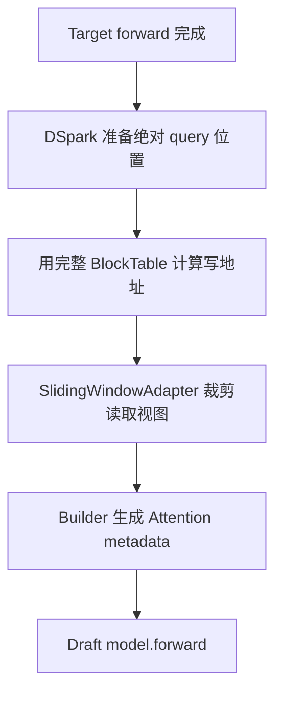
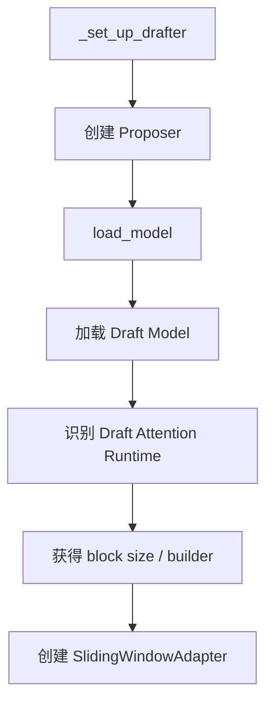
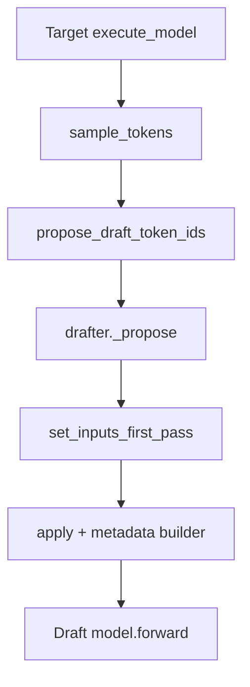
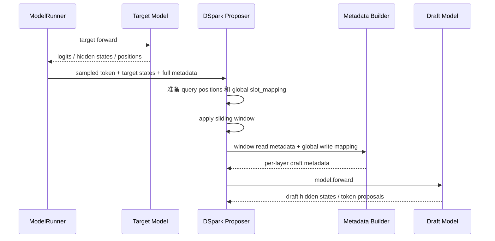
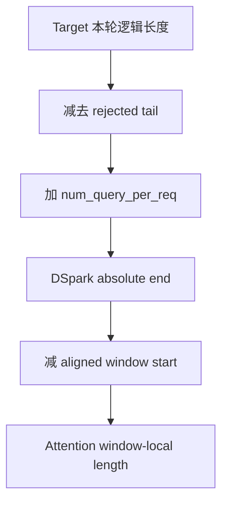
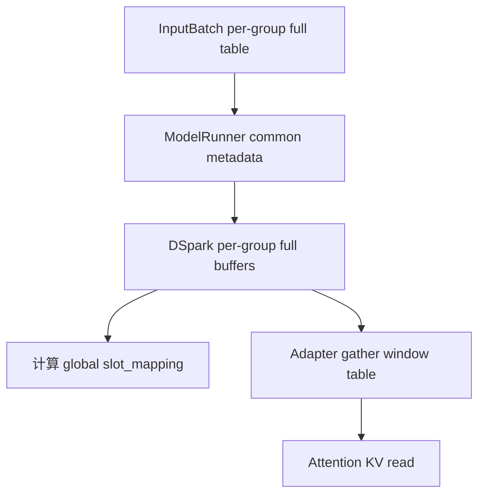
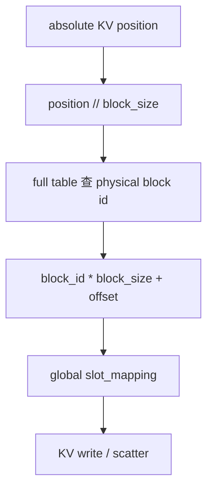
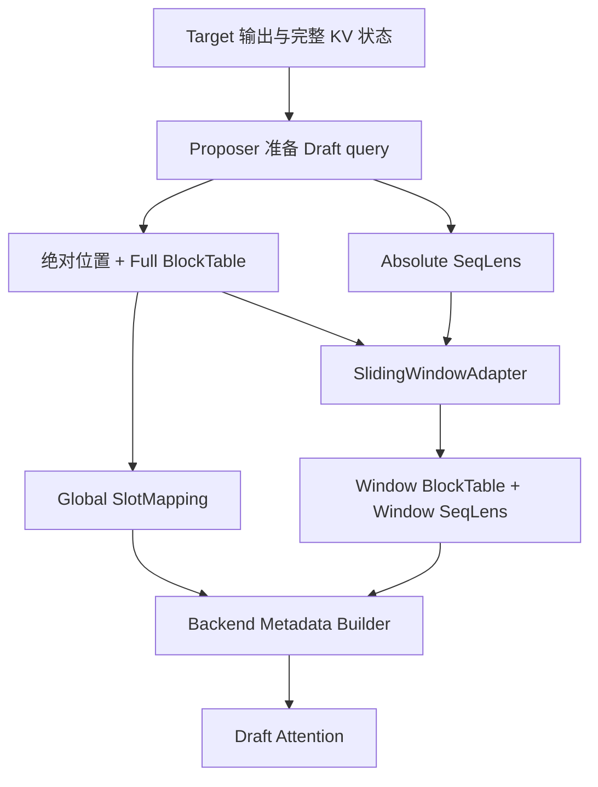
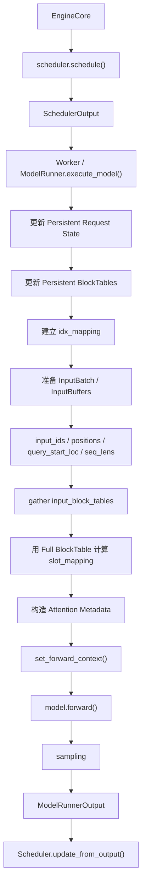

# Stage 1：`SlidingWindowAdapter`——吃透 MRV1 窗口数学

> 目标：不是背 MRV1 源码，而是建立一套以后能迁移到 MRV2 的“行为模型”。
>
> 本阶段要做到：
> 1. 看懂 Sliding Window 的数学。
> 2. 知道 `seq_lens / block_table / slot_mapping` 分别代表什么。
> 3. 明白为什么 read 可以 window，而 write 必须保持 global。
> 4. 知道 Adapter 在 MRV1 中何时创建、何时 apply、最终被谁消费。
> 5. 能把 DSpark 的完整数据流画出来。
> 6. 能回答迁移 MRV2 时必须保持哪些不变式。

> 阅读建议：第一次先读“0、4、10、12、13、28”，先形成整体感觉；第二次再读初始化、源码位置和函数卡；真正改 MRV2 代码前，再复习数据生命周期、错误案例和调试清单。

---

## 0. 一页总览：这项功能究竟做了什么

### 0.1 一句话理解

> `SlidingWindowAdapter` 不负责生成 token，也不搬动真实 KV；它把 Draft Attention 使用的 metadata 从“完整历史视图”转换成“最近窗口视图”。

它改变的是 Draft Attention 的读取范围：

```text
完整历史：0 ........................................ 101

窗口视图：                        64 ............... 101
```

它绝不能错误改变新 KV 的真实写入地址：

```text
READ：windowed block_table + windowed seq_lens
WRITE：full-table-based slot_mapping
```

### 0.2 最核心的故事



把它翻译成人话：

1. Target 先正常推理。
2. DSpark 确定本轮 Draft query 位于全局序列的哪些绝对位置。
3. 在完整 KV 世界里，为这些位置算好真实写地址 `slot_mapping`。
4. 再把 Draft Attention 能读取的旧 KV 限制在最近窗口内。
5. Builder 同时接收“局部读取视图”和“全局写地址”。
6. Draft Model 执行时，读历史只读窗口，写新 KV 仍写到全局正确位置。

### 0.3 三种数据绝不能混

| 数据 | 回答的问题 | 是否被窗口化 | 最终消费者 |
|---|---|---:|---|
| `seq_lens` | Attention 认为当前可见 KV 有多长？ | 是 | Attention read |
| `block_table` | 逻辑 KV block 映射到哪个物理 block？ | 是 | Attention read |
| `slot_mapping` | 新 token 的 KV 写到哪个物理 slot？ | 否 | KV write/scatter |

### 0.4 阶段 1 的 Feature Contract

迁移到 MRV2 时必须保持下面这些行为，而不是机械复制 MRV1 类名：

```text
输入：
  absolute seq_lens
  full block table
  global slot_mapping
  window_size
  block_size
  proposer-specific future_offset

输出：
  windowed seq_lens
  windowed block table
  unchanged global slot_mapping

不应改变：
  Target Attention
  真实 KV Cache 内容
  已分配的物理 block
  新 KV 的全局写地址
```

---

## 1. 三个最重要的对象

### 1.1 Proposer

`Proposer` 是草稿推理的总控制器。

```text
NPUModelRunner
    │
    ▼
Proposer
    ├─ Draft Model
    ├─ 输入准备
    ├─ Attention metadata builder
    ├─ KV / slot mapping
    ├─ draft forward
    ├─ draft sampling
    └─ SlidingWindowAdapter
```

记忆：

```text
Proposer = 草稿推理“老板”
Draft Model = 真正做神经网络 forward 的“工人”
SlidingWindowAdapter = 在窗口场景下改 metadata 的“工具”
```

### 1.2 Draft Model

真正执行：

```python
self.model(...)
```

负责 Attention、MLP、hidden states 等模型计算。

### 1.3 SlidingWindowAdapter

它不是模型，只负责：

```text
完整 sequence metadata
        ↓
滑动窗口局部 metadata
```

它不会预测 token，也不会替代 Attention kernel。

---

## 2. `SlidingWindowAdapter.__init__`

```python
def __init__(
    self,
    window_size: int,
    block_size: int,
    max_num_reqs: int,
    future_offset: int,
    device: torch.device,
) -> None:
    self.window_size = window_size
    self.block_size = block_size
    self.window_blocks = (window_size + block_size - 1) // block_size
    self.max_window_blocks = self.window_blocks + 1
    self._future_offset = future_offset
    self._block_table_clone = torch.zeros(
        (max_num_reqs, self.max_window_blocks),
        dtype=torch.int32,
        device=device,
    )
```

| 参数 | 含义 |
|---|---|
| `window_size` | Sliding Window 最多保留多少 token |
| `block_size` | 一个 KV block 包含多少 token |
| `max_num_reqs` | 最大 request 数 |
| `future_offset` | 为得到正确窗口逻辑右边界，当前 `seq_lens` 还差多少 position |
| `device` | 工作 tensor 所在设备 |

### 2.1 `window_blocks`

```python
(window_size + block_size - 1) // block_size
```

就是：

```text
ceil(window_size / block_size)
```

例如：

```text
window_size = 32
block_size = 16
→ window_blocks = 2
```

### 2.2 为什么 `max_window_blocks = window_blocks + 1`

逻辑窗口通常不和 block 边界对齐。

```text
逻辑窗口：
72 ---------------- 103

KV block：
Block 4: 64~79
Block 5: 80~95
Block 6: 96~111
```

虽然窗口只有 32 token，却横跨 3 个 block，所以最坏情况需要多 1 个 block。

### 2.3 `_block_table_clone`

预分配：

```text
[max_num_reqs, max_window_blocks]
```

保存每个 request 当前窗口对应的小型 block table。

```text
完整：
[10,11,12,13,14,15,16]

窗口：
[14,15,16]
```

---

## 3. `future_offset`：最容易误解的变量

### 3.1 它不代表“未来 token 已经存在”

例如：

```text
seq_lens = 100
future_offset = 4
```

未来：

```text
position:
100 101 102 103

token value:
 ?   ?   ?   ?
```

程序知道的是位置，不知道内容。

所以：

> 提前知道未来位置 ≠ 提前知道未来内容。

它不会让当前 token 看见未来 KV，也不会破坏 causal attention。

### 3.2 最准确的定义

> `future_offset` = 为了得到正确的窗口逻辑右边界，当前 `seq_lens` 还差多少 position。

不同 proposer 的 `seq_lens` 语义不同：

```text
EAGLE3:
seq_lens 只包含 context
未来 K 个位置尚未计入
→ future_offset = K

DFlash / DSpark:
input preparation 已把 query stretch 加入 seq_lens
→ future_offset = 0

MTP:
复用 target layer，不直接创建该 Adapter
```

---

## 4. 窗口数学

核心公式：

```python
start = (
    (seq_lens + future_offset - window_size).clamp(min=0)
    // block_size
) * block_size
```

拆开：

```text
seq_lens
   │
   │ + future_offset
   ▼
logical_right
   │
   │ - window_size
   ▼
logical_start
   │
   │ clamp(min=0)
   ▼
非负 logical_start
   │
   │ // block_size * block_size
   ▼
block-aligned actual start
```

### 4.1 完整数值例子

```text
seq_lens = 100
future_offset = 4
window_size = 32
block_size = 16
```

逻辑右边界：

```text
100 + 4 = 104
```

逻辑窗口：

```text
[72, 104)
```

即 token：

```text
72 ~ 103
```

block 对齐：

```text
72 // 16 * 16 = 64
```

因此实际从 absolute token 64 所在 block 开始取。

### 4.2 为什么窗口必须向右推进？

Sliding Window 的定义：

```text
当前位置向右移动
→ 可见历史窗口也向右移动
```

如果实际会走到 127，却仍按旧 `seq_lens=120`：

```text
错误窗口：
88~119

正确窗口：
96~127
```

窗口会整体落后。

---

## 5. `compute_sliding_window_block_table()`

一句话：

> 从 full block table 中裁出当前 window 真正需要的 block。

流程：

```text
seq_lens
  ↓
算 block-aligned start token
  ↓
start_block_index
  ↓
构造 [0,1,2,...]
  ↓
得到每个 req 的 src_cols
  ↓
torch.gather(full_block_table)
  ↓
valid_mask
  ↓
windowed block table
```

### 5.1 完整例子

```text
window_size = 32
block_size = 16
future_offset = 4
seq_len = 100

full block table:
[10,11,12,13,14,15,16]
```

逻辑起点：

```text
100 + 4 - 32 = 72
```

block 对齐：

```text
72 // 16 * 16 = 64
```

起始列：

```text
64 // 16 = 4
```

最多取 3 个 block：

```text
cols = [0,1,2]
```

真实 source columns：

```text
src_cols = [4,5,6]
```

gather：

```text
full:
[10,11,12,13,14,15,16]
             ↑  ↑  ↑

window:
[14,15,16]
```

窗口局部长度：

```text
_windowed_seq_lens
= 100 - 64
= 36
```

注意：

```text
start_block_indices
```

是 block table 的列索引；真正物理 KV block id 是 table 中的值。

---

## 6. `apply()`：把 metadata 变成窗口视图

`apply()` 核心做三件事。

### 6.1 保存 full table

```python
self.full_block_table = common_attn_metadata.block_table_tensor
```

因为后面仍需要 full table 做绝对坐标相关计算。

### 6.2 替换 block table

```text
full:
[10,11,12,13,14,15,16]

→

window:
[14,15,16]
```

### 6.3 替换 `seq_lens`

```text
global seq_len = 100
window-aligned start = 64
windowed seq_len = 36
```

真实 sequence 没变短，只是 Attention 局部坐标变成：

```text
global:
64 65 ... 99

local:
0  1  ... 35
```

同时同步：

```text
seq_lens_cpu
_seq_lens_cpu
seq_lens_cpu_upper_bound
```

避免 NPU/CPU 认知不一致。

一句话：

> `apply()` 把 Attention metadata 从“全局 sequence 视角”改成“滑动窗口局部视角”。

---

## 7. MRV1 初始化链

```text
NPUModelRunner._set_up_drafter()
    ↓
根据 speculative method
创建 Proposer
    ↓
此时还没有 SlidingWindowAdapter

NPUModelRunner.load_model()
    ↓
加载 Target Model
    ↓
drafter.load_model(target_model)
    ↓
加载 Draft Model
    ↓
识别 Draft Attention Runtime Layers
    ↓
得到 backend / KV spec / metadata builder / kernel block size
    ↓
读取 draft_window_size
    ↓
决定 future_offset
    ↓
创建 SlidingWindowAdapter
```

### 7.1 为什么 Proposer 可以先创建？

因为它已经知道：

```text
method
K
device
runner
draft model config
```

### 7.2 为什么 Adapter 必须后创建？

因为需要等 Draft Attention backend 确定后才能知道：

```text
kernel_block_size
```

---

## 8. 为什么 `drafter.load_model(target_model)` 需要 Target Model？

不只是为了 block size。

Draft 与 Target 可能共享：

```text
embedding
lm_head
多模态 token config
部分 runtime state
MTP / EAGLE 结构资源
```

所以 target model 是 Draft Runtime 建立的一部分输入。

---

## 9. 为什么要“找 Draft Attention Layers”？

不是找权重，而是在 vLLM Runtime 中找：

```text
AttentionLayerBase
```

这些对象携带：

```text
attention backend
KV cache spec
metadata builder
kernel block size
attention group
```

典型做法：

```text
加载 Draft 前：
registry = Target attention layers

加载 Draft 后：
registry = Target + Draft attention layers

集合差：
Draft attention layers
```

本质：

> 建立 Draft Attention Runtime。

---

## 10. MRV1 DSpark 最终纵向调用链

```text
NPUModelRunner.execute_model()
        │
        ▼
Target model forward
        │
        ├─ token
        ├─ positions
        ├─ hidden states
        └─ full common metadata
        │
        ▼
sample_tokens()
        │
        ▼
propose_draft_token_ids()
        │
        ▼
drafter._propose()
        │
        ▼
DSpark.set_inputs_first_pass()
        │
        ├─ 修正 rejected tail
        ├─ 生成 DSpark query positions
        ├─ 更新 seq_lens
        ├─ 用 FULL per-group block table
        │   计算 query slot_mapping
        └─ 准备 draft inputs
        │
        ▼
build_draft_attn_metadata()
        │
        ├─ 当前 group FULL block table
        ├─ 当前 group query slot_mapping
        │
        ▼
SlidingWindowAdapter.apply()
        │
        ├─ FULL block_table
        │     ↓
        │   WINDOW block_table
        │
        └─ global seq_lens
              ↓
            windowed seq_lens
        │
        ▼
AscendDSAMetadataBuilder.build_for_drafting()
        │
        ├─ windowed block_table
        ├─ windowed seq_lens
        └─ full-table-based slot_mapping
        │
        ▼
AscendDSAReqMetadata
        │
        ▼
set_ascend_forward_context()
        │
        ▼
draft model.forward()
        │
        ├─ KV READ
        │   → window table + window len
        │
        └─ KV WRITE
            → absolute slot_mapping
```

---

## 11. 三类关键数据：一定不要混

### 11.1 `seq_lens`

> Attention 当前认为有效 KV 长度是多少？

DSpark 生命周期：

```text
Target seq_len
    ↓
减 rejected tail
    ↓
+ num_query_per_req
    ↓
得到 DSpark 本轮绝对 KV 终点
    ↓
SlidingWindowAdapter
    ↓
变成 window-local seq_len
    ↓
Attention read length
```

### 11.2 `block_table`

> 逻辑 block 对应哪个物理 KV block？

```text
InputBatch full block table
    ↓
per-group full block table
    ↓
先用于计算 absolute slot_mapping
    ↓
当前 group 进入 apply()
    ↓
windowed block table
    ↓
Attention read
```

### 11.3 `slot_mapping`

> 新 token 的 KV 到底写到哪个物理 slot？

```text
absolute_kv_position
    ↓
column = position // block_size
    ↓
block_id = full_block_table[column]
    ↓
slot = block_id * block_size + offset
```

它必须基于 full table。

---

## 12. 最重要的不变式：READ windowed，WRITE global

### READ

Attention 只需要最近的可见 KV：

```text
windowed block_table
+
windowed seq_lens
```

### WRITE

新 token 的 KV 必须写到真实全局物理位置：

```text
full-table-based slot_mapping
```

一句话：

> **Sliding Window 改的是“Draft Attention 可以回头看多远”，不是“新产生的 KV 在整个 KV Cache 世界里写到哪里”。**

---

## 13. 一个完整数字例子：Target → DSpark → Sliding Window → Attention

假设：

```text
Target metadata seq_len = 100
rejected = 2
num_query_per_req = 4
window_size = 32
block_size = 16
```

### 第一步：有效 Target 长度

```text
100 - 2 = 98
```

### 第二步：DSpark query positions

```text
98
99
100
101
```

所以：

```text
cad.seq_lens
= 98 + 4
= 102
```

这不代表 4 个 draft token 内容已存在，只代表本轮 KV 布局规划的逻辑终点。

### 第三步：先算 WRITE 地址

对 position 100：

```text
100 // 16 = 6
```

去 full block table column 6 查物理 block id：

```text
slot = block_id * 16 + 100 % 16
```

得到 `slot_mapping`。

### 第四步：再裁 READ window

```text
102 - 32 = 70
70 // 16 * 16 = 64
```

窗口局部长度：

```text
102 - 64 = 38
```

Adapter 后：

```text
seq_lens:
102 → 38

block_table:
FULL → absolute 64 开始的 WINDOW table

slot_mapping:
保持不变
```

### 第五步：Attention

```text
KV READ:
window table + window len

KV WRITE:
slot_mapping
```

---

## 14. 为什么 DSpark 的 apply 比 EAGLE/DFlash 晚？

DSpark 有 per-group full block table。

如果过早：

```text
FULL
↓
apply
↓
WINDOW
```

后面 DSpark 又：

```text
block_table_tensor = per_group_full_table
```

就会把窗口表覆盖回 FULL。

更糟的是：

```text
seq_lens 已 windowed
+
block_table 又 FULL
```

坐标系不一致。

所以必须：

```text
先选当前 group FULL table
↓
装入当前 group query slot_mapping
↓
apply()
↓
立刻 builder
```

本质：

> DSpark 不是窗口数学不同，而是 per-group block table 的选择时机更晚。

---

## 15. Metadata Builder 是干什么的？

Adapter 只是改：

```text
common_attn_metadata
```

Builder 把：

```text
seq_lens
block_table
slot_mapping
```

翻译成 backend 真正认识的：

```text
AscendDSAReqMetadata
```

即：

> 通用 metadata → DSA kernel metadata。

---

## 16. `set_forward_context()` 是干什么的？

`self.model(...)` 并没有显式传 `attn_metadata`。

所以系统先：

```text
set_ascend_forward_context()
```

把 per-layer metadata 放到执行上下文。

模型内部 Attention 层：

```text
get_forward_context()
↓
按 layer_name 取 metadata
```

可以理解为：

> “先把 Attention 参数放桌面上，model.forward 内部的 Attention 层自己来取。”

---

## 17. 阶段 1 最核心的 6 条结论

1. `future_offset` 是**为了得到正确窗口右边界，当前 `seq_lens` 还差多少 position**。
2. DSpark 进入 Adapter 前已把 `num_query_per_req` 加入 `seq_lens`，所以 `future_offset=0`。
3. DSpark 必须先用 full per-group block table + absolute KV position 算 `slot_mapping`。
4. `SlidingWindowAdapter` 修改 read 侧：`block_table + seq_lens`；不改 `slot_mapping`。
5. DSpark 必须在选定当前 per-group full block table 后再 apply。
6. 最终 Attention：
   - READ → windowed table + windowed length
   - WRITE → full-table-based slot mapping

---

## 18. 阶段 1 停止条件

进入 MRV2 前，只需能回答：

```text
1. Target output 怎么进入 drafter？
2. DSpark input_ids / positions 怎么生成？
3. common_attn_metadata 从哪里来？
4. apply 前 seq_lens 的准确语义是什么？
5. full block table 从哪里来？
6. slot_mapping 为什么必须提前用 full table 生成？
7. SlidingWindowAdapter.apply() 在哪里调用？
8. windowed metadata 被哪个 builder 消费？
9. set_forward_context 起什么作用？
10. Draft model.forward 内 READ / WRITE 最终分别消费什么？
```

能回答这些：

> 阶段 1 就够了，不需要继续横向学习 MRV1。

---

## 19. 下一阶段：MRV2 推荐阅读路径

```text
阶段 2：MRV2 architecture

2.1 MRV2 ModelRunner → Speculator 总入口
2.2 AscendDSparkSpeculator
2.3 _build_attn_metadata / builder inputs
2.4 AscendBlockTables
    - full table
    - kernel table
    - slot_mapping
2.5 AscendInputBuffers / request state
    - NPU seq_lens
    - CPU seq_lens
    - NumPy mirror
    - authoritative state

阶段 3：
先设计 Eager sliding-window path

阶段 4：
ACL Graph / persistent buffer / static address

阶段 5：
边界、精度、eager/graph、性能验证
```

---

## 20. 后续增量维护约定

后续继续讨论时：

- 新 MRV1 细节：补到“阶段 1”对应小节。
- 进入 MRV2：新增“阶段 2：MRV2 调用链和映射”。
- 开始修改代码：新增“阶段 3：设计与修改点”。
- 完成测试：新增“阶段 4：验证、性能、问题与结论”。

本文件保持“看一遍就能重新建立完整心智模型”的结构化风格。

---

## 21. 源码导航：从哪里开始看、每处看什么

> 行号来自本次学习时的 checkout。源码后续增删会导致行号漂移，因此应优先用“文件 + 类名/函数名 + 关键语句”定位。

| 顺序 | 文件 | 类/函数 | 阅读目的 |
|---:|---|---|---|
| 1 | `vllm_ascend/worker/model_runner_v1.py` | `_set_up_drafter()` | 看不同 speculative method 如何选择 Proposer |
| 2 | `vllm_ascend/worker/model_runner_v1.py` | `load_model()` | 看 Target 加载后如何触发 `drafter.load_model(target_model)` |
| 3 | `vllm_ascend/spec_decode/llm_base_proposer.py` | `AscendSpecDecodeBaseProposer.load_model()` | 看 Draft Attention Runtime 和 Adapter 初始化 |
| 4 | `vllm_ascend/worker/model_runner_v1.py` | `execute_model()` | 看 Target forward 和 `ExecuteModelState` |
| 5 | 同上 | `sample_tokens()` | 看采样后如何触发 draft proposal |
| 6 | 同上 | `propose_draft_token_ids()` | 看 ModelRunner 跨入 Proposer 的桥梁 |
| 7 | `vllm_ascend/spec_decode/llm_base_proposer.py` | `_propose()` | 看 Draft 流程总编排 |
| 8 | `vllm_ascend/spec_decode/dspark_proposer.py` | `set_inputs_first_pass()` | 看 DSpark query、长度和写地址如何准备 |
| 9 | `vllm_ascend/ops/triton/spec_decode/utils.py` | `copy_and_expand_dflash_and_dspark_inputs_kernel()` | 看 absolute position 如何变成 `slot_mapping` |
| 10 | `vllm_ascend/spec_decode/llm_base_proposer.py` | `build_draft_attn_metadata()` | 看 DSpark 的真实 `apply()` 时机 |
| 11 | `SlidingWindowAdapter` 所在文件 | `compute_sliding_window_block_table()` / `apply()` | 看窗口数学和 metadata 改写 |
| 12 | `vllm_ascend/attention/dsa_v1.py` | `AscendDSAMetadataBuilder.build_for_drafting()` | 看窗口结果如何进入 backend metadata |
| 13 | `vllm_ascend/ascend_forward_context.py` | `set_ascend_forward_context()` | 看 metadata 如何安装进执行上下文 |
| 14 | `vllm_ascend/spec_decode/llm_base_proposer.py` | `_run_merged_draft()` | 看 Draft Model 真正 forward |
| 15 | `vllm_ascend/ops/dsa.py`、`attention/dsa_v1.py` | `dsa_forward()` / `_forward_attention()` | 看 read/write 各自消费什么 |

推荐的搜索方式：

```bash
rg -n "class SlidingWindowAdapter|def apply|compute_sliding_window" vllm_ascend
rg -n "def _set_up_drafter|def propose_draft_token_ids" vllm_ascend
rg -n "set_inputs_first_pass|build_draft_attn_metadata" vllm_ascend/spec_decode
rg -n "build_for_drafting|build_req_metadata_for_drafting" vllm_ascend/attention
rg -n "set_ascend_forward_context|get_forward_context" vllm_ascend
```

### 21.1 初始化链和运行链要分开看

初始化链回答“工具怎么准备好”：



运行链回答“每轮怎么使用”：



不要把两条链混起来：Adapter 在初始化期被创建，在运行期被反复调用。

---

## 22. 初始化期详解：为什么先有 Proposer，后有 Adapter

### 22.1 Proposer 是“系统”，Adapter 是“零件”

创建 Proposer 时，已经知道：

```text
speculative method
num_speculative_tokens
device
draft model config
ModelRunner 引用
```

所以可以先建立“草稿推理控制器”。

但 Adapter 还缺一个关键参数：

```text
Draft Attention kernel 使用的 block_size
```

这个值必须等 Draft Model 加载、Draft Attention 层注册、backend 确定以后才能可靠获取。因此初始化顺序是：

```text
先创建 Proposer 壳子
    ↓
加载 Target Model
    ↓
drafter.load_model(target_model)
    ↓
加载 Draft Model
    ↓
找出 Draft Attention Runtime Layers
    ↓
获得 backend / KV spec / builder / kernel block size
    ↓
创建 SlidingWindowAdapter
```

### 22.2 为什么 `drafter.load_model(target_model)` 要传 Target Model

它并不只是为了读取 block size。Draft Runtime 可能复用或依赖 Target 的：

```text
embedding
lm_head
辅助 hidden states
多模态配置
MTP/EAGLE 共享结构
部分运行时资源
```

所以更准确的理解是：

> `target_model` 是建立 Draft Runtime 的输入之一，而不仅是一个查询参数的对象。

### 22.3 为什么要找 Draft Attention Layers

这里找的不是 checkpoint 里的权重名字，而是运行时的 `AttentionLayerBase` 对象。它们携带：

```text
attention backend
KV cache spec
metadata builder
kernel block size
attention group / layer names
```

一种常见识别思路是：

```text
加载 Draft 前 registry = Target Attention layers
加载 Draft 后 registry = Target + Draft Attention layers
集合差             = Draft Attention layers
```

这一步的本质是：建立 Draft Attention 的运行时环境。

---

## 23. 窗口数学再拆一遍：四个边界、两个坐标系

### 23.1 四个边界

核心公式：

```python
logical_right = seq_lens + future_offset
logical_start = max(logical_right - window_size, 0)
aligned_start = logical_start // block_size * block_size
windowed_seq_len = seq_lens - aligned_start
```

注意这里存在四个不同概念：

| 名称 | 含义 |
|---|---|
| `seq_lens` | 当前 metadata 已经表达到的序列长度 |
| `logical_right` | 本轮窗口逻辑上必须考虑到的右边界（右开） |
| `logical_start` | 恰好保留 `window_size` 个位置时的理想左边界 |
| `aligned_start` | 为了按 block 取数据而向左对齐后的实际起点 |

### 23.2 为什么使用右开区间

当：

```text
logical_right = 104
window_size = 32
```

逻辑窗口写成：

```text
[72, 104)
```

包含的 token position 是：

```text
72, 73, ..., 103
```

个数：

```text
104 - 72 = 32
```

右开区间能让“长度 = 右边界 - 左边界”，减少 off-by-one 错误。

### 23.3 两个坐标系

全局坐标：

```text
absolute position: 64 65 66 ... 100 101
```

窗口局部坐标：

```text
local position:     0  1  2 ...  36  37
```

Adapter 做的是建立一个局部视图：

```text
global position 64  → local position 0
global position 100 → local position 36
```

真实请求没有变短，真实 token position 也没有重新编号；变化的只是 Attention metadata 的视角。

---

## 24. 五个完整数字例子

### 24.1 例子 A：短序列，小于窗口

```text
seq_lens = 20
future_offset = 0
window_size = 32
block_size = 16
```

计算：

```text
logical_right = 20
logical_start = max(20 - 32, 0) = 0
aligned_start = 0
windowed_seq_len = 20 - 0 = 20
```

结论：尚未超过窗口，不需要丢弃任何历史 block。

```text
原始：  [0........................19]
窗口：  [0........................19]
```

### 24.2 例子 B：逻辑起点刚好 block 对齐

```text
seq_lens = 96
future_offset = 0
window_size = 32
block_size = 16
```

计算：

```text
logical_start = 96 - 32 = 64
aligned_start = 64
windowed_seq_len = 96 - 64 = 32
```

恰好需要两个 block：

```text
Block 4: 64~79
Block 5: 80~95
```

此时不需要额外的 `+1 block`，但 buffer 必须为最坏的不对齐情况预留空间。

### 24.3 例子 C：逻辑起点不对齐，因此多保留一小段

```text
seq_lens = 100
future_offset = 4
window_size = 32
block_size = 16
```

计算：

```text
logical_right = 104
logical_start = 72
aligned_start = 64
```

逻辑真正需要：

```text
72~103，共 32 个位置
```

物理 block 必须取：

```text
Block 4: 64~79
Block 5: 80~95
Block 6: 96~111
```

因此取了三个 block。多取到的 `64~71` 不代表一定对 Attention 可见；后端仍可结合准确序列长度、mask 或索引限制逻辑窗口。Adapter 首先解决的是 block 粒度的数据可达性。

### 24.4 例子 D：完整 BlockTable 裁成窗口表

假设：

```text
full block table = [10, 3, 21, 8, 14, 6, 19]
start_block_index = 4
max_window_blocks = 3
```

注意，表的“列”和表中的“物理 block id”不是一回事：

```text
逻辑列：          0   1   2  3   4  5   6
物理 block id： [10,  3, 21, 8, 14, 6, 19]
                              ↑  ↑   ↑
```

gather 后：

```text
window block table = [14, 6, 19]
```

`start_block_index=4` 的含义是“从完整表第 4 列开始”，并不是“物理 block id 为 4”。

### 24.5 例子 E：为什么窗口表不能计算全局写地址

假设：

```text
block_size = 4
absolute position = 5
full block table = [9, 17, 3, ...]
```

正确写地址：

```text
block column = 5 // 4 = 1
physical block id = full_block_table[1] = 17
offset in block = 5 % 4 = 1
slot = 17 * 4 + 1 = 69
```

现在假设窗口从 full table 第 1 列开始：

```text
window table = [17, 3, ...]
```

窗口表的列 0 才对应全局列 1。如果仍用绝对位置 5：

```text
5 // 4 = 1
```

程序会错误读取：

```text
window_table[1] = 3
```

错误 slot：

```text
3 * 4 + 1 = 13
```

正确是 69，错误变成 13。这不是轻微偏差，而是把 KV 写进了完全不同的物理位置。

---

## 25. `future_offset` 的物理意义与方法差异

### 25.1 最准确的判断问题

不要问：

> 这个 method 一次 draft 几个 token，所以 offset 是多少？

应该问：

> Adapter 执行这一刻，`seq_lens` 已经包含本轮将参与 Draft Attention 的 query stretch 了吗？

如果没包含，需要 `future_offset` 补上；如果已经包含，offset 就是 0。

### 25.2 对照

| Method | Adapter 执行前 `seq_lens` 的典型语义 | `future_offset` |
|---|---|---:|
| EAGLE3 | 仍偏向 context-only，未来 K 个 draft positions 尚未体现在长度里 | `K` |
| DFlash | input preparation 已把 query stretch 加入 | `0` |
| DSpark | `effective_seq_lens + num_query_per_req` | `0` |
| MTP | 当前 MRV1 路径不直接创建该 Adapter | 不适用 |

这里描述的是本次 checkout 的行为模型。以后源码变动时，应重新检查 `apply()` 前的实际长度语义，不能死记方法名。

### 25.3 为什么不破坏因果性

`future_offset` 只参与 metadata 的窗口边界计算：

```text
知道未来要使用 position 100、101、102、103
```

不等于：

```text
知道这些位置未来会是什么 token
```

真正能否互相看见，仍由 Draft Attention 的 query layout、causal/non-causal 语义和 mask 决定。位置规划和内容可见性是两件不同的事情。

---

## 26. DSpark 运行期：完整时序与数据流



### 26.1 Target 阶段

`NPUModelRunner.execute_model()` 完成：

```text
准备 target inputs
构造 target attention metadata
安装 target forward context
执行 target model forward
保存 logits / hidden states / aux hidden states / positions
```

这些输出暂存在 `ExecuteModelState`，供 `sample_tokens()` 使用。

### 26.2 ModelRunner 跨入 Proposer

```text
sample_tokens()
  → target sampler / rejection sampler
  → propose_draft_token_ids()
  → self.drafter._propose(...)
```

`propose_draft_token_ids()` 负责把下面几类数据成套传入：

| 数据 | 来源 | DSpark 用途 |
|---|---|---|
| `next_token_ids` | Target 采样结果 | 第一个真实 Draft query token |
| `target_positions` | Target input buffer | 生成后续 query positions |
| `target_hidden_states` | Target 辅助层输出 | 合并后预计算 Draft context KV |
| `common_attn_metadata` | Target metadata 构造过程 | 提供长度、块表、slot 等基础状态 |
| rejection 信息 | rejection sampler | 修正仍留在 padding 中的无效尾部 |

### 26.3 DSpark 第一轮输入准备

`set_inputs_first_pass()` 做的不是“直接推理”，而是布置 Draft 世界：

```text
修正有效 Target 终点
生成 DSpark query input_ids
生成 context/query positions
按 group 保存完整 block table
用完整 block table 生成 query slot_mapping
更新 seq_lens 为 query block 结束后的绝对长度
准备采样索引和 query layout
```

DSpark query block 通常可以理解为：

```text
第 0 个 query：真实 next token
后续 query：并行 drafting 占位 token
```

### 26.4 为什么 Target hidden states 还要写 Draft context KV

DSpark 不只拿 Target 的 token。它还会把 Target 辅助层 hidden states：

```text
aux hidden states
  → concatenate / combine_hidden_states
  → Draft 所需 hidden size
  → precompute_and_store_context_kv
  → Draft KV Cache
```

这条路径使用 context slot mapping 写 KV，同样要求全局物理地址正确。

### 26.5 DSpark 的真实 apply 点

每个 Draft Attention/KV group 都要执行：

```text
选当前 group 的 full block table
    ↓
选当前 group 的 query slot_mapping
    ↓
SlidingWindowAdapter.apply()
    ↓
当前 group 的 metadata builder
```

伪代码：

```python
cad = copy.copy(common_attn_metadata)
cad.block_table_tensor = per_group_full_block_table
cad.slot_mapping = per_group_query_slot_mapping

self.sliding_window.apply(cad)

attn_metadata = builder.build_for_drafting(cad, ...)
```

这里的浅拷贝主要隔离当前 group 对 metadata 字段引用的替换；它不会深拷贝所有 tensor。

### 26.6 为什么不能在公共位置提前 apply

如果提前窗口化：

```text
FULL table
  → apply
WINDOW table
```

但 DSpark 后面又覆盖：

```text
cad.block_table_tensor = per_group_full_block_table
```

就会得到危险组合：

```text
windowed seq_lens
+
full block table（从全局列 0 开始）
```

Builder 会把最近窗口误映射到序列开头。因此 DSpark 必须在“最后一次选择当前 group 完整表”之后 apply，并立刻交给 Builder。

---

## 27. 三类数据的完整生命周期

### 27.1 `seq_lens`



详细语义：

```text
ModelRunner._prepare_inputs
  → target 本轮调度后的逻辑长度

prepare_inputs_padded
  → 被拒绝的尾部可能暂时仍作为 padding 保留

DSpark.set_inputs_first_pass
  → effective = seq_lens - rejected
  → seq_lens = effective + num_query_per_req

SlidingWindowAdapter.apply
  → seq_lens = absolute_end - aligned_start

Metadata Builder / Attention
  → 作为窗口局部 KV read length
```

### 27.2 `block_table`



一个完整表同时有两种用途：

```text
用途 1：在裁窗前，根据 absolute position 计算写地址
用途 2：裁出窗口表，供 Draft Attention 读取历史
```

### 27.3 `slot_mapping`



生命周期中 Adapter 不应修改它：

```text
query absolute position
  → full per-group block table
  → query slot_mapping buffer
  → common metadata.slot_mapping
  → Adapter 原样保留
  → Backend metadata
  → KV write
```

---

## 28. 一个从 Target 到 Draft Attention 的端到端例子

假设一条请求在 Target metadata 中：

```text
seq_len = 100
rejected = 2
num_query_per_req = 4
window_size = 32
block_size = 16
```

为了让物理地址更具体，再假设 full block table 是：

```text
逻辑列：          0   1   2   3   4   5   6
物理 block id： [41,  7, 28, 13, 52,  9, 34]
```

### Step 1：修正被拒绝的尾部

```text
effective_seq_len = 100 - 2 = 98
```

这里的 98 表示真正保留的 Target 序列长度，最后一个已有 position 是 97。

### Step 2：建立四个 DSpark query 位置

```text
query positions = 98, 99, 100, 101
```

本轮结束后的绝对右边界：

```text
seq_lens = 98 + 4 = 102
```

这表示布局规划到 position 101，并不表示四个 token 的最终内容已经被 Target 接受。

### Step 3：先计算全局写地址

以 position 100 为例：

```text
block column = 100 // 16 = 6
physical block id = full_table[6] = 34
offset = 100 % 16 = 4
slot = 34 * 16 + 4 = 548
```

所以 position 100 的 Draft KV 应写入物理 slot 548。

四个 query 的写地址全部在完整表坐标系中确定并保存。

### Step 4：计算读取窗口

DSpark 的 `seq_lens=102` 已含 query stretch，所以 `future_offset=0`：

```text
logical_start = 102 - 32 = 70
aligned_start = 70 // 16 * 16 = 64
start_block_column = 64 // 16 = 4
```

从完整表第 4 列开始 gather：

```text
full:   [41, 7, 28, 13, 52, 9, 34]
                         ↑   ↑  ↑
window:                 [52, 9, 34]
```

窗口局部长度：

```text
windowed_seq_len = 102 - 64 = 38
```

### Step 5：Builder 看到的最终组合

```text
block_table = [52, 9, 34]       # 读取窗口
seq_lens = 38                   # 从 absolute 64 起的局部长度
slot_mapping(position 100)=548  # 全局写地址
```

### Step 6：Draft Attention 真正执行

```text
READ：
Q(position 100)
  → window table [52, 9, 34]
  → window-local length 38
  → 最近历史 KV

WRITE：
K/V(position 100)
  → slot_mapping 548
  → 全局物理 KV Cache
```

这个例子把整个功能浓缩为：

> **先在完整世界确定门牌号，再裁一张局部地图供 Attention 看历史。**

---

## 29. Adapter 前后状态对照

| 字段 | `apply()` 前 | `apply()` 后 | 真实世界是否改变 |
|---|---|---|---:|
| `seq_lens` | 本轮 Draft 布局的绝对右边界 | 从对齐窗口起点计算的局部长度 | 否 |
| `block_table_tensor` | 当前 group 的完整块表 | 当前 group 的窗口块表 | 否，只换视图 |
| `slot_mapping` | 基于完整表生成的全局写地址 | 原样保留 | 否 |
| `positions` | Draft query 的绝对位置 | 原样保留 | 否 |
| KV Cache 内容 | 已有全局 KV | 不移动、不复制 | 否 |
| Target metadata | Target forward 所需视图 | 不应被 Draft 窗口污染 | 否 |

### 29.1 `apply()` 为什么要同步 CPU 字段

如果只改 NPU tensor，不同步：

```text
NPU 认为 seq_len = 38
CPU 认为 seq_len = 102
```

后续 Builder、shape 选择、图捕获或辅助逻辑可能使用不同来源，形成隐蔽错误。因此 MRV1 `apply()` 还要维护相关 CPU/private mirror 和 upper-bound 字段的一致语义。

这里要记住：同步不是“多做几次同样的赋值”，而是保证不同消费者看到的是同一个窗口世界。

---

## 30. Metadata Builder、Forward Context、Attention 的职责边界

### 30.1 Adapter

```text
职责：改通用 metadata 的视图
不负责：调用 kernel、执行 Attention、生成 token
```

### 30.2 Metadata Builder

```text
输入：
  windowed seq_lens
  windowed block_table
  global slot_mapping

输出：
  backend-specific request metadata
  例如 AscendDSAReqMetadata
```

可以把它理解为“翻译器”：

```text
通用调度/缓存语言
       ↓
Attention backend 能直接消费的语言
```

### 30.3 Forward Context

`self.model(input_ids=..., positions=...)` 通常没有显式传入 `attn_metadata`，因为 metadata 已经提前安装进执行上下文：

```text
set_ascend_forward_context(...)
      ↓
forward_context.attn_metadata
      ↓
每个 Attention layer 按 layer_name 取自己的 metadata
```

通俗比喻：

> Builder 把资料整理成每个部门能看的表；Forward Context 把表放到共享工作台；Attention 层执行时按自己的名字把表取走。

### 30.4 Attention kernel

最终分工：

```text
KV write/prolog：slot_mapping
KV read：block_table + seq_lens / seqused_kv
```

这就是 READ/WRITE 不变式能够在底层落地的证据。

---

## 31. 真实对话中最容易形成的误区

### 误区 1：`future_offset` 表示已经生成的未来 token

**错误理解：** offset 为 4，就好像未来四个 token 已经存在。

**正确理解：** 已知的是未来位置范围，不是 token 内容；offset 只补偿窗口右边界。

### 误区 2：Sliding Window 把真实序列截断了

**错误理解：** `seq_lens` 从 102 变成 38，说明前 64 个 token 被删除。

**正确理解：** 真实 sequence 和 KV Cache 都还在，只是 Draft Attention 使用从 absolute 64 开始的局部视图。

### 误区 3：window size 是 32，就永远只需 2 个 16-token block

**错误理解：** `32 / 16 = 2`，buffer 两列足够。

**正确理解：** 窗口起点可能落在 block 中间，因此最坏横跨 3 个 block，需要 `ceil(window/block)+1`。

### 误区 4：`start_block_indices` 是物理 block id

**错误理解：** `start_block_index=4` 就去找物理 block 4。

**正确理解：** 它是完整 block table 的列号；物理 block id 是该列中的值。

### 误区 5：窗口表也能算 `slot_mapping`

**错误理解：** 反正窗口表也包含当前 token 所在物理 block。

**正确理解：** 窗口表的列坐标已经平移，绝对位置不能直接索引它；写地址必须基于完整表或显式补偿后的坐标计算。

### 误区 6：所有 proposer 的 `future_offset` 都等于 K

**错误理解：** 一次 draft K 个，所以统一 `future_offset=K`。

**正确理解：** 要看 apply 前 `seq_lens` 是否已经包含 query stretch。DSpark/DFlash 已包含时为 0。

### 误区 7：DSpark 可以在公共位置提前 apply

**错误理解：** 窗口数学相同，统一放在公共代码最简洁。

**正确理解：** DSpark 后面还会逐 group 覆盖 block table。必须在最后一次装入 per-group full table 后 apply。

### 误区 8：Builder 自己会自动理解 Sliding Window

**错误理解：** 只传 `window_size`，Builder 自然能推导。

**正确理解：** MRV1 Adapter 先明确改写通用 metadata；Builder 消费的是已经窗口化的长度和块表。

### 误区 9：看到 `copy.copy(metadata)` 就认为所有 tensor 都复制了

**错误理解：** 每个 group 都有全套深拷贝数据。

**正确理解：** 浅拷贝只复制 Python 容器，tensor 仍共享引用；随后字段会被指向当前 group/persistent buffer。

---

## 32. 如果实现出错，通常会出现什么现象

| 错误 | 可能表现 |
|---|---|
| 窗口右边界少算 future positions | 窗口整体落后，保留旧 KV、丢掉本应可见的新位置 |
| logical start 未 clamp 到 0 | 短序列产生负索引或错误 gather |
| 没有向 block 边界对齐 | block table 无法覆盖逻辑窗口开头 |
| buffer 少预留一个 block | 非对齐窗口下丢 block 或越界 |
| 用窗口表算 slot mapping | KV 写错物理 block、精度异常甚至越界 |
| apply 后又覆盖回 full table | windowed length 与 full table 坐标不匹配 |
| 只更新设备长度，不更新需要的 host mirror | Builder/shape/graph 路径行为不一致 |
| 不区分 per-group block table | 某些层读取错误 KV group |
| 每步重新分配窗口 tensor | ACL Graph 地址不稳定、性能下降或 capture 失败 |

### 32.1 最危险的错误

最危险的不是立刻 crash，而是：

```text
程序能跑
输出语言也像正常文本
但 KV 读写坐标存在细微错误
导致接受率、精度或长序列行为异常
```

因此不能只看“服务拉起来了”，必须检查边界用例、slot mapping 和输出对照。

---

## 33. 调试与验证清单

### 33.1 建议打印/断言的中间量

对一个很小的 batch，记录：

```text
request id
原始 seq_lens
rejected token count
effective seq_lens
num_query_per_req
adapter 前 seq_lens
future_offset
logical_start
aligned_start
start_block_index
full block table
window block table
query absolute positions
slot_mapping
adapter 后 seq_lens
```

### 33.2 关键断言

```text
aligned_start % block_size == 0
aligned_start <= logical_start
logical_start - aligned_start < block_size
window table 来自 full table 的连续列
slot_mapping 在 apply 前后保持不变
短序列 start == 0
每个 group 使用自己的 full/window table
```

### 33.3 最小边界矩阵

设 `window_size=32`、`block_size=16`：

```text
seq_len = 0, 1, 15, 16, 17
seq_len = 31, 32, 33
seq_len = 47, 48, 49
seq_len = 63, 64, 65
future_offset = 0, 1, K
rejected = 0, 1, K-1
batch = 1, 2+
```

重点观察：

```text
window boundary ±1
block boundary ±1
```

### 33.4 功能对照

```text
同一输入：
window disabled
vs
window enabled（window 足够大，理论上等价）
```

如果 window 大于完整上下文，两个结果应保持一致；这是很有价值的 sanity check。

---

## 34. 问题闭环：我当时困惑什么，现在应怎样回答

| 当时真正困惑的问题 | 最终理解 |
|---|---|
| `future_offset` 为什么要看未来？ | 看的是未来位置边界，不是未来 token 内容；用于修正窗口右边界 |
| 为什么窗口会多取一个 block？ | 逻辑起点可能位于 block 中间，向左对齐会额外覆盖一个 block |
| `apply()` 到底改了什么？ | 把 `block_table + seq_lens` 改成局部读取视图，保留 `slot_mapping` |
| Proposer 和 Adapter 有什么区别？ | Proposer 编排整个 Draft 推理；Adapter 只是其中负责 metadata 窗口化的工具 |
| 为什么 Proposer 先创建、Adapter 后创建？ | Adapter 需要 Draft Attention backend 确定后的 kernel block size |
| 为什么 `load_model` 要传 Target Model？ | Draft Runtime 可能共享 Target 资源并消费 Target hidden states，不只是为了 block size |
| 为什么还要找 Draft Attention layers？ | 为了取得运行时 backend、KV spec、builder、block size 和 group 信息 |
| DSpark 为什么 `future_offset=0`？ | `set_inputs_first_pass()` 已把 `num_query_per_req` 加进 `seq_lens` |
| DSpark 为什么 apply 得更晚？ | 它在 Builder 前才逐 group 装入完整 block table，必须在最后一次覆盖后裁窗 |
| 为什么 `slot_mapping` 不能窗口化？ | 它表达新 KV 的绝对物理写地址；窗口表列坐标已平移 |
| Builder 的作用是什么？ | 把通用 metadata 翻译为 Attention backend 真正消费的数据结构 |
| `model.forward()` 没传 metadata，Attention 怎么拿到？ | metadata 预先安装在 forward context，Attention 层按 layer name 获取 |

---

## 35. 自测题：能独立回答才算真正吃透

1. 给出 `seq_lens=100`、`future_offset=4`、`window_size=32`、`block_size=16`，算出逻辑起点、对齐起点和窗口局部长度。
2. 为什么逻辑窗口只需 32 个 token，却可能需要 3 个 block？
3. `full block table=[10,3,21,8,14,6,19]`，起始列为 4，窗口表是什么？
4. `block_size=4`、绝对 position=5、full table 第 1 列为物理 block 17，slot 是多少？
5. 为什么提前知道未来 position 不代表违反 causal attention？
6. DSpark 的 adapter 为什么用 `future_offset=0`？
7. `apply()` 前后哪三个字段变化或不变化？
8. 为什么 DSpark 不能使用 EAGLE/DFlash 的公共 apply 点？
9. Target hidden states 怎样进入 Draft KV Cache？
10. Builder、Forward Context、Attention kernel 三者各负责什么？
11. 如果 `windowed seq_lens` 配上从列 0 开始的 full table，会发生什么语义错误？
12. 迁移到 MRV2 时，哪些是必须保持的行为，哪些 MRV1 类名不必照搬？

参考答案关键词：

```text
1. 72 / 64 / 36（注意此例原 seq_lens 未包含 offset，局部长度按实现语义核对）
2. block 起点不对齐
3. [14, 6, 19]
4. 69
5. 位置规划 ≠ 内容可见
6. query stretch 已进入 seq_lens
7. seq_lens、block table 变；slot mapping 不变
8. 后续 per-group full table 会覆盖窗口表
9. aux hidden states → combine → precompute context KV
10. 翻译 / 安装 / 消费
11. 最近 N 个 token 被错误映射到最早 N 个 token
12. 保持 Feature Contract，不机械复制实现结构
```

> 关于第 1 题：若实现中 `windowed_seq_lens` 使用原始 `seq_lens - aligned_start`，结果为 36；若某调用点已经把 future stretch 合并进 `seq_lens=104`，则为 40。关键不是背数字，而是先确认调用点上 `seq_lens` 的准确语义，避免重复添加 `future_offset`。

---

## 36. 最终心智模型：半年后只看这一节

### 36.1 一张图恢复全部知识



### 36.2 只记住八句话

1. `SlidingWindowAdapter` 是 metadata 适配器，不是模型，也不移动真实 KV。
2. `future_offset` 修正窗口右边界；它表示位置差，不表示未来 token 内容。
3. 逻辑窗口按 token 计算，实际块表必须向左按 block 对齐。
4. 非对齐窗口最坏会多跨一个 block，所以要预留 `+1 block`。
5. `seq_lens + block_table` 描述 Attention 从哪里读、读多长。
6. `slot_mapping` 描述新 KV 写到哪个绝对物理槽位。
7. DSpark 必须先按当前 group 的完整表算写地址，再裁读取窗口。
8. 迁移 MRV2 的目标是保持 `READ windowed，WRITE global`，不是复制 MRV1 的类和函数。

### 36.3 最终类比

把完整 KV Cache 想成整个上海：

```text
Full BlockTable = 上海完整地图
Window BlockTable = 当前附近区域的小地图
SlotMapping = 快递必须送达的真实门牌号
```

Attention 为了节省成本，只拿附近的小地图看历史；但是寄送新 KV 时，必须使用整个城市坐标系里的真实门牌号。

> **裁小地图，不改门牌号。**

这就是 `SlidingWindowAdapter` 最值得带到 MRV2 的完整行为模型。

---

# Stage 2：MRV2 普通 ModelRunner 执行主链

> 目标：先理解普通请求如何从 `SchedulerOutput` 变成一次 `model.forward()`，暂不进入 Speculative Decoding、DSpark 或 Sliding Window 的实现设计。

---

## 1. 一句话理解 MRV1 与 MRV2

MRV1 与 MRV2 最重要的区别可以压缩为：

> **MRV1 中长期状态与本轮模型输入绑定得较紧；MRV2 将长期保存的 Request 状态，与本轮真正送入模型的数据明确分离。**

MRV2 的基本结构是：

```text
长期状态（Persistent Request State）
        │
        │ 按本轮调度结果 gather
        ▼
本轮输入（InputBatch / InputBuffers）
        │
        ▼
model.forward()
```

这样做的直接好处是：Request 加入、退出或改变 batch 顺序时，不必反复搬动所有长期状态。

---

## 2. 完整调用链



对应的数据流是：

```text
SchedulerOutput
    │
    ├─ 更新长期 Request 状态
    ├─ 更新长期 Full BlockTable
    └─ 指定本轮每个 Request 计算多少 token
            │
            ▼
       idx_mapping
            │
            ▼
    本轮 token 输入与布局
            │
            ├─ input_ids
            ├─ positions
            ├─ query_start_loc
            └─ seq_lens
            │
            ▼
   gathered input_block_tables
            │
            ├─ Attention 读取历史 KV
            └─ 与绝对 position 一起计算 slot_mapping
                         │
                         ▼
                  写入新 KV 的物理位置
```

---

## 3. 固定示例：A、B、C 三个 Request

后续统一使用三个 Request：

| Request | 已完成 token 数 | 本轮调度 token 数 | Persistent row |
|---|---:|---:|---:|
| A | 5 | 2 | 7 |
| B | 8 | 3 | 2 |
| C | 4 | 1 | 11 |

长期状态中的顺序可以是：

```text
row 2  → B
row 7  → A
row 11 → C
```

本轮 batch 顺序可以完全不同：

```text
batch 0 → B
batch 1 → C
batch 2 → A
```

这正是 `idx_mapping` 存在的原因。

---

## 4. SchedulerOutput：本轮执行计划

Scheduler 每轮决定：

- 哪些 Request 本轮参与执行；
- 每个 Request 本轮计算多少 token；
- 哪些 Request 新加入、继续、结束或被抢占；
- KV block 分配发生了哪些变化。

`SchedulerOutput` 是 Scheduler 交给 Worker/ModelRunner 的本轮执行计划。它不是最终模型输入，而是更新长期状态与构造本轮输入的依据。

```text
SchedulerOutput
    ├─ new / resumed / running / finished requests
    ├─ num_scheduled_tokens
    ├─ KV block updates
    └─ 本轮调度附加信息
```

---

## 5. Persistent Request State：长期档案

每个活跃 Request 在 ModelRunner 中占据一个稳定 row。只要 Request 仍然存活，它的长期状态就保存在该 row 中，不需要跟随每轮 batch 顺序移动。

长期状态通常包含：

- token 历史；
- prompt / prefill / total length；
- `num_computed_tokens`；
- 最近采样结果；
- Request ID 与 row 的映射；
- 与 KV block 状态关联的信息。

它的语义是：

```text
Persistent Request State = Request 跨 step 保留的长期事实
```

而不是：

```text
Persistent Request State = 当前这一次 forward 的输入
```

`execute_model()` 开始后，首先根据 `SchedulerOutput` 完成新增、结束、恢复、更新以及 staged block-table writes 的提交，然后才准备本轮输入。

---

## 6. idx_mapping：长期状态与本轮 batch 的桥

`idx_mapping` 的方向是：

```text
batch_idx → persistent request-state row
```

在固定示例中：

```text
batch order: [B, C, A]
persistent rows: B=2, C=11, A=7

idx_mapping = [2, 11, 7]
```

它解决的问题是：本轮 batch 可以按调度或执行需要排序，但长期状态仍保持稳定位置。随后所有 gather 操作都可以通过 `idx_mapping` 从长期状态中取出本轮需要的数据。

不要把 `idx_mapping` 理解为 token index 或 block index；它只描述两个 Request 排列空间之间的映射。

---

## 7. num_scheduled_tokens：每个 Request 本轮做多少工作

设本轮 batch 顺序为 `[B, C, A]`，对应：

```text
num_scheduled_tokens = [3, 1, 2]
```

它决定每个 Request 在本轮 flattened token batch 中占多少位置，也决定：

- `input_ids` 取多少 token；
- `positions` 生成多少绝对位置；
- `query_start_loc` 如何划分各 Request；
- 本轮总 token 数是多少。

本轮总 token 数：

```text
total_num_scheduled_tokens = sum(num_scheduled_tokens)
                           = 3 + 1 + 2
                           = 6
```

---

## 8. query_start_loc：切分 flattened token batch

模型通常把本轮所有 Request 的 token 展平成一个连续数组。`query_start_loc` 是前缀和，用来标记每个 Request 的 token 区间。

对于：

```text
num_scheduled_tokens = [3, 1, 2]
```

有：

```text
query_start_loc = [0, 3, 4, 6]
```

因此：

```text
B → flattened token [0:3]
C → flattened token [3:4]
A → flattened token [4:6]
```

通式：

```text
query_start_loc[0] = 0
query_start_loc[i + 1]
    = query_start_loc[i] + num_scheduled_tokens[i]
```

`query_start_loc` 描述的是本轮 query 布局，不是历史 KV 长度。

---

## 9. input_ids、positions 与 seq_lens

### 9.1 input_ids

`input_ids` 是本轮真正送入模型的 token ID。它从每个 Request 的长期 token 历史中，按 `num_computed_tokens` 与 `num_scheduled_tokens` 取出本轮需要计算的片段，再按 batch 顺序展平。

```text
Request 长期 token 历史
        │
        │ 取本轮未计算片段
        ▼
本轮各 Request token
        │
        │ flatten
        ▼
input_ids
```

### 9.2 positions

`positions` 是这些 token 在各自 Request 全局序列中的绝对位置。

对于 Request A：

```text
num_computed_tokens = 5
num_scheduled_tokens = 2
positions = [5, 6]
```

通式：

```text
positions_i = num_computed_tokens_i + arange(num_scheduled_tokens_i)
```

Sliding Window 只能限制读取历史 KV 的范围，不能把这些绝对位置改成窗口内局部位置。

### 9.3 seq_lens

`seq_lens` 描述 Attention 在当前执行点看到的序列逻辑长度。普通路径中可由已计算长度与本轮调度长度得到：

```text
seq_len_i = num_computed_tokens_i + num_scheduled_tokens_i
```

但进入 speculative method 后，具体语义可能因方法与执行阶段而变化，因此必须结合其生成时点理解，不能只看变量名。

---

## 10. InputBuffers 与 InputBatch

二者不要混淆：

| 对象 | 核心语义 | 生命周期 |
|---|---|---|
| `InputBuffers` | 为高频执行与 graph replay 预分配的 Tensor 存储 | persistent allocation，内容 per-step 更新 |
| `InputBatch` | 对本轮输入数据与布局的逻辑描述 | per-step |

可以把它们理解为：

```text
InputBuffers = 可重复使用的容器
InputBatch   = 这一轮装进容器里的有效数据与视图
```

MRV2 的重点不是每轮重新构造整个长期世界，而是更新稳定 buffer 的内容，并构造本轮有效 slice/view。

---

## 11. Persistent BlockTables：完整 KV 地址地图

KV cache manager 决定每个 Request 获得哪些物理 KV blocks；ModelRunner 侧维护这些映射的长期设备表示。

Persistent BlockTables 按稳定 Request row 保存：

```text
row 2  / B → [31, 4, 19, ...]
row 7  / A → [3, 44, ...]
row 11 / C → [12, 41, 9, ...]
```

其含义是：

```text
逻辑 block index → 物理 KV block ID
```

它描述 Request 的完整 KV 物理布局，是 authoritative full state，不应被 Draft Sliding Window 永久裁剪。

---

## 12. input_block_tables：按本轮顺序 gather 的读取视图

Attention 本轮需要的顺序是 `[B, C, A]`，因此根据 `idx_mapping = [2, 11, 7]` 从 Persistent BlockTables gather：

```text
Persistent BlockTables（stable row）
        │
        │ gather(idx_mapping)
        ▼
input_block_tables（batch order）
```

结果顺序为：

```text
input row 0 → B 的 block table
input row 1 → C 的 block table
input row 2 → A 的 block table
```

二者的差异：

| 对象 | 排列方式 | 语义 | 生命周期 |
|---|---|---|---|
| Persistent BlockTables | stable request row | 完整长期 KV 映射 | persistent |
| `input_block_tables` | 当前 batch 顺序 | 本轮 Attention 使用的映射 | persistent buffer，per-step 刷新内容 |

---

## 13. slot_mapping：新 KV 写到哪里

`slot_mapping` 把本轮每个 token 的绝对位置映射到物理 KV cache slot。

设：

```text
block_size = S
absolute_position = p
```

则：

```text
logical_block_idx = p // S
offset_in_block    = p % S
physical_block_id  = full_block_table[logical_block_idx]
physical_slot      = physical_block_id * S + offset_in_block
```

因此：

```text
slot_mapping = f(absolute position, Full BlockTable)
```

`slot_mapping` 属于 KV write plane，而不是历史 KV read view。即使 Draft Attention 以后只允许读取最近窗口，新 token 仍必须写入全局正确位置。

---

## 14. BlockTable 与 slot_mapping 的职责边界

| 数据 | 回答的问题 | 主要用途 |
|---|---|---|
| BlockTable | 一个逻辑 KV block 位于哪个物理 block？ | 读取历史 KV，并参与推导写地址 |
| `slot_mapping` | 本轮这个 token 的 KV 写到哪个物理 slot？ | 写入新 K/V |

对 Sliding Window 最重要的不变式是：

```text
READ  → 可以使用 windowed block table / windowed length
WRITE → 必须使用 Full BlockTable + absolute position
```

---

## 15. Attention Metadata 与 model.forward()

Input preparation 完成后，ModelRunner 根据：

- `query_start_loc`；
- `seq_lens`；
- `input_block_tables`；
- `slot_mapping`；
- attention backend 所需的其他字段；

构造 Attention Metadata。

Attention Metadata 不是新的事实来源，而是把本轮逻辑输入、KV 读取映射与 KV 写入位置转换成 backend 能消费的形式。

```text
InputBatch / InputBuffers
        +
input_block_tables
        +
slot_mapping
        +
backend-specific fields
        │
        ▼
Attention Metadata
        │
        ▼
set_forward_context()
        │
        ▼
model.forward()
```

`set_forward_context()` 将本轮 metadata 放入模型层可访问的 forward context；各 Attention layer 在 forward 时读取对应 metadata，而不是让每一层都重复接收一长串参数。

---

## 16. Sampling、ModelRunnerOutput 与 Scheduler 回写

`model.forward()` 产生 hidden states，随后进入 logits 计算与 sampling，得到本轮新 token 或相关采样结果。

```text
model.forward()
    ↓
hidden states
    ↓
logits / sampling
    ↓
ModelRunnerOutput
    ↓
Scheduler.update_from_output()
```

Scheduler 使用输出更新每个 Request 的进度、完成状态与后续调度条件，下一轮再产生新的 `SchedulerOutput`，从而形成闭环。

---

## 17. 四组概念必须分开

### 17.1 Request 长期状态

```text
RequestState / persistent rows / token history / num_computed_tokens
```

含义：Request 跨 step 的真实进度与长期信息是什么？

### 17.2 本轮模型输入

```text
InputBatch / input_ids / positions / query_start_loc / seq_lens
```

含义：这一轮 `model.forward()` 实际计算什么？

### 17.3 KV Cache 物理布局

```text
Persistent Full BlockTables / physical block allocation
```

含义：Request 的逻辑 KV block 在物理 cache 的哪里？

### 17.4 Attention 对 KV 的使用方式

```text
input_block_tables / slot_mapping / Attention Metadata
```

含义：本轮 Attention 从哪里读历史 KV，新 KV 又写到哪里？

---

## 18. 核心变量总表

| 数据 | 创建/更新者 | 设备 | 生命周期 | 核心消费者 | 为什么存在 |
|---|---|---|---|---|---|
| `SchedulerOutput` | Scheduler | CPU | per-step | Worker / ModelRunner | 描述本轮执行计划 |
| Persistent Request State | ModelRunner 根据调度更新 | CPU + 部分设备 buffer | persistent | input preparation | 保存 Request 跨 step 状态 |
| `idx_mapping` | ModelRunner | CPU/设备实现相关 | per-step | gather 操作 | 连接 batch 顺序与 stable row |
| `num_scheduled_tokens` | Scheduler | CPU，常复制/转换到设备 | per-step | input preparation | 指定每个 Request 本轮工作量 |
| `input_ids` | input preparation | NPU/GPU | per-step，有时写入 persistent buffer | model embedding | 提供本轮 token |
| `positions` | input preparation | NPU/GPU | per-step | position encoding / model | 提供绝对序列位置 |
| `query_start_loc` | input preparation | NPU/GPU，常有 CPU mirror | persistent allocation、per-step 内容 | attention backend | 切分 flattened query |
| `seq_lens` | input preparation | NPU/GPU，可能有 CPU mirror | persistent allocation、per-step 内容 | attention metadata / kernel | 描述当前逻辑序列长度 |
| Persistent BlockTables | BlockTables | NPU/GPU | persistent | gather / slot mapping | 保存完整 KV 地址地图 |
| `input_block_tables` | BlockTables gather | NPU/GPU | persistent allocation、per-step 内容 | attention | 按本轮顺序提供 KV 映射 |
| `slot_mapping` | input preparation / BlockTables | NPU/GPU | persistent allocation、per-step 内容 | KV cache write | 指定新 KV 的物理写入位置 |
| Attention Metadata | metadata builder | mixed | per-step，部分字段依赖 persistent buffer | attention layers | 转换为 backend 可执行形式 |
| `ModelRunnerOutput` | ModelRunner | CPU/mixed | per-step | Scheduler | 回传模型执行与采样结果 |

---

## 19. 三个核心公式

### 19.1 本轮 flattened token 边界

```text
query_start_loc = prefix_sum(num_scheduled_tokens, initial=0)
```

### 19.2 本轮绝对位置

```text
positions_i = num_computed_tokens_i + arange(num_scheduled_tokens_i)
```

### 19.3 KV 写地址

```text
logical_block_idx = position // block_size
offset_in_block    = position % block_size
physical_slot      = full_block_table[logical_block_idx] * block_size
                   + offset_in_block
```

---

## 20. 与 Draft Sliding Window 的连接点

Stage 1 已确定：

```text
Target 不 Window
absolute positions 不变
KV allocation 不变
slot_mapping 必须基于 Full BlockTable
Draft Attention 的历史读取视图可以 Window
```

Stage 2 进一步定位了这些对象在 MRV2 中的位置：

```text
Authoritative Full State
    ├─ Persistent Request State
    ├─ Persistent Full BlockTables
    └─ absolute positions
            │
            ├─ Full BlockTable + position → slot_mapping（WRITE）
            │
            └─ gathered input_block_tables + lengths → Attention read view
```

因此，后续迁移 Draft Sliding Window 时，真正需要寻找的是：

> **在 Full State 与写地址都准备完成后，Draft Attention Metadata 固化之前，如何派生一个只影响 READ 的 Window View。**

这一结论连接了 Stage 1 的 Feature Contract 与 MRV2 的普通执行主链，但此处暂不决定具体修改位置。

---

## 21. 最终口述模板

> Scheduler 每轮通过 `SchedulerOutput` 告诉 ModelRunner 哪些 Request 要执行、各执行多少 token，以及 KV block 如何变化。ModelRunner 先更新按稳定 row 保存的 Persistent Request State 与 Full BlockTables，再用 `idx_mapping` 将本轮 batch 顺序映射回这些长期 row。随后根据 `num_computed_tokens` 与 `num_scheduled_tokens` 生成 `input_ids`、绝对 `positions`、`query_start_loc` 和 `seq_lens`，并按本轮顺序 gather 出 `input_block_tables`。`slot_mapping` 使用绝对位置和完整 BlockTable 计算新 KV 的物理写地址。最后，ModelRunner 将本轮输入、读取映射和写入映射构造成 Attention Metadata，放入 forward context，执行 `model.forward()` 与 sampling，生成 `ModelRunnerOutput`，再由 Scheduler 更新 Request 状态并进入下一轮。

只要能清楚解释这段话，MRV2 普通主链的骨架就已经建立。

---

# Stage 3：Speculative Decoding 全方法盘点与 MRV1/MRV2 Support Matrix

这一阶段我已经按你的要求，**只做“方法盘点 + MRV1/MRV2 Support Matrix”**，不进入 MRV2 Window patch 设计。

先说明源码基线：下面以我在 **2026-09-29 检索到的 vllm-project/vllm-ascend 官方 main** 为准。你没有给我你本地 checkout 的 commit SHA，所以我不能保证与你服务器上的 checkout 逐行一致；但下面已经不是根据旧博客或经验推断，而是以当前官方源码、官方 Speculative Decoding Guide、Sliding Window Design Doc 和相关 PR 交叉验证。

## 一、先给你 Stage 3 最重要的结论

你现在最需要建立的不是：

> “有哪些 speculative method？”

而是下面这 **4 类状态**：

|状态|Method|
|---|---|
|**MRV1 官方明确支持 Draft Window**|**EAGLE3、DFlash、DSpark**|
|**MRV1 明确不允许 Window，warning + ignore**|**MTP**|
|**MRV1 generic base 代码会机械执行 Window，但不属于官方 Window support contract**|**Eagle、draft_model**|
|**没有进入 neural draft Window 路径**|ngram、ngram_gpu、suffix、medusa、extract_hidden_states|

官方当前文档已经非常明确：draft_window_size 对外支持的是 **eagle3、dflash、dspark**；MTP 强制忽略；而整个功能 **尚未支持 MRV2**。

但源码里有一个你做架构设计前**必须知道的微妙点**：

> AscendSpecDecodeBaseProposer 当前并没有写
> if method in ("eagle3", "dflash", "dspark")
> 才创建 SlidingWindowAdapter。

它实际写的是：

`if draft_window_size is not None and method != "mtp": future_offset = 0 if dflash/dspark num_speculative_tokens otherwise SlidingWindowAdapter(...)`

所以只要 proposer 继承这个 base，除了 MTP 以外，**Eagle 和 generic draft_model 也会机械得到 Window adapter**。这是“代码行为”，但**不是官方声明的 feature support contract**。

这一点非常重要。你师傅说的：

> “都要适配，保证和所有其他特性/模型不冲突”

**不能翻译成：把所有 method 都变成正式支持 Window。**

你的正确理解应该是：

> MRV2 适配需要审计所有 speculative method，保证已有 compatibility policy 不被破坏；
> 但 MRV1 本来不支持/不推荐/ignore 的路径，不应该因为 MRV2 迁移而擅自升级成 supported。

---

## 二、当前 speculative method 全盘

当前官方用户文档列出的 method 有：

ngram / suffix / medusa / eagle / eagle3 / mtp / dflash / dspark / draft_model / extract_hidden_states。

MRV1 dispatch 代码中还存在一个文档表里没有列出来的：

**ngram_gpu → AscendNgramProposerNPU**。

所以你 Stage 3 的“代码盘点集合”应该是：

**11 个入口形态**，其中 DFlash 还要继续拆成 DFlash / DFlash2 architecture，MTP 又有多个 proposer variant。

---

## 三、先把四个核心 neural method 的关系真正分清

### 1. EAGLE3

EAGLE3 是一个**独立的轻量 Draft Model**。

Target 在正常 forward 中产生 hidden states，EAGLE3 使用 Target hidden states + 自己的 draft network / KV cache 来预测未来 token，然后 Target 再验证这些 token。

MRV1：

`method=eagle3 ↓ AscendEagleProposer ↓ EagleProposer + AscendSpecDecodeBaseProposer`

源码直接定义：

`class AscendEagleProposer( EagleProposer, AscendSpecDecodeBaseProposer ) `  MRV2： ` AscendEagleSpeculator ↓ AscendAutoRegressiveSpeculator + EagleSpeculator `

### Window

**正式支持。** EAGLE3 的关键是： ` seq_lens = 当前 context 长度`

它还**没有把后面的 K 个 draft positions 算进去**。

因此：

`future_offset = num_speculative_tokens`

即：

`window end = seq_lens + K`

官方设计文档对此是明确规定。

---

## 四、DFlash

DFlash 与 EAGLE3 最大的流程区别是：

> 它不是一个 token 一个 token autoregressive 地 draft K 次，而是构造一个 **bonus + mask/query block**，一次 parallel draft forward 产生一个 block。

它依旧是一个**独立 Draft Model**，使用 Target hidden states 来构建自己的 context KV。

MRV1：

`AscendDflashProposer ↓ AscendEagleProposer ↓ AscendSpecDecodeBaseProposer`

源码确实是：

`class AscendDflashProposer(AscendEagleProposer) `  但它会重写 input preparation。当前 `set_inputs_first_pass()` 直接把： ` num_query_per_req = 1 + num_speculative_tokens`

对应的 query stretch 加入 cad.seq_lens。

所以 Window apply 时：

`seq_lens 已经包含 query extension`

不能再 +K。

因此：

`future_offset = 0 `

---

## 五、DFlash2 不是新的 method

这是 Stage 3 很容易漏掉的一点。用户配置仍然是： ` { "method": "dflash" }`

然后系统根据：

`draft_model_config.architectures`

发现：

`DFlash2DraftModel`

才自动选择 DFlash2。

MRV1 dispatch：

`method=dflash ├─ DFlash2 architecture │ → AscendDflash2Proposer └─ otherwise → AscendDflashProposer`

MRV2 也是同样的 architecture 分流。

而且：

`class AscendDflash2Proposer(AscendDflashProposer)`

所以它继承 DFlash 的 MRV1 Window 路径：

`Window support = yes future_offset = 0 `  不过 DFlash2 自己还有**与 Window 无关的 compatibility policy**： MRV1 当前不接受 probabilistic draft sampling，只能 greedy；MRV2 已支持 probabilistic，但 MRV2 DFlash2 当前 draft graph 仍要求 eager。 因此你以后不能写： > DFlash 和 DFlash2 完全一样。 准确说法应该是： > **对于 Window contract，它们共享 DFlash 语义；对于 sampling / graph compatibility，它们仍存在差异。**

---

## 六、DSpark

DSpark 可以理解成： > **建立在 DFlash block-drafting 形态之上的半自回归 drafter，再加入 sequential Markov logit-bias 等机制。** 它不是 MTP。 当前用户配置已经是： ` method="dspark"`

MRV1 dispatch：

`AscendDSparkProposer`

并且继承链非常清楚：

`AscendDSparkProposer ↓ AscendDflashProposer ↓ AscendEagleProposer ↓ AscendSpecDecodeBaseProposer `  > 注意：当前 `dspark_proposer.py` 里还能看到一段老 docstring 写“DSpark uses vLLM's mtp method in user config”，但这已经和当前实际 dispatcher 不一致。当前 dispatcher 明确 `method=="dspark"`。因此这里应以执行代码为准，不要被残留注释带偏。 MRV2： ` AscendDSparkSpeculator ↓ upstream DSparkSpeculator `

### Window

**正式支持。** 并且： ` future_offset = 0`

原因和 DFlash 一类：

> DSpark input preparation 已经把 draft query extension 反映进 seq_lens。

但是 DSpark 的 **apply point 与 DFlash 不一样**。

EAGLE3 / DFlash 是：

`shared common_attn_metadata ↓ SlidingWindowAdapter.apply() ↓ build attention metadata`

DSpark 因为存在 **per-KV-group block table**：

`copy common metadata ↓ 覆盖当前 group 的 full block table ↓ SlidingWindowAdapter.apply() ↓ builder.build_for_drafting()`

所以必须 **per-group apply**。

这不是实现细节上的偶然区别，而是 MRV1 Window contract 的一部分。官方设计文档明确记录了这一点。

---

## 七、MTP 是最重要的“不要误适配”案例

MTP 与前面三种最大的本质区别：

> 它不是一个完全独立的 external drafter；它会复用 Target 自己的层 / embedding / prediction structure。

因此：

`对 MTP attention 加 Window ≈ 改变 Target 本身计算语义`

于是 MRV1 当前行为非常明确：

`draft_window_size != None ↓ method == "mtp" ↓ WARNING ↓ 不创建 SlidingWindowAdapter ↓ Window ignored`

源码 warning 就是：

> draft method is MTP ... not compatible with draft_window_size; the window is ignored.

所以：

`future_offset = N/A apply point = N/A`

**不是 future_offset=K。**

这是你后面设计 MRV2 时必须坚守的边界。

### MTP 还不止一个 proposer

当前 MRV1 dispatcher 根据模型继续分成：

|MTP variant|MRV1 proposer|
|---|---|
|ordinary MTP|AscendEagleProposer|
|Gemma4 MTP|AscendGemma4Proposer|
|Step3.5 MTP|AscendStep3p5MTPProposer|
|multi-KV-cache-group MTP|AscendMultiKVCacheGroupMTPProposer|

这些 dispatch 分支在当前源码都存在。

例如 Gemma4 明确：

`class AscendGemma4Proposer( Gemma4Proposer, AscendSpecDecodeBaseProposer )`

所以它仍然进入 base 的：

`method == "mtp" → warning → Window ignored `  MRV2 ordinary MTP 使用： ` AscendMTPSpeculator ↓ AscendAutoRegressiveSpeculator + MTPSpeculator `  当前 MRV2 dispatcher 对普通 MTP 和特殊 Gemma4 / Step3.5 做了分流条件，特殊情况可继续落入 Eagle-style routing。 所以将来你写设计时千万别写： > “MTP 缺少 Window，MRV2 需要补上。” 应该写： > **MTP 的 MRV1 compatibility contract 就是 force-disable Window。MRV2 adaptation 应保留这一 policy，而不是使 MTP 获得 Window 能力。**

---

## 八、Window 到底修改了什么

这一部分与 Stage 1 的结论一致，这里只把它和 method matrix 对齐。 `SlidingWindowAdapter` 的逻辑不是“删 KV”。 它限制的是 **draft attention 的读视野**。 Window 会修改： ` block_table_tensor seq_lens seq_lens_cpu _seq_lens_cpu seq_lens_cpu_upper_bound`

但：

`slot_mapping`

**绝不能 window。**

因为：

`Attention Read: 最近 W 个 token KV Write: 仍然写绝对位置`

官方设计文档把这两个 invariants 明确写死：slot mapping 始终基于 full block table；只有 FIA 的读取范围被限制。

窗口数学就是：

`start = floor( clamp(seq_lens + future_offset - W, min=0) / block_size ) * block_size windowed_len = seq_lens - start`

然后从完整 block table 中 gather：

`start_block ... start_block + max_window_blocks`

得到 windowed clone。

---

## 九、一个源码漂移：你本地总结里值得记录

官方 Design Doc 目前说：

> Adapter 在 AscendSpecDecodeBaseProposer.__init__ 构造。

但是**当前 main 源码已经不是这样了**。

现在是：

`__init__ ↓ draft_window_size = None sliding_window = None load_model() ↓ get_ascend_config().draft_window_size ↓ compatibility validation ↓ SlidingWindowAdapter(...) `  所以你的 Stage 3 笔记建议以： > **current main actual source: config read / adapter construction occurs during `load_model()`** 为准，并备注： > Design Doc 中 `__init__` 描述存在轻微 implementation drift。 这个细节以后做代码评审很有用。

---

## 十、Model-specific compatibility policy

这里可以把“所有模型不冲突”的要求解释清楚。

| 情形 | MRV1 行为 | 属于什么性质 |
|---|---|---|
|**MTP + Window** | warning + **ignore Window** | 硬 incompatibility |
|**DSpark + DeepSeek-V4 + Window** | warning，**但 Window 仍实际启用** | 支持，但不推荐 |
|Drafter 自带 native `sliding_window` | 不强制 disable；建议 `draft_window_size >= native/training window`，否则可能掉 acceptance | model/config recommendation |
|EAGLE3 short-context drafter | Window 是预期使用场景 | 正式支持 |
|DFlash / DFlash2 | Window 正式支持 | 正式支持 |
|plain Eagle | generic base 会机械创建 adapter，但官方没列入 Window supported methods | undocumented / 非 contract support |
|generic `draft_model` | 同样机械走 base Window | undocumented / 非 contract support |

尤其是 DSpark + DeepSeek-V4。 当前源码只是： ` warning: long-context stable; window may degrade acceptance`

但后面的 adapter creation 条件只有：

`method != "mtp"`

因此 **DSpark + DeepSeek-V4 并不会被 disable**。

这就是你要求区分的：

> **代码支持，但某模型不建议启用**

而不是：

> **Feature 不支持。**

官方文档也明确说，长上下文已经稳定或者 draft 自带 SWA 时，应保持 Window 关闭，或者至少不低于训练时原生 window。

---

## 十一、其他 speculative methods 怎么处理

这里非常容易因为“都要适配”过度设计。

### Eagle

MRV1：

`AscendEagleProposer`

和 EAGLE3 共用 proposer。

因此当前 base 源码下：

`draft_window_size != None method != mtp → adapter created future_offset = K`

也就是说：

**机械代码路径支持。**

但是官方 Window Guide 明确只写：

`eagle3 / dflash / dspark`

没有 eagle。

所以 Stage 3 最准确的状态是：

> ⚠️ **code-path-active but not officially supported/validated.**

不能写成 YES，也不能写成完全 NO。

---

### draft_model

它同样继承：

`DraftModelProposer + AscendSpecDecodeBaseProposer `  因此也会机械得到： ` future_offset = K`

但官方 Window contract 没列它。

所以也是：

> ⚠️ generic-base mechanical behavior，非正式 Window support。

这两个其实是非常值得后续设计评审时问清楚的“现有 MRV1 policy ambiguity”，但 **Stage 3 先记录，不解决。**

---

### ngram

没有 neural draft model，也没有 draft KV attention。

它只是从已有 prompt/token pattern 中找候选。

所以 Draft Window 本身就没有物理意义。

MRV1：

`AscendNgramProposer`

MRV2 Ascend init_speculator() 当前没有 ngram 分支；如果走这个 factory，会落入 NotImplementedError。

---

### ngram_gpu

当前 MRV1 dispatcher 还有：

`ngram_gpu → AscendNgramProposerNPU`

但当前用户 guide 的 supported-method table 没列这个名字。

因此建议 Stage 3 标：

> **code-side/internal/legacy dispatch path; no Window relevance.**

---

### suffix

基于 suffix/pattern matching，不需要 neural draft KV。

MRV1：

`AscendSuffixDecodingProposer`

MRV2 Ascend factory 当前没有分支。

Window：N/A。

---

### medusa

Medusa 使用附着在 target 上的 prediction heads。

它不是 EAGLE/DFlash 那种具有独立 draft attention KV 的 external draft model。

MRV1：

`AscendMedusaProposer`

并不进入 AscendSpecDecodeBaseProposer Window 路径。

MRV2 Ascend factory 当前也没有对应分支。

Window：N/A。

---

### extract_hidden_states

它更接近 EAGLE training / hidden-state extraction utility，而不是正常产生 speculative tokens 的 draft algorithm。

MRV1：

`AscendExtractHiddenStatesProposer`

MRV2 直接复用 upstream：

`ExtractHiddenStatesSpeculator `  Window：不属于当前 Window contract。

---

## 十二、Speculative Sliding Window Method Matrix

`Tests` 只记录 Window-specific 或与当前路径直接相关、能够确认的测试证据，不穷举整个仓库的 speculative decoding regression tests。

| Method | MRV1 Proposer | MRV2 Speculator | MRV1 Window Support | Apply Point | future_offset | Compatibility | Tests | MRV2 Gap |
|---|---|---|---|---|---:|---|---|---|
|**EAGLE3** | `AscendEagleProposer` | `AscendEagleSpeculator` | **YES，official** | shared `common_attn_metadata`，build 前一次 | **K** | short-context drafter 主要使用场景；native SWA 要注意 window 大小 | Adapter UT；PR #10023 GSM8K + LongBench 长上下文验证 | **Window feature missing** |
|**DFlash** | `AscendDflashProposer` | `AscendDFlashSpeculator` | **YES，official** | shared metadata，input extension 后、build 前 | **0** | 无 Window-specific hard incompatibility | Adapter UT + PR #10023 32k~128k validation | **Window feature missing** |
|**DFlash2** | `AscendDflash2Proposer` | `AscendDFlash2Speculator` | **YES via DFlash path** | 同 DFlash | **0** | method 仍为 `dflash`; MRV1 greedy-only；MRV2 draft graph 需 eager | 继承 DFlash Window contract；未发现独立 Window UT | **Window missing；但不要破坏 DFlash2 自己 sampling/graph policy** |
|**DSpark** | `AscendDSparkProposer` | `AscendDSparkSpeculator` | **YES，official** | **per-group**：full block table overwrite 后、`build_for_drafting` 前 | **0** | DeepSeek-V4 只 warning，**仍启用**；native SWA/long-context stable drafter 不建议乱开 | shared Adapter UT；官方文档有 GLM5.2 acceptance/perf evidence；未定位到独立 Window E2E | **Window feature missing，且 multi-group semantics 要保持** |
|**MTP** | ordinary `AscendEagleProposer`; Gemma4 / Step3.5 / multi-KV variants | ordinary `AscendMTPSpeculator`; special cases另行 dispatch | **NO — force-disabled** | N/A | N/A | **warning + ignore**；复用 target layers，Window 会改变 target computation | 有普通 MTP/Eagle correctness suites；未发现 Window-specific enable test 的必要性 | **不是“补 Window”**；应保持 incompatibility policy |
|**Eagle** | `AscendEagleProposer` | `AscendEagleSpeculator` | ⚠️ **base code mechanically applies；not official contract** | common base path | K | docs 未列为 supported | 未发现 Window-specific validation | **不应自动定义为必适配；先保留 policy ambiguity** |
|**draft_model** | `AscendDraftModelProposer` | Ascend MRV2 factory 当前无 branch | ⚠️ **base code mechanically applies；not official contract** | common base path | K | generic external LLM；无公开 Window support contract | 未发现 Window-specific validation | factory 本身不支持 + Window contract 未定义 |
|**ngram** | `AscendNgramProposer` | Ascend MRV2 factory 无 branch | N/A | N/A | N/A | 无 draft attention/KV | method-level tests与 Window 无关 | 无 Window gap；MRV2 method support另议 |
|**ngram_gpu** | `AscendNgramProposerNPU` | 无 branch | N/A | N/A | N/A | 当前源码 dispatch 有，guide 未列 | Window 无关 | 无 Window gap |
|**suffix** | `AscendSuffixDecodingProposer` | 无 branch | N/A | N/A | N/A | pattern/suffix matching | Window 无关 | 无 Window gap |
|**medusa** | `AscendMedusaProposer` | 无 branch | N/A | N/A | N/A | target-side heads，无独立 draft attention window | Window 无关 | 无 Window gap |
|**extract_hidden_states** | `AscendExtractHiddenStatesProposer` | upstream `ExtractHiddenStatesSpeculator` | N/A | N/A | N/A | training/hidden-state extraction utility | Window 无关 | 无 Window gap |

MRV1 的完整 dispatch 可从当前 `get_spec_decode_method()` 直接验证；MRV2 Ascend factory 当前只显式处理 `extract_hidden_states → DSpark → DFlash/DFlash2 → ordinary MTP → Eagle-family`，其余最终是 `NotImplementedError`。

---

## 十三、测试现状

这里有一个值得后续补 UT 的明显空洞。最初 Window feature PR #10023 是： > **Add kv sliding window for Eagle3 and DFlash** 2026-07-13 merge。 它确实加入了： ` tests/ut/spec_decode/a2/test_eagle_proposer.py class TestSlidingWindowAdapter: test_apply_window()`

测试参数是：

`K = 3 W = 64 B = 16`

并验证：

`block_table rebinding full block table preserved seq_lens windowing _seq_lens_cpu windowing `  注意这里有一个关键细节： 这个 UT 用的是： ` future_offset = K = 3`

也就是**典型 EAGLE3 semantics**。

它没有直接证明：

`future_offset = 0`

的 DFlash / DSpark 路径，也没有证明：

`DSpark per-group full-table overwrite → window → builder`

这个特殊顺序。

PR 本身对 EAGLE3 做了 GSM8K/LongBench，对 DFlash 做了 32k、64k、96k、128k 等长上下文 acceptance/performance 实测，所以 EAGLE3/DFlash 有不错的 E2E-like validation evidence。

但截至我这次检索：

> **我没有在官方可索引源码中定位到一个专门针对 DSpark draft_window_size per-group behavior 的 Window UT/E2E。**

因此不要在笔记写：

> DSpark 没测试。

更准确：

> **shared SlidingWindowAdapter UT exists；dedicated DSpark Window/per-group automated coverage not located。**

这个差别很重要。

---

## 十四、MRV2 当前到底“缺什么”

这句话现在你已经可以说得非常精准了：

**MRV2 不是没有 speculative decoding。**

MRV2 当前已经有：

`Eagle/Eagle3 MTP DFlash DFlash2 DSpark extract_hidden_states`

对应 speculator dispatch。

它缺的是：

> **Draft KV Sliding Window capability。**

官方 Design Doc 明确写：

> Model Runner V2 尚未被此功能覆盖。

原因不是“MRV2 没有 BlockTable”，而是你 Stage 2 已经学到的结构变化：

`MRV1: CommonAttentionMetadata ↓ 可以在 builder 前 mutate ↓ per-layer metadata MRV2: InputBuffers / BlockTable / seq lens ↓ build_attn_metadata ↓ final per-layer metadata`

进入后面以后就没有一个 MRV1 式的共享 common_attn_metadata 可统一修改。

例如当前 MRV2 DFlash 已直接调用 _build_uniform_attn_metadata(...)，生成最终 metadata，再 _update_draft_attn_metadata()；代码里没有 Window config/read/apply。

DSpark 也已经有非常复杂的 DCP、async scheduling、multi-group handling，但当前 AscendDSparkSpeculator 同样没有 MRV1 SlidingWindowAdapter 能力。

到这里我**不往下一步设计“Window 应该插在哪里”**，因为那正是你的下一 Stage。

---

## 十五、你现在应该在脑子里形成的最终模型

Stage 3 最重要的不是背 11 个类，而是记住下面这一棵树：

```text
Speculative Methods
│
├ ── 有独立 Draft Attention / KV
│ │
├ ── EAGLE3
│ │ Window = YES
│ │ future_offset = K
│ │
│
├ ── DFlash
│ │ Window = YES
│ │ future_offset = 0
│ │
│ │
└ ── DFlash2
│ │ 同 Window contract
│ │
│
├ ── DSpark
│ │ Window = YES
│ │ future_offset = 0
│ │ per-group apply
│ │ DeepSeek-V4: warning but still enabled
│ │
│
├ ── Eagle
│ │ base code mechanically works
│ │ BUT not official Window contract
│ │
│
└ ── draft_model
│ base code mechanically works
│ BUT not official Window contract
│
├ ── 与 Target 层强耦合
│ │
└ ── MTP
│ Window = FORCE DISABLED
│ warning + ignore
│ 不应该在 MRV2 被“顺便支持”
│
└ ── 不存在这种 Draft Attention Window 问题
├ ── ngram
├ ── ngram_gpu
├ ── suffix
├ ── medusa
└ ── extract_hidden_states
```

因此现在你已经可以准确回答师傅：

> **MRV1 的 Draft Sliding Window 官方支持 EAGLE3、DFlash（包括沿 DFlash path 的 DFlash2）和 DSpark。EAGLE3 因 seq_lens 只包含 context，future_offset=K；DFlash/DSpark 的 input preparation 已把 draft query extension 纳入 seq_lens，所以 future_offset=0。EAGLE3/DFlash 在 shared metadata 上 apply，DSpark 因 multi-group block table 要 per-group apply。MTP 明确 warning + ignore，不属于待补能力，因为它复用 target layers。plain Eagle 和 generic draft_model 当前会因为 generic base implementation 机械进入 Window，但不属于官方声明的 Window support contract。MRV2 已有多个 speculative speculator，但 Draft Sliding Window 整体尚未覆盖。**

这就是我认为 **Stage 3 可以正式收口** 的状态。

下一阶段真正进入 MRV2 设计前，你最应该带过去的不是“DSpark 怎么搬”，而是三个不变式：**EAGLE3: K vs DFlash/DSpark: 0、DSpark per-group、MTP force-disable**。这三个一旦在设计里被破坏，你的实现即使能跑，也已经和 MRV1 feature contract 不等价。

---

# Stage 4：MRV2 Speculative Decoding 公共主链与 Method 分叉

我把当前 **vLLM / vLLM-Ascend main（截至 2026-09-30）** 的 MRV2 speculative 路径重新顺了一遍。先给你 Stage 4 最重要的结论：

> **不要把 Eagle3 / MTP / DFlash / DSpark 看成四套独立 speculative pipeline。**
>
> 当前 MRV2 更准确的结构是：
>
> **一个 ModelRunner 公共闭环 → 一个 DraftModelSpeculator 公共基础层 → 两大 drafting 家族 → method-specific hook。**

而且这里还有一个很容易看错、但对你后面做 Window 非常重要的点：

> **运行时真实顺序不是 propose → target verify → rejection 在同一个 step 内。**
>
> 实际是一个跨 step 的流水：
>
> propose(t) 产生下一轮 draft
> → target forward(t+1) 验证这些 draft
> → rejection/acceptance
> → 根据验证结果 propose(t+1)。

当前 ModelRunner 在 target sampling/rejection 完成、更新 request state 后，才调用 speculator.propose() 生成下一轮 draft。

---

## 一、先建立整个 MRV2 Speculative 的公共调用链

### 1. 初始化生命周期

这部分不是每次 decode 都跑。

```text
NPUModelRunner
│
├ ── init_speculator(vllm_config)
│ │
├ ── Eagle → AscendEagleSpeculator
│
├ ── MTP → AscendMTPSpeculator
│
├ ── DFlash → AscendDFlashSpeculator
│
├ ── DFlash2 → AscendDFlash2Speculator
│
├ ── DSpark → AscendDSparkSpeculator
│
└ ── unsupported → NotImplementedError
│
├ ── load draft model
│
├ ── initialize KV cache / attention backend
│
├ ── speculator.set_attn(...)
│ │
│
├ ── shared BlockTables
│
├ ── target InputBuffers
│
├ ── KVCacheConfig
│
└ ── AttentionGroups
│
├ ── speculator.init_cudagraph_manager(...)
│
└ ── graph capture / warmup
```

Ascend 的 init_speculator() 目前就是明确按这些 method 分发；不认识的 method 最后直接 NotImplementedError，所以这也是你说的“**不能因为做 Window 顺手扩大 feature/support 语义**”的一个重要边界。

另外，ModelRunner 初始化 KV 后，把**同一个 BlockTables、KV config、target buffers、attention groups**传入 DraftModelSpeculator.set_attn()；之后 speculator 再初始化自己的 graph manager。

Ascend 还显式让 target model 与 Eagle/DFlash/DSpark 的 ACL graph manager 使用同一个 update_stream。

---

## 二、真正的运行时公共闭环

这张图我建议你作为 Stage 4 最核心的一张图记住。

```text
┌───────────────────────────────────────────────────────────────┐
│ MRV2 ModelRunner
│
└ ───────────────────────────────────────────────────────────────┘
│ │ scheduler 给出本轮 input
│ 其中包含上一轮产生的 draft tokens
▼ Target Model Forward
│ │ logits
▼ Target Sampling / Verification
│
▼ RejectionSampler
│
┌ ───────────┴────────────┐
│ │ accepted tokens rejected tokens
│ │
└ ───────────┬────────────┘
│ num_sampled num_rejected
│
▼ postprocess request state
│
▼ speculator.observe_verification()
│
▼ speculator.propose(...)
│
┌ ─────────────┴──────────────┐
│ │ AutoRegressive family Parallel family Eagle3 / MTP DFlash / DSpark
│ │
▼ ▼ prepare inputs prepare inputs
│ │
▼ ▼ attention metadata attention metadata
│ │
▼ ▼ draft forward draft forward
│ │
▼ ▼ generate draft tokens generate draft tokens
│ │
└ ─────────────┬──────────────┘
▼ save draft tokens into RequestState
│
▼ next scheduler step
│ Target verifies them
└ ───────────→ loop
```

ModelRunner 的 rejection 部分完全在 speculator 外：存在 draft 时统一调用 self.rejection_sampler(logits, input_batch, self.speculator.draft_logits)，然后得到 num_sampled / num_rejected。因此 **Eagle、MTP、DFlash、DSpark 最后都重新汇聚到同一个 target verification / acceptance 层**。

这意味着从你的 Window 任务视角看：

**Window 是 drafter execution 问题，不应该改变 target verification / rejection sampling 的公共语义。**

---

## 三、真正的 Method 分叉图

这是第二张核心图。

```text
BaseSpeculator
│
▼ DraftModelSpeculator
│
┌ ─────────────┴──────────────┐
│ │
│ │
▼ ▼ AutoRegressiveSpeculator DFlashSpeculator
│ │
┌ ──────┴───────┐
┌ ─────┴─────┐
│ │
│ │
▼ ▼
▼ ▼ EagleSpeculator MTPSpeculator DFlash DSparkSpeculator
│ │
│ │
│ │
▼ ▼
│ AscendEagle AscendMTP
│ │
│ │
└ ──────┬───────┘
│
▼ ▼ AscendAutoRegressive loop DFlash-style parallel drafting machinery
│ AscendDFlash / AscendDSpark
```

上游当前代码非常明确：

- EagleSpeculator(AutoRegressiveSpeculator)；
- MTPSpeculator(AutoRegressiveSpeculator)；
- DSparkSpeculator(DFlashSpeculator)；
- DFlashSpeculator(DraftModelSpeculator)。

Ascend 又在上面叠了一层：

`AscendEagleSpeculator( AscendAutoRegressiveSpeculator, EagleSpeculator ) AscendMTPSpeculator( AscendAutoRegressiveSpeculator, MTPSpeculator )`

而 Ascend 自己的注释就直接说 AscendAutoRegressiveSpeculator 是 **Ascend Eagle / MTP 的 shared spec-decode loop**。

所以你现在可以先形成一个非常重要的心智模型：

`speculative methods │ ┌───────────────┴────────────────┐ │ │ 串行 autoregressive 并行 block drafting │ │ Eagle3 / MTP DFlash / DSpark`

不是四套。

---

## 四、最大的公共漏斗：Metadata 到底在哪里汇合？

这里和你后面 Window 的架构关系最大。

先纠正一个**版本差异**。

你可能在 checkout / 旧代码里看到：

`_build_draft_attn_metadata(...)`

但是当前 vLLM main 已经把这层改成了：

`_build_uniform_attn_metadata(...) ↓ _build_attn_metadata(...) ↓ build_attn_metadata(...) ↓ AttentionBackend metadata builder`

vLLM-Ascend 当前 DSpark/DFlash 代码里甚至专门留了注释：

> vLLM main #56181 把 _build_draft_attn_metadata 替换成了 _build_uniform_attn_metadata(BatchExecutionDescriptor)。

所以你 Stage 4 不应该死盯函数名字。

应该盯**语义漏斗**：

`method-specific positions / seq_lens / block table / query layout │ ▼ _build_uniform_attn_metadata │ ▼ _build_attn_metadata │ ▼ build_attn_metadata │ ▼ backend-specific metadata`

DraftModelSpeculator._build_attn_metadata() 已经统一负责：

- block tables；
- slot mappings；
- seq lens；
- query start loc；
- DCP local seq lens；
- causal；
- KV cache config；

最后调用公共 build_attn_metadata()。

**这就是目前最强的“公共 Window 基础设施候选层”的证据之一。**

但注意，我现在只是说“候选观察点”，还不是说以后一定 patch 这里。

---

## 五、AutoRegressive 家族：Eagle3 + MTP

这一支要分成两个阶段看。

### Phase A：draft prefill / 第一个 draft token

这是一个非常特殊的地方。

AutoRegressiveSpeculator.propose() 会先 prepare_prefill_inputs()。

为了避免 CPU/GPU sync，它特意让 draft prefill 的输入 shape 与 target 保持一致，于是：

> **draft prefill 可以直接复用 target 的 attn_metadata 和 slot_mappings。**

代码注释就是这么写的。

也就是说：

`Target Forward │ ├─ target attn_metadata ├─ target slot_mapping └─ target hidden states │ ▼ AutoRegressive Draft Prefill │ └── 直接复用 target metadata`

这里非常重要。

**Eagle/MTP 的第一个 speculative step 并不一定经过 draft _build_uniform_attn_metadata()。**

---

### Phase B：后续 speculative decode steps

生成第一个 draft token 后：

`prepare_decode_inputs() │ ├─ draft input_ids ├─ positions ├─ seq_lens └─ sample_src_positions │ ▼ for step = 1 ... N-1 │ ├─ BlockTables.compute_slot_mappings() │ ├─ build_slot_mappings_by_layer() │ ├─ _build_uniform_attn_metadata() │ ├─ draft forward │ ├─ sample_draft() │ └─ update_draft_inputs()`

这就是 Eagle/MTP 真正公共的 decode loop。

而且 prepare_decode_inputs() 会显式根据：

`target_seq_lens num_rejected draft token`

重新设置 draft 的 positions / seq_lens。

这对 Sliding Window 很关键：

> **AutoRegressive family 的 Window 如果依赖当前 draft position / seq_len，它看到的不是 target 原始状态，而是已经经过 rejection 修正后的 draft state。**

---

## 六、Eagle3 到底特殊在哪里？

Eagle3 并没有自己搞一套 attention pipeline。

它的特殊点主要在 **draft 输入 hidden states**。

AutoRegressive propose() 中：

`if aux_hidden_states: assert self.method == "eagle3" hidden_states = self.model.combine_hidden_states( torch.cat(aux_hidden_states, dim=-1) )`

然后才进入公共的 prefill / decode loop。

所以：

`Eagle3 special │ ▼ target auxiliary hidden states │ combine_hidden_states() │ ▼ ─────────────── 从这里以后 进入 AutoRegressive common path ─────────────── │ prepare_prefill_inputs │ prefill │ prepare_decode_inputs │ metadata │ multi-step decode`

因此 Eagle3 的 method-specific hook 更偏：

**hidden-state construction / draft model configuration**

而不是：

**Window / BlockTable / metadata 完全自己重写。**

Ascend Eagle 自己的类也非常薄，主要只是构造 draft config，然后复用 AscendAutoRegressiveSpeculator。

---

## 七、MTP 到底特殊在哪里？

普通 MTP 同样非常薄：

`class MTPSpeculator(AutoRegressiveSpeculator):`

当前它主要额外做的是 MTP model loading，以及某些模型的 top-k index reuse 生命周期 hook：

`on_prefill_begin on_prefill_end on_multi_step_decode_begin on_multi_step_decode_end`

主体 speculative loop 仍然属于 AutoRegressive。

还有一个模型级特殊情况：

某些 target model 可以通过：

`get_mtp_target_hidden_states()`

给 MTP drafter 提供不同于普通 target output hidden state 的输入，例如代码注释提到的 DeepSeek V4 pre-hc residual。ModelRunner 会在进入 speculator.propose() 前做这个替换。

所以 MTP 特殊 hook 更偏：

`Target-specific hidden state + MTP lifecycle/model behavior`

而非另外一套 BlockTable / metadata 主链。

---

## 八、DFlash：真正不同的地方在哪里？

DFlash 与 Eagle/MTP 的差异就比较大了。

它不是：

`token → forward → token → forward → token`

而是一次准备一个 query block：

`context + anchor + mask / parallel query tokens │ ▼ one draft forward │ ▼ multiple draft candidates`

所以它必须自己做一套比较重的 input preparation。

当前 DFlashSpeculator.propose() 中会调用类似：

`prepare_dflash_inputs()`

并直接准备：

`input_ids positions query_start_loc seq_lens BlockTables.slot_mappings context slot mappings sample_indices sample_pos sample_idx_mapping`

甚至直接使用：

`block_tables.input_block_tables[gid] block_tables.kernel_block_sizes[gid]`

进行地址计算。

所以这里是非常明确的：

> **DFlash 自己控制 query layout、position、seq_len、slot mapping preparation。**

但它准备完以后，并没有彻底绕开公共 metadata infra：

`prepare_dflash_inputs │ ▼ shared BlockTables buffers │ ▼ _build_uniform_attn_metadata() │ ▼ _build_attn_metadata() │ ▼ build_attn_metadata()`

因此 DFlash 是：

**Input preparation 特殊，Metadata funnel 仍高度公共。**

---

## 九、DSpark：它不是第三套，而是 DFlash 的变体

当前 upstream 定义非常直接：

`class DSparkSpeculator(DFlashSpeculator):`

而源文件文档也明确说：

> DSpark reuse DFlash machinery：context-KV precompute + query-block forward。

它与 DFlash 的核心区别主要是：

`DFlash anchor + N mask ≈ 1 + N query positions 一次并行预测 DSpark anchor + N-1 noise ≈ N query positions parallel backbone ↓ sequential Markov sampling`

而且两者共享的 input kernel 本身已经通过 sample_from_anchor 参数支持这种 layout 差异。DSpark 的 FULL graph 也覆盖 parallel backbone + sequential Markov sampling。

因此 DSpark 的 method-specific hook 更像：

`query layout sample position semantics sampling algorithm DSpark model-specific hidden states`

而不是重新造一套 BlockTable / metadata framework。

Ascend DSpark 也依然在 propose() 外面包一层 Ascend metadata context，然后 super().propose()。

---

## 十、你问的 _build_draft_attn_metadata / build_attn_metadata 可以直接这样回答

### 1. 哪些共用 _build_draft_attn_metadata？

如果你的 checkout 还是旧命名：

**Eagle/MTP decode 与 DFlash/DSpark 最终都存在对应的公共 draft metadata builder 语义。**

但在当前 main：

`_build_draft_attn_metadata`

已经不是应该追踪的核心名字。

现在看：

`_build_uniform_attn_metadata ↓ _build_attn_metadata`

更准确。

例外是：

**Eagle/MTP 的 draft prefill 直接复用 target metadata。**

---

### 2. 哪些共用 build_attn_metadata？

对于需要自己构建 draft metadata 的路径，最终基本都会进入：

`DraftModelSpeculator._build_attn_metadata() ↓ build_attn_metadata(...)`

所以这里是目前看到的最大公共漏斗之一。

Ascend 可以在这个公共逻辑外增加 backend-specific metadata 修正，例如 FIA / MLA / DSA / SFA 差异；AscendAutoRegressiveSpeculator 的类注释就明确说明这些 attention architecture 共享一条 loop，但 metadata 内部仍有架构差异。

---

## 十一、Graph Capture / Replay 到底是不是同一条路径？

答案是：

**上层逻辑相同，graph manager / capture 粒度不同。**

#### Eagle / MTP

AutoRegressive 有：

`prefill graph manager + decode graph manager`

capture 的函数就是：

`_prefill _generate_draft`

或者 fused：

`_generate_fused_drafts`

因此 eager 和 graph 并没有另一套业务语义，只是 graph replay 替代 Python 逐步执行。

Ascend 又进一步把 FULL 模式的 multi-step decode 合并：

`if FULL: decode_cudagraph_manager.run_fullgraph(...) else: super()._multi_step_decode(...)`

也就是 FULL graph 一次 replay 整个 speculative multi-step。

#### DFlash / DSpark

这是另外一个 graph 家族：

`DFlashCudaGraphManager`

因为它 capture 的是一个 parallel-query draft step。

DSpark 继承这一 machinery，FULL graph 同样覆盖整次 drafting，只是 sampling 部分变成 DSpark 的 sequential Markov sampling。

所以不能说：

> 所有 method 使用“同一个 graph implementation”。

但可以说：

> **所有 method 都维持同一个 propose → prepare state → metadata → graph/eager forward → draft tokens 抽象生命周期。**

---

## 十二、最终 Method Matrix

|Method|Shared Base|Input Prepare|Metadata Path|BlockTable Behavior|Graph Path|Potential Window Hook|
|---|---|---|---|---|---|---|
|**Eagle3**|AutoRegressiveSpeculator + Ascend AR loop|prepare_prefill_inputs → prepare_decode_inputs; Eagle3 额外 combine aux hidden states|Prefill 复用 target metadata；后续 decode → _build_uniform_attn_metadata → common builder|decode step 调 compute_slot_mappings()；positions/seq_lens 随 step 前进|AR prefill graph + decode graph；Ascend FULL 可合并 multi-step|**AR decode metadata / BlockTable 公共层**；Eagle3 hidden-state hook 保留|
|**MTP**|AutoRegressiveSpeculator + Ascend AR loop|基本同 Eagle；target 可提供 MTP-specific hidden state|与 Eagle 相同；普通 MTP 后续 decode 走公共 metadata|基本共享 AR block-table lifecycle|与 Eagle 同一个 AR graph family|**AR 公共层**；target-hidden/MTP lifecycle hook 保留|
|**DFlash**|DraftModelSpeculator → DFlashSpeculator|**自定义 prepare_dflash_inputs**，构造整个 query block|自己 prepare 后仍进入 _build_uniform_attn_metadata → common builder|**直接写 shared BlockTables slot mappings，并读取 input block tables**|DFlash-specific FULL graph manager|**metadata/common KV 层可共享；input/block layout 必须保留 hook**|
|**DSpark**|DSparkSpeculator(DFlashSpeculator)|大量复用 DFlash prepare；sample_from_anchor 改 query semantics|与 DFlash 同族；Ascend 仍调用 shared metadata builder|基本继承 DFlash block-table machinery|DFlash-family graph；FULL graph + Markov sampling|**DFlash family 公共 hook；DSpark query/sampling hook 保留**|
|**DFlash2**|独立 Ascend dispatch branch|独立实现，需要单独检查|不能仅凭 DFlash 名字假定完全相同|单独确认|单独确认|**作为 sibling 单独验证，不默认继承语义**|
|extract_hidden_states|不属于普通 draft-model token proposal family|特殊用途|非上述 Window 主路径|—|—|不应因为 Window migration 擅自纳入|
|Unsupported methods|—|—|—|—|—|**保持 MRV1/现有 unsupported policy**|

表中 Eagle/MTP 共享 AutoRegressive、DSpark 继承 DFlash，以及 Ascend dispatch 边界都由当前实现直接体现。

---

## 十三、现在回答你最关键的第 4、5、7、8 个问题

### 哪些自己改写 BlockTable / seq_lens / positions？

强弱程度大致是：

`method-specific 程度 Eagle / MTP │ │ prepare_decode_inputs │ 更新 positions / seq_lens │ compute_slot_mappings │ │ DFlash / DSpark │ │ 自己建立整个 query block │ 自己计算 positions │ 自己设置 seq_lens │ 自己写 slot mappings │ 自己准备 context KV mapping ▼ method-specific 更强`

AutoRegressive 的 block-table 动作集中在公共 _multi_step_decode()；DFlash 则从 prepare_dflash_inputs() 阶段就深度参与。

---

## 十四、哪些差异会直接影响 Window 的接入时机？

这个 Stage 我不进入设计，只把观察结论标出来。

**观察 1：Window 不能简单挂在“draft model forward 前一行”。**

因为在 forward 之前，真正决定 KV 可见范围的：

`positions seq_lens block table slot_mapping metadata`

已经被不同 family 以不同方式准备好了。

---

**观察 2：Eagle/MTP 有 prefill metadata reuse。**

所以如果 Window 只挂到：

`_build_uniform_attn_metadata()`

那么：

`AutoRegressive draft prefill`

这一段可能根本不会经过它。

这是未来设计必须考虑的 method-specific 差异。

---

**观察 3：DFlash/DSpark 的 Window 影响可能早于 metadata builder。**

因为它们自己根据：

`block_table position context slot_mapping`

准备 parallel draft query。

所以如果 Sliding Window 改变“哪个 context block 仍然 resident / 可以读写”，hook 很可能不能只存在 metadata 层。

当前 DFlash prepare kernel 本身就已经关心 context block 是否 resident、slot 是否应当变成 PAD。

---

**观察 4：graph 并不能拥有另一套 Window 语义。**

Eager 和 graph replay 最终应该消费相同的：

`positions seq lens block table slot mapping metadata`

只是 FULL graph 对 buffer 地址和 shape 更敏感。

尤其 DFlash 在 FULL replay 前仍然会重建 draft attention metadata，说明 metadata state 本身仍然属于 runtime state，而不是 capture 一次永久固定。

---

## 十五、所以能不能形成你说的：

`Common Window Infrastructure + Method-specific Activation / Hook`

**从 Stage 4 的架构观察来看，这个方向是有非常强的结构依据的。**

但目前还不能直接把“Common Window Infrastructure”简单等同于某一个函数。

现在能观察到三个层次：

```text
Common infrastructure candidate DraftModelSpeculator
│
▼ shared BlockTables / KV config
│
▼ _build_uniform_attn_metadata()
│
▼ _build_attn_metadata()
│
▼ build_attn_metadata()
│
▼ Attention Backend Method-specific hooks
┌ ────────────┴─────────────┐
│ │ AutoRegressive family DFlash family
│ │ prepare_prefill_inputs prepare_dflash_inputs prepare_decode_inputs query block layout position advancement context KV mapping slot mapping per step slot mapping construction
│ │ Eagle/MTP hooks DSpark sampling/layout
```

这正好符合你师傅说的：

> “一个特性要保证和所有其他特性/模型不冲突”

而不是：

`EagleWindowAdapter MTPWindowAdapter DFlashWindowAdapter DSparkWindowAdapter`

四份复制粘贴。

---

## 十六、Stage 4 最终你应该沉淀下来的 4 条结论

**第一条：MRV2 speculative 有“两大家族”。**

`AutoRegressive: Eagle3 MTP Parallel Drafting: DFlash DSpark`

它们最终都建立在 DraftModelSpeculator 以及 ModelRunner 的统一 verification/rejection framework 上。

**第二条：最大的 metadata 公共漏斗已经存在。**

`_build_uniform_attn_metadata ↓ _build_attn_metadata ↓ build_attn_metadata`

因此未来不存在“每种 method 必须重新写一套 Window metadata”的架构必然性。

**第三条：真正不可强行统一的是 metadata 之前的输入语义。**

`Eagle/MTP: autoregressive position advancement DFlash/DSpark: parallel query block construction`

尤其 block table / slot mapping 的准备时间不同。

**第四条：未来 Window architecture 最值得调查的不是“哪个 method 文件加代码”，而是两个问题：**

`A. 哪些 Window 状态是真正 method-independent 的？ window_size block_size effective visible KV range slot mapping/window boundary ... B. 每种 drafting family 在什么时候 把这些公共状态消费进 positions / seq_lens / block table / metadata？`

这两问回答完，才应该进入下一 Stage 的正式设计。

**所以 Stage 4 到这里，已经足够支撑下一步了：你现在不应该直接写 patch；下一步应该把 MRV1 的 SlidingWindowAdapter contract 映射到刚才这几个 MRV2 consumption point 上，逐项判断“公共状态应该存在哪里、两个 family 分别什么时候消费它”。** 这才是从“代码阅读”正式进入“架构设计”的分界线。

---

# Stage 5：Draft Sliding Window Data Plane

这个 Stage 的关键结论已经可以比较明确了。下面我按 **2026-09-30 当前公开 vLLM / vLLM-Ascend main** 来梳理；你实际开发 checkout 如果 pin 在较早 commit，类名/文件位置可能略有差异，但这里讨论的数据 contract 是你后续设计最应该守住的部分。

## 一、先建立 Stage 5 最重要的模型

不要把 Draft-visible KV 理解成：

`Draft-visible KV = seq_lens + block_table + seq_lens_cpu_upper_bound`

更准确的是：

`┌── exact seq_lens │ ├── block table │ Draft-visible KV = F├── query layout / query_start_loc │ ├── attention mask / sliding-window policy │ ├── DCP local length │ └── backend-specific read metadata 例如 DSA 的 dspark_swa_indices`

其中：

`seq_lens_cpu_upper_bound`

**通常甚至不属于最终 KV read truth 本身**，它更多是 host-side metadata 构建/shape planning 的辅助信息。

而：

`slot_mapping`

属于另一条轴：

`当前 token 的新 K/V 写到哪里？`

而不是：

`Attention 可以从历史 KV 的哪里读？`

这个区分我建议你直接作为 Stage 5 的第一条 invariant 记下来。

---

## 二、先看三个你点名的数据

### 1. input_buffers.seq_lens

这是三者中**最接近 Draft Attention 精确逻辑长度真值**的数据。

MRV2 的 InputBuffers 在初始化时就预分配了：

`self.seq_lens = torch.zeros( max_num_reqs, dtype=torch.int32, device=device, )`

同时还有 query_start_loc、dcp_local_seq_lens 等 persistent device buffer。换言之，它不是每轮 Python 新建一个 Tensor，而是一个长期存在的 device buffer，每 step 更新里面的值。

对 Draft Model 而言，可以把它理解成：

`self.input_buffers.seq_lens[r] = 本次 draft attention invocation 中 request r 的 KV logical end position`

注意我故意没有简单说“历史 token 数”。

因为它通常包括：

`historical context + 本次 query 已经纳入 attention 的部分`

DFlash 当前代码甚至直接写了非常好的注释：

> seq_lens is the absolute sequence length the draft attention reads up to (context + query)

也就是它描述的是**当前这次 Attention 读到的逻辑终点**。DFlash 的 input-preparation kernel 会直接写 persistent input_buffers.seq_lens。

所以你后面做 Window 时，一个非常重要的意识是：

`seq_lens = right boundary / logical end 但 Window 还需要 left boundary。`

仅有：

`seq_lens = 10000`

只能告诉 backend：

`KV 到 position 9999 为止有效`

却不能单独告诉它：

`只允许读 [7952, 9999]`

因此 window 必然还需要通过：

`block-table view 或 mask/window parameter 或 sparse indices 或 backend-specific metadata`

表达 left boundary。

---

#### 谁创建？

InputBuffers.__init__() 预分配。

#### 谁持有？

对于 neural draft path，是 draft speculator 自己工作的 InputBuffers。

比如当前 DFlash/DSpark 路径明显使用：

`self.input_buffers.seq_lens self.input_buffers.query_start_loc`

并把这些 persistent buffers 交给 graph capture。

#### 谁更新？

method 的 input preparation。

不同 method 更新方法不完全一样。

DFlash/DSpark 是很直观的例子：

`target batch state ↓ prepare_dflash_inputs(...) ↓ input_buffers.seq_lens`

而 autoregressive Eagle/MTP 类路径则是在每个 draft step 随着 draft token 前进而更新 sequence state。

所以：

`storage 是 common 更新算法可以 method-specific`

这是很重要的一点。

#### Device

NPU/device tensor。

#### Lifetime

`allocation: persistent value: per-step / per-draft-step mutable`

千万别把“persistent”理解成“值不变”。

---

### 2. input_block_tables[gid]

这个对象解决的是另外一个问题：

> **逻辑 KV position 对应哪个物理 KV Cache block？**

BlockTables 维护两层东西。

一层是 canonical block table：

`self.block_tables`

另一层是专门给 forward 使用的 batch view：

`self.input_block_tables = [ torch.zeros_like(b.gpu) for b in self.block_tables ]`

然后通过：

`gather_block_tables(...)`

把当前 batch 对应 request 的 block-table rows gather 到这个 persistent forward buffer。

因此：

`canonical block table = request 的 KV allocation truth input_block_tables[gid] = 当前 model forward 使用的 batch-indexed materialized view`

这是你 Stage 5 很值得区分的两个概念。

---

#### 它对 visibility 做什么？

假设：

`block_size = 4 logical block: 0 1 2 3 4 input_block_table: 17 3 26 8 41`

Attention 如果要读取 logical position 13：

`logical block = 13 // 4 = 3 offset = 13 % 4 = 1`

查：

`block_table[3] = physical block 8`

最终读：

`physical block 8, offset 1`

所以：

`seq_lens 决定逻辑上读到哪里 block_table 决定逻辑位置去哪块物理 KV 找`

这是两种完全不同的信息。

---

#### Window 为什么和 block table 有关系？

因为 sliding window 可以有两种实现思想：

`A. block table 仍然完整 但 backend 通过 length/mask/index 不去访问旧 block B. 给 Draft 一个裁剪/偏移后的 block-table view 让旧 block 从 read view 里消失`

你 Stage 1 的 MRV1 已经发现它是 block-aligned start，本质上就是这类 read-view construction 问题。

但 Stage 5 暂时不用决定 MRV2 采用 A 还是 B。

现在只需要记住：

> input_block_tables[gid] 是 **read-address mapping 的重要组成部分**，但它本身不包含“哪一个 token 是 window 左边界”的完整语义。

---

#### Lifetime / Graph

这里非常重要。

vLLM 对 get_dummy_block_tables() 有明确注释：

> graph capture 时必须返回和真实 forward **相同 memory address 的 persistent tensor**，不能临时 allocate 一个新的 tensor。

所以：

`input_block_tables allocation = persistent content = per-step refreshed address = graph-sensitive`

这个对你未来 Window 实现非常关键。

你不能轻易干这种事：

`window_block_table = original_block_table[:, start:]`

然后每 step 创建一个地址可能变化的新 tensor，再假设 ACL Graph 没事。

至少需要非常谨慎地处理 persistent buffer/view/address contract。

---

### 3. seq_lens_cpu_upper_bound

这一个最容易误判。

它名字已经写得非常准确：

`upper_bound`

不是：

`exact_seq_lens_cpu`

CommonAttentionMetadata 的 contract 明确写着：

> prefill 以及非 async spec decode 时可能精确；async speculative decode 下它是 optimistic upper bound，假设 draft 都接受，所以需要 exact decode context length 的 kernel 不能直接把它当真值。

MRV2 target runner 构造方式也非常直白：

`seq_lens_cpu_upper_bound = num_computed_tokens + num_scheduled_tokens_upper_bound`

而且这样做的目的之一就是避免为了拿精确长度进行 GPU→CPU sync。

所以它实际上承担的是：

`Host-side planning information`

而不是：

`Device-side KV visibility truth`

---

DFlash 是一个非常好的证明。

当前实现会先根据 rejection 修正：

`effective_seq_lens = cad.seq_lens if has_num_rejected: effective_seq_lens -= num_rejected_tokens_gpu`

但是 CPU upper bound 那边可以直接：

`new_seq_lens_cpu_upper_bound = cad.seq_lens_cpu_upper_bound + num_query_per_req`

因为：

> “Skip num_rejected_tokens (GPU-only); overestimating is fine here.”

也就是说，同一次 Draft Forward：

`device seq_lens = exact / rejection-aware CPU upper bound = intentionally optimistic`

这几乎直接证明：

> **seq_lens_cpu_upper_bound 不能作为 Draft Window 的唯一 visibility truth。**

---

## 三、你不能只追这三个：至少还需要再追 5 类数据

### query_start_loc

这个对象非常重要，而且我认为 Stage 5 必须把它加入 Data Plane。

它告诉 Attention：

`batch 中每个 request 的 query token 在扁平 token buffer 中从哪里开始、到哪里结束`

于是：

`query_lens = query_start_loc[1:] - query_start_loc[:-1]`

有了：

`seq_lens query_lens`

才可以得到：

`prefix_len = seq_len - query_len`

而 Sliding Window 的左边界通常恰恰是以：

`prefix_len`

为参考构造的。

这在 DSpark + DSA 中不是理论，而是现成代码：

`query_lens = query_start_loc[1:] - query_start_loc[:-1] prefix_lens = seq_lens - query_lens start_pos = ( prefix_lens - window_size ).clamp(min=0)`

然后才得到 visible slots。

所以：

`seq_lens`

不能脱离：

`query_start_loc`

孤立研究。

---

## 四、DSA 是最能证明“三元组不够”的 backend

你前面问：

> Draft KV visibility 是否都由相同三个数据定义？

答案现在可以非常明确：

**不是。**

DSpark + DSA 就是一个明确反例。

当前 Ascend DSA metadata 里除了：

`block_table seq_lens slot_mapping query_start_loc`

还有：

`sas_metadata qli_metadata qli_cu_seqlens_q qli_seqused_k qli_cmp_residual_k compressor_metadata ori_win_left ori_win_right dspark_swa_indices ... `  尤其： ` dspark_swa_indices`

直接就是一种**materialized KV read view**。

它的构建函数：

`build_dspark_swa_indices( block_table, ... query_start_loc, seq_lens, ... )`

会计算：

`query_lens ↓ prefix_lens ↓ window start ↓ visible_lens ↓ visible KV slot/index`

最终得到每个 draft token 能读取哪些 KV slots。

所以这里的数据层次已经变成：

`seq_lens block_table query_start_loc │ ▼ backend builder │ ▼ dspark_swa_indices │ ▼ Sparse/DSA attention kernel`

此时真正最靠近 kernel 的 visibility truth 已经不再是原始三元组，而是：

`dspark_swa_indices`

---

### 更有意思的是：logical index 和 physical slot 都可能存在

当前 DSA 代码明确支持：

`use_logical_indices=True`

这种情况下生成的是：

`logical sequence positions`

由 SparseFlashMLA 自己再做 block-table lookup。

默认情况下则可以生成：

`physical KV slots`

给已有 DSA caller 使用。

这说明不同 backend 甚至可以选择不同层级的 read ABI：

`Backend A: logical indices + block table ↓ kernel lookup Backend B: physical slots ↓ kernel direct read`

这就是为什么你的公共 Window 迁移不能简单假定：

`“改 seq_lens 就结束了”`

或者：

`“改 block table 就结束了”`

---

## 五、这里必须区分两个 Sliding Window

这是一个非常容易在 Stage 5 混掉的点。

当前 DSA 中的：

`build_dspark_swa_indices(...)`

使用的是类似：

`hf_config.sliding_window`

即模型自己的 native sliding-window attention。

而你正在迁移的是：

`additional_config.draft_window_size`

二者不是同一个 Feature。

公开文档目前仍明确写着：

`draft_window_size: Eagle3 / DFlash / DSpark MRV1: supported MRV2: not yet supported MTP: force-disabled`

因为 MTP 复用 target model layers，给它裁 Window 会改变 target computation。

所以你现在看到 DSA 已经存在：

`dspark_swa_indices`

正确理解应该是：

> **它证明了 DSA backend 如何表达“一个 KV read window”，但不代表你的 draft_window_size MRV2 Feature 已经实现。**

这个差异非常重要。

---

## 六、slot_mapping 到底算不算 visibility？

你问得非常准。

在你这个 MRV2 speculative self-attention Data Plane 里，我建议明确立下：

> **slot_mapping 属于 KV write semantics，不属于 historical KV read-view semantics。**

Ascend AscendMetadata 自己的注释就非常明确：

`block_tables: Block addresses per sequence slot_mapping: indices of token slots that INPUT TOKENS will be stored into`

甚至给了例子：

`slot_mapping = [35, 2, 17]`

表示三个当前输入 token 分别写入哪些 KV cache slots。

所以：

`block_table -> 历史 KV 从哪里读 seq_lens -> 历史 KV 有效逻辑范围 slot_mapping -> 当前新 KV 写哪里`

这是最重要的三分法。

---

### 为什么 Sliding Window 不应该通过 slot_mapping 表达？

举个例子。

现在上下文：

`0 ... 9999`

Window：

`只读 7952 ... 9999`

你仍然可能正在生成：

`token position 10000`

它的新 KV 必须正常写入：

`position 10000 对应的 physical KV slot`

所以：

`read history: 7952 ... 9999 write: position 10000`

这是两条完全独立的事情。

Window 不应该因为“不想读 position 0”就破坏：

`position 10000 的 KV write mapping`

---

#### DSA 会不会例外？

DSA/压缩 cache 可能会把 common logical slot mapping 再转换成：

`compressed-cache physical slot C4/C128 slot state slot`

但它仍然是在回答：

`“新 KV / 压缩 state 写到哪里？”`

并没有把 common slot_mapping 的 contract 改成：

`“历史 KV 允许读哪里？”`

真正的 read restriction 仍是诸如：

`dspark_swa_indices SAS metadata QLI metadata window/mask`

等数据。

所以你的问题：

> slot_mapping 是否始终属于 write semantics？

对你当前 Feature 范围而言：

**是。这个 invariant 应该保留。**

---

## 七、dcp_local_seq_lens：Week4 加 DSA-CP 时一定会遇到

你当前虽然 Stage 5 主要是基础 MRV2，但既然你后面明确要叠加 DSA-CP，这个现在就必须放进 Data Plane。

InputBuffers 中已经有：

`self.dcp_local_seq_lens`

它表示：

`global seq_len 经过 DCP shard 规则之后 本 rank 实际拥有多少 KV `  也就是说： ` global seq_lens = 10000`

在 DCP 下不能直接推出：

`rank0 有 10000 KV rank1 有 10000 KV`

而是需要：

`global seq_len ↓ DCP mapping ↓ rank-local seq_len`

因此 Window 一旦改变：

`global visible interval`

DCP backend 还可能需要重新得到对应：

`local visible interval / local length`

这也是为什么你以后绝对不能只 patch：

`seq_lens`

然后忘记：

`dcp_local_seq_lens`

vLLM 的 attention common metadata 本身也明确把它作为独立字段传给 builder。

---

## 八、FIA / PA：最接近“普通情况”

Ascend 普通 attention backend 反而最适合用来建立 baseline。

AscendAttentionMetadataBuilder 从 CommonAttentionMetadata 取：

`block_table = common_attn_metadata.block_table_tensor seq_lens = ... slot_mapping = ...`

然后构造 Ascend metadata。

### FIA

FIA 最终 kernel 会收到：

`block_table actual_seq_lengths_kv`

如果模型本身配置 native sliding window，还会收到：

`pre_tokens = sliding_window sparse_mode = 4 `  所以 FIA 的 read semantics 可以抽象成： ` Physical KV mapping = block_table Logical KV extent = actual_seq_lengths_kv Allowed region within extent = causal/window mask + pre_tokens + sparse_mode`

这里已经非常明显：

`block_table + seq_lens`

只是基础。

真正的：

`visible KV`

还受 window/mask 控制。

---

### PA

Paged Attention 更直接：

`block_table=attn_metadata.block_tables context_lens=attn_metadata.seq_lens `  因此标准 PA 是你最容易理解的一种： ` seq_lens + block_tables ↓ Paged KV read`

但即使这种情况：

`seq_lens_cpu_upper_bound`

也不是 kernel 的 visibility truth。

---

## 九、MLA：source semantics 相同，kernel ABI 不一定相同

这里建议你不要陷入一个误区：

`“只要都是 Attention，就应该都消费同样的字段。”`

不是。

更准确的层次是：

`Common semantic inputs seq_lens block table query layout etc. ↓ Backend builder ↓ Backend-specific metadata ↓ Kernel ABI`

MLA/DSA 等 backend 会把 common semantics 转换为自己的：

`compressed layout sparse indices SAS / QLI metadata logical indices physical indices ...`

DSA 本身的 metadata 在代码里就被描述为 MLACommon metadata，并额外挂了非常多 DSA-specific 字段。

所以对于你的 Window Feature：

> 公共层应该定义“Draft 能读哪段逻辑 KV”的语义；不能假定所有 backend 最终都通过同一个 seq_lens + block_table kernel ABI 表达它。

这是我认为你 Stage 5 最重要的架构发现之一。

---

## 十、逐 method 看 Data Plane

### Eagle3

Eagle/Eagle3 属于 neural draft model。

它的 Draft Attention 本质上还是：

`draft input preparation ↓ draft seq_lens query_start_loc block table slot mapping(write) ↓ CommonAttentionMetadata ↓ backend-specific metadata ↓ Draft Attention`

所以 Eagle3 **有独立 Draft-visible KV view**，是 draft_window_size 正常应该作用的对象。

对于普通 FIA/PA backend，它通常最终还是由：

`seq_lens block table attention window/mask`

决定。

如果未来 Eagle3 模型落到更特殊 backend，最终 representation 也可能 backend-specific。

---

## 十一、DFlash

DFlash 和 Eagle3 最大区别不是“有没有这些数据”，而是：

> **它怎么生成这些数据完全不同。**

DFlash 是 parallel drafting，一次生成：

`anchor + N query tokens`

当前 MRV2 DFlash input kernel 会直接构造：

`input_buffers.query_start_loc input_buffers.seq_lens query slot mapping context slot mapping positions sample indices `  并且 rejection 后还存在： ` effective_seq_lens`

这样的 method-specific 长度修正。

因此 DFlash 的特点是：

`Common semantic fields: seq_lens / block table / query_start_loc 但这些字段的生成方式： DFlash-specific`

目前没有看到类似 DSA：

`dspark_swa_indices`

这样的统一 DFlash-specific historical KV index object。

所以对普通 FIA/PA backend：

`DFlash visibility ≈ common fields + DFlash query layout + backend window/mask`

---

## 十二、DSpark

DSpark 必须分两层理解。

普通 backend：

`和 DFlash 一样： seq_lens block table query_start_loc + backend mask/window`

但是如果走：

`DSA / SparseFlashMLA`

就变成：

`common metadata ↓ DSA builder ↓ dspark_swa_indices SAS metadata QLI/compressor metadata ↓ kernel`

所以 DSpark 是当前最明确存在：

`method × backend`

交叉特化的例子。

而不是单纯：

`method-specific`

这一点非常重要。

---

## 十三、MTP

MTP 是特殊情况。

公开 Feature Contract 已经明确规定：

> draft_window_size 对 MTP force-disabled，因为 MTP 重用 target model 自身的层；限制它的 KV read 会改变 target computation。

因此 MTP 虽然在执行层仍然可能经过：

`seq_lens block table query_start_loc MLA-specific metadata`

但你不能把它解释成：

`“存在一个可以独立 window 的 Draft KV read view”`

更准确是：

`MTP attention state 与 target computation semantic coupling`

所以：

`MTP 的 Data Plane 需要理解 但不是 draft_window_size 的合法 mutation target`

这是 Stage 3 unsupported policy 在 Stage 5 数据层面的体现。

---

## 十四、其他 methods

当前公开文档列出的 methods 包括：

`ngram suffix medusa eagle eagle3 mtp dflash dspark draft_model extract_hidden_states `  这里不能都套 Draft-Attention Data Plane。 `ngram` / `suffix` 是 pattern-matching proposer，没有一个独立 Transformer Draft Attention，因此也不存在你这里意义上的 Draft KV attention read window。 `medusa` 是基于 Medusa heads 产生候选，不等价于一个拥有独立历史 Attention KV read path 的普通 draft LLM。 `extract_hidden_states` 更明确：官方直接说它**不执行真正 speculation**，只是提取 target hidden states 用于训练数据。 `eagle` 和 `draft_model` 则属于真正需要考虑 Draft Attention KV view 的一类，架构上更接近 Eagle3/common neural drafter。

---

## 十五、Graph capture：哪些地址尤其不能乱变？

这里可以直接记四个等级。 `input_block_tables`：**明确 graph-address-sensitive。** vLLM 源码直接要求 dummy capture 和真实 forward 使用同一 persistent storage。 `slot_mappings`：虽然是 write-side，但同样 graph-sensitive。`BlockTables` 将它预分配为 persistent tensor；DFlash 甚至明确注释 captured graph replay 读取的就是 shared persistent slot-mapping buffer 的地址。 `input_buffers.seq_lens/query_start_loc/dcp_local_seq_lens`：属于 persistent `InputBuffers`，capture path 直接使用这些 buffers。因此实现 Window 时应保持“原地更新 persistent storage”思路，不应该每 step 随意换 Tensor 对象。 `dspark_swa_indices`：这是最强的 Ascend-specific 证据。源码明确说明 ACL graph capture 会冻结 `ori_sparse_indices` data pointer，因此专门维护 shared static buffer，让 replay 时地址稳定。 反过来： ` seq_lens_cpu_upper_bound`

是 CPU side per-step information，不是同一种 NPU graph captured device pointer contract。

---

## 十六、现在可以给 Stage 5 下正式结论

可以把 Draft-visible KV 定义为：

DraftVisibleKV=BackendReadView⁡(L, B, Q, W, P)DraftVisibleKV=BackendReadView(L,B,Q,W,P)​

其中：

`L = exact sequence length / local sequence length B = logical→physical block mapping Q = query layout W = window / causal / sparse policy P = backend-specific derived metadata`

而：

`seq_lens_cpu_upper_bound`

属于辅助 planning information。

`slot_mapping`

属于 write placement。

所以你后面设计 MRV2 Window 公共能力时，真正应该问的不是：

> “我要修改三个 tensor 中的哪几个？”

而是：

> **“对于每一种 draft method × attention backend，哪一层 metadata 最终表达了 historical KV read view？”**

这才是正确的数据面问题。

---

## 表 1：Data Plane Object

|Data Object|Owner|Device|Lifetime|Updated By|Consumed By|Window Relevance|
|---|---|---|---|---|---|---|
|input_buffers.seq_lens|Draft InputBuffers / speculator|NPU|**Persistent allocation; per-step content**|Eagle/MTP draft-step update；DFlash/DSpark input-preparation kernel|CommonAttentionMetadata.seq_lens → Ascend/MLA/DSA backend builder → attention kernel|**High. Exact logical KV end / current sequence extent；但单独不能表达 left boundary**|
|input_block_tables[gid]|Shared BlockTables|NPU|**Persistent allocation; per-batch view refreshed**|canonical block-table staged writes + gather_block_tables()；特殊 PCP path 可重新 gather|CommonAttentionMetadata.block_table_tensor → FIA/PA/DSA/MLA|**High. logical→physical KV mapping；可作为 window read-view 的承载之一**|
|seq_lens_cpu_upper_bound|InputBatch / per metadata build|CPU|**Per-step**|Target runner；draft method 可派生新的 upper bound|Attention metadata builder / shape & host planning|**Indirect. Contract 是 upper bound，不应作为 exact Window visibility truth；async spec 尤其可能 optimistic**|
|query_start_loc|Draft InputBuffers|NPU + 通常还有 CPU mirror|**Persistent device buffer; per-step values**|method-specific input preparation|Common metadata；FIA；DSA；query-length calculation|**High. 决定 query layout；与 seq_lens 一起导出 prefix length；DSA SWA index 直接依赖它**|
|dcp_local_seq_lens|Draft InputBuffers / CP logic|NPU|**Persistent allocation; derived per step**|DCP/CP preparation from current global seq_lens|DCP-aware attention builder/backend|**High when DCP enabled. Window 改变 global visible extent 后必须保持 local-length semantics 一致**|
|slot_mapping|BlockTables / draft method|NPU|**Persistent allocation; per-token update**|compute_slot_mappings() 或 DFlash/DSpark-specific input preparation|reshape/cache/write path；backend-specific write conversion|**Not historical-read visibility. KV write placement；不要拿它表达 window read range**|
|attention mask / native sliding_window / pre_tokens|Attention backend/layer config + metadata builder|Host config + backend metadata|Config persistent / metadata per invocation|backend builder|FIA/other attention kernels|**High. 可直接限定 seq_lens 范围内部真正可读区域**|
|dspark_swa_indices|DSA metadata builder|NPU|**Persistent backing buffer; per-step values**|build_dspark_swa_indices(block_table, seq_lens, query_start_loc, ...)|DSA / SparseFlashMLA attention|**Very High. 已 materialize 的 historical KV read view；可为 logical index 或 physical slot**|
|SAS / QLI / compressor metadata|DSA builder/backend|NPU / mixed metadata|Persistent buffers + per-step derived values|DSA builder/compressor|DSA/Sparse MLA kernels|**Backend-specific. 会重新编码 length/window/compressed-cache semantics，不能假设 common 三元组直接进入 kernel**|

这里最值得你留意的是前三行的类型完全不同：

`seq_lens = logical extent truth input_block_tables = address mapping/view seq_lens_cpu_upper_bound = planning upper bound`

它们不能被视为三个平级的 Window 状态变量。

---

## 表 2：Method × Data Plane

|Data|Eagle3|DFlash|DSpark|MTP|Other|
|---|---|---|---|---|---|
|input_buffers.seq_lens|**Yes**；autoregressive draft exact logical extent|**Yes**；DFlash input kernel直接生成，且 rejection 会影响 effective length|**Yes**；parallel/semi-AR draft extent|**Yes in execution path**，但不可作为独立 Window mutation target|eagle / neural draft_model: Yes；ngram/suffix/medusa/extract_hidden_states: 无同等意义的独立 Draft Attention read length|
|input_block_tables[gid]|**Yes**|**Yes**；input preparation 甚至用它计算 draft write locations|**Yes**|**Yes / MLA path consumes equivalent mapping**，但不应 Window target layers|neural drafter: Yes；matching/head-only proposer: N/A|
|seq_lens_cpu_upper_bound|**Builder/planning only**；不要当 exact visibility|**Yes but explicitly may overestimate**|**Builder/planning only**|**Builder/planning only**；async/spec 下尤其不能冒充 exact length|仅需要 Attention metadata 的 neural paths 有意义|
|query_start_loc|**Yes**；描述每 draft step query|**Very important**；parallel 1+N query layout|**Very important**；DSA SWA indices 直接依赖|**Yes**|neural paths Yes；non-attention proposer N/A|
|dcp_local_seq_lens|DCP 时需要|DCP 时需要|**DSA-CP/DSpark 时尤其重要**|MLA+DCP 时需要|视 backend / CP support|
|slot_mapping|**Write only**|**Write only**；另有 context/query write mappings|**Write only**|**Write only / backend-specific conversion**|对有 KV cache 的 neural drafter同理|
|Method-specific read metadata|通常无独立 universal sparse-index object；落到 backend metadata|query layout/effective length 是 method-specific；普通 FIA/PA 无统一 DFlash sparse-index truth|**Yes when DSA：dspark_swa_indices + SAS/QLI/compressor metadata**|MLA-specific representation；但 draft_window_size 禁用|backend dependent；ngram/suffix 没有 Draft Attention read metadata|
|Backend window/mask|FIA/PA 等决定最终 read restriction|同左；DFlash 的 non-causal/parallel query semantics还会参与|**FIA ordinary path 或 DSA sparse path均可能存在，解释不同**|Target/MLA semantics；不能被 Draft Window 改写|取决于实际 attention backend|
|draft_window_size 当前 Feature Contract|**MRV1 supported；MRV2 待迁移**|**MRV1 supported；MRV2 待迁移**|**MRV1 supported；MRV2 待迁移**|**Force-disabled**|当前公开 contract 未扩展到 eagle / generic draft_model / non-neural methods|

最后一句给你作为 **Stage 5 的知识沉淀标题结论**：

> **MRV2 中 Draft KV Visibility 不是由固定三个 Tensor 定义，而是由“精确 logical length + logical→physical block mapping + query layout + backend window/mask + backend-specific derived read metadata”共同 materialize；seq_lens_cpu_upper_bound 是 planning upper bound，slot_mapping 是 KV write semantics。对于普通 FIA/PA，read view 较接近 seq_lens + block_table + window；对于 DSA/Sparse MLA，则会进一步 materialize 成 dspark_swa_indices、SAS/QLI/compressor metadata。因此 draft_window_size 的公共迁移必须守住统一的 logical visibility contract，但不能假设所有 backend 使用同一种最终 metadata 表达。**

这一步之后，我认为 **Stage 5 已经足够收口**：下一阶段不应该继续无限扩展 backend 阅读，而应该开始从这张 Data Plane 反推“公共 Window 应该在哪一层注入，以及哪些 backend 需要 adapter/derived metadata 重建”。

---

# Stage 6：各 Speculative Method 的 Window 接入时机与不变式

你现在 Stage 6 真正要定下来的，不再是“Window 怎么算”，而是一个更重要的架构边界：

> **什么时候 Full State 已经准备完毕，可以从它派生出 Draft-only Window Read View？**

我先给结论：**Window 不应该成为 Input Preparation 的一部分，也不应该无条件塞进公共 build_attn_metadata()。最合适的架构是：各 method 在自己的“最后 Full-State Point”之后激活 Window，调用同一套公共 Window 变换；最终 Draft metadata builder 只消费变换后的 READ View。**

而且你现在可以把整个 Feature 的核心不变式压缩成这一句话：

> **WRITE 永远基于 Full State；READ 才 Window。**

官方目前仍明确写着：draft_window_size 只裁 Draft Attention，Target 保持完整上下文；现有公开支持范围是 Eagle3 / DFlash / DSpark，MTP 强制忽略；文档当前仍标注 MRV2 尚未支持——所以你做的正是把 MRV1 contract 迁移过去，而不是重新定义 Feature。

---

## 一、先把最重要的问题定死：Window 在 slot_mapping 前还是后？

答案是：

### **逻辑上必须在 slot_mapping 之后。**

更精确地说：

`Full Block Table │ ├──> positions ├──> slot_mapping ← WRITE plane，必须 Full ├──> physical KV address ← WRITE plane，必须 Full │ └──> Window Transform │ ├── windowed block_table ├── window-aware seq_lens / visible length └── window-aware upper bound │ ↓ Draft Attention Metadata │ ↓ Draft READ KV`

为什么？

假设真实上下文已经有：

`0 ... 9999`

Window 只允许 Draft 看：

`7952 ... 9999`

但 Draft 下一 token 的真实 position 仍然是：

`10000`

它的新 KV 必须写到：

`physical_slot(position=10000)`

而不是某个“Window 内的第 2048 个位置”。

所以：

`slot_mapping = “我要把新 KV 写在哪里” Window = “Attention 可以从哪些旧 KV 读”`

两者不能混。

当前 autoregressive 路径本身也提供了一个非常好的天然切入点：代码先调用 compute_slot_mappings(...)，之后才调用 _build_uniform_attn_metadata(...)。

这几乎就在告诉你：

> **slot_mapping 与 attention read metadata 之间，就是 Window 最理想的逻辑边界。**

注意我说的是“逻辑边界”，不代表 Window helper 必须物理写在这两行之间。如果你维护两份 view：

`full_block_table windowed_block_table`

那么 Windowed copy 可以提前算，但 **slot_mapping 永远只能引用 full version**。

---

## 二、所以 MRV2 最合理的架构不是“修改 Full State”，而是派生 READ View

这一点我建议你在 Stage 6 直接定成设计原则。

不要设计成：

`input_buffers.seq_lens ↓ 修改 input_block_tables ↓ 修改 slot_mapping ↓ metadata`

更稳的是：

```text
Authoritative Full State
│
├ ── full seq_lens
├ ── full block_table
├ ── real positions
└ ── full slot_mapping
│ │ method-specific activation ↓ DraftWindowView
├ ── read_seq_lens / visible length
├ ── windowed_block_table
├ ── windowed upper bound
└ ── method-specific derived READ metadata
│ ↓ build draft attn metadata
```

尤其 input_buffers.seq_lens 在 MRV2 是 persistent state，AR draft step 后续还会继续 +1。

因此我**不建议永久把 persistent input_buffers.seq_lens 改成 window length**。

如果现有 builder API 强迫它从 input_buffers.seq_lens 读数据，那么实现层未来可以：

`temporary overlay → build metadata → restore`

或者更干净：

`builder 显式接受 DraftWindowView`

但那是 Stage 7/实现阶段再决定。

---

## 三、future_offset 到底是什么？这里非常关键

MRV1 源码已经把语义写得非常清楚：

`Eagle3: seq_lens = context only 未来还有 K 个 draft position → future_offset = K DFlash / DSpark: query stretch 已经进入 seq_lens → future_offset = 0`

源码就是这样定义的。

所以不要把：

`Eagle3 → K DFlash → 0 DSpark → 0`

死记成“算法属性”。

真正定义应该是：

future_offset=maximum_draft_visible_end−seq_lens_basisfuture_offset=maximum_draft_visible_end−seq_lens_basis

也就是：

> **future_offset 用来补偿：Window 被 apply 时，当前 seq_lens 还没有包含多少未来 Draft query。**

这就解释了为什么 method 不一样。

---

### 一个特别重要的 MRV2 陷阱

MRV1 Eagle3 的 adapter 看见的是：

`seq_len = context end`

所以：

`future_offset = K`

但 MRV2 autoregressive loop 里，prepare_decode_inputs() 已经会做：

`seq_len = target_seq_len - num_rejected seq_len += 1`

后续 draft step 还会继续推进。官方当前实现可以直接看到这个行为。

因此：

> **如果你把 Window helper 放得很晚，让它直接读取“已经推进到第 i 个 Draft step”的 seq_lens，就绝不能每一步机械地再 +K。**

否则会重复算 future。

这意味着 MRV2 Eagle3 有两个设计方式。

我更推荐第一种：

`canonical base seq_len = draft block 开始前的 context end window_end = canonical_base_seq_len + K 整个 K-step AR loop 使用这个稳定的 Window block range 每一步： exact seq_len 仍然正常 +1`

这样：

- MRV1 future_offset=K contract 原样保留；
- Window block-table view 在一次 speculation 中稳定；
- per-step seq_lens 决定“现在实际已经有多少 KV”；
- Window block table 决定“最多允许落在哪个历史范围”。

另一种是每 step 使用 current seq_lens，那就必须算：

`remaining_future_offset = K - already_advanced_steps`

明显更绕，也更容易 off-by-one。

所以 Stage 6 我建议直接冻结：

> **Eagle3 的公共 Window 数学仍采用 MRV1 canonical basis：context-only seq_len + K。不要让 future_offset 的语义随着 AR step 漂移。**

---

## 四、Eagle3：应该什么时候 Window？

Eagle3 是最麻烦的，因为它是 autoregressive draft。

当前 AR 路径里：

`prepare_prefill_inputs ↓ Draft Prefill ↓ gather_block_tables（某些并行场景） ↓ prepare_decode_inputs ↓ for each draft step: positions / seq_lens ↓ compute_slot_mappings ↓ build draft attn metadata ↓ draft forward ↓ update draft inputs`

而且当前 upstream 有一个非常值得你注意的优化：

> Draft prefill 直接复用 Target 的 attention metadata 和 slot mappings，因为正常情况下二者 batch shape / KV layout 相同。

一旦加 Window，这句话就只剩一半成立：

`slot_mapping → 仍可 Full / 可复用 attention metadata → 不能直接把 Target metadata Window 掉`

否则就违反：

`Target must remain Full`

因此 Eagle3 实际有两个接入点。

**Prefill 阶段**：Target metadata 已经准备完成之后，Draft forward 之前，如果要 Window Draft prefill，就必须得到一个 **Draft-only windowed metadata/view**。绝不能原地修改 Target metadata。

**Decode 阶段**：每个 step 的 full position / seq_len 准备完成、full slot_mapping 算完以后，在 _build_uniform_attn_metadata() 固化 Draft READ metadata 前激活 Window。这正好符合当前代码“slot mapping → metadata”的顺序。

所以 Eagle3 的关键不是“Window 放进 AR input preparation”，而是：

> **AR input preparation 先把真实世界准备好，Window 再给 Draft Attention 戴上一副只能看到最近 W token 的眼镜。**

---

## 五、DFlash：比 Eagle3 简单很多

DFlash 是 parallel drafting。

它不是：

`draft token 1 → draft token 2 → draft token 3`

而是一次准备：

`anchor + K 个 query positions`

当前 prepare_dflash_inputs() 同时接收：

`block_table positions query_start_loc ...`

并生成 DFlash 自己的输入、slot mapping 等。

而且现在代码已经明确：

`seq_lens = absolute context + query length`

即：

`last_valid_pos + 1 + num_query_per_req `  因此 DFlash 的 Window 时间非常明确： ` Full Block Table ↓ prepare_dflash_inputs │ ├─ real positions ├─ query layout ├─ FULL slot mappings └─ seq_lens = context + whole query stretch ↓ ===== LAST FULL-STATE POINT ===== ↓ apply Draft Window ↓ _build_uniform_attn_metadata ↓ Draft Attention`

所以：

`future_offset = 0`

因为 Future query 已经在 seq_lens 里了。

Ascend 当前 DFlash 最后也是通过 _build_uniform_attn_metadata(... num_query_per_req=...) 构造 metadata。

所以这里的最佳 hook 非常漂亮：

> **prepare_dflash_inputs() 之后，_build_uniform_attn_metadata() 之前。**

---

## 六、DSpark：总体像 DFlash，但必须“更晚一点”

这是 DSpark 和普通 DFlash 最重要的差异。

公共部分仍然是：

`parallel query layout seq_lens 已包含 query stretch future_offset = 0`

MRV1 也明确把 DFlash / DSpark 一起定义为 offset 0。

但 DSpark 有你 Stage 4 / Stage 5 已经找出来的额外问题：

`common DFlash-like preparation ↓ DSpark / per-group / DSA-specific block table or derived metadata override ↓ 真正最终的 block-table representation`

因此千万不能：

`Window ↓ DSpark override full block table`

因为效果等于：

`刚 Window 完 ↓ 被 Full table 覆盖掉`

正确顺序必须是：

`Full preparation ↓ DSpark final per-group block-table selection / override ↓ ===== LAST FULL-STATE POINT ===== ↓ Window ↓ derive dspark / DSA / sparse READ metadata ↓ Attention metadata`

也就是说：

> **DSpark Window 必须发生在“最后一次 block-table overwrite”之后。**

如果还有类似：

`dspark_swa_indices`

这种由：

`block_table + seq_lens`

派生出的 READ metadata，那么它也必须：

`Window 后重新基于 Window View 生成`

而不能基于 Full table 先生成后继续沿用。

这里可以形成一个很通用的原则：

> **所有从 KV 可见范围派生出来的数据属于 READ plane，必须在 Window 后生成。所有决定 KV 实际写入位置的数据属于 WRITE plane，必须在 Full State 上生成。**

---

## 七、MTP：不是 future_offset=0，而是根本“不进入 Window Feature”

这个区别非常重要。

不要设计：

`MTP: future_offset = 0`

这看起来像：

> 支持 Window，只是不需要 future。

实际上 MRV1 contract 是：

`MTP: Window disabled`

MRV1 当前代码甚至明确 warning：

> MTP reuse Target layers，Window 它等同于 Window Target，因此忽略 draft_window_size。

所以 MRV2 应保持：

`draft_window_size != None + method == MTP ↓ warning ↓ NO DraftWindowView NO Window adapter NO block-table transform NO seq-lens transform ↓ normal full-context MTP`

表里的 future_offset 应该写：

`N/A`

而不是 0。

因为：

`0 = Feature active, no future compensation N/A = Feature incompatible / inactive`

语义完全不同。

---

## 八、到底应该在哪一层激活？

你给出的四个候选里，我会这样定：

`Input Preparation ❌ 太早 Speculator ✅ 负责 activation Before metadata builder ✅ 最准确的时机 Common build_attn_metadata △ 只负责消费，不应无条件激活`

所以架构可以概括成：

`Common Window Mechanics ↑ │ Eagle3 speculator ─────┤ DFlash speculator ─────┤ method decides: DSpark speculator ─────┘ when + params + whether │ ↓ Draft Attention Metadata`

也就是：

> **Activation belongs to method-aware speculator boundary；Transformation belongs to common Window utility；Consumption belongs to common attention metadata path。**

不要让：

`build_attn_metadata(...)`

自己看到：

`draft_window_size != None`

就擅自 Window。

因为 builder 本身很难知道：

`我是 Target 还是 Draft？ 这个 method 支不支持？ DSpark final override 做完没有？ 当前 seq_lens 是否已经包含 future query？`

如果以后确实想让 common builder 参与，那么 API 至少应该是显式的：

`build_attn_metadata( ..., draft_window_view=... )`

而不是从全局配置隐式判断。

---

## 九、哪些逻辑公共？哪些必须 method-specific？

真正应该公共的是“Window 数学”：

`window_size block_size logical window end block-aligned window start windowed block-table view visible KV length upper-bound adjustment padding boundary cases`

以及四个总不变式：

`Target Full WRITE Full Position Full Allocation Full`

method-specific 只负责告诉公共逻辑：

`是否 enable 什么时候 enable canonical seq_len basis 是什么 future_offset 是多少 哪个 per-group block table 已经是最终版本 Window 后还要重建哪些 derived READ metadata`

这就是你这个 Feature 真正“公共能力”的含义：

> **不是所有 method 在同一行代码调用 Window，而是所有 method 使用同一套 Window semantics，但各自在自己的正确生命周期边界激活。**

这两句话差别非常大。

---

## 十、你要求的最终 Stage 6 Matrix

|Method|Last Full-State Point|Window Apply Timing|future_offset|Special Override|Must Remain Full|Compatibility|
|---|---|---|---|---|---|---|
|**Eagle3**|Prefill：Target/Draft input layout 已确定；Decode：prepare_decode_inputs 后，并在该 step 的 compute_slot_mappings 完成后|Draft Prefill 必须 fork Draft-only READ metadata；Decode 在 full slot_mapping 后、Draft metadata build 前|**K**，基于 MRV1 canonical context-only seq_len；若直接使用已 step-advanced MRV2 seq_len，则不能机械再次 +K|AR 每 step 更新 seq_lens/positions；prefill 当前存在 Target metadata 复用优化|Target metadata、full block table、slot_mapping、absolute position、KV allocation|**支持；公共 Feature 核心路径**|
|**DFlash / DFlash2**|prepare_dflash_inputs() 完成 query layout、real positions、full slot mappings、query-stretched seq_lens 后|input preparation 完成后，_build_uniform_attn_metadata() 前|**0**|seq_lens 已经包含整个 parallel draft query stretch|full input block table、query/context slot mappings、positions、allocation|**支持；最直接的公共 Window 使用者**|
|**DSpark**|DFlash-like preparation **以及 DSpark/per-group 最后一次 block-table override** 全部完成后|最终 per-group full table 确定后、DSpark/DSA READ metadata 构造前|**0**|per-group block table；DSA/SP/SWA 类 derived indices 必须从 Window View 重建|original full table、slot_mapping、real positions、allocation|**支持；Window hook 比普通 DFlash 更晚**|
|**MTP**|N/A|**不 apply**|**N/A**|重用 Target layers / Target attention semantics|全部 Full|**明确 incompatible；保持 MRV1 ignore + warning contract**|
|**generic Eagle / draft_model**|与 AR independent-draft 路径类似|理论可在 full slot_mapping 后、draft metadata 前|取决于其 seq_len basis|可能有独立 Draft KV，但不应因为代码结构相似就扩大公开 contract|Target / WRITE / position / allocation|**MRV1 未公开承诺则 MRV2 默认不新增支持**|
|**ngram / suffix / medusa / extract-hidden-state 等无独立 Draft Attention KV Read Plane 的方法**|N/A|不 apply|N/A|不存在等价的 independent Draft KV attention visibility|原路径全部不变|**Not Applicable；Feature 不应侵入**|

---

## 十一、Stage 6 最终可以冻结成 5 条 Architecture Invariants

我建议你后面给 Codex / DeepSeek 评审设计时，就拿这 5 条当红线：

```text
1. Window is a Draft READ-view transformation, not KV-state mutation. 2. All WRITE-side derivations must use Full State: physical KV allocation / slot_mapping / real positions. 3. Window activation happens only after a method reaches its Last Full-State Point and before Draft attention metadata is finalized. 4. Common code owns Window mathematics; method-specific code owns activation timing and parameters. 5. MRV1 compatibility is semantic: Eagle3 = K; DFlash/DSpark = 0; MTP = disabled; unsupported methods must not become supported accidentally.
```

其中我认为 Stage 6 最大的收获其实是第 3 条：

> **我们真正寻找的不是一个“公共函数放在哪里”，而是每个 method 的 Last Full-State Point。**

只要找准这个点，你后续 Stage 7 的架构设计就会突然简单很多：

`Full State ↓ method-specific finalization ↓ ──────────── Feature Boundary ──────────── ↓ Common Draft Window View ↓ method-specific derived READ metadata ↓ Common Attention Metadata ↓ Draft Attention`

而且这天然保证了你师傅要求的“公共 Feature，而不是 DSpark 特判”：**公共的是 Window View abstraction 和数学，不是强迫所有 speculative method 在完全相同的位置执行。**

---

# Stage 7：BlockTable、Length State、ACL Graph 与 Persistent Buffer 底层约束

你这个 Stage 7 的核心可以先压缩成一句话：

> **Sliding Window 改的是“Draft Attention 这一轮能读哪些 KV”，不是“请求真实拥有多少 KV、KV 写到哪里、全局 sequence 已经走到哪里”。**

只要后面的设计始终守住这条边界，BlockTable、Length、ACL Graph 三类问题会清晰很多。

下面我基于你前面 Stage 1–6 的语义，加上我刚核对的当前 vLLM / vLLM-Ascend main 实现来讲。需要注意：截至 **2026-09-30**，main 上这几块还在快速演进，尤其 async spec decode 的 CPU length contract 甚至 9 月 24 日刚有新的 RFC；所以你最终写代码仍应以你的 checkout 为准，但下面这些底层约束基本就是你架构设计必须守住的。

---

## A. BlockTable / SlotMapping

### A1. Full BlockTable 到底是谁的？

这里要区分两个“owner”。

**逻辑分配权**属于 Scheduler / KV cache manager：它决定 request 当前分到了哪些 physical KV blocks。

但是进入 MRV2 worker 后，**设备侧长期状态 owner 是 ModelRunner.self.block_tables，也就是 AscendBlockTables**。

它继承的 BlockTables 内部实际上有两层：

`self.block_tables ↓ 按 stable request-state slot 保存 真正的、完整的 request → physical blocks 映射 self.input_block_tables ↓ 按当前 batch 顺序 gather 后 供本轮 model.forward / attention 使用`

当前 upstream BlockTables 明确把：

`self.block_tables: list[StagedWriteTensor]`

作为 [max_num_reqs, max_num_blocks] 的长期 request-state 表；

同时另外预分配：

`self.input_block_tables = [ torch.zeros_like(b.gpu) for b in self.block_tables ]`

并注明它是：

> Block tables used for model's forward pass.

所以你可以把它记成：

```text
SchedulerOutput
│
▼
┌ ───────────────────────────┐
│ Persistent Full State
│ │ self.block_tables
│ │
│ │ req_state_17 → [8,12,31]
│ │ req_state_25 → [5,19,22]
│
└ ─────────────┬─────────────┘
│ gather by idx_mapping
▼
┌ ───────────────────────────┐
│ Per-step Forward Buffer
│ │ input_block_tables
│ │
│ │ batch row0 ← req_state25
│ │ batch row1 ← req_state17
│
└ ───────────────────────────┘
```

**Window 绝不能成为第三个“真实 owner”。**

它只能是：

> Full state 的一个 **attention-visible derived state**。

---

### A2. per-step input_block_tables 怎么来的？

MRV2 每轮已经存在非常清楚的流程：

`persistent self.block_tables │ │ idx_mapping ▼ gather_block_tables(...) │ ▼ persistent input_block_tables │ ▼ attention metadata`

当前实现：

`block_tables = self.block_tables.gather_block_tables( input_batch.idx_mapping, num_reqs_padded=input_batch.num_reqs_after_padding, )`

而 gather_block_tables() 默认不是创建新 Tensor：

`if out is None: out = tuple(self.input_block_tables)`

它只是把当前 request rows 写入预先分配好的 persistent buffer。

最后返回：

`tuple(bt[:num_reqs_padded] for bt in out)`

也就是说：

> **返回的是 persistent buffer 的 slice/view，而不是本轮 clone 出来的新 storage。**

源码甚至专门强调 dummy/capture 也必须复用相同 persistent tensor，因为 graph capture 要求地址一致。

这个模式对你的 Window 特性非常重要。

---

### A3. slot_mapping 在什么时候确定？

正常路径大致：

`SchedulerOutput ↓ apply_staged_writes() ↓ prepare_inputs() ↓ prepare_attn() ├─ gather_block_tables() │ └─ compute_slot_mappings() ↓ build attention metadata ↓ model.forward`

当前 prepare_attn() 里：

`block_tables = self.block_tables.gather_block_tables(...) slot_mappings = self.block_tables.compute_slot_mappings( input_batch.idx_mapping, input_batch.query_start_loc, input_batch.positions, ... )`

而 Ascend 的 compute_slot_mappings() 最关键的一点是，它查询的是：

`self.block_table_ptrs`

也就是 **persistent full request-state block table**，而不是本轮 forward 用的 input_block_tables。

所以：

`Full BlockTable / \ / \ ▼ ▼ slot_mapping input_block_table “KV写到哪” “Attention读什么”`

这是你 Stage 7 最重要的不变式之一。

---

### A4. 为什么 Window table 不能拿去算 KV write？

假设：

`block_size = 4 Full BlockTable: [10, 20, 30, 40, 50] position = 17`

真实位置：

`block_idx = 17 // 4 = 4 offset = 17 % 4 = 1 physical block = full_table[4] = 50 slot = 50 * 4 + 1`

现在 Window 只保留最后两个 block：

`Window BlockTable: [40, 50]`

如果拿它继续按绝对 position=17 算：

`block_idx = 4`

但 Window table 根本没有 [4]。

本质原因就是：

> **Window table 的 column 0 已经不再表示 logical block 0。**

它表示：

`某个 window_start_block`

因此 Window table 是一个**读取坐标系变换后的表**。

而 slot_mapping 是：

> logical absolute position → physical KV storage

属于**存储坐标系**。

二者不能混。

所以应该坚守：

`slot_mapping: 永远从 Full BlockTable + absolute position 计算 Window BlockTable: 只进入 Draft Attention read path`

---

### A5. Window BlockTable 应该是 view、clone 还是 persistent buffer？

这里我先给 Stage 7 级别的判断：

### 最安全语义是：

> **Dedicated persistent buffer，外面可以返回它的 slice/view。**

也就是：

`self.window_block_tables[group_id]`

初始化一次。

每轮：

`full input_block_table │ ▼ window transform │ copy/write contents ▼ persistent window_block_table │ ▼ [:num_reqs] view`

而不是：

`window_bt = full_bt[:, start:].clone()`

三者区别：

|方案|语义|Graph|Shared state|判断|
|---|---|---|---|---|
|full table 的普通 view|地址可能稳定，但很难表达每个 req 不同 start + 左移 + padding|部分可行|安全|接口不够自然|
|per-step clone()|很简单|**地址不稳定**|安全|FULL Graph 危险|
|dedicated persistent buffer|独立 storage，内容每轮更新|**最好**|最安全|**优先方向**|

当前 vLLM 本身就是这么处理 input_block_tables 的；vLLM-Ascend 当前代码里 DSpark 的 graph-sensitive sparse indices 也专门使用了 shared static/persistent buffer，并明确说明是为了保持 ACL Graph replay 时地址稳定。

注意，这还不是 Stage 8 的最终设计结论，但已经是一个非常强的约束。

---

## B. Length State

这里是最容易乱的地方。

我建议你以后不要问：

> “seq_len 要不要改？”

而要问：

> **“这个 length 描述的是 global progress，还是 Draft-visible KV？”**

这是两套完全不同的东西。

---

### B1. 先建立 Length 分类

|Length|真正语义|Window 后怎么办|
|---|---|---|
|device exact seq_lens|请求当前真实 absolute sequence length|**全局保持 full**；为 draft 派生 window length|
|CPU exact mirror|device exact 的 host 镜像|**全局保持 full**|
|private _seq_lens_cpu|Ascend 自己保留的 CPU mirror|**全局保持 full**；window consumer 可派生独立版本|
|seq_lens_cpu_upper_bound|optimistic / capacity upper bound|**必须保持 full**|
|attention max_seqlen_kv|kernel 实际可见 KV 最大长度|**应该反映 Window visible length**|
|DCP/local lengths|global sequence 在当前 CP rank 上的 local 长度|full state 保持；window 需重新派生 local view|
|graph padding length|静态 shape / padded rows|shape 不变；内容置 neutral value|

这个表你可以直接作为 Stage 8 的设计前置条件。

---

### B2. device exact seq_lens

这是最重要的 source of truth。

MRV2 speculative decode 尤其 async 下：

`NPU device state`

才知道 rejection sampling 之后：

`到底接受了几个 draft token`

所以 device seq_lens 是：

> **actual sequence progress**

而不是：

> “attention 这次允许看到多少历史”。

2026-09-24 的最新 Ascend RFC 正好把这个 contract 明确化：

- Device exact：actual length after rejection；
- Host upper bound：假定 speculative tokens 全部接受后的 conservative bound；
- device state 才是 authoritative。

因此：

`❌ input_batch.seq_lens = min(input_batch.seq_lens, window_size)`

这种“直接把 global seq_lens Window 化”的方向非常危险。

正确概念应该是：

`full_seq_lens │ ├────────────→ global state / positions / scheduler │ └─ WindowTransform ↓ draft_visible_seq_lens ↓ Draft Attention only`

---

### B3. CPU exact mirror / _seq_lens_cpu

Ascend 当前还有一点特殊。

AscendCommonAttentionMetadata 自己保留：

`seq_lens_cpu _seq_lens_cpu`

当前源码说明 _seq_lens_cpu 是 Ascend 自己保留的 host copy，目的是避免 attention backend 临时触发 NPU→CPU sync；一些 builder 会优先使用 _seq_lens_cpu。

所以如果你的 Window metadata 最终需要：

`actual_seq_lengths_kv: list[int]`

这种 CPU 参数，千万不要去：

`common_attn_metadata._seq_lens_cpu[:] = window_lens`

因为这会把：

`full/exact CPU mirror`

污染成：

`draft-visible length`

应该是：

`full_cpu_seq_lens │ └── derive ↓ window_seq_lens_cpu`

并且它最好也是 persistent / reusable 的，如果 FULL Graph 或 async path 会消费它。

---

### B4. seq_lens_cpu_upper_bound

这个字段特别值得你单独圈起来：

> **它不是 Window target。**

当前 upstream 对它的定义已经非常明确：

`CPU upper bound on seq_lens prefill 时 precise 普通情况下 precise async spec decode 时 optimistic： 假设所有 draft 都被接受`

并明确说：

> 不适合需要 exact per-row context length 的 kernel。

最新 Ascend RFC进一步把它定位为：

`capacity checks graph/buffer shape selection 其他明确允许 upper-bound 的操作 `  因此： ### 不应该： ` seq_lens_cpu_upper_bound = window_size`

因为 Window 并没有改变 request 的真实容量需求。

例如：

`真实 sequence = 10000 Window = 1024`

request 仍然已经运行到了 position 10000。

graph shape / model len / block capacity 等仍可能关心这个 10000。

所以：

> **global seq_lens_cpu_upper_bound 保持 Full。**

如果 Window builder 自己需要一个：

`window-visible upper bound`

另起字段/局部变量。

不要借壳。

---

### B5. max_seqlen_kv

这个和上一个恰好相反。

假设：

`full seq lens: [10000, 8000, 5000] window-visible: [1024, 1024, 1024]`

如果 max_seqlen_kv 是传给 Draft Attention operator 的：

`实际 KV 范围语义`

那么它应该是：

`1024`

而不是：

`10000`

当前 DSA metadata/operator 明确把 seqused_kv 与 max_seqlen_kv 作为 attention metadata 参数传入底层 sparse attention。

因此你以后最好把两个概念拆开：

`max_storage_seq_len max_visible_kv_len`

而不是一个 max_seq_len 到处复用。

一句话：

> **用于“分配多大 buffer”的 max，可以 full；用于“Attention 实际看多长”的 max，必须 Window-consistent。**

---

### B6. DCP / local lengths

这个地方不能简单：

`local_window_len = min(local_seq_len, window_size)`

因为 DCP 下 global token 会根据：

`CP_SIZE CP_RANK CP_INTERLEAVE`

映射到不同 rank。

Window 是一个 global interval：

`[start_position, end_position)`

你真正要算的是：

`这个 interval 中 有多少 token 属于当前 CP rank`

而不是简单截断 local total length。

当前 slot mapping kernel 本身已经按照 CP rank/interleave 对 absolute position 做 local 映射。

所以底层约束应该写成：

> **Window first defines a global logical interval; DCP/local visibility must be derived from that interval.**

而不是：

> 先得到 full local length，再 min(window_size)。

Week3 如果暂时不支持 SP/DCP，这一条可以暂时只是设计接口约束；Week4 接 SP 时就非常重要。

---

### B7. Padding lengths

Padding 不是 request state。

假设 FULL graph 捕获：

`capture batch = 8 real req = 3`

Window 之后依然：

`Tensor shape = 8`

不能因为只有 3 个 request：

`new_tensor = window_lens[:3]`

然后把这个新地址喂进 Full Graph。

正确是：

`persistent: [req0, req1, req2, pad, pad, pad, pad, pad] window 后： [w0, w1, w2, 0, 0, 0, 0, 0]`

当前 BlockTables gather 甚至专门把 padded row 清零；slot mapping 则把 padding 填成 PAD_SLOT_ID，原因就是避免上一轮 stale value 被 graph replay 读取。

这一点你的 Window buffer 也必须照做。

---

## C. ACL Graph / Graph Capture

这一部分我建议你先记住：

> **Graph capture 固定的不是“Tensor 里的值”，而主要是“执行拓扑 + Tensor storage/address + capture shape”。**

所以：

`buffer.copy_(new_value)`

和：

`buffer = new_tensor`

在 Graph 世界里完全不是一回事。

---

### C1. Capture 时什么被固定？

vLLM-Ascend 当前 ACLGraphWrapper capture 时直接记录：

`input_addresses = [ x.data_ptr() for x in args if isinstance(x, torch.Tensor) ]`

debug replay 时重新取 data_ptr()，并 assert：

`new_input_addresses == entry.input_addresses `  所以： ` Capture: Tensor A data_ptr = 0x12340000 Replay: 必须继续让 graph 从对应 captured storage 获取数据`

不是：

`“shape 一样就行”`

---

### C2. Replay 时什么可以改？

最安全的操作：

`persistent_buffer.copy_(new_contents)`

因为：

`address 不变 value 变`

Graph 看到：

`same memory new data`

这正是：

`input_block_tables slot_mapping 各种 metadata persistent buffer`

现在大量采用的模式。

当前 DSpark SWA 相关代码甚至明确写：

> ACL graph capture freezes tensor addresses，因此把 freshly built indices copy 到 stable buffer，再返回这个 buffer 的 view。

这基本就是你 Window buffer 设计的现成范式。

---

### C3. 哪些东西可以换地址？

可以粗略分：

`Eager: 基本可以 PIECEWISE graph 外部 eager op: 通常可以 FULL graph captured tensor: 默认不可以`

另外有一个特殊例外：

> 底层 graph/task 明确提供了 dynamic parameter update 能力。

这就是 update_graph_params / UpdatableGraph。

---

### C4. update_graph_params 到底能干嘛？

这里非常容易产生一个误区：

> “既然有 update_graph_params，那我每轮 new 一个 Tensor，再把地址更新进去不就行了？”

不能这么泛化。

当前 Ascend FULL Graph 为 attention 做了专门机制：

`capture attention task ↓ record handles/events/workspace ↓ next replay ↓ update_full_graph_params() ↓ backend-specific update_graph_params() ↓ graph_task_update_begin/end ↓ replay`

当前 ACL Graph 文档明确说明，这是：

> **attention-specific runtime parameter patching**

不是任意 ModelRunner Tensor 的通用动态输入机制。

而且现在部分 backend 已经转向：

`UpdatableGraph`

当前 update_full_graph_params() 对支持 UpdatableGraph 的 backend 直接 return；replay 时通过 metadata resolver 更新 task。

所以你 Stage 7 应该定一条非常保守的规则：

> **除非明确验证某个 Window parameter 已被 attention graph update mechanism 支持，否则不要把 update_graph_params 当作“地址可以随便变”的许可证。**

---

### C5. 为什么 per-step clone() 风险这么大？

例如：

`window_bt = full_bt.clone()`

Step 1：

`data_ptr = 0x1000 graph capture`

Step 2：

`clone() data_ptr = 0x8000`

然后出现两种情况：

#### Debug：

直接：

`assert address mismatch`

#### 非 Debug：

更危险。

Graph 可能继续读：

`0x1000`

你却把新数据写到了：

`0x8000`

然后就会出现：

`代码看起来完全正确 eager 完全正确 FULL graph silently wrong`

这种 bug 是最难查的。

所以：

> clone() 不是 correctness 本身有问题，而是 **graph storage identity** 有问题。

---

### C6. Eager / PIECEWISE / FULL

可以这样记：

#### Eager

`Python 本轮创建 Tensor ↓ operator 直接拿这个 Tensor ↓ 执行`

最自由。

所以 per-step slice / clone 通常 correctness 没问题。

---

#### PIECEWISE

大致：

`captured compute ↓ eager / graph-incompatible attention ↓ captured compute`

Ascend 官方文档也把 PIECEWISE 定位为更保守、更灵活的路径，attention 等 graph-incompatible op 可以留在 graph 外。

因此 Window metadata 如果只在 eager attention boundary 使用，地址约束可能没有 FULL 那么严格。

但是：

> **你做的是公共 Feature。**

不能设计成：

`if PIECEWISE: clone() elif FULL: completely different architecture`

除非确实必要。

最好一开始就按 FULL-safe 设计。

---

#### FULL

近似：

`Model Forward ┌─────────────────────────┐ │ embeddings │ │ attention │ │ MLP │ │ ... │ └─────────────────────────┘ 全部 capture`

因此：

`persistent buffer stable address fixed capture bucket padding runtime content refresh`

都非常重要。

而 attention 动态 metadata 依赖：

`UpdatableGraph or update_graph_params`

来补动态性。

---

## D. Persistent Window Buffer

现在我们可以比较你提的两个方向了。

---

### D1. 方案一：原地 Window full buffer

这里必须再分两种。

### 如果改的是 authoritative：

`self.block_tables.block_tables`

基本直接排除。

因为它代表：

`request 真正拥有的 physical blocks`

会污染：

- 下轮 slot_mapping；
- request persistent state；
- prefix/cache state；
- KV ownership；
- 其他 attention；
- 其他 method。

---

### 如果改的是 per-step：

`input_block_tables`

看起来好一点：

`地址稳定 而且 slot_mapping 已经从 full state 算好了`

但还是有非常严重的问题。

因为这个 buffer 本质是：

> **当前 forward 所有消费者共享的 normal block table。**

例如：

`Target Attention │ └── input_block_tables Draft │ └── input_block_tables`

如果 Draft 做：

`input_block_tables[:] = window(...)`

Target / Eagle / DFlash / 其他 backend 后面再读时，就会看到：

`Window table`

而不是 full table。

这叫：

> **shared-state pollution**。

---

### D2. repeated-window 风险

这是原地方案非常隐蔽的另一个坑。

第一次：

`Full: [10 20 30 40 50] Window: [30 40 50 0 0]`

某个 method / draft iteration 再 apply 一次：

`source 已经不是 Full`

可能变成：

`[50 0 0 0 0]`

也就是：

> **Window(Window(full)) ≠ Window(full)**

除非你专门保证 transform 幂等。

公共 speculative feature 下：

`MTP multiple steps Eagle DFlash DSpark method-specific metadata rebuild FULL replay preparation`

都有可能让“这个函数一轮到底进几次”变复杂。

因此最安全的不变式应该是：

> **每次 Window transform 的 source 必须永远是 canonical Full state。绝不能把上一轮 Window output 当下一轮 input。**

---

### D3. 方案二：dedicated persistent Window buffer

语义：

`Canonical Full │ ├──────────────→ target / storage / slot mapping │ └── WindowTransform │ ▼ Persistent Window Buffer │ ▼ Draft Attention`

这会自然解决：

#### correctness

Full state 不变。

#### shared-state pollution

Target 和 Draft 隔离。

#### graph address stability

Window buffer 生命周期和 ModelRunner / proposer 一样长。

#### multi-method

不同 method 只决定：

`什么时候 refresh future_offset 是多少 如何计算 visible interval`

而不是改 Full state。

#### repeated Window

始终：

`full → window`

而不是：

`window → window`

---

### D4. 但 persistent buffer ≠ 自动 async-safe

这一点非常重要。

假设只有一个：

`window_buffer`

异步情况下：

`iteration N: graph 正在读 window_buffer iteration N+1: CPU/NPU 已经开始把新内容写入 window_buffer`

仍然会 race。

所以 persistent 解决的是：

`空间身份 / address lifetime`

并没有自动解决：

`时间 ownership`

当前 ACL Graph replay 代码也专门讨论了 async/multi-thread 场景下：

`iteration i parameter update`

不能越过：

`iteration i-1 graph replay`

因此在一般 FULL path 会通过 stream synchronization / event ordering 保证 update 与 replay 的先后关系。

你的 Stage 8 必须回答：

`Window buffer refresh happens-before Draft Attention consumes it happens-before next refresh`

可能最终依赖：

`same stream ordering event update stream existing graph replay barrier`

必要时甚至：

`double-buffer / generation-aware buffer`

但这是下一 Stage 的设计内容。

Stage 7 只需要写：

> **Persistent address stability is necessary but not sufficient; buffer lifetime must also be generation-safe under async execution.**

---

### D5. per-KV-cache-group

这一点也必须在 Stage 8 前钉死：

> **不能假设所有 KV group 共用同一个 BlockTable geometry。**

当前 BlockTables 本身就是：

`self.block_tables: list[...] self.input_block_tables: list[...]`

按：

`num_kv_cache_groups`

管理，而且每个 group 都可以有自己的：

`block_size kernel_block_size max_num_blocks `  因此 Window state 语义应该天然是： ` WindowState[group_id]`

而不是：

`window_block_table = ...`

单 tensor 假定所有 group 一样。

尤其：

`window_start_block window block count alignment`

都应基于该 group 的 block geometry 计算。

---

### D6. Padding

Dedicated buffer 也必须把：

`active rows padded rows unused tail columns`

区分清楚。

典型目标：

`Window BT req0 [31 32 33 0 0] req1 [71 72 73 74 0] req2 [91 92 0 0 0] pad [ 0 0 0 0 0] pad [ 0 0 0 0 0]`

Length：

`[visible0, visible1, visible2, 0, 0]`

Slot mapping 若存在 Window-specific mapping：

`unused token → PAD_SLOT_ID`

目的不是美观，而是：

> **不能让上一次 replay 的 stale value 被本次 padded graph 意外读到。**

当前 MRV2 的 block table / slot mapping 已经明确采用了这种策略。

---

## 最终：Stage 7「设计必须满足的底层约束清单」

我建议你把下面这部分直接收进本地总 Markdown，后面 Stage 8 做架构设计时逐条打勾。

#### 1. Storage ownership invariant

`Full BlockTable 是 canonical request/KV allocation state。 Sliding Window 不得修改其 ownership 语义。`

#### 2. Write/read separation invariant

`KV write slot_mapping ← Full BlockTable + absolute position Draft KV visibility ← Window-derived BlockTable / Length`

两者必须解耦。

#### 3. Absolute progress invariant

`positions global exact seq_lens num_computed_tokens scheduler progress`

保持 absolute/full 语义。

Window 不能伪装成“请求变短了”。

#### 4. Derived-state invariant

Window 必须被定义成：

`Full State ↓ deterministic transform Window-visible State`

而不是新的 source of truth。

#### 5. No shared-state pollution

Window 不能原地污染：

`self.block_tables global input_block_tables global seq_lens global CPU exact mirror`

尤其不能影响 Target model。

#### 6. Stable-address invariant

FULL ACL Graph 可能消费的 Window tensor：

`不能依赖 per-step clone/new Tensor。`

优先：

`preallocated persistent buffer + in-place content refresh + slice/view`

#### 7. Graph update boundary

不能假定：

`update_graph_params`

能够修补任意 Window Tensor 地址。

只有明确由：

`attention update hook UpdatableGraph resolver`

支持的参数才可以动态 patch。

#### 8. Length semantic separation

至少逻辑上区分：

`full exact length full upper bound window-visible exact length window-visible max KV length`

不要把一个 seq_lens 变量承担所有语义。

#### 9. Upper-bound invariant

`seq_lens_cpu_upper_bound`

仍然描述 full/optimistic request progress。

不能因为 Window 而全局截断。

#### 10. Attention consistency invariant

进入 Draft Attention 的：

`Window block table Window seq lengths max_seqlen_kv 相关 sparse/mask metadata`

必须描述**同一个 visible KV interval**。

不能：

`Window table + Full semantic seq_len`

这种半套状态。

#### 11. Per-group invariant

Window transform 必须支持：

`KV cache group 0 KV cache group 1 ...`

独立的：

`block size kernel block size buffer width window start`

不能默认 single group。

#### 12. Padding invariant

所有 persistent Window buffers：

`padded req rows unused tail entries padded tokens`

每轮必须明确写成 neutral/PAD 状态，禁止 stale data 泄漏到 replay。

#### 13. Async lifetime invariant

必须满足：

`refresh Window(N) happens-before consume Window(N) happens-before refresh Window(N+1)`

**地址稳定不等于并发安全。**

#### 14. Repeated-apply invariant

每次 Window 必须：

`Canonical Full → Window`

禁止：

`previous Window → next Window`

从根上消除 repeated-window 问题。

#### 15. Method-independent state, method-dependent policy

公共层最好只认识：

`full state window_size block geometry visible interval output buffers`

而：

`Eagle3 / DFlash / DSpark / MTP future_offset apply timing`

属于 method policy。

这和你 Stage 6 得出的“**Window 数学公共，但 apply timing / future_offset 可以 method-specific**”是完全吻合的。

---

如果把 Stage 7 再浓缩成一个你脑中以后随时能调出来的图，就是：

```text
┌──────── Scheduler / Request State ────────┐
│ │ ▼
│ FULL BLOCK TABLE
│ FULL EXACT LENGTH
│ │
│
┌ ─────────┴────────────┐
│ │
│ │
▼ ▼
│ compute slot_mapping Window Transform
│ │
│ │
│
┌ ───────┴────────┐
│ │
▼ ▼
│ │ Window BlockTable Window Length
│ │
│ │
│ │
└ ───────┬────────┘
│ │ ▼
│ │ DRAFT ATTENTION
│ │
│ ▼
│ WRITE NEW KV ──────────────────────────────────────────────┘
```

**左边负责“写到哪里”，右边负责“允许读哪些”；Window 只活在右边。**

到这里，Stage 7 真正需要消除的底层不确定性基本已经消掉了。下一步进入架构设计时，我会建议你把设计中心从“怎么修改 BlockTable”换成一个更清晰的问题：**是否建立一个 DraftWindowState / SlidingWindowAdapter V2，负责从 canonical full state 生成 graph-safe、per-group、method-policy-aware 的 derived attention state。** 这个才是 Stage 8 最值得重点评审的抽象。
