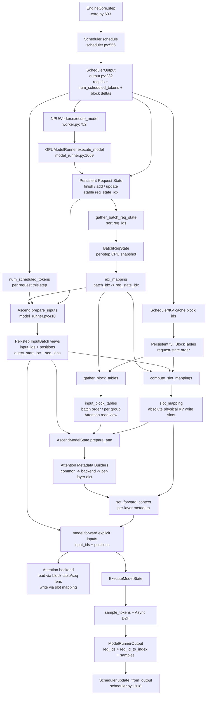

# DSpark KV 滑动窗口：MRV1 → MRV2 读码笔记

> 本文件按阶段持续增量更新。
>
> 任务说明：`/Users/wenqingzhang/Desktop/Note/MRV2/DSpark_sliding_window_v1_to_v2.md`
>
> 代码仓库：`/Users/wenqingzhang/Desktop/vllm/vllm-ascend`
>
> **总原则：** 阅读目的不是完整学习整个 vLLM，而是尽快建立 MRV2 普通执行主链，在此基础上定位 DSpark Draft Attention 的数据流，最终为 `draft_window_size` 的 MRV2 适配形成有代码依据的最小修改方案。

## 总体阅读路线

### 阶段 1【已完成】：MRV1 `SlidingWindowAdapter`——理解已有 Feature Contract

目标：

- 理解 `window_size` / `block_size` / `future_offset` 的窗口数学。
- 理解 block-aligned start。
- 明确 MRV1 Sliding Window 修改哪些数据。
- 明确 `slot_mapping`、真实 KV Cache、Target Model 等必须保持不变的不变式。

本阶段正文、结论、代码依据、公式和总结已经完成，后续保持不变。

### 阶段 2【当前下一阶段】：MRV2 普通 ModelRunner 执行主链

本阶段暂时完全忽略 speculative decoding 和 DSpark。

沿以下主线阅读：

```text
EngineCore
→ scheduler.schedule()
→ SchedulerOutput
→ Worker
→ ModelRunner.execute_model()
→ Persistent State / InputBatch 更新
→ Input Preparation
→ input_ids / positions / query_start_loc / seq_lens
→ gather block tables
→ compute slot_mapping
→ build attention metadata
→ model.forward()
→ sampling
→ ModelRunnerOutput
→ Scheduler.update_from_output()
```

重点回答：

- `SchedulerOutput` 向 MRV2 提供什么？
- Persistent Request State 与本轮 Model Input 如何关联？
- `idx_mapping` 的作用是什么？
- `input_ids`、`positions`、`query_start_loc`、`seq_lens` 分别在哪里生成？
- block table 从哪里来？
- `slot_mapping` 在哪里生成？
- attention metadata 如何从上述输入构造？
- `model.forward()` 前完整的数据流是什么？

本阶段只建立普通 MRV2 的骨架，不展开 DSpark。

### 阶段 3【待完成】：把 Speculative Decoding / DSpark 插入 MRV2 主链

沿以下主线阅读：

```text
ModelRunner
→ Speculator
→ AscendDSparkSpeculator
→ prepare_dflash_inputs
→ DraftModelSpeculator._build_draft_attn_metadata
→ Ascend build_attn_metadata
→ DSA MetadataBuilder
→ Draft Attention
```

重点回答：

- ModelRunner 在哪里调用 Speculator？
- Target 路径和 Draft 路径在哪里分叉？
- `AscendDSparkSpeculator.propose()` 的职责是什么？
- `prepare_dflash_inputs` 具体写入哪些 buffer？
- Draft metadata 使用哪些输入？
- eager / PIECEWISE / FULL 是否经过相同 metadata 构建路径？

### 阶段 4【待完成】：专项追踪 Sliding Window 在 MRV2 中最关键的三个输入

三个关键输入：

1. `input_buffers.seq_lens`
2. `input_block_tables[gid]`
3. `seq_lens_cpu_upper_bound`

对每一个变量必须回答：

- 谁创建？
- 谁持有？
- 谁每 Step 更新？
- CPU 还是 NPU？
- 是 Persistent State、persistent buffer，还是 per-step view？
- 谁读取？
- 最终进入哪个 Attention Metadata 字段？
- Graph capture 时是否记录其地址？
- Sliding Window 最合适在哪一步改变其 Draft-visible view？

最终画出三个变量的完整生命周期图。

### 阶段 5【待完成】：专项研究 BlockTable / Slot Mapping 不变式

重点：

- Scheduler/KV Cache Manager 如何得到完整 block table？
- MRV2 如何 gather `input_block_tables`？
- `positions + block table` 如何计算 `slot_mapping`？
- 为什么 `slot_mapping` 必须使用完整 block table？
- 为什么 Sliding Window 必须发生在 `slot_mapping` 语义确定之后？
- Window block table 应该是完整 block table 的什么 view / copy？
- Target 和 Draft 对 block table 的需求有什么不同？

最终形成“完整物理 KV 世界”和“Draft Attention 可见 KV 世界”的边界图。

### 阶段 6【待完成】：专项研究长度状态

重点区分：

- `input_buffers.seq_lens`
- `seq_lens_cpu`
- `_seq_lens_cpu`（如果当前分支存在）
- `seq_lens_cpu_upper_bound`
- `max_seqlen_kv`
- DCP/local seq length（如果相关）

明确 exact value、CPU mirror、upper bound、device state 的差异。

判断 Sliding Window 后哪些长度必须同步变化，哪些绝对不能改变。

### 阶段 7【待完成】：研究 ACL Graph / Graph Capture / Persistent Buffer

重点：

- capture 阶段到底固定哪些 Tensor 地址？
- replay 时哪些 buffer 只更新内容、不换地址？
- `AscendDSAImpl.update_graph_params` 当前行为是什么？
- `input_block_tables`、`seq_lens`、`dspark_swa_indices` 等 buffer 的生命周期。
- 为什么不能每一步临时 `new` / `clone` 一个 Window Tensor 后直接换引用？
- Window BlockTable 是否需要 per-KV-cache-group persistent buffer？
- Window `seq_lens` 应该安全原地修改，还是使用独立 persistent window buffer？

本阶段需要形成“Capture → Replay → Persistent Window Buffer”的设计方案。

### 阶段 8【待完成】：最终 MRV1 → MRV2 Feature Mapping 和设计方案

输出表格：

| Feature 语义 | MRV1 实现 | MRV2 对应数据/模块 | 当前是否缺失 | 建议修改位置 |
| --- | --- | --- | --- | --- |

必须覆盖：

- `draft_window_size` 配置读取
- compatibility check / warning
- Sliding Window 数学
- `seq_lens`
- per-group block table
- CPU upper bound
- `slot_mapping` 不变式
- Target 不受影响
- eager
- PIECEWISE
- FULL graph capture/replay

然后提出最小修改方案。

在完成阶段 8 之前，不正式修改生产代码。

### 阶段 9【待完成】：实现和验证

实现应遵守：

- 最小修改原则。
- 避免 model-specific hack 污染 MRV2 公共主干。
- 优先使用清晰模块边界。
- Window 只作用于 DSpark Draft metadata 构建作用域。
- Target、positions、`slot_mapping`、真实 KV allocation 保持原行为。
- Graph capture/replay 使用地址稳定的 persistent buffer。

验证顺序：

```text
Window 数学单测
→ metadata 单测
→ Window OFF regression
→ eager
→ PIECEWISE
→ FULL graph
→ single request
→ multi request
→ long context
→ correctness
→ acceptance rate
→ latency / throughput
```

---

# 阶段 1：`SlidingWindowAdapter`——吃透 MRV1 窗口数学

## 1. 本阶段要解决什么问题

源码入口：

- `vllm_ascend/spec_decode/utils.py:83-169`
- 构造位置：`vllm_ascend/spec_decode/llm_base_proposer.py:410-452`
- 普通 EAGLE3/DFlash 应用点：`llm_base_proposer.py:1119-1127`
- DSpark 应用点：`llm_base_proposer.py:2588-2609`

这一阶段读完后，应当能够回答下面几个问题：

1. `SlidingWindowAdapter` 到底裁剪了什么？
2. 为什么既要改 `seq_lens`，又要改 `block_table_tensor`？
3. 为什么 `slot_mapping` 绝对不能跟着裁剪？
4. 为什么窗口大小是 `W`，实际保留下来的 token 数却可能大于 `W`？
5. `torch.gather`、`unsqueeze` 和广播在这里分别做了什么？
6. 为什么使用预分配的 `_block_table_clone` 和 `copy_`，而不是每步返回一个新 Tensor？
7. 为什么 DSpark 的 `future_offset` 是 `0`？

先给结论：

> `SlidingWindowAdapter` 只改变 draft attention“能读哪些历史 KV”，不改变 KV cache 的真实存放位置，也不改变 target 模型看到的完整上下文。

它同时维护两类信息：

- **读范围**：`seq_lens` 以及它的 CPU 镜像；
- **读目录**：`block_table_tensor`，即逻辑块到物理 KV block 的映射。

但是它不改：

- **写地址**：`slot_mapping`，即当前 query token 的 KV 应写入哪个绝对 slot。

可以先把它类比成文件系统：

- KV cache 是磁盘上的数据块；
- block table 是“这个请求的第 0、1、2……个逻辑块分别落在哪个物理块”的目录；
- `seq_lens` 告诉 attention 这次最多读多少个 token；
- `slot_mapping` 告诉 `reshape_and_cache` 新 token 写到哪个绝对地址；
- 滑窗只给 draft 模型换一张“从近期开始的目录”，但磁盘本身和新数据的写入地址不变。

## 2. 背景：为什么 vLLM 需要 block table

### 2.1 KV cache 是什么

Transformer 自回归生成时，第 `t` 个 token 做 attention，需要历史 token 的 Key 和 Value。若每一步都重新计算全部历史 K/V，代价会非常高，因此推理系统把历史 K/V 缓存在 KV cache 中。

逻辑上，一个请求的 KV 像连续数组：

```text
token position:  0   1   2   3   4   5   ...
KV cache:       KV0 KV1 KV2 KV3 KV4 KV5 ...
```

但 vLLM 的 PagedAttention 不要求它在物理内存中连续。它把 KV 分成固定大小的 block，再通过 block table 做映射。例如 `block_size = 4`：

```text
请求的逻辑 token 位置：
  block 0 -> token 0..3
  block 1 -> token 4..7
  block 2 -> token 8..11

block_table = [17, 4, 29]

含义：
  请求的逻辑 block 0 存在物理 block 17
  请求的逻辑 block 1 存在物理 block 4
  请求的逻辑 block 2 存在物理 block 29
```

这类似 Java 程序里的 `int[][] pageTable`，每一行对应一个请求，每一列对应该请求的一个逻辑 KV block，单元格的值是物理 block id。

### 2.2 一个 batch 的 block table

如果 batch 中有三个请求，`block_table_tensor.shape` 可能是：

```text
[num_reqs, max_num_blocks]
```

例如：

```text
request 0: [17,  4, 29, 31,  8, ...]
request 1: [ 6, 23,  1,  0,  0, ...]
request 2: [11, 12, 37, 18, 42, ...]
```

这里行是 request，列是该请求的逻辑 block 序号，值是物理 block id。

滑动窗口的任务不是释放前面的物理 block，而是让 draft attention 暂时只拿到类似下面的视图：

```text
full table:     [17, 4, 29, 31, 8, 44, ...]
windowed table:         [29, 31, 8, ...]
```

注意：`29` 在新表中虽然变成第 0 列，但它仍然是物理 block 29。KV 数据没有搬家。

## 3. `CommonAttentionMetadata`：这个 Adapter 改写的对象

MRV1 中，各 attention layer builder 共享一个 `CommonAttentionMetadata`。上游定义在：

```text
/Users/wenqingzhang/Desktop/vllm/vllm/vllm/v1/attention/backend.py:385
```

与本任务最相关的字段是：

| 字段 | 典型 shape | 含义 | 滑窗是否修改 |
| --- | --- | --- | --- |
| `seq_lens` | `[num_reqs]` | 每个请求的 KV 长度，设备 Tensor | 修改 |
| `block_table_tensor` | `[num_reqs, max_blocks]` | 每个请求的物理 KV block 目录 | 修改为窗口视图 |
| `slot_mapping` | `[num_query_tokens]` | 当前 query token 写 KV 的绝对 slot | **不修改** |
| `seq_lens_cpu` | `[num_reqs]` | CPU 长度镜像，某些 builder/backend 使用 | 若存在则修改 |
| `_seq_lens_cpu` | `[num_reqs]` | 另一份内部 CPU 长度镜像 | 若存在则修改 |
| `seq_lens_cpu_upper_bound` | `[num_reqs]` | CPU 上的长度上界 | 若存在则修改 |

MRV1 的优势是这些字段都集中在一个对象上，所以 adapter 可以在 builder 构建 per-layer metadata 之前统一替换。

Java 开发者可以把 `CommonAttentionMetadata` 理解成一个 DTO。不过 Python 这里有两个区别：

1. Python 的类型提示通常不会在运行时自动校验。
2. `SlidingWindowAdapter.apply()` 没有把参数类型写死，而是通过 `getattr`/`setattr` 使用“只要对象具有这些字段就行”的鸭子类型。

因此单测可以用 `types.SimpleNamespace` 临时造一个对象，而不用实现某个 Java interface。

## 4. 类注释先读懂：它承诺了什么

源码 `utils.py:83-99`：

```python
class SlidingWindowAdapter:
    """
    Sliding-window draft attention for the draft model ...
    ...
    Slot-mapping is untouched and still addresses the full, absolute KV cache
    ...
    """
```

这段注释给出了类的契约：

1. 只服务 draft 模型的 attention。
2. 通过两件事限制读取范围：
   - 裁 block table；
   - 截断 FIA 可能读取的所有 KV length。
3. `slot_mapping` 不动，继续使用完整绝对 KV cache。
4. 不同 draft 方法的 `seq_lens` 语义不同，因此需要 `future_offset`。

这里的 FIA 可以先理解为 Ascend 上执行 attention 的算子。它需要至少知道：query 在哪里、KV 有多长、KV blocks 在哪里。

## 5. 构造函数逐行看

源码 `utils.py:101-118`：

```python
def __init__(
    self,
    window_size: int,
    block_size: int,
    max_num_reqs: int,
    future_offset: int,
    device: torch.device,
) -> None:
```

### 5.1 Python 语法与 Java 对照

- `self` 类似 Java 的 `this`，但 Python 实例方法必须显式写出来。
- `window_size: int` 是类型提示，类似 Java 参数类型，但默认不是强制运行时检查。
- `-> None` 表示方法不返回有意义的值，类似 Java `void`。
- Python 不要求提前声明全部成员变量；`self.window_size = ...` 时成员才被绑定到实例。
- `_future_offset` 和 `_block_table_clone` 的单下划线是“内部使用”的命名约定，不是 Java `private` 那样的访问控制。

### 5.2 五个构造参数

| 参数 | 简写 | 含义 |
| --- | --- | --- |
| `window_size` | `W` | 用户配置的 draft 窗口大小，单位是 token |
| `block_size` | `b` | block table 一列对应多少 token；这里必须用 kernel block size |
| `max_num_reqs` |  | 允许的最大 batch request 数，用于一次性预分配 buffer |
| `future_offset` | `K` | 当前 `seq_lens` 之外还需要被窗口覆盖的 draft 位置数 |
| `device` |  | buffer 分配到哪个设备，例如 CPU 或 NPU |

`block_size` 不能随便用逻辑 cache block size。`llm_base_proposer.py:406-408` 从 attention backend 取得 `kernel_block_size`，再于 `:446-451` 传给 adapter。原因是 block table 的列和 attention kernel 真正解释的块粒度必须一致。

### 5.3 `window_blocks`：Python 的整数向上取整写法

```python
self.window_blocks = (window_size + block_size - 1) // block_size
```

`//` 是整数向下除法。对于正整数，下面是常见的向上取整公式：

```text
ceil(a / b) = (a + b - 1) // b
```

如果 `W=128, b=64`：

```text
(128 + 64 - 1) // 64 = 191 // 64 = 2
```

如果 `W=130, b=64`：

```text
(130 + 64 - 1) // 64 = 193 // 64 = 3
```

这等价于 Java 中：

```java
int windowBlocks = (windowSize + blockSize - 1) / blockSize;
```

前提同样是操作数为正整数。

### 5.4 为什么 `max_window_blocks` 还要 `+1`

```python
self.max_window_blocks = self.window_blocks + 1
```

因为窗口起点不能落在一个 block 的中间。实现选择把起点向下对齐到 block 边界，于是可能额外包含窗口左侧最多 `b-1` 个 token。

例如：

```text
W = 128
b = 64
seq_len = 300

理想 token 级窗口起点：300 - 128 = 172
向下对齐后的起点：floor(172 / 64) * 64 = 128
实际保留长度：300 - 128 = 172
```

名义窗口是 128，但因为必须从完整 block 边界开始，实际读 172 个 token。一般有：

```text
windowed_len <= W + b - 1
```

因此输出 block table 要比 `ceil(W/b)` 再多预留一列。当前实现直接使用：

```text
ceil(W/b) + 1
```

这是一个略宽松但安全的上界。

### 5.5 为什么在构造时预分配 clone

```python
self._block_table_clone = torch.zeros(
    (max_num_reqs, self.max_window_blocks),
    dtype=torch.int32,
    device=device,
)
```

它创建二维 Tensor：

```text
shape = [最大请求数, 最大窗口 block 数]
dtype = int32
device = adapter 所在设备
```

预分配有三个作用：

1. 避免每个 decode step 反复申请和释放设备内存。
2. 让输出 Tensor 的内存地址稳定。
3. 为后续 ACL graph capture/replay 做准备；图捕获通常要求参与图的 Tensor 地址稳定。

这与普通 Java 代码里在热循环外复用数组类似：

```java
private final int[][] blockTableClone;
```

但是 Tensor 还包含 device memory、dtype、shape、stride 和异步执行等语义。

## 6. `compute_sliding_window_block_table()` 总览

方法签名：

```python
def compute_sliding_window_block_table(
    self,
    common_attn_metadata,
    out: torch.Tensor,
) -> None:
```

它不返回新 Tensor，而是把结果写进调用者传入的 `out`。这是典型的“out parameter”风格。

输入输出关系：

```text
输入：
  full_block_table                    [num_reqs, full_cols]
  seq_lens                            [num_reqs]

中间结果：
  start_tokens_in_window_rounding     [num_reqs]
  _windowed_seq_lens                  [num_reqs]
  start_block_indices                 [num_reqs]
  src_cols                            [num_reqs, max_window_blocks]

输出：
  out                                 [max_num_reqs, max_window_blocks]
```

整个计算保持在 device 上，没有 `.item()` 或 `.tolist()`。在 NPU 热路径中，这一点很重要，因为把设备标量同步回 CPU 会阻塞异步流水。

## 7. 窗口起点和长度：最核心的两行

源码 `utils.py:131-134`：

```python
self.start_tokens_in_window_rounding = (
    (common_attn_metadata.seq_lens + k_future - w).clamp(min=0) // b
) * b
self._windowed_seq_lens = (
    common_attn_metadata.seq_lens - self.start_tokens_in_window_rounding
)
start_block_indices = self.start_tokens_in_window_rounding // b
```

数学形式：

```text
start = floor(max(seq_lens + K - W, 0) / b) * b
windowed_len = seq_lens - start
start_block = start / b
```

逐步解释：

### 7.1 `seq_lens + K - W`

先算理想的 token 级窗口起点。

- 如果序列还没有窗口长，这个值为负数；
- 如果序列已经很长，这个值表示需要丢掉前面多少 token。

### 7.2 `.clamp(min=0)`

把所有负值改成 0，相当于逐元素执行：

```java
Math.max(value, 0)
```

但这里不是处理单个 `int`，而是并行处理 batch 中所有请求的 Tensor。

### 7.3 `// b * b`

先除以 block size 并向下取整，再乘回来，即向下对齐到 block 边界。

```text
172 // 64 * 64 = 2 * 64 = 128
```

不能直接从 token 172 开始，因为 block table 只能按整列 block 重排，不能表达“从物理 block 中间开始”。

### 7.4 `windowed_len = seq_lens - start`

block table 被裁后，原窗口的第一个 token 在新 metadata 看来成为逻辑位置 0，因此 attention 需要的长度也变成“从对齐后起点到原序列末尾的长度”。

这里最容易犯的错误是只裁 block table，却仍把旧的完整 `seq_lens` 传给 FIA。那样 FIA 会按照旧长度继续向后读，可能越过窗口表的有效列。

反过来，只改 `seq_lens` 而不移动 block table 的起始列也不行：FIA 会从 block table 第 0 列开始读取较短长度，结果读到的是**最老的 KV**，而不是最近的 KV。

## 8. 数值例子：`W=128, b=64, K=0, seq_len=300`

这是 `tests/ut/spec_decode/test_utils.py:192-214` 使用的例子。

### 8.1 算 token 起点

```text
ideal_start = 300 + 0 - 128 = 172
aligned_start = floor(172 / 64) * 64 = 128
```

### 8.2 算窗口长度

```text
windowed_len = 300 - 128 = 172
```

### 8.3 算起始 block

```text
start_block = 128 / 64 = 2
```

假设完整表是：

```text
full_block_table = [[0, 1, 2, 3, 4, 5, 6, 7, 8, 9]]
```

那么窗口表应从第 2 列开始：

```text
windowed_block_table = [[2, 3, 4]]
```

为什么是 3 个块？

```text
needed = ceil(172 / 64) = 3
```

最后一块只使用其中一部分，但仍必须把整个物理 block id 传给 kernel。

现在两项信息是配套的：

```text
block table 起点：原逻辑 block 2
KV length：172
```

FIA 从物理 block 2 对应的 KV 开始，按 172 个 token 的长度读取。

## 9. 构造列索引：`arange`、`unsqueeze` 和广播

源码 `utils.py:136-139`：

```python
cols = torch.arange(
    self.max_window_blocks,
    device=self.full_block_table.device,
).unsqueeze(0)
src_cols = start_block_indices.unsqueeze(1) + cols
```

### 9.1 `torch.arange(n)`

产生：

```text
[0, 1, 2, ..., n-1]
```

假设 `max_window_blocks=3`：

```text
torch.arange(3) -> shape [3] -> [0, 1, 2]
```

源码注释写的是 `[1, max_window_blocks]`，这里的 `1` 表示 shape 的第一维大小，不是数值从 1 开始。更准确的注释应是：

```text
0-based column offset grid with shape [1, max_window_blocks]
```

### 9.2 `.unsqueeze(0)`

在第 0 维插入一个长度为 1 的维度：

```text
before: shape [3]    [0, 1, 2]
after:  shape [1,3] [[0, 1, 2]]
```

可以把它理解为 Java 中把 `int[]` 变成只有一行的 `int[][]`，但它通常只是创建 view，不复制底层数据。

### 9.3 `start_block_indices.unsqueeze(1)`

假设 batch 有三个请求：

```text
start_block_indices = [2, 0, 5]        shape [3]
unsqueeze(1)        = [[2], [0], [5]]  shape [3,1]
```

### 9.4 广播相加

```text
[[2],        [[0, 1, 2]]       [[2, 3, 4],
 [0],   +                      = [0, 1, 2],
 [5]]                            [5, 6, 7]]

shape [3,1] + shape [1,3] -> shape [3,3]
```

这就是 PyTorch broadcasting。没有显式写双层 `for` 循环，但语义相当于：

```java
for (int req = 0; req < numReqs; req++) {
    for (int col = 0; col < maxWindowBlocks; col++) {
        srcCols[req][col] = startBlockIndices[req] + col;
    }
}
```

区别是 Tensor 运算会交给底层 kernel 并行执行。

## 10. `gather`：按每一行自己的列索引取值

源码 `utils.py:140-147`：

```python
src_cols_clamped = src_cols.clamp(max=full_cols - 1)
gathered = torch.gather(self.full_block_table, 1, src_cols_clamped)
```

`torch.gather(input, dim=1, index=...)` 表示：行号保持不变，每一行按照 `index` 指定的列号取值。

例子：

```text
full_block_table =
[[10, 11, 12, 13, 14],
 [20, 21, 22, 23, 24]]

src_cols =
[[2, 3, 4],
 [0, 1, 2]]

gathered =
[[12, 13, 14],
 [20, 21, 22]]
```

等价的 Java 伪代码是：

```java
gathered[req][col] = fullBlockTable[req][srcCols[req][col]];
```

### 10.1 为什么先 clamp

如果某个请求靠近 full table 末尾，`src_cols` 可能含有越界列。`torch.gather` 遇到越界索引会报错，所以先执行：

```python
src_cols_clamped = src_cols.clamp(max=full_cols - 1)
```

越界列暂时被替换为最后一个合法列，确保 gather 能执行。

但这只是在保证内存访问安全，并不代表最后一个合法块应该被重复使用。真正的语义正确性由后面的 `valid_mask` 保证：越界位置最终会被置 0。

这是常见的 device 端无分支处理方式：

1. 先把所有索引变成内存安全的索引；
2. 执行统一的向量化读取；
3. 用 mask 清掉逻辑上无效的结果。

## 11. `needed` 和 `valid_mask`

源码：

```python
needed = torch.clamp(
    (self._windowed_seq_lens + b - 1) // b,
    max=self.max_window_blocks,
).unsqueeze(1)

valid_mask = (cols < needed) & (src_cols < full_cols)
```

### 11.1 `needed`

对每个请求计算窗口长度需要几个 block：

```text
needed = ceil(windowed_len / b)
```

再限制不超过预分配 buffer 的列数。

假设两个请求的 `windowed_len` 分别为 172 和 60，`b=64`：

```text
needed = [3, 1]
unsqueeze(1) -> [[3], [1]]
```

### 11.2 `(cols < needed)`

通过广播得到每行自己的有效列：

```text
cols = [[0, 1, 2]]
needed = [[3], [1]]

cols < needed =
[[True, True,  True ],
 [True, False, False]]
```

### 11.3 `(src_cols < full_cols)`

进一步排除完整 block table 范围外的列。

### 11.4 `&`

这里的 `&` 是 Tensor 的逐元素逻辑与，不是 Python 标量逻辑运算 `and`。

这是 Java 转 Python 时容易混淆的一点：

- Python 标量条件：`a and b`
- PyTorch Tensor 逐元素条件：`a & b`

Tensor 通常不能直接用于 `and`，因为一个多元素 Tensor 的整体真假含义不明确。

## 12. 写入持久 buffer：为什么是 `copy_`

```python
out[:num_reqs].copy_(gathered * valid_mask.to(gathered.dtype))
```

拆开看：

1. `valid_mask` 是 bool Tensor；
2. `.to(gathered.dtype)` 把 `True/False` 转成 `1/0`；
3. 与 `gathered` 相乘，把无效位置清零；
4. `out[:num_reqs]` 只取真实 batch 对应的行；
5. `.copy_(...)` 把值原地写入既有 buffer。

PyTorch 中，名字以 `_` 结尾的方法通常表示 in-place 操作，例如：

- `copy_`
- `add_`
- `clamp_`
- `zero_`
- `fill_`

需要区分两种操作：

```python
out = new_tensor       # 变量重新指向另一个 Tensor，地址可能变化
out.copy_(new_tensor)  # 原 Tensor 地址不变，只覆盖其中的值
```

对 ACL graph 来说，第二种更重要，因为图捕获后往往要求地址保持稳定。

被 mask 成 0 的列为什么安全？因为同一个请求的 `windowed_len` 已同步缩短，FIA 不应该读取 `needed` 之外的列。这里的 0 只是 padding 值，不表示让 FIA 真正去读取物理 block 0。

## 13. `apply()`：把计算结果装回 metadata

源码 `utils.py:149-169`。

### 13.1 保存完整 block table

```python
self.full_block_table = common_attn_metadata.block_table_tensor
```

这里没有复制 Tensor，只是保存 Python 对象引用，类似 Java：

```java
this.fullBlockTable = metadata.blockTableTensor;
```

保存它是为了后续计算 `slot_mapping` 时仍能找到完整绝对 KV 地址。

值得注意的是，`full_block_table` 没有在 `__init__` 中声明，而是在第一次 `apply()` 时动态创建。Python 允许这样做，但也意味着如果错误地在 `apply()` 前直接调用 `compute_sliding_window_block_table()`，访问 `self.full_block_table` 会触发 `AttributeError`。

### 13.2 计算并替换 block table 视图

```python
self.compute_sliding_window_block_table(
    common_attn_metadata,
    self._block_table_clone,
)
common_attn_metadata.block_table_tensor = (
    self._block_table_clone[:num_reqs]
)
```

第二行是字段重新绑定：metadata 从完整表改为指向持久 clone 的前 `num_reqs` 行。

`self._block_table_clone[:num_reqs]` 通常是 view，与底层持久 buffer 共享 storage，不会复制数据。

### 13.3 替换设备长度

```python
common_attn_metadata.seq_lens = self._windowed_seq_lens
```

同样是重新绑定，不是原地修改原始 `seq_lens`。这点很关键：其他仍持有旧 Tensor 引用的对象不会自动看到这个字段重绑定。

### 13.4 用鸭子类型更新可选 CPU 字段

```python
for name in (
    "seq_lens_cpu",
    "_seq_lens_cpu",
    "seq_lens_cpu_upper_bound",
):
    src = getattr(common_attn_metadata, name, None)
    if src is not None:
        _windowed = src - (
            (src + k_future - w).clamp(min=0) // b
        ) * b
        setattr(common_attn_metadata, name, _windowed)
```

对应 Java 直觉，可以把它理解成对三个可选字段执行同一个 helper；只是 Python 用字段名字符串减少重复代码。

- `getattr(obj, name, None)`：读取名为 `name` 的属性；不存在则返回 `None`。
- `setattr(obj, name, value)`：把名为 `name` 的属性设为 `value`。
- `None` 类似 Java 的 `null`。

为什么三个 CPU 字段必须使用同一套公式？因为不同 attention backend 或不同执行路径可能选择不同长度来源。如果只改 NPU `seq_lens`，某个 builder 却读取未修改的 CPU mirror，窗口就会静默失效；更糟时还会造成 block table 与长度不一致。

注意：这里虽然变量名叫 `_windowed`，前导下划线只是局部命名风格，不影响功能。

## 14. 从类内部实现切换到 MRV1 系统集成：这一部分在解释什么

前 1～13 节主要是在回答：

> `SlidingWindowAdapter` 这个类内部如何计算窗口？

从本节开始，问题切换为：

> 这个类在 MRV1 投机推理系统里什么时候创建、拿到什么输入、在哪里调用，以及调用结果最终被谁消费？

所以，原来的 `future_offset`、`slot_mapping` 和“DSpark 为什么有单独 apply 位置”并不是三个互不相关的补充知识，而是在回答集成层面的三个不同问题：

| 问题 | 对应内容 |
| --- | --- |
| 构造 adapter 时应该传什么参数？ | `future_offset` 由各 draft 方法的 `seq_lens` 语义决定 |
| adapter 改完 metadata 后，哪些下游数据必须继续使用完整表？ | `slot_mapping` 必须通过 `full_block_table` 计算 |
| adapter 应该在调用链的哪个时刻执行？ | EAGLE3/DFlash 用公共 apply 点；DSpark 必须等 per-group 表就位后执行 |

因此，这一部分确实是在讲滑动窗口类的具体应用，但原结构缺少两块内容：

1. MRV1 一轮投机推理的完整大流程；
2. `SlidingWindowAdapter` 在生产代码中的全部使用点和生命周期。

下面先把这两块补齐，再分别解释 `future_offset`、`slot_mapping` 和 DSpark apply 点。

## 15. MRV1 中为什么需要它：先看投机推理的大背景

### 15.1 draft 模型和 target 模型分别负责什么

投机推理中有两个角色：

- **draft 模型**较小、较快，一次提出若干候选 token；
- **target 模型**较大、结果权威，验证候选 token，并保证最终采样分布正确。

可以类比为：

```text
draft 模型：先快速写一份草稿
target 模型：逐项审核草稿，接受正确前缀，拒绝后续错误项
```

投机推理能加速的前提，是 draft 提出的候选有足够高的接受率。如果长上下文让 draft 模型的接受率从约 5 个 token 降到约 1 个 token，那么多跑一次 draft 模型反而可能成为额外开销。

`draft_window_size` 针对的正是这个问题：某些 draft 模型只在较短上下文上训练，在 32k 等长上下文中读取完整 KV 会进入训练分布之外。让它只读取最近 `W` 个 token，可能把接受率恢复到短上下文水平。

但 target 模型仍然必须读取完整上下文，否则会改变最终生成质量。因此 adapter 的边界是：

```text
只改变 draft attention 的读取视图
不改变 target attention
不物理删除旧 KV
不改变新 KV 的绝对写入位置
不参与拒绝采样算法
```

### 15.2 初始化阶段：adapter 什么时候创建

完整初始化链如下：

```text
NPUModelRunner._set_up_drafter()
  └─ 根据 speculative_config 选择 AscendDSparkProposer、
     AscendDflashProposer、AscendEagleProposer 等

NPUModelRunner.load_model()
  ├─ 加载 target model
  └─ drafter.load_model(target_model)
       └─ AscendSpecDecodeBaseProposer.load_model()
            ├─ 找出 draft attention layers
            ├─ 从 attention backend 得到 kernel_block_size
            ├─ 读取 AscendConfig.draft_window_size
            ├─ 决定 future_offset
            └─ 构造 SlidingWindowAdapter
```

对应源码：

- `model_runner_v1.py:697-737`：选择 drafter；
- `model_runner_v1.py:4386-4389`：加载 drafter；
- `llm_base_proposer.py:370-452`：加载 draft model 并构造 adapter。

这里有一个容易被旧文档行号误导的细节：

- proposer 的 `__init__` 只在 `llm_base_proposer.py:308-309` 把 `draft_window_size` 和 `sliding_window` 初始化为 `None`；
- 真正的 `SlidingWindowAdapter(...)` 构造发生在 `load_model()`，因为只有找到 draft attention backend 后，才能确定正确的 `kernel_block_size`。

若配置没有设置 `draft_window_size`，`self.sliding_window` 会一直是 `None`，后面的窗口分支全部跳过，保持原行为。

MTP 也不会创建 adapter，因为 MTP 复用 target 自己的层。若对它窗口化，就可能同时窗口化 target，这与功能边界冲突。

### 15.3 每个 decode step 的上层流程

进入稳态生成后，一轮大致是：

```text
target model forward
  ↓
target logits / hidden states
  ↓
rejection sampler 验证上一轮 draft token，并得到本轮有效 token
  ↓
NPUModelRunner.sample_tokens()
  ↓
NPUModelRunner.propose_draft_token_ids()
  ↓
drafter._propose()
  ↓
draft model 提出下一轮候选 token
  ↓
下一轮再由 target model 验证
```

这里要注意时间关系：在稳态流水中，本轮 target 主要验证上一轮的 draft；验证和采样完成后，drafter 再为下一轮生成候选。

`SlidingWindowAdapter` 只位于 `drafter._propose()` 内部，影响下一轮候选的生成。它不参与 target logits 的计算，也不参与 rejection sampler 对候选的接受/拒绝判断。

### 15.4 进入 drafter 前：runner 准备完整 metadata

MRV1 runner 会根据当前 batch 和 KV cache group 构建 `CommonAttentionMetadata`。对 DSpark，它还会把每个 KV cache group 的完整 block table 和 slot mapping 保存进 proposer：

```python
self.drafter.set_per_group_attn_metadata(
    kv_cache_gid,
    cm.block_table_tensor,
    cm.slot_mapping,
)
```

位置在 `model_runner_v1.py:3794-3843`。

这一步传进去的是完整信息，还没有应用 `draft_window_size`。这是合理的，因为：

1. runner 仍需要用完整 metadata 服务 target；
2. slot mapping 必须基于完整表；
3. DSpark 不同 cache group 可能拥有不同 block table；
4. 窗口只应在 draft metadata 即将构建时生效。

### 15.5 `_propose()` 内部：窗口真正进入数据流

`NPUModelRunner.propose_draft_token_ids()` 最终在 `model_runner_v1.py:2039-2056` 调用：

```python
draft_token_ids = self.drafter._propose(
    ...,
    common_attn_metadata=common_attn_metadata,
    ...,
)
```

进入 `llm_base_proposer.py:950` 的 `_propose()` 后，关键顺序是：

```text
1. set_inputs_first_pass(...)
   ├─ 准备 draft input_ids / positions / hidden states
   ├─ 准备 query slot mappings
   └─ DFlash/DSpark 把 query stretch 加进 seq_lens

2. 根据 eager/full-graph 情况调整 batch padding 和 metadata shape

3A. EAGLE3 / DFlash：
    sliding_window.apply(common_attn_metadata)

3B. DSpark：这里先跳过

4. 把 seq_lens / slot_mapping 等复制到 proposer 的持久 step buffer

5. build_draft_attn_metadata(...)
   ├─ 遍历 draft_attn_groups
   ├─ DSpark 换成当前 group 的完整 block table
   ├─ DSpark 在这里 sliding_window.apply(...)
   └─ builder 构建每层真正交给 FIA 的 attention metadata

6. 必要时构建后续 draft step 的 metadata

7. set_ascend_forward_context(...)

8. draft model forward

9. 根据 draft logits 产生 draft_token_ids
```

adapter 正好位于“draft 输入已经准备好”和“per-layer attention metadata 尚未构建”之间。这是最关键的时机：

- 太早：还不知道 DSpark 当前 group 真正使用哪张表；
- 太晚：builder 已把长度和 block table 烘进最终 per-layer metadata，再改公共对象已经无效。

### 15.6 对 EAGLE3/DFlash 的公共路径

在 `llm_base_proposer.py:1119-1127`：

```python
if (
    self.draft_window_size is not None
    and self.method not in ("dspark", "mtp")
):
    self.sliding_window.apply(common_attn_metadata)
```

这时：

1. `set_inputs_first_pass()` 已完成，各方法的 `seq_lens` 语义已经确定；
2. graph padding 等 shape 调整已经完成；
3. EAGLE3/DFlash 后续 builder 会继续使用当前这张 block table；
4. per-layer metadata 尚未构建。

所以这是它们共同的正确切入点。

### 15.7 对 DSpark 的 per-group 路径

DSpark 的 draft attention layers 可能分布在多个 KV cache group。`build_draft_attn_metadata()` 会遍历 group，并在每轮将 `common_attn_metadata.block_table_tensor` 换成当前 group 的完整表。

因此 DSpark 的顺序必须是：

```text
runner 保存每个 group 的完整表
  ↓
_propose() 的公共 apply 点跳过 DSpark
  ↓
build_draft_attn_metadata() 遍历 group
  ↓
浅拷贝 common metadata
  ↓
装入当前 group 的完整 block table 和 query slot mapping
  ↓
对当前 group 调用 sliding_window.apply()
  ↓
builder.build_for_drafting()
```

这就是 `llm_base_proposer.py:2588-2609` 的作用。

### 15.8 builder 和 draft forward 如何消费结果

adapter 自己不执行 attention。它只准备 builder 输入：

```text
windowed seq_lens
+ windowed block table
+ 未窗口化的 slot_mapping
        ↓
AttentionMetadataBuilder
        ↓
per-layer attention metadata
        ↓
set_ascend_forward_context
        ↓
draft model forward
        ↓
FIA 只读取最近窗口内的 KV
```

因此可以把 `SlidingWindowAdapter` 定位成：

> draft attention metadata 构建前的输入适配器。

它既不是 attention kernel，也不是 KV cache manager，更不是 speculative sampling 算法本身。

### 15.9 后续 draft step 是否会再次 apply

生产代码中只有前面列出的两个 `apply()` 调用点。对于非 parallel drafting 的后续 draft step，`attn_update_stack_num_spec_norm()` 会在已经窗口化的 metadata 基础上递增位置和长度，但不会重新调用 adapter 做窗口起点对齐。

这意味着当前 MRV1 的语义是：

```text
先为本轮 draft 构造一次窗口基准
→ 后续 draft step 在这个基准上演进
```

而不是每个 draft step 都重新计算一次“最新的最近 W 个 token”。这是理解现有实现边界时需要记住的事实，也是在 MRV2 移植时不能无意改变的行为。

## 16. `SlidingWindowAdapter` 在 MRV1 的全部生产使用点

精确搜索类名和 `self.sliding_window` 后，与这个 adapter 直接相关的生产代码全部集中在 `llm_base_proposer.py`：

| 生命周期阶段 | 位置 | 做什么 | 为什么 |
| --- | --- | --- | --- |
| 默认状态 | `:308-309` | `draft_window_size=None`、`sliding_window=None` | 未配置时完全不改变旧路径 |
| 构造 | `:410-452` | 读取配置、检查方法兼容性、决定 `future_offset`、创建 adapter | 此时已经能取得正确 `kernel_block_size` |
| 公共 apply | `:1119-1127` | 对 EAGLE3/DFlash 的共享 metadata 应用窗口 | 这两条路径后续不会换掉当前 block table |
| 保存完整写地址来源 | `:2104-2123` | 计算 slot mapping 时读取 `sliding_window.full_block_table` | KV 写入必须保持绝对地址，不得使用窗口表 |
| DSpark apply | `:2588-2609` | 当前 per-group 完整表装入后再应用窗口 | 防止提前裁出的表被 per-group 覆盖 |

类定义只有一处：

```text
vllm_ascend/spec_decode/utils.py:83-169
```

生产代码中也只有一处 `SlidingWindowAdapter(...)` 构造表达式，即 `llm_base_proposer.py:446`。

仓库中还存在许多名字同样叫 `sliding_window` 的字段，例如模型原生 SWA、attention backend 的 `pre_tokens` 配置和 DSpark 稀疏索引窗口。它们不是这个 `SlidingWindowAdapter` 类的使用点，不能混为一谈。判断方法是搜索精确类名、`sliding_window.apply` 和 `sliding_window.full_block_table`，而不是只搜索单词 `sliding_window`。

测试代码另外覆盖了：

- `tests/ut/spec_decode/test_utils.py:192-214`：NPU/CPU 长度镜像使用同一公式；
- `tests/ut/spec_decode/test_eagle_proposer.py:311-340`：持久 buffer 地址、完整表引用和 batch 数学；
- `tests/ut/spec_decode/test_llm_base_proposer.py:196-231`：从已验证的 AscendConfig 读取 `draft_window_size`。

## 17. `future_offset`：为什么 DSpark 必须是 0

构造位置 `llm_base_proposer.py:437-451`：

```python
future_offset = (
    0
    if self.method in ("dflash", "dspark")
    else self.num_speculative_tokens
)
```

### 17.1 EAGLE3

EAGLE3 这里看到的 `seq_lens` 主要表示 context 长度，待处理的若干 draft query 位置还在它之外。

如果不加 `K`，窗口终点会提前。因此：

```text
future_offset = num_speculative_tokens
```

### 17.2 DSpark / DFlash

DSpark 在 `dspark_proposer.py:313-325` 已经执行：

```python
cad.seq_lens = effective_seq_lens + self.num_query_per_req
```

CPU mirror 也同步执行：

```python
draft_seq_lens_cpu[:batch_size].add_(
    self.num_query_per_req
)
```

也就是说，adapter 看到的 `seq_lens` 已经包含这轮 query stretch。如果再把 speculative token 数加一次，会重复计数，使窗口整体向后偏移。

因此 DSpark 的正确值是：

```text
future_offset = 0
```

可以把 `future_offset` 理解为：

> adapter 当前看到的 `seq_lens` 与“窗口真正应该覆盖到的最终位置”之间，还差多少 token。

不是所有方法都固定取 `num_speculative_tokens`，而是由该方法的 `seq_lens` 语义决定。

## 18. 第二个数值例子：单测中的 batch 向量化计算

`tests/ut/spec_decode/test_eagle_proposer.py:317-340` 使用：

```text
K = 3
W = 64
b = 16
seq_lens = [10, 60, 200, 64]
```

逐请求计算：

| seq_len | `seq+K-W` | clamp 后 | 向下对齐 start | windowed_len |
| ---: | ---: | ---: | ---: | ---: |
| 10 | -51 | 0 | 0 | 10 |
| 60 | -1 | 0 | 0 | 60 |
| 200 | 139 | 139 | 128 | 72 |
| 64 | 3 | 3 | 0 | 64 |

所以得到：

```text
[10, 60, 72, 64]
```

单测同时验证：

1. `cad.block_table_tensor.data_ptr()` 等于预分配 clone 的地址；
2. `adapter.full_block_table` 仍指向原始完整表；
3. NPU/CPU 长度镜像得到一致结果。

这里测试在 CPU 上运行，但 PyTorch Tensor 运算语义与设备端一致，因此可以作为不依赖 NPU 的数学单测。

## 19. 为什么 `slot_mapping` 不允许窗口化

这是整个功能最重要的不变式。

block table 和 `seq_lens` 描述的是：

> draft attention 这次要从哪里开始读、读多长。

`slot_mapping` 描述的是：

> 当前新 token 产生的 K/V 要写入完整 KV cache 的哪个绝对位置。

假设完整序列已经到 position 300，滑窗从 position 128 开始。对 draft attention 来说，可以把 position 128 看成窗口内逻辑起点；但新 token 的 KV 仍必须写到完整序列的 position 300 对应 slot，不能写到窗口内的相对 position 172。

否则会出现：

1. 覆盖已有 KV；
2. target 模型完整上下文被破坏；
3. 下一步切换窗口大小时 KV 地址不再自洽；
4. draft 和 target 对同一请求的 cache 认知不一致。

MRV1 后续计算 slot mapping 时显式选择完整表，位置在 `llm_base_proposer.py:2104-2123`：

```python
if self.sliding_window is not None:
    block_table_for_slot = self.sliding_window.full_block_table
else:
    block_table_for_slot = old_common_metadata.block_table_tensor
```

然后根据绝对 `clamped_positions` 计算：

```python
block_numbers = clamped_positions // block_size
block_ids = block_table_for_slot.gather(
    dim=1,
    index=block_numbers.view(-1, 1),
)
slot_mapping = (
    block_ids * block_size
    + clamped_positions % block_size
)
```

这套公式很好理解：

```text
逻辑 block 序号 = position // block_size
块内偏移          = position % block_size
绝对 slot         = 物理 block id * block_size + 块内偏移
```

## 20. 为什么 DSpark 有自己的 apply 位置

普通 EAGLE3/DFlash 在 `llm_base_proposer.py:1119-1127` 应用窗口：

```python
if (
    self.draft_window_size is not None
    and self.method not in ("dspark", "mtp")
):
    self.sliding_window.apply(common_attn_metadata)
```

DSpark 被跳过，因为 DSpark 是 per-KV-cache-group 处理 block table。稍后在 `llm_base_proposer.py:2588-2609`，它会先用当前 group 的完整表覆盖字段：

```python
common_attn_metadata = copy.copy(common_attn_metadata)
common_attn_metadata.block_table_tensor = per_group_block_table
self.sliding_window.apply(common_attn_metadata)
attn_metadata = builder.build_for_drafting(...)
```

正确顺序必须是：

```text
拿到当前 group 的完整 block table
        ↓
对当前 group 的表应用窗口
        ↓
构建该 group/layer 的 attention metadata
```

如果提前在公共入口裁表，DSpark 随后又用 per-group 完整表覆盖它，那么刚才裁出的表会被丢掉；但 `seq_lens` 已经被截短。结果变成：

```text
短 seq_lens + 从第 0 列开始的完整 block table
```

FIA 读到的将是最老的 blocks，滑窗方向完全反了。

### 20.1 `copy.copy` 为什么够用

这里使用浅拷贝：

```python
common_attn_metadata = copy.copy(common_attn_metadata)
```

浅拷贝只复制外层 Python 对象，里面的 Tensor 起初仍是同一对象。但是 `apply()` 主要对字段做重新绑定：

```python
metadata.seq_lens = new_tensor
metadata.block_table_tensor = new_view
```

重新绑定发生在浅拷贝对象上，不会把调用方对象的字段引用一起改掉。若这里对共享 Tensor 数据执行无保护的 in-place 修改，浅拷贝就未必安全，这是阅读 Python 对象语义时需要留意的地方。

## 21. 从 Java 转 Python/PyTorch需要特别记住的语法

### 21.1 切片通常是 view

```python
x[:num_reqs]
```

通常不复制底层数据，而是得到共享 storage 的 view。修改 view 可能影响原 Tensor。

### 21.2 赋值、clone 与 copy_ 不同

```python
b = a          # Python 引用赋值，a、b 指向同一 Tensor 对象
b = a.clone()  # 分配新 storage，复制数据
b.copy_(a)     # b 的 storage 不变，把 a 的数据写进 b
```

### 21.3 Tensor 运算是逐元素运算

```python
tensor + 3
tensor // 64
tensor < limit
```

都对每个元素执行，而不是对容器对象执行 Java 式方法调用循环。

### 21.4 shape 是阅读 Tensor 代码的第一线索

每看到一行 Tensor 代码，先在旁边写 shape：

```text
seq_lens                         [R]
start_block_indices.unsqueeze(1) [R, 1]
cols                             [1, C]
src_cols                         [R, C]
block_table                      [R, F]
gathered                         [R, C]
```

其中：

- `R = num_reqs`
- `C = max_window_blocks`
- `F = full_cols`

如果 shape 对不上，代码要么依赖广播，要么存在 bug。

### 21.5 Python 的动态属性

```python
getattr(obj, "field", None)
setattr(obj, "field", value)
```

类似 Java 反射，但更日常。优点是适配多个 metadata 变体方便；缺点是 IDE 和静态检查更难发现拼写错误。

## 22. 当前实现中值得留意的边角

1. `utils.py:136` 的注释容易误读。`torch.arange` 实际从 0 开始；`[1, max_window_blocks]` 应理解为 shape。
2. `full_block_table` 是第一次 `apply()` 时才产生的动态属性。
3. `full_block_table` 是可变 side channel；同一个 adapter 连续处理多个 group 后，它最终指向最后一个 group 的完整表。因此不要在 DSpark group 循环外假定它仍代表某个特定 group。
4. 构造函数当前没有显式校验 `window_size > 0`、`block_size > 0`。
5. `_block_table_clone` 只覆盖 `[:num_reqs]` 的行；后面未使用的预分配行可能保留旧数据，但 metadata 只暴露真实 request 行，因此不应被读取。
6. 输出表的 padding 位置用 0 填充。正确性依赖“对应长度也被同步截断”，使这些列永不被 FIA 读取。
7. 当前 MRV1 adapter 只有一份 `_block_table_clone`。MRV2 的 DSpark 需要特别考虑多个 KV cache group 和 ACL graph 地址稳定性，很可能要为每个 group 持有独立持久 buffer。

## 23. 用一句伪代码概括整个类

```text
for each request:
    aligned_start = floor(max(seq_len + future_offset - W, 0) / b) * b
    windowed_len = seq_len - aligned_start
    start_block = aligned_start / b

    windowed_block_table = full_block_table[
        start_block : start_block + ceil(windowed_len / b)
    ]

metadata.block_table = persistent_windowed_clone
metadata.seq_lens = windowed_len
metadata.cpu_length_mirrors = same_window_formula(...)

# metadata.slot_mapping stays unchanged and continues to use full_block_table
```

真正的代码没有 Python `for each request`，而是用 Tensor broadcasting 和 `gather` 一次处理整个 batch。

## 24. 本阶段最终心智模型

不要把 `SlidingWindowAdapter` 理解成“删除旧 KV”。当前 MRV1 实现没有释放物理 KV block，它只是给 draft attention 构造一个近期视图：

```text
完整 KV cache / 完整 block table
          ├── target attention：继续读取完整上下文
          ├── slot_mapping：继续按绝对位置写入完整 KV
          └── draft attention：
                ├── block table 从近期 block 开始
                └── KV length 改为窗口内长度
```

所以它更接近“逻辑读取窗口”，不是“物理 KV 逐出”。

## 25. 自测题

读完后可以自行回答：

1. `W=100, b=64, K=0, seq_len=250` 时，`start`、`windowed_len`、`needed` 分别是多少？
2. 为什么 `src_cols_clamped` 之后还必须有 `valid_mask`？
3. 为什么只改 `seq_lens` 会读到旧 blocks？
4. 为什么只改 block table、不改 `seq_lens` 可能越界？
5. `out = gathered` 和 `out.copy_(gathered)` 对图捕获有什么不同？
6. 为什么 DSpark 不能在公共 EAGLE3/DFlash 应用点直接调用 adapter？
7. 为什么 DSpark 的 `future_offset` 为 0，但 EAGLE3 不是？

### 参考答案 1：计算 `start`、`windowed_len` 和 `needed`

```text
ideal_start = 250 - 100 = 150
start = floor(150 / 64) * 64 = 128
windowed_len = 250 - 128 = 122
needed = ceil(122 / 64) = 2
```

### 参考答案 2：为什么 clamp 后还需要 `valid_mask`

`src_cols_clamped` 只解决“内存访问是否合法”，不解决“这个值在逻辑上是否应该存在”。

例如完整表只有 5 列：

```text
full_cols = 5
合法列号 = 0..4
src_cols = [4, 5, 6]
```

为了不让 `torch.gather` 越界，clamp 后得到：

```text
src_cols_clamped = [4, 4, 4]
```

如果直接使用 gather 结果，最后一个物理 block 会被错误重复三次。`valid_mask` 中的：

```python
src_cols < full_cols
```

会把原始列号 5、6 对应的位置清零。

另外，预分配的 `max_window_blocks` 是所有请求共享的最大宽度，但短请求可能只需要一两个 block，因此还需要：

```python
cols < needed
```

清掉“虽然没有越过完整表，但超出当前请求实际所需 block 数”的列。

所以两个步骤的职责不同：

```text
clamp：保证 gather 不发生非法内存索引
mask：保证 gather 结果符合真实窗口语义
```

### 参考答案 3：为什么只改 `seq_lens` 会读到旧 blocks

`seq_lens` 只告诉 FIA“读取多少 token”，没有告诉它“从完整表的哪一列开始”。

以前面的例子为例：

```text
full block table = [0, 1, 2, 3, 4, ...]
完整 seq_len = 300
窗口计算得到 windowed_len = 172
正确 start_block = 2
```

如果只把长度改为 172，block table 仍从第 0 列开始，那么 FIA 会读取：

```text
[0, 1, 2]
```

也就是序列最前面的旧 KV。正确的近期窗口应该读取：

```text
[2, 3, 4]
```

因此 `seq_lens` 和 block table 起始列必须一起改变。

### 参考答案 4：为什么只改 block table、不改 `seq_lens` 可能越界

窗口表只保留少量列，但旧 `seq_lens` 仍声称有完整长度。

例如：

```text
窗口表 = [2, 3, 4]       # 只有 3 个 block
block_size = 64
旧 seq_lens = 300
```

旧长度需要：

```text
ceil(300 / 64) = 5 个 block
```

但是传给 FIA 的窗口表只有 3 个有效 block。这样 backend/kernel 可能继续索引第 4、5 列，读取 padding、旧数据，甚至发生越界；具体表现取决于 metadata builder 和 kernel 的实现。

即使底层为了安全没有直接越界，这两项 metadata 的语义仍然互相矛盾：表表示“只有近期 3 个块”，长度却表示“这里有 300 个 token”。所以必须把长度同步改为 `windowed_len`。

### 参考答案 5：`out = gathered` 和 `out.copy_(gathered)` 对图捕获有什么不同

```python
out = gathered
```

只是让 Python 变量 `out` 改为引用 `gathered`。如果 `gathered` 是本轮新产生的 Tensor，它的 `data_ptr()` 可能和捕获时使用的地址不同，原先预分配的持久 buffer 也没有被更新。

```python
out.copy_(gathered)
```

则把数据写进原来的 `out` storage：

```text
out 的对象/底层地址保持不变
out 的内容更新为本轮结果
```

ACL/CUDA graph 在 capture 时会记录参与运算的 Tensor 地址。replay 时如果 metadata 改为指向一个新 Tensor，图仍可能读取捕获时的旧地址；使用预分配 buffer 加 `copy_` 可以让地址稳定，只更新值。

可以类比 Java：

```java
out = newArray;                    // 引用换了
System.arraycopy(src, 0, out, ...); // 原数组对象不换，只覆盖内容
```

### 参考答案 6：为什么 DSpark 不能在公共 EAGLE3/DFlash 应用点直接调用 adapter

DSpark 的 draft attention 按 KV cache group 使用不同 block table。在公共 apply 点之后，`build_draft_attn_metadata()` 还会执行：

```python
common_attn_metadata.block_table_tensor = per_group_full_block_table
```

如果 DSpark 也在公共点调用 adapter：

```text
公共点裁出窗口表
  ↓
seq_lens 已变成 windowed_len
  ↓
进入 DSpark group 分支
  ↓
block_table_tensor 被当前 group 的完整表覆盖
```

最终 builder 看到的是：

```text
短的窗口长度 + 从第 0 列开始的完整表
```

它会读取最老的 blocks，而不是最近的 blocks。

所以 DSpark 必须跳过公共点，等当前 group 的完整表装入后，再立刻调用 adapter，然后再执行 `builder.build_for_drafting()`。

### 参考答案 7：为什么 DSpark 的 `future_offset=0`，EAGLE3 不是

关键不在模型名字，而在 adapter 调用时 `seq_lens` 已经表示什么。

EAGLE3 路径中，adapter 看到的 `seq_lens` 主要是 context 长度，未来的 `K=num_speculative_tokens` 个 draft 位置还没有包含在里面。窗口终点必须覆盖到 `seq_lens + K`，因此：

```text
future_offset = K
```

DSpark/DFlash 的 `set_inputs_first_pass()` 已经把 query stretch 加入：

```python
cad.seq_lens = effective_seq_lens + self.num_query_per_req
```

adapter 看到的长度已经到达本轮 draft query 的末端，再加 `K` 会重复计数，导致窗口起点错误地继续右移。因此：

```text
future_offset = 0
```

一句话记忆：

```text
future_offset = 窗口真实终点 - adapter 当前看到的 seq_lens 终点
```

---

## 26. 阶段 1 最终纵向调用链：从 target ModelRunner 到 DSpark `model.forward()`

> 本节是阶段 1 的最后一次补充，只纵向追踪当前本地源码中的真实调用链，不再横向介绍 MRV1 的其他组成部分。
>
> 行号均以这次阅读时本地 checkout 为准。由于工作目录本身没有可读取的 Git 元数据，这里不写 commit hash；以后源码发生增删时，应以函数名和关键语句重新定位，不能只依赖行号。

### 26.1 先给结论：窗口处在整条链路的哪一段

DSpark 的纵向主链可以压缩成下面这张图：

```text
NPUModelRunner.execute_model()
  │
  ├─ _prepare_inputs()
  │    ├─ 生成 target input_ids / positions
  │    ├─ seq_lens = num_computed_tokens + num_scheduled_tokens
  │    └─ 用各 KV cache group 的完整 block table 生成 target slot_mapping
  │
  ├─ _build_attention_metadata()
  │    ├─ 取 group 0 的完整 block_table / slot_mapping 构造 common metadata
  │    ├─ 保存每个 group 的完整 block_table / slot_mapping 给 DSpark
  │    └─ 选出 spec_decode_common_attn_metadata
  │
  ├─ set_ascend_forward_context(target attn_metadata)
  ├─ target model forward
  ├─ 保存 target hidden_states / aux_hidden_states / logits / positions
  │
  └─ NPUModelRunner.sample_tokens()
       ├─ target sampler / rejection sampler 产生 sampled_token_ids
       └─ NPUModelRunner.propose_draft_token_ids()
            ├─ prepare_next_token_ids_padded()
            ├─ prepare_inputs_padded()
            ├─ 按 token_indices 取 target_token_ids / positions / hidden states
            └─ drafter._propose(...)
                 │
                 ├─ combine_hidden_states(target_hidden_states)
                 │
                 ├─ AscendDSparkProposer.set_inputs_first_pass()
                 │    └─ copy_and_expand_dflash_and_dspark_inputs_kernel()
                 │         ├─ 生成 DSpark query input_ids
                 │         ├─ 生成 context/query positions
                 │         ├─ 用完整 per-group block table 生成 query slot_mapping
                 │         └─ 把 seq_lens 改成“有效 target 终点 + DSpark query block”
                 │
                 ├─ build_draft_attn_metadata()
                 │    └─ 对每个 draft attention group：
                 │         ├─ 装入该 group 的完整 block table
                 │         ├─ 装入该 group 的 full-table-based query slot_mapping
                 │         ├─ SlidingWindowAdapter.apply()       ← DSpark 的真实调用点
                 │         └─ AscendDSAMetadataBuilder.build_for_drafting()
                 │              └─ build_req_metadata_for_drafting()
                 │                   └─ 生成该 group / 各 layer 的 AscendDSAMetadata
                 │
                 ├─ set_ascend_forward_context(
                 │      attn_metadata=multi_steps_attn_metadata[0],
                 │      draft_attn_metadatas=multi_steps_attn_metadata,
                 │      is_draft_model=True)
                 │
                 └─ _run_merged_draft()
                      ├─ build_model_inputs_first_pass()
                      │    └─ precompute_and_store_context_kv(target hidden states, ...)
                      ├─ self.model(input_ids=..., positions=...)
                      │    └─ DSpark draft model.forward()
                      └─ DSA attention
                           ├─ KV write：使用 full-table-based slot_mapping
                           └─ KV read ：使用 windowed block_table + windowed seq_lens
```

最重要的边界是：

```text
DSpark input preparation
    先决定“本轮 query 写到绝对序列的什么位置”
                         ↓
    使用完整 block table 生成 slot_mapping
                         ↓
SlidingWindowAdapter.apply()
    只把“draft attention 可以回看哪些 KV”裁成最近窗口
                         ↓
DSA metadata builder
    把两套语义一起固化到最终 per-layer metadata
```

所以，滑动窗口约束的是 **KV read 范围**，不能反过来改变 **KV write 的绝对地址**。

### 26.2 入口：哪个函数开始进入 drafter / proposer

严格区分两个层次：

- 从 ModelRunner 的业务入口看，进入 speculative draft 的函数是 `NPUModelRunner.propose_draft_token_ids()`。
- 真正从通用 ModelRunner 跨入 proposer 对象的方法调用，是 `self.drafter._propose()`。

调用过程如下：

```text
NPUModelRunner.execute_model()
  └─ target model forward
       └─ ExecuteModelState 保存 target 输出

NPUModelRunner.sample_tokens()
  ├─ self._sample(logits, spec_decode_metadata)
  └─ 内部闭包 propose_draft_token_ids(...)
       └─ self.propose_draft_token_ids(...)
            └─ self.drafter._propose(...)
```

#### 函数卡 1：target forward 和输出暂存

- 文件：`vllm_ascend/worker/model_runner_v1.py`
- 函数：`NPUModelRunner.execute_model()`
- 定义起点：第 2170 行
- 关键行：
  - 第 2436—2450 行：调用 `_build_attention_metadata()`。
  - 第 2493—2508 行：为 target model 设置 forward context。
  - 第 2537—2539 行：调用 target `_model_forward()`。
  - 第 2551—2554 行：DSpark 场景拆出 `aux_hidden_states`。
  - 第 2599—2612 行：把 logits、hidden states、positions、spec common metadata 等存入 `ExecuteModelState`。
- 输入：scheduler 本轮调度结果、target 的 input buffers、KV cache 状态。
- 输出：target forward 结果被暂存在 `self.execute_model_state`，留给 `sample_tokens()`。
- 对 sliding window 的作用：不调用 adapter；它产生之后 drafter 所需的 target 数据，并提前构造完整块表语义的 common metadata。

#### 函数卡 2：采样后触发 drafter

- 文件：`vllm_ascend/worker/model_runner_v1.py`
- 函数：`NPUModelRunner.sample_tokens()`
- 定义起点：第 2705 行
- 关键行：
  - 第 2726—2740 行：解包 `ExecuteModelState`。
  - 第 2753—2755 行：target sampler / rejection sampler 产生 `sampled_token_ids`。
  - 第 2769—2790 行：内部闭包调用 `self.propose_draft_token_ids()`，同时传入 target hidden states、aux hidden states、positions 和 common metadata。
- 输入：上一阶段暂存的 target logits、hidden states、attention metadata。
- 输出：触发 drafter，最终保存新一轮 `_draft_token_ids`。
- 对 sliding window 的作用：没有直接裁窗；它把 target forward 的产物送进 drafter 链路。

#### 函数卡 3：ModelRunner 到 proposer 的真正桥梁

- 文件：`vllm_ascend/worker/model_runner_v1.py`
- 函数：`NPUModelRunner.propose_draft_token_ids()`
- 定义起点：第 1839 行
- 关键行：
  - 第 1966—1981 行：padded 路径调用 `prepare_next_token_ids_padded()`。
  - 第 2021—2026 行：调用 `prepare_inputs_padded()`。
  - 第 2027 行：`target_token_ids = self.input_ids.gpu[token_indices]`。
  - 第 2028 行：`target_positions = self._get_positions(token_indices)`。
  - 第 2029—2032 行：按同一批 `token_indices` 取得 target hidden states；DSpark 使用拼接后的辅助层 hidden states。
  - 第 2039—2056 行：调用 `self.drafter._propose(...)`。
- 输入：target 的采样 token、positions、hidden states、spec common metadata，以及 rejection 信息。
- 输出：`draft_token_ids`。
- 对 sliding window 的作用：仍不调用 adapter；负责把 target 坐标系中的数据成套传给 proposer。

### 26.3 target model 的 token、hidden states、positions 怎样进入 DSpark

这里不要把三种数据混成一件事：

| 数据 | ModelRunner 取值 | 传给 `_propose()` 的参数 | DSpark 后续用途 |
|---|---|---|---|
| target token | `self.input_ids.gpu[token_indices]`，第 2027 行 | `target_token_ids` | 供输入展开逻辑识别已有 target context；不是 DSpark 所有 query token 的最终形态 |
| target position | `self._get_positions(token_indices)`，第 2028 行 | `target_positions` | kernel 复制 context positions，并以最后一个有效 target position 为基准生成 query positions |
| target hidden states | `aux_hidden_states` 按同一索引抽取后沿最后一维拼接，第 2029—2030 行 | `target_hidden_states` | `_propose()` 先调用 draft model 的 `combine_hidden_states()`，随后 DSpark 预计算并写入 context KV |
| target 采样结果 | `sampled_token_ids` 经 `prepare_next_token_ids_padded()` 整理 | `next_token_ids` | 成为每个请求第一个 DSpark query 的真实 token；其余并行 query 使用占位 token |

DSpark 在 `_set_up_drafter()` 第 727—729 行设置：

```python
self.use_aux_hidden_state_outputs = True
```

所以 DSpark 的 `target_hidden_states` 并非只取 target 最后一层。第 2029—2030 行把需要的辅助层输出按最后一维拼接，再在 `_propose()` 第 1000—1006 行交给 draft model 的 `combine_hidden_states()` 变成 draft 模型所需的 hidden size。

随后，DSpark 继承 DFlash 的 `build_model_inputs_first_pass()`：

- 文件：`vllm_ascend/spec_decode/dflash_proposer.py`
- 函数：`AscendDFlashProposer.build_model_inputs_first_pass()`
- 行号：第 296—314 行
- 输入：整理后的 target hidden states、context positions、各层 context slot mapping。
- 输出/副作用：调用 `self.model.precompute_and_store_context_kv(...)`，把 target hidden states 投影得到的 context KV 写入正确物理槽位。
- 对 sliding window 的作用：它负责 **写已有 context KV**；写地址依赖完整块表生成的 context slot mapping，而不是窗口后的块表。

因此 target output 进入 drafter 有两条通道：

```text
token / position 通道
target input buffers
  → target_token_ids / target_positions
  → DSpark 展开 kernel
  → draft input_ids / positions

hidden-state 通道
target aux_hidden_states
  → combine_hidden_states()
  → _dflash_hidden_states
  → precompute_and_store_context_kv()
  → draft KV cache
```

### 26.4 `common_attn_metadata` 从哪里来

#### 函数卡 4：target 侧 common metadata 的源头

- 文件：`vllm_ascend/worker/model_runner_v1.py`
- 函数：`NPUModelRunner._build_attention_metadata()`
- 定义起点：第 3454 行
- 关键行：
  - 第 3549—3551 行：从 `self.input_batch.block_table[kv_cache_gid]` 取得设备 block table 与其 slot mapping。
  - 第 3635—3679 行：创建 `AscendCommonAttentionMetadata`。
  - 第 3638 行：写入 `self.seq_lens[:num_reqs_padded]`。
  - 第 3654—3655 行：写入 group 0 的完整 `block_table_tensor` 和 `slot_mapping`。
  - 第 3794—3857 行：遍历 KV cache group；对 group > 0 换成该 group 的 block table / slot mapping。
  - 第 3828—3833 行：调用 DSpark 的 `set_per_group_attn_metadata()`，保存每组完整表和 slot mapping。
  - 第 3836—3848 行：选择 drafter attention layer 对应的那份 `spec_decode_common_attn_metadata`。
- 输入：ModelRunner 当前批次的 seq lengths、query layout、positions、各 KV cache group 块表。
- 输出：target 的 per-layer metadata，以及交给 proposer 的 `spec_decode_common_attn_metadata`。
- 对 sliding window 的作用：此处只提供 **完整** target 布局，不能在 target 侧裁窗。

block table 和 slot mapping 的直接来源分别是：

```python
block_table = self.input_batch.block_table[kv_cache_gid].get_device_tensor()
slot_mapping = self.input_batch.block_table[kv_cache_gid].slot_mapping.gpu
```

也就是说，`common_attn_metadata` 不是 proposer 临时凭空创建的；它是 ModelRunner 为 target attention 构建 metadata 时，额外挑出与 drafter attention group 对应的公共输入。

#### 函数卡 5：padded speculative 路径的整理

- 文件：`vllm_ascend/spec_decode/llm_base_proposer.py`
- 函数：`prepare_next_token_ids_padded()`
- 行号：第 2185—2245 行
- 输入：target sampler 输出的二维 `sampled_token_ids`。
- 输出：每个 request 的 `next_token_ids` 和有效采样 token 数。
- 对 sliding window 的作用：不裁窗；确定 DSpark 每个请求的 seed/bonus token。

- 文件：同上
- 函数：`prepare_inputs_padded()`
- 行号：第 2379—2475 行
- 输入：原始 common metadata、spec decode metadata、有效采样数。
- 输出：新的 common metadata、`token_indices`、`token_indices_to_sample`、`num_rejected_tokens_gpu`。
- 对 sliding window 的作用：它在第 2436—2445 行明确 **不立即修改 `seq_lens`**。被拒绝的尾部 token 暂留作 padding，真正的有效长度修正在 DSpark input preparation 内完成。

### 26.5 `set_inputs_first_pass()` 到底修改了什么

#### 函数卡 6：DSpark 第一轮输入准备

- 文件：`vllm_ascend/spec_decode/dspark_proposer.py`
- 函数：`AscendDSparkProposer.set_inputs_first_pass()`
- 行号：第 226—357 行
- 输入：
  - `target_token_ids`
  - `next_token_ids`
  - `target_positions`
  - 合并后的 `target_hidden_states`
  - `token_indices_to_sample`
  - `cad`，即 common attention metadata
  - `num_rejected_tokens_gpu`
- 输出：`num_tokens`、新的采样索引、修改后的 `cad`、long-sequence 参数。
- 对 sliding window 的作用：它不直接调用 adapter；它把 adapter 即将看到的序列终点、per-group 完整块表和 full-table-based slot mapping 准备好。

它的关键修改可按对象分组理解。

#### 1. 修改 proposer 自己的 input buffers

第 240—243 行把 `next_token_ids` 复制到 DSpark seed buffer。

第 270—307 行对每个 draft attention group 调用真实的 Triton kernel，生成：

- DSpark 展开后的 `self.input_ids`
- context positions
- query positions
- 每组 context slot mapping
- 每组 query slot mapping
- `token_indices_to_sample`

#### 2. 保存每组完整 block table

第 252—256 行把 ModelRunner 之前保存的 `_per_group_block_tables` 放进 `_per_group_block_table_buffers`。这里仍然是完整表，尚未窗口化。

#### 3. 保存 target hidden states

第 258—259 行把 `target_hidden_states` 复制进 `_dflash_hidden_states`，稍后由 `build_model_inputs_first_pass()` 用于 context KV 预计算。

#### 4. 修改 `common_attn_metadata.seq_lens`

第 313—318 行：

```python
effective_seq_lens = cad.seq_lens
if num_rejected_tokens_gpu is not None:
    effective_seq_lens = effective_seq_lens - num_rejected_tokens_gpu

cad.seq_lens = effective_seq_lens + self.num_query_per_req
```

语义变化是：

```text
进入函数时：
  target 本轮 forward 后的逻辑序列终点
  （padded 路径可能仍把被拒绝的 speculative tail 算在其中）

减去 num_rejected_tokens_gpu 后：
  真正被接受/保留的 target 有效终点

加上 num_query_per_req 后：
  本轮 DSpark 并行 query block 结束后的绝对 KV 终点
```

这正是 DSpark 调用 adapter 时 `future_offset=0` 的根本原因：adapter 看到的 `seq_lens` 已经包含将要参与本轮 draft attention 的 query stretch。

#### 5. 修改 common metadata 的其他字段

第 317—349 行还会修改：

- `query_start_loc`：改成每个请求固定 `num_query_per_req` 的等距布局。
- `_seq_lens_cpu` / `seq_lens_cpu`：CPU 镜像同步增加 query 数。
- `_query_start_loc_cpu`：同步成新的 query layout。
- `num_actual_tokens`、`num_input_tokens`、`max_query_len`。
- `slot_mapping`：先指向当前主 group 的 **query slot mapping**。
- `positions`：切换到 DSpark 生成的 positions buffer。
- `attn_state`：设成 `ChunkedPrefill`。
- `causal` / `attn_mask`：按 DSpark draft attention 语义设置。

这里最容易混淆的是：`slot_mapping` 已经换成 DSpark query 的写地址，但 `block_table_tensor` 仍是完整表。真正逐 group 换表并裁窗发生在后面的 `build_draft_attn_metadata()`。

### 26.6 DSpark 的 `input_ids`、`positions` 和 `slot_mapping` 怎样生成

#### 函数卡 7：真实展开 kernel

- 文件：`vllm_ascend/ops/triton/spec_decode/utils.py`
- 函数：`copy_and_expand_dflash_and_dspark_inputs_kernel()`
- 行号：第 69—204 行
- 输入：next token、target positions、原始 context slot mapping、当前 group 的完整 block table、旧 query start locations、旧 seq lengths、rejection 数。
- 输出：展开后的 draft input IDs、context/query positions、context/query slot mappings、采样索引。
- 对 sliding window 的作用：不裁 read window；它必须在裁窗前，以完整表计算绝对 KV 写地址。

kernel 分两段：

1. 第 111—123 行复制 target context 的 positions 和 slot mapping。
2. 第 134—202 行生成 DSpark query block。

对第 `q_idx` 个 query：

```text
position = 最后一个有效 target position + 1 + q_idx
absolute_kv_position = effective_seq_len + q_idx
block_column = absolute_kv_position // block_size
block_id = full_block_table[request, block_column]
slot = block_id * block_size + absolute_kv_position % block_size
```

对应源码证据在第 163—190 行：先由有效序列长度得到 query 的绝对 KV 位置，再通过传入的完整 `input_block_table` 查 `block_id_q`，最终写出 `slot_q`。

DSpark query token 的生成规则在第 192—194 行：

```text
q_idx == 0：使用 next_token_ids[request]
q_idx > 0 ：使用 parallel_drafting_token_id 占位
```

因此，DSpark 不是简单地把 target 的 token 序列再喂一遍 draft model，而是构造一个“真实 seed token + 多个并行占位 query”的固定宽度 query block。

### 26.7 `SlidingWindowAdapter.apply()` 的准确调用位置

#### 函数卡 8：proposer 总调度

- 文件：`vllm_ascend/spec_decode/llm_base_proposer.py`
- 函数：`_propose()`
- 行号：第 950—1335 行
- 输入：ModelRunner 传入的 target token、positions、hidden states、common metadata、采样与 rejection 信息。
- 输出：draft token IDs。
- 对 sliding window 的作用：组织 input preparation、窗口、builder、forward context 和 draft forward 的先后顺序。

关键顺序为：

```text
第 1000—1006 行：combine_hidden_states()
第 1008—1020 行：set_inputs_first_pass()
第 1119—1127 行：EAGLE3/DFlash 等的公共 apply 点；明确排除 DSpark/MTP
第 1142—1158 行：复制 slot_mapping / seq_lens / query_start_loc 到 proposer buffers
第 1163—1165 行：build_draft_attn_metadata()
第 1293—1307 行：set_ascend_forward_context()
第 1324—1331 行：运行 _run_merged_draft()
```

#### 函数卡 9：DSpark 真正的 apply 点

- 文件：`vllm_ascend/spec_decode/llm_base_proposer.py`
- 函数：`build_draft_attn_metadata()`
- 行号：第 2547—2630 行
- DSpark 关键行：第 2588—2610 行
- 输入：已经完成 DSpark input preparation 的 common metadata。
- 输出：`multi_steps_attn_metadata` 和当前/后续 step 的 metadata。
- 对 sliding window 的作用：逐个 draft attention group 换入该组完整数据后，再调用 adapter。

DSpark 分支的准确顺序是：

```python
common_attn_metadata = copy.copy(common_attn_metadata)
common_attn_metadata.block_table_tensor = per_group_full_block_table
common_attn_metadata.slot_mapping = per_group_query_slot_mapping
self.sliding_window.apply(common_attn_metadata)
attn_metadata = builder.build_for_drafting(common_attn_metadata, draft_index=1, ...)
```

对应第 2590—2609 行。

注意这里的 `copy.copy()` 是浅拷贝 metadata 容器，目的是让当前 group 替换字段时不污染外层公共对象；tensor 本身不会被深拷贝。adapter 随后把当前 group 的 `block_table_tensor` 指向窗口 buffer，并把 `seq_lens` 指向窗口长度 buffer。

### 26.8 为什么 DSpark 与 EAGLE/DFlash 的 apply 位置不同

EAGLE/DFlash 走 `_propose()` 第 1119—1127 行的公共 apply 点。此时它们后面的 builder 会继续使用这里已经窗口化的 `common_attn_metadata.block_table_tensor`。

DSpark 不能在这里 apply，因为稍后的 `build_draft_attn_metadata()` 会按 KV cache group 执行：

```python
common_attn_metadata.block_table_tensor = per_group_full_block_table
```

若 DSpark 也在公共点裁窗，顺序会变成：

```text
公共点：block table 和 seq_lens 一起窗口化
                    ↓
DSpark group 分支：block table 被完整 per-group table 覆盖
                    ↓
builder 最终看到：windowed seq_lens + full table 从第 0 列开始
```

这会把“最近 N 个 token”错误映射成“最早 N 个 token”。

所以 DSpark 的正确时机只能是：

```text
确定当前 attention group
  → 换入该 group 的完整 block table
  → 换入该 group 的 query slot mapping
  → apply 当前 group 的窗口
  → 立刻交给该 group 的 builder
```

这不是因为 DSpark 的窗口数学不同，而是因为 DSpark 的 **per-group block table 选择发生得更晚**。

### 26.9 apply 前三个核心字段的准确语义

就在第 2604—2605 行调用 `apply()` 之前：

#### `seq_lens`

它不再只是 target context length，而是：

```text
(target forward 后长度 - 被拒绝的尾部 token 数)
+ DSpark 的 num_query_per_req
```

它代表本轮 DSpark attention 应视为已经延伸到的 **绝对 KV 终点/长度**。因此 adapter 用它直接计算窗口终点，`future_offset=0`。

#### `block_table_tensor`

它来自：

```text
self.input_batch.block_table[kv_cache_gid].get_device_tensor()
  → ModelRunner._build_attention_metadata()
  → DSpark.set_per_group_attn_metadata()
  → DSpark._per_group_block_table_buffers[gid]
  → build_draft_attn_metadata() 为当前 gid 装入
```

此时是当前 KV cache group 的 **完整块表**。

#### `slot_mapping`

它来自：

```text
当前 group 的完整 block table
  + 每个 query 的绝对 KV position
  → copy_and_expand_dflash_and_dspark_inputs_kernel()
  → _per_group_query_slot_mapping_buffers[gid]
  → build_draft_attn_metadata() 为当前 gid 装入
```

此时是当前 group 的 **query KV 写地址**，已经由完整块表算完。`SlidingWindowAdapter.apply()` 不修改它。

### 26.10 windowed 数据最终被哪个 builder 消费

DSpark 使用当前 attention group 返回的 metadata builder。当前 DSA 路径进入：

- 文件：`vllm_ascend/attention/dsa_v1.py`
- 类：`AscendDSAMetadataBuilder`
- 函数：`build_for_drafting()`
- 行号：第 1296—1347 行

#### 函数卡 10：`build_for_drafting()`

- 输入：刚经过 adapter 的 `common_attn_metadata`。
- 读取窗口结果：
  - 第 1313 行：`self.seq_lens = common_attn_metadata.seq_lens`
  - 第 1314 行：`self.block_table = common_attn_metadata.block_table_tensor`
- 读取写地址：
  - 第 1326—1330 行：读取并格式化 `common_attn_metadata.slot_mapping`
- 输出：`AscendDSAMetadata(req_metadata=...)`。
- 对 sliding window 的作用：把窗口后的 read length/read table 与不窗口化的 write slot mapping 合并成最终 DSA metadata。

随后它调用：

- 文件：同上
- 函数：`build_req_metadata_for_drafting()`
- 行号：第 1349—1495 行

#### 函数卡 11：`build_req_metadata_for_drafting()`

- 输入：builder 已保存的 windowed `seq_lens`、windowed `block_table` 和 formatted slot mapping。
- 关键行：
  - 第 1356—1368 行：准备 query locations 和 sequence lengths。
  - 第 1371—1404 行：基于当前 builder 的 block table/seq lengths 准备 DSA 自己的索引数据。
  - 第 1439 行：把 `seq_lens` 作为 `seqused_kv` 交给 metadata op。
  - 第 1474—1485 行：构造 `AscendDSAReqMetadata`，其中同时保存 block table、seq lengths、slot mapping。
- 输出：最终 request-level DSA metadata。
- 对 sliding window 的作用：把窗口化输入固化到 attention backend 真正要用的数据结构中。

`build_draft_attn_metadata()` 第 2622—2623 行还会把一个 attention group 构造出的同一个 metadata 对象挂到该 group 的每个 `layer_name`：

```python
for layer_name in attn_group.layer_names:
    per_layer_attn_metadata[layer_name] = attn_metadata
```

最终：

```text
一个 KV cache / attention group
  → 一次 builder.build_for_drafting()
  → 一个 AscendDSAMetadata
  → 映射给该 group 内所有 layer_name

所有 layer_name → metadata 的映射
  → per_layer_attn_metadata
  → multi_steps_attn_metadata[0]
```

### 26.11 `set_forward_context` 和 `draft model.forward()` 分别拿到什么

#### 函数卡 12：安装 draft forward context

- 文件：`vllm_ascend/ascend_forward_context.py`
- 函数：`set_ascend_forward_context()`
- 行号：第 101—236 行
- 调用点：`llm_base_proposer.py` 第 1293—1307 行
- 输入：
  - `attn_metadata=multi_steps_attn_metadata[0]`
  - `draft_attn_metadatas=multi_steps_attn_metadata`
  - `is_draft_model=True`
  - token 数、batch descriptor、graph mode 等
- 输出/副作用：在上下文中安装当前 draft forward 的 per-layer metadata，并保留多 step metadata 列表。
- 对 sliding window 的作用：不再计算窗口；负责把已经构建好的窗口 metadata 放到 attention 层可读取的位置。

这里两份参数的区别是：

```text
forward_context.attn_metadata
  = 当前这次 forward 直接使用的 per-layer metadata 字典
  = multi_steps_attn_metadata[0]

forward_context.draft_attn_metadatas
  = proposer 保存的多 step metadata 列表
  = multi_steps_attn_metadata
```

#### 函数卡 13：真正调用 draft model

- 文件：`vllm_ascend/spec_decode/llm_base_proposer.py`
- 函数：`_run_merged_draft()`
- 行号：第 1391 行开始；DSpark 第一轮关键区间第 1410—1432 行
- 输入：`self.input_ids`、proposer positions、target hidden-state context、已经安装的 forward context。
- 输出：draft hidden states，后续经 DSpark head/Markov 逻辑得到 draft token IDs。
- 对 sliding window 的作用：自身不裁窗；其内部 attention 层从 forward context 读取 builder 已生成的 metadata。

第 1413—1415 行准备：

```python
model_input_ids = self.input_ids[:num_input_tokens]
model_positions = self._get_positions(num_input_tokens)
model_kwargs = {
    "input_ids": model_input_ids,
    "positions": model_positions,
    "inputs_embeds": inputs_embeds,
}
```

第 1417—1418 行先调用继承自 DFlash 的 `build_model_inputs_first_pass()`，用 target hidden states 预计算 context KV。

第 1431 行真正调用：

```python
ret_hidden_states = self.model(**model_kwargs)
```

`attn_metadata` 没有作为普通 Python 位置参数显式传给 `self.model()`；它已经由外层 `set_ascend_forward_context()` 安装在线程/执行上下文中，attention custom op 再从上下文取出。

#### 函数卡 14：DSA attention 真正取出并消费 metadata

- 文件：`vllm_ascend/ops/dsa.py`
- 函数：`dsa_forward()`
- 行号：第 172—211 行
- 关键行：第 178—180 行从 `get_forward_context()` 取出整个 `forward_context.attn_metadata` 字典；第 198—210 行传给 DSA implementation。

- 文件：`vllm_ascend/attention/dsa_v1.py`
- 函数：`AscendDSAImpl.forward()`
- 行号：第 1769—1838 行
- 关键行为：第 1789 行按 `layer_name` 从 per-layer 字典中选出本层 metadata，再取得其中的 request metadata。

- 文件：同上
- 函数：`AscendDSAImpl._forward_attention()`
- 行号：第 2145—2283 行
- 最终消费证据：
  - 第 2178—2179 行：attention 的实际 KV lengths 取自 request metadata 的 `seq_lens`。
  - 第 2197—2215 行：KV 写入/prolog 使用 request metadata 的 `slot_mapping`。
  - 第 2246—2251 行：attention read 使用 request metadata 的 `block_table` 和 `seqused_kv`。

最终的读写分工可以精确写成：

```text
KV write
  absolute query position
    → full per-group block table
    → slot_mapping
    → DSA KV compress/scatter

KV read
  SlidingWindowAdapter 输出的 windowed block_table
    + windowed seq_lens
    → DSA/FIA attention
```

### 26.12 三类关键数据的完整生命周期

#### 26.12.1 `seq_lens`

```text
ModelRunner._prepare_inputs()
  self.seq_lens
  = corrected num_computed_tokens + num_scheduled_tokens
          │
          ▼
ModelRunner._build_attention_metadata()
  common_attn_metadata.seq_lens
  = target 本轮 forward 后的逻辑长度
          │
          ▼
prepare_inputs_padded()
  暂不减 rejected tail
          │
          ▼
DSpark.set_inputs_first_pass()
  effective_seq_lens = seq_lens - num_rejected_tokens_gpu
  seq_lens = effective_seq_lens + num_query_per_req
  含义：DSpark query block 结束后的绝对 KV 终点
          │
          ▼
SlidingWindowAdapter.apply(future_offset=0)
  seq_lens = absolute_end - block_aligned_window_start
  含义：从窗口块起点开始计算的相对可见长度
          │
          ▼
AscendDSAMetadataBuilder.build_for_drafting()
          │
          ▼
AscendDSAReqMetadata.seq_lens / seqused_kv
          │
          ▼
DSA/FIA attention kernel 的 KV read length
```

#### 26.12.2 `block_table`

```text
InputBatch 中每个 KV cache group 的完整逻辑→物理块表
  self.input_batch.block_table[gid].get_device_tensor()
          │
          ▼
ModelRunner._build_attention_metadata()
  group 0 放进 common metadata
  每个 group 的完整表另存给 DSpark
          │
          ▼
DSpark.set_inputs_first_pass()
  _per_group_block_table_buffers[gid]
  仍是完整表
          │
          ├──────────────► 展开 kernel：生成绝对 slot_mapping
          │
          ▼
build_draft_attn_metadata() 当前 gid 分支
  common_attn_metadata.block_table_tensor = 当前 group 完整表
          │
          ▼
SlidingWindowAdapter.apply()
  从 block-aligned start_block 开始 gather 最近所需 blocks
          │
          ▼
windowed block_table_tensor
          │
          ▼
AscendDSAMetadataBuilder → AscendDSAReqMetadata.block_table
          │
          ▼
DSA/FIA attention kernel 的 KV read block table
```

这里的“per-group table”不是另一套逻辑块表；它是从所有 KV cache groups 中选出当前 group 的完整表，然后才对它做窗口裁剪。

#### 26.12.3 `slot_mapping`

```text
每个 query 的 absolute_kv_position
  = effective_seq_len + q_idx
          │
          ▼
copy_and_expand_dflash_and_dspark_inputs_kernel()
  用当前 group 的完整 block table 查 block_id
  计算 slot = block_id * block_size + offset
          │
          ▼
_per_group_query_slot_mapping_buffers[gid]
          │
          ▼
build_draft_attn_metadata()
  common_attn_metadata.slot_mapping = 当前 group query slot mapping
          │
          ▼
SlidingWindowAdapter.apply()
  不修改 slot_mapping
          │
          ▼
AscendDSAMetadataBuilder 格式化 slot_mapping
          │
          ▼
AscendDSAReqMetadata.slot_mapping
          │
          ▼
DSA KV compress/scatter 的最终写地址
```

为什么 slot mapping 不能使用 windowed block table，可以用一个简单例子理解：

```text
绝对 token position = 150
block_size = 64
完整表中应查 column = 150 // 64 = 2

窗口表若从完整表 column 2 开始：
窗口表 column 0 其实对应绝对 column 2
```

如果仍拿绝对 position 150 去索引窗口表，会查窗口表 column 2，而不是 column 0，得到完全不同的物理块，甚至越界。窗口表的列坐标已经平移，只适用于与 windowed `seq_lens` 配对的 **attention read**；绝对 slot mapping 必须先在未平移的完整表坐标系内计算。

补充一个与后续非并行 draft step 有关的源码证据：`llm_base_proposer.py` 的 `attn_update_stack_num_spec_norm()` 第 2104—2123 行，在需要重算 slot mapping 且启用窗口时，明确选择 `self.sliding_window.full_block_table`，而不是窗口表。DSpark 当前第一轮并行 query 的 slot mapping 则更早在 Triton kernel 中按 per-group 完整表生成。两条路径共同保持同一条不变式：**写地址永远回到 full table 坐标系。**

### 26.13 对题目中 10 个问题的逐项短答

1. **哪个函数开始进入 drafter/proposer？** 业务入口是 `NPUModelRunner.propose_draft_token_ids()`（`model_runner_v1.py:1839`）；跨入 proposer 的准确语句是第 2039 行 `self.drafter._propose(...)`。

2. **target token、hidden states、positions 如何传入？** ModelRunner 用同一批 `token_indices` 从 target input buffers 和 forward outputs 中取得三者，在第 2041—2043 行作为 `target_token_ids`、`target_positions`、`target_hidden_states` 传给 `_propose()`；采样结果另作为 `next_token_ids` 传入。

3. **`set_inputs_first_pass()` 修改什么？** 它生成 DSpark input IDs、context/query positions、per-group context/query slot mappings 和采样索引；保存 target hidden states；把 `seq_lens` 修正为 `old - rejected + num_query_per_req`；重写 query layout、CPU length mirrors、token counts、positions、slot mapping、attention state/causal 信息。

4. **apply 前三个字段的语义/来源？** `seq_lens` 是本轮 DSpark query block 结束后的绝对 KV 长度；`block_table_tensor` 是当前 KV cache group 的完整表；`slot_mapping` 是展开 kernel 用该完整表和绝对 query positions 算出的写地址。

5. **`SlidingWindowAdapter.apply()` 在哪里调用？** DSpark 的真实调用点是 `llm_base_proposer.py:2604—2605`，位于 `build_draft_attn_metadata()` 的逐-group DSpark 分支内，装入当前 group 完整表和 query slot mapping 后、调用 builder 前。

6. **为何与 EAGLE/DFlash 位置不同？** EAGLE/DFlash 在 `_propose():1119—1127` 公共点裁窗；DSpark 后面还要按 group 覆盖 block table，若提前裁窗会形成“短长度 + 未裁完整表”的错配，所以必须延迟到 group 覆盖之后。

7. **windowed table/length 被谁消费？** `AscendDSAMetadataBuilder.build_for_drafting()` 先读取，再由 `build_req_metadata_for_drafting()` 放入 `AscendDSAReqMetadata`，最终 DSA/FIA attention read 使用。

8. **如何形成 per-group / per-layer metadata？** `build_draft_attn_metadata()` 遍历 draft attention groups，每组取自己的 builder、完整表和 query slot mapping，裁窗后 build 一份 `AscendDSAMetadata`；再把该对象映射给 group 内全部 `layer_name`，形成 `per_layer_attn_metadata`。

9. **slot mapping 是否继续依赖 full table？** 是。DSpark 第一轮在 Triton kernel 第 163—190 行用完整 per-group block table 计算；adapter 不改它；后续通用重算路径也在 `attn_update_stack_num_spec_norm():2104—2123` 显式选择 `full_block_table`。

10. **forward context 和 model.forward 各拿什么？** context 的 `attn_metadata` 是当前 step 的 per-layer 字典，`draft_attn_metadatas` 是整个 metadata 列表；`self.model()` 显式拿 `input_ids/positions/inputs_embeds`，attention 层隐式从 forward context 按 `layer_name` 取得对应的 `AscendDSAMetadata`。

原问题后附的 8 个检查项均已包含在上述 10 项中：target output 入口见第 2 项，DSpark IDs/positions 见 26.6，common metadata 源头见 26.4，apply 前 length 语义见 26.9，调用时机见第 5 项，builder 见第 7—8 项，full-table slot mapping 见第 9 项，最终 per-layer metadata 见第 10 项。

### 26.14 迁移到 MRV2 时必须保持的行为不变式

这里只总结现有 MRV1 行为，不提出 MRV2 的放置位置、buffer 方案或代码修改方式。

1. **target model 不变量**：draft sliding window 只能改变 draft attention 的可见历史，不能窗口化 target model 的 block table、seq lengths 或 target KV cache 语义。

2. **调用时序不变量**：DSpark 必须先完成 rejection 修正和 query block 展开，再根据最终 draft 终点计算窗口；窗口结果必须在 DSA metadata builder 读取之前生效。

3. **长度语义不变量**：DSpark 调用 adapter 前的 `seq_lens` 必须表示 `effective target end + num_query_per_req`；调用后必须表示相对 block-aligned window start 的可见 KV 长度。

4. **`future_offset` 不变量**：由于 DSpark 的 query stretch 已包含在 apply 前的 `seq_lens` 中，窗口数学不能再次把 speculative token 数加到终点。

5. **per-group 不变量**：每个 draft attention/KV cache group 必须先选择自己的完整 block table，再独立得到与同一窗口起点对应的 windowed table；不能用一个 group 的表替代另一个 group。

6. **成对消费不变量**：attention read 必须同时拿到彼此匹配的 `windowed block_table` 与 `windowed seq_lens`。只改变其中一个都会造成读错旧块或读越界。

7. **写地址不变量**：context/query `slot_mapping` 必须基于绝对 KV position 和完整 per-group block table 生成；滑动窗口不能重写或重新解释这些地址。

8. **read/write 分离不变量**：最终 DSA metadata 中允许“read 使用窗口表/窗口长度，同时 write 使用 full-table-based slot mapping”，并且 attention backend 必须继续按此语义消费。

9. **per-layer 映射不变量**：每个 layer 必须从 forward context 取得所属 attention group 构建的那份 metadata；不能只更新公共 metadata 而让最终 per-layer metadata 仍引用旧值。

10. **target-output 对齐不变量**：传给 drafter 的 target tokens、positions、hidden states 必须来自同一组有效 token indices；rejection 修正后生成的 DSpark query positions、lengths 和 slot mappings 必须保持同一逻辑序列终点。

11. **最终消费不变量**：`draft model.forward()` 所在的 forward context 必须暴露已经窗口化并已按 layer 映射的 metadata，而不是尚未处理的 target common metadata。

阶段 1 到这里闭环：`SlidingWindowAdapter` 既不是简单“截短 seq_lens”，也不是独立于调用链的小工具；它是位于 **full-table-based KV 写地址已经确定之后、draft attention read metadata 尚未固化之前** 的一次坐标系变换。

---

## 阶段 1 小结

`SlidingWindowAdapter` 的本质是同时移动 draft attention 的 block-table 起点并缩短它的 KV length。两者必须同步，否则“读取起点”和“读取长度”会互相矛盾。它保留完整 block table 专门用于绝对 `slot_mapping`，从而保证物理 KV cache 与 target 模型完全不受 draft 窗口影响。

从 MRV1 全流程看，它在 `load_model()` 中创建，在每轮 `_propose()` 准备好 draft 输入之后、builder 生成 per-layer metadata 之前生效。EAGLE3/DFlash 使用公共 apply 点；DSpark 因为会按 KV cache group 换表，必须在当前 group 的完整表装入后单独 apply。它的输出最终由 attention metadata builder 烘入 draft layer metadata，再由 FIA 在 draft forward 中消费。

下一阶段将进入 `AscendDSparkSpeculator`，重点追踪 MRV2 中：

```text
配置在哪里读取
→ input buffers 在哪里准备
→ metadata 在哪里构建
→ 上游方法在哪里真正读取 seq_lens / block tables
→ ACL graph 在调用链中的位置
```

---

# 阶段 2：MRV2 普通 ModelRunner 执行主链

## 2.1 阶段目标

这一阶段只回答一个问题：**在完全不考虑投机推理时，当前本地 vLLM + vLLM-Ascend 的 MRV2，怎样把 Scheduler 的本轮调度结果变成一次普通模型 forward，再把采样结果送回 Scheduler？**

这里先建立普通 ModelRunner 的“坐标系”。后续再研究 draft 路径时，才有可能准确判断某个字段究竟是 Scheduler 状态、跨 step 的请求状态、本轮 batch view，还是 attention backend 最终读取的 metadata。

本阶段采用以下边界：

- 上游源码根目录：`/Users/wenqingzhang/Desktop/vllm/vllm`；
- Ascend 源码根目录：`/Users/wenqingzhang/Desktop/vllm/vllm-ascend`；
- 以当前磁盘中的源码和当前文件行号为准；两个源码目录当前没有可用的 `.git` 元数据，因此本文不声称某个 commit hash；
- 主线是普通 decoder、`pcp_manager is None` 的默认路径；PCP、混合模型和模型专用 `ModelState` 只标明分叉点，不在本阶段展开；
- eager、PIECEWISE、FULL 的执行入口都会如实标出，但 graph capture/persistent address 的细节留到阶段 7；
- 本阶段不研究 DSpark、DFlash、Eagle，也不提出 `draft_window_size` 或 Sliding Window 的实现方案。

为了避免名称混淆，先给出三个核心概念：

| 概念 | 含义 | 生命周期 |
|---|---|---|
| persistent request row | 一个请求在 ModelRunner 长期状态中的稳定行，索引叫 `req_state_idx` | 从请求加入到 finish/preempt |
| batch row | 本 step 排序之后的第几条请求，索引叫 `batch_idx` | 仅本 step |
| flattened token row | 将每个请求本轮 query token 拼成一维后的 token 下标 | 仅本 step |

它们不是同一套下标。连接 persistent request row 与 batch row 的桥梁就是 `idx_mapping`；连接 batch row 与 flattened token row 的桥梁就是 `query_start_loc`。

**该部分未来与 draft sliding window 的潜在关系：**后续任何 draft-side length 或 block-table 变换，都必须先说明自己处于上述哪一套坐标系中；本阶段只建立这些事实，不设计变换。

## 2.2 总调用链

### 2.2.1 EngineCore 到 Worker

同步单步主链从 [`EngineCore.step()`](/Users/wenqingzhang/Desktop/vllm/vllm/vllm/v1/engine/core.py:633) 开始：

1. 第 643 行调用 `scheduler.schedule()`，得到本轮 `SchedulerOutput`；
2. 第 644 行调用 `model_executor.execute_model(scheduler_output, non_block=True)`；
3. 第 650 行等待 worker forward 结果；
4. forward 返回 `None` 时，第 651—652 行再调用 `model_executor.sample_tokens(...)`；
5. 第 657—659 行把 `ModelRunnerOutput` 交给 `scheduler.update_from_output(...)`。

`EngineCore.step_with_batch_queue()` 在同文件第 673 行实现了可重叠的 batch queue 版本，但单个 batch 仍经历同样的 schedule → execute → sample → update 四段，只是不同 batch 在时间上可以流水化。

单进程执行器 [`UniProcExecutor.execute_model()`](/Users/wenqingzhang/Desktop/vllm/vllm/vllm/v1/executor/uniproc_executor.py:119) 通过 worker collective RPC 调用 `execute_model`；`sample_tokens()` 起于同文件第 134 行。Ascend 的实际 worker 是 [`NPUWorker`](/Users/wenqingzhang/Desktop/vllm/vllm-ascend/vllm_ascend/worker/worker.py:121)：

- `init_device()` 第 490—505 行在启用 MRV2 时构造 `NPUModelRunner`；
- `execute_model()` 第 752 行接收 `SchedulerOutput`，第 786 行委托 runner；
- `sample_tokens()` 第 822 行委托 runner 的 sampling。

[`NPUModelRunner.execute_model()`](/Users/wenqingzhang/Desktop/vllm/vllm-ascend/vllm_ascend/worker/v2/model_runner.py:313) 在第 339—347 行进入上游 [`GPUModelRunner.execute_model()`](/Users/wenqingzhang/Desktop/vllm/vllm/vllm/v1/worker/gpu/model_runner.py:1669)。因此普通 MRV2 的大部分编排由上游 runner 完成，Ascend 通过 override、patch 和 Ascend 专用对象提供输入、block table、metadata 与执行后端。

### 2.2.2 ModelRunner 内部顺序

当前普通主线的真实顺序如下：

```text
EngineCore.step()
  -> Scheduler.schedule()
     -> SchedulerOutput
  -> executor.execute_model()
     -> NPUWorker.execute_model()
        -> NPUModelRunner.execute_model()
           -> GPUModelRunner.execute_model()
              -> finish_requests()
              -> add_requests()
              -> update_requests()
              -> block_tables.apply_staged_writes()
              -> gather_batch_req_state()
                 -> sort_batch_req_ids()
                 -> BatchReqState
                 -> idx_mapping_np
              -> NPUModelRunner.prepare_inputs()
                 -> AscendInputBatch
                 -> input_ids / positions / query_start_loc / seq_lens
              -> GPUModelRunner.prepare_attn()
                 -> gather_block_tables()
                 -> compute_slot_mappings()
              -> AscendModelState.prepare_attn()
                 -> build_attn_metadata()
                 -> per-layer attention metadata
              -> set_forward_context()
              -> model.forward() 或 graph replay
              -> ExecuteModelState
  -> executor.sample_tokens()
     -> NPUWorker.sample_tokens()
        -> GPUModelRunner.sample_tokens()
           -> sample()
           -> AsyncOutput D2H
           -> ModelRunnerOutput
  -> Scheduler.update_from_output()
```

关键源码位置：

| 阶段 | 类 / 函数 | 当前代码位置 | 作用 |
|---|---|---|---|
| 调度 | `Scheduler.schedule()` | [`scheduler.py:556`](/Users/wenqingzhang/Desktop/vllm/vllm/vllm/v1/core/sched/scheduler.py:556) | 分配本轮 token/KV slots，构造 `SchedulerOutput` |
| runner 编排 | `GPUModelRunner.execute_model()` | [`model_runner.py:1669`](/Users/wenqingzhang/Desktop/vllm/vllm/vllm/v1/worker/gpu/model_runner.py:1669) | 更新 persistent state、准备输入、forward |
| Ascend 输入 | `NPUModelRunner.prepare_inputs()` | [`model_runner.py:410`](/Users/wenqingzhang/Desktop/vllm/vllm-ascend/vllm_ascend/worker/v2/model_runner.py:410) | 构造本轮 `AscendInputBatch` |
| attention 输入 | `GPUModelRunner.prepare_attn()` | [`model_runner.py:1510`](/Users/wenqingzhang/Desktop/vllm/vllm/vllm/v1/worker/gpu/model_runner.py:1510) | gather block tables，计算 slot mapping |
| metadata | `AscendModelState.prepare_attn()` | [`default.py:44`](/Users/wenqingzhang/Desktop/vllm/vllm-ascend/vllm_ascend/worker/v2/model_states/default.py:44) | 构建 per-layer metadata |
| forward context | `set_forward_context()` | [`forward_context.py:277`](/Users/wenqingzhang/Desktop/vllm/vllm/vllm/forward_context.py:277) | 让每层 attention 隐式取得 metadata/slot mapping |
| 采样 | `GPUModelRunner.sample_tokens()` | [`model_runner.py:2035`](/Users/wenqingzhang/Desktop/vllm/vllm/vllm/v1/worker/gpu/model_runner.py:2035) | 从 forward 状态采样并创建输出 |
| 调度回写 | `Scheduler.update_from_output()` | [`scheduler.py:1918`](/Users/wenqingzhang/Desktop/vllm/vllm/vllm/v1/core/sched/scheduler.py:1918) | 按 req id 更新请求、停止条件和 EngineCore 输出 |

**该部分未来与 draft sliding window 的潜在关系：**这张图确定了普通 target forward 的基线；未来定位 draft 分叉时，需要明确分叉发生在普通链的哪两个节点之间。

## 2.3 Persistent Request State / InputBatch

### 2.3.1 Persistent Request State：跨 step 的请求仓库

上游基础类是 [`RequestState`](/Users/wenqingzhang/Desktop/vllm/vllm/vllm/v1/worker/gpu/states.py:9)，Ascend 扩展类是 [`AscendRequestState`](/Users/wenqingzhang/Desktop/vllm/vllm-ascend/vllm_ascend/worker/v2/states.py:24)。[`NPUModelRunner.__init__()`](/Users/wenqingzhang/Desktop/vllm/vllm-ascend/vllm_ascend/worker/v2/model_runner.py:99) 在第 166—175 行创建 `self.req_states`。

它不是“本轮 batch”，而是 ModelRunner 进程内跨 step 存活的请求状态仓库。基础类第 27—29 行维护：

```text
req_id_to_index: req_id -> req_state_idx
index_to_req_id: req_state_idx -> req_id
free_indices: 尚未占用的 persistent row
```

`add_request()` 起于 [`states.py:88`](/Users/wenqingzhang/Desktop/vllm/vllm/vllm/v1/worker/gpu/states.py:88)，从 `free_indices` 取出一行并建立映射。请求存活期间这行保持稳定；`remove_request()` 在第 123 行释放它。因此同一个请求在多个 step 的 `batch_idx` 可以不断变化，但 `req_state_idx` 不变。

主要 persistent 字段如下：

| 字段 | 大致 shape / dtype | 所在位置 | 语义 |
|---|---|---|---|
| `req_id_to_index` | Python dict | CPU | request id 到稳定行号 |
| `all_token_ids` | `[max_num_reqs, max_model_len]`, int32 | CPU staging + accelerator/device view | 每个请求的 token 历史 |
| `prompt_len` / `prefill_len` | `[max_num_reqs]`, int32 | CPU/NumPy source + UVA view | prompt 与 prefill 长度 |
| `total_len` | `[max_num_reqs]`, int32 | device/staged | 请求当前总 token 数 |
| `num_computed_prefill_tokens` | `[max_num_reqs]`, NumPy int32 | CPU | 已完成的 prefill token 数 |
| `num_computed_tokens` | `[max_num_reqs]`, int32 | device/staged | 每个请求已经由模型计算的 token 数 |
| `num_computed_tokens_np` | `[max_num_reqs]`, NumPy int32 | CPU | host 侧镜像 |
| `num_computed_tokens_cpu` | `[max_num_reqs]`, torch int32 | CPU，共享上述 NumPy storage | Ascend 增加的 torch CPU view |
| `last_sampled_tokens` | `[max_num_reqs, 1]`, int64 | device | 普通 decode 下一步的输入 token |

`UvaBackedTensor` 和 `StagedWriteTensor` 分别定义于 [`buffer_utils.py:109`](/Users/wenqingzhang/Desktop/vllm/vllm/vllm/v1/worker/gpu/buffer_utils.py:109) 与同文件第 132 行：前者把 CPU source 暴露为 accelerator 可访问 view，后者保留地址稳定的 device tensor，并将 CPU 侧的零散写入延迟批量提交。

每个 step，`GPUModelRunner.execute_model()` 第 1679—1686 行按顺序：处理结束请求、释放状态、加入新请求、更新已有请求，再执行 `block_tables.apply_staged_writes()`。具体地：

- [`add_requests()`](/Users/wenqingzhang/Desktop/vllm/vllm/vllm/v1/worker/gpu/model_runner.py:1152) 第 1164—1171 行为新请求建立 persistent row；
- [`update_requests()`](/Users/wenqingzhang/Desktop/vllm/vllm/vllm/v1/worker/gpu/model_runner.py:1207) 第 1215—1223 行更新 cached request 的 `num_computed_tokens` 与新增 block；
- forward/sampling 后，[`postprocess_sampled_token_ids()`](/Users/wenqingzhang/Desktop/vllm/vllm/vllm/v1/worker/gpu/model_runner.py:1626) 以及 input-batch post-update kernel 将 sampled token、长度等写回对应 persistent row。

### 2.3.2 InputBuffers：跨 step 复用的容量型 buffer

上游 [`InputBuffers`](/Users/wenqingzhang/Desktop/vllm/vllm/vllm/v1/worker/gpu/input_batch.py:19) 分配容量型 device buffers；Ascend [`AscendInputBuffers`](/Users/wenqingzhang/Desktop/vllm/vllm-ascend/vllm_ascend/worker/v2/input_batch.py:29) 继承并扩展。`NPUModelRunner.__init__()` 第 183—189 行创建并长期持有它。

| buffer | capacity shape | dtype | 位置 |
|---|---:|---|---|
| `input_ids` | `[max_num_batched_tokens]` | int32 | NPU |
| `positions` | `[max_num_batched_tokens]` | int64 | NPU |
| `is_padding` | `[max_num_batched_tokens]` | bool | NPU |
| `query_start_loc` | `[max_num_reqs + 2]` | int32 | NPU |
| `seq_lens` | `[max_num_reqs]` | int32 | NPU |
| `dcp_local_seq_lens` | `[max_num_reqs]` | int32 | NPU |
| `seq_lens_cpu` | `[max_num_reqs]` | int32 | CPU torch tensor |
| `seq_lens_np` | `[max_num_reqs]` | NumPy int32 | 与 `seq_lens_cpu` 共享内存 |

这里的关键是“capacity shape”：这些 buffers 按最大容量一次分配，各 step 原地覆盖内容；本轮代码通常只取前 `num_tokens_after_padding` 或前 `num_reqs_padded` 的 view。

### 2.3.3 AscendInputBatch：本轮视图的集合

[`AscendInputBatch`](/Users/wenqingzhang/Desktop/vllm/vllm-ascend/vllm_ascend/worker/v2/input_batch.py:65) 继承上游 [`InputBatch`](/Users/wenqingzhang/Desktop/vllm/vllm/vllm/v1/worker/gpu/input_batch.py:39)。它由 `NPUModelRunner.prepare_inputs()` 第 606—641 行每 step 新建。

`AscendInputBatch` 这个 Python 对象是 per-step 的，但里面的 `input_ids`、`positions`、device `query_start_loc`、device `seq_lens` 等通常只是 persistent `InputBuffers` 的 slice/view；所以应该区分：

```text
per-step Python InputBatch
    持有
persistent backing buffer 的本轮有效 view
```

forward 结束后，runner 在 [`ExecuteModelState`](/Users/wenqingzhang/Desktop/vllm/vllm/vllm/v1/worker/gpu/model_runner.py:2358) 中暂存 `InputBatch`、hidden states 和 metadata；`sample_tokens()` 第 2042—2051 行取出并清空这个中间状态。由此，InputBatch 从 `prepare_inputs()` 创建开始，一直活到 sampling/postprocess 完成，而 backing buffers 随 ModelRunner 一直存在。

**该部分未来与 draft sliding window 的潜在关系：**后续需要严格区分“改 persistent request state”“改 persistent backing buffer 内容”和“只给某条路径一个 per-step view”；本节只确认三者的现状。

## 2.4 Per-step Request Ordering 与 idx_mapping

### 2.4.1 Scheduler 先给出 request 集合，Worker 再决定执行顺序

`Scheduler.schedule()` 遍历 running requests 的主循环起于第 623 行；等待队列中新请求的调度起于第 867 行。调度完成后：

- 第 1353—1355 行得到 `num_scheduled_tokens` 与总 token 数；
- 第 1377—1389 行将 MRV2 恢复请求按 new request payload 发送；
- 第 1400—1407 行生成 cached request payload；
- 第 1461—1483 行构造 `SchedulerOutput`；
- 第 1515—1517 行更新 scheduler 内部状态并返回。

[`SchedulerOutput`](/Users/wenqingzhang/Desktop/vllm/vllm/vllm/v1/core/sched/output.py:232) 是 per-step dataclass，重要字段包括：

- `scheduled_new_reqs`：本轮新进入/恢复的请求；
- `scheduled_cached_reqs`：已有请求及本轮差分；
- `num_scheduled_tokens: dict[str, int]`：每个请求本轮 query token 数；
- `total_num_scheduled_tokens`：本轮总 token 数；
- `finished_req_ids`、`preempted_req_ids`；
- `block_table_updates`：需要整行覆盖的 block-table 更新。

Scheduler 形成了一种插入顺序，但 ModelRunner 不直接把这个 dict 顺序当作执行顺序。[`gather_batch_req_state()`](/Users/wenqingzhang/Desktop/vllm/vllm/vllm/v1/worker/gpu/model_runner.py:1247) 在第 1264—1268 行调用 [`sort_batch_req_ids()`](/Users/wenqingzhang/Desktop/vllm/vllm/vllm/v1/worker/gpu/model_runner.py:2385)。当前排序 key 是：

```python
(not draft_tokens.get(req_id),
 num_scheduled_tokens[req_id] != decode_query_len,
 num_scheduled_tokens[req_id])
```

本阶段普通路径没有 draft tokens，因此第一项对所有请求相同；当 `decode_query_len == 1` 时，实际效果是：

1. 本轮 query length 为 1 的 decode-like 请求在前；
2. 其余多-token 请求在后，并按本轮 token 数从小到大；
3. key 相同时，Python 稳定排序保留输入 dict 的相对顺序。

仓内测试 [`test_gpu_batch_ordering.py:145`](/Users/wenqingzhang/Desktop/vllm/vllm/tests/v1/worker/test_gpu_batch_ordering.py:145) 给出的普通例子中，`{p1:100, d1:1, p2:7, d2:1}` 被排成 `[d1, d2, p2, p1]`。

### 2.4.2 idx_mapping 的生成与语义

排序后，`gather_batch_req_state()` 第 1270—1274 行构造两个 NumPy 数组：

```text
num_scheduled_tokens[batch_idx]
    = SchedulerOutput.num_scheduled_tokens[req_ids[batch_idx]]

idx_mapping_np[batch_idx]
    = req_states.req_id_to_index[req_ids[batch_idx]]
```

随后第 1286—1295 行把它们和 `req_ids`、prefill flags 等一起包装为 CPU-only 的 `BatchReqState`。该 dataclass 定义于 [`model_runner.py:2370`](/Users/wenqingzhang/Desktop/vllm/vllm/vllm/v1/worker/gpu/model_runner.py:2370)。

可以用一张小图理解：

```text
本轮 batch_idx        0       1       2
本轮 req_id          req-B   req-A   req-C
                         |       |       |
idx_mapping_np            7       2       11
                         |       |       |
persistent req_state row  7       2       11
```

Ascend `prepare_inputs()` 第 429—432 行通过 `async_copy_to_gpu()` 把 `idx_mapping_np` 复制到 NPU。当前 Ascend 调用没有指定 dtype；上游 `idx_mapping_np` 是 `np.intp`，[`async_tensor_h2d()`](/Users/wenqingzhang/Desktop/vllm/vllm/vllm/utils/torch_utils.py:703) 会保留源 dtype，因此在常见 64 位主机上，真实 batch 的 device `idx_mapping` 通常是 int64。不要把它和 `InputBatch.make_dummy()` 显式创建的 int32 dummy mapping 混为一谈。

`idx_mapping` 的消费者贯穿本轮输入准备：

- 从 persistent `all_token_ids` gather prefill token；
- 从 persistent `num_computed_tokens` 读取 positions/seq-length 基点；
- 为 decode 读取 `last_sampled_tokens`；
- 将 persistent block-table row gather 成本轮 batch row；
- 计算真实 KV write 的 slot mapping；
- sampling/postprocess 后写回正确的 persistent request row。

### 2.4.3 输出为什么还能匹配 Scheduler 顺序

sampling 创建 `ModelRunnerOutput` 时，runner 第 2104—2113 行同时写入：

- `req_ids=input_batch.req_ids`：这是 worker 排序后的顺序；
- `req_id_to_index=input_batch.req_id_to_index`：req id 到输出行的映射。

[`Scheduler.update_from_output()`](/Users/wenqingzhang/Desktop/vllm/vllm/vllm/v1/core/sched/scheduler.py:1918) 不假设 worker 输出与 scheduler list 的行号相同。它在第 1966 行遍历 scheduler 的请求顺序，并在第 1994—1997 行通过 `model_runner_output.req_id_to_index[req_id]` 找到 sampled result。因此，排序优化不会破坏按请求更新的正确性。

**该部分未来与 draft sliding window 的潜在关系：**任何按请求保存的长度或表，如果是 persistent-row order，就必须经过 `idx_mapping` 才能和本轮 batch order 对齐；本节不决定未来在哪一侧处理。

## 2.5 Input Preparation

### 2.5.1 入口与 CPU/device 分工

上游 runner 在 `GPUModelRunner.execute_model()` 第 1700—1705 行收集 `BatchReqState`，第 1751—1760 行进入 input/attention preparation。动态分派到 Ascend [`NPUModelRunner.prepare_inputs()`](/Users/wenqingzhang/Desktop/vllm/vllm-ascend/vllm_ascend/worker/v2/model_runner.py:410)。

普通输入准备并不是“CPU 完整生成 `input_ids`/`positions` 后整体 H2D”，而是：

```text
CPU/NumPy 决定请求顺序、request-row 映射和 token 边界
                         ↓
H2D 复制少量索引/边界
                         ↓
NPU kernel 直接从 persistent request state 组装 token-level 输入
```

具体分工如下：

| CPU / NumPy | NPU / device kernel |
|---|---|
| 处理 finished/new/cached request 差分 | 应用 staged tensor 写入 |
| `req_id -> req_state_idx` 字典维护 | `idx_mapping_np -> idx_mapping` H2D |
| 本轮 req id 排序 | `query_start_loc_np -> query_start_loc` H2D |
| 生成 `num_scheduled_tokens`、`idx_mapping_np` | 从 persistent token state gather prefill `input_ids` |
| 更新 `seq_lens_cpu/seq_lens_np` | 写入 decode 的 last sampled token |
| `query_start_loc_np` prefix sum | 生成 `positions` 和 device `seq_lens` |
| 判断 prefill/decode attention state | gather block tables |
| 构造 CPU length upper bound | 计算 slot mappings |
| 组装 Python `BatchReqState`/`AscendInputBatch` | attention/model forward |

### 2.5.2 Ascend prepare_inputs 的实际步骤

按当前函数顺序：

1. 第 427 行 `_update_seq_lens_cpu()` 更新按本轮 batch order 排列的 CPU 长度；
2. 第 429—432 行拿到本轮 token counts，并将 `idx_mapping_np` H2D；
3. 第 443—450 行 `build_attn_state()` 判断 batch 的 prefill/decode/mixed 状态；
4. 第 487—510 行在 CPU 上做 `query_start_loc_np` 前缀和，并复制到 persistent NPU buffer；
5. 第 498—507 行在需要时补 graph padding；
6. 第 544—554 行调用 `prepare_prefill_inputs()`；
7. 第 556—564 行调用 `prepare_pos_seq_lens()`；
8. 第 575—588 行调用 `combine_sampled_and_draft_tokens()`；普通路径在这里主要把 last sampled token 放进 decode 输入；
9. 第 590—599 行生成 CPU `seq_lens_cpu_upper_bound`；
10. 第 606—641 行创建 `AscendInputBatch`；
11. 第 650—651 行按 positions 更新 rotary cos/sin 相关状态。

`_update_seq_lens_cpu()` 的真实定义在 [`model_runner.py:818`](/Users/wenqingzhang/Desktop/vllm/vllm-ascend/vllm_ascend/worker/v2/model_runner.py:818)：它逐个读取 `req_states.num_computed_tokens_cpu[req_state_idx]`，加上 `SchedulerOutput.num_scheduled_tokens[req_id]`，写入 `input_buffers.seq_lens_cpu[batch_idx]`。

注意：当前两个本地源码 checkout 在 `prepare_inputs` 的调用签名上存在不一致，详见 2.13。本节描述的是函数体中已经能够静态确认的数据流，不把该接口不一致假装成已经闭环。

**该部分未来与 draft sliding window 的潜在关系：**这里暴露了 CPU length、device length、block gather 与 metadata 之间的边界，未来需要据此定位 draft-visible 数据；本阶段不选择修改点。

## 2.6 input_ids / positions / query_start_loc / seq_lens

### 2.6.1 num_scheduled_tokens：每个请求本轮的 query length

Scheduler 侧的原始对象是 `SchedulerOutput.num_scheduled_tokens: dict[str, int]`。ModelRunner 排序请求后，在 `gather_batch_req_state()` 第 1270—1271 行生成：

```text
num_scheduled_tokens_np.shape = [num_actual_reqs]
num_scheduled_tokens_np.dtype = np.int32
num_scheduled_tokens_np[i] = 本轮为 req_ids[i] 安排的 query token 数
```

它是 per-step CPU/NumPy 数组，不是 persistent device buffer。它决定 query boundary、prefill/decode 分类、最大 query length，也参与计算本轮结束时的 sequence length。

### 2.6.2 query_start_loc：request row 到 flattened token row

Ascend `prepare_inputs()` 第 487—496 行在 CPU 上执行：

```text
query_start_loc_np[0] = 0
query_start_loc_np[i + 1]
    = query_start_loc_np[i] + num_scheduled_tokens_np[i]
```

于是第 `i` 个请求的本轮 query token 区间为：

```text
[query_start_loc[i], query_start_loc[i + 1])
```

第 509—510 行将它写入 persistent NPU `input_buffers.query_start_loc`；`AscendInputBatch` 同时持有 CPU NumPy view 和 NPU tensor view。实际 shape 为 `[num_reqs_padded + 1]`，dtype 为 int32；buffer 总容量是 `[max_num_reqs + 2]`。

### 2.6.3 input_ids：prefill 从 token history gather，decode 取 last sampled token

prefill 输入由 [`prepare_prefill_inputs()`](/Users/wenqingzhang/Desktop/vllm/vllm/vllm/v1/worker/gpu/input_batch.py:307) 调用同文件第 257 行开始的 kernel。对每个 batch row：

```text
req_state_idx = idx_mapping[batch_idx]
base = req_states.num_computed_tokens[req_state_idx]

input_ids[query_start_loc[batch_idx] + j]
    = req_states.all_token_ids[req_state_idx, base + j]
```

普通 decode 输入在 [`combine_sampled_and_draft_tokens()`](/Users/wenqingzhang/Desktop/vllm/vllm/vllm/v1/worker/gpu/input_batch.py:453) 中，根据 `idx_mapping` 读取 `req_states.last_sampled_tokens[req_state_idx]` 并写入该请求的 query row。

最终 `input_ids` 是 persistent NPU int32 buffer 的本轮 view，shape 为 `[num_tokens_after_padding]`，显式传给 text model。

### 2.6.4 positions 与 device seq_lens：由同一个 kernel 生成

调用点是 Ascend runner 第 556—564 行，对应 [`prepare_pos_seq_lens()`](/Users/wenqingzhang/Desktop/vllm/vllm/vllm/v1/worker/gpu/input_batch.py:371) 和同文件第 334 行开始的 kernel。其核心数学是：

```text
req_state_idx = idx_mapping[i]
base = req_states.num_computed_tokens[req_state_idx]
query_len = query_start_loc[i + 1] - query_start_loc[i]

positions[query_start_loc[i] + j] = base + j
seq_lens[i] = base + query_len
```

所以，在普通路径进入 attention 前：

> `seq_lens[i]` 表示请求 `i` 在本轮全部 query token 执行完成时的逻辑总长度，即“本轮开始前已经计算的 token 数 + 本轮 query token 数”。

对象属性：

| 对象 | shape | dtype / device | backing |
|---|---:|---|---|
| `positions` | `[num_tokens_after_padding]` | int64 / NPU | persistent buffer 的 view |
| `seq_lens` | `[num_reqs_padded]` | int32 / NPU | persistent buffer 的 view |

`positions` 同时被 `model.forward()` 和 slot-mapping kernel 使用；`seq_lens` 被 attention metadata 构建使用。

### 2.6.5 CPU seq_lens 与 seq_lens_cpu_upper_bound

Ascend 还有两类 host 长度：

1. `input_buffers.seq_lens_cpu` / `seq_lens_np`
   - persistent CPU buffer / 共享 NumPy view；
   - `_update_seq_lens_cpu()` 每 step 按 batch order 覆盖；
   - 普通路径的计算也是 `num_computed + num_scheduled`；
   - `build_attn_state()` 和 Ascend metadata builder 会读取它。

2. `input_batch.seq_lens_cpu_upper_bound`
   - `prepare_inputs()` 第 590—599 行每 step 新建 NumPy 数组再 `torch.from_numpy()`；
   - shape `[num_reqs_padded]`、CPU int32；
   - 普通无特殊路径时，它与 exact `seq_lens` 数值相同，但对象性质不同：它是 per-step tensor，不属于 persistent `InputBuffers`。

当前默认 `AscendModelState.prepare_attn()` 第 97—121 行没有把 `input_batch.seq_lens_cpu_upper_bound` 显式传给 `build_attn_metadata()`；因此 [`build_attn_metadata()`](/Users/wenqingzhang/Desktop/vllm/vllm-ascend/vllm_ascend/worker/v2/attn_utils.py:220) 第 256—260 行目前将 `seq_lens_np` 创建出的 CPU tensor同时当作默认 upper bound。这个结论仅描述当前调用实参，不等价于说两个对象在所有路径中永远可互换。

**该部分未来与 draft sliding window 的潜在关系：**现在已经知道 exact device length、persistent CPU mirror 和 per-step CPU upper bound 是三个不同对象；后续阶段再逐一研究它们与 draft attention 的关系。

## 2.7 Block Table 数据流

### 2.7.1 Scheduler 如何得到物理 block ids

Scheduler/KV cache 侧的 [`KVCacheBlocks`](/Users/wenqingzhang/Desktop/vllm/vllm/vllm/v1/core/kv_cache_manager.py:34) 按 KV cache group 保存 `KVCacheBlock`。`get_block_ids()` 第 45—107 行将其转换为：

```text
tuple[list[int], ...]
  外层 tuple：KV cache group
  内层 list：该 group 按逻辑顺序排列的物理 block id
```

真实物理分配发生在 [`KVCacheManager.allocate_slots()`](/Users/wenqingzhang/Desktop/vllm/vllm/vllm/v1/core/kv_cache_manager.py:371)。调度新请求/扩展请求时，`Scheduler.schedule()` 第 739—750 行调用它。

传给 worker 的两种 payload 不同：

- 新请求/恢复请求：[`NewRequestData`](/Users/wenqingzhang/Desktop/vllm/vllm/vllm/v1/core/sched/output.py:40) 的 `block_ids` 携带完整 per-group block id list；scheduler 第 1377—1389 行构造；
- cached request：[`CachedRequestData`](/Users/wenqingzhang/Desktop/vllm/vllm/vllm/v1/core/sched/output.py:137) 的 `new_block_ids` 通常只携带本 step 新增 block；[`_make_cached_request_data()`](/Users/wenqingzhang/Desktop/vllm/vllm/vllm/v1/core/sched/scheduler.py:1658) 第 1699—1701 行提取；
- 特殊的整行替换通过 `SchedulerOutput.block_table_updates` 携带。

### 2.7.2 Worker 如何形成 persistent full block table

上游 [`BlockTables`](/Users/wenqingzhang/Desktop/vllm/vllm/vllm/v1/worker/gpu/block_table.py:17) 是基础实现；当前 Ascend 实例实际是 [`AscendBlockTables`](/Users/wenqingzhang/Desktop/vllm/vllm-ascend/vllm_ascend/worker/v2/block_table.py:29)。原因不是靠类名推断，而是 patch：

- [`patch_block_table.py:19`](/Users/wenqingzhang/Desktop/vllm/vllm-ascend/vllm_ascend/patch/worker/patch_v2/patch_block_table.py:19) 第 30 行把上游 `model_runner.BlockTables` 符号替换为 `AscendBlockTables`；
- patch 入口在 [`patch/worker/__init__.py:60`](/Users/wenqingzhang/Desktop/vllm/vllm-ascend/vllm_ascend/patch/worker/__init__.py:60)；
- 上游 runner 在 [`model_runner.py:653`](/Users/wenqingzhang/Desktop/vllm/vllm/vllm/v1/worker/gpu/model_runner.py:653) 通过这个模块符号构造对象。

每个 KV cache group 都有：

```text
block_tables[g].gpu
shape = [max_num_reqs,
         max_num_blocks_for_group * blocks_per_kv_block]
dtype = int32, device = NPU
row coordinate = persistent req_state_idx
```

它是 full-capacity、跨 step 的 persistent table。`num_blocks` 是 `[num_groups, max_num_reqs]` 的 CPU/NumPy source + UVA accelerator view，记录每一行当前有效 block 数。

[`append_block_ids()`](/Users/wenqingzhang/Desktop/vllm/vllm/vllm/v1/worker/gpu/block_table.py:112) 先把 diff 放进 CPU staged writes，并更新 `num_blocks`；`apply_staged_writes()` 第 134 行在 forward 前把这些写入 persistent device table。新请求在 `add_requests()` 第 1188—1190 行用 `overwrite=True` 写完整行；cached request 在 `update_requests()` 第 1220—1223 行追加增量。

### 2.7.3 full table 如何 gather 成 input_block_tables

`GPUModelRunner.prepare_attn()` 第 1516—1519 行调用 [`gather_block_tables()`](/Users/wenqingzhang/Desktop/vllm/vllm/vllm/v1/worker/gpu/block_table.py:148)。每个 group 还有一个 `input_block_tables[g]`：

- 在 `BlockTables.__init__()` 第 71—75 行一次性分配；
- 是 persistent NPU int32 buffer，full-capacity shape 与该 group 的 `block_tables[g].gpu` 相同；
- 每 step 由 gather kernel 使用 `idx_mapping[batch_idx]`，把 persistent request row 搬到本轮 batch row；
- 返回值 `input_block_tables[g][:num_reqs_padded]` 是本轮 view，shape `[num_reqs_padded, max_blocks_g]`。

gather kernel 定义于 [`block_table.py:235`](/Users/wenqingzhang/Desktop/vllm/vllm/vllm/v1/worker/gpu/block_table.py:235)。它对真实请求只复制 `num_blocks` 范围，对 padding rows 清零。真实 row 的更远 tail 可能保留旧内容，但 attention 通过有效 sequence length/有效 block 范围约束读取，不能把整行容量当作有效 block 数。

完整生命周期是：

```text
KVCacheManager 中的 KVCacheBlock
  -> SchedulerOutput 中的 tuple[list[block_id], ...]
  -> worker CPU staged writes
  -> persistent full block_tables[g][req_state_idx, :]
  -> idx_mapping gather
  -> persistent input_block_tables[g][batch_idx, :] 的本轮 view
  -> AscendCommonAttentionMetadata.block_table
  -> backend-specific Attention Metadata.block_tables
  -> attention read
```

**该部分未来与 draft sliding window 的潜在关系：**这里已经分清 Scheduler 物理分配、worker full table 和 attention 的 per-step gathered table；后续只需追踪 draft 实际读取哪一层对象，本阶段不改变任何一层。

## 2.8 Slot Mapping 数据流

### 2.8.1 真实输入不是 input_block_tables

`GPUModelRunner.prepare_attn()` 第 1520—1527 行调用 `self.block_tables.compute_slot_mappings(...)`。当前 Ascend 实现是 [`AscendBlockTables.compute_slot_mappings()`](/Users/wenqingzhang/Desktop/vllm/vllm-ascend/vllm_ascend/worker/v2/block_table.py:82)，输入为：

- `idx_mapping`：`batch_idx -> persistent req_state_idx`；
- `query_start_loc`：每个请求在 flattened tokens 中的边界；
- `positions`：每个本轮 token 的绝对逻辑 position；
- `self.block_table_ptrs`：指向 persistent/full request-indexed block tables；
- 每个 group 的 storage/kernel block size；
- `num_tokens_padded` 与可选 context-parallel 参数。

因此要特别纠正一个容易出现的直觉：

> `input_block_tables` 是 attention 读取 KV 的本轮 batch-order 表；`slot_mapping` 的计算则直接读取 persistent/full block table。它不是由 gather 后的 `input_block_tables` 推导出来的。

### 2.8.2 kernel 数学

Ascend kernel 定义于 [`compute_slot_mappings.py:8`](/Users/wenqingzhang/Desktop/vllm/vllm-ascend/vllm_ascend/ops/triton/v2/block_table/compute_slot_mappings.py:8)。在普通 CP=1 情况下，第 55—100 行的逻辑可写成：

```text
req_state_idx = idx_mapping[batch_idx]
token_idx 属于 [query_start_loc[batch_idx], query_start_loc[batch_idx + 1])
position = positions[token_idx]

block_index  = position // kernel_block_size
block_offset = position %  kernel_block_size
physical_block = full_block_table[req_state_idx, block_index]

slot_mapping[token_idx]
    = physical_block * kernel_block_size + block_offset
```

若 storage block 比 kernel block 大，`append_block_ids()` 第 121—123 行会按 `blocks_per_kv_block` 展开，因此 kernel 看到的是 kernel-block 坐标。padding token、非本 CP rank token或禁用 slot mapping 的 group 会写入 PAD slot id。

### 2.8.3 输出与消费

`AscendBlockTables.__init__()` 第 72—80 行创建 persistent NPU int32 `slot_mappings`，shape `[num_kv_cache_groups, max_num_batched_tokens]`。每 step kernel 原地重写，并返回 `[num_groups, num_tokens_padded]` view。

输出有两种组织方式：

1. 原始 per-group `slot_mappings[g]` 传给 Ascend metadata builder，成为 common/final attention metadata 的字段；
2. [`build_slot_mappings_by_layer()`](/Users/wenqingzhang/Desktop/vllm/vllm/vllm/v1/worker/gpu/attn_utils.py:382) 把每个 group 的 tensor 映射给该 group 内所有 layer，形成 `dict[layer_name, Tensor]`，交给 `ForwardContext`。

最终 consumption 的源码证据：

- [`get_attention_context()`](/Users/wenqingzhang/Desktop/vllm/vllm/vllm/model_executor/layers/attention/attention.py:680) 第 704—720 行按 `layer_name` 从 ForwardContext 取 metadata 和 layer slot mapping；
- [`unified_kv_cache_update()`](/Users/wenqingzhang/Desktop/vllm/vllm/vllm/model_executor/layers/attention/attention.py:724) 可用 context 中的 slot mapping 做独立 KV update；
- Ascend GQA 后端 [`reshape_and_cache()`](/Users/wenqingzhang/Desktop/vllm/vllm-ascend/vllm_ascend/attention/attention_v1.py:1122) 第 1140—1155 行将 slot mapping slice 到 actual tokens 后写 K/V。

从数据语义看：`block table + seq length` 主要描述 attention “读哪些历史 KV”，而 `slot_mapping` 描述当前 K/V “写到哪个物理 cache slot”。在普通路径中二者共享同一个物理 KV 世界，但构建路径并不相同。

**该部分未来与 draft sliding window 的潜在关系：**slot mapping 的 full-table 输入链已经得到源码确认；未来研究只需检查 draft 是否保持这一事实，本阶段不提出处理方式。

## 2.9 Attention Metadata 构建

### 2.9.1 ModelState 如何确定为 Ascend 实现

上游 runner 通过 `init_model_state` 建立模型相关状态。当前 Ascend patch [`patch_model_state.py:20`](/Users/wenqingzhang/Desktop/vllm/vllm-ascend/vllm_ascend/patch/worker/patch_v2/patch_model_state.py:20) 将这个初始化入口替换为 Ascend 版本；[`model_states/__init__.py:28`](/Users/wenqingzhang/Desktop/vllm/vllm-ascend/vllm_ascend/worker/v2/model_states/__init__.py:28) 再依据模型类型选择默认、hybrid 或模型专用 `ModelState`。

本阶段普通默认 decoder 主线使用 [`AscendModelState`](/Users/wenqingzhang/Desktop/vllm/vllm-ascend/vllm_ascend/worker/v2/model_states/default.py:37)。上游 `GPUModelRunner.execute_model()`：

1. 第 1760 行先调用 `prepare_attn(input_batch)`，得到 `input_block_tables` 和 `slot_mappings`；
2. 第 1843—1845 行构造 `slot_mappings_by_layer`；
3. 第 1855—1866 行调用 `self.model_state.prepare_attn(...)`，构造最终 per-layer attention metadata。

### 2.9.2 AscendModelState.prepare_attn 的输入来源

[`AscendModelState.prepare_attn()`](/Users/wenqingzhang/Desktop/vllm/vllm-ascend/vllm_ascend/worker/v2/model_states/default.py:44) 汇合前面所有数据：

| 传给 builder 的输入 | 来源 |
|---|---|
| `num_reqs` / `num_input_tokens` | `InputBatch` 的 actual/padded counts；第 58—74 行按执行模式选择 |
| `query_start_loc` | persistent NPU input buffer 的 per-step view |
| `query_start_loc_cpu` | 第 87 行由 `query_start_loc_np` 创建的 CPU torch view |
| `seq_lens` | `InputBatch.seq_lens`，NPU per-step view |
| `seq_lens_np` | Ascend persistent CPU mirror 的本轮 batch-order slice |
| `block_tables` | `prepare_attn()` gather 后的 per-group `input_block_tables` |
| `slot_mappings` | full-table-based kernel 生成的 per-group view |
| `positions` | input preparation 生成的绝对 positions |
| `is_prefilling` / `attn_state` | CPU classification 与 `build_attn_state()` 结果 |
| attention groups | KV cache config / model attention groups |

第 97—121 行将这些传给 Ascend [`build_attn_metadata()`](/Users/wenqingzhang/Desktop/vllm/vllm-ascend/vllm_ascend/worker/v2/attn_utils.py:220)。

### 2.9.3 Common metadata、backend builder、per-layer dict

`build_attn_metadata()` 的实际层次是：

```text
InputBatch fields + input_block_tables + slot_mappings
  -> 每个 KV cache group 一份 AscendCommonAttentionMetadata
  -> 该 group 的 AttentionGroup.get_metadata_builder(0)
  -> backend-specific metadata builder.build(...)
  -> 将同一 metadata 对象登记到 group 内各 layer_name
  -> dict[layer_name, backend-specific metadata]
```

代码依据：

- 第 256—260 行从 `seq_lens_np` 创建 CPU length tensor；
- 第 293—330 行逐 KV cache group 选择 `block_tables[i]` 和 `slot_mappings[i]`，构造 `AscendCommonAttentionMetadata`；
- 第 332—371 行调用每个 AttentionGroup 的 metadata builder；
- 第 376—377 行把结果映射到该 group 的每个 layer name。

普通 GQA 后端的具体 builder 是 [`AscendAttentionMetadataBuilder`](/Users/wenqingzhang/Desktop/vllm/vllm-ascend/vllm_ascend/attention/attention_v1.py:211)。其 [`build()`](/Users/wenqingzhang/Desktop/vllm/vllm-ascend/vllm_ascend/attention/attention_v1.py:301)：

- 第 310 行读取 CPU query boundaries；
- 第 312—314 行区分 decode/prefill 请求；
- 第 316 行取得本 group 的 gathered block table；
- 第 319—324 行选择 seq lengths；
- 第 325 行将 slot mapping slice 到 actual token 数；
- 第 333—340 行准备 mask、query starts 和 CPU lists；
- 第 383—405 行构造最终 [`AscendMetadata`](/Users/wenqingzhang/Desktop/vllm/vllm-ascend/vllm_ascend/attention/attention_v1.py:155)。

最终 GQA metadata 的核心字段包括：

```text
block_tables       [batch, max_blocks], int32 NPU
slot_mapping       [actual_tokens], int32 NPU
seq_lens           device/CPU-selected length object
seq_lens_cpu       CPU length
query_start_loc    builder 使用的 NPU query boundaries
actual_seq_lengths_q  Python list
attention mask / phase / request counts
```

如果模型使用 MLA，会进入 [`AscendMLAMetadataBuilder.build()`](/Users/wenqingzhang/Desktop/vllm/vllm-ascend/vllm_ascend/attention/mla_v1.py:470)，具体字段不同，但仍从同一 common block table、slot mapping、length 与 query boundaries 派生。本阶段不把某一 backend 的字段强行当成所有 backend 完全相同的结构。

### 2.9.4 Metadata 的持有与生命周期

最终 `attn_metadata` 是一个 per-step Python dict：`layer_name -> backend-specific metadata object`。metadata 对象本身是本 step 构造的，但内部大量 tensor 字段是 persistent buffers 的 view。

`AscendModelState.prepare_attn()` 第 95—122 行把最新 dict 保存在 `self.attn_metadata`；runner 也把它放入本轮 `ExecuteModelState`。`sample_tokens()` 第 2051 行会清掉 `ExecuteModelState` 引用，但 `AscendModelState.attn_metadata` 仍保留最后一次 dict，直到下一 step 被覆盖。FULL graph replay 也会从 `ModelState` 取得本 step metadata，所以不能简单说 metadata 在 `model.forward()` 返回时就立即销毁。

**该部分未来与 draft sliding window 的潜在关系：**metadata builder 是“本轮输入视图”固化成 backend 字段的边界；未来只需在 draft 路径确认对应 builder 的输入与最终字段，本节不设计任何改动。

## 2.10 model.forward 与 sampling

### 2.10.1 model.forward 显式拿什么，隐式拿什么

`GPUModelRunner.execute_model()` 第 1899—1907 行构造显式 `model_inputs`：

```text
input_ids
positions
inputs_embeds（适用时）
intermediate_tensors（pipeline parallel 适用时）
model-specific kwargs
```

attention metadata 不是普通 `model.forward(...)` 的显式参数。eager/PIECEWISE 分支在第 1962—1975 行调用 [`set_forward_context()`](/Users/wenqingzhang/Desktop/vllm/vllm/vllm/forward_context.py:277)，将：

- `attn_metadata: dict[layer_name, metadata]`；
- `slot_mapping: dict[layer_name, slot_tensor]`；
- KV caches、virtual engine 等执行状态

临时安装到 ForwardContext。PIECEWISE 在第 1982—1989 行执行 graph wrapper；eager 在第 1992 行执行 `self.model(**model_inputs)`。

[`Attention.forward()`](/Users/wenqingzhang/Desktop/vllm/vllm/vllm/model_executor/layers/attention/attention.py:488) 第 499—505 行明确说明 metadata 来自 ForwardContext。[`get_attention_context()`](/Users/wenqingzhang/Desktop/vllm/vllm/vllm/model_executor/layers/attention/attention.py:680) 第 704—720 行按当前 `layer_name` 取对应 metadata 与 slot mapping；[`unified_attention_with_output()`](/Users/wenqingzhang/Desktop/vllm/vllm/vllm/model_executor/layers/attention/attention.py:767) 再把它们交给 backend impl。

因此普通 eager forward 的准确接口是：

```text
model.forward 显式输入：input_ids + positions + 其他模型张量
attention layer 隐式输入：ForwardContext 中的 per-layer metadata + slot mapping
```

FULL 模式在 runner 第 1945—1953 行调用 ACL graph manager replay，而不是每 step 直接执行一次 Python `self.model(...)`。[`ModelAclGraphManager.run_fullgraph()`](/Users/wenqingzhang/Desktop/vllm/vllm-ascend/vllm_ascend/worker/v2/aclgraph_utils.py:174) 会读取 `model_state.attn_metadata` 并在 replay 前更新图参数/输入内容；capture wrapper 第 276—300 行仍基于 capture 时的 ForwardContext。地址稳定性和 capture/replay 约束留到阶段 7，本阶段只确认逻辑字段的来源。

### 2.10.2 forward 到 ExecuteModelState

forward 产生 hidden states 后，runner 第 2011—2022 行创建 `ExecuteModelState`，主要暂存：

- `input_batch`；
- `hidden_states`；
- `attn_metadata`；
- `slot_mappings_by_layer`；
- grammar / auxiliary outputs 等。

在 pipeline parallel 的非最后 rank，`execute_model()` 可在第 2031 行返回中间结果；普通最后 rank 返回 `None`，让 `EngineCore` 随后单独触发 `sample_tokens()`。

### 2.10.3 sampling 与 ModelRunnerOutput

[`GPUModelRunner.sample_tokens()`](/Users/wenqingzhang/Desktop/vllm/vllm/vllm/v1/worker/gpu/model_runner.py:2035) 第 2042—2051 行取出并清空 `ExecuteModelState`，第 2081—2083 行调用 [`sample()`](/Users/wenqingzhang/Desktop/vllm/vllm/vllm/v1/worker/gpu/model_runner.py:1546)。普通路径中：

1. 第 1568—1569 行用 `logits_indices` 从 hidden states 选需要采样的 rows，并调用 `model.compute_logits()`；
2. 第 1588—1590 行调用 sampler；
3. sampler 输出的 `sampled_token_ids` 大致为 `[num_reqs, 1]` 的 device tensor，见 [`SamplerOutput`](/Users/wenqingzhang/Desktop/vllm/vllm/vllm/v1/worker/gpu/sample/output.py:15) 与 [`sampler.py:190`](/Users/wenqingzhang/Desktop/vllm/vllm/vllm/v1/worker/gpu/sample/sampler.py:190)。

runner 第 2104—2113 行先构造 [`ModelRunnerOutput`](/Users/wenqingzhang/Desktop/vllm/vllm/vllm/v1/outputs.py:258) 外壳，保存排序后的 `req_ids`、`req_id_to_index` 等。第 2118—2127 行构造 [`AsyncOutput`](/Users/wenqingzhang/Desktop/vllm/vllm/vllm/v1/worker/gpu/async_utils.py:115)；其第 137—167 行异步 D2H，第 169—210 行 `get_output()` 同步、裁剪每个请求的 sampled token，并填成 Python lists/logprobs。

sampling 过程中，第 2152—2158 行还会更新 worker 侧 persistent request state，使下一 step 能从正确的 `last_sampled_tokens`、token history 和长度继续执行。

最终 EngineCore 第 657—659 行调用 `Scheduler.update_from_output()`。Scheduler 利用 `req_id_to_index` 对齐输出，在第 2054—2058 行更新 scheduler-side request/stop state，并在第 2147—2173 行形成面向 EngineCore/客户端的输出。

**该部分未来与 draft sliding window 的潜在关系：**普通 forward 明确分成“显式模型张量”和“ForwardContext 中的 attention 输入”；未来定位 draft 时只需比较这两条输入通道，不在本阶段改动。

## 2.11 核心对象生命周期表

### 2.11.1 控制对象与状态对象

| 对象 | 谁初始化 / 拥有 | 谁每 step 更新 | CPU / device 副本 | persistent 还是 per-step | 大致 shape / dtype | 主要消费者 | 生命周期起止 |
|---|---|---|---|---|---|---|---|
| `SchedulerOutput` | `Scheduler.schedule()` 构造；EngineCore 暂持有 | 每 step 全量重建，不原地更新 | Python dataclass；字段含 dict/list/tuple | per-step | `num_scheduled_tokens: dict[str,int]`；block ids 为 per-group lists | executor/worker、`Scheduler.update_from_output()` | `schedule()` 返回 → 本 step update 完成 |
| `AscendRequestState` | `NPUModelRunner.__init__()` 创建并拥有 | `finish/add/update_requests`；sampling post-update | CPU dict/NumPy/torch、UVA/device staged tensors | runner-lifetime persistent | 多数按 `[max_num_reqs,...]` | input preparation、sampler、postprocess | runner 创建 → runner 销毁 |
| persistent request row | `RequestState.add_request()` 从 free list 分配 | scheduler diff 与 sampling 更新该行 | 同 RequestState 各字段 | request-lifetime persistent | `req_state_idx` 对应的一行 | `idx_mapping` 间接访问 | 请求加入 → finish/preempt 释放 |
| `BatchReqState` | `gather_batch_req_state()` 创建 | 创建后不更新 | CPU Python/NumPy only | per-step | `req_ids[num_reqs]`、NumPy arrays | `prepare_inputs()` | 请求排序后 → input preparation 完成后无独占用途 |
| `AscendInputBuffers` | `NPUModelRunner.__init__()` 创建并拥有 | input kernels/CPU loop 每 step原地覆盖 | NPU tensors + Ascend CPU length buffer | runner-lifetime persistent | 按 max req/token 容量 | 每 step `AscendInputBatch` views | runner 创建 → runner 销毁 |
| `AscendInputBatch` | `NPUModelRunner.prepare_inputs()` 创建 | 本 step可补充字段；backing 内容由 kernels 写 | Python object 同时持 CPU arrays 与 NPU views | 对象 per-step；多数 backing persistent | actual/padded req/token views | attn prep、forward、sampling | prepare_inputs → sample/postprocess 完成 |
| `Attention Metadata` | `AscendModelState.prepare_attn()` / backend builder | 每 step重新 build；`ModelState` 覆盖保存最新 dict | Python objects + CPU数据 + NPU buffer views | dict/object per-step；内部 backing 多为 persistent | `dict[layer_name, metadata]` | ForwardContext、attention backend、FULL replay | metadata build → 至少到 forward/sample；ModelState 引用到下次覆盖 |
| `ModelRunnerOutput` | `sample_tokens()` 创建；AsyncOutput 填充 | D2H 完成时填 sampled ids/logprobs | 最终为 host Python/可序列化数据 | per-step | 按本轮 req ids 的 lists/dicts | `Scheduler.update_from_output()` | sampling → scheduler update 消费 |

### 2.11.2 本轮关键数组与 tensor

| 对象 | 初始化 / 每 step 更新者 | CPU / NumPy / NPU | persistent 还是 per-step view | shape / dtype | 谁消费 | 生命周期 |
|---|---|---|---|---|---|---|
| `idx_mapping_np` | `gather_batch_req_state()` 按排序后 req ids 创建 | NumPy `np.intp` | per-step | `[num_actual_reqs]` | H2D、CPU state gather | batch state 创建 → step结束 |
| `idx_mapping` | Ascend `prepare_inputs()` H2D | NPU，保留 `np.intp` dtype，通常 int64 | per-step tensor，不是 InputBuffers backing | `[num_actual_reqs]` | input kernels、block gather、slot kernel、sampler | H2D → sampling/postprocess结束 |
| `num_scheduled_tokens` | Scheduler dict；runner重排为 NumPy | Python dict + NumPy int32 | per-step | `[num_actual_reqs]` | qstart、length、attn classification | schedule → step结束 |
| `input_ids` | InputBuffers 一次分配；prefill/decode kernels覆盖 | NPU int32 | persistent backing 的 per-step view | `[num_tokens_after_padding]` | `model.forward()` | backing为runner期；view为本step |
| `positions` | InputBuffers 一次分配；position kernel覆盖 | NPU int64 | persistent backing 的 per-step view | `[num_tokens_after_padding]` | slot kernel、`model.forward()` | 同上 |
| `query_start_loc_np` | Ascend `prepare_inputs()` CPU prefix sum | NumPy int32 | per-step CPU array/view | `[num_reqs_padded+1]` | H2D、metadata CPU输入 | prepare_inputs → step结束 |
| `query_start_loc` | AscendInputBuffers 一次分配；每 step H2D覆盖 | NPU int32 | persistent backing 的 per-step view | `[num_reqs_padded+1]` | input/slot kernels、attention | backing为runner期；view为本step |
| `seq_lens` | AscendInputBuffers 一次分配；device kernel覆盖 | NPU int32 | persistent backing 的 per-step view | `[num_reqs_padded]` | metadata builder/backend | backing为runner期；view为本step |
| `seq_lens_cpu/seq_lens_np` | AscendInputBuffers 创建；`_update_seq_lens_cpu()` 覆盖 | CPU torch + NumPy共享 storage，int32 | persistent backing，本轮有效前缀 | `[max_num_reqs]` 容量 | attn state、metadata builder | runner期 |
| `seq_lens_cpu_upper_bound` | Ascend `prepare_inputs()` 每 step新建 | CPU torch/NumPy int32 | per-step | `[num_reqs_padded]` | InputBatch 的通用消费者；当前默认 attn调用未显式传入 | prepare_inputs → step结束 |

### 2.11.3 Block table、slot mapping 与 metadata 输入

| 对象 | 谁初始化 / 拥有 | 谁每 step 更新 | 位置 / persistent 性 | shape / dtype | 谁消费 | 生命周期 |
|---|---|---|---|---|---|---|
| `block_tables[g].gpu` | `AscendBlockTables` 创建并拥有 | new/cached block ids 经 staged writes 更新 | persistent NPU full table；persistent-row order | `[max_reqs,max_blocks_g]`, int32 | gather kernel、slot kernel | KV cache初始化后 → runner销毁 |
| `num_blocks` | `BlockTables` 创建并拥有 | `append_block_ids()` 更新 CPU source，apply 刷新 view | CPU torch/NumPy + UVA view，persistent | `[groups,max_reqs]`, int32 | gather kernel | runner期 |
| `input_block_tables[g]` | `BlockTables` 一次分配 | gather kernel按 `idx_mapping` 每 step覆盖 | persistent NPU backing；返回 per-step batch-order view | `[num_reqs_padded,max_blocks_g]`, int32 | common metadata → backend metadata → attention read | backing runner期；view 本step |
| `slot_mappings` | `AscendBlockTables` 一次分配 | slot kernel用 full table每 step覆盖 | persistent NPU backing；返回 per-step token view | `[groups,num_tokens_padded]`, int32 | metadata、ForwardContext、KV write | backing runner期；view 本step |
| `AscendCommonAttentionMetadata` | `build_attn_metadata()` 每 cache group构造 | 创建后不原地更新 | per-step Python dataclass，引用 CPU/NPU views | group级字段集合 | backend metadata builder | builder调用期间/本step引用 |
| final backend metadata | backend builder构造，ModelState/ExecuteState持有 | 下 step重建/覆盖 | per-step Python对象，含 persistent views | backend-specific | 当前 layer attention impl | build → forward/sample；ModelState到下次覆盖 |

### 2.11.4 三种“持久”不要混淆

本文出现的 persistent 至少有三层：

1. **请求期持久状态**：某请求占用的 `req_state_idx` 行，只活到 finish/preempt；
2. **runner 期持久 buffer**：`InputBuffers`、full/input block tables、slot mappings 的 backing storage，整个 runner 生命周期地址稳定；
3. **per-step 对象中的持久 view**：`InputBatch`/metadata 本身短命，但它们的 tensor 字段可指向第 2 类 backing。

因此，“这个 tensor 在 InputBatch 里”不代表每 step 都重新分配；“这个 metadata 是 per-step 的”也不代表它内部所有 tensor 都是 per-step 新 tensor。

**该部分未来与 draft sliding window 的潜在关系：**对象表为后续逐个核对 draft-side visible view 提供清单；本阶段不判断应修改哪种生命周期。

## 2.12 与后续 Sliding Window 研究的接口点

本节只标出已经由普通主链暴露出的接口，不给 MRV2 适配方案：

1. **请求顺序接口**：Scheduler 用 req id 描述本轮工作；ModelRunner 会重新排序，`idx_mapping` 将 batch row 映射回 persistent row。
2. **长度接口**：同一逻辑长度存在 device `seq_lens`、persistent CPU `seq_lens_cpu/seq_lens_np` 和 per-step `seq_lens_cpu_upper_bound`，它们的创建者、地址与消费者不同。
3. **block-table 接口**：Scheduler 的物理 blocks 先进入 persistent full table，再按本轮顺序 gather 成 per-group `input_block_tables`，后者才进入普通 attention read metadata。
4. **slot-mapping 接口**：slot kernel使用 absolute `positions`、`idx_mapping` 和 persistent/full table；不以 `input_block_tables` 为输入。
5. **metadata 接口**：`AscendModelState.prepare_attn()` 将 length、gathered table、slot mapping、query boundaries 汇合，backend builder 再产出 per-layer metadata。
6. **forward 接口**：模型显式接收 `input_ids/positions`；attention 通过 ForwardContext 隐式接收 per-layer metadata 与 slot mapping。
7. **graph 接口**：FULL replay 读取 `ModelState` 中最新 metadata，并依赖 capture 时建立的执行环境；具体地址约束尚未在本阶段展开。

这些只是“以后需要继续追踪的接缝”。在普通 target 主链里，当前行为保持原样。

## 2.13 尚未解决的问题

### 2.13.1 当前两个 checkout 存在 prepare_inputs 签名不一致

这是本阶段最重要的源码完整性问题，必须显式记录，不能用函数名相似来掩盖。

当前上游 `GPUModelRunner.execute_model()` 第 1757—1759 行调用：

```python
self.prepare_inputs(
    scheduler_output,
    batch_req_state,
    batch_desc,
    num_active_loras,
)
```

但当前 Ascend override [`NPUModelRunner.prepare_inputs()`](/Users/wenqingzhang/Desktop/vllm/vllm-ascend/vllm_ascend/worker/v2/model_runner.py:410) 的定义在第 410—415 行只接收前三个业务参数：

```python
def prepare_inputs(
    self,
    scheduler_output,
    batch_req_state,
    batch_desc,
):
```

仓内没有找到修正该方法签名的 monkey patch。按当前两份源码静态配对，动态分派到 Ascend override 时会产生 `TypeError`。因此目前可以确认函数体内的数据流，但不能声称这两份 checkout 已经在真实运行时完成接口闭环。后续需要确认本地 vLLM 与 vLLM-Ascend 的版本配对或工作树缺失内容；本阶段不修改代码。

### 2.13.2 idx_mapping 的真实 dtype 与 dummy dtype 不同

真实 `idx_mapping_np` 是 `np.intp`，Ascend H2D 未显式 cast，64 位主机上通常得到 NPU int64；而 `InputBatch.make_dummy()` 创建 int32 mapping。现有 slot/input kernels 能否在所有执行模式、capture 测试中一致接受这两种 dtype，需要后续运行验证。本阶段只记录静态事实。

### 2.13.3 seq_lens_cpu_upper_bound 未显式进入默认 attention builder

`AscendInputBatch` 保存了每 step 的 `seq_lens_cpu_upper_bound`，但当前 `AscendModelState.prepare_attn()` 的实参列表没有将其传给 `build_attn_metadata()`；builder 目前默认用 `seq_lens_np` 的 CPU tensor作为 upper bound。普通路径数值相同时看不出差异，但两个对象的生命周期不同。其设计意图与其他路径的需求留到阶段 6。

### 2.13.4 有意留到后续阶段的边界

- PCP 路径会在 [`pcp_manager.py:681`](/Users/wenqingzhang/Desktop/vllm/vllm/vllm/v1/worker/gpu/pcp_manager.py:681) 改变 gather/layout 流程；其 slot 仍先基于完整表计算，但本阶段没有展开 context-parallel 布局细节。
- hybrid/model-specific `ModelState` 可能有额外 metadata 字段；本阶段只建立默认普通 decoder 骨架。
- FULL ACL graph 的 capture 地址、replay 更新与 persistent buffer 约束属于阶段 7。
- draft/speculator 在普通主链中的分叉与回接属于阶段 3，本阶段没有追踪。

## 阶段 2 自测题

建议先不看答案，尝试在纸上画出 `req_id → batch_idx → req_state_idx → flattened token index → physical KV slot` 的转换过程。

1. `SchedulerOutput` 是跨 step 持久状态，还是 per-step 消息？它至少向 ModelRunner 提供哪四类信息？
2. `req_id`、`batch_idx`、`req_state_idx` 和 flattened token index 分别属于哪一套坐标系？为什么不能把 `batch_idx` 直接当成 persistent request row？
3. 普通路径中有四个请求：`p1` 本轮 100 tokens、`d1` 本轮 1 token、`p2` 本轮 7 tokens、`d2` 本轮 1 token。`sort_batch_req_ids()` 会把它们排成什么顺序？为什么？
4. 本轮排序后的 `req_ids=[B,A,C]`，而 persistent 映射为 `B→7, A→2, C→11`。`idx_mapping_np` 是什么？`idx_mapping_np[1]=2` 的准确含义是什么？
5. 沿用第 4 题，若：

   ```text
   num_scheduled_tokens = [1, 3, 2]
   num_computed_tokens：B=40, A=10, C=100
   ```

   请计算 `query_start_loc`、每个请求的 `positions` 和 `seq_lens`。
6. 为什么普通路径中 `seq_lens[i]` 表示“本轮 query 执行完之后的总长度”，而不是“本轮开始前的 context length”或“本轮 query length”？
7. 为什么可以同时说“`AscendInputBatch` 是 per-step 对象”和“其中的 `input_ids`、`positions`、`seq_lens` 具有 persistent backing”？这两句话是否矛盾？
8. 请完整描述 block table 从 Scheduler/KV Cache Manager 到 attention backend 的生命周期。新请求与 cached request 传给 worker 的 block 信息有什么差异？
9. 假设某请求 persistent full block table 的前三项为 `[100, 105, 109]`，`kernel_block_size=16`，当前 token 的绝对 `position=37`。普通 CP=1 时，它的 `block_index`、`block_offset`、`physical_block` 和最终 `slot_mapping` 分别是多少？
10. 为什么 `slot_mapping` 不能被简单理解为“从 `input_block_tables` 计算出来的另一个数组”？`input_block_tables` 和 `slot_mapping` 分别服务于什么语义？
11. `seq_lens`、`seq_lens_cpu/seq_lens_np`、`seq_lens_cpu_upper_bound` 在普通路径中数值可能相同，为什么仍不能把它们当成同一个对象？
12. `AscendModelState.prepare_attn()` 之后，common metadata 是怎样变成最终 per-layer attention metadata 的？如果两个 layer 属于同一个 attention group，它们一定各自重新 build 一份 metadata 吗？
13. `model.forward()` 显式拿到了什么？attention layer 又如何拿到 block table、seq lengths 和 slot mapping？为什么说 attention metadata 是“隐式输入”？
14. 假设 worker 排序后的 `req_ids=[B,A,C]`，采样 tensor 的行顺序也是 `[B,A,C]`，但 Scheduler 想按 `[A,C,B]` 更新。它如何找到每个请求的采样结果，而不依赖两个组件具有相同顺序？
15. 将以下对象分别归类为“runner-lifetime persistent backing”“request-lifetime persistent row”或“per-step object/view”：`AscendRequestState`、某个请求的 `req_state_idx` 行、`BatchReqState`、`AscendInputBatch`、`input_block_tables` backing、`input_block_tables[:num_reqs_padded]`、final attention metadata dict、`ModelRunnerOutput`。
16. 当前本地源码研究中发现了哪两个不能被悄悄忽略的接口/类型问题？为什么阶段 2 只能记录，而不能假装已经解决？

### 参考答案 1：SchedulerOutput 的性质与内容

`SchedulerOutput` 是 **per-step 消息**，不是跨 step 的请求状态。它由 `Scheduler.schedule()` 每轮重新构造，从 schedule 返回后一路被 EngineCore、executor、worker 使用，最后和 `ModelRunnerOutput` 一起交给 `Scheduler.update_from_output()`；本轮更新结束后，这份消息的职责就完成了。

它至少携带四类信息：

1. **本轮有哪些请求**：`scheduled_new_reqs`、`scheduled_cached_reqs`；
2. **每个请求做多少工作**：`num_scheduled_tokens` 和 `total_num_scheduled_tokens`；
3. **请求生命周期变化**：`finished_req_ids`、`preempted_req_ids`；
4. **KV block 信息**：新请求的完整 `block_ids`、cached request 的 `new_block_ids`，以及必要时的 `block_table_updates`。

真正跨 step 保存请求 token、已计算长度和最后采样 token 的，是 worker 内的 `AscendRequestState`；SchedulerOutput 只是把“这一轮需要发生什么”告诉 worker。

### 参考答案 2：四种下标属于不同坐标系

```text
req_id
  业务身份坐标：例如请求字符串 ID，Scheduler 与 Worker 用它关联同一请求

batch_idx
  本轮执行坐标：排序后，这个请求在当前 batch 的第几行

req_state_idx
  persistent state 坐标：这个请求长期占用 RequestState 的哪一行

flattened token index
  本轮 token 坐标：所有请求的 query token 拼平后，第几个 token
```

`batch_idx` 不能直接当 persistent row，因为 ModelRunner 每 step 会依据 query length 等条件重新排序请求；请求还可能加入、完成或被抢占。相反，`req_state_idx` 在该请求存活期间保持稳定。

两次关键转换是：

```text
idx_mapping[batch_idx] = req_state_idx

第 batch_idx 个请求的 token 区间
= [query_start_loc[batch_idx], query_start_loc[batch_idx + 1])
```

### 参考答案 3：普通请求排序

结果是：

```text
[d1, d2, p2, p1]
```

普通路径没有 draft tokens，因此当前 `sort_batch_req_ids()` key 的第一项对所有请求相同。`decode_query_len=1` 时：

1. query length 为 1 的 decode-like 请求先排；
2. 多-token 请求随后按 `num_scheduled_tokens` 从小到大排列；
3. 相同 key 使用 Python 稳定排序，保留原始相对顺序。

所以 `d1`、`d2` 在前，随后是 7-token 的 `p2`，最后是 100-token 的 `p1`。

### 参考答案 4：计算并解释 idx_mapping

```text
req_ids          = [B, A, C]
persistent row   = [7, 2, 11]
idx_mapping_np   = [7, 2, 11]
```

`idx_mapping_np[1]=2` 的准确含义是：

> 本轮 batch 的第 1 行是请求 A；读取或写回 A 的长期状态时，应访问 persistent request state 的第 2 行。

它不是“请求 A 的 token position 为 2”，也不是“A 在 Scheduler 队列中排第 2”。它只负责 batch-row 到 persistent-row 的映射。

### 参考答案 5：计算 query_start_loc、positions 和 seq_lens

先对本轮 token 数做前缀和：

```text
num_scheduled_tokens = [1, 3, 2]
query_start_loc       = [0, 1, 4, 6]
```

因此 flattened token buffer 中：

```text
B 占 [0, 1)
A 占 [1, 4)
C 占 [4, 6)
```

`positions` 从每个请求本轮开始前的 `num_computed_tokens` 起递增：

```text
B: [40]
A: [10, 11, 12]
C: [100, 101]

flattened positions = [40, 10, 11, 12, 100, 101]
```

`seq_lens[i] = num_computed_tokens + query_len`：

```text
B: 40 + 1 = 41
A: 10 + 3 = 13
C: 100 + 2 = 102

seq_lens = [41, 13, 102]
```

这个例子同时展示了：`positions` 是 token-level 数组，而 `seq_lens` 是 request-level 数组。

### 参考答案 6：seq_lens 的结束时刻语义

device kernel 的公式是：

```text
query_len = query_start_loc[i + 1] - query_start_loc[i]
seq_lens[i] = num_computed_tokens[idx_mapping[i]] + query_len
```

其中：

- `num_computed_tokens` 是本轮开始前已经计算完成的 context 长度；
- `query_len` 是本轮新安排给该请求的 token 数；
- 两者相加就是本轮 query 全部纳入注意力时的逻辑总长度。

因此：

```text
本轮开始前 context length = num_computed_tokens
本轮 query length          = num_scheduled_tokens
本轮结束时 seq_lens        = 二者之和
```

三者不能混用。

### 参考答案 7：per-step 对象与 persistent backing 不矛盾

可以类比 Java 中“一个临时对象持有长期数组的切片/视图”：

```text
AscendInputBuffers
  └── runner 初始化时一次性分配的大容量 NPU tensor
          ↑
AscendInputBatch
  └── 本 step 新建的 Python dataclass，字段引用前述 tensor 的有效区间
```

每 step 都会创建新的 `AscendInputBatch` Python 对象，但类似：

```python
input_ids = input_buffers.input_ids[:num_tokens_after_padding]
```

得到的只是 persistent storage 的本轮 view。step 结束后，InputBatch 可以释放；底层 buffer 不释放，下一 step 原地覆盖并复用。

所以要分别问：

1. Python wrapper 活多久？
2. tensor view 活多久？
3. view 指向的 storage 活多久？

### 参考答案 8：Block Table 的完整生命周期

```text
KVCacheManager.allocate_slots()
  -> KVCacheBlocks / physical block ids
  -> SchedulerOutput
       新/恢复请求：完整 per-group block_ids
       cached 请求：本 step 新增 new_block_ids
       特殊情况：block_table_updates 整行覆盖
  -> worker append_block_ids() 的 CPU staged writes
  -> apply_staged_writes()
  -> persistent full block_tables[g][req_state_idx, :]
  -> gather_block_tables(idx_mapping)
  -> input_block_tables[g][batch_idx, :] 的本轮 view
  -> AscendCommonAttentionMetadata
  -> backend-specific metadata
  -> attention read
```

新请求需要建立整行，因此通常发送完整 block list，并用 `overwrite=True`；cached request 的旧 blocks 已经在 worker persistent table 中，所以通常只发送新增差分。这样不必每 step 重传完整表。

### 参考答案 9：计算 physical slot

已知：

```text
full block table = [100, 105, 109]
kernel_block_size = 16
position = 37
```

计算：

```text
block_index  = 37 // 16 = 2
block_offset = 37 % 16  = 5
physical_block = full_block_table[2] = 109
slot_mapping = 109 * 16 + 5 = 1749
```

因此当前 token 的 K/V 应写入物理 KV cache 的 slot `1749`。

这里的 `position=37` 是绝对逻辑 position；`idx_mapping` 还会先选择这个请求所在的 persistent block-table row。

### 参考答案 10：input_block_tables 与 slot_mapping 的职责不同

`input_block_tables` 的生成链是：

```text
persistent full table
  -> 使用 idx_mapping gather
  -> 变成本轮 batch-order 的 per-request block rows
  -> 交给 attention metadata
  -> 用于读取历史 KV
```

`slot_mapping` 的生成链则是：

```text
idx_mapping + query_start_loc + absolute positions
  + persistent/full block-table pointers
  -> 逐 token 算出绝对物理 KV write slot
```

因此二者的基本粒度也不同：

- `input_block_tables`：request × block；
- `slot_mapping`：group × 本轮 token。

前者描述 attention read 能看到哪些物理 blocks，后者描述当前 token 的 K/V 写到哪里。它们共享同一物理 KV 世界，但不是一条“先 gather 表、再从 gather 表算 slot”的调用链。

### 参考答案 11：三个 length 对象为何不能合并理解

普通路径中它们可能都等于：

```text
num_computed_tokens + num_scheduled_tokens
```

但对象属性不同：

| 对象 | 位置 | 生命周期 / backing | 生成方式 | 当前主要消费者 |
|---|---|---|---|---|
| `seq_lens` | NPU | persistent InputBuffers 的本轮 view | device kernel | attention metadata/backend |
| `seq_lens_cpu/seq_lens_np` | CPU/NumPy | persistent AscendInputBuffers | CPU loop 原地覆盖 | attn state、默认 metadata builder |
| `seq_lens_cpu_upper_bound` | CPU | per-step 新数组/tensor | NumPy gather + add | InputBatch 通用消费者；当前默认 attn调用未显式传入 |

“数值暂时相同”不等于“地址相同、更新时机相同、所有路径语义相同”。一旦进入 padding、特殊模型或其他执行路径，这种区别会直接影响谁能看到最新值。

### 参考答案 12：从 common metadata 到 per-layer metadata

转换过程是：

```text
AscendModelState.prepare_attn()
  -> build_attn_metadata()
     -> 对每个 KV cache group 选择：
          input_block_tables[group]
          slot_mappings[group]
          seq_lens / query_start_loc / positions 等
     -> 构造 AscendCommonAttentionMetadata
     -> 取得该 AttentionGroup 的 metadata builder
     -> builder.build(...)
     -> 得到 backend-specific metadata
     -> 映射到 group 内所有 layer_name
```

如果两个 layer 属于同一个 attention group，当前代码会把这一 group build 出的 **同一个 metadata 对象** 登记到两个 layer name；并不是仅仅因为有两个 layer name 就重复 build 两份。不同 group 则可以拥有不同 block table、backend builder 和 metadata 对象。

### 参考答案 13：model.forward 的显式输入与 attention 的隐式输入

普通 text model 的显式 kwargs 主要包括：

```text
input_ids
positions
inputs_embeds（适用时）
intermediate_tensors（PP 适用时）
其他 model-specific kwargs
```

在 eager/PIECEWISE 路径，runner 在调用 model 前用 `set_forward_context()` 安装：

```text
dict[layer_name, attention metadata]
dict[layer_name, slot mapping]
KV cache 等执行状态
```

模型执行到某个 `Attention` layer 时，`get_attention_context()` 根据该层的 `layer_name` 取出对应 metadata 和 slot mapping，再交给 Ascend attention backend。因此这些数据虽然不出现在 `model.forward(input_ids=..., positions=...)` 的参数列表中，却真实参与 attention 计算，所以称为“通过 ForwardContext 注入的隐式输入”。

### 参考答案 14：Scheduler 如何消费被重排的输出

worker 输出：

```text
req_ids = [B, A, C]
req_id_to_index = {B: 0, A: 1, C: 2}
sampled rows = [sample_B, sample_A, sample_C]
```

Scheduler 按 `[A,C,B]` 更新时，不使用循环下标直接索引 sampled rows，而是：

```text
A -> req_id_to_index[A] = 1 -> sample_A
C -> req_id_to_index[C] = 2 -> sample_C
B -> req_id_to_index[B] = 0 -> sample_B
```

因此排序只改变 worker 的计算布局，不改变 request identity。`req_id_to_index` 是输出侧与 `idx_mapping` 相呼应的“按身份重新对齐”机制，但前者映射到输出行，后者映射到 persistent request row，职责不同。

### 参考答案 15：生命周期分类

**runner-lifetime persistent backing：**

- `AscendRequestState` 整体；
- `input_block_tables` 的 full-capacity backing buffer。

**request-lifetime persistent row：**

- 某个请求占用的 `req_state_idx` 行；请求 finish/preempt 后该行会被释放复用。

**per-step object/view：**

- `BatchReqState`；
- `AscendInputBatch` Python 对象；
- `input_block_tables[:num_reqs_padded]` 这一有效 view；
- final attention metadata dict；
- `ModelRunnerOutput`。

其中最容易答错的是 `input_block_tables`：

```text
底层 full-capacity storage：runner-lifetime persistent
本轮返回的有效 slice/view：per-step
```

final metadata dict 是 per-step build 的，但其中的 tensor 字段可能继续引用 persistent backing；`AscendModelState` 还会保留最新 dict，直到下一 step 覆盖。

### 参考答案 16：当前源码不能忽略的两个问题

第一个是 `prepare_inputs()` 签名不匹配：

```text
上游调用：scheduler_output, batch_req_state, batch_desc, num_active_loras
Ascend override：只声明前三个业务参数
```

按当前两份 checkout 静态配对，动态调用会 `TypeError`。除非确认存在当前仓库之外的版本配对或补丁，否则不能声称调用已经真实跑通。

第二个是 `idx_mapping` 的 dtype 差异：

```text
真实路径：np.intp H2D，64 位主机上通常为 NPU int64
dummy 路径：显式创建 int32
```

kernel 当前能否在所有模式和 capture 场景下统一接受，需要运行验证。

两者都属于“从当前源码得到的未闭环事实”。阶段 2 的任务是准确建立普通数据流，而且用户明确要求不修改生产代码，所以这里只记录证据和影响，不擅自修复，也不通过猜测旧版本来抹平差异。

## 2.14 阶段总结

阶段 2 得到的核心结论不是“ModelRunner 接到 token 后调用模型”这么简单，而是四次坐标转换：

1. Scheduler 以 `req_id` 为中心给出 per-step 工作与 KV block 差分；
2. Worker 将请求排序，用 `idx_mapping` 从本轮 batch row 映射到 persistent request row；
3. `query_start_loc` 把 request row 映射为 flattened token ranges，device kernels据此生成 `input_ids`、`positions` 与 `seq_lens`；
4. full block table 经 gather 成 attention-read 的 `input_block_tables`，但 KV-write 的 `slot_mapping` 仍直接由 full table和 absolute positions计算；最后 builder 把这些字段固化为 per-layer metadata。

forward 时，`input_ids/positions` 是显式模型输入，attention metadata 与 slot mapping 则通过 ForwardContext 按 layer 隐式取得。sampling 又通过 `req_id_to_index` 将 worker 的重排结果安全地交回 Scheduler。

下面是阶段 2 最终、按当前源码还原的完整图：



---

# 阶段 3：推测解码方法清单与窗口支持矩阵（Speculative Decoding Method Matrix）

## 3.1 当前支持的所有 speculative methods

### 3.1.1 本阶段怎样定义“存在”和“支持”

本阶段不能只搜索四个熟悉的模型名。当前源码至少存在三层不同集合：

1. **配置层可接受的方法名**：由上游 `SpeculativeMethod` 定义；
2. **Ascend MRV1 可实例化的方法**：由 `get_spec_decode_method()` 决定；
3. **Ascend MRV2 可实例化的方法**：由 `worker/v2/spec_decode/init_speculator()` 决定。

“配置对象能创建”不等于“当前 Ascend runner 有对应实现”。本阶段的矩阵会分别标记这三层。

还需要先澄清仓库路径命名：

```text
本文 MRV1：
  vllm/v1/worker/gpu_model_runner.py
  vllm_ascend/worker/model_runner_v1.py
  vllm_ascend/spec_decode/*_proposer.py

本文 MRV2：
  vllm/v1/worker/gpu/model_runner.py
  vllm_ascend/worker/v2/model_runner.py
  vllm_ascend/worker/v2/spec_decode/*/speculator.py
```

虽然两代上游代码都位于 `vllm/v1` 包下，但目录结构和 runner 类不是同一套，不能根据路径中的 `v1` 字样判断 Model Runner 代际。

### 3.1.2 配置层的完整方法集合

当前上游 [`SpeculativeMethod`](/Users/wenqingzhang/Desktop/vllm/vllm/vllm/config/speculative.py:74) 明确列出以下方法族：

| 规范化后的 runtime method | 配置含义 |
|---|---|
| `ngram` | CPU prompt lookup proposer |
| `ngram_gpu` | device/GPU-NPU prompt lookup proposer |
| `suffix` | suffix decoding proposer |
| `medusa` | Medusa heads |
| `mlp_speculator` | MLP Speculator checkpoint |
| `draft_model` | 独立 autoregressive draft model |
| `custom_class` | 动态导入用户 proposer class |
| `eagle` | EAGLE draft model |
| `eagle3` | EAGLE3 draft model |
| `extract_hidden_states` | 只提取/转移 hidden states 的特殊 speculative method |
| `mtp` | 统一后的 MTP runtime method |
| `dflash` | DFlash；也作为 DFlash2 的公开配置名 |
| `dspark` | DSpark parallel drafting |

这 13 个是去掉 MTP 旧别名后的规范化方法集合。

[`MTPModelTypes`](/Users/wenqingzhang/Desktop/vllm/vllm/vllm/config/speculative.py:39) 还接受以下模型类型式配置名：

```text
deepseek_mtp
dots3_note_mtp
mimo_mtp
mimo_v2_mtp
glm4_moe_mtp
glm4_moe_lite_mtp
glm_ocr_mtp
ernie_mtp
nemotron_h_mtp
exaone_moe_mtp
exaone4_5_mtp
qwen3_next_mtp
qwen4_exp_mtp
qwen3_5_mtp
longcat_flash_mtp
bailing_hybrid_v3_mtp
minimax_m3_mtp
bailing_hybrid_mtp
kimi_k3_mtp
pangu_ultra_moe_mtp
step3p5_mtp
hy_v3_mtp
hy_v4_mtp
gemma4_mtp
inkling_mtp
glm5_next_mtp
```

但 [`SpeculativeConfig.__post_init__()`](/Users/wenqingzhang/Desktop/vllm/vllm/vllm/config/speculative.py:1113) 第 1133—1137 行会对除 `mtp` 自身之外的这些名字发出 deprecated warning，然后统一执行：

```python
self.method = "mtp"
```

因此它们是**可输入的配置别名/模型类型名**，不是运行期间 26 个独立 method 分支。runtime 再根据 `draft_model_config.hf_config.model_type`、architecture 和 helper 选择具体 MTP 实现。

### 3.1.3 不是独立 method、但必须单独盘点的实现变体

- **DFlash2**：公开配置仍是 `method="dflash"`；当 draft architecture 包含 `DFlash2DraftModel` 时，factory 选择 DFlash2 实现。MRV1 判断在 [`is_dflash2_draft()`](/Users/wenqingzhang/Desktop/vllm/vllm-ascend/vllm_ascend/spec_decode/dflash2_proposer.py:13)，MRV2 判断在 [`init_speculator()`](/Users/wenqingzhang/Desktop/vllm/vllm-ascend/vllm_ascend/worker/v2/spec_decode/__init__.py:23) 第 46—57 行。
- **Gemma4 MTP**：公开 runtime method 已归一化为 `mtp`，由 `use_gemma4_mtp()` 检测 draft model type。
- **Step3.5 MTP**：同样是 `mtp`，由 `use_step3p5_mtp()` 检测。
- **multi-KV-cache-group MTP**：当前 MRV1 Ascend selector 只显式允许 `glm5_next_mtp` / `Glm5NextMTPModel`，见 [`multi_kv_cache_group_proposer.py:18`](/Users/wenqingzhang/Desktop/vllm/vllm-ascend/vllm_ascend/spec_decode/multi_kv_cache_group_proposer.py:18)。
- **multi-module MTP**：上游 MRV2 有 `MultiModuleMTPSpeculator`，但当前 Ascend MRV2 factory 没有单独 dispatch 分支。
- `parallel_drafting`、dynamic speculative scheduling、probabilistic/greedy draft sampling 是 method 的模式或策略，不是新的 `SpeculativeMethod`。

## 3.2 MRV1 proposer hierarchy

### 3.2.1 MRV1 的实际 factory 链

Ascend MRV1 runner 在 [`NPUModelRunner._set_up_drafter()`](/Users/wenqingzhang/Desktop/vllm/vllm-ascend/vllm_ascend/worker/model_runner_v1.py:697) 第 715—720 行检查 speculative config，随后 [`_get_drafter()`](/Users/wenqingzhang/Desktop/vllm/vllm-ascend/vllm_ascend/worker/model_runner_v1.py:736) 调用 [`get_spec_decode_method()`](/Users/wenqingzhang/Desktop/vllm/vllm-ascend/vllm_ascend/spec_decode/__init__.py:41)。因此 Ascend 的这个 factory，而不是上游相似类名，是 MRV1 NPU runtime 的最终事实来源。

实际 dispatch 为：

| method / model policy | Ascend MRV1 proposer |
|---|---|
| `ngram` | `AscendNgramProposer` |
| `ngram_gpu` | `AscendNgramProposerNPU` |
| `suffix` | `AscendSuffixDecodingProposer` |
| `medusa` | `AscendMedusaProposer` |
| `draft_model` | `AscendDraftModelProposer` |
| `extract_hidden_states` | `AscendExtractHiddenStatesProposer` |
| `eagle` / `eagle3` | `AscendEagleProposer` |
| `dflash` + `DFlash2DraftModel` | `AscendDflash2Proposer` |
| 其他 `dflash` | `AscendDflashProposer` |
| `dspark` | `AscendDSparkProposer` |
| `mtp` + Gemma4 model type | `AscendGemma4Proposer` |
| `mtp` + Step3.5 model type | `AscendStep3p5MTPProposer` |
| `mtp` + `glm5_next_mtp` / `Glm5NextMTPModel` | `AscendMultiKVCacheGroupMTPProposer` |
| 其他 `mtp` | `AscendEagleProposer` |
| `mlp_speculator` / `custom_class` | factory 没有分支，落到 `ValueError` |

### 3.2.2 MRV1 继承树

```text
上游 SpecDecodeBaseProposer
└── AscendSpecDecodeBaseProposer
    ├── AscendEagleProposer
    │   ├── AscendDflashProposer
    │   │   ├── AscendDflash2Proposer
    │   │   └── AscendDSparkProposer
    │   ├── AscendStep3p5MTPProposer
    │   └── AscendMultiKVCacheGroupMTPProposer
    ├── AscendDraftModelProposer
    └── AscendGemma4Proposer

不继承 AscendSpecDecodeBaseProposer：
AscendNgramProposer
AscendNgramProposerNPU
AscendSuffixDecodingProposer
AscendMedusaProposer
AscendExtractHiddenStatesProposer
```

直接基类的源码证据：

- [`AscendSpecDecodeBaseProposer`](/Users/wenqingzhang/Desktop/vllm/vllm-ascend/vllm_ascend/spec_decode/llm_base_proposer.py:113)；
- [`AscendEagleProposer`](/Users/wenqingzhang/Desktop/vllm/vllm-ascend/vllm_ascend/spec_decode/eagle_proposer.py:10) 的直接 bases 是上游 `EagleProposer` 与 Ascend base，并显式调用 Ascend base 初始化；
- [`AscendDflashProposer`](/Users/wenqingzhang/Desktop/vllm/vllm-ascend/vllm_ascend/spec_decode/dflash_proposer.py:40) 继承 `AscendEagleProposer`；
- [`AscendDSparkProposer`](/Users/wenqingzhang/Desktop/vllm/vllm-ascend/vllm_ascend/spec_decode/dspark_proposer.py:23) 继承 `AscendDflashProposer`；
- [`AscendDraftModelProposer`](/Users/wenqingzhang/Desktop/vllm/vllm-ascend/vllm_ascend/spec_decode/draft_proposer.py:8) 复用 Ascend base；
- [`AscendGemma4Proposer`](/Users/wenqingzhang/Desktop/vllm/vllm-ascend/vllm_ascend/spec_decode/gemma4_proposer.py:36) 复用 Ascend base；
- [`AscendStep3p5MTPProposer`](/Users/wenqingzhang/Desktop/vllm/vllm-ascend/vllm_ascend/spec_decode/step3p5.py:30) 与 [`AscendMultiKVCacheGroupMTPProposer`](/Users/wenqingzhang/Desktop/vllm/vllm-ascend/vllm_ascend/spec_decode/multi_kv_cache_group_proposer.py:39) 都继承 `AscendEagleProposer`。

这个继承边界也正是 MRV1 window 行为的边界：`draft_window_size` 的读取、adapter 构造和公共 apply 都位于 `AscendSpecDecodeBaseProposer` 中。不经过该 base 的 proposer 不会自然获得 window 行为。

## 3.3 MRV2 speculator hierarchy

### 3.3.1 上游 MRV2 基础继承树

当前上游 speculator 体系位于 `vllm/v1/worker/gpu/spec_decode`：

```text
BaseSpeculator
└── DraftModelSpeculator
    ├── AutoRegressiveSpeculator
    │   ├── EagleSpeculator
    │   ├── MTPSpeculator
    │   └── Gemma4Speculator
    ├── DFlashSpeculator
    │   ├── DSparkSpeculator
    │   └── DFlash2Speculator
    ├── ExtractHiddenStatesSpeculator
    └── MultiModuleMTPSpeculator
```

基础定义分别位于：

- [`BaseSpeculator` / `DraftModelSpeculator`](/Users/wenqingzhang/Desktop/vllm/vllm/vllm/v1/worker/gpu/spec_decode/speculator.py:59)；
- [`AutoRegressiveSpeculator`](/Users/wenqingzhang/Desktop/vllm/vllm/vllm/v1/worker/gpu/spec_decode/autoregressive/speculator.py:29)；
- [`EagleSpeculator`](/Users/wenqingzhang/Desktop/vllm/vllm/vllm/v1/worker/gpu/spec_decode/eagle/speculator.py:12)；
- [`MTPSpeculator`](/Users/wenqingzhang/Desktop/vllm/vllm/vllm/v1/worker/gpu/spec_decode/mtp/speculator.py:12)；
- [`DFlashSpeculator`](/Users/wenqingzhang/Desktop/vllm/vllm/vllm/v1/worker/gpu/spec_decode/dflash/speculator.py:35)；
- [`DSparkSpeculator`](/Users/wenqingzhang/Desktop/vllm/vllm/vllm/v1/worker/gpu/spec_decode/dspark/speculator.py:40)。

### 3.3.2 Ascend MRV2 的继承与 factory

Ascend [`NPUModelRunner.__init__()`](/Users/wenqingzhang/Desktop/vllm/vllm-ascend/vllm_ascend/worker/v2/model_runner.py:99) 第 150—164 行删除上游创建的 speculator，再调用 Ascend 自己的 [`init_speculator()`](/Users/wenqingzhang/Desktop/vllm/vllm-ascend/vllm_ascend/worker/v2/spec_decode/__init__.py:23) 重建。因此仍应以 Ascend factory 为最终 dispatch 依据。

Ascend 类关系为：

```text
AutoRegressiveSpeculator
└── AscendAutoRegressiveSpeculator
    ├── AscendEagleSpeculator
    │   └── 同时叠加上游 EagleSpeculator 行为
    └── AscendMTPSpeculator
        └── 同时叠加上游 MTPSpeculator 行为

上游 DFlashSpeculator
└── AscendDFlashSpeculator

上游 DSparkSpeculator
└── AscendDSparkSpeculator

上游 DFlash2Speculator + AscendDFlashSpeculator
└── AscendDFlash2Speculator

上游 ExtractHiddenStatesSpeculator
└── Ascend factory 直接复用，不另建 Ascend subclass
```

直接定义见：

- [`AscendAutoRegressiveSpeculator`](/Users/wenqingzhang/Desktop/vllm/vllm-ascend/vllm_ascend/worker/v2/spec_decode/autoregressive/speculator.py:64)；
- [`AscendEagleSpeculator`](/Users/wenqingzhang/Desktop/vllm/vllm-ascend/vllm_ascend/worker/v2/spec_decode/eagle/speculator.py:27)；
- [`AscendMTPSpeculator`](/Users/wenqingzhang/Desktop/vllm/vllm-ascend/vllm_ascend/worker/v2/spec_decode/mtp/speculator.py:25)；
- [`AscendDFlashSpeculator`](/Users/wenqingzhang/Desktop/vllm/vllm-ascend/vllm_ascend/worker/v2/spec_decode/dflash/speculator.py:26)；
- [`AscendDSparkSpeculator`](/Users/wenqingzhang/Desktop/vllm/vllm-ascend/vllm_ascend/worker/v2/spec_decode/dspark/speculator.py:45)；
- [`AscendDFlash2Speculator`](/Users/wenqingzhang/Desktop/vllm/vllm-ascend/vllm_ascend/worker/v2/spec_decode/dflash2/speculator.py:107)。

Ascend MRV2 factory 的实际结果：

| method / model policy | MRV2 speculator |
|---|---|
| `extract_hidden_states` | 上游 `ExtractHiddenStatesSpeculator` |
| `dspark` | `AscendDSparkSpeculator` |
| `dflash` + DFlash2 architecture | `AscendDFlash2Speculator` |
| 其他 `dflash` | `AscendDFlashSpeculator` |
| 普通 `mtp`（排除 Gemma4、Step3.5） | `AscendMTPSpeculator` |
| `eagle` / `eagle3` | `AscendEagleSpeculator` |
| Gemma4 MTP / Step3.5 MTP | 未进入 `AscendMTPSpeculator` 分支，随后因 `use_eagle()` 为真而进入 `AscendEagleSpeculator` |
| 其他配置方法 | `NotImplementedError` |

因此 MRV2 当前没有可实例化的 `ngram`、`ngram_gpu`、`suffix`、`medusa`、`draft_model`、`mlp_speculator`、`custom_class` speculator。上游旧 MRV1 runner 或全局配置里存在这些名字，不能证明 Ascend MRV2 支持它们。

另一个 model-specific 差异是：上游 MRV2 factory [`vllm/.../spec_decode/__init__.py`](/Users/wenqingzhang/Desktop/vllm/vllm/vllm/v1/worker/gpu/spec_decode/__init__.py:8) 会显式选择 `Gemma4Speculator` 和 `MultiModuleMTPSpeculator`；Ascend override 当前没有同名 dispatch，不能把上游选择逻辑自动视为 Ascend 仍会执行。

## 3.4 draft_window_size 读取/校验路径

### 3.4.1 配置入口

`draft_window_size` 不是上游 `SpeculativeConfig` 字段，而是 Ascend `additional_config` 字段。当前定义在 [`AscendConfig`](/Users/wenqingzhang/Desktop/vllm/vllm-ascend/vllm_ascend/ascend_config.py:320)：

```python
draft_window_size: int | None = None
```

字段位于第 497 行，配置示例位于第 337—355 行。`AscendConfig` 使用 `extra="forbid"`，并由 `init_ascend_config(vllm_config)` 从 `vllm_config.additional_config` 构造 singleton。UT [`test_converged_bypass_fields_are_validated()`](/Users/wenqingzhang/Desktop/vllm/vllm-ascend/tests/ut/test_ascend_config.py:1346) 证明字符串 `"4096"` 会被类型校验/转换为整数 `4096`。

当前字段只有 `int | None` 类型声明，没有 `Field(gt=0)`，仓内也没有找到 `draft_window_size <= 0` 一类的显式范围校验。因此当前可证明的是“类型校验/转换”，不能声称已经验证正整数范围。

### 3.4.2 MRV1 读取与 adapter 构造

唯一生产读取点位于 [`AscendSpecDecodeBaseProposer.load_model()`](/Users/wenqingzhang/Desktop/vllm/vllm-ascend/vllm_ascend/spec_decode/llm_base_proposer.py:370)：

```text
get_ascend_config().draft_window_size                   第 415 行
  -> compatibility warning                             第 416—435 行
  -> method != "mtp" 时构造 SlidingWindowAdapter       第 437—452 行
```

构造时的 `future_offset`：

```python
future_offset = (
    0
    if self.method in ("dflash", "dspark")
    else self.num_speculative_tokens
)
```

所以当前代码实际会为所有经过 Ascend base、且 `method != "mtp"` 的方法构造 adapter；不仅是类注释中点名的 Eagle3/DFlash/DSpark。

### 3.4.3 MRV1 compatibility policy

当前只有两类显式 policy：

1. **MTP**：第 423—429 行 warning，说明 MTP 复用 target layers，window 会同时影响 target，因此 `draft_window_size` 被忽略；第 437 行条件保证不构造 adapter。
2. **DeepSeek-V4 target + DSpark**：第 430—435 行 warning，说明这类 draft 原生长上下文稳定，启用 window 会降低 acceptance length；但代码继续构造 adapter，因此是“警告但仍启用”，不是 ignore 或 hard incompatibility。

Eagle/Eagle3、DFlash/DFlash2、普通 DSpark、`draft_model` 没有额外 compatibility warning。没有经过 Ascend base 的 proposer 也没有看到统一 warning；配置值会存在于 AscendConfig，但对应 method 不读取它。

### 3.4.4 MRV1 apply 与被修改字段

公共 apply 位于 [`AscendSpecDecodeBaseProposer._propose()`](/Users/wenqingzhang/Desktop/vllm/vllm-ascend/vllm_ascend/spec_decode/llm_base_proposer.py:1119)：

```text
draft_window_size != None
and method not in ("dspark", "mtp")
  -> self.sliding_window.apply(common_attn_metadata)
```

DSpark 因为随后会按 KV cache group 替换完整 block table，跳过公共点；它在 [`build_draft_attn_metadata()`](/Users/wenqingzhang/Desktop/vllm/vllm-ascend/vllm_ascend/spec_decode/llm_base_proposer.py:2550) 第 2588—2605 行为每个 group 装入该 group 的完整表之后单独 apply。

[`SlidingWindowAdapter.apply()`](/Users/wenqingzhang/Desktop/vllm/vllm-ascend/vllm_ascend/spec_decode/utils.py:149) 修改：

| 字段 | 行为 |
|---|---|
| `block_table_tensor` | 第 153 行先保留为 `full_block_table`，第 160 行换成 windowed clone view |
| device `seq_lens` | 第 163 行换成 windowed length |
| `seq_lens_cpu` | 存在时，第 165—169 行同步 window |
| `_seq_lens_cpu` | 存在时同步 window |
| `seq_lens_cpu_upper_bound` | 存在时同步 window |
| `slot_mapping` | adapter 完全不修改 |

后续 draft step 需要重算 slot mapping 时，[`attn_update_stack_num_spec_norm()`](/Users/wenqingzhang/Desktop/vllm/vllm-ascend/vllm_ascend/spec_decode/llm_base_proposer.py:2080) 第 2104—2118 行显式使用 `self.sliding_window.full_block_table`，而不是 windowed table。这是 MRV1 “attention read 使用窗口表、KV write 保留 full-table 绝对地址”的代码证据。

### 3.4.5 MRV2 当前读取结果

对以下目录完整搜索：

```text
vllm_ascend/worker/v2/spec_decode
vllm/v1/worker/gpu/spec_decode
```

没有找到 `draft_window_size`、`SlidingWindowAdapter` 或该 MRV1 adapter 的 `future_offset` 引用。Ascend MRV2 factory 只选择 speculator，不读取此 AscendConfig 字段。

上游 MRV2 [`DFlashSpeculator.set_attn()`](/Users/wenqingzhang/Desktop/vllm/vllm/vllm/v1/worker/gpu/spec_decode/dflash/speculator.py:173) 第 189—200 行出现的 `get_kv_cache_spec_sliding_window(...)` 是 draft model/KV cache spec 自带的 native sliding-window 属性，用来关闭 FlashAttention AOT schedule；它不是 Ascend `additional_config["draft_window_size"]`，也没有执行 MRV1 的 block-table/length adapter 数学。两者不能混为一项 feature。

## 3.5 Method-by-method Window 行为

### 3.5.1 Eagle 与 Eagle3

MRV1 两者都由 `AscendEagleProposer` 承载，也都经过 Ascend base：

```text
config method: eagle / eagle3
future_offset: num_speculative_tokens = K
apply point: _propose() 公共 apply 点，第 1119—1127 行
修改: block table + device seq_lens + 存在的 CPU length mirrors
slot mapping: 保留并使用 full_block_table
warning: 无 method-specific warning
```

类注释和设计说明重点写的是 EAGLE3，因为其 `seq_lens` 明确是 context-only，窗口末端需要再覆盖未来 K 个 draft positions；但构造和 apply 条件使用的并不是 `method == "eagle3"`，而是“任何非 DFlash/DSpark/MTP 的 Ascend-base method”。因此 `eagle` 也会走 `future_offset=K`。这是**当前代码级行为**；专项 window E2E 只找到 Eagle3，没有找到 Eagle window E2E。

MRV2 的 `AscendEagleSpeculator` 支持 Eagle/Eagle3 普通推测解码，但没有读取 `draft_window_size`，因此 MRV1 window 行为尚未出现。

### 3.5.2 DFlash 与 DFlash2

DFlash MRV1 继承 `AscendEagleProposer`，DFlash2 再继承 DFlash：

```text
config method: dflash
architecture policy: DFlash2DraftModel -> AscendDflash2Proposer
future_offset: 0
apply point: _propose() 公共 apply 点
修改: block table + device seq_lens + 存在的 CPU length mirrors
slot mapping: full table 保留
warning: 无 window-specific warning
```

`future_offset=0` 的原因是 DFlash 的 `set_inputs_first_pass()` 已把 bonus/mask query stretch 放入 `seq_lens`。DFlash2 没有另设公开 method，也没有覆写 window 初始化/apply，所以继承相同行为。

当前有 DFlash/DFlash2 普通 MRV1/MRV2 测试，但没有找到设置 `draft_window_size` 的 DFlash 或 DFlash2 专项 E2E。

### 3.5.3 DSpark

```text
config method: dspark
future_offset: 0
apply point: build_draft_attn_metadata() 的逐-group 分支
修改: 当前 group block table + device seq_lens + 存在的 CPU length mirrors
slot mapping: per-group full table 已用于绝对写地址；adapter 不改 slot mapping
policy: DeepSeek-V4 target 发 warning，但仍启用
```

DSpark 不在公共点 apply，因为 `build_draft_attn_metadata()` 会为每个 KV group 装入自己的 full block table。第 2590 行还会 shallow-copy common metadata，使 group 间的 block-table 选择保持独立。

MRV2 有 `AscendDSparkSpeculator`、普通 UT/E2E 和 graph/PCP/DCP 测试，但没有 `draft_window_size` 读取、adapter 或 window 专项测试。

### 3.5.4 draft_model

`AscendDraftModelProposer` 明确经过 Ascend base，所以当前代码条件会产生：

```text
future_offset: K
apply point: 公共 _propose() apply 点
修改字段: 与 Eagle 相同
full table: 保留供 slot mapping
warning: 无
```

但是：

- `SlidingWindowAdapter` docstring 只点名 EAGLE3/DFlash/DSpark；
- 当前 window 专项 UT/E2E 没有使用 `method="draft_model"`；
- Ascend MRV2 factory 甚至不支持 `draft_model`。

因此本矩阵将其标成“MRV1 代码路径启用，但显式 feature contract/专项测试不足”，而不是把它与 Eagle3/DSpark 的验证等级写成相同。

### 3.5.5 MTP 及所有模型变体

所有 MTP 旧配置名在 runtime 前都归一化为 `method="mtp"`。不论最终选择默认、Gemma4、Step3.5 或 multi-KV-cache-group proposer，这些类都经过 Ascend base 的 `load_model()`，会读取 `draft_window_size` 并发出同一条 warning；随后由于 `method == "mtp"` 不构造 adapter。

所以当前 MTP window contract 是：

```text
Window Support: 不兼容
行为: warning + ignore
future_offset: 不存在
seq_lens/block table/CPU length: 不做 window 修改
full table: 维持原始完整语义
原因: draft 复用 target layers，窗口化会污染 target attention
```

这条 policy 覆盖 Gemma4 MTP、Step3.5 MTP、`glm5_next_mtp` 等所有最终 method 为 `mtp` 的变体。

### 3.5.6 ngram / ngram_gpu / suffix / medusa / extract_hidden_states

这些 proposer 不继承 `AscendSpecDecodeBaseProposer`，所以不会执行 `load_model()` 中的 window 读取、构造和 apply：

| method | 是否有 draft attention block table | 当前 `draft_window_size` 行为 |
|---|---|---|
| `ngram` | 否，CPU token lookup | 未读取，逻辑上不适用；无 warning |
| `ngram_gpu` | 否，device token lookup | 未读取，逻辑上不适用；无 warning |
| `suffix` | 否，suffix tree/token proposal | 未读取，逻辑上不适用；无 warning |
| `medusa` | Medusa heads，不走 Ascend base window adapter | 未读取；无 warning |
| `extract_hidden_states` | 特殊 hidden-state/KV-transfer method，不走 Ascend base | 未读取；无 warning |

这里的“未读取”是当前源码事实，不表示全局配置层会拒绝用户同时传入 `draft_window_size`；当前看起来会静默无效。

### 3.5.7 mlp_speculator 与 custom_class

两者存在于全局 `SpeculativeMethod`：

- `custom_class` 在上游旧 GPU runner 有 `create_custom_proposer()` 分支；
- `mlp_speculator` 可由 draft config 的 `model_type` 自动检测。

但 Ascend MRV1 `get_spec_decode_method()` 与 MRV2 `init_speculator()` 都没有对应分支：前者抛 `ValueError`，后者抛 `NotImplementedError`。因此对当前 Ascend runtime 来说，它们不是“window 不支持但普通推测解码支持”，而是 runner 本身就不可实例化；window 行为没有到达执行阶段。

### 3.5.8 MRV2 统一结论

当前 MRV2 已能实例化 Eagle/Eagle3、MTP、DFlash/DFlash2、DSpark、extract_hidden_states 的相应 speculator，但对所有这些方法：

```text
draft_window_size config: AscendConfig 可以接收
MRV2 speculator 读取: 无
Window Adapter 构造: 无
Window apply: 无
future_offset: 无
windowed seq_lens: 无
windowed input_block_tables: 无
CPU length window 同步: 无
window-specific warning/ignore: 无
```

也就是说，MRV2 当前不是“有部分方法已经迁移 window”，而是 `draft_window_size` feature 整体尚未接入 MRV2 speculator 数据流。

## 3.6 支持矩阵（Support Matrix）

先统一表中术语：

- “MRV1 代码启用”表示当前源码确实会构造并调用 `SlidingWindowAdapter`，不自动等价于已有完整 feature contract 和专项测试。
- “不适用/未读取”表示该方法不走 draft-model attention window；当前配置层也不会因此自动报错。
- “MRV2 无 window”表示普通 speculative method 可能已经支持，但 `draft_window_size` 尚未接入。
- DFlash2 是 `method="dflash"` 下按 draft model architecture 选择的实现，不是新的公开 method。
- MTP 的大量旧 method alias 和模型变体最终都归一为 `method="mtp"`，表中按实际实现分支拆开，避免误以为它们是独立配置名。

| Method | MRV1 | MRV2 | Window Support | Apply Point | future_offset | Compatibility | Tests | MRV2 Gap |
|---|---|---|---|---|---:|---|---|---|
| `ngram` | `AscendNgramProposer` | 不支持 | 不适用；配置未读取 | 无 | — | 静默不使用 | MRV1 E2E | method 本身未进入 MRV2 Ascend factory |
| `ngram_gpu` | `AscendNgramProposerNPU` | 不支持 | 不适用；配置未读取 | 无 | — | 静默不使用 | MRV1 E2E | method 本身未进入 MRV2 Ascend factory |
| `suffix` | `AscendSuffix` | 不支持 | 不适用；配置未读取 | 无 | — | 静默不使用 | MRV1 E2E | method 本身未进入 MRV2 Ascend factory |
| `medusa` | `AscendMedusa` | 不支持 | 未接入 adapter | 无 | — | 静默不使用 | 未找到 Ascend 专项测试 | method 本身未进入 MRV2 Ascend factory |
| `mlp_speculator` | Ascend factory 不支持 | 不支持 | runner 无法实例化 | 无 | — | MRV1 `ValueError`；MRV2 `NotImplementedError` | 未找到 Ascend 测试 | 普通 method 与 window 均不存在 |
| `custom_class` | Ascend factory 不支持 | 不支持 | runner 无法实例化 | 无 | — | MRV1 `ValueError`；MRV2 `NotImplementedError` | 未找到 Ascend 测试 | 普通 method 与 window 均不存在 |
| `draft_model` | `AscendDraftModelProposer` | 不支持 | **MRV1 代码启用；显式 contract/专项测试不足** | 公共 `_propose()` apply 点 | `K` | 无 method-specific warning | 普通 MRV1 E2E/UT；无 window 专测 | method 本身及 window 都未迁移 |
| `extract_hidden_states` | `AscendExtractHiddenStatesProposer` | 上游 `ExtractHiddenStatesSpeculator` | 不适用；不经过 Ascend base adapter | 无 | — | 静默不使用 | MRV1/MRV2 E2E；MRV2 UT | 没有 window 逻辑；从当前 attention 形态看不属于 adapter 路径 |
| `eagle` | `AscendEagleProposer` | `AscendEagleSpeculator` | **MRV1 代码启用；无专项 window E2E** | 公共 `_propose()` apply 点 | `K` | 无 warning | 普通 MRV1/MRV2 测试 | 缺 config 读取、adapter、apply、window 测试 |
| `eagle3` | `AscendEagleProposer` | `AscendEagleSpeculator` | MRV1 已实现 | 公共 `_propose()` apply 点 | `K` | 无 warning | adapter UT + MRV1 window E2E；普通 MRV2 E2E | 缺 config 读取、adapter、apply、window 测试 |
| `dflash` | `AscendDflashProposer` | `AscendDFlashSpeculator` | MRV1 已实现 | 公共 `_propose()` apply 点 | `0` | 无 warning | 普通 MRV1/MRV2 测试；无 window E2E | 缺 config 读取、adapter、apply、window 测试 |
| `dflash` + DFlash2 architecture | `AscendDflash2Proposer` | `AscendDFlash2Speculator` | 继承 MRV1 DFlash window | 公共 `_propose()` apply 点 | `0` | 无 warning | MRV1/MRV2 普通 E2E；MRV2 UT；无 window E2E | 缺 config 读取、adapter、apply、window 测试 |
| `dspark` | `AscendDSparkProposer` | `AscendDSparkSpeculator` | MRV1 已实现 | `build_draft_attn_metadata()` 内逐 KV group apply | `0` | DeepSeek-V4 target：warning，但继续启用 | MRV1 window E2E；普通 MRV2 UT/E2E/graph tests | 缺 config 读取、per-group adapter/apply、window 测试 |
| `mtp` 默认/旧 aliases | `AscendEagleProposer` 或模型策略分支 | `AscendMTPSpeculator` 或 Eagle fallback | **明确不兼容：warning + ignore** | 无 | — | 所有归一化后的 `mtp` 统一忽略 | MRV1/MRV2 多组普通测试；无 window 生效测试 | 缺 MRV1 同等 warning/ignore 行为 |
| `mtp` + Gemma4 | `AscendGemma4Proposer` | Ascend factory 落到 `AscendEagleSpeculator` | warning + ignore | 无 | — | 与所有 `mtp` 一致 | MRV1 Gemma4 UT；普通 MRV2 路径 | 缺 warning/ignore；MRV1/MRV2 具体类映射不同 |
| `mtp` + Step3.5 | `AscendStep3_5Proposer` | Ascend factory 落到 `AscendEagleSpeculator` | warning + ignore | 无 | — | 与所有 `mtp` 一致 | MRV1 source-regression；MRV2 普通测试 | 缺 warning/ignore；MRV1/MRV2 具体类映射不同 |
| `mtp` + multi-KV/multi-module model | MRV1 对已登记模型选 `AscendMultiKVCacheGroupProposer` | Ascend MRV2 当前一般选 `AscendMTPSpeculator` | warning + ignore | 无 | — | 与所有 `mtp` 一致 | MRV1 multi-KV UT；MRV2 MTP/PCP/DCP tests | 缺 warning/ignore；且两代 factory 的 model-specific 分派不完全对称 |

### 3.6.1 “修改哪些字段”矩阵

| MRV1 方法组 | `seq_lens` | 当前 draft block table | CPU length metadata | `slot_mapping` | full block table |
|---|---:|---:|---:|---:|---:|
| Eagle/Eagle3/DFlash/DFlash2/draft_model，且 window 有效 | 改 | 改 | 字段存在时改 | **不改** | adapter 保存，后续 slot mapping 显式使用 |
| DSpark，且 window 有效 | 改 | 按 KV group 改 | 字段存在时改 | **不改** | 每组先建立 full table，slot mapping 保持完整物理地址语义 |
| MTP | 不改 | 不改 | 不改 | 不改 | 原样保留 |
| ngram/ngram_gpu/suffix/medusa/extract | 不改 | 不通过 adapter 改 | 不改 | 不改 | 原路径不变 |
| 所有 MRV2 method | 无 window 修改 | 无 window 修改 | 无 window 修改 | 普通路径不变 | 当前普通路径原样使用 |

这里最重要的源码边界是：MRV1 adapter 改的是 **Draft Attention 可见输入**，不是 KV cache 的物理分配与写地址。`slot_mapping` 没有被 adapter 重算；需要重算/扩展 draft slot 时，源码显式取 `self.sliding_window.full_block_table`，而不是已经裁剪后的 table。

## 3.7 现有测试矩阵（Existing Tests Matrix）

### 3.7.1 Window 专项测试

| 覆盖点 | 测试位置 | 实际验证内容 | 覆盖缺口 |
|---|---|---|---|
| AscendConfig 类型转换 | [`test_ascend_config.py:1346`](/Users/wenqingzhang/Desktop/vllm/vllm-ascend/tests/ut/test_ascend_config.py:1346) | 字符串 `"4096"` 可转换为整数 `4096` | 未验证 `0`/负数的拒绝策略，也未验证不同 method policy |
| base proposer 构造 adapter | [`test_llm_base_proposer.py:196`](/Users/wenqingzhang/Desktop/vllm/vllm-ascend/tests/ut/spec_decode/test_llm_base_proposer.py:196) | 从配置读取 window，并带 `block_size`、`num_speculative_tokens` 构造 adapter | 没有覆盖所有 factory 分支和 warning |
| adapter 核心 apply | [`test_eagle_proposer.py:311`](/Users/wenqingzhang/Desktop/vllm/vllm-ascend/tests/ut/spec_decode/test_eagle_proposer.py:311) | full table 保存、窗口化 block table、device `seq_lens` 更新 | 不是 MRV2 buffer/graph 测试 |
| 三种 CPU length mirror | [`test_utils.py:192`](/Users/wenqingzhang/Desktop/vllm/vllm-ascend/tests/ut/spec_decode/test_utils.py:192) | `seq_lens_cpu`、`_seq_lens_cpu`、`seq_lens_cpu_upper_bound` 字段存在时同步更新 | 没覆盖 MRV2 实际 `InputBuffers` 生命周期 |
| Eagle3 window E2E | [`test_spec_decode.py:370`](/Users/wenqingzhang/Desktop/vllm/vllm-ascend/tests/e2e/pull_request/two_card/spec_decode/test_spec_decode.py:370) | `draft_window_size=512` 下运行 Eagle3 | 环境未启用 MRV2，因此属于 MRV1 |
| DSpark window E2E | [`test_dspark.py:80`](/Users/wenqingzhang/Desktop/vllm/vllm-ascend/tests/e2e/pull_request/one_card/spec_decode/test_dspark.py:80) | `draft_window_size=512` 下运行 DSpark | 环境未启用 MRV2，因此属于 MRV1 |

这些 E2E 被判定为 MRV1 的依据不是文件名推测，而是测试没有设置 `VLLM_USE_V1=1`，而 Ascend patch 在环境变量未显式设置时会关闭 upstream V1/MRV2 runner，见 [`patch_use_v2_model_runner.py:18`](/Users/wenqingzhang/Desktop/vllm/vllm-ascend/vllm_ascend/patch/platform/patch_use_v2_model_runner.py:18)。

### 3.7.2 Method 普通功能测试

| Method / family | MRV1 UT | MRV1 E2E | MRV2 UT | MRV2 E2E | Window-specific 判断 |
|---|---|---|---|---|---|
| ngram | — | [`test_ngram.py:10`](/Users/wenqingzhang/Desktop/vllm/vllm-ascend/tests/e2e/pull_request/one_card/spec_decode/test_ngram.py:10) | — | — | 不适用；无 window test |
| ngram_gpu | — | [`test_ngram_npu.py:15`](/Users/wenqingzhang/Desktop/vllm/vllm-ascend/tests/e2e/pull_request/one_card/spec_decode/test_ngram_npu.py:15) | — | — | 不适用；无 window test |
| suffix | — | [`test_suffix.py:10`](/Users/wenqingzhang/Desktop/vllm/vllm-ascend/tests/e2e/pull_request/one_card/spec_decode/test_suffix.py:10) | — | — | 不适用；无 window test |
| medusa | 未找到 | 未找到 | — | — | 未找到 Ascend window test |
| Eagle/Eagle3 | `test_eagle_proposer.py` | [`test_eagle.py:18`](/Users/wenqingzhang/Desktop/vllm/vllm-ascend/tests/e2e/pull_request/one_card/spec_decode/test_eagle.py:18) | speculator/metadata 相关 UT | [`test_llama3_1_8b_eagle.py:47`](/Users/wenqingzhang/Desktop/vllm/vllm-ascend/tests/e2e/pull_request/one_card/model_runner_v2/spec_decode/test_llama3_1_8b_eagle.py:47)、[`test_qwen3_8B.py:57`](/Users/wenqingzhang/Desktop/vllm/vllm-ascend/tests/e2e/pull_request/one_card/model_runner_v2/spec_decode/test_qwen3_8B.py:57) | Eagle3 有 MRV1 window E2E；Eagle 未找到专项 E2E；MRV2 无 window test |
| DFlash | Eagle/DFlash proposer UT | [`test_dflash.py:20`](/Users/wenqingzhang/Desktop/vllm/vllm-ascend/tests/e2e/pull_request/one_card/spec_decode/test_dflash.py:20) | metadata/speculator 相关 UT | [`test_qwen3_8b_dflash.py:46`](/Users/wenqingzhang/Desktop/vllm/vllm-ascend/tests/e2e/pull_request/one_card/model_runner_v2/spec_decode/test_qwen3_8b_dflash.py:46) | 未找到 MRV1/MRV2 window E2E |
| DFlash2 | [`test_dflash2_proposer.py`](/Users/wenqingzhang/Desktop/vllm/vllm-ascend/tests/ut/spec_decode/test_dflash2_proposer.py) | two-card spec decode E2E | [`test_dflash2_v2.py`](/Users/wenqingzhang/Desktop/vllm/vllm-ascend/tests/ut/spec_decode/test_dflash2_v2.py) | two-card MRV2 E2E | 未找到 window E2E |
| DSpark | [`test_dspark_proposer.py`](/Users/wenqingzhang/Desktop/vllm/vllm-ascend/tests/ut/spec_decode/test_dspark_proposer.py) | [`test_dspark.py:15`](/Users/wenqingzhang/Desktop/vllm/vllm-ascend/tests/e2e/pull_request/one_card/spec_decode/test_dspark.py:15) | `test_dspark_speculator.py`、`test_dspark_graph_contract.py`、`test_mla_dspark.py` | [`test_qwen3_8b_dspark.py:52`](/Users/wenqingzhang/Desktop/vllm/vllm-ascend/tests/e2e/pull_request/one_card/model_runner_v2/spec_decode/test_qwen3_8b_dspark.py:52) | MRV1 有 window E2E；MRV2 无 window test |
| draft_model | Eagle/draft proposer 相关 UT | [`test_draft_parallel.py:18`](/Users/wenqingzhang/Desktop/vllm/vllm-ascend/tests/e2e/pull_request/one_card/spec_decode/test_draft_parallel.py:18) | — | — | 虽代码会启用 adapter，但无专项 window test |
| extract_hidden_states | [`test_extract_hidden_states_proposer.py`](/Users/wenqingzhang/Desktop/vllm/vllm-ascend/tests/ut/spec_decode/test_extract_hidden_states_proposer.py) | [`test_extract_hidden_states.py:244`](/Users/wenqingzhang/Desktop/vllm/vllm-ascend/tests/e2e/pull_request/one_card/spec_decode/test_extract_hidden_states.py:244) | [`test_extract_hidden_states_speculator_v2.py`](/Users/wenqingzhang/Desktop/vllm/vllm-ascend/tests/ut/worker/test_extract_hidden_states_speculator_v2.py) | 同一 E2E 通过环境开关覆盖两代 runner | 不经过 adapter；无 window test |
| MTP default | proposer 相关 UT | [`test_mtp_eagle_correctness.py:48`](/Users/wenqingzhang/Desktop/vllm/vllm-ascend/tests/e2e/pull_request/one_card/spec_decode/test_mtp_eagle_correctness.py:48) | `test_mtp_pcp_speculator_v2.py` 等 | [`test_deepseek_mtp.py:42`](/Users/wenqingzhang/Desktop/vllm/vllm-ascend/tests/e2e/pull_request/one_card/model_runner_v2/spec_decode/test_deepseek_mtp.py:42) | 只应 warning+ignore；未找到专项 warning test |
| MTP Gemma4 / Step3.5 / multi-KV | `test_gemma4_proposer.py`、`test_multi_kv_cache_group_proposer.py`、Step3.5 regression | 各模型普通 spec decode 测试 | MTP/PCP/DCP metadata tests | Qwen/DeepSeek 等 MRV2 MTP E2E | 未找到 window compatibility test |
| mlp_speculator / custom_class | — | — | — | — | Ascend factory 不支持，window 不可达 |

### 3.7.3 测试结论

1. 已有测试足以证明 MRV1 adapter 的数学、字段修改和两条代表性 E2E 路径。
2. 不能据此声称所有经过 base proposer 的方法都具备相同验证等级：`eagle`、`draft_model`、DFlash、DFlash2 都缺少 method-specific window E2E。
3. 当前没有任何 MRV2 `draft_window_size` 测试；普通 DSpark/DFlash/MTP graph tests 不能替代 window graph contract 测试。
4. 当前没有找到 MTP “warning + ignore”、DeepSeek-V4 DSpark warning，以及非 attention proposer 配置 window 时行为的专项测试。

## 3.8 MRV2 当前缺口（Current Gaps）

本节只记录与 MRV1 feature contract 的事实差异，不提出架构或修改方案。

### 3.8.1 配置消费缺口

`AscendConfig` 能解析并保存 `draft_window_size`，但 MRV2 speculator 初始化、factory 和各方法实现均没有读取该字段。因此用户配置可以通过解析，却不会影响 MRV2 draft attention。

### 3.8.2 Method policy 缺口

MRV1 有两条明确 policy：

- `mtp`：warning + ignore；
- DSpark + DeepSeek-V4 target：warning，但仍启用。

MRV2 中两条都不存在。也就是说，缺的不只是窗口裁剪本身，还包括用户可见的兼容性语义。

### 3.8.3 Draft Attention 输入变换缺口

MRV2 当前没有与 MRV1 对应的：

- window block table；
- windowed device `seq_lens`；
- CPU length metadata 同步；
- Eagle/Eagle3 的 `future_offset=K`；
- DFlash/DSpark 的 `future_offset=0`；
- DSpark per-KV-group apply；
- full table 与 window table 的显式双重语义。

### 3.8.4 Ascend MRV2 method 覆盖缺口

相对于当前配置枚举和 MRV1 factory，Ascend MRV2 factory 未支持：

- `ngram`；
- `ngram_gpu`；
- `suffix`；
- `medusa`；
- `draft_model`；
- `mlp_speculator`；
- `custom_class`。

其中前四类/`draft_model` 是“MRV1 有普通实现而 MRV2 没有”；后两类是 Ascend MRV1 也没有。这个 method support 差异必须与 `draft_window_size` feature 缺口分开理解。

### 3.8.5 Model-specific factory 对称性缺口

MRV1 对 Gemma4、Step3.5、已登记 multi-KV-cache-group MTP model 有专门 proposer 分支。Ascend MRV2 factory 的选择更集中：Gemma4/Step3.5 会落到 Eagle speculator 分支，其他非特殊 MTP 一般落到 `AscendMTPSpeculator`。当前不能简单地用 MRV1 类名一一映射 MRV2 类名。

### 3.8.6 测试缺口

- 没有 MRV2 window 单测、metadata test、E2E 或 graph replay test；
- 没有逐 method 验证 MRV1 真实支持边界；
- 没有 window config 非法范围测试；
- 没有 compatibility warning 测试；
- 没有 DFlash/DFlash2/Eagle/draft_model window E2E。

### 3.8.7 文档 contract 与代码行为的边界不完全一致

现有 docstring/测试主要把 window feature 描述为 Eagle3、DFlash、DSpark 的能力，但 MRV1 条件实际上还会让 `eagle` 和 `draft_model` 构造并调用 adapter。这不是 MRV2 已有行为，而是迁移前必须先确认的 MRV1 真实代码边界。

### 3.8.8 不应混淆的“原生 sliding window”

MRV2 DFlash speculator 中的 `get_kv_cache_spec_sliding_window()` 处理的是 draft model 自身配置的原生 attention sliding-window/KV-cache spec，并会影响 FA AOT 可用性。它不是 AscendConfig 的 `draft_window_size`，也不是 MRV1 `SlidingWindowAdapter` 的替代实现。

## 3.9 开放问题（Open Questions）

这些问题通过当前源码扫描无法得到产品意图层面的唯一答案；本阶段不替它们设计方案。

1. `draft_window_size` 的正式支持集合究竟是 Eagle3/DFlash/DSpark，还是应以 MRV1 base-proposer 的实际条件为准，把 Eagle 和 `draft_model` 也视为兼容方法？
2. `draft_model` 当前启用 window 是有意 feature，还是继承/条件过宽造成的隐式行为？
3. `eagle` 与 `eagle3` 是否应共享完全相同的 `future_offset=K` contract？当前代码共享，但专项文档和测试更偏向 Eagle3。
4. ngram、ngram_gpu、suffix、medusa、extract_hidden_states 收到 `draft_window_size` 时，正式行为应是静默忽略、warning，还是配置错误？当前是未读取/静默无效。
5. `draft_window_size <= 0` 的正式校验规则是什么？当前字段能做整数转换，但没有找到正数约束及其测试。
6. MTP 的“不兼容”是否明确覆盖所有 aliases、Gemma4、Step3.5、multi-KV/multi-module 变体？当前由于最终统一为 `method="mtp"`，MRV1 实际全部 warning + ignore。
7. DSpark + DeepSeek-V4 的 warning 是否只是提示接受率风险，还是未来应升级为不同 compatibility policy？当前行为仍然启用 window。
8. draft model 自身的原生 sliding-window attention 与 `draft_window_size` 同时配置时，预期优先级和组合语义是什么？当前没有交叉测试。
9. Ascend MRV2 对 Gemma4、Step3.5 和 multi-module/multi-KV MTP 的 factory 分派与 upstream/MRV1 不完全相同，这是有意合并还是当前能力差异？
10. Stage 3 找到的 window 测试缺口中，哪些方法应被正式纳入验收矩阵？这需要 feature owner 确认支持边界，不能仅凭继承关系决定。

## 3.10 阶段总结

### 3.10.1 当前 speculative method 全景

当前配置层实际存在 13 个归一化 runtime method：

```text
ngram
ngram_gpu
suffix
medusa
mlp_speculator
draft_model
custom_class
eagle
eagle3
extract_hidden_states
mtp
dflash
dspark
```

此外还有大量 MTP 旧 alias/模型类型，以及 `method="dflash"` 下的 DFlash2 architecture 分支；它们不是新的公开 runtime method。

### 3.10.2 MRV1 window 的真实支持边界

```text
明确且有代表性 window 验证：Eagle3、DSpark
源码实现存在但 window 专测不足：Eagle、DFlash、DFlash2、draft_model
明确不兼容：所有最终 method 为 mtp 的变体（warning + ignore）
未读取/不走 adapter：ngram、ngram_gpu、suffix、medusa、extract_hidden_states
Ascend runner 本身不可实例化：mlp_speculator、custom_class
```

其中 DFlash 的实现逻辑明确存在，只是本次扫描没有找到 window 参数专项 E2E；不能把“缺专项测试”误写成“没有实现”。

### 3.10.3 MRV1 window 的共同数据 contract

对实际启用 adapter 的方法，MRV1 做三类 Draft Attention 输入变换：

1. 裁剪当前 draft-visible block table；
2. 把 device `seq_lens` 改成 block-aligned window length；
3. 同步存在的 CPU length metadata。

同时维持两条不变式：

- 不修改 `slot_mapping`；
- 保存/使用 full block table 来表达真实 KV write address。

方法差异集中在 apply 位置与 `future_offset`：Eagle/Eagle3/draft_model 使用公共 apply 点和 `K`，DFlash/DFlash2 使用公共 apply 点和 `0`，DSpark 使用逐 KV group apply 点和 `0`。

### 3.10.4 MRV2 结论

当前 Ascend MRV2 已支持 Eagle/Eagle3、MTP、DFlash/DFlash2、DSpark、extract_hidden_states 的普通 speculative execution；但没有任何 method 读取或执行 `draft_window_size`，也没有继承 MRV1 的 compatibility warning/ignore 语义。

因此 Stage 3 的最终结论是：

> `draft_window_size` 在 MRV2 中不是某个 method 的局部漏项，而是整个 feature contract 尚未进入 MRV2 speculator；与此同时，MRV1 的真实代码支持范围比现有 docstring 和专项测试所显式表达的范围更宽。

本阶段到此停止：只完成 method inventory、hierarchy、window support 与 tests matrix，不提出公共 Window 架构，也不修改任何生产代码。

# 阶段 4：MRV2 Speculative Common Path 与 Method 分叉

> 本阶段只描述当前 checkout 中已经存在的执行路径、继承关系和数据变换，不修改生产代码，也不在此确定最终 Window 架构。

本阶段源码根目录约定：

- `<vLLM>`：`/Users/wenqingzhang/Desktop/vllm/vllm`
- `<Ascend>`：`/Users/wenqingzhang/Desktop/vllm/vllm-ascend`

当前总文档的 Stage 1～3 保持不变；以下内容只是在文档末尾增量追加。

## 4.1 总调用链

### 4.1.1 先纠正一个最容易混淆的时序

MRV2 中一次 Engine step 不是“本轮生成 draft，随后马上用 Target 验证这批 draft”。真实时序是：

1. Scheduler 把**上一轮已经生成的 draft tokens**放入本轮 `SchedulerOutput`；
2. Target model 在本轮 forward 中计算这些 token 的 logits；
3. rejection sampler 验证这些旧 draft，得到 `num_sampled` 和 `num_rejected`；
4. ModelRunner 根据验证结果修正 persistent request state；
5. speculator 再基于修正后的状态生成**供下一轮验证**的新 draft tokens；
6. draft tokens 经 `DraftTokensHandler` 回到 Scheduler。

源码依据：

- `<vLLM>/vllm/v1/engine/core.py:633-671`，`EngineCore.step()` 先 `scheduler.schedule()`、执行/采样、`scheduler.update_from_output()`；`post_step()` 再取出并写回 draft token ids。
- `<vLLM>/vllm/v1/worker/gpu/model_runner.py:1247-1298`，`gather_batch_req_state()` 从 `SchedulerOutput.scheduled_spec_decode_tokens` 读取上一轮 drafts，并据此确定本轮 request order。
- 同文件 1308～1440 行，`prepare_inputs()` 统计每请求 draft 数、构造 Target query layout，再由 `combine_sampled_and_draft_tokens()` 把 persistent draft tokens 放入本轮 Target inputs/logit rows。
- `<vLLM>/vllm/v1/worker/gpu/model_runner.py:2035-2218`，`GPUModelRunner.sample_tokens()` 先在 2081～2083 行调用 Target sampling，在 2152～2158 行修正状态，最后才在 2182～2197 行调用 `speculator.propose()`。
- `<vLLM>/vllm/v1/worker/gpu/model_runner.py:1546-1600`，`GPUModelRunner.sample()` 在有 draft tokens 时调用 rejection sampler。

因此，严格按时间排列的总链是：

```text
EngineCore.step()
  -> scheduler.schedule()
     -> SchedulerOutput（含上一轮 scheduled_spec_decode_tokens）
  -> Worker / GPUWorker.execute_model()
  -> NPUModelRunner.execute_model()
     -> GPUModelRunner.execute_model()
        -> gather_batch_req_state()
        -> prepare_inputs()
           -> 把上一轮 draft tokens 拼进本轮 Target query
        -> prepare_attn()
           -> gather full input_block_tables
           -> compute Target slot_mapping
        -> build Target attention metadata
        -> Target model.forward()
        -> 保存 ExecuteModelState
  -> NPUModelRunner.sample_tokens()
     -> GPUModelRunner.sample_tokens()
        -> sample()
           -> Target logits
           -> rejection_sampler(Target logits, previous draft logits/tokens)
           -> num_sampled / num_rejected
        -> postprocess_sampled()：修正 request state
        -> observe_verification()
        -> speculator.propose()：生成下一轮 draft
           -> method-specific input preparation
           -> draft metadata preparation
           -> set_forward_context()
           -> draft model.forward()
           -> method-specific draft token generation
        -> DraftTokensHandler.set_draft_tokens()
  -> scheduler.update_from_output()
EngineCore.post_step()
  -> take_draft_token_ids()
  -> scheduler.update_draft_token_ids()
  -> 下一轮再由 Target 验证
```

### 4.1.2 ModelRunner 到各 method 的分叉图

```text
NPUModelRunner.__init__
  -> Ascend init_speculator()
     +-> extract_hidden_states -> upstream ExtractHiddenStatesSpeculator
     +-> use_dspark()          -> AscendDSparkSpeculator
     +-> use_dflash()
     |    +-> DFlash2 arch     -> AscendDFlash2Speculator
     |    `-> otherwise        -> AscendDFlashSpeculator
     +-> ordinary mtp          -> AscendMTPSpeculator
     `-> use_eagle()           -> AscendEagleSpeculator

GPUModelRunner.sample_tokens()
  -> speculator.propose(...)
     +-> Eagle/Eagle3/MTP family
     |    -> AscendAutoRegressiveSpeculator.propose()
     |    -> upstream AutoRegressiveSpeculator.propose()
     |    +-> draft prefill: reuse Target metadata
     |    `-> later draft steps:
     |         prepare_decode_inputs()
     |         -> compute_slot_mappings(full persistent BlockTables)
     |         -> _build_uniform_attn_metadata()
     |         -> draft forward -> sample_draft()
     |
     +-> DFlash/DFlash2/DSpark family
     |    -> Ascend method wrapper
     |    -> upstream DFlashSpeculator.propose()
     |    -> prepare_dflash_inputs(per KV group, full table)
     |    -> context KV precompute
     |    -> _build_uniform_attn_metadata()
     |    -> one parallel draft forward
     |    +-> DFlash: independent mask-token sampling
     |    +-> DFlash2: candidate selector/path walk
     |    `-> DSpark: sequential Markov sampling
     |
     `-> extract_hidden_states
          -> reuse filtered Target metadata/slot mappings
          -> hidden-state-only model forward
          -> directly return last sampled token as the single draft token
```

### 4.1.3 Target verification 是所有 method 的公共出口

各 drafter 的生成方式不同，但验证不在具体 speculator 内完成。公共出口位于：

- `<vLLM>/vllm/v1/worker/gpu/model_runner.py:1546-1600`，`GPUModelRunner.sample()`；
- `<Ascend>/vllm_ascend/worker/v2/model_runner.py:680-734`，`NPUModelRunner.sample()` 仅在 lmhead-TP 分支复制同样的 rejection-sampler 选择，普通情况直接调用父类；
- `<vLLM>/vllm/v1/worker/gpu/model_runner.py:2160-2165`，验证结果还会传给 `DraftModelSpeculator.observe_verification()`，供 adaptive verification 的 estimator 更新；
- `<vLLM>/vllm/v1/worker/gpu/spec_decode/speculator.py:445-457`，`observe_verification()` 的注释明确说明它必须在下一次 `propose()` 覆盖特征前执行。

换句话说，Eagle3、MTP、DFlash、DFlash2、DSpark 的 proposal 都汇入同一个 Target logits/rejection-sampler 验证链；method-specific 的是“怎样提出候选”，不是“怎样让 Target 最终裁决”。

## 4.2 Speculator 初始化

### 4.2.1 NPUModelRunner 替换上游 speculator

文件：`<Ascend>/vllm_ascend/worker/v2/model_runner.py`

类与位置：`NPUModelRunner.__init__()`，150～189 行。

真实行为：

- 删除上游 runner 构造出的 `req_states`、`input_buffers`、`speculator`；
- 160～164 行仅在 `speculative_config` 存在且当前是最后一个 PP rank 时调用 Ascend `init_speculator()`；
- 把 Target 与 Draft 共用的 `update_stream` 交给 speculator；
- 168～189 行重新构造 `AscendRequestState` 和带 `seq_lens_cpu` 的 `AscendInputBuffers`。

因此真正运行在 NPU 上的是 Ascend factory 返回的具体类，不是仅凭上游类名推断出来的对象。

### 4.2.2 当前 Ascend factory 的逐分支事实

文件：`<Ascend>/vllm_ascend/worker/v2/spec_decode/__init__.py`

函数：`init_speculator()`，23～72 行。

| 判定顺序 | 配置/模型条件 | 实际对象 | 关键行 |
|---|---|---|---:|
| 1 | `method == "extract_hidden_states"` | upstream `ExtractHiddenStatesSpeculator` | 32～39 |
| 2 | `use_dspark()` | `AscendDSparkSpeculator` | 40～45 |
| 3 | `use_dflash()` 且 architecture 含 `DFlash2DraftModel` | `AscendDFlash2Speculator` | 46～52 |
| 4 | 其他 `use_dflash()` | `AscendDFlashSpeculator` | 53～57 |
| 5 | `method == "mtp"` 且不是 Gemma4/Step3.5 MTP | `AscendMTPSpeculator` | 58～67 |
| 6 | `use_eagle()` | `AscendEagleSpeculator` | 68～71 |
| 7 | 其他 | `NotImplementedError` | 72 |

这里有两个边界：

- DFlash2 是 `method="dflash"` 下按 draft architecture 再分派的变体，不是新的公开 method 名；
- Gemma4/Step3.5 MTP 被排除出普通 MTP 分支，随后是否进入 Eagle 分支由 `use_eagle()` 的当前配置判断决定；当前 Ascend factory 没有为它们实例化 upstream 的专用 `Gemma4MTPSpeculator`/`Step3p5` 类。

### 4.2.3 模型加载、attention 绑定和 graph manager 初始化

初始化不是 factory 返回对象后就结束。生命周期还包括：

```text
NPUModelRunner.__init__
  -> init_speculator()

GPUModelRunner.load_model()
  -> speculator.load_model(target_model)
  -> DraftModelSpeculator.load_model()
     -> concrete load_draft_model()
     -> 找出 draft_attn_layer_names

GPUModelRunner.initialize_kv_cache()/attention initialization
  -> speculator.set_attn(
       model_state,
       kv_cache_config,
       shared BlockTables,
       target InputBuffers,
       target attention groups)
  -> speculator.init_cudagraph_manager(target cudagraph_mode)

GPUModelRunner.capture_model()
  -> capture Target graph
  -> speculator.capture()
```

源码依据：

- `<vLLM>/vllm/v1/worker/gpu/model_runner.py:366-402`：load Target 后加载 speculator；
- 同文件 720～732 行：仅 `DraftModelSpeculator` 调用 `set_attn()`，之后再初始化自己的 graph manager；
- 同文件 992～1040 行：Target graph capture 完成后，在 draft workspace lane 中调用 `speculator.capture()`；
- `<vLLM>/vllm/v1/worker/gpu/spec_decode/speculator.py:209-226`：公共 `load_model()` 调用具体 `load_draft_model()` 并计算 draft attention layer 集合；
- 同文件 271～293 行：公共 `set_attn()` 持有 `model_state`、`kv_cache_config`、共享 `block_tables`、Target buffers/groups，并初始化 Draft attention groups。

## 4.3 Base hierarchy

### 4.3.1 当前运行类的继承树

```text
BaseSpeculator
`-> DraftModelSpeculator
    +-> AutoRegressiveSpeculator
    |   +-> EagleSpeculator
    |   |   `-> AscendEagleSpeculator
    |   |       MRO 前半：AscendAutoRegressiveSpeculator -> EagleSpeculator
    |   `-> MTPSpeculator
    |       `-> AscendMTPSpeculator
    |           MRO 前半：AscendAutoRegressiveSpeculator -> MTPSpeculator
    |
    +-> DFlashSpeculator
    |   +-> AscendDFlashSpeculator
    |   +-> DSparkSpeculator
    |   |   `-> AscendDSparkSpeculator
    |   `-> DFlash2Speculator
    |       `-> AscendDFlash2Speculator
    |           MRO：DFlash2Speculator -> AscendDFlashSpeculator -> DFlashSpeculator
    |
    `-> ExtractHiddenStatesSpeculator
```

关键定义位置：

| 层级/类 | 文件与行号 | 作用 |
|---|---|---|
| `BaseSpeculator` | `<vLLM>/vllm/v1/worker/gpu/spec_decode/speculator.py:59` | 定义 `init_cudagraph_manager/capture/propose` 抽象接口 |
| `DraftModelSpeculator` | 同文件 101 | 公共 persistent buffers、模型加载、attention 绑定、metadata/sampling helpers |
| `AutoRegressiveSpeculator` | `<vLLM>/vllm/v1/worker/gpu/spec_decode/autoregressive/speculator.py:29` | Eagle/MTP 的 step-by-step draft 主循环 |
| `AscendAutoRegressiveSpeculator` | `<Ascend>/vllm_ascend/worker/v2/spec_decode/autoregressive/speculator.py:64` | NPU metadata、DCP/PCP、ACL graph 适配 |
| `EagleSpeculator` | `<vLLM>/vllm/v1/worker/gpu/spec_decode/eagle/speculator.py:12` | 主要负责加载 Eagle draft model |
| `AscendEagleSpeculator` | `<Ascend>/vllm_ascend/worker/v2/spec_decode/eagle/speculator.py:27` | 组合 Ascend AR loop 与 Eagle 模型 |
| `MTPSpeculator` | `<vLLM>/vllm/v1/worker/gpu/spec_decode/mtp/speculator.py:12` | 在 AR loop 上增加 MTP model/hooks |
| `AscendMTPSpeculator` | `<Ascend>/vllm_ascend/worker/v2/spec_decode/mtp/speculator.py:25` | 无独立 loop，直接复用 Ascend AR base |
| `DFlashSpeculator` | `<vLLM>/vllm/v1/worker/gpu/spec_decode/dflash/speculator.py:35` | 一次并行生成整块 query 的公共骨架 |
| `AscendDFlashSpeculator` | `<Ascend>/vllm_ascend/worker/v2/spec_decode/dflash/speculator.py:26` | NPU builder/ACL graph/slot dtype 适配 |
| `DSparkSpeculator` | `<vLLM>/vllm/v1/worker/gpu/spec_decode/dspark/speculator.py:40` | 继承 DFlash backbone，改成 Markov 顺序采样 |
| `AscendDSparkSpeculator` | `<Ascend>/vllm_ascend/worker/v2/spec_decode/dspark/speculator.py:45` | DSpark 的 DCP、metadata 和 graph 适配 |
| `DFlash2Speculator` | `<vLLM>/vllm/v1/worker/gpu/spec_decode/dflash2/speculator.py:111` | 用候选选择器/path walk 覆盖 draft generation |
| `AscendDFlash2Speculator` | `<Ascend>/vllm_ascend/worker/v2/spec_decode/dflash2/speculator.py:107` | 复用 Ascend DFlash plumbing，保留 DFlash2 sampling override |
| `ExtractHiddenStatesSpeculator` | `<vLLM>/vllm/v1/worker/gpu/spec_decode/extract_hidden_states.py:18` | 特殊 hidden-state 提取路径 |

### 4.3.2 是否都共用 DraftModelSpeculator？

结论分两层：

- **类继承上：是。** 当前 Ascend factory 能创建的 Eagle/Eagle3、MTP、DFlash、DFlash2、DSpark、extract_hidden_states 最终都继承 `DraftModelSpeculator`。
- **运行路径上：不等于所有逻辑都公共。** `DraftModelSpeculator` 只提供 buffer、`set_attn()`、`_build_attn_metadata()`、`sample_draft()` 等基础设施；具体 `propose()` 分成 AR、DFlash、Extract 三套明显不同的路径。

特别地，`ExtractHiddenStatesSpeculator` 虽然继承 `DraftModelSpeculator`，但完全不调用公共 draft metadata builder，也不进行通常意义上的 token-by-token/parallel draft attention input preparation。

## 4.4 Shared draft input preparation

### 4.4.1 真正公共的输入只有哪些

所有具体 `propose()` 的公共入口参数由 `BaseSpeculator.propose()` 定义：

- `input_batch`：本轮 Target 输入；
- Target 的 `attn_metadata` 和 `slot_mappings`；
- Target `last_hidden_states` 与可选 `aux_hidden_states`；
- 本轮 Target 验证结果 `num_sampled/num_rejected`；
- persistent `last_sampled/next_prefill_tokens`；
- temperature/seeds；
- DP、dummy/profile、multimodal 上下文。

定义位置：`<vLLM>/vllm/v1/worker/gpu/spec_decode/speculator.py:71-97`；实际传参位置：`<vLLM>/vllm/v1/worker/gpu/model_runner.py:2182-2197`。

`DraftModelSpeculator._copy_request_inputs()` 是 attention-using family 的共享小步骤：它把 temperature、seeds、`idx_mapping` 复制进预分配 buffer，并以 `-1` 标记 graph padding/dummy rows。位置：`<vLLM>/vllm/v1/worker/gpu/spec_decode/speculator.py:466-493`。

但是，并不存在一套覆盖所有 method 的“公共 prepare inputs 函数”。真实分叉如下。

### 4.4.2 AutoRegressive family 的准备路径

文件：`<vLLM>/vllm/v1/worker/gpu/spec_decode/autoregressive/speculator.py`

主函数：`AutoRegressiveSpeculator.propose()`，197～385 行。

第一段 draft prefill：

1. 224～231 行计算本轮 token/request 数和 draft 最大长度；
2. Eagle3 有 aux hidden states 时，239～245 行拼接并调用 draft model 的 `combine_hidden_states()`；普通 Eagle/MTP 使用 Target `last_hidden_states`；
3. 246～252 行复制 request-level sampling state；
4. 255～265 行调用 `prepare_prefill_inputs()`；
5. kernel 在同文件 691～770 行：
   - 按 `num_rejected` 扣除无效 Target query 尾部；
   - 把 Target token ids 左移，并在末尾放 `last_sampled` 或下一 prefill token；
   - 复制 Target positions；
   - 复制 `query_start_loc`；
   - 复制 Target `seq_lens` 到 Draft `input_buffers.seq_lens`；
   - 为 graph padded rows 清零/补齐；
6. eager/PIECEWISE 时，311～322 行直接把 Target 已构建的 metadata 和 slot mappings 交给 `_prefill()`；FULL 时走 prefill graph replay。

后续 draft decode steps：

1. 335～344 行调用 `prepare_decode_inputs()`；
2. kernel 在 813～864 行把第一枚 draft token 写为下一步 `input_id`；
3. `seq_len = target_seq_len - num_rejected`；若 `advance_draft_positions=True`，再把 position 和 seq_len 各推进 1；
4. 351～382 行分派 graph/eager decode；
5. `_multi_step_decode()` 在 501～550 行每一步先从共享 full BlockTables 算 slot mappings，再建 metadata；
6. `_generate_draft()` 在 640～687 行 forward、采样并原地更新下一步的 input id/position/seq_len/hidden state。

所以 AR family 的 `seq_lens` 与 positions 是逐 draft step 前进的；第一步可复用 Target metadata，后续步骤改用 Draft 自己的 input buffers 和 metadata。

### 4.4.3 DFlash family 的准备路径

文件：`<vLLM>/vllm/v1/worker/gpu/spec_decode/dflash/speculator.py`

主函数：`DFlashSpeculator.propose()`，302～483 行。

关键差异是它不是按 step 多次 forward，而是为每个请求一次构造宽度固定的并行 query block：

- DFlash 的 `num_query_per_req = 1 + K`，定义在 55～56 行；
- DSpark 在 `sample_from_anchor=True` 时改成 `K`，否则仍为 `K+1`，见 `<vLLM>/vllm/v1/worker/gpu/spec_decode/dspark/speculator.py:43-55`；
- 375～409 行对每个 draft KV-cache group 调用 `prepare_dflash_inputs()`；
- 411～428 行在 captured graph 外，用 method-specific context positions/slots 预写 context K/V；
- 451～464 行构建 draft metadata 和 per-layer slot mappings；
- 470～481 行选择 FULL replay 或直接 `_generate_draft()`。

Ascend 实际 kernel 位于 `<Ascend>/vllm_ascend/worker/v2/spec_decode/dflash/speculator.py:168-315`，它一次写出：

- Draft `input_ids`：offset 0 是 bonus/anchor token，后续是 parallel drafting mask token；
- 特殊 query `positions = last_valid_pos + 1 + q_off`；
- uniform `query_start_loc`；
- Draft `seq_lens = last_valid_pos + 1 + num_query_per_req`，即“attention 能读到的绝对序列尾”，不是本轮 token 个数；
- query slot mapping；
- context positions 和 context slot mapping；
- sampling indices、sampling positions、request-state idx mapping；
- temperature 和 seeds。

物理 slot 的查询明确读取传入的 `block_table`：context 见 243～253 行，query 见 264～273 行。调用处传的是 `self.block_tables.input_block_tables[gid]`，即 397 行的 gathered full table；没有在 metadata 前替换成 window table。

### 4.4.4 ExtractHiddenStates 的准备路径

文件：`<vLLM>/vllm/v1/worker/gpu/spec_decode/extract_hidden_states.py`

函数：`ExtractHiddenStatesSpeculator.propose()`，88～156 行。

它：

- 用 `last_sampled[input_batch.idx_mapping, :1]` 直接作为单个 draft token；
- 堆叠 Target aux hidden states 并复制到 persistent hidden buffer；
- 从 Target metadata/slot mappings 中只过滤出自己唯一的 draft attention layer；
- 以 `CUDAGraphMode.NONE` 调用 hidden-state-only model；
- 不改 Draft `seq_lens`、不 gather/替换 block table、不调用 `_build_attn_metadata()`。

### 4.4.5 metadata build 前各 method 已经改了什么

| Method family | `seq_lens` | block table | positions | 特殊 sparse/index/slot 状态 |
|---|---|---|---|---|
| Eagle/Eagle3/MTP：first draft prefill | 从 Target `input_batch.seq_lens` 复制到 Draft buffer | 不替换；eager 首步直接复用 Target metadata | 从 Target positions 复制 | `last_token_indices`、sample source positions；Target slot mappings 直接复用 |
| Eagle/Eagle3/MTP：later decode | 先减去 rejected 尾部，再按 step 推进；Gemma4 等 `advance_draft_positions=False` 例外由具体类决定 | 不替换；slot mapping 仍从 persistent full BlockTables 计算 | 通常逐步 `+1` | MTP 可在 hooks 中复用 top-k indices |
| DFlash | 写成 context 尾 + `K+1` query 的绝对长度 | 不替换；对每个 group 先读取 full gathered table | 生成 anchor 后连续 `K+1` 个位置 | 生成 query/context slots、sample indices；可按 group 设置 causality |
| DSpark | 与 DFlash 相同骨架，但 query width 可为 `K` 或 `K+1` | 不替换；同样先读取 full table | 同 DFlash kernel | 除 DFlash indices 外，DSA builder 可再生成 DSpark sparse SWA indices |
| DFlash2 | 输入准备与 DFlash 相同 | 同 DFlash | 同 DFlash | generation 阶段额外构造 candidate ids/scores 和 path-walk 状态 |
| extract_hidden_states | 不修改 | 不修改 | 不生成 | 过滤并复用 Target metadata/slot mappings |

### 4.4.6 “完整 block table / length 状态最后稳定”的真实时刻

这里的“稳定”只表示 method 已经完成本次 metadata 所需的输入准备，不表示未来应该在哪修改。

| 路径 | 当前源码中的最后稳定时刻 |
|---|---|
| Target | `GPUModelRunner.prepare_attn()` gather full tables、计算 slot mappings 之后，Target metadata builder 之前。位置：`<vLLM>/vllm/v1/worker/gpu/model_runner.py:1510-1528` |
| AR first prefill | `prepare_prefill_inputs()` 完成 Draft seq/position/input id 后；非 replicated-PCP 直接复用已经稳定的 Target metadata/table/slot |
| AR later decode | 每个 step 的 `prepare_decode_inputs()` 或上一步 `update_draft_inputs()` 完成后；紧接着先以 full persistent BlockTables 计算 slot mapping，再建 metadata。位置：AR speculator 501～534 行 |
| DFlash/DSpark/DFlash2 | 可选 PCP gather 与所有 KV group 的 `prepare_dflash_inputs()` 都结束后；此时 full table 已经被用于 query/context slot 计算，Draft seq/position/query layout 已写完。位置：DFlash speculator 370～409 行 |
| Extract | `propose()` 收到 Target metadata/slot mappings 时已稳定；它只过滤 layer，不重建 |

## 4.5 Shared metadata path

### 4.5.1 当前 live 公共入口不是旧 `_build_draft_attn_metadata`

当前上游代码的实时公共链是：

```text
method-specific propose/input preparation
  -> DraftModelSpeculator._build_uniform_attn_metadata()
       只生成 uniform query_start_loc_np
  -> DraftModelSpeculator._build_attn_metadata()
       汇总 Draft seq_lens / full input_block_tables / slot_mappings /
       CPU upper bound / DCP local lengths / causality
  -> module-level build_attn_metadata(...)
       在 Ascend propose wrapper 内被动态替换成 Ascend 实现
  -> Ascend build_attn_metadata()
       -> per KV-cache group AscendCommonAttentionMetadata
       -> each AttentionMetadataBuilder.build()
       -> layer_name -> final metadata dict
```

源码依据：

- `<vLLM>/vllm/v1/worker/gpu/spec_decode/speculator.py:514-533`：`_build_uniform_attn_metadata()` 只构造等宽 query 的 cumulative starts，然后委托 `_build_attn_metadata()`；
- 同文件 295～369 行：`_build_attn_metadata()` 是当前公共装配点；
- `<Ascend>/vllm_ascend/worker/v2/attn_utils.py:1240-1251`：`build_attn_metadata_wrapper()` 临时把 upstream speculator module 中的符号替换为 Ascend builder；
- 同文件 1255～1281 行：`build_draft_attn_metadata_factory()` 再为这个调用注入 positions、is_prefilling、attn_state、parallel config、可选 CPU seq lengths；
- 同文件 220～378 行：Ascend `build_attn_metadata()` 是最终 per-group/per-layer 漏斗。

Ascend 代码中仍能看到名为 `_build_draft_attn_metadata()` 的函数，但它现在是兼容/graph 辅助入口：

- AR：`<Ascend>/vllm_ascend/worker/v2/spec_decode/autoregressive/speculator.py:494-571`；
- DSpark：`<Ascend>/vllm_ascend/worker/v2/spec_decode/dspark/speculator.py:188-268`。

这两个函数自己的注释都说明 upstream 已把旧 hook 拆成 `_build_uniform_attn_metadata()` 与 `_build_attn_metadata()`。普通 eager draft decode 直接调用新 hook；不能再把旧函数描述为所有 MRV2 method 的实时公共入口。

### 4.5.2 `_build_attn_metadata()` 实际拿了什么

`DraftModelSpeculator._build_attn_metadata()` 位于 `<vLLM>/vllm/v1/worker/gpu/spec_decode/speculator.py:295-369`：

| 输入/状态 | 代码位置 | 当前含义 |
|---|---:|---|
| `num_reqs_padded` | 305 | FULL graph 可使用 capture shape 的 request 数 |
| `num_tokens` | 311～315 | FULL 使用 graph token 数；eager/PIECEWISE 使用真实 query end |
| CPU `query_start_loc` | 316～321 | 从 NumPy layout 构造并为 padded request 补齐 |
| `block_tables` | 322～324 | `self.block_tables.input_block_tables` 的 padded row views |
| `slot_mappings` | 325 | 共享 persistent `self.block_tables.slot_mappings` 的 token view |
| Draft CPU upper bound | 326～334 | Target upper bound `+ step`，再 clamp 到 `max_model_len` |
| DCP local lengths | 335～345 | 必要时由 Draft device `seq_lens` 重新计算 |
| device `seq_lens` | 355 | `self.input_buffers.seq_lens` |
| causality | 365 | bool 或 per-group mapping |
| final builder | 346～368 | 调用当前 module symbol `build_attn_metadata()` |

注意这里的两个 table 世界：

- `input_block_tables` 是按本轮 request order gather 后给 attention 读的二维表；
- `compute_slot_mappings()` 则读取 `block_table_ptrs` 指向的 persistent request-state full tables。

上游 `BlockTables` 的证据：

- `<vLLM>/vllm/v1/worker/gpu/block_table.py:148-173`，`gather_block_tables()` 从 `block_table_ptrs` gather 到 persistent `input_block_tables`；
- 同文件 190～221 行，`compute_slot_mappings()` 直接把 `block_table_ptrs` 和 strides 传给 kernel；
- `<Ascend>/vllm_ascend/worker/v2/block_table.py:82-114`，Ascend 覆盖也同样从 `self.block_table_ptrs` 算 slots，只把输出 dtype 改为 NPU 需要的 `int32`。

### 4.5.3 Ascend `build_attn_metadata()` 为什么是最终公共漏斗

文件：`<Ascend>/vllm_ascend/worker/v2/attn_utils.py`

函数：`build_attn_metadata()`，220～378 行。

它对每个 KV-cache group：

1. 295～296 行取本 group 的 block table 和 slot mapping；
2. 297～298 行解析 bool/per-group causality；
3. 309～330 行构造 `AscendCommonAttentionMetadata`，把 device/CPU lengths、block table、slot mapping、positions、attention state 等聚到一起；
4. 332～371 行遍历本 group 的 attention builders；
5. capture 时调用 `build_for_cudagraph_capture()`，普通路径调用 builder 的 `build()`；
6. 376～377 行把得到的 metadata 映射到该 group 的每个 layer name。

所以对当前所有“确实需要自己构建 Draft Attention metadata”的方法，Ascend `build_attn_metadata()` 是最终公共漏斗。

边界也很明确：

- Target 普通执行也会使用同名 Ascend builder，因此“函数本身”不是 Draft-only；
- 动态 wrapper 所包住的那次调用才具有 Draft scope；
- `ExtractHiddenStatesSpeculator` 不进入这个漏斗，而是过滤并复用 Target metadata。

### 4.5.4 `build_for_drafting()` 是否是 MRV2 的 live 路径

不是当前这条 MRV2 speculator live path 的公共入口。

例如 `AscendDSAMetadataBuilder.build_for_drafting()` 确实存在于 `<Ascend>/vllm_ascend/attention/dsa_v1.py:1296-1347`，但当前仓库对 `build_for_drafting(` 的调用点位于 MRV1 proposer、专项 model path 或测试中；MRV2 `attn_utils.build_attn_metadata()` 在普通运行中调用的是 builder `.build()`，见 365～371 行。

因此需要区分：

```text
MRV1/部分专项 proposer：builder.build_for_drafting(...)
MRV2 当前 speculator：_build_*_attn_metadata()
                         -> Ascend build_attn_metadata()
                         -> builder.build(...)
```

## 4.6 Eagle3 path

### 4.6.1 初始化和继承

Eagle 与 Eagle3 在 Ascend MRV2 都进入 `AscendEagleSpeculator`：

```text
Ascend init_speculator().use_eagle()
  -> AscendEagleSpeculator
  -> AscendAutoRegressiveSpeculator.propose()
  -> upstream AutoRegressiveSpeculator.propose()
```

`AscendEagleSpeculator` 自身只有 draft config 构造逻辑，见 `<Ascend>/vllm_ascend/worker/v2/spec_decode/eagle/speculator.py:27-45`；真正的循环来自 Ascend/upstream AR base。

### 4.6.2 Target hidden states 怎样进入 Eagle3

1. Target forward 输出存入 `ExecuteModelState.hidden_states/aux_hidden_states`，见 `<vLLM>/vllm/v1/worker/gpu/model_runner.py:1996-2022`；
2. `sample_tokens()` 在必要时允许 Target 通过 `get_mtp_target_hidden_states()` 替换送给 drafter 的主 hidden states，见 2166～2176 行；
3. 2182～2197 行把主 hidden states 和 aux hidden states 传入 `propose()`；
4. AR `propose()` 在 method 为 `eagle3` 且 aux 非空时，把 aux tensors 沿 hidden 维拼接并调用 `model.combine_hidden_states()`，见 AR speculator 239～245 行；
5. 得到的 Draft hidden input 被复制进 persistent `self.hidden_states`，见 275 行。

普通 Eagle 没有 Eagle3 的 aux combine，直接用 Target last hidden states。

### 4.6.3 Eagle3 的 metadata、forward 和 token generation

第一枚 draft token：

```text
prepare_prefill_inputs()
  -> Draft ids/positions/query layout/seq_lens
  -> Target metadata + Target slot mappings（eager/PIECEWISE 直接复用）
  -> _prefill()
  -> _run_model()
     -> set_forward_context(metadata, slot mappings)
     -> draft model(input_ids, positions, hidden_states)
  -> sample_draft()
```

后续 token：

```text
prepare_decode_inputs()
  -> 每 req 一 token 的 Draft layout
for each draft step:
  -> compute_slot_mappings(full persistent BlockTables)
  -> _build_uniform_attn_metadata()
  -> Ascend build_attn_metadata()
  -> _generate_draft()
     -> set_forward_context()
     -> draft model.forward()
     -> sample_draft()
     -> update_draft_inputs()
```

`_run_model()` 的真实 forward context 与 model args 位于 `<vLLM>/vllm/v1/worker/gpu/spec_decode/autoregressive/speculator.py:388-443`：metadata 与 per-layer slot mappings 进入 `set_forward_context()`，model 获得 Draft `input_ids`、`positions`、`hidden_states`、可选 multimodal embeds。

### 4.6.4 Eagle3 在 metadata 前的 method-specific 状态

- `seq_lens`：首步复制 Target 值，后续根据 rejection 纠正并逐步推进；
- block table：没有替换，仍是共享 BlockTables 中的 full gathered table；
- positions：首步复制 Target，后续逐 step 前进；
- 特殊状态：Eagle3 合并 aux hidden states；没有 DFlash 的 mask block，也没有 DSpark Markov/sparse-index preparation。

验证仍走 4.1.3 的 Target rejection sampler，不在 Eagle 类中实现。

## 4.7 DFlash path

### 4.7.1 公共 backbone

```text
AscendDFlashSpeculator.propose()
  -> 保存 input_batch
  -> build_attn_metadata_wrapper()
  -> upstream DFlashSpeculator.propose()
     -> 准备 hidden states
     -> per group prepare_dflash_inputs()
     -> precompute_and_store_context_kv()
     -> dispatch graph/eager
     -> _build_uniform_attn_metadata()
     -> build_slot_mappings_by_layer()
     -> FULL replay 或 _generate_draft()
```

Ascend wrapper 位于 `<Ascend>/vllm_ascend/worker/v2/spec_decode/dflash/speculator.py:116-162`；公共主逻辑位于 `<vLLM>/vllm/v1/worker/gpu/spec_decode/dflash/speculator.py:302-483`。

### 4.7.2 DFlash 为什么必须有自己的 input preparation

DFlash 一次 forward 处理每个请求的 `1 + K` 个 query tokens，且需要同时处理：

- anchor/bonus token；
- parallel drafting mask tokens；
- 可变长度 Target context 的 K/V 预写；
- query 与 context 两套 physical slot mappings；
- 每个 mask token 对应的 sampling row/position/request state。

这些都不是 AR 的 `prepare_prefill_inputs/prepare_decode_inputs` 能表达的，因此 `prepare_dflash_inputs()` 是 family-specific 的。

### 4.7.3 DFlash metadata 的公共与特有部分

- 公共：最终仍调用 `DraftModelSpeculator._build_uniform_attn_metadata()`，再进入 Ascend `build_attn_metadata()`；
- 特有：传入 `num_query_per_req=1+K`，并使用 `_group_causal` 表达 per-group causality；
- 特有：Ascend graph helper `build_draft_attn_metadatas()` 会修正 padded batch 的 `actual_seq_lengths_q`，见 `<Ascend>/vllm_ascend/worker/v2/spec_decode/dflash/speculator.py:27-64`；
- 当前 `AscendDFlashSpeculator.propose()` 只使用 `build_attn_metadata_wrapper()`，没有像 DSpark/AR 那样显式嵌套 `build_draft_attn_metadata_factory()`。这意味着 positions 等额外注入是否由具体 backend 需要，必须以当前 builder 行为为准，不能用 DSpark 路径反推 DFlash。

### 4.7.4 DFlash forward 和生成

`DFlashSpeculator._run_model()` 位于 upstream DFlash 文件 242～266 行：

- 以 draft metadata 和 per-layer slot mappings 设置 forward context；
- model 只显式收到 Draft `input_ids/positions`；
- Target hidden states 已经在 graph 外通过 `precompute_and_store_context_kv()` 写入 Draft 所需的 context K/V。

`_generate_draft()` 位于 268～299 行：从 `sample_indices` 选择每个 mask query 的 hidden states，调用公共 `sample_draft()`，最后 reshape 成 `[num_reqs, K]`。

### 4.7.5 DFlash2 分叉

DFlash2 复用全部 DFlash input preparation、metadata、forward-context 和 verification，只覆盖 token generation：

- upstream `DFlash2Speculator._generate_draft()`：`<vLLM>/vllm/v1/worker/gpu/spec_decode/dflash2/speculator.py:181-223`；
- 它从 forward hidden states 计算 candidate ids/unary logits，再通过 candidate selector 和 sequential path walk 生成整条 draft；
- Ascend MRO 的证据及说明位于 `<Ascend>/vllm_ascend/worker/v2/spec_decode/dflash2/speculator.py:107-118`。

所以 DFlash2 是“DFlash shared plumbing + method-specific candidate selector”，不是独立 metadata family。

## 4.8 DSpark path

### 4.8.1 调用链和继承事实

```text
Ascend init_speculator().use_dspark()
  -> AscendDSparkSpeculator
     -> upstream DSparkSpeculator
        -> upstream DFlashSpeculator
           -> DraftModelSpeculator
```

运行时：

```text
AscendDSparkSpeculator.propose()
  -> 保存 input_batch
  -> build_attn_metadata_wrapper()
  -> build_draft_attn_metadata_factory(positions, is_prefilling, parallel config)
  -> DFlashSpeculator.propose()
     -> prepare_dflash_inputs(per group, full table)
     -> context KV precompute
     -> _build_uniform_attn_metadata()
        -> AscendDSparkSpeculator override：修正 padded q lengths
        -> DraftModelSpeculator._build_attn_metadata()
        -> Ascend build_attn_metadata()
     -> DSparkSpeculator._generate_draft()
        -> DFlash _run_model()：parallel backbone forward
        -> DSpark _sample_sequential()：Markov 顺序采样 K 个 token
```

Ascend propose wrapper：`<Ascend>/vllm_ascend/worker/v2/spec_decode/dspark/speculator.py:316-371`。

### 4.8.2 DSpark 与 DFlash 共用什么

DSpark 完整复用 DFlash 的：

- Target hidden states 接收与复制；
- per-group `prepare_dflash_inputs()`；
- context/query position 与 slot mapping 生成；
- context K/V 预写；
- uniform parallel query layout；
- graph dispatch；
- `_run_model()` 和 `set_forward_context()`；
- Target rejection-sampler verification。

### 4.8.3 DSpark 自己覆盖什么

upstream `<vLLM>/vllm/v1/worker/gpu/spec_decode/dspark/speculator.py`：

- 43～55 行根据 `sample_from_anchor` 把 query width 设为 `K` 或 `K+1`；
- 84～114 行加载 DSpark model、reduced-vocab/confidence-head 状态；
- 156～249 行执行 sequential Markov sampling；
- 250～268 行覆盖 `_generate_draft()`：先执行一次 parallel backbone forward，再顺序生成 token。

Ascend `<Ascend>/vllm_ascend/worker/v2/spec_decode/dspark/speculator.py`：

- 94～135 行识别 GQA/MLA attention architecture；
- 137～151 行准备 DCP length inputs；
- 153～186 行为 FULL replay 重建 Draft metadata，注入 positions、CPU lengths、`ChunkedPrefill` attention state 和 parallel config；
- 270～304 行覆盖 live `_build_uniform_attn_metadata()`，在 GQA/MLA 下修正 padded request 的 cumulative q lengths；
- 316～371 行建立 Draft-scoped Ascend builder context。

### 4.8.4 DSpark 的特殊 sparse/index metadata

如果 DSpark draft layer 使用当前 DSA builder，最终 `builder.build()` 还会构造 model-native 的 sparse visible indices：

- `<Ascend>/vllm_ascend/attention/dsa_v1.py:408-412`，窗口来自 draft model `hf_config.sliding_window`，并结合 speculative token count；
- 420～503 行，`build_dspark_swa_indices()` 根据 block table、query layout、seq_lens 生成每个 draft query 可见的 physical/logical indices；
- 442～445、491～501 行明确支持写入 persistent buffer，以保持 ACL graph 捕获地址稳定；
- 625～653 行，DSA builder 在 speculative config 存在时预分配 per-step metadata 与 `dspark_swa_indices_buffer`；
- 1105～1125 行，非 causal、无 prefill 的 DSpark branch 使用当前 block table/seq_lens 重建 indices。

必须严格区分两种概念：

```text
现有 DSA/DSpark sparse visibility：hf_config.sliding_window
本开发任务的 MRV1 feature：AscendConfig.draft_window_size
```

前者已经存在于 MRV2，并产生显式 sparse indices；后者在 Stage 3 已确认尚未接入 MRV2。现有 sparse-index 逻辑不是 `draft_window_size` 已经适配完成的证据。

### 4.8.5 DSpark 最后的 full-state 稳定点

在所有 per-group `prepare_dflash_inputs()` 完成后：

- full gathered table 已用于 context/query physical slots；
- query positions、query starts 和绝对 Draft `seq_lens` 已确定；
- sampling indices 已确定；
- 随后才做 context KV precompute、metadata build 和 forward。

这也是 DSpark 与 AR family 最重要的 method-specific 顺序差异之一。

## 4.9 MTP / other path

### 4.9.1 普通 Ascend MTP

普通 MTP 的实际对象是 `AscendMTPSpeculator`，其类体为 `pass`：`<Ascend>/vllm_ascend/worker/v2/spec_decode/mtp/speculator.py:25-29`。

因此它的执行骨架与 Eagle 相同：

```text
AscendMTPSpeculator
  -> AscendAutoRegressiveSpeculator.propose()
  -> AutoRegressiveSpeculator.propose()
  -> prepare_prefill_inputs()
  -> AR draft prefill
  -> prepare_decode_inputs()
  -> per-step full-table slot mapping
  -> shared metadata funnel
  -> draft model forward/sample_draft
```

MTP 的 method-specific 部分主要在 upstream `<vLLM>/vllm/v1/worker/gpu/spec_decode/mtp/speculator.py:15-59`：

- 使用 `load_eagle_model()` 加载 MTP draft；
- 如果模型支持 `index_share_for_mtp_iteration`，prefill step 计算并压缩 top-k indices；
- later steps 开启 `skip_topk` 复用 indices；
- hooks 同时在 capture 和 propose 中触发，保证 capture/replay 状态一致。

另外，Target model 若实现 `get_mtp_target_hidden_states()`，ModelRunner 会在调用 speculator 前以该 persistent buffer 替换普通 Target hidden states；真实调用位于 `<vLLM>/vllm/v1/worker/gpu/model_runner.py:2166-2176`。这使 DeepSeek-V4 一类 MTP 可以接收 pre-hc-head residual，而不是默认 collapsed hidden states。

它没有独立的 block-table 替换或 metadata builder；相关输入仍走 AR shared path。

### 4.9.2 Gemma4 / Step3.5 与 multi-module MTP 的边界

当前源码同时存在一些 upstream model-specific MTP 实现，但“源码存在”不等于当前 Ascend factory 会创建它们：

- upstream AR base 的 `advance_draft_positions` 注释明确指出标准 Eagle/MTP 为 `True`，Gemma4 MTP 可为 `False`，见 AR speculator 71～78 行；
- upstream multi-module MTP 有自己的 `propose/_prepare_inputs/_generate_drafts`，见 `<vLLM>/vllm/v1/worker/gpu/spec_decode/multi_module_mtp/speculator.py:132`、306、372；
- 但当前 Ascend factory 只显式创建 ordinary `AscendMTPSpeculator`，并没有创建 upstream multi-module 类；Gemma4/Step3.5 又被普通 MTP 条件排除。

所以 Stage 4 对当前 Ascend runtime 的结论是：普通 MTP 走 Ascend AR shared path；其他 model-specific upstream classes 只能作为存在性边界记录，不能当成当前 NPU 真实调用链。

### 4.9.3 ExtractHiddenStates

这是当前 Ascend factory 唯一直接复用 upstream concrete class 的路径。限制在 `<vLLM>/vllm/v1/worker/gpu/spec_decode/extract_hidden_states.py:21-37`：

- 只支持 greedy draft sampling；
- `num_speculative_tokens` 必须是 1；
- 不支持关闭 padded drafter batch。

它没有 graph capture，`init_cudagraph_manager()` 丢弃 mode、`capture()` 空返回，见 81～85 行；forward 固定 `CUDAGraphMode.NONE`，见 143～154 行。

### 4.9.4 当前其他配置 method

Stage 3 已盘点的 ngram/ngram_gpu/suffix/medusa/draft_model/mlp_speculator/custom_class 等，不会通过当前 Ascend MRV2 `init_speculator()` 得到 concrete speculator；factory 最后会抛 `NotImplementedError`。因此它们没有可继续追踪的 Ascend MRV2 `prepare -> metadata -> forward` 链，不能为了补矩阵而虚构共同路径。

## 4.10 Graph paths

### 4.10.1 Target 与 Draft graph 是两层独立分派

Target 执行位于 `<vLLM>/vllm/v1/worker/gpu/model_runner.py:1944-1992`：

- FULL：`cudagraph_manager.run_fullgraph()`；
- PIECEWISE：在 `set_forward_context()` 中调用 `run_pw_graph()`；
- NONE/eager：在相同 context 中直接调用 raw model。

Target capture 完成后才调用 `speculator.capture()`，见同文件 1014～1040 行。Draft 自己根据 family 再决定是否支持 FULL/PIECEWISE/eager，不能把 Target mode 直接等同于 Draft mode。

Ascend 之所以能让 upstream 构造代码得到 ACL manager，是因为 patch 层替换了 upstream module symbol：

- `<Ascend>/vllm_ascend/patch/worker/patch_v2/patch_eagle_speculator.py:19-23` 把 AR 的 `SpeculatorCudaGraphManager` 替换为 `AutoRegressiveAclGraphManager`；
- `<Ascend>/vllm_ascend/patch/worker/patch_v2/patch_dflash_speculator.py:18-33` 把 DFlash manager 替换为 `DFlashAclGraphManager`，同时替换 capture builder 与 DFlash2 selector kernel。

### 4.10.2 Eagle/Eagle3/MTP 的 graph mode

upstream AR `init_cudagraph_manager()`：`<vLLM>/vllm/v1/worker/gpu/spec_decode/autoregressive/speculator.py:123-141`。

- draft prefill manager 接收 runner 的 cudagraph mode；
- draft decode 不支持 PIECEWISE：若 runner decode mode 是 FULL，则转成 `FULL_DECODE_ONLY`；否则强制 `NONE`。

运行时：

| 阶段 | eager/NONE | PIECEWISE | FULL |
|---|---|---|---|
| first draft prefill | `_prefill -> _run_model -> raw model` | `_run_model -> prefill manager.run_pw_graph()` | prefill manager `run_fullgraph()` |
| later draft decode | upstream per-step loop、raw model | 被转换为 NONE，仍是 eager decode | Ascend 把所有 remaining steps 捕获为一个 `_multi_step_decode` graph，replay 一次 |

Ascend 特有证据：

- `<Ascend>/vllm_ascend/worker/v2/spec_decode/autoregressive/speculator.py:348-390`：prefill capture 后，把整段 `_multi_step_decode` 作为 decode graph 捕获；
- 同文件 438～458 行：FULL runtime 只 replay 一次；NONE/PIECEWISE 委托 upstream loop；
- `<Ascend>/vllm_ascend/worker/v2/spec_decode/autoregressive/aclgraph.py:132-152`：每次 replay 前调用 speculator 的 `build_draft_attn_metadatas()`；
- 同文件 154～208 行：随后通过 legacy graph-param update 或 `UpdatableGraph` 更新 attention 参数。

### 4.10.3 DFlash/DSpark 的 graph mode

upstream DFlash `init_cudagraph_manager()` 位于 `<vLLM>/vllm/v1/worker/gpu/spec_decode/dflash/speculator.py:122-146`：

- 只在请求 FULL 且 Draft attention backend 支持 uniform batch graph 时使用 `FULL_DECODE_ONLY`；
- 其他情况强制 `NONE`；
- 明确不支持 PIECEWISE。

capture 的内容是 `self._generate_draft`，见 148～164 行。由于 Python 动态分派：

- DFlash 捕获普通并行 sampling；
- DSpark 捕获其覆盖后的 parallel backbone + sequential Markov sampling；
- DFlash2 理论上捕获其 candidate selector/path walk override。

但 context K/V precompute 明确在 graph 外执行，见 DFlash propose 411～428 行。

Ascend replay：

- `<Ascend>/vllm_ascend/worker/v2/spec_decode/dflash/aclgraph.py:86-98`：每次 FULL replay 先调用 `build_draft_attn_metadatas()`；
- 100～138 行：再更新 graph attention params；
- DSpark 复用相同 `DFlashAclGraphManager`，但动态调用 DSpark 自己的 metadata helper。

### 4.10.4 DFlash2 和 Extract 的限制

- `AscendDFlash2Speculator.init_cudagraph_manager()` 在 `<Ascend>/vllm_ascend/worker/v2/spec_decode/dflash2/speculator.py:121-139` 明确要求 `speculative_config.enforce_eager=True`；否则直接 `NotImplementedError`。所以当前 Ascend DFlash2 只有 eager Draft path。
- Extract 的 graph manager/capture 都为空，forward 固定 eager，见 4.9.3。

### 4.10.5 graph replay 对 metadata/buffer 的实际约束

当前 replay 并不是“只启动静态 graph，完全不管 metadata”：AR 和 DFlash ACL managers 都会在 replay 前重建/刷新 Draft metadata，并更新 graph params。

与此同时，captured op 仍可能冻结 tensor 地址。DSA `build_dspark_swa_indices()` 的注释直接说明 `ori_sparse_indices` 地址被 capture，因此要写入 persistent buffer 而不是每轮换新 tensor，见 `<Ascend>/vllm_ascend/attention/dsa_v1.py:442-445,491-501`。

这是当前源码已经存在的 graph contract；本阶段只记录该约束，不据此选择最终 Window buffer 方案。

## 4.11 Common vs Method-specific Matrix

### 4.11.1 方法全链矩阵

| Method | Concrete speculator / base | Prepare inputs | metadata 前是否改 seq_lens | 是否替换 block table | 特殊 positions / sparse state | Draft metadata path | Forward / generation | Target verification | full state 最后稳定点 |
|---|---|---|---|---|---|---|---|---|---|
| Eagle | `AscendEagle -> AscendAR -> AR -> DraftModel` | AR prefill + per-step decode | 是 | 否 | positions 逐步推进 | 首步复用 Target；后续 `_build_uniform -> _build_attn -> Ascend builder` | AR forward + `sample_draft` | 公共 rejection sampler | 每个 decode step 的 input update 后、slot mapping 前 |
| Eagle3 | 同 Eagle | 同 AR，另合并 aux hidden states | 是 | 否 | aux hidden combine；positions 逐步推进 | 同 Eagle | AR forward + `sample_draft` | 公共 | 同 Eagle |
| MTP | `AscendMTP -> AscendAR/MTPSpeculator` | AR；可用 MTP top-k hooks | 是 | 否 | 可复用 top-k indices | 同 AR shared funnel | AR forward + `sample_draft` | 公共 | 同 AR |
| DFlash | `AscendDFlash -> DFlash -> DraftModel` | per-group `prepare_dflash_inputs` | 是，写绝对 context+query 长度 | 否 | anchor/mask positions；context/query slots；sample indices | `_build_uniform -> _build_attn -> Ascend builder` | single parallel forward + independent sampling | 公共 | 所有 group 的 DFlash prepare 完成后 |
| DFlash2 | `DFlash2 -> AscendDFlash -> DFlash` | 同 DFlash | 是 | 否 | 同 DFlash + candidates/path state | 同 DFlash | parallel forward + selector/path walk | 公共 | 同 DFlash |
| DSpark | `AscendDSpark -> DSpark -> DFlash` | 同 DFlash | 是 | 否 | 同 DFlash；DSA 可额外生成 sparse SWA indices | shared funnel + DSpark DCP/position/attn-state/padded-q 适配 | parallel backbone + sequential Markov sampling | 公共 | 所有 group prepare 完成后 |
| Extract | upstream `ExtractHiddenStates -> DraftModel` | 过滤 Target metadata/slots，复制 aux hidden | 否 | 否 | 无新 positions/sparse | 不调用公共 builder，复用 Target metadata | hidden-only eager forward；返回 last sampled token | 公共采样链仍接收该 draft | 进入 `propose()` 时 Target metadata 已稳定 |

### 4.11.2 公共/特有职责矩阵

| 职责 | 公共位置 | 仍需 method-specific 的事实 |
|---|---|---|
| ModelRunner 调用 | `GPUModelRunner.sample_tokens():2182-2197` | 无；所有 concrete speculator 都从同一入口调用 |
| 基础 persistent buffers | `DraftModelSpeculator.__init__():101-200` | family 继续分配 hidden、positions、sample indices、context slots 等额外 buffer |
| request sampling state copy | `DraftModelSpeculator._copy_request_inputs():466-493` | DFlash kernel还会准备 query/context/sampling layout |
| Draft metadata 汇总 | `DraftModelSpeculator._build_attn_metadata():295-369` | method 必须先决定 seq/query/positions/causality；Extract 不走这里 |
| Ascend per-group/per-layer builder | `attn_utils.build_attn_metadata():220-378` | DSpark/DCP/DSA 等通过额外 context 或具体 builder 产生特有 metadata |
| Forward context | AR `_run_model():388-443`；DFlash `_run_model():242-266` | model args、hidden-state供给方式不同 |
| Token sampling helper | `DraftModelSpeculator.sample_draft():397-431` | DSpark/DFlash2 覆盖整段 generation；Extract 不用它 |
| Verification | `GPUModelRunner.sample():1546-1600` | method 只提供 draft logits/confidence 等输入，裁决仍公共 |
| Graph lifecycle | `GPUModelRunner.capture_model():992-1040` | AR 与 DFlash 使用不同 ACL graph manager；DFlash2/Extract 当前 eager-only |

## 4.12 Potential Window Integration Points

本节只依据当前调用边界标出“未来研究时值得检查的位置”和硬约束，不在 Stage 4 选择方案。

### 4.12.1 具有 shared-infra 特征的现有位置

1. **`DraftModelSpeculator._build_attn_metadata()`**

   - Eagle/MTP 后续 decode、DFlash、DFlash2、DSpark 最终都会到这里；
   - 它同时拿到 Draft device `seq_lens`、per-group `input_block_tables`、slot mappings、CPU upper bound；
   - 它位于 concrete method 完成输入语义之后、per-layer builder 之前；
   - 但 first AR prefill 可直接复用 Target metadata，Extract 完全绕过它。

2. **`_build_uniform_attn_metadata()`**

   - 是等宽 draft query 的公共薄入口；
   - AR decode 与 DFlash family 都使用；
   - non-uniform/multi-module 仍可能直接走 `_build_attn_metadata()`，因此它不是绝对总入口。

3. **Ascend `build_attn_metadata_wrapper()` / `build_draft_attn_metadata_factory()` 的动态作用域**

   - wrapper 能把公共 upstream helper 的最终调用局部替换为 Ascend builder；
   - factory 能注入 positions、is_prefilling、CPU lengths、attn state、parallel config；
   - 这是当前已有的 Draft-scoped context 机制，而不是全局永久替换。

4. **Ascend `build_attn_metadata()`**

   - 是所有 attention-using method 的最终 per-group/per-layer漏斗；
   - 但它也服务 Target 普通执行，本身不是 method-specific、也不是天然 Draft-only；
   - 任何未来研究都必须保留“Target 不受 Draft 可见性变化影响”这一边界。

5. **ACL graph manager replay 前的 `build_draft_attn_metadatas()`**

   - AR 与 DFlash/DSpark FULL replay 都会在 graph 参数更新前调用；
   - 它表明 graph runtime 有明确的 Draft metadata 刷新入口；
   - 但各 manager 的形状、per-step metadata 数量和 update API 并不相同。

### 4.12.2 由源码证明必须保持 method-specific 的部分

| 部分 | 为什么不能假设完全公共 |
|---|---|
| AR first prefill | 直接复用 Target metadata/slot mappings；其时机早于 later-step builder |
| AR later steps | seq_lens/positions 每 step 更新，slot mapping 每 step从 full persistent table 计算；可能有 fused metadata in-place update |
| DFlash/DSpark input preparation | full table 必须先被 `prepare_dflash_inputs()` 用来算 context/query physical slots；不能把这个顺序当成 AR |
| DFlash causality/query width | 通常 `K+1`，并可按 KV group 指定 causality |
| DSpark | query width 可为 `K`；有 DCP、`ChunkedPrefill` state、padded-q 修正、Markov sampling，以及 DSA native sparse indices |
| MTP | model hooks 可能捕获/复用 top-k indices；Gemma4 类模型还可能不推进 positions |
| DFlash2 | input/metadata 公共，但候选路径和当前 eager-only 限制特有 |
| Extract | 不构建新的 draft metadata，不能硬塞进 attention-using family 的假设 |
| Graph | AR capture prefill + merged multi-step decode；DFlash capture一次 parallel generation；persistent buffer 数量/shape 不同 |

### 4.12.3 当前源码已经给出的不可越过边界

- slot mapping 表示真实 KV write address，当前 AR 与 DFlash family 都在任何可能的 attention visibility 变化之前从 full table 计算；
- DFlash/DSpark 的 context KV 预写也使用 full-table-derived context slots；
- Target metadata 已经在 speculator 调用前建立，且同一个 `sample_tokens()` 中还要完成 Target verification；
- FULL graph replay 要求 captured tensor 地址稳定，DSA sparse index buffer 已给出直接实例；
- per-group causality、block size、attention backend 可能不同，不能只观察 group 0 推断所有 group；
- `hf_config.sliding_window` 的 DSpark native sparse semantics 与本任务 `draft_window_size` 是两套独立配置和行为。

这些是后续 Stage 5～8 可以利用的事实边界，不是本阶段的最终修改方案。

## 4.13 Open Questions

以下问题在当前源码中能定位到边界，但仅凭本阶段不能确定产品意图或最终实现选择：

1. `AscendDFlashSpeculator.propose()` 只包 `build_attn_metadata_wrapper()`，而 AR/DSpark 还使用 `build_draft_attn_metadata_factory()` 注入 positions 等上下文；这是 DFlash backend 有意不需要这些字段，还是当前路径尚待与新 upstream hooks 对齐？
2. 当前 Ascend factory 把 Gemma4/Step3.5 MTP 排除出 ordinary MTP，却没有直接实例化 upstream 的专用 concrete classes；它们经 `use_eagle()` 分支获得的精确行为是否完全覆盖 upstream model-specific contract？
3. upstream multi-module MTP 已有独立非 uniform input/metadata path，但当前 Ascend factory 不创建它；未来它若进入 Ascend，shared boundary 是否仍能只依赖 `_build_attn_metadata()`？
4. Ascend AR/DSpark 保留旧 `_build_draft_attn_metadata()` 兼容入口，同时 live eager loop 已改调新 hooks；后续维护中哪些 graph/test caller 仍必须保留旧入口？
5. DSA `build_for_drafting()` 仍包含 DSpark-specific logic，但当前 MRV2 live funnel调用 `.build()`；两套 builder path 的长期职责是否计划合并？
6. DSpark native `hf_config.sliding_window` sparse indices 与未来 `draft_window_size` 同时启用时，二者的正式组合语义是什么？当前没有配置交叉 contract。
7. AR first draft prefill 复用 Target metadata，而 later steps 重建 Draft metadata；未来任何 visibility feature 是否要求首步也进入统一 builder，需要在 Stage 5～8 结合 MRV1 contract 与实际模型验证，不能由本阶段决定。
8. DFlash/DSpark 的 context K/V 在 graph 外预写，而 query forward 可在 graph 内；未来 metadata 变化与 context-slot buffer 的地址/内容更新顺序需要 graph 专项验证。

## 4.14 阶段总结

### 4.14.1 三条主干，而不是一个万能 propose

当前 Ascend MRV2 的 concrete speculators 虽然都继承 `DraftModelSpeculator`，运行时实际分成三条主干：

```text
AR family：Eagle / Eagle3 / ordinary MTP
Parallel family：DFlash / DFlash2 / DSpark
Special reuse path：ExtractHiddenStates
```

AR 逐 step 推进输入；DFlash family 一次构造 parallel query block；Extract 过滤并复用 Target metadata。不能因为共有基类就把三者的 input preparation 视为相同。

### 4.14.2 metadata 的准确公共关系

对需要重建 Draft metadata 的 attention paths：

```text
_build_uniform_attn_metadata（等宽 query helper）
  -> _build_attn_metadata（当前公共装配点）
  -> Ascend build_attn_metadata（最终 per-group/per-layer 漏斗）
  -> concrete AttentionMetadataBuilder.build()
```

因此：

- `_build_draft_attn_metadata` **不是**当前所有 method 的实时公共入口，它主要是 Ascend compatibility/graph helper；
- `build_attn_metadata` 是最终公共漏斗，但函数也服务 Target，只有 wrapper 所限定的调用才是 Draft scope；
- MRV2 live path 调用 builder `.build()`，不是 MRV1 常见的 `.build_for_drafting()`。
- AR first draft prefill 可以直接复用 Target metadata，Extract 也完全绕过这条重建链；二者是明确例外。

### 4.14.3 method-specific 的最后输入变换

- Eagle3：AR input preparation + aux hidden-state combine；
- MTP：AR input preparation + 可选 top-k index lifecycle hooks；
- DFlash：full-table-derived context/query slots、`K+1` parallel positions 与 absolute seq_lens；
- DFlash2：DFlash inputs/metadata + candidate selector/path walk；
- DSpark：DFlash inputs + `K/K+1` layout + DCP/attention-state/padded-q 适配 + Markov sampling；DSA backend 下还有 native sparse indices；
- Extract：不新建普通 Draft metadata。

### 4.14.4 graph 结论

- AR draft prefill 可有 eager/PIECEWISE/FULL，later decode 只有 eager 或 FULL；Ascend FULL decode 捕获整段 multi-step loop；
- DFlash/DSpark 只有 eager 或 FULL，一次捕获 parallel generation，context KV preparation 留在 graph 外；
- Ascend DFlash2 当前强制 eager；Extract 永远 eager；
- FULL replay 前仍会重建 Draft metadata/刷新 graph params，但捕获地址稳定性依然是硬约束。

### 4.14.5 Target verification 结论

所有 method 的候选最终都由 ModelRunner 的公共 Target sampler/rejection sampler 验证。`propose()` 发生在本轮 Target 验证和 request-state 修正之后，它生成的是下一轮候选。

### 4.14.6 对后续研究留下的事实边界

从当前源码只能得出：公共 metadata 装配点、Draft-scoped wrapper、graph replay metadata refresh 都具有 shared-infra 特征；而 input preparation 顺序、full-table slot 计算、query width/causality、DSpark sparse state 和各 graph manager 必须按 family 保留 method-specific 语义。

本阶段到此停止：已完成 MRV2 speculative common path、method 分叉、graph path 与 Target verification 的事实定位；没有修改任何生产代码，也没有提交最终 Window 架构设计。

# 阶段 5：Draft Sliding Window Data Plane

> 本阶段只回答一个数据问题：在当前 MRV2 源码中，哪些对象共同决定 Draft Attention 能读到哪些历史 KV，以及这些对象怎样从 runner buffer 变成 backend/operator 参数。
>
> 本阶段仍然只读源码：不修改生产代码，不实现 `draft_window_size`，也不确定最终集成位置。

本阶段继续使用以下源码根目录缩写：

- `<vLLM>`：`/Users/wenqingzhang/Desktop/vllm/vllm`
- `<Ascend>`：`/Users/wenqingzhang/Desktop/vllm/vllm-ascend`

## 5.1 Draft-visible KV 的定义

### 5.1.1 它不是一个 Tensor，而是一组相互约束的数据

对 paged attention 来说，Draft Attention “能读哪些历史 KV”至少由四层信息共同决定：

1. **逻辑有效范围**：每个 request 的 `seq_lens[r]` 给出当前 attention 视角下序列结束位置；`query_start_loc` 给出本轮 query 的分段。因此 `query_len[r] = query_start_loc[r+1] - query_start_loc[r]`，而常见 backend 会据此得到 `prefix_len[r] = seq_len[r] - query_len[r]`。
2. **逻辑位置到物理页的映射**：`block_table[r, logical_block]` 把逻辑 token position 映射到真实 KV cache block。
3. **attention 规则**：causal/non-causal、模型原生 SWA window、DCP/local partition 等继续限制一个 query 在上述范围内可见的 token。
4. **稀疏后端的显式选择结果**：SFA/DSA 还可能把 `seq_lens + query layout + block table + positions` 派生为 `top-k indices`、`dspark_swa_indices`、`sas_metadata` 等，最终 operator 直接消费这些派生结果。

所以当前源码中的读取边界可以抽象为：

```text
全局逻辑序列长度 seq_lens
  + 本轮 query 分段 query_start_loc
  + 每个 KV cache group 的 block table
  + causal / native SWA / DCP 规则
  + backend-specific sparse metadata（如果有）
  -> Draft Attention 实际可读的历史 KV 集合
```

`slot_mapping` 不直接定义“读哪些历史 KV”，它定义本轮 query 生成的新 K/V 写到哪里；但读、写必须处在同一个完整物理 KV 世界里。因此它是本阶段必须同时观察的边界数据，而不能与 read-side block table 割裂。

### 5.1.2 CommonAttentionMetadata 是公共漏斗

上游 [`CommonAttentionMetadata`](/Users/wenqingzhang/Desktop/vllm/vllm/vllm/v1/attention/backend.py:385) 在 393～447 行明确承载：

- `query_start_loc` 与 `query_start_loc_cpu`；
- device `seq_lens`；
- `max_query_len` 与可能只是 upper bound 的 `max_seq_len`；
- `block_table_tensor`；
- `slot_mapping`；
- device `dcp_local_seq_lens`；
- CPU `dcp_local_seq_lens_cpu_upper_bound`；
- `positions`；
- `seq_lens_cpu_upper_bound`。

Ascend 的最终装配函数 [`build_attn_metadata()`](/Users/wenqingzhang/Desktop/vllm/vllm-ascend/vllm_ascend/worker/v2/attn_utils.py:220) 在 290～377 行按 KV cache group 创建 `AscendCommonAttentionMetadata`，再调用该 group 的真实 metadata builder：

```text
Draft input buffers / BlockTables
  -> DraftModelSpeculator._build_attn_metadata()
  -> Ascend build_attn_metadata()
  -> per-group AscendCommonAttentionMetadata
  -> GQA / MLA / SFA / DSA builder
  -> operator 参数
```

公共漏斗中的字段不一定都被每个 backend 以相同方式消费，后文会分别追到最后消费者。

## 5.2 seq_lens lifecycle

### 5.2.1 先区分 Target buffer 与 Draft buffer

当前进程中至少同时存在两套长度 buffer：

```text
Target NPUModelRunner.input_buffers.seq_lens
  owner: NPUModelRunner
  含义: 本轮 Target attention 的每请求绝对序列长度

Speculator.input_buffers.seq_lens
  owner: concrete speculator
  含义: 当前 Draft forward 视角的每请求绝对序列长度
```

上游 [`InputBuffers.__init__()`](/Users/wenqingzhang/Desktop/vllm/vllm/vllm/v1/worker/gpu/input_batch.py:19) 在 25～35 行一次性分配 persistent device buffers：

- `query_start_loc`: `int32[max_num_reqs + 1]`；
- `seq_lens`: `int32[max_num_reqs]`；
- `dcp_local_seq_lens`: `int32[max_num_reqs]`。

Ascend [`AscendInputBuffers.__init__()`](/Users/wenqingzhang/Desktop/vllm/vllm-ascend/vllm_ascend/worker/v2/input_batch.py:29) 在 43～62 行把 query buffer 扩成 `max_num_reqs + 2`，并新增 CPU `seq_lens_cpu` 与共享同一内存的 NumPy `seq_lens_np`。

一个关键 method 差异是：

- `AscendAutoRegressiveSpeculator.__init__()` 会删掉上游 draft buffers，重建为 `AscendInputBuffers`，见 [`autoregressive/speculator.py:79`](/Users/wenqingzhang/Desktop/vllm/vllm-ascend/vllm_ascend/worker/v2/spec_decode/autoregressive/speculator.py:79) 的 94～109 行。因此 Eagle/Eagle3/ordinary MTP 的 draft 侧有 persistent CPU mirror。
- `AscendDFlashSpeculator` 和 `AscendDSparkSpeculator` 没有做这次替换；它们继承 [`DraftModelSpeculator.__init__()`](/Users/wenqingzhang/Desktop/vllm/vllm/vllm/v1/worker/gpu/spec_decode/speculator.py:101) 在 144～163 行创建的普通 `InputBuffers`。因此 DFlash/DFlash2/DSpark 的 draft 侧只有 persistent device `seq_lens`，没有 `input_buffers.seq_lens_cpu/seq_lens_np`。

### 5.2.2 Target device `seq_lens`：Draft 的上游基准

Target 路径在 [`NPUModelRunner.prepare_inputs()`](/Users/wenqingzhang/Desktop/vllm/vllm-ascend/vllm_ascend/worker/v2/model_runner.py:410) 中完成：

1. 427 行先更新 Target CPU mirror；
2. 487～541 行形成本轮 Target query layout；
3. 556～564 行的 `prepare_pos_seq_lens()` 用 `idx_mapping + query_start_loc + persistent request num_computed_tokens` 写入 persistent NPU `positions` 和 `seq_lens`；
4. 568～569 行把 padded CPU rows 清零；
5. 606～641 行创建的 `AscendInputBatch` 只持有这些 persistent buffers 的本轮 view。

这里的 device `seq_lens[r]` 是**本轮 Target attention 结束后的绝对长度**，不是 query token 数。它在 speculative 场景中可能包含 Scheduler 本轮安排给 Target 验证的旧 draft tokens；验证后的 `num_rejected` 要到 proposal 阶段才可用于构造下一轮 Draft 的精确视图。

### 5.2.3 Eagle/Eagle3/ordinary MTP：AR draft 长度逐步推进

AR family 的 device lifecycle 有三个阶段。

第一步 draft prefill：[`prepare_prefill_inputs()`](/Users/wenqingzhang/Desktop/vllm/vllm/vllm/v1/worker/gpu/spec_decode/autoregressive/speculator.py:773) 调用 kernel；kernel 719～752 行先用 `num_rejected` 缩短有效 query，再把 Target `seq_lens` 复制到 Draft `input_buffers.seq_lens`。这一轮保持 Target batch shape，是为了复用 Target metadata 和 padded layout。

后续第一个 one-token decode：[`prepare_decode_inputs()`](/Users/wenqingzhang/Desktop/vllm/vllm/vllm/v1/worker/gpu/spec_decode/autoregressive/speculator.py:867) 对每个 request 计算：

```text
corrected_target_len = target_seq_lens - num_rejected

标准 Eagle / ordinary MTP:
draft_seq_len = min(corrected_target_len + 1, max_model_len)

advance_draft_positions=False 的 Q-only 变体:
draft_seq_len = corrected_target_len
```

真实公式在 kernel 853～864 行。每完成一个非最终 draft step，[`update_draft_inputs()`](/Users/wenqingzhang/Desktop/vllm/vllm/vllm/v1/worker/gpu/spec_decode/autoregressive/speculator.py:968) 又在 kernel 955～964 行原地把 position 和 `seq_lens` 加 1。

因此标准 AR decode 的 device exact length 是：

```text
Target 本轮 scheduled length
  -> 减 rejected tail
  -> 加当前已经进入 Draft KV 的 token 数
  -> 每个 draft step 原地 +1
```

[`AutoRegressiveSpeculator._multi_step_decode()`](/Users/wenqingzhang/Desktop/vllm/vllm/vllm/v1/worker/gpu/spec_decode/autoregressive/speculator.py:501) 在 515～534 行每步用当前 `positions` 重新算 slot mapping，并用当前 persistent draft `seq_lens` 构建 metadata。

### 5.2.4 DFlash / DFlash2 / DSpark：一次性平行 query block

DFlash family 不做 one-token 循环。它把每个 request 的整块 query 一次写入 draft buffers。

Ascend [`_prepare_dflash_inputs_kernel_ascend()`](/Users/wenqingzhang/Desktop/vllm/vllm-ascend/vllm_ascend/worker/v2/spec_decode/dflash/speculator.py:168) 在 220～290 行：

1. 用 Target `query_start_loc` 得到旧 Target query 区间；
2. 225～226 行用 `num_rejected` 得到最后一个有效 Target token；
3. 255～273 行构造新的平行 Draft positions 和 query slot；
4. 286 行写 uniform `query_start_loc`；
5. 287～290 行写 exact device length：

```text
draft_seq_len = min(last_valid_position + 1 + num_query_per_req,
                    max_model_len)
```

DFlash 的 `num_query_per_req = K + 1`，见 [`DFlashSpeculator.__init__()`](/Users/wenqingzhang/Desktop/vllm/vllm/vllm/v1/worker/gpu/spec_decode/dflash/speculator.py:38) 的 55～80 行；DSpark 根据 `sample_from_anchor` 取 `K` 或 `K + 1`，见 [`DSparkSpeculator.__init__()`](/Users/wenqingzhang/Desktop/vllm/vllm/vllm/v1/worker/gpu/spec_decode/dspark/speculator.py:43) 的 46～55 行。

所以它们进入 attention builder 的 device `seq_lens` 已经包含整个平行 query block；这与 AR 的“按 draft step 逐次 +1”是不同数据语义。

### 5.2.5 `draft_max_seq_len` 不是逐请求可见边界

AR propose 在 [`AutoRegressiveSpeculator.propose()`](/Users/wenqingzhang/Desktop/vllm/vllm/vllm/v1/worker/gpu/spec_decode/autoregressive/speculator.py:197) 的 227～231 行计算：

```text
draft_max_seq_len = min(max(target CPU upper bound) + K, max_model_len)
```

DFlash family 在 [`DFlashSpeculator.propose()`](/Users/wenqingzhang/Desktop/vllm/vllm/vllm/v1/worker/gpu/spec_decode/dflash/speculator.py:302) 的 329～335 行改为加 `num_query_per_req`。

该值是 batch 级最大长度/容量边界，传给 backend 做 metadata/tiling；每请求真实可见结束位置仍由 device `input_buffers.seq_lens[r]` 或 backend 选择的逐请求 CPU 表示决定，不能把这个 scalar 当成每个 request 的 exact length。

### 5.2.6 生命周期图

```text
Target persistent request state.num_computed_tokens
  + Scheduler 本轮 num_scheduled_tokens
  -> Target persistent NPU input_buffers.seq_lens
  -> Target InputBatch.seq_lens（view）
  -> Target forward / verification
  -> num_rejected
     |
     +-> AR family
     |    prepare_prefill_inputs: copy Target length
     |    prepare_decode_inputs: Target length - rejected + 1
     |    update_draft_inputs: each later step +1
     |    -> Draft persistent input_buffers.seq_lens
     |
     `-> DFlash / DFlash2 / DSpark
          last_valid_position = Target position after rejection
          + whole parallel query width
          -> Draft persistent input_buffers.seq_lens

Draft persistent input_buffers.seq_lens
  -> CommonAttentionMetadata.seq_lens
  -> backend exact/device or CPU/list representation
  -> attention operator actual KV length
```

## 5.3 block table lifecycle

### 5.3.1 三层 block table 必须分开命名

当前 MRV2 至少有三层 table：

1. **request-state full table**：`BlockTables.block_tables[gid].gpu`，row index 是 persistent request-state index；
2. **per-step gathered table**：`BlockTables.input_block_tables[gid]`，row order 是本轮 batch request order；
3. **backend view / derived table**：metadata builder 对 gathered table 的 slice、padding、页粒度转换或 persistent copy。

定义见 [`BlockTables.__init__()`](/Users/wenqingzhang/Desktop/vllm/vllm/vllm/v1/worker/gpu/block_table.py:17)：

- 52～59 行：每个 KV cache group 一个 `StagedWriteTensor[int32]`，shape 约为 `[max_num_reqs, max_num_blocks_for_group]`；
- 61～63 行：`num_blocks` 是 CPU/UVA 共享的 `int32[num_groups, max_num_reqs]`；
- 71～75 行：每组一个 persistent NPU `input_block_tables`；
- 92～110 行：为 full tables 和 input tables 建 persistent pointer tensors。

### 5.3.2 Scheduler/KV allocation 到 full table

ModelRunner 收到 Scheduler 的 block 信息后：

- 新请求由 [`GPUModelRunner.add_requests()`](/Users/wenqingzhang/Desktop/vllm/vllm/vllm/v1/worker/gpu/model_runner.py:1152) 的 1188～1190 行以 `overwrite=True` 写入；
- cached request 由 [`update_requests()`](/Users/wenqingzhang/Desktop/vllm/vllm/vllm/v1/worker/gpu/model_runner.py:1207) 的 1210～1223 行全量覆盖或追加；
- [`execute_model()`](/Users/wenqingzhang/Desktop/vllm/vllm/vllm/v1/worker/gpu/model_runner.py:1678) 在 1686 行统一 `apply_staged_writes()`。

此后 full table 是当前物理 KV allocation 的 authoritative NPU 表。

### 5.3.3 full table 到 per-step `input_block_tables[gid]`

[`BlockTables.gather_block_tables()`](/Users/wenqingzhang/Desktop/vllm/vllm/vllm/v1/worker/gpu/block_table.py:148) 用本轮 `idx_mapping` 从 persistent request rows gather 到 persistent `input_block_tables`；164～175 行同时清零 graph padded rows，并返回 `bt[:num_reqs_padded]` view。

普通 Target 路径的调用点是 [`GPUModelRunner.prepare_attn()`](/Users/wenqingzhang/Desktop/vllm/vllm/vllm/v1/worker/gpu/model_runner.py:1510) 的 1516～1528 行。

Draft speculator 在 [`DraftModelSpeculator.set_attn()`](/Users/wenqingzhang/Desktop/vllm/vllm/vllm/v1/worker/gpu/spec_decode/speculator.py:271) 的 287～293 行保存的是**同一个** `BlockTables` 对象，因此 Draft 默认读取 Target 已 gather 好的同一组 `input_block_tables`，不是另建一份 allocation table。

存在两个真实的 re-gather 时机：

- AR family 在 PCP 情况下，prefill 后于 [`AutoRegressiveSpeculator.propose()`](/Users/wenqingzhang/Desktop/vllm/vllm/vllm/v1/worker/gpu/spec_decode/autoregressive/speculator.py:197) 的 329～332 行重新 gather；
- DFlash family 在 [`DFlashSpeculator.propose()`](/Users/wenqingzhang/Desktop/vllm/vllm/vllm/v1/worker/gpu/spec_decode/dflash/speculator.py:302) 的 370～373 行重新 gather。

### 5.3.4 per-step table 到 Draft metadata

公共 Draft metadata builder [`DraftModelSpeculator._build_attn_metadata()`](/Users/wenqingzhang/Desktop/vllm/vllm/vllm/v1/worker/gpu/spec_decode/speculator.py:295) 在 322～324 行直接取：

```python
block_tables = [
    x[:num_reqs_padded]
    for x in self.block_tables.input_block_tables
]
```

Ascend [`build_attn_metadata()`](/Users/wenqingzhang/Desktop/vllm/vllm-ascend/vllm_ascend/worker/v2/attn_utils.py:220) 再按 group 选 `block_tables[i]`，放入 `AscendCommonAttentionMetadata.block_table_tensor`，见 293～319 行。

backend 随后可能形成不同视图：

- GQA/FIA：直接保存 common table；只有额外 FIA dummy request 时可能 `torch.cat` 一行零表，见 [`AscendAttentionMetadataBuilder.build()`](/Users/wenqingzhang/Desktop/vllm/vllm-ascend/vllm_ascend/attention/attention_v1.py:301) 的 316、361～386 行；
- MLA：按 prefill/decode row 数 slice，graph padding 时可能拼零行，见 [`AscendMLAMetadataBuilder.build()`](/Users/wenqingzhang/Desktop/vllm/vllm-ascend/vllm_ascend/attention/mla_v1.py:470) 的 512～540 行和 [`build_decode_metadata()`](/Users/wenqingzhang/Desktop/vllm/vllm-ascend/vllm_ascend/attention/mla_v1.py:679) 的 695～735 行；
- SFA：先取 `[:num_reqs]`，NoPE/Sparse MLA 再复制/换算到 builder-owned persistent `block_table_buffer`，见 [`AscendSFAMetadataBuilder._build()`](/Users/wenqingzhang/Desktop/vllm/vllm-ascend/vllm_ascend/attention/sfa_v1.py:618) 的 634～690 行，以及 [`SparseMLAMetadataState.prepare()`](/Users/wenqingzhang/Desktop/vllm/vllm-ascend/vllm_ascend/attention/sfa_v1.py:297) 的 297～307 行；
- DSA：按 group 取 `[:num_reqs]`，再把同一 table 放进 `AscendDSAReqMetadata`，见 [`AscendDSAMetadataBuilder.build()`](/Users/wenqingzhang/Desktop/vllm/vllm-ascend/vllm_ascend/attention/dsa_v1.py:821) 的 890～898 行与 [`build_req_metadata()`](/Users/wenqingzhang/Desktop/vllm/vllm-ascend/vllm_ascend/attention/dsa_v1.py:1043) 的 1247～1271 行。

### 5.3.5 slot mapping 始终来自 full physical table

上游 [`BlockTables.compute_slot_mappings()`](/Users/wenqingzhang/Desktop/vllm/vllm/vllm/v1/worker/gpu/block_table.py:190) 和 Ascend override [`AscendBlockTables.compute_slot_mappings()`](/Users/wenqingzhang/Desktop/vllm/vllm-ascend/vllm_ascend/worker/v2/block_table.py:82) 都把 `block_table_ptrs` 传入 kernel。`block_table_ptrs` 在初始化时指向的是 `self.block_tables[gid].gpu`，不是 `input_block_tables[gid]`。

因此当前事实链是：

```text
read side:
full request table --idx_mapping gather--> input_block_tables[gid]
                                      --> backend view --> Attention KV read

write side:
full request table + idx_mapping + positions + query_start_loc
  --> compute_slot_mappings()
  --> persistent slot_mappings[gid]
  --> reshape/cache write
```

DFlash/DSpark 更直接地证明这一点：其 input kernel 用 gathered **full** `input_block_tables[gid]` 同时算 context/query slots，写入 shared persistent `slot_mappings[gid]`，见 [`DFlashSpeculator.propose()`](/Users/wenqingzhang/Desktop/vllm/vllm/vllm/v1/worker/gpu/spec_decode/dflash/speculator.py:302) 的 375～409 行，以及 Ascend kernel 238～273 行。

### 5.3.6 PCP 下是 persistent local table，不是临时 Python table

PCP 的 [`PCPManager.prepare_attn()`](/Users/wenqingzhang/Desktop/vllm/vllm/vllm/v1/worker/gpu/pcp_manager.py:681) 把 gather 输出显式写入 `_local_block_tables`；`AscendPCPManager` 注释明确说明这些是 graph capture 使用的 persistent PCP-local storage，见 [`AscendPCPManager.__init__()`](/Users/wenqingzhang/Desktop/vllm/vllm-ascend/vllm_ascend/worker/v2/pcp_manager.py:65) 的 100～113 行，以及 [`get_dummy_block_tables()`](/Users/wenqingzhang/Desktop/vllm/vllm-ascend/vllm_ascend/worker/v2/pcp_manager.py:468) 的 468～473 行。

## 5.4 CPU length / upper bound

### 5.4.1 `seq_lens_cpu` / `seq_lens_np`：Ascend persistent CPU mirror

Target `AscendInputBuffers.seq_lens_cpu` 是 CPU `int32[max_num_reqs]` persistent buffer；`seq_lens_np` 与它共享存储。

[`NPUModelRunner._update_seq_lens_cpu()`](/Users/wenqingzhang/Desktop/vllm/vllm-ascend/vllm_ascend/worker/v2/model_runner.py:818) 的真实顺序是：

1. 有 speculator 时，825～833 行先等待上一轮 verification 后的 `num_computed_tokens` D2H correction；
2. 834～838 行按本轮 request order 写 `num_computed_tokens + num_scheduled_tokens`；
3. 由于 CPU Tensor/NumPy 共享存储，`seq_lens_np` 同步看见该值。

这是 persistent host mirror，但它仍描述**本轮 Target scheduled end**；Draft 是否需要减 rejection、加 draft step，必须看具体 method 的 input preparation，不能因为字段名相同就视为 Draft exact length。

### 5.4.2 `seq_lens_cpu_upper_bound`：per-step CPU Tensor

Target [`NPUModelRunner.prepare_inputs()`](/Users/wenqingzhang/Desktop/vllm/vllm-ascend/vllm_ascend/worker/v2/model_runner.py:410) 在 590～599 行每 step 新建 NumPy array，再 `torch.from_numpy()` 得到 CPU `int32[num_reqs_padded]`：

```text
seq_lens_cpu_upper_bound
  = request_state.num_computed_tokens
  + num_scheduled_tokens_upper_bound
```

上游字段注释 [`CommonAttentionMetadata.seq_lens_cpu_upper_bound`](/Users/wenqingzhang/Desktop/vllm/vllm/vllm/v1/attention/backend.py:443) 明确规定：

- prefill 和非 async speculative decode 时通常精确；
- async speculative decode 时是 optimistic upper bound，假设 draft 全接受；
- 不能供要求 decode 每行精确 context length 的 kernel 直接使用。

Draft 公共 builder 又在 [`DraftModelSpeculator._build_attn_metadata()`](/Users/wenqingzhang/Desktop/vllm/vllm/vllm/v1/worker/gpu/spec_decode/speculator.py:295) 的 326～334 行每次分配新的 CPU tensor，计算：

```text
draft_seq_lens_cpu_upper_bound[r]
  = clamp(target_seq_lens_cpu_upper_bound[r] + step,
          max=max_model_len)
```

AR later decode 的 `step` 是当前 draft step；DFlash/DSpark 的 `step` 是整个 `num_query_per_req`。它仍然是 upper bound，不会自动减去 device-only `num_rejected`。

### 5.4.3 Ascend common builder 的 CPU fallback

[`Ascend build_attn_metadata()`](/Users/wenqingzhang/Desktop/vllm/vllm-ascend/vllm_ascend/worker/v2/attn_utils.py:220) 的 253～260 行存在一个很关键的 fallback：

```text
如果 caller 没有传 seq_lens_np:
    seq_lens_np = [max_seq_len] * num_reqs
seq_lens_cpu = torch.from_numpy(seq_lens_np)

如果没有传 seq_lens_cpu_upper_bound:
    upper_bound = seq_lens_cpu
```

这意味着 `common.seq_lens_cpu` 可能是 exact CPU mirror，也可能只是用 batch `max_seq_len` 填满的兼容值，必须结合 caller 判断。

当前 method 事实如下：

- AR Ascend speculator 拥有 `AscendInputBuffers.seq_lens_cpu`，但 live `_build_uniform_attn_metadata()` / `_build_attn_metadata()` 的 factory 调用没有传 `seq_lens_cpu`，见 [`autoregressive/speculator.py:573`](/Users/wenqingzhang/Desktop/vllm/vllm-ascend/vllm_ascend/worker/v2/spec_decode/autoregressive/speculator.py:573) 的 594～642 行；
- AR 的 compatibility/full-graph helper 在 DCP 时会显式传 CPU length，见同文件 494～556 行；
- DFlash live path 只使用 `build_attn_metadata_wrapper()`，本身没有 draft CPU mirror；
- DSpark live `propose()` 使用 draft metadata factory 传 positions/parallel config，但没有传 `seq_lens_cpu`，见 [`dspark/speculator.py:316`](/Users/wenqingzhang/Desktop/vllm/vllm-ascend/vllm_ascend/worker/v2/spec_decode/dspark/speculator.py:316) 的 345～371 行；DSpark 的 DCP graph helper 才会传 CPU length，见 153～186 行。

所以“`common.seq_lens_cpu` 非空”不足以证明它是 exact；必须继续看它来自真实 mirror，还是 253～258 行的 uniform fallback。

### 5.4.4 `_seq_lens_cpu`：字段存在，但当前 MRV2 公共装配点不写它

Ascend [`AscendCommonAttentionMetadata`](/Users/wenqingzhang/Desktop/vllm/vllm-ascend/vllm_ascend/attention/utils.py:223) 在 273～280 行保留 `_seq_lens_cpu` 兼容字段。多个 backend 注释把它描述为 async spec decode 下优先使用的 CPU mirror。

但当前 MRV2 [`build_attn_metadata()`](/Users/wenqingzhang/Desktop/vllm/vllm-ascend/vllm_ascend/worker/v2/attn_utils.py:220) 构造 `AscendCommonAttentionMetadata` 的 309～330 行只传 `seq_lens_cpu` 和 `seq_lens_cpu_upper_bound`，没有传 `_seq_lens_cpu`。仓内 `_seq_lens_cpu=` 的真实赋值点仍位于 MRV1 路径；MRV2 只有 unpadded view 的字段传播。

因此在当前 checkout 中，MRV2 backend 的优先级分支虽然存在，但不能假设 `_seq_lens_cpu` 已被公共 runner 填充。这是源码事实上的接口落差，保留到 5.10。

### 5.4.5 backend 到底选 device 还是 CPU

GQA/FIA 的 [`_select_seq_lens()`](/Users/wenqingzhang/Desktop/vllm/vllm-ascend/vllm_ascend/attention/utils.py:553) 在 569～587 行：

1. 默认 `_seq_lens_cpu -> seq_lens_cpu -> device D2H`；
2. cross attention 使用 device；
3. `parallel_drafting` 一般使用 device exact `seq_lens`；
4. 例外是 DSpark + `_is_glm_model()`，保留 CPU 选择。

MLA builder 没有调用这个 helper；它在 [`AscendMLAMetadataBuilder.build()`](/Users/wenqingzhang/Desktop/vllm/vllm-ascend/vllm_ascend/attention/mla_v1.py:470) 的 500～509 行直接按 `_seq_lens_cpu -> seq_lens_cpu -> device D2H` 选择。

SFA/DSA 的 exact operator length 保留 device `seq_lens`：

- SFA builder 641～655 行把 device `seq_lens` 与可选 CPU mirror 分开存；
- DSA builder 850～860 行把 device exact length 存入 shared metadata，仅把 CPU length 用于 host-side max/metadata plan。

### 5.4.6 DCP/local lengths

device local length 由上游 [`prepare_dcp_local_seq_lens()`](/Users/wenqingzhang/Desktop/vllm/vllm/vllm/v1/worker/gpu/cp_utils.py:8) 计算。它把 caller-owned persistent `int32[max_num_reqs]` buffer 原地更新，并在 kernel 51～63 行按 `dcp_size / dcp_rank / cp_interleave` 从 global device exact `seq_lens` 派生 local length。

Draft 公共 builder 在 [`DraftModelSpeculator._build_attn_metadata()`](/Users/wenqingzhang/Desktop/vllm/vllm/vllm/v1/worker/gpu/spec_decode/speculator.py:295) 的 335～345 行，从 **Draft persistent device `seq_lens`** 重新计算 local length，注释明确说 Target 的 local length 可能已经过时。

CPU local length 由 [`get_dcp_local_seq_lens()`](/Users/wenqingzhang/Desktop/vllm/vllm/vllm/v1/attention/backends/utils.py:1088) 从所给 CPU global length 派生。Ascend common builder 在 262～273 行只要收到 device local length，就会从 `seq_lens_cpu` 再算一份 CPU local length。因此若 global CPU length 只是 upper/fallback，它派生的 CPU local length也只能保持相同精度等级。

Ascend [`DCPManager.prepare_draft_dcp_metadata_inputs()`](/Users/wenqingzhang/Desktop/vllm/vllm-ascend/vllm_ascend/worker/dcp_utils.py:141) 的 150～164 行明确记录：AR 传 draft step，DSpark 传整个 query block width；CPU progression 保留现有行为，**不做 rejection correction**。

PCP+DCP 还有 `dcp_local_seq_lens_cpu_upper_bound`。上游 [`PCPManager.partition_batch()`](/Users/wenqingzhang/Desktop/vllm/vllm/vllm/v1/worker/gpu/pcp_manager.py:595) 的 599～617 行使用 whole-request upper bound 计算每行“任意 DCP rank 最大 shard”，供 sparse backend padding；它不是本 rank exact local length。

## 5.5 backend-specific derived metadata

### 5.5.1 GQA / FIA

[`AscendAttentionMetadataBuilder.build()`](/Users/wenqingzhang/Desktop/vllm/vllm-ascend/vllm_ascend/attention/attention_v1.py:301) 形成：

- `block_tables`: NPU `int32[req, blocks]`；
- `seq_lens`: 由 `_select_seq_lens()` 选出的 CPU 或 NPU tensor；
- `seq_lens_list`: `seq_lens.tolist()`；
- `actual_seq_lengths_q`: CPU cumulative query list；
- `slot_mapping`: NPU `int32[token]`。

FIA 最终 [`_get_fia_params()`](/Users/wenqingzhang/Desktop/vllm/vllm-ascend/vllm_ascend/attention/attention_v1.py:789) 在 DecodeOnly/ChunkedPrefill 分支把 `block_tables + seq_lens_list` 作为实际 KV table/length，见 820～829 行。

图相关事实：GQA 的 legacy `update_graph_params()` 明确要求使用 UpdatableGraph，见同文件 572～581 行。也就是说 FULL replay 可以更新 operator 参数，但 capture 入口 tensor 和作为 graph input 的 persistent buffers 仍需遵守地址稳定性；[`ACLGraphWrapper`](/Users/wenqingzhang/Desktop/vllm/vllm-ascend/vllm_ascend/compilation/acl_graph.py:66) 的 82～88、186～187 行明确记录 wrapper 不替调用方管理 persistent buffers，并会记录 capture input addresses。

### 5.5.2 MLA

[`AscendMLAMetadataBuilder.build()`](/Users/wenqingzhang/Desktop/vllm/vllm-ascend/vllm_ascend/attention/mla_v1.py:470) 先从 CPU `query_start_loc` 计算 `query_lens`，再选择 CPU seq length；[`build_decode_metadata()`](/Users/wenqingzhang/Desktop/vllm/vllm-ascend/vllm_ascend/attention/mla_v1.py:679) 生成：

- `input_positions`；
- `block_table`；
- `seq_lens` tensor；
- `seq_lens_list`；
- `max_seq_lens`；
- cumulative `actual_seq_lengths_q`。

FULL graph replay 的 [`AscendMLAImpl.update_graph_params()`](/Users/wenqingzhang/Desktop/vllm/vllm-ascend/vllm_ascend/attention/mla_v1.py:888) 在 draft 模式按 per-step metadata 重新取得 `decode.seq_lens_list`、`actual_seq_lengths_q` 与 `decode.block_table`，见 896～966 行。这说明这些值是 graph replay 参数的一部分；同时 AR graph path 为每个 step 准备 persistent CPU `draft_seq_lens_cpus`，见 [`AscendAutoRegressiveSpeculator.__init__()`](/Users/wenqingzhang/Desktop/vllm/vllm-ascend/vllm_ascend/worker/v2/spec_decode/autoregressive/speculator.py:79) 的 103～109 行和 [`_init_decode_draft_attn_metadatas()`](/Users/wenqingzhang/Desktop/vllm/vllm-ascend/vllm_ascend/worker/v2/spec_decode/autoregressive/speculator.py:686) 的 719～729 行。

### 5.5.3 SFA / Sparse MLA

[`AscendSFAMetadataBuilder._build()`](/Users/wenqingzhang/Desktop/vllm/vllm-ascend/vllm_ascend/attention/sfa_v1.py:618) 保留：

- device exact `seq_lens`；
- device cumulative `cum_query_lens`；
- per-group `block_table`；
- positions；
- `max_seq_len`；
- 可选 CPU mirror。

对于 NoPE/Sparse MLA，[`SparseMLAMetadataState`](/Users/wenqingzhang/Desktop/vllm/vllm-ascend/vllm_ascend/attention/sfa_v1.py:248) 又长期持有：

- persistent `block_table_buffer[int32]`；
- persistent `metadata_buffer[int32]`；
- persistent `length_buffer[int32]`；
- persistent `sinks[float32]`。

`prepare()` 在 297～327 行把 common block table 换算到 operator page 粒度，并用 positions/indexer 填 `smla_topk_length` 与 plan。最终 [`sparse_mla()`](/Users/wenqingzhang/Desktop/vllm/vllm-ascend/vllm_ascend/attention/sfa_v1.py:157) 把 `ori_sparse_indices + block_table + seq_lens + query_start_loc + topk_length` 一起传给 sparse operator，见 198～218 行；非 A5 路径同样把 `sparse_indices + block_table + actual_seq_lengths_kv` 传入，见 220～235 行。

SFA 的 `update_graph_params()` 当前是 no-op，见 [`sfa_v1.py:886`](/Users/wenqingzhang/Desktop/vllm/vllm-ascend/vllm_ascend/attention/sfa_v1.py:886)。源码同时在 persistent buffers 注释中明确指出 ACL replay 读取 capture 时地址，见 286～295 行。因此 SFA/NoPE 派生 buffer 的地址稳定性是已有实现事实，不是可选优化。

### 5.5.4 DSA

DSA 的 [`AscendDSAMetadataBuilder.build()`](/Users/wenqingzhang/Desktop/vllm/vllm-ascend/vllm_ascend/attention/dsa_v1.py:821) 把 device exact `seq_lens`、CPU length、positions、per-group table 交给 [`build_req_metadata()`](/Users/wenqingzhang/Desktop/vllm/vllm-ascend/vllm_ascend/attention/dsa_v1.py:1043)。后者继续派生：

- `seq_lens_q = query_start_loc[1:] - query_start_loc[:-1]`；
- `start_pos = seq_lens - seq_lens_q`；
- host scalar `max_seqlen_q / max_seqlen_kv`；
- device `cu_seqlens_ori_kv` / compressed lengths；
- persistent SAS/QLI metadata；
- 非因果 DSpark 的 `dspark_swa_indices`。

真实位置见 1055～1086、1155～1220、1247～1271 行。

operator 在 [`AscendDSAImpl._forward_attention()`](/Users/wenqingzhang/Desktop/vllm/vllm-ascend/vllm_ascend/attention/dsa_v1.py:2145) 的 2178～2181、2246～2280 行最终消费：

```text
query_start_loc
+ device seq_lens
+ original block table
+ native window left/right
+ optional ori_sparse_indices
+ optional compressed top-k indices
```

### 5.5.5 DSpark 的 `dspark_swa_indices` 是另一套现存 SWA 数据

[`build_dspark_swa_indices()`](/Users/wenqingzhang/Desktop/vllm/vllm-ascend/vllm_ascend/attention/dsa_v1.py:420) 的输入是：

- per-group block table；
- `num_speculative_tokens`；
- **模型原生** `hf_config.sliding_window`；
- storage block size；
- `query_start_loc`；
- device exact `seq_lens`。

它在 458～480 行计算：

```text
query_lens  = diff(query_start_loc)
prefix_lens = seq_lens - query_lens
start_pos   = max(prefix_lens - native_window, 0)
visible_len = seq_lens - start_pos
```

随后把逻辑位置通过 block table 转成 physical slot ids。DSA builder 在 1105～1125 行只对 non-causal DSpark 构造该索引，operator 在 2268～2270 行把它作为 `ori_sparse_indices`。

这套数据与本开发任务必须严格区分：它读取 `model_config.hf_config.sliding_window`，没有读取 AscendConfig 的 `draft_window_size`。它证明了 DSpark/DSA 当前已经有“模型原生 sparse window”，但不等于 MRV1 `SlidingWindowAdapter` 已迁移。

其 graph buffer 是 builder-owned persistent NPU `int32[max_rows, 1, aligned_width]`，见 [`AscendDSAMetadataBuilder.__init__()`](/Users/wenqingzhang/Desktop/vllm/vllm-ascend/vllm_ascend/attention/dsa_v1.py:600) 的 619～652 行。`build_dspark_swa_indices()` 442～445、491～501 行明确说明：operator capture `ori_sparse_indices` data pointer，所以 replay 必须原地更新稳定 buffer。

### 5.5.6 MTP top-k index reuse

ordinary MTP 共享 AR 长度/块表主链，但可额外拥有 index data plane。上游 [`MTPSpeculator`](/Users/wenqingzhang/Desktop/vllm/vllm/vllm/v1/worker/gpu/spec_decode/mtp/speculator.py:12) 在 27～59 行：

- step 0 正常计算 top-k；
- prefill 结束把每个 request 最后一个 token 的 indices compact 到共享 buffer；
- later draft steps 设置 `skip_topk=True`，复用该 buffer；
- draft 结束恢复普通模式。

因此 MTP 的 visible KV 不只有 AR `seq_lens/block table`；在启用 `index_share_for_mtp_iteration` 的模型上，稀疏候选 indices 也有跨 draft step 的生命周期，不能从 DSpark 的 sparse index 行为类推。

## 5.6 method-specific data differences

### 5.6.1 Eagle / Eagle3

当前 Ascend 两者都实例化 `AscendEagleSpeculator`，走标准 AR data plane：

- first draft prefill 复用 Target attention metadata 和 slot mappings；
- later decode 使用 Draft persistent `query_start_loc/seq_lens/positions`；
- 每步 query width 为 1；
- device length 先减 rejection，再逐步 +1；
- block table 默认是 shared `input_block_tables` view；
- slot mapping 每步从 full request table 和当前 position 重算。

Eagle3 与 Eagle 的主要区别是 hidden states 组合，不改变上述 KV data plane。源码位置是 [`AutoRegressiveSpeculator.propose()`](/Users/wenqingzhang/Desktop/vllm/vllm/vllm/v1/worker/gpu/spec_decode/autoregressive/speculator.py:197) 的 239～265、311～344 行。

### 5.6.2 ordinary MTP

ordinary `AscendMTPSpeculator` 与 Eagle 共享同一 AR buffer/metadata 路径；差异是 draft model/backend 通常是 MLA/SFA/DSA，并可能启用 5.5.6 的 top-k reuse hooks。

当前 Ascend factory 对 Gemma4/Step3.5 没有实例化 upstream 专用 concrete class，而可能落入 `AscendEagleSpeculator`。因此不能把 upstream [`Gemma4Speculator.advance_draft_positions=False`](/Users/wenqingzhang/Desktop/vllm/vllm/vllm/v1/worker/gpu/spec_decode/gemma4/speculator.py:48) 自动视为当前 Ascend concrete object 的行为；当前 factory/class 映射问题继续列在开放问题中。

### 5.6.3 DFlash

DFlash 的 data plane 是单次 parallel block：

- query width 固定 `K + 1`；
- device `seq_lens` 已包含整个 block；
- `query_start_loc[r] = r * (K + 1)`；
- full gathered table 同时用于 context K/V pre-insert、query slot 计算和 Draft attention read；
- `step=K+1` 只用于 CPU upper bound；
- causal/non-causal 按 KV group 的 `_group_causal` 传给 builder。

### 5.6.4 DFlash2

DFlash2 继承 DFlash 的 input preparation、长度、table、metadata 与 slot mapping；它只在 proposal token generation 阶段加入 candidate selector/path walk。因此 Stage 5 的所有 read-side data 对象与 DFlash 相同。

当前 Ascend DFlash2 只允许 eager draft path，这个 graph 能力边界已在 Stage 4 定位；不能因为 DFlash 有 graph manager 就把 DFlash2 也标成相同 capture 生命周期。

### 5.6.5 DSpark

DSpark 继承 DFlash data plane，但有三个实质差异：

1. query width 由 `sample_from_anchor` 决定为 `K` 或 `K+1`；
2. per-group causality 和 backend 可能不同；
3. DSA non-causal attention 会额外从 **native** `hf_config.sliding_window` 派生 `dspark_swa_indices`。

因此 DSpark 的 Draft-visible KV 可能同时受 device exact length、per-group full table、causality，以及显式 sparse indices 约束；不能只观察其中一个对象后假设其余 backend-derived state 自动一致。

### 5.6.6 extract_hidden_states

[`ExtractHiddenStatesSpeculator.propose()`](/Users/wenqingzhang/Desktop/vllm/vllm/vllm/v1/worker/gpu/spec_decode/extract_hidden_states.py:88) 在 136～150 行只按 draft layer name 过滤 Target `attn_metadata` 和 Target `slot_mappings`，然后以 eager forward context 复用它们。它不建立独立 Draft seq/table data plane，也不创建 draft graph。

### 5.6.7 当前 Ascend MRV2 未实例化的方法

Stage 3 已确认 ngram/ngram_gpu/suffix/medusa/draft_model 等不进入当前 Ascend MRV2 factory。它们在当前执行面没有可追踪的 MRV2 Draft Attention data plane，因此本阶段不把上游或 MRV1 的同名行为推断为 Ascend MRV2 行为。

## 5.7 Data Lifetime Matrix

表中 `R` 表示 request-lifetime persistent state，`P` 表示 runner/speculator-lifetime persistent buffer，`S` 表示 per-step object/view，`B` 表示 builder/backend-lifetime persistent state。

| 数据对象 | 定义/owner | 初始化与每 step 更新 | device / dtype / shape | 精度语义 | 生命周期 | downstream consumer | Graph 地址相关性 |
|---|---|---|---|---|---|---|---|
| Target `input_buffers.seq_lens` | `NPUModelRunner` / `AscendInputBuffers` | runner init 分配；每 step 由 `prepare_pos_seq_lens()` 原地写 | NPU `int32[max_reqs]` | Target 本轮 exact scheduled end | P；`InputBatch` 只持 view | Target metadata；AR/DFlash input prep 的上游基准 | 高：persistent graph input，内容变、地址不变 |
| Draft `input_buffers.seq_lens` | concrete speculator | speculator init 分配；AR 逐步写/加一，parallel family 一次写 whole block | NPU `int32[max_reqs]` | Draft device exact end | P | common metadata；DCP local 派生；SFA/DSA operator | 高：直接进入 captured draft path |
| Target `seq_lens_cpu/np` | `NPUModelRunner.input_buffers` | Ascend buffer init；每 step `_update_seq_lens_cpu()` 写；NumPy 共享存储 | CPU `int32[max_reqs]` + NumPy view | Target scheduled CPU mirror；受 verification D2H 修正 | P | Ascend Target builder；AR/DSpark DCP helper；graph helper | 内容重要；CPU tensor 多用于 build/update，而非直接 NPU kernel pointer |
| AR `draft_seq_lens_cpus[step]` | `AscendAutoRegressiveSpeculator` | 仅 FULL mode 初始化；每 replay 按 step 原地填 | CPU `int32[max_reqs]`，列表长 `K-1` | 当前实现为 Target CPU + step，未减 rejection | P | GQA/MLA per-step graph metadata | 明确为 graph per-step persistent host buffer |
| `InputBatch.seq_lens_cpu_upper_bound` | ModelRunner / PCP local batch | 每 step 新建 | CPU `int32[num_reqs_padded]` | exact 或 optimistic upper bound | S | `draft_max_seq_len`；Draft common builder | Tensor 地址非公共 persistent contract；值用于重建 host metadata/graph params |
| `draft_seq_lens_cpu_upper_bound` | `DraftModelSpeculator._build_attn_metadata()` | 每次 metadata build 新建并 `target_upper + step` | CPU `int32[num_reqs_padded]` | upper bound | S | `AscendCommonAttentionMetadata.seq_lens_cpu_upper_bound` | 同上；不可当成 captured exact device length |
| Draft `query_start_loc` | speculator `InputBuffers` | init 分配；AR copy/改成 width=1；parallel family 写 uniform width | NPU `int32[max_reqs+1]`；AR Ascend 为 `+2` | exact/padded cumulative query layout | P | slot mapping；common metadata；DSA/SFA derived metadata | 高：graph input 且与 token shape 绑定 |
| `query_start_loc_cpu` | `_build_attn_metadata()` | 每次从 NumPy layout 分配并 pad | CPU `int32[num_reqs_padded+1]` | 本轮 cumulative query layout | S | GQA/MLA host lists；split decode/prefill | 地址通常不作为 persistent NPU buffer；值进入 graph param 更新 |
| device `dcp_local_seq_lens` | Draft `InputBuffers` | init 分配；每 metadata build 从 draft global exact length 原地派生 | NPU `int32[max_reqs]` | 本 rank exact local view | P/view | DCP-aware builder/operator | 高：caller-owned persistent output |
| CPU `dcp_local_seq_lens` | common builder / DCPManager | 从所选 CPU global length 每 build 派生 | CPU `int32[num_reqs]` | 与输入相同：exact、upper 或 fallback | S | FIA/MLA host metadata | 值相关；地址未被当前公共代码声明为 persistent contract |
| `dcp_local_seq_lens_cpu_upper_bound` | PCP local `InputBatch` | PCP partition 每 step 计算 | CPU `int32[num_local_reqs_padded]` | whole request 各 rank 最大 shard upper bound | S | sparse backend padding | 值用于容量，不是 exact 可见边界 |
| full `block_tables[gid].gpu` | `BlockTables` | runner init；request add/update staged write 后每 step apply | NPU `int32[max_request_rows, max_blocks_g]` | authoritative physical allocation | R/P | gather；slot mapping kernel | 高：pointer tensor 长期指向它 |
| `input_block_tables[gid]` | `BlockTables` | runner init 分配；每 step 按 `idx_mapping` gather/清 padding | NPU `int32[max_reqs, max_blocks_g]` | per-step request-order full-table copy | P；metadata 取 view | Draft common metadata；DFlash input kernel；backend | 很高：源码明确 dummy/capture 必须返回同地址 storage |
| PCP local block table | `PCPManager` / `AscendPCPManager` | PCP init 分配；每 step gather 到 local output | NPU `int32[...]` | rank-local persistent gathered view | P | PCP Target/Draft backend | 很高：SFA FULL graph 不能 rebind captured pointer |
| metadata block-table view | per backend builder | 每 build slice；部分 backend 可能 pad/转换 | NPU `int32[active_reqs, backend_width]` | view、padding copy 或页粒度转换 | S 或 B | concrete attention op | 取决于 backend：普通 slice 继承 persistent 地址；SFA/DSA graph 派生 buffer 明确持久；临时 `torch.cat` 只存在于特定 padding 路径 |
| `slot_mappings[gid]` | `AscendBlockTables` | runner init 分配；每 step 从 full table+positions 计算，DFlash 直接写 | NPU `int32[num_groups,max_tokens]` | physical KV write slots | P | cache write；per-layer slot map | 高；但不属于 read-window length/table |
| SFA `smla_topk_length/metadata` | `SparseMLAMetadataState` | builder init 分配；每 step 从 positions/indexer 原地写 | NPU `int32[token,1]` + fixed metadata buffer | backend-derived sparse plan | B | sparse MLA op | 很高：源码显式要求 capture-stable |
| DSA `start_pos/SAS/QLI/cu_seqlens` | `AscendDSAMetadataBuilder` | builder persistent buffers；每 build 从 q/seq lengths 更新 | 主要为 NPU `int32` tensors | backend-derived exact/plan data | B | DSA sparse op / compressor / indexer | 高：device metadata buffers 与任务 ID 跨 graph 使用 |
| DSA `dspark_swa_indices` | `AscendDSAMetadataBuilder` | builder init 分配；每 DSpark step 从 table/q/seq lens 原地重建 | NPU `int32[max_rows,1,aligned_width]` | native-SWA 显式 physical index 集合 | B | DSA `ori_sparse_indices` | 明确捕获 data pointer，必须稳定 |
| MTP shared top-k indices | draft model/indexer owner | model load 后启用；step0 写并 compact，later steps 复用 | backend/model-specific NPU buffer | 稀疏候选 view | model/spec step | SFA/DSA indexer/attention | 若被 graph 捕获则依赖 model-owned persistent buffer；当前 hook 不创建临时替代 |

## 5.8 Method × Data Matrix

| Method / 当前 concrete path | device `seq_lens` | query layout | block table | CPU length data | local/DCP | sparse / SWA derived data | graph 事实 |
|---|---|---|---|---|---|---|---|
| Eagle / Eagle3 | AR：copy Target；later `Target-rejected+1`，逐 step `+1` | first pass 复用 Target shape；later width=1 | shared per-group gathered full table | AR 有 persistent CPU mirror；FULL 另有 per-step CPU buffers；current update 不减 rejection | 从 current Draft device length 派生；CPU helper 为 Target CPU+step | 取决于实际 GQA/MLA/SFA/DSA backend；Eagle3 本身不新增 sparse index | eager/PIECEWISE/FULL；FULL 按 AR manager 重建/更新 metadata |
| ordinary MTP | 与标准 AR 相同 | first pass + later width=1 | 同 AR | 同 AR | 同 AR | 可启用 step0 计算、later 复用的 top-k indices | eager/PIECEWISE/FULL；backend-specific |
| Gemma4/Step3.5 配置落入当前 Ascend Eagle fallback 时 | 当前 concrete `AscendEagleSpeculator` 未覆写 `advance_draft_positions` | 按标准 AR path | 同 AR | 同 AR | 同 AR | model-specific 真实 contract 与 upstream 专用类不对称 | 属于开放的 factory/data-contract 问题，不能套 upstream Gemma4 class 结论 |
| DFlash | 一次写 `last_valid+1+(K+1)` | uniform width `K+1` | per-group gathered full table；同时算 context/query slots | 无 draft persistent CPU mirror；common builder 可能 fallback；upper=`target upper+K+1` | device local 从 exact device length 派生；CPU local 精度取决于 fallback | backend 决定；DFlash 自身不构造 DSpark SWA indices | eager/PIECEWISE/FULL；FULL 用 DFlash graph manager 重建 metadata |
| DFlash2 | 与 DFlash 相同 | 与 DFlash 相同 | 与 DFlash 相同 | 与 DFlash 相同 | 与 DFlash 相同 | proposal 阶段额外 candidate/path state，不改变 attention read metadata | 当前 Ascend 强制 eager |
| DSpark | 一次写 `last_valid+1+width` | width=`K` 或 `K+1` | per-group gathered full table | 无 draft persistent CPU mirror；DCP graph helper 可显式构造 CPU progression | device local exact；DCP CPU helper 不减 rejection | DSA non-causal 额外构造 native `dspark_swa_indices`；其他 backend 不同 | eager/PIECEWISE/FULL；graph buffer 持久性对 DSA indices 明确 |
| extract_hidden_states | 不建独立 Draft length | 复用 Target | 按 draft layer 过滤并复用 Target metadata | 复用 Target metadata 所含表示 | 复用 Target | 不建独立 sparse state | 始终 eager，无 draft capture |
| 当前 Ascend MRV2 factory 不支持的方法 | 无可达 concrete data plane | — | — | — | — | — | 不从同名 MRV1/上游实现推断 |

### 5.8.1 Backend × 可见边界的最后消费者

| Backend | 逐请求真实 KV 结束位置 | 物理页表 | query length | 额外可见性限制 |
|---|---|---|---|---|
| GQA/FIA | `seq_lens_list`（来源受 `_select_seq_lens` 控制） | `AscendMetadata.block_tables` | `actual_seq_lengths_q` | causal/native SWA 参数 |
| MLA | `decode.seq_lens` / `decode.seq_lens_list`（CPU 选择链） | `decode.block_table` | `decode.actual_seq_lengths_q` | MLA mask/phase split |
| SFA | device `metadata.seq_lens` | `metadata.block_table`，NoPE 时可变成 persistent operator-page table | `cum_query_lens/query_start_loc` | top-k indices、topk length、SMLA plan |
| DSA | device `req_metadata.seq_lens` | `req_metadata.block_table` | `req_metadata.query_start_loc` | native window、`dspark_swa_indices`、compressor top-k indices、SAS/QLI metadata |

## 5.9 Sliding Window 必须保持一致的数据集合

本节不选择未来实现位置，只从现有 producer/consumer 关系归纳**已经存在的数据一致性条件**。

### 5.9.1 全局长度、query layout 与 prefix 起点

现有 SFA/DSA 直接计算：

```text
query_len = diff(query_start_loc)
prefix_len / start_pos = seq_lens - query_len
```

所以只要某个 Draft-visible length 发生变化，所有用 `seq_lens - query_len` 推导 prefix 的 backend 就会改变历史边界。`seq_lens` 和 `query_start_loc` 不能被当成彼此无关的字段。

### 5.9.2 device exact length 与 CPU/list length

当前 backend 有三种消费方式：

- 直接消费 device `seq_lens`；
- 先选择 CPU tensor，再 `.tolist()`；
- device exact length 控制真正范围，CPU upper 控制 max/tiling/metadata plan。

因此存在的事实约束是：凡是同一个 backend/operator 把 device、CPU/list、`max_seqlen_kv` 同时用于一次 attention，它们必须描述同一个 request order 和兼容的长度范围；upper bound 可以大于 exact，但不能被误标成逐行 exact boundary。

### 5.9.3 global length 与 DCP local length

`dcp_local_seq_lens` 是 global `seq_lens` 的确定性函数，不是独立真相源。device local、CPU local、PCP+DCP upper 三者各有不同精度语义；它们必须由对应精度级别的 global length 派生，不能把 upper-bound local 值当成本 rank exact 可见长度。

### 5.9.4 每个 KV cache group 的 table 与长度

Ascend common builder 按 KV group 选择 `block_tables[i]`，但共享同一组 request lengths/query layout。每个 table row 至少需要覆盖该组 operator 会按长度访问到的 logical blocks。hybrid model 不同 group 可能有不同 kernel/storage block size 和 causality，因此“一个 group 的 table 可用”不推出其他 group 也可用。

### 5.9.5 table view 与 backend-derived sparse state

SFA/DSA 的 top-k/SWA/SAS metadata 是从 table、length、positions、query layout 派生的缓存结果。只改变上游 table 或 length 而保留旧 derived indices，会让 operator 读取一个不再与上游视图对应的稀疏集合。当前 DSpark DSA 源码因此明确在每次 draft step 重建 `dspark_swa_indices`。

### 5.9.6 read view 与 physical write mapping

当前 read side 使用 gathered `input_block_tables`/backend view；write side `slot_mapping` 从 authoritative full request table 计算。二者的语义本来就不同：前者描述 attention 可见页，后者描述真实 KV 写地址。现有源码没有把改变 read view 自动传播成重算 physical allocation 或修改 slot mapping。

### 5.9.7 Graph 中的值一致与地址一致是两个条件

现有 graph path 同时存在：

- persistent input/device buffers，replay 前只更新内容；
- host metadata/list，replay 时通过 UpdatableGraph 或 backend graph params 更新；
- backend-owned persistent sparse buffers，operator 直接捕获地址。

所以“本轮数值正确”不自动证明“FULL replay 正确”；还必须根据具体 consumer 确认它是读新 graph param，还是读 capture 时固定地址。Stage 5 只记录这条数据事实，详细 capture 设计留待后续阶段。

## 5.10 Open Questions

以下问题是当前 checkout 暴露出的源码接口边界；本阶段不替它们给出修改方案。

1. `AscendCommonAttentionMetadata._seq_lens_cpu` 的注释与 backend 选择逻辑都认为它会在 async spec decode 中持续更新，但当前 MRV2 公共 `build_attn_metadata()` 没有写这个字段。预期 producer 究竟在哪里？
2. AR live `_build_uniform_attn_metadata()` 没有把 draft `AscendInputBuffers.seq_lens_cpu` 注入 factory；而 `_update_decode_attn_metadata()` 在普通 `_generate_draft()` 返回后才更新 GQA/MLA CPU metadata。不同 eager/PIECEWISE/backend 组合中，forward 前最终依赖 device 还是 CPU 长度，需要用运行测试确认。
3. DFlash/DSpark 没有 draft persistent CPU mirror；Ascend common builder 会在 `seq_lens_np=None` 时用 `[draft_max_seq_len] * num_reqs`。这对 GQA parallel drafting 通常被 device 选择覆盖，但 MLA 直接选择 CPU，DSpark+GLM GQA 也保留 CPU 分支。当前这些组合的正式支持范围和逐请求 heterogeneous-length 正确性是什么？
4. `DCPManager.prepare_draft_dcp_metadata_inputs()` 和 AR `_calc_next_seq_lens_cpu()` 都明确不减 rejection；这只是 host-side upper/graph 参数策略，还是某些 backend 仍把它当 exact KV length？
5. Ascend factory 没有实例化 upstream `Gemma4Speculator`，所以 `advance_draft_positions=False` 不会由类继承自然获得。Gemma4/Step3.5 落入 Eagle fallback 时，当前 data contract 是否由其他 model hook 补齐？
6. PCP speculative draft 采用 replicated PCP=1 执行，而 Target batch 可经历 PCP local partition。当前哪些阶段保证 Draft 看到 global table/length，哪些阶段看到 PCP-local persistent buffers，需要结合具体启用组合做运行态验证。
7. DSA 的 `dspark_swa_indices` 使用模型原生 `hf_config.sliding_window`；未来同时存在 `draft_window_size` 时两套可见性边界应是什么关系，当前源码没有组合语义和交叉测试。
8. GQA/MLA builder 在特定 graph padding 分支会通过 `torch.cat` 产生新 tensor，而 SFA/DSA 显式依赖 persistent buffer。哪些 padding 分支可进入 Draft FULL replay、哪些由 UpdatableGraph 参数替换安全承接，需要在专门 graph 阶段逐条验证。
9. `seq_lens_cpu_upper_bound` 当前既参与 `draft_max_seq_len`，又被传进 common metadata；各 backend 究竟只把它当容量上界，还是有分支把它降格为实际长度，尚需逐组合测试。
10. DFlash/DSpark 每个 KV cache group 都运行一次 `prepare_dflash_inputs()`，共享 query buffers 但写各自 slot/table 语义。hybrid multi-group 配置中不同 block size 与 causality 是否已有完整测试覆盖，当前静态源码不能替代验证。

## 5.11 阶段总结

### 5.11.1 最小事实模型

当前 MRV2 Draft Attention 的历史 KV 可见性不是由 `input_buffers.seq_lens` 单独决定，而是：

```text
Draft exact device seq_lens
  + Draft query_start_loc / positions
  + per-KV-group gathered input_block_tables
  + device/CPU/local/max length representations
  + backend causality/native window
  + SFA/DSA sparse derived metadata
  -> concrete operator 可读取的历史 KV
```

### 5.11.2 四条最重要的源码结论

1. **Draft device `seq_lens` 是主数据，但 method 语义不同。** AR 在 verification 结果上逐 step 推进；DFlash/DSpark 一次包含整个平行 query block。
2. **`input_block_tables[gid]` 是 shared persistent per-step full-table copy。** 它来自 authoritative request table 按本轮 order gather，随后不同 backend 再取 view 或转换。
3. **CPU length 不是单一真相。** `seq_lens_cpu`、`seq_lens_cpu_upper_bound`、draft upper、DCP local CPU、`max_seqlen_kv` 分别可能是 exact mirror、optimistic upper、fallback 或派生容量；必须沿 producer 判断。
4. **稀疏 backend 拥有额外 data plane。** SFA 的 top-k/plan、DSA 的 SAS/QLI 与 DSpark native SWA indices 会直接决定可见集合，并且部分 buffer 明确具有 graph capture 地址约束。

### 5.11.3 method 边界

```text
Eagle / Eagle3 / ordinary MTP
  -> AR 逐 step data plane

DFlash / DFlash2
  -> K+1 parallel block data plane

DSpark
  -> K 或 K+1 parallel block
  -> 可能再叠加 DSA native sparse-window indices

extract_hidden_states
  -> 不建独立 Draft KV data plane，复用 Target metadata
```

### 5.11.4 Graph 边界

当前源码同时依赖 persistent runner/speculator buffers、replay-time graph 参数更新和 backend-owned persistent sparse buffers。地址相关性不能按“所有 metadata tensor”统一回答，必须追到最终 backend/operator；但 `input_buffers`、`input_block_tables`、slot mappings、SFA/DSA 明确声明的派生 buffers 都具有稳定存储生命周期。

本阶段到此停止：已完成 Draft-visible KV 数据面的事实追踪、生命周期矩阵与 method/backend 差异整理；没有提出最终 Sliding Window 架构，也没有修改任何生产代码。

# 阶段 6：Method-specific Window Timing / 方法特定的 Window 时序与不变式

> 本阶段状态：**已完成源码事实定位**。
>
> 本阶段只回答“Window 必须落在什么语义边界内，以及该边界为什么随 method 不同”；不修改生产代码，也不在这里锁定最终公共架构。

## 6.1 Common invariants

### 6.1.1 本阶段所说的“时机”是什么

Stage 5 已经确认 Draft Attention 的可见历史不是由一个 `seq_lens` 单独决定，而是由 length、block table、query layout、slot mapping、CPU/DCP/backend 派生状态共同决定。Stage 6 在此基础上增加一个时间维度：

```text
哪些 full-state 数据还会被后续步骤使用？
        ↓
最后一次 full-state 操作何时完成？
        ↓
从何时开始，Draft Attention 的 read-side 才允许看到 Window state？
        ↓
第一个消费 Window state 的 metadata builder / attention forward 在哪里？
```

因此，“最接近的 MRV2 语义位置”不是在本阶段指定一行未来代码，而是给出一个源码可证明的 bracket：

```text
[最后一个必须读取完整状态的操作]
                 ↓
          Window timing bracket
                 ↓
[第一个必须读取窗口状态的 metadata consumer]
```

只要未来实现落在这个 bracket 之外，就会破坏 Stage 1 的 Feature Contract；至于 bracket 内由哪个类、哪个 helper、哪个 persistent buffer 承担，是后续设计阶段的问题。

### 6.1.2 公共调用时序

当前 MRV2 的共同骨架是：

```text
ModelRunner.prepare_inputs()
  ├─ positions / seq_lens / query_start_loc
  └─ seq_lens_cpu_upper_bound
          │
          ▼
ModelRunner.prepare_attn()
  ├─ gather_block_tables()       -> per-step full input_block_tables[gid]
  └─ compute_slot_mappings()     -> Target physical KV write slots
          │
          ▼
Speculator.propose()
  ├─ method-specific Draft input preparation
  ├─ 可能再次 gather full block tables（PCP / replicated PCP）
  ├─ 由 full table + absolute positions 生成 Draft slot mappings
  ├─ 最终确定 Draft query layout / exact seq_lens
  ├─ 派生 Draft CPU upper / DCP / backend-specific state
  ├─ build_attn_metadata()
  └─ set_forward_context() -> Draft model.forward()
```

关键源码依据：

| 事实 | 当前源码 |
|---|---|
| Target per-step full table gather 与 slot mapping | `vllm/v1/worker/gpu/model_runner.py:1510-1528`，`ModelRunner.prepare_attn()` |
| `input_block_tables` 是 persistent device buffer | `vllm/v1/worker/gpu/block_table.py:52-82`，`BlockTables.__init__()` |
| slot mapping 读取 authoritative request tables 的 `block_table_ptrs`，不是 `input_block_tables` | `vllm/v1/worker/gpu/block_table.py:190-221`；Ascend override 为 `vllm_ascend/worker/v2/block_table.py:82-114` |
| Draft metadata 的最终公共输入漏斗 | `vllm/v1/worker/gpu/spec_decode/speculator.py:295-369`，`DraftModelSpeculator._build_attn_metadata()` |
| Ascend 按 KV group 选 table/slot 并构造 `AscendCommonAttentionMetadata` | `vllm_ascend/worker/v2/attn_utils.py:290-378`，`build_attn_metadata()` |

### 6.1.3 由 MRV1 Feature Contract 导出的公共不变式

#### 不变式 A：slot mapping 必须先在完整物理 KV 世界中确定

MRV2 `BlockTables.compute_slot_mappings()` 的输入是：

```text
idx_mapping
+ query_start_loc
+ absolute positions
+ block_table_ptrs（authoritative full request table）
-> physical KV slot
```

源码位置：

- upstream：`vllm/v1/worker/gpu/block_table.py:190-221`；
- Ascend：`vllm_ascend/worker/v2/block_table.py:82-114`。

两个实现都把 `self.block_table_ptrs` 传给 kernel。`block_table_ptrs` 在 `BlockTables.init_block_table_layout_tensors()` 中绑定 `self.block_tables[*].gpu`，不是绑定 `input_block_tables`，见 upstream `block_table.py:92-110`。

这与 MRV1 的显式保护一致：`vllm_ascend/spec_decode/llm_base_proposer.py:2104-2129` 在 sliding window 开启时，后续 draft step 的 slot mapping 专门改用 `self.sliding_window.full_block_table`。

所以公共顺序必须是：

```text
full table + absolute position
  -> slot_mapping 已确定
  -> 才能让 Draft Attention read-side 使用 Window table
```

#### 不变式 B：positions 不能因为 Window 而重新从 0 编号

Window 改变“Draft Attention 能读哪些历史 KV”，不改变 token 在真实请求中的绝对位置。以下数据仍依赖 absolute position：

- RoPE / position embedding；
- block number 与 physical slot 计算；
- DFlash/DSpark 的 context/query slot；
- sampling key 的 position；
- Target verification 对 token 位置的理解。

MRV1 `SlidingWindowAdapter.apply()` 只改 block table 与长度字段，没有改 positions/query layout/slot mapping，见 `vllm_ascend/spec_decode/utils.py:149-169`。

#### 不变式 C：query layout 不等于历史窗口长度

`query_start_loc` 描述本次 forward 中每个 request 的 query token 范围；Window 描述这些 query 可以读取的历史 KV 范围。裁历史不能缩短或重排本轮 query。因此：

```text
query_start_loc / num_query_per_req / num_tokens
    保持 method 原始语义

seq_lens + block table + derived backend metadata
    才是 Draft-visible history 的窗口化数据集合
```

#### 不变式 D：所有会被同一次 attention 调用共同读取的 length 表示必须相容

MRV1 adapter 同时处理：

- device `seq_lens`；
- `seq_lens_cpu`；
- `_seq_lens_cpu`；
- `seq_lens_cpu_upper_bound`。

见 `vllm_ascend/spec_decode/utils.py:162-169`。

MRV2 又增加 DCP local length、backend list、`max_seqlen_kv` 等派生值。它们不必都是逐行 exact，但必须满足：

```text
exact device length <= 对应 upper bound
CPU/list 与 device 使用同一 request order
DCP local length 由同一版本的 global length 派生
backend sparse/index state 与同一 Window table/length 版本对应
```

#### 不变式 E：Target state 与 Draft Window state 必须隔离

以下对象属于 Target/full state，不允许被 Draft Window 原地改成窗口语义：

- Target `InputBatch.seq_lens`；
- Target `seq_lens_cpu_upper_bound`；
- authoritative `BlockTables.block_tables`；
- Target attention metadata；
- scheduler/KV cache allocation 状态；
- Target verification 输入。

MRV2 的 AR prefill 默认直接复用 Target metadata/slots，见 `vllm/v1/worker/gpu/spec_decode/autoregressive/speculator.py:305-323`。这使“只改 Draft-visible state”成为比 MRV1 更需要显式维护的边界。

#### 不变式 F：multi-group 必须在每个 group 上分别成立

`build_attn_metadata()` 在 `vllm_ascend/worker/v2/attn_utils.py:293-330` 中逐 KV group 选择：

```python
block_table = block_tables[i]
slot_mapping = slot_mappings[i]
```

不同 group 可以有不同：

- storage/kernel block size；
- causality；
- attention backend；
- DSA/SFA 派生 metadata；
- slot-mapping enable 状态。

所以“primary group 已经满足 Window timing”不能证明其他 group 满足。

#### 不变式 G：graph correctness 同时要求值时序和地址时序正确

Eager/PIECEWISE 中，Python 在每次 forward 前构建 metadata；FULL graph 中，capture 会记录 tensor 地址或 backend graph 参数来源，replay 前只允许按既定机制更新内容/参数。必须同时满足：

1. replay 使用的是本 step 的 Window 值；
2. replay 读取的地址/graph parameter slot 与 capture 时一致；
3. Window 更新发生在 graph 真正消费之前；
4. slot mapping 仍从 full state 得到。

这条只定义约束，不在本阶段决定采用哪种 persistent Window buffer。

### 6.1.4 三个不能混淆的“最后时刻”

| 名称 | 含义 | 典型函数 |
|---|---|---|
| full table 最后写入时刻 | 本轮 `input_block_tables[gid]` 最后一次由 request table gather/覆盖 | `ModelRunner.prepare_attn()`；PCP 条件分支中的再次 `gather_block_tables()` |
| full table 最后读取时刻 | Draft input kernel 最后一次用完整 table 计算 query/context slot | AR `compute_slot_mappings()`；DFlash/DSpark `prepare_dflash_inputs()` |
| Window state 第一次消费时刻 | metadata builder 第一次把 table/length 转成具体 backend metadata | `_build_attn_metadata()` -> Ascend `build_attn_metadata()` -> per-backend builder |

Window timing 的下界由“最后读取 full state”决定，上界由“第一次消费 Window state”决定。

## 6.2 Eagle3（同时对照 Eagle 的共享 AR 路径）

### 6.2.1 类与调用入口

当前 MRV2 Ascend 类关系：

```text
AutoRegressiveSpeculator
  └─ EagleSpeculator

AscendAutoRegressiveSpeculator
  └─ AscendEagleSpeculator
       MRO 同时包含 EagleSpeculator
```

源码：

- upstream `EagleSpeculator`：`vllm/v1/worker/gpu/spec_decode/eagle/speculator.py:12-18`；
- Ascend `AscendEagleSpeculator`：`vllm_ascend/worker/v2/spec_decode/eagle/speculator.py:27-45`；
- 公共 AR propose：`vllm/v1/worker/gpu/spec_decode/autoregressive/speculator.py:197-385`；
- Ascend wrapper：`vllm_ascend/worker/v2/spec_decode/autoregressive/speculator.py:254-314`。

Eagle 与 Eagle3 在本节使用同一 AR input/metadata 时序；Eagle3 额外组合 target auxiliary hidden states，见 upstream AR `propose()` 的 `method == "eagle3"` 分支 `:239-245`，但这不改变 table/slot/length 的顺序。

### 6.2.2 MRV1 timing 与 future_offset

MRV1 基类 first pass 在 `vllm_ascend/spec_decode/llm_base_proposer.py:1771-1830` 完成：

1. shift Target token ids，并写 next token；
2. 准备/复制 Target positions；
3. 写 draft hidden states；
4. 返回仍为 context/Target 语义的 `common_attn_metadata`。

随后 `_propose()`：

1. 调用 `set_inputs_first_pass()`：`:1008-1020`；
2. 完成 graph dispatch、padding、block-table row 调整与 length padding：`:1030-1118`；
3. 对非 DSpark/MTP 调 `sliding_window.apply()`：`:1119-1127`；
4. 把 slot/seq/query 写进 per-step persistent buffers：`:1142-1158`；
5. 调 `build_draft_attn_metadata()`：`:1162-1165`。

Eagle3 在 apply 时 `seq_lens` 还没有把将来的 K 个 draft positions 全部折入，所以 adapter 用：

```text
future_offset = num_speculative_tokens = K
final_window_end = seq_lens + K
```

构造点见 `llm_base_proposer.py:437-452`；语义注释见 `vllm_ascend/spec_decode/utils.py:93-98`。

### 6.2.3 MRV2 prefill / first draft forward 时序

MRV2 AR 的第一个 draft forward 与后续 one-token decode 不同。

#### 第一步：query / positions / seq_lens 准备

`AutoRegressiveSpeculator.propose()` 调 `prepare_prefill_inputs()`，见 `autoregressive/speculator.py:254-265`。

其 kernel 在 `:690-770`：

- 根据 `num_rejected` 缩短本轮有效 query length：`:719-721`；
- shift Target input ids，并把 sampled/next prefill token 放到 request 最后：`:731-740`；
- 把 Target positions 复制到 draft positions：`:742-747`；
- 复制 Target `query_start_loc`：`:749-750`；
- 把 Target device `seq_lens` 复制到 Draft `input_buffers.seq_lens`：`:751-752`。

这里的 Draft `seq_lens` 包含 Target 本轮已经准备好的序列终点，但不表示“未来所有 K 个 AR draft step 已经一次性加入”。这是 MRV2 与 DFlash/DSpark parallel query block 的第一处根本差异。

#### 第二步：first-pass slot mapping

普通非 replicated-PCP 路径直接复用 Target attention metadata 与 Target slot mappings：

```text
propose():305-323
  -> _prefill(..., attn_metadata, slot_mappings)
```

注释明确说明复用成立是因为 first-pass batch shape 与 KV layout 相同，见 upstream `autoregressive/speculator.py:311-313`。

Ascend replicated-PCP 是条件例外：`_prefill()` 先调用 `_prepare_replicated_prefill_attn()`，见 `vllm_ascend/.../autoregressive/speculator.py:460-476`。该 helper 会：

1. 再次 gather global full block tables：`:209-213`；
2. 用 full tables 重新算 slots：`:214-219`；
3. 非特定 FULL GQA/MLA 早退分支下，重新构造 draft metadata：`:226-237`。

所以 Eagle first-pass 的“slot 已稳定”不能统一写成 `prepare_prefill_inputs()` 之后；它至少要晚于普通路径的 Target slot 形成，且 replicated-PCP 下要晚于 `_prepare_replicated_prefill_attn()` 的 slot 重算。

#### 第三步：first forward

`_prefill()` 在 upstream `autoregressive/speculator.py:453-499` 中调用 `_run_model()`；`_run_model()` 通过 `set_forward_context()` 传入 metadata/slots，并把 draft `input_ids`、`positions`、hidden states 交给 model，见 `:387-451`。

### 6.2.4 MRV2 后续 AR decode step 时序

当 `K > 1` 时：

1. PCP 条件路径可能在 prefill 后重新 gather table：`autoregressive/speculator.py:329-332`；
2. `prepare_decode_inputs()` 生成后续 one-token decode 的初始输入：`:334-344`；
3. kernel 把 `seq_lens` 设为 `target_seq_len - num_rejected + 1`（普通 advance path），并把 position 加一，见 `:845-864`；
4. `_multi_step_decode()` 每个 step 先 `compute_slot_mappings()`：`:515-524`；
5. 再 `_build_uniform_attn_metadata()`：`:528-534`；
6. 然后 `_generate_draft()` -> `_run_model()`：`:542-549`；
7. forward 与 sampling 后，`update_draft_inputs()` 为下一个 step 递增 positions 与 device `seq_lens`：`:640-687`、`:954-964`。

因此第 `s` 个 one-token draft forward 的核心顺序是：

```text
上一步结束时更新 absolute position / exact device seq_len
  -> 本步用 full authoritative table 计算 slot_mapping
  -> 本步构建 Draft attention metadata
  -> 本步 model.forward
```

这给出非常明确的 timing bracket：

```text
compute_slot_mappings(full table, current absolute position) 已完成
                    ↓
           AR per-step Window bracket
                    ↓
_build_uniform_attn_metadata() 读取本步 table/length
```

该 bracket 是源码事实上的“最接近语义位置”，不是本阶段对未来 helper 放置位置的决定。

### 6.2.5 CPU upper bound 最终在哪里确定

分三层：

1. Target CPU upper 在 Ascend ModelRunner 输入准备中形成：`vllm_ascend/worker/v2/model_runner.py:590-622`，值为 CPU `num_computed_tokens + num_scheduled_tokens_upper_bound`；
2. 整个 Eagle propose 的容量上界 `draft_max_seq_len` 为 Target upper max 加 K，见 upstream AR `propose():227-231`；
3. 每次 draft metadata build 会新建 CPU `draft_seq_lens_cpu_upper_bound`，把 Target upper 加当前 `step` 并 clamp，见 `vllm/v1/worker/gpu/spec_decode/speculator.py:326-334`。

Ascend FIA 的 per-step CPU list 另由 `_calc_next_seq_lens_cpu()` 计算 Target CPU length + step，见 `vllm_ascend/.../autoregressive/speculator.py:815-835`；源码注释明确指出该路径当前没有减 rejection，以避免额外同步。因此它是 optimistic/graph-side 表示，不能与 device exact length 混称为同一值。

### 6.2.6 block table 最后一次覆盖

| 场景 | 最后一次 full input table 写入 |
|---|---|
| 普通 first pass | Target `ModelRunner.prepare_attn()` 中的 `gather_block_tables()` |
| replicated-PCP first pass | Ascend `_prepare_replicated_prefill_attn():209-213` 再 gather |
| 后续 decode，PCP 启用 | upstream AR `propose():329-332` 在 prefill 后再 gather |
| 后续 decode，无 PCP | 沿用 Target runner 本 step gather 的 full `input_block_tables` |

注意：slot mapping 始终通过 authoritative `block_table_ptrs` 计算；即使未来存在 Window read view，也不能把上述 full table/ptr 语义一起替换。

### 6.2.7 Eager / PIECEWISE / FULL timing 差异

#### Eager / PIECEWISE

Eager 与 PIECEWISE 共享同一 Python input preparation、slot mapping 和 metadata build。差别只在 `_run_model()`：PIECEWISE 调 `run_pw_graph()`，Eager 直接调 model，见 upstream AR `autoregressive/speculator.py:434-443`。

所以它们共享上一节的 per-step bracket。

#### FULL prefill

`propose()` 在 FULL 时不走普通 `_prefill()`，而是直接 `prefill_cudagraph_manager.run_fullgraph()`，见 `:305-310`。Ascend graph manager 在 replay 入口先调用 `speculator.build_draft_attn_metadatas()`，见 `vllm_ascend/.../autoregressive/aclgraph.py:132-149`。

对于 prefill，`build_draft_attn_metadatas()` 主要过滤/准备 Target metadata，见 Ascend AR `speculator.py:654-675`；这再次说明 future Window 不能直接污染 Target metadata。

#### FULL decode

Ascend `_multi_step_decode()` 将所有后续 draft steps 合并进一次 graph replay，FULL 时直接调用一次 manager，见 `vllm_ascend/.../autoregressive/speculator.py:438-458`。replay 前：

- manager 构造 per-step metadata list：`aclgraph.py:143-147`；
- GQA/MLA 会从当前 buffers/table 重建基础 metadata，再为各 step 复制/更新 CPU lengths：Ascend AR `speculator.py:686-731`；
- DSA/SFA 返回空 generic list，由各自 builder 持有 graph state：`:691-694`。

capture 则使用 persistent `input_buffers`/`block_tables` 准备 dummy 输入，见 `autoregressive/aclgraph.py:78-130` 与 upstream `autoregressive/cudagraph_utils.py:20-71`。

因此 FULL 的 timing 要同时在 capture 和 replay 两侧成立：Window-visible buffer/derived state 必须在 capture 时有稳定来源，并在 replay 消费之前更新为本 step 内容；但 slot mapping 所依赖的 full table 仍必须可用。

### 6.2.8 Eagle3 时序结论表

| 问题 | 当前源码结论 |
|---|---|
| query/positions 何时完成 | first pass 在 `prepare_prefill_inputs()`；后续 decode 初值在 `prepare_decode_inputs()`；每步之后由 `update_draft_inputs()` 推进 |
| slot_mapping 何时确定 | first pass 复用 Target，replicated-PCP 可重算；后续每步在 metadata builder 前用 full table 重算 |
| seq_lens 何时含 speculative query | first pass 不一次性包含未来 K；decode 初值为 corrected Target + 1，之后每 step +1 |
| table 最后覆盖 | Target gather；PCP/replicated-PCP 有条件再 gather |
| CPU upper 最终时刻 | metadata build 时由 Target upper + `step` 派生 |
| MRV1 apply | first-pass input/graph padding 后、metadata build 前 |
| MRV1 future_offset | `K` |
| MRV2 最接近语义位置 | first pass：slot/PCP 刷新后、Draft metadata/forward 前；decode：每步 slot_mapping 后、metadata build 前 |
| 必须 full | authoritative table、positions、Target state、slot mappings、request/KV allocation |
| 可成为 Window-visible view | Draft-only per-group attention table、Draft attention lengths及其同步派生 state |

## 6.3 DFlash

### 6.3.1 DFlash 不是 AR 逐 token timing

DFlash 一次 forward 的 query width 是：

```text
Q = num_query_per_req = 1 + K
```

它把 bonus/anchor 与 K 个 mask/fill positions 作为一个 parallel query block 一次送进 draft attention。因此它的 `seq_lens` 在 metadata build 前就已经包含整个 query stretch，这也是 MRV1 `future_offset=0` 的根本原因。

### 6.3.2 MRV1 timing

`AscendDflashProposer.set_inputs_first_pass()` 位于 `vllm_ascend/spec_decode/dflash_proposer.py:100-187`：

1. 确定 `num_query_per_req = 1 + K`：`:116-119`；
2. kernel 读取原始 `cad.slot_mapping` 与 full `cad.block_table_tensor`：`:132-159`；
3. kernel 产出 query positions、context/query slots、input ids、sample indices；
4. `query_start_loc` 改为每 request 固定宽度 Q：`:161-172`；
5. `seq_lens = effective_seq_lens + Q`：`:164-169`；
6. 把 query slot mapping 写回 common metadata：`:182`。

然后 MRV1 公共 `_propose()` 完成 graph padding，在 `llm_base_proposer.py:1119-1127` 调 adapter，随后才 build metadata。因此：

```text
full table 已用于产生所有 physical slots
+ seq_lens 已含整个 Q
  -> SlidingWindowAdapter.apply(future_offset=0)
  -> metadata builder
```

### 6.3.3 MRV2 query/positions/slots/seq_lens 完成点

MRV2 DFlash 主体在 upstream `vllm/v1/worker/gpu/spec_decode/dflash/speculator.py:302-483`。

顺序如下：

1. Target CPU upper 先用于计算 `draft_max_seq_len = max_upper + Q`：`:329-335`；
2. PCP 条件路径最后一次重新 gather full tables：`:370-373`；
3. 对每个 Draft KV group 调一次 `prepare_dflash_inputs()`：`:375-409`；
4. 每个调用都读取该 group 的 `input_block_tables[gid]`：`:397-400`；
5. query slot 写入 shared persistent `block_tables.slot_mappings[gid]`：`:375-383`；
6. context K/V 通过已经生成的 per-group context slots 预写入真实 cache：`:411-428`；
7. 才 dispatch graph mode：`:430-449`；
8. 无论 FULL 与否，都先调用 `_build_uniform_attn_metadata()`：`:451-460`；
9. 然后生成 per-layer slots：`:461-464` 并 forward/replay：`:470-481`。

Ascend `prepare_dflash_inputs` kernel 在 `vllm_ascend/worker/v2/spec_decode/dflash/speculator.py:168-322` 明确展示同一个 kernel 同时完成：

- context positions/slots：`:238-253`；
- query input ids/absolute positions/slots：`:255-274`；
- uniform query start：`:286`；
- exact device length：`:287-290`，值为 `last_valid_pos + 1 + Q`；
- graph padding tail：`:301-322`。

所以 DFlash 的最后 full-table read 发生在所有 group 的 `prepare_dflash_inputs()` 完成时；context KV 预插入随后只消费已经算好的 full physical slots，而不会把 Window table 当作分配依据。

### 6.3.4 CPU upper bound 与 metadata consumer

`DraftModelSpeculator._build_attn_metadata()`：

- 从 `self.block_tables.input_block_tables` 取每组 table view：`vllm/v1/worker/gpu/spec_decode/speculator.py:322-324`；
- 从 shared persistent slot buffer 取 slots：`:325`；
- 创建 `draft_seq_lens_cpu_upper_bound = target_upper + step`：`:326-334`；
- DFlash 传入的 `step` 就是 Q：DFlash `propose():453-459`；
- 最后把 exact device seq、CPU upper、per-group table/slot 交给 Ascend `build_attn_metadata()`：common `speculator.py:346-368`。

Ascend `build_attn_metadata()` 再逐 group 构造 `AscendCommonAttentionMetadata`，见 `vllm_ascend/worker/v2/attn_utils.py:293-330`，然后调用对应 backend builder，见 `:332-377`。

因此 DFlash 当前最接近的语义 bracket 是：

```text
所有 group 的 prepare_dflash_inputs(full table) 已完成
+ context/query physical slots 已固定
+ exact seq_lens / absolute positions / Q layout 已完成
                    ↓
        DFlash Window timing bracket
                    ↓
_build_uniform_attn_metadata()
  -> per-group AscendCommonAttentionMetadata
  -> backend builder
```

把 bracket 写在 context-KV preinsert 之后、metadata build 之前最容易表达“所有 full physical write-side 工作已经结束”；但本阶段不决定实际实现行。

### 6.3.5 Eager / PIECEWISE / FULL

- **Eager / PIECEWISE**：共用 `prepare_dflash_inputs()` 和同一次 live metadata build；只有实际 model execution 的 graph mode 不同。
- **FULL live entry**：外层 `propose()` 仍在 `run_fullgraph()` 前调用 `_build_uniform_attn_metadata()`，源码注释明确说即使 FULL 也重建，以更新 builder state，见 DFlash `speculator.py:451-460`。
- **FULL replay manager**：`DFlashAclGraphManager.run_fullgraph()` 又调用 `speculator.build_draft_attn_metadatas()`，见 `vllm_ascend/.../dflash/aclgraph.py:86-98`。Ascend DFlash builder 在 `vllm_ascend/.../dflash/speculator.py:26-46` 用 padded request count 再建 metadata。
- **capture**：upstream `_prepare_dflash_inputs_to_capture()` 从 persistent dummy block tables/slots 构造 capture metadata，见 `vllm/v1/worker/gpu/spec_decode/dflash/cudagraph.py:24-71`；`DFlashCudaGraphManager.capture()` 在每个 warmup/capture descriptor 上执行该准备，见 `:74-122`。

一个必须保留的当前源码事实是：Ascend legacy graph manager 的 Python 顺序在 `super().run_fullgraph(desc)` 之后才调用 `update_full_graph_params()`，见 `dflash/aclgraph.py:100-129`；UpdatableGraph 分支也先 `super().run_fullgraph()` 再 `graph.update()`，见 `:131-138`。这些 API 可能包含 stream/task 语义，本阶段不从 Python 顺序推断硬件生效时刻；但它是后续验证 Window replay timing 必须正面回答的问题。

### 6.3.6 DFlash 时序结论表

| 问题 | 当前源码结论 |
|---|---|
| query/positions 何时完成 | 每 group `prepare_dflash_inputs()`；共享 query buffer 最终由循环最后一次写同值 |
| slot_mapping 何时确定 | 每 group prepare 时由 full group table + absolute positions 生成 |
| seq_lens 何时含 speculative query | prepare kernel 结束时已含整个 Q=`K+1` |
| table 最后覆盖 | Target gather；PCP 时 DFlash `propose():370-373` 再 gather |
| CPU upper 最终时刻 | common Draft builder 中 Target upper + Q |
| MRV1 apply | DFlash first-pass prep 与 graph padding后，metadata build 前 |
| MRV1 future_offset | `0` |
| MRV2 最接近语义位置 | 所有 per-group prepare/context physical write-side 完成后、uniform metadata build 前 |
| 必须 full | authoritative/input full tables 至少供 prepare 使用；absolute positions；context/query slots；Target state |
| 可成为 Window-visible view | 交给 Draft attention builder 的 per-group table/length及同步派生 metadata |

## 6.4 DSpark

### 6.4.1 DSpark 的 query width 由模型配置决定

DSpark 继承 DFlash parallel drafting 主体，见 `vllm/v1/worker/gpu/spec_decode/dspark/speculator.py:40-55`：

```text
sample_from_anchor = True  -> Q = K
sample_from_anchor = False -> Q = K + 1
```

所以 DSpark timing 与 DFlash 同属“一次平行 query block”，但不能把 width 永远写死成 `K+1`。

### 6.4.2 MRV1 为什么必须在 method-specific builder 内 apply

MRV1 DSpark `set_inputs_first_pass()` 在 `vllm_ascend/spec_decode/dspark_proposer.py:226-357`：

1. 建立 per-group block table/slot buffers：`:252-256`；
2. 对每个 Draft attention group 调 input kernel：`:270-307`；
3. 每组 kernel 读取该组 full block table：`:272-290`；
4. 所有组完成后，把 device `seq_lens` 改为 `effective + Q`：`:313-318`；
5. canonical CPU mirror 同步加 Q：`:319-327`；
6. 设置 uniform query start、positions 与 primary-group slots：`:328-342`；
7. DCP 条件下继续派生 parallel-draft metadata：`:351-355`。

MRV1 公共 `_propose()` 的早期 apply 明确排除 DSpark，见 `llm_base_proposer.py:1119-1127`。原因不是 DSpark 不需要 Window，而是后面的 `build_draft_attn_metadata()` 会为每个 group 覆盖 common table/slot：

- per-group table overwrite：`llm_base_proposer.py:2588-2593`；
- per-group slot overwrite：`:2594-2596`；
- 此后才对该 group 调 adapter：`:2597-2605`；
- 然后 DCP 派生与 `builder.build_for_drafting()`：`:2606-2610`。

所以 MRV1 DSpark 的严格顺序是：

```text
per-group full table 生成 slots
  -> common metadata 切换为该 group full table/slot
  -> SlidingWindowAdapter.apply(future_offset=0)
  -> DCP/backend derived metadata
  -> 该 group Draft attention metadata
```

这就是 method-specific timing，而不是一个可随意前移到公共 Eagle 点的调用。

### 6.4.3 MRV2 与 DFlash 共享 prepare 主链

MRV2 `DSparkSpeculator(DFlashSpeculator)` 直接复用 upstream DFlash `propose()`；Ascend `AscendDSparkSpeculator.propose()` 只是缓存 `input_batch`、建立 metadata factory context，再调 `super().propose()`，见 `vllm_ascend/worker/v2/spec_decode/dspark/speculator.py:316-371`。

因此以下完成点与 DFlash 相同：

- conditional PCP table re-gather：upstream DFlash `propose():370-373`；
- per-group `prepare_dflash_inputs()`：`:375-409`；
- per-group query/context slots、absolute positions 与 exact device seq_len：Ascend kernel `dflash/speculator.py:238-290`；
- context KV physical preinsert：upstream DFlash `:411-428`；
- graph dispatch：`:430-449`；
- metadata build：`:451-460`。

不同点是 Q 的值与最终 backend：DSpark 可能进入 DSA，并构造 native sparse/SWA indices；DFlash 一般走其自身 GQA 路径。

### 6.4.4 MRV2 metadata 与 per-group timing

当前 MRV2 不再像 MRV1 那样在一个 mutable `common_attn_metadata` 上逐 group 覆盖 table。公共 `_build_attn_metadata()` 一次取出：

```text
[input_block_tables[0], input_block_tables[1], ...]
[slot_mappings[0], slot_mappings[1], ...]
```

见 `vllm/v1/worker/gpu/spec_decode/speculator.py:322-325`；Ascend `build_attn_metadata()` 在 group loop 中选择 `block_tables[i]` / `slot_mappings[i]`，见 `vllm_ascend/worker/v2/attn_utils.py:293-330`。

所以 MRV2 DSpark 的“最接近 MRV1 语义位置”仍然是 per-group metadata 被构造之前，但其当前数据形态已经从“循环内覆盖一个 table 字段”变成“builder 接收 per-group table list”。这是一项事实差异，不代表本阶段选择公共或 method-specific 实现。

DSpark 的 Ascend wrapper 还会在 metadata build 前/期间处理：

- DCP CPU/local inputs：`AscendDSparkSpeculator._prepare_draft_dcp_metadata_inputs()`，`dspark/speculator.py:137-151`；
- FULL graph padded metadata：`build_draft_attn_metadatas()`，`:153-186`；
- positions/is-prefilling/Ascend state factory：`:159-168`；
- padded `actual_seq_lengths_q` 修正：`_build_uniform_attn_metadata()` 与 `_update_draft_attn_metadata()`，`:270-314`。

若 backend 是 DSA，Stage 5 已确认其 sparse/SWA indices 是 builder-derived state。时序上它们必须由同一版本的 per-group Window table/length/positions 派生；不能在 builder 已经缓存 full-state indices 后才只替换 table。

### 6.4.5 CPU upper bound

DSpark 与 DFlash 共用 common `_build_attn_metadata()`：

```text
draft_cpu_upper = Target seq_lens_cpu_upper_bound + Q
```

Q 为当前 DSpark `num_query_per_req`，调用点是 upstream DFlash `propose():453-459`。Ascend DCP helper 另外从 Target CPU length 按 step 派生 local/CPU metadata，见 DSpark `speculator.py:137-151`。这两套值的 exact/upper 语义必须分别保留，不能因为名字里都有 `seq_lens` 就互换。

### 6.4.6 Graph timing

DSpark 使用 DFlash query graph 主体，且 Ascend graph manager 会调用 DSpark 自己的 `build_draft_attn_metadatas()`。因此：

- live `propose()` 先完成 per-group full-state input preparation；
- live path 即使 FULL 也先 build 一次 metadata；
- manager replay 入口再 build 一次 padded metadata；
- capture 使用 persistent dummy per-group tables/slots；
- DSA/SFA 等 backend-owned state 还可能有自己的 persistent/capture 生命周期。

这意味着 DSpark FULL timing 不是“在 replay 前临时创建一个 Python tensor view”就能由源码自动证明安全；它至少要同时满足 table/length/DSA-derived state 的 capture/replay契约。本阶段只记录这一约束。

### 6.4.7 DSpark 时序结论表

| 问题 | 当前源码结论 |
|---|---|
| query/positions 何时完成 | 所有 per-group `prepare_dflash_inputs()` 完成时；Q 为 K 或 K+1 |
| slot_mapping 何时确定 | prepare 时逐 group 用 full table 产生 context/query slots |
| seq_lens 何时含 speculative query | prepare kernel 结束时已经包含完整 Q |
| table 最后覆盖 | Target gather；PCP 条件下 DFlash shared propose 再 gather |
| CPU upper 最终时刻 | common builder 中 Target upper + Q；DCP/helper 另派生 local/CPU 值 |
| MRV1 apply | `build_draft_attn_metadata()` 内，切换到每个 group full table/slot 后、DCP/backend builder 前 |
| MRV1 future_offset | `0` |
| MRV2 最接近语义位置 | per-group full-state prepare 完成后、每组 Ascend/backend metadata 派生前 |
| 必须 full | authoritative/full input tables供 slot 生成；absolute positions；per-group context/query slots；Target state |
| 可成为 Window-visible view | 每组 Draft attention table、exact/CPU/local Window lengths、由其重建的 DSA/SFA derived state |

## 6.5 MTP / unsupported behavior

### 6.5.1 MRV1 的明确 Feature Contract：忽略 Window

MRV1 `load_model()` 对 `method == "mtp"` 发 warning：MTP 复用 Target 自身 layers，窗口化会同时影响 Target，见 `vllm_ascend/spec_decode/llm_base_proposer.py:423-429`。

adapter 构造条件也明确排除 MTP：`:437-452`；公共 apply 再次排除 MTP：`:1119-1127`。

所以 MTP 的 MRV1 contract 是：

```text
draft_window_size 被忽略
future_offset = N/A
没有 SlidingWindowAdapter
没有合法 apply timing
```

不能因为 MRV2 MTP 恰好复用 AR 基类，就把 Eagle 的 `future_offset=K` 或 timing 自动套给 MTP。

### 6.5.2 MRV2 ordinary MTP 的当前执行事实

当前 Ascend ordinary MTP：

```text
MTPSpeculator(AutoRegressiveSpeculator)
AscendMTPSpeculator(AscendAutoRegressiveSpeculator, MTPSpeculator)
```

源码：

- upstream `vllm/v1/worker/gpu/spec_decode/mtp/speculator.py:12-59`；
- Ascend `vllm_ascend/worker/v2/spec_decode/mtp/speculator.py:25-29`。

因此其 query/positions/seq_lens/slot/metadata 的当前时序与 6.2 AR 路径一致，外加 MTP top-k index sharing hook；但这只是“现有执行时序”，不是 Window 支持声明。

对 MTP 当前可下的结论只有：

- positions/query：AR prepare/update 时序；
- slots：AR 用 full authoritative table 计算；
- lengths：AR per-step exact/upper 时序；
- Window：MRV1 明确不支持，MRV2 当前也没有 Window 逻辑；
- 最接近语义位置：**不适用**，除非未来先改变 compatibility contract。

### 6.5.3 MTP variants 的当前 factory 边界

upstream factory 能区分 ordinary MTP、Gemma4 MTP、multi-module MTP，见 `vllm/v1/worker/gpu/spec_decode/__init__.py:35-50`。

Ascend MRV2 factory 位于 `vllm_ascend/worker/v2/spec_decode/__init__.py:23-72`：

- ordinary MTP 且不是 Gemma4/Step3.5 -> `AscendMTPSpeculator`：`:58-67`；
- 其余 `use_eagle()` -> `AscendEagleSpeculator`：`:68-71`。

这意味着 Gemma4/Step3.5 在当前 Ascend factory 中没有实例化 upstream 专用 speculator。尤其 upstream `Gemma4Speculator.advance_draft_positions=False`，见 `vllm/v1/worker/gpu/spec_decode/gemma4/speculator.py:48-53`；不能假设当前 Ascend fallback 与该专用语义完全等价。这保留为 Open Question，而不是在本阶段推导 Window timing。

### 6.5.4 MTP 必须保持 full 的状态

由于当前 compatibility 是 unsupported/ignored，MTP 的 table、length、positions、slot mapping、Target-shared KV/layers 均维持原始 full semantics。本阶段没有任何一项数据被判定为可安全转成 Window view。

## 6.6 Other methods

### 6.6.1 DFlash2

MRV1 `AscendDflash2Proposer(AscendDflashProposer)` 明确复用 DFlash input layout，见 `vllm_ascend/spec_decode/dflash2_proposer.py:48-68`。配置 method 仍是 `dflash`，架构名区分 DFlash2，见 `:13-17`。

因此 MRV1：

- apply point 与 DFlash 相同；
- `future_offset=0`；
- selector/sampling 发生在 attention forward 之后，不改变 Window timing。

MRV2 `AscendDFlash2Speculator(DFlash2Speculator, AscendDFlashSpeculator)` 继承 DFlash input/metadata 数据面，见 `vllm_ascend/worker/v2/spec_decode/dflash2/speculator.py:107-139`。当前 Ascend DFlash2 明确要求 `enforce_eager`，否则 graph mode 抛 `NotImplementedError`，见 `:121-138`。

所以 DFlash2 的 MRV2 timing 与 DFlash eager 相同；当前没有 PIECEWISE/FULL Window timing 可支持性事实。

### 6.6.2 extract_hidden_states

`ExtractHiddenStatesSpeculator.propose()`：

- 直接从 Target `last_sampled` 取一个 draft token：`vllm/v1/worker/gpu/spec_decode/extract_hidden_states.py:119-121`；
- 过滤并复用 Target attention metadata：`:136-138`；
- 过滤并复用 Target slot mappings：`:139-142`；
- 强制 Eager `set_forward_context()`：`:143-154`。

它没有独立的 Draft input block-table/length preparation bracket，也没有 MRV1 `SlidingWindowAdapter` contract。若直接窗口化复用的 Target metadata，就会违反 Target isolation。因此当前 timing 为 N/A，而不是“在 `set_forward_context()` 前 apply”。

### 6.6.3 draft_model

MRV1 `draft_model` 进入 `AscendSpecDecodeBaseProposer`，若配置 Window，会走 generic future-offset K 与公共 apply 分支；factory 见 `vllm_ascend/spec_decode/__init__.py:65-66`。

当前 Ascend MRV2 factory `vllm_ascend/worker/v2/spec_decode/__init__.py:23-72` 没有 `draft_model` 分支，最终会 `NotImplementedError`。因此不存在可追踪的 MRV2 Window timing。

### 6.6.4 ngram / ngram_gpu / suffix / medusa 等 token-only 或非当前 MRV2 speculator methods

这些 method 在 MRV1 有独立 proposer factory 分支，见 `vllm_ascend/spec_decode/__init__.py:41-69`；当前 Ascend MRV2 `init_speculator()` 不包含它们。它们不经过当前 MRV2 model-backed Draft attention builder，因而没有本阶段所定义的 Draft Attention Window apply 时机。

结论：不能把“所有 speculative method”统一理解为“都有一条可窗口化 Draft attention data plane”。只有真实拥有独立 Draft Attention read-side 的支持 method 才存在 timing 问题。

## 6.7 future_offset Matrix

先重申公式语义：MRV1 `future_offset` 是 **adapter apply 当时，Window 终点还需要越过当前 `seq_lens` 覆盖多少未来 token**，不是 method 的固定“投机 token 数别名”。源码定义见 `vllm_ascend/spec_decode/utils.py:93-98`。

| Method | MRV1 apply 时 `seq_lens` 语义 | MRV1 `future_offset` | 源码依据 | MRV2 当前长度形态 | 能否机械照搬 offset |
|---|---|---:|---|---|---|
| Eagle / Eagle3 | first-pass context/Target 终点；K 个后续 AR positions 未一次性折入 | `K` | `llm_base_proposer.py:437-452`；`utils.py:93-98` | first pass 复制 Target seq；decode 按 step 变为 corrected Target + s | 不能；MRV2 有 first-pass 与 per-step 两个 timing 粒度 |
| DFlash | prepare 后已含整个 `Q=K+1` parallel query block | `0` | `dflash_proposer.py:164-169`；`llm_base_proposer.py:445` | prepare kernel 后 exact seq 已含 Q | 语义仍对应 0，但 MRV2 尚无 adapter |
| DFlash2 | 与 DFlash 相同 | `0` | method 配置仍为 `dflash`，继承 DFlash proposer | 与 DFlash eager 相同 | 同上；且当前 Ascend MRV2 仅 eager |
| DSpark | prepare 后已含整个 Q；Q 为 K 或 K+1（模型布局决定） | `0` | `dspark_proposer.py:313-327`；`llm_base_proposer.py:445` | shared DFlash prepare 后 exact seq 已含 Q | 语义仍对应 0，但必须覆盖 per-group/backend-derived state |
| ordinary MTP | MRV1 明确忽略 Window | N/A | `llm_base_proposer.py:423-429,437-452` | 当前走 AR 时序 | 不适用；compatibility contract 先于 offset |
| Gemma4/Step3.5 MTP | MRV1/MRV2 存在 model-specific 分支差异 | N/A | factories 与 `Gemma4Speculator.advance_draft_positions=False` | 当前 Ascend factory 行为存在待确认边界 | 不适用 |
| extract_hidden_states | 复用 Target metadata，无独立 Window data plane | N/A | `extract_hidden_states.py:136-154` | 同左 | 不适用 |
| draft_model | MRV1 generic path 为 K | `K` | MRV1 generic 构造条件 | 当前 Ascend MRV2 factory 不支持 | 无 MRV2 timing 可映射 |

矩阵最重要的结论不是“K/0”本身，而是：

```text
future_offset 由 apply 时 seq_lens 已经包含了什么决定。
一旦 apply timing 或 length representation 改变，offset 必须重新证明。
```

## 6.8 Window Timing Matrix

### 6.8.1 method 主矩阵

| Method | query/positions ready | slot mapping fixed | exact seq_lens ready | last full table overwrite/read | MRV1 apply point | MRV2 最接近的语义 bracket | Graph timing |
|---|---|---|---|---|---|---|---|
| Eagle/Eagle3 first pass | `prepare_prefill_inputs()`；replicated PCP 还会刷新 global layout | 普通路径复用 Target；replicated PCP 在 `_prepare_replicated_prefill_attn()` 重算 | 复制 Target seq，未一次性含未来 K | Target gather；replicated PCP 可再 gather/read | first-pass prep + graph padding 后 | first-pass slot/PCP 最终稳定后，Draft-only metadata/forward 前 | FULL prefill 由 graph manager replay；不能原地改 Target metadata |
| Eagle/Eagle3 decode | `prepare_decode_inputs()`，之后每 forward 后 `update_draft_inputs()` | 每 step metadata build 前用 authoritative full table 计算 | 第 s 步为 corrected Target + s（advance path） | PCP 可在 prefill 后再 gather；每 step slot kernel 读取 full ptr | MRV1 一次 apply，offset K | 每 step `compute_slot_mappings()` 后、`_build_uniform_attn_metadata()` 前 | Ascend FULL 将多 step 合并；replay 前建 per-step metadata/state |
| DFlash | 所有 per-group `prepare_dflash_inputs()` | prepare 中按 group 固定 context/query slots | prepare 后含 Q=K+1 | PCP optional gather；per-group prepare 是最后 full read | public apply，input prep/padding 后 | per-group prepare及physical context写入完成后、uniform metadata build 前 | live FULL 先 build；manager 又 build；capture 用 persistent dummy buffers |
| DFlash2 | 同 DFlash | 同 DFlash | 同 DFlash | 同 DFlash | 同 DFlash，offset 0 | 同 DFlash eager | 当前 Ascend 明确仅 enforce_eager |
| DSpark | 所有 per-group shared prepare；Q=K 或 K+1 | prepare 中逐 group 固定 context/query slots | prepare 后含完整 Q | PCP optional gather；所有 per-group prepare 是最后 full read | 每 group table/slot override 后，在 builder 内 apply | full-state prepare 后、每组 builder及DSA/SFA derived state 前 | DFlash graph主体 + DSpark padded/DCP/backend state |
| ordinary MTP | AR path | AR path | AR path | AR path | 不支持/忽略 | N/A | 即使走 AR graph，也不能推导 Window support |
| extract_hidden_states | 直接使用 Target batch | 直接复用 Target slots | 直接复用 Target metadata | Target path | 无 | N/A | 强制 Eager |
| draft_model | MRV1 generic | MRV1 generic | MRV1 generic | MRV1 generic | public apply，offset K | 当前 Ascend MRV2 不支持 | N/A |

### 6.8.2 模式矩阵

| Execution mode | Python-side timing | metadata 时机 | Window timing 必须额外证明什么 |
|---|---|---|---|
| Eager | 每 step/每 propose 真实执行 input prep 与 builder | forward 前同步构建 | full slots 已固定；所有 Window fields 在 builder 前一致 |
| PIECEWISE | 与 Eager 共享 input prep/builder；模型内部部分 graph 化 | forward 前仍走 live metadata path | graph region 读取的地址是否为 persistent；值在 graph region 前已更新 |
| FULL AR prefill | 普通 `_prefill()` 被 manager replay 替代 | replay 入口准备/过滤 metadata | Draft-only state不能污染复用的 Target metadata；capture与replay地址一致 |
| FULL AR decode | Ascend 一次 replay 包含多 draft steps | replay 前形成 per-step list或backend-owned state | 每 step Window length/table/derived state都对应正确 step；slot仍读full ptr |
| FULL DFlash/DSpark | live propose 已 build；manager 入口再 build | capture用dummy，replay用padded live state | per-group persistent view、Q宽度、CPU/DCP/DSA state与capture参数一致 |

### 6.8.3 “最晚不能晚过哪里”

| Method | 最晚边界 |
|---|---|
| Eagle/Eagle3 first pass | Draft first-pass metadata/forward 开始消费之前 |
| Eagle/Eagle3 decode | 当前 step `_build_uniform_attn_metadata()` / backend builder 读取 full table/length 之前 |
| DFlash | live `_build_uniform_attn_metadata()` 之前；FULL 还要在 manager/capture consumer 前保持同一状态 |
| DSpark | 每 group backend builder（尤其 DSA/SFA derived metadata）开始派生之前 |
| MTP/unsupported | 不存在合法 apply 边界 |

### 6.8.4 “最早不能早过哪里”

| Method | 最早边界 |
|---|---|
| Eagle/Eagle3 first pass | Target/replicated-PCP slot mapping 已经按 full state 确定之后 |
| Eagle/Eagle3 decode | 当前 step `compute_slot_mappings()` 已经按 full authoritative table 完成之后 |
| DFlash | 所有 group 的 `prepare_dflash_inputs()` 已用 full tables 生成 query/context slots之后 |
| DSpark | 同 DFlash，且所有 group 均完成，而不是只完成 primary group |
| DFlash2 | 同 DFlash eager |

## 6.9 Full-state vs Window-state boundary

### 6.9.1 边界图

```text
                     完整物理 KV 世界（必须保持 full）

Scheduler / KV Cache Manager
        │
        ▼
authoritative BlockTables.block_tables[gid]
        │
        ├── gather ──> full input_block_tables[gid] ───────────────┐
        │                                                          │
        └── block_table_ptrs                                       │
                 + absolute positions                              │
                 + query_start_loc                                 │
                 └──> Target / Draft physical slot_mapping         │
                              │                                    │
                              ├──> KV write / context preinsert    │
                              └──> forward_context slots           │
                                                                   │
          最后一个 full-table slot/read-side preparation 完成 ─────┘
                                  │
                                  ▼
                        ===== 语义边界 =====
                                  │
                                  ▼
                     Draft Attention 可见 KV 世界

         Draft-only per-group Window table view/copy
              + Window exact seq_lens
              + Window-compatible CPU upper/list
              + Window-derived DCP local lengths
              + Window-derived DSA/SFA indices/plans
                                  │
                                  ▼
                       Attention Metadata Builder
                                  │
                                  ▼
                         Draft Attention read

Target metadata / Target seq / physical allocation / slot_mapping
从边界左侧直达各自 consumer，不穿过 Window 变换。
```

### 6.9.2 必须始终保持 full 的数据

| 数据 | 为什么必须 full | 源码证据 |
|---|---|---|
| `BlockTables.block_tables[*].gpu` | authoritative request→physical block mapping | `block_table.py:52-59` |
| `block_table_ptrs` | slot-mapping kernel 直接读取 | `block_table.py:92-110,203-220`；Ascend `block_table.py:94-113` |
| absolute `positions` | slot、RoPE、sampling position 均依赖绝对坐标 | AR/DFlash input kernels |
| Target `InputBatch.seq_lens` / CPU upper | Target forward/verification 与其他模块共享 | ModelRunner input construction；Draft builder只应派生自己的值 |
| Target attention metadata | Eagle first pass 当前直接复用 | AR `propose():311-322` |
| slot mappings | 真实 KV write address，不是历史 read window | MRV1 adapter不修改；MRV2从full ptr计算 |
| DFlash/DSpark context slots | context KV preinsert 写真实 cache | DFlash `propose():411-428` |
| request ordering / `idx_mapping` | full table row与persistent request state的映射 | ModelRunner与BlockTables共同使用 |
| scheduler allocation / num_blocks | Window不释放、不重分配真实 cache | `BlockTables` authoritative state |

### 6.9.3 允许具有 Window 语义的 Draft-only read state

这里“允许”表示 MRV1 Feature Contract 已证明这些语义可以被窗口化；不表示 MRV2 已经有实现。

| Draft-only state | Window 后应表达什么 |
|---|---|
| per-group attention block table | 从 block-aligned window start 起的最近 block pages |
| exact Draft attention `seq_lens` | 在窗口坐标中的可见 KV 长度 |
| Draft CPU length / upper | 与 exact Window length相容的CPU/list/tiling边界 |
| DCP local lengths | 由 Window global length按同一分区规则派生 |
| backend `max_seqlen_kv` / lists | 覆盖 Window-visible KV，而不是误回退到 full length |
| DSA/SFA sparse indices/plans | 从 Window table/length/positions重新派生的集合 |

### 6.9.4 保持原样但参与 Window 计算的数据

有些数据既不是 Window output，也不能丢：

| 数据 | 角色 |
|---|---|
| absolute positions | 确定 window end 与物理/旋转位置；输出仍保持 absolute |
| query_start_loc | 确定每 request 的 query width；不因历史裁剪改变 |
| method width Q/K | 决定当前 seq 已经包含多少 query，以及 future_offset 语义 |
| block/kernel block size | 决定 block-aligned start 和每组裁剪列数 |
| causality | 与历史窗口共同决定具体可见集合，但不由 Window 改写 |
| rejection count | AR/DFlash/DSpark 计算本轮有效 context end，不能在 Window 后再重复扣减 |

### 6.9.5 method-specific 边界差异

```text
Eagle/Eagle3:
  boundary 每个 AR step 都存在；first pass 还要处理 Target metadata 复用。

DFlash:
  boundary 每个 propose 只有一次，但在所有 KV group 的 parallel prepare 之后。

DSpark:
  boundary 每个 propose 一次，且必须延伸到 per-group backend-derived sparse state。

MTP:
  MRV1 contract 不允许建立 Window-state 分支。

extract_hidden_states:
  没有独立 Draft read state，Target/Draft 边界不足以承载 Window。
```

## 6.10 Open Questions

以下问题是 Stage 6 从 timing/invariant 角度留下的待验证项；本阶段不回答成最终设计。

1. **Eagle first-pass Draft-only metadata 如何与 Target metadata 解除别名？** 当前普通路径直接复用 Target metadata/slots；任何 Window state 都必须证明不会原地污染 Target。
2. **MRV2 AR 应沿用“一次 apply + future_offset=K”，还是按 step 使用当前 exact length？** 两者可能表达相同数学窗口，但 capture、buffer 与CPU派生时序不同，不能只凭 MRV1 offset决定。
3. **AR FULL merged graph 中 slot computation 与 Window state 更新的实际 graph 内/外顺序是什么？** Python replay入口与捕获的 kernel顺序需要结合运行态/graph task 验证。
4. **Ascend graph manager 的 `super().run_fullgraph()` 与随后 `update_full_graph_params()`/`graph.update()` 的 stream语义是什么？** 仅看Python顺序不能证明参数对当前还是下一次 replay 生效。
5. **PCP/replicated-PCP 最后一次 gather 的所有组合是否已经覆盖？** Window view若形成在 conditional re-gather 之前，会被新 full table 覆盖或变 stale。
6. **Draft CPU upper 应从 Target upper窗口化，还是由 Window exact length重新建立更紧上界？** 不同 backend 对 upper/exact 的消费方式不同，Stage 5 已显示不能统一假定。
7. **AR rejection correction 与 Ascend `_calc_next_seq_lens_cpu()` 不减 rejection 的 optimistic策略如何同 Window 对齐？** device exact、CPU list、upper可能代表三种精度。
8. **DCP/PCP local lengths 应在 Window 前还是后派生？** MRV1 DSpark 在 apply 后做 DCP common metadata；MRV2 helper路径不同，需要逐 backend确认。
9. **DSpark 的 `draft_window_size` 与模型原生 DSA `hf_config.sliding_window` 如何组合？** 两者都改变可见集合，但当前源码没有交叉语义。
10. **hybrid multi-group 不同 block size 下是否需要不同 window column count/persistent shape？** MRV1 adapter只有一个 `kernel_block_size`；MRV2 builder明确逐 group选 table。
11. **FULL capture dummy table/length 应表达 full 还是 Window shape？** capture必须稳定地址，但真实 replay又要保持逐请求窗口起点和值正确。
12. **SFA/DSA builder-owned persistent state在 live build、manager rebuild、graph update三次边界中的真正owner是谁？** 这决定Window-derived indices最晚更新时间。
13. **Gemma4/Step3.5 MTP 的 Ascend factory fallback 是否保留其真实 `advance_draft_positions` contract？** 未确认前不能讨论Window timing。
14. **DFlash/DSpark context KV preinsert 与 Window read view能否完全解耦？** 静态源码显示preinsert只用derived full slots，但需要E2E验证混合group/cache layout。
15. **MRV2 `draft_model` 未来若被支持，应该复用MRV1 generic K contract还是采用独立AR路径？** 当前没有concrete speculator，不能推测。

## 6.11 阶段总结

### 6.11.1 最重要的时序结论

```text
Window 不能早于 physical slot mapping 所需的最后一次 full-table 读取，
也不能晚于 Draft attention metadata/derived sparse state 的第一次构建。
```

但这个 bracket 随 method 不同：

- **Eagle/Eagle3**：AR first pass 与后续每个 decode step 是两套时序；后续 step 的清晰边界是 `compute_slot_mappings(full)` 之后、per-step metadata build 之前。
- **DFlash**：所有 per-group parallel input preparation 一次完成 slots/positions/exact lengths；边界位于这批 full-state 工作之后、uniform metadata build 之前。
- **DSpark**：总体继承 DFlash 时序，但 Window state 还必须先于每组 DSA/SFA 等 derived metadata；MRV1 因此在 group-specific builder 内 apply。
- **MTP**：MRV1 明确 unsupported/ignored，没有合法 future_offset 或 apply timing；MRV2 走 AR 基类不等于自动获得支持。
- **DFlash2**：继承 DFlash timing，但当前 Ascend MRV2 只支持 eager。
- **extract_hidden_states 与非当前 MRV2 model-backed methods**：没有独立可窗口化 Draft Attention data plane。

### 6.11.2 future_offset 的最终认识

```text
Eagle/Eagle3: MRV1 = K
  因为 apply 时 seq_lens 未一次性包含未来 K 个 AR draft positions。

DFlash/DSpark/DFlash2: MRV1 = 0
  因为 input preparation 已把整个 parallel query width折入seq_lens。

MTP/其他无独立Draft attention data plane的方法: N/A
```

`future_offset` 是 apply timing 的函数；MRV2若改变 apply 粒度，不能只复制常数。

### 6.11.3 Full/Window 边界的最终事实

必须保持 full：

```text
Target state
authoritative block tables / allocation
absolute positions
request ordering / idx_mapping
slot mappings与context physical slots
真实 KV writes
```

只有 Draft read-side 可以具有 Window 语义：

```text
per-group Draft attention block-table view
Draft exact/CPU/local length representations
由这些值派生的 backend metadata / sparse indices
```

### 6.11.4 Graph 的额外约束

Eager/PIECEWISE 主要验证“值在 builder 前正确”；FULL 还必须验证：

- capture 与 replay 读取稳定地址；
- live build、manager rebuild、backend graph update 的时序；
- AR multi-step 的每一步 Window state；
- DSpark multi-group/DSA derived state；
- slot mapping 仍从 full authoritative state 计算。

### 6.11.5 本阶段边界

本阶段已经完成：

- 各 method query/positions/slot/seq/table/CPU upper 的完成时刻；
- MRV1 apply point 与 future_offset 对照；
- MRV2 最接近的语义 bracket；
- eager/PIECEWISE/FULL timing 差异；
- full-state 与 Window-state 不变式边界。

本阶段没有：

- 选择 shared Window infrastructure；
- 决定 persistent buffer 归属；
- 决定 AR 一次窗口化还是逐 step 窗口化；
- 解除任何 Open Question；
- 修改任何生产代码。

Stage 6 到此停止。

# 阶段 7：Low-level Constraints / Block、Length、ACL Graph 与 Persistent Buffer 底层约束

> 本阶段状态：**已完成源码事实审计**。
>
> 本阶段只回答“Stage 8 做设计时不能违反哪些底层事实”。不修改生产代码，不在这里决定 Window buffer 最终放在哪个类，也不锁定原地更新、独立 buffer 或其他具体实现。

## 7.1 BlockTable / SlotMapping

### 7.1.1 先区分两层“full block table owner”

当前源码里，“完整 block table 的 owner”有两层含义：

```text
Scheduler / KVCacheManager
  └─ 拥有 engine 侧真实物理块分配与 request -> block ids
       │
       └─ SchedulerOutput 携带 new/full/replace block ids
            │
            ▼
ModelRunner.block_tables: AscendBlockTables
  └─ 拥有 worker/device 侧 authoritative full-table mirror
```

Scheduler 侧事实：

- `NewRequestData.block_ids` 定义在 `vllm/v1/core/sched/output.py:40-49`；
- cached request 的增量块由 `CachedRequestData.new_block_ids` 表示，定义在 `output.py:138-151`；
- Scheduler 在 `_make_cached_request_data()` 中从 `req_to_new_blocks` 取出本轮新增块，见 `vllm/v1/core/sched/scheduler.py:1658-1715`；
- Scheduler 最终构造 `SchedulerOutput`，见 `scheduler.py:1461-1483`；
- 真实 allocator/KV manager 仍保有 request block state，例如 `KVCacheManager.get_block_ids` 被作为 resolver 传出，见 `scheduler.py:1419-1431`。

Worker 侧事实：

- upstream `GPUModelRunner.initialize_kv_cache()` 构造唯一一份 `self.block_tables`，见 `vllm/v1/worker/gpu/model_runner.py:566-664`；
- Ascend patch 将该构造符替换成 `AscendBlockTables`，见 `vllm_ascend/patch/worker/patch_v2/patch_block_table.py:19-30`；
- new request 用 `overwrite=True` 写入，见 `model_runner.py:1152-1190`；
- cached request 的 replacement/append 在 `update_requests()` 完成，见 `model_runner.py:1207-1223`；
- staged writes 在每次真实 execute 的 input preparation 前统一提交，见 `model_runner.py:1668-1686`。

所以 Stage 8 不能把任何 Draft Window table 当成新的物理分配真相。它至多是 worker 侧 full table 的 Draft-read 可见形式。

### 7.1.2 `BlockTables` 内部实际有三类 table/buffer

`vllm/v1/worker/gpu/block_table.py:17-110` 的布局不是“一张表”，而是：

| 对象 | 形态 | 语义 | 地址/生命周期 |
|---|---|---|---|
| `block_tables[gid].gpu` | 每组 `[max_num_reqs, max_num_blocks_gid]`, `int32`, device | persistent request-state row 对应的 authoritative full table | runner 初始化后长期存在；`block_table_ptrs` 指向它 |
| `num_blocks` | `[num_groups, max_num_reqs]`, `int32`, CPU source + UVA device view | 每个 authoritative row 当前有效列数 | 随 block append/replace 更新；gather 用它限制复制列数 |
| `input_block_tables[gid]` | 每组与 authoritative table 同 shape，`int32`, device | 按本轮 request order gather 后给 model forward/metadata builder 使用的 persistent read buffer | 地址长期稳定；每 step 内容更新 |
| `slot_mappings` | `[num_groups, max_num_batched_tokens]` | 当前 step 的物理 KV write slots | persistent device buffer；Ascend 为 `int32` |
| `block_table_ptrs` | `[num_groups]`, `uint64` | 指向 authoritative `block_tables[*].gpu` | slot kernel 的输入 |
| `input_block_table_ptrs` | `[num_groups]`, `uint64` | 指向 persistent `input_block_tables[*]` | gather kernel 的输出地址 |

关键源码：

- authoritative tables：`block_table.py:52-59`；
- per-row valid counts：`:61-63`；
- forward tables：`:71-75`；
- slot buffer：`:77-82`；
- 两套 pointer arrays：`:92-110`；
- Ascend 将 slot dtype 改成 `int32`：`vllm_ascend/worker/v2/block_table.py:70-80`。

这里最重要的是：

```text
authoritative full table != gathered input table != slot mapping
```

它们语义不同，不能用同一个“Window table”概念替换。

### 7.1.3 gather path：从 persistent request row 到本轮 batch row

真实路径为：

```text
SchedulerOutput block ids
  -> ModelRunner.add_requests()/update_requests()
  -> BlockTables.append_block_ids()
  -> apply_staged_writes()
  -> authoritative block_tables[gid].gpu
  -> gather_block_tables(idx_mapping, num_reqs_padded)
  -> input_block_tables[gid][:num_reqs_padded]
```

源码依据：

- `append_block_ids()` 会按 `blocks_per_kv_block` 展开 scheduler block ids，并更新 `num_blocks`，见 `block_table.py:112-132`；
- `apply_staged_writes()` 将 staged diff 写到 authoritative device buffers，并刷新 `num_blocks.gpu`，见 `:134-146`；
- `ModelRunner.prepare_attn()` 每 step 调用 `gather_block_tables()`，见 `model_runner.py:1510-1519`；
- gather kernel 用 `idx_mapping[batch_idx]` 找 persistent request row，再复制该 row 的前 `num_blocks` 列，见 `block_table.py:235-272`；
- padding rows 被整行清零，见 `:255-260`。

一个容易漏掉的细节：对**真实 active row**，gather kernel 只覆盖 `[0, num_blocks)`，不会在同一次 gather 中清空该 row 的尾部 `num_blocks:`，见 `:269-272`。因此：

```text
active row 的有效边界由 length/num_blocks 约束；
不能把 buffer 物理尾部“看起来还有数值”解释为可见 KV。
```

这也是 repeated-window 与 padding 风险的一项来源：若未来固定宽度 copy/view 会暴露有效列之外的部分，必须有明确的 mask/zero 语义，不能依赖旧内容恰好为 0。

### 7.1.4 slot mapping 的真实输入：它绕过 gathered table

`BlockTables.compute_slot_mappings()` 接收：

```text
idx_mapping
query_start_loc
absolute positions
authoritative block_table_ptrs
block_sizes / kernel_block_sizes
CP rank/layout
```

而不是 `input_block_tables`。

upstream 证据：

- Python 调用将 `self.block_table_ptrs` 传给 kernel，见 `vllm/v1/worker/gpu/block_table.py:190-220`；
- kernel 用 `req_state_idx = idx_mapping[batch_idx]`，再按 `local_position // kernel_block_size` 直接索引 authoritative row，见 `:310-355`。

Ascend 证据：

- override 同样把 `self.block_table_ptrs` 传入，见 `vllm_ascend/worker/v2/block_table.py:82-113`；
- Ascend kernel 仍由 absolute `positions` 计算 `block_indices`，再读 `block_table_ptr + req_state_idx * stride + block_indices`，见 `vllm_ascend/ops/triton/v2/block_table/compute_slot_mappings.py:51-100`。

因此，“slot mapping 输入是否必须 full”的源码答案是：**是**。更准确地说，它必须读取与 absolute position 具有同一原点的 authoritative request table。若把 table 的第 0 列换成 window 起点对应的物理块、但 positions 仍是绝对位置，kernel 仍会用绝对 `block_indices`，列坐标立即错位。

### 7.1.5 DFlash/DSpark 再次证明 slot 需要 full gathered table

DFlash 与 DSpark 的 shared input kernel 还会直接从 `input_block_tables[gid]` 生成两类 slot：

- context precompute 的 `out_context_slot_mapping`；
- parallel draft query 的 `out_query_slot_mapping`。

调用位置：`vllm/vllm/v1/worker/gpu/spec_decode/dflash/speculator.py:370-409`。

kernel 行为：

- context absolute position -> `ctx_block_num` -> `block_table[req, ctx_block_num]`，见 `:560-588`；
- query absolute position -> `q_block_num` -> `block_table[req, q_block_num]`，见 `:590-625`；
- 只有在这些 physical slots 都写完后，Draft exact `seq_lens` 才被写入，见 `:640-648`；
- padded query slots 被写成 `PAD_SLOT_ID`，见 `:655-688`。

所以 DFlash/DSpark 的 full-state 边界比公共 `compute_slot_mappings()` 更严格：所有 group 的 `prepare_dflash_inputs()` 都必须先读完 full gathered table。不能只保证 Target slot mapping 用 full table，而让 DSpark 的 context/query slot kernel看到左移后的 Window table。

### 7.1.6 target 与 draft 到底共享什么、不共享什么

`DraftModelSpeculator.__init__()` 自己分配一套 Draft `InputBuffers`，见 `vllm/v1/worker/gpu/spec_decode/speculator.py:101-164`。因此 Target/Draft 的 `input_ids`、`positions`、`query_start_loc`、device `seq_lens` 并不是同一 tensor。

但是 `set_attn()` 明确保存：

- `self.block_tables = block_tables`：与 ModelRunner 是**同一个 BlockTables 对象**；
- `self.target_input_buffers = target_input_buffers`：另存 Target buffers 引用供 Draft prefill/graph capture；
- `self.target_attn_groups = target_attn_groups`。

见 `vllm/vllm/v1/worker/gpu/spec_decode/speculator.py:271-293`。ModelRunner 传入的正是 `self.block_tables` 和 `self.input_buffers`，见 `model_runner.py:720-728`。

结论：

| 状态 | Target/Draft 关系 |
|---|---|
| authoritative `block_tables` | 共享同一对象、同一物理状态 |
| gathered `input_block_tables` | 默认也属于共享 BlockTables；不同路径可另外提供 PCP-local out buffers |
| `slot_mappings` | 默认共享 BlockTables 的 persistent buffer；DFlash/DSpark 明确写它 |
| device `seq_lens` | Target 与 Draft 各自有 buffer |
| Target CPU exact mirror | Target `AscendInputBuffers` 持有；Draft可读取/派生，但不等于 Draft device length |
| attention metadata object | per build/per path；Eagle first pass 存在复用 Target metadata 的特殊情况 |

因此不能笼统说“Target 与 Draft 完全共享输入”，也不能说“Draft 有自己的一切”。对 Window 风险最大的是共享 BlockTables 与其 forward/slot buffers。

### 7.1.7 per-group table 生命周期与 block size

每个 KV cache group 可以有不同的：

- `block_sizes[gid]`：KV allocation/storage block 语义；
- `kernel_block_sizes[gid]`：attention/slot kernel 的逻辑 table-entry 粒度；
- row width；
- `blocks_per_kv_block = block_size // kernel_block_size`。

源码见 `block_table.py:31-59`。当二者不相等时，`append_block_ids()` 会把一个 scheduler block id 展开成多个 kernel-block ids，见 `:118-124`。

因此 Stage 8 必须先回答“Window 数学作用在 token、storage block 还是 kernel-table column 哪一层”，不能拿 group 0 的单一 block size 推导所有 `input_block_tables[gid]` 的列起点/列数。

每组 table 的生命周期是：

```text
runner init 时固定 shape/address
  -> scheduler 更新 authoritative row 内容
  -> 每 step 按 request order gather 到该组 persistent input buffer
  -> builder 按 gid 取该组 table
  -> 同组多个 layer 共享对应 metadata/table view
  -> 下一 step 原地址覆盖新内容
```

PCP 还可能提供自己持有的 persistent local tables。`AscendPCPManager.get_dummy_block_tables()` 明确要求 capture 与 runtime 使用同一 PCP-local backing，因为 SFA FULL graph 无法重新绑定捕获的 block-table pointer，见 `vllm_ascend/worker/v2/pcp_manager.py:468-485`。

### 7.1.8 Block/Slot 完整数据图

```text
Scheduler / KVCacheManager physical allocation
              │
              ▼
SchedulerOutput.block_ids / new_block_ids / block_table_updates
              │
              ▼
ModelRunner.add_requests() / update_requests()
              │
              ▼
AscendBlockTables.block_tables[gid].gpu      <- authoritative, full, persistent
              │
              ├── block_table_ptrs + absolute positions
              │        └── compute_slot_mappings()
              │               └── persistent physical KV write slots
              │
              └── gather(idx_mapping)
                       └── input_block_tables[gid]       <- full gathered read buffer
                                 │
                                 ├── Target metadata
                                 ├── AR Draft metadata
                                 └── DFlash/DSpark prepare kernel
                                           ├── context physical slots
                                           └── query physical slots

只有以上 physical slot/read preparation 完成后，才存在 Draft Attention read-side
是否能看 Window table 的问题；slot 本身不进入 Window 世界。
```

## 7.2 Length states

### 7.2.1 不能再把所有“长度”都叫 `seq_lens`

当前 checkout 至少存在以下不同语义：

```text
device exact global length
CPU exact mirror
CPU optimistic upper bound
optional legacy CPU exact field (_seq_lens_cpu)
device DCP-local exact length
CPU DCP-local length/bound
builder scalar max_seq_len
backend scalar max_seqlen_kv
graph-padded vector rows
```

它们可能数值暂时相等，但 owner、更新方式和 consumer 不同。Window 后只更新其中一个，会产生“table 已 window、kernel 仍按 full length”或相反的组合错误。

### 7.2.2 device `seq_lens`：persistent exact vector

定义：

- upstream `InputBuffers.seq_lens` 为 `[max_num_reqs]`, `int32`, device persistent buffer，见 `vllm/vllm/v1/worker/gpu/input_batch.py:19-35`；
- Target `prepare_pos_seq_lens()` 用 persistent request 的 `num_computed_tokens + query_len` 写 active rows，并把 `[num_reqs, max_num_reqs)` 清零，见 `input_batch.py:334-389`；
- Ascend ModelRunner 调用点为 `vllm_ascend/worker/v2/model_runner.py:556-564`；
- `AscendInputBatch.seq_lens` 只是该 persistent buffer 的当前 padded slice，不是新分配，见 `model_runner.py:606-641`。

语义：每个 active row 的值是**本次 attention 可读到的绝对 sequence end**，已包含本轮 query。它不是 query length，也不是“历史 token 数”。

Draft 路径：

- 每个 `DraftModelSpeculator` 有自己的 persistent `input_buffers.seq_lens`；
- DFlash/DSpark input kernel 将 `last_valid_pos + 1 + num_query_per_req` 写入，见 `dflash/speculator.py:640-648`；
- AR Draft 则随 speculative step 更新自己的 device state，metadata builder读取 `self.input_buffers.seq_lens`，见 `spec_decode/speculator.py:335-366`。

结论：device vector 是 exact read boundary；Window 若改变 Draft-visible KV，不能让它继续宣称 full absolute可见长度而 table 已从较晚 block 开始，除非 backend另有显式 base-offset 语义。当前公共 metadata 没有这个 base-offset 字段。

### 7.2.3 Target CPU exact mirror：`seq_lens_cpu` / `seq_lens_np`

`AscendInputBuffers` 新增：

- CPU `torch.int32[max_num_reqs]` 的 `seq_lens_cpu`；
- 与它共享 storage 的 NumPy `seq_lens_np`。

定义见 `vllm_ascend/worker/v2/input_batch.py:29-62`。

每 step 更新路径：

```text
if speculator:
  等待上一轮 D2H num_computed_tokens event
  修正 rejection 后 persistent request CPU state

for current req order:
  seq_lens_cpu[batch_row]
    = corrected num_computed_tokens_cpu[request_row]
    + SchedulerOutput.num_scheduled_tokens[req]
```

源码见 `vllm_ascend/worker/v2/model_runner.py:800-839`。

Adaptive verification + FIA 时，device compact/reallocate 后又把 active rows从 device exact vector回写到 NumPy mirror，见 `model_runner.py:564-567`。

所以 active real rows 的目标是 exact mirror。它是 persistent CPU buffer，不是每 step 新 tensor。

但 padding 需要单独审计：device `prepare_pos_seq_lens()` 会从实际 `num_reqs` 起清零整个尾部；Ascend real path 的 CPU 代码在 `model_runner.py:568-569` 只显式清零 `num_reqs_padded:`，没有在这里显式清零 `num_reqs:num_reqs_padded`。PCP path 则明确清零这段，见 `vllm_ascend/worker/v2/pcp_manager.py:361-369`；dummy path 也明确清零，见 `vllm_ascend/worker/v2/input_batch.py:93-98`。

因此 Stage 8 不能假设所有 graph-padding CPU rows 天然为 0；必须根据所走的 real/dummy/PCP/method path逐一证明。

### 7.2.4 `seq_lens_cpu_upper_bound`：per-step CPU upper，不是 exact mirror

`InputBatch.seq_lens_cpu_upper_bound` 的 upstream contract 明确写着：

- prefill 与非 async-spec 时精确；
- async speculative decode row 可 optimistic，假设 draft 全部接受；
- 不能给需要 exact per-row decode length 的 kernel 使用。

见 `vllm/vllm/v1/attention/backend.py:443-447`。

Ascend ModelRunner 当前每 step：

- 新建 NumPy zeros `[num_reqs_padded]`；
- active rows写 `num_computed_tokens_np + num_scheduled_tokens_upper_bound`；
- `torch.from_numpy()` 得到 CPU tensor。

见 `vllm_ascend/worker/v2/model_runner.py:590-599`。因此它是 **per-step CPU allocation**，不是 `AscendInputBuffers` 中的 persistent buffer。

一个重要的当前源码差异：`AscendModelState.prepare_attn()` 调用 `build_attn_metadata()` 时传了 `seq_lens_np`，但没有传 `seq_lens_cpu_upper_bound`，见 `vllm_ascend/worker/v2/model_states/default.py:87-121`；Ascend builder 在参数缺省时令 upper bound等于 `seq_lens_cpu`，见 `vllm_ascend/worker/v2/attn_utils.py:253-260`。因此：

```text
普通 Target Ascend metadata 当前看到的 seq_lens_cpu_upper_bound
    = builder 里的 CPU exact view

InputBatch 中另行构造的 optimistic upper
    主要继续供 speculator/draft 路径使用
```

不能只看字段同名就假定 Target builder 消费了 InputBatch 那个对象。

Draft 公共 builder 每次重新分配 padded CPU upper vector，并做 `target_upper + step` 和 clamp，见 `vllm/vllm/v1/worker/gpu/spec_decode/speculator.py:295-369`。DFlash/DSpark FULL manager 也会从当前 `input_batch.seq_lens_cpu_upper_bound` 重建 draft metadata。

### 7.2.5 `_seq_lens_cpu`：类型仍在，普通 MRV2 builder 当前未填

`AscendCommonAttentionMetadata` 为兼容保留 `_seq_lens_cpu`，定义见 `vllm_ascend/attention/utils.py:273-280`。

但当前 `vllm_ascend/worker/v2/attn_utils.py:309-329` 构造 common metadata 时只赋值：

- `seq_lens_cpu`；
- `seq_lens_cpu_upper_bound`；
- `seq_lens`；
- `dcp_local_seq_lens` / `dcp_local_seq_lens_cpu`。

没有赋 `_seq_lens_cpu`。在 `worker/v2` 和 attention builder 中也没有发现 `_seq_lens_cpu=` 的普通 MRV2写入点。因此当前默认值为 `None`；backend 中“优先 `_seq_lens_cpu`”的分支是兼容路径，不是普通 MRV2 当前实际数据源。

这是一处必须按源码而不是按注释推断的地方：`_select_seq_lens()` 的注释仍称 `_seq_lens_cpu` always available，见 `vllm_ascend/attention/utils.py:559-570`，但当前 MRV2 builder 事实并非如此。

### 7.2.6 DCP/local lengths

device local length：

- `InputBuffers.dcp_local_seq_lens` 是 `[max_num_reqs]`, `int32`, device persistent buffer，见 `input_batch.py:32-35`；
- `prepare_dcp_local_seq_lens()` 从 global device exact `seq_lens` 派生，写 caller-owned buffer，并清零 padding tail，见 `vllm/vllm/v1/worker/gpu/cp_utils.py:8-63`；
- ModelRunner 在 PCP partition 后、metadata build 前执行，见 `model_runner.py:1814-1826`。

CPU local length：

- Ascend `build_attn_metadata()` 用 CPU `seq_lens_cpu` 调 `get_dcp_local_seq_lens()`，见 `vllm_ascend/worker/v2/attn_utils.py:262-273`；
- 结果写入 `AscendCommonAttentionMetadata.dcp_local_seq_lens_cpu`，见 `:309-329`；
- MLA DCP decode 用它更新 rank-local metadata，见 `vllm_ascend/attention/context_parallel/mla_cp.py:202-219`。

Draft DCP：

- `DCPManager.prepare_draft_dcp_metadata_inputs()` 以 Target CPU length + draft step派生 padded CPU length，并清零 padded rows，见 `vllm_ascend/worker/dcp_utils.py:141-164`；
- `prepare_dcp_local_seq_lens_cpu()` 再按 rank/interleave 切分，见 `:166-173`；
- Eagle/MTP 与 DSpark 分别在自己的 draft metadata path 调用它。

所以 global Window length 发生变化后，任何由它派生的 local vector都不能继续沿用 full global length的旧结果；但 physical DCP slot ownership仍由 absolute positions/full allocation决定，两者不能混成一个概念。

### 7.2.7 `max_seq_len` 与 `max_seqlen_kv`

这两个名字接近，但不是同一对象。

`CommonAttentionMetadata.max_seq_len`：

- 是 Python scalar，contract 为最长 context，允许是 upper bound，见 `vllm/vllm/v1/attention/backend.py:405-408`；
- 普通 Ascend target 的 `AscendModelState.prepare_attn()` 当前传 `self.max_model_len`，见 `vllm_ascend/worker/v2/model_states/default.py:97-120`；
- Draft 公共路径传 `self.draft_max_seq_len`，见 `vllm/vllm/v1/worker/gpu/spec_decode/speculator.py:346-366`；DFlash 在 propose 开头由 target upper maximum + query width更新它，见 `dflash/speculator.py:329-335`。

`max_seqlen_kv`：

- 是 DSA builder 为稀疏 attention metadata op计算的本次 batch scalar；
- normal DSA 在 `build_req_metadata()` 对选中的 CPU length取 max，见 `vllm_ascend/attention/dsa_v1.py:1065-1086`；
- drafting DSA 同样对 CPU vector取 max，见 `:1349-1368`；
- 随后与 device `seqused_kv=seq_lens` 一起传给 sparse metadata op，见 `:1427-1452`。

因此 `max_seqlen_kv` 只负责 batch-level plan/tiling 上界，不能替代每 row exact length；反过来，只改 exact vector、不改其派生 maximum，也可能让 backend plan 仍按 full context构建。

### 7.2.8 Backend 最终到底读哪一份 length

| Backend/builder | device length | CPU/list/scalar来源 | 关键源码事实 |
|---|---|---|---|
| GQA/FIA `AscendAttentionMetadataBuilder` | common `seq_lens` 可被 `_select_seq_lens()` 选中 | 优先 `_seq_lens_cpu`，再 `seq_lens_cpu`；parallel drafting通常强制 device，DSpark+GLM例外 | `attention/utils.py:553-587`；`attention/attention_v1.py:300-400` |
| MLA | metadata 的 `self.seq_lens` 实际优先 CPU exact fields，fallback 才 D2H | 由它生成 `seq_lens_list`、max、context lens | `attention/mla_v1.py:490-540,646-762` |
| SFA | 保留 device `seq_lens`；另选 CPU mirror | NoPE 可允许 CPU None并依赖 device/upper | `attention/sfa_v1.py:618-692` |
| DSA | common device `seq_lens` | CPU mirror生成 `max_seqlen_kv`、`start_pos`和 sparse metadata | `attention/dsa_v1.py:821-909,1043-1102` |
| GDN/linear state | 主要读 inherited `seq_lens_cpu_upper_bound` | 用于区分padding/phase和 state 长度 | `vllm_ascend/ops/gdn_attn_builder.py:57-112` |

结论不是“统一改一份即可”，而是必须按当前 active backend找出 exact vector、CPU vector、list、scalar以及local派生状态的完整闭包。

### 7.2.9 Graph-padded lengths

FULL graph 固定 shape 后，长度向量通常包含 real rows + padded rows：

```text
[ real request lengths | graph padding lengths ]
```

当前不同路径使用不同约定：

- generic dummy capture：device/CPU padding为 0，见 upstream `InputBatch.make_dummy()` 的 `input_batch.py:146-175` 和 Ascend override `input_batch.py:93-98`；
- Target device real path：`prepare_pos_seq_lens()` 从 actual `num_reqs` 起清零；
- DFlash/DSpark kernel：从 actual `num_reqs` 起清零 Draft seq_lens，见 `dflash/speculator.py:655-665`；
- PCP FULL path：显式清零 device、CPU upper与CPU exact padding，见 `vllm_ascend/worker/v2/pcp_manager.py:320-369`；
- FIA 为满足 TND shape，可能扩展 `query_start_loc` 到 captured request形状或增加一个 dummy request，见 `vllm_ascend/worker/v2/model_runner.py:840-891`；
- GQA builder 若 q-derived batch 比 seq/table row 多，还会追加 length=1 与 zero table row，见 `attention/attention_v1.py:341-379`；
- MLA decode 还会按 graph shape为 list/table/slot/positions做 padding，见 `attention/mla_v1.py:680-762`。

所以“padding row 应该是 0”不是跨 backend 的唯一表达；0、1、PAD slot、zero table row可能组合出现。硬约束是：padding row不能读取/写入真实 request KV，也不能保留上一 step 的有效 Window state。

### 7.2.10 Length State 生命周期总表

| 对象 | owner | device/shape | exact or bound | 更新时机 | persistent? | 主要 consumer |
|---|---|---|---|---|---|---|
| Target `input_buffers.seq_lens` | Target ModelRunner `AscendInputBuffers` | NPU `[max_reqs]`, int32 | exact active rows | 每 step `prepare_pos_seq_lens` | 是 | common metadata、attention、DCP派生 |
| Draft `input_buffers.seq_lens` | 每个 model-backed Speculator | NPU `[max_reqs]`, int32 | exact Draft read end | method input prep/每 draft step | 是 | draft common metadata、slot/DCP/backend |
| Target `seq_lens_cpu/np` | Target `AscendInputBuffers` | CPU `[max_reqs]`, int32，共享 NumPy | exact mirror active rows | 每 step `_update_seq_lens_cpu`；必要时D2H修正 | 是 | Ascend common builder、CPU lists/max |
| `_seq_lens_cpu` | `AscendCommonAttentionMetadata` optional field | CPU tensor或None | 若存在应为exact | 普通 MRV2 builder 当前不设置 | metadata字段 | backend优先兼容分支 |
| `InputBatch.seq_lens_cpu_upper_bound` | per-step InputBatch | CPU `[num_reqs_padded]`, int32 | exact或optimistic upper | 每 step新建 | 否 | speculator、sampling及部分upstream builder |
| common `seq_lens_cpu_upper_bound` | metadata builder | CPU vector | 当前普通 Ascend target默认退化为CPU exact；Draft显式upper | 每次 build | metadata对象 | upper-bound consumers |
| `dcp_local_seq_lens` | Target/Draft InputBuffers | NPU `[max_reqs]`, int32 | rank-local exact | global device length后派生 | 是 | DCP attention metadata/kernel |
| `dcp_local_seq_lens_cpu` | Ascend common metadata | CPU `[num_reqs]` | 由所选CPU global length派生 | 每次 build | per-build tensor | MLA/SFA/DSA CP |
| inherited `dcp_local_seq_lens_cpu_upper_bound` | upstream common metadata | CPU optional | upper | Ascend普通 builder当前未显式设置 | 通常None | upstream sparse backends若使用 |
| `max_seq_len` | common metadata | Python int | capacity/upper | 每 build | 否 | backend workspace/plan |
| `max_seqlen_kv` | DSA builder | Python int或op参数 | CPU vector的batch max | 每 build | 否；graph params可记录 | DSA sparse metadata op |
| graph-padded rows | 各 persistent vector的尾部/view | CPU/NPU | dummy/inert | real/dummy/method path各自写 | 随base buffer | captured attention shape |

## 7.3 Graph capture/replay

### 7.3.1 Eager、PIECEWISE、FULL 的实际分叉

Target `ModelRunner.execute_model()` 在 forward 前无论哪种模式都先准备本 step inputs与attention metadata。真正 forward 分叉在 `vllm/vllm/v1/worker/gpu/model_runner.py:1944-1992`：

```text
FULL
  -> 不再把本轮 model_inputs 直接传进 model()
  -> cudagraph_manager.run_fullgraph(batch_desc)

PIECEWISE
  -> set_forward_context(live attn_metadata)
  -> cudagraph_manager.run_pw_graph(model, model_inputs)

NONE / eager
  -> set_forward_context(live attn_metadata)
  -> model(**model_inputs)
```

PIECEWISE 的 metadata/attention breakpoint仍主要走 live Python路径；FULL 的 model forward则读取 capture 时绑定的 static buffers/graph parameters。

### 7.3.2 capture entry 与 capture-time metadata

入口：

- `GPUModelRunner.capture_model()` 调 `self.cudagraph_manager.capture(...)`，见 `model_runner.py:981-1025`；
- Ascend 初始化阶段用 `graph_manager_wrapper()` 将 upstream manager替换为 `ModelAclGraphManager`，见 `vllm_ascend/worker/v2/model_runner.py:917-945`；
- Ascend manager 再包一层 `ModelWithContext` 后调用 upstream capture，见 `vllm_ascend/worker/v2/aclgraph_utils.py:235-273`。

upstream `CudaGraphManager.capture()`：

- capture 顺序是 PIECEWISE 后 FULL，见 `vllm/vllm/v1/worker/gpu/cudagraph_utils.py:397-437`；
- 每个 descriptor先 warmup；FULL 用 fresh attention state重新创建 forward closure，见 `:438-477`；
- `ModelCudaGraphManager.create_forward_fn()` 从 persistent `input_buffers` 取 input_ids/positions，并调用 `prepare_inputs_to_capture()`，见 `:645-746`；
- `prepare_inputs_to_capture()` 使用 dummy InputBatch、persistent dummy block tables和persistent dummy slot mappings构建 capture metadata，见 `:766-834`。

`BlockTables.get_dummy_block_tables()` 与 `get_dummy_slot_mappings()` 的注释直接说明：返回的必须是 model forward runtime 使用的同一 persistent tensor地址，不能新分配，见 `vllm/vllm/v1/worker/gpu/block_table.py:177-188,223-232`。

### 7.3.3 ACLGraphWrapper 不替业务层管理 persistent inputs

`vllm_ascend/compilation/acl_graph.py:80-88` 明确写明：

- wrapper 不存 persistent buffers；
- wrapper 不负责把 runtime inputs copy进 persistent buffers；
- 实现责任在 wrapper 外部；
- debug模式会检查 replay tensor addresses一致。

capture 时它记录 positional tensor args 的 `data_ptr()`，见 `acl_graph.py:176-188`；debug replay时对比新地址，见 `:275-282`。

需要更严格理解这条规则：debug assert只显式检查 positional tensor args，但图中通过 closure、forward context、metadata引用到的 tensor同样在capture时被算子记录。没有被 assert枚举，不代表其地址可以任意重绑。

源码中的三个强证据：

- block-table dummy API明确要求同地址；
- DFlash 注释明确说 shared `slot_mappings` 的地址正是 captured graph replay读取的地址，见 `dflash/speculator.py:375-377`；
- PCP 注释明确说 SFA full graph不能 rebind block-table pointer，见 `vllm_ascend/worker/v2/pcp_manager.py:468-474`。

### 7.3.4 replay-time metadata 有两条更新机制

#### 路径 A：legacy `update_graph_params`

`update_full_graph_params()`：

- 如果 backend 使用 UpdatableGraph，直接返回；
- 否则调用 backend impl 的 `update_graph_params(...)`。

见 `vllm_ascend/compilation/acl_graph.py:331-357`。

backend差异：

- GQA/FIA 的 legacy实现直接抛 `NotImplementedError`，要求 UpdatableGraph，见 `vllm_ascend/attention/attention_v1.py:572-581`；
- MLA 的实现从 target/draft对应 graph-param pool取 captured handles，并用本轮 metadata中的 `block_table`、`seq_lens_list`、`actual_seq_lengths_q`重建/更新算子参数，见 `vllm_ascend/attention/mla_v1.py:887-1004`；
- SFA `update_graph_params()` 当前 no-op，见 `vllm_ascend/attention/sfa_v1.py:885-896`；
- `AscendDSAImpl.update_graph_params()` 当前也是 no-op，见 `vllm_ascend/attention/dsa_v1.py:1621-1631`。

#### 路径 B：`UpdatableGraph`

`use_updatable_graph()` 当前只对 `AscendAttentionBackend`（GQA/FIA家族）返回 true，见 `vllm_ascend/utils.py:1769-1775`。

capture 中 `UpdatableGraph.register_task()` 保存 operation、弱引用 kwargs、provider index和 task handle，见 `vllm_ascend/compilation/updatable_graph.py:120-145`；replay前后由 runtime metadata source解析新参数，再在 update stream执行 task update，见 `:147-174`。

这允许算子参数随 step改变，但不等于所有任意 tensor都能换地址。是否可重绑取决于该 tensor是否真的出现在 registered task kwargs/provider中；普通 graph input与未注册的metadata tensor仍必须用 capture-compatible storage。

### 7.3.5 target FULL replay 的实际顺序

`ModelAclGraphManager.run_fullgraph()` 在 `vllm_ascend/worker/v2/aclgraph_utils.py:174-233`：

```text
本 step ModelRunner 已经把 persistent input buffers 写好
        │
        ├─ 选择 graph update backend
        ├─ 读取本 step model_state.attn_metadata
        │
        ├─ legacy:
        │    update_stream.wait_stream(current)
        │    super().run_fullgraph(desc) -> replay
        │    set_forward_context(current metadata)
        │    update_full_graph_params(...)
        │
        └─ UpdatableGraph:
             resolve_tasks(current metadata)
             update_stream.wait_stream(current)
             replay
             graph.update(update_stream, tasks)
```

上面是当前代码的调用顺序，不在本阶段推断 CANN内部何时生效。Stage 8 若依赖“先 update还是先 replay”的精确设备时序，必须用对应 backend和硬件验证，而不能只按 Python代码表面顺序猜测。

### 7.3.6 `ACLGraphWrapper` 自己的 replay 顺序

piecewise/breakable wrapper 位于 `vllm_ascend/compilation/acl_graph.py:156-320`：

- NONE或runtime mode不匹配：直接调用 runnable；
- 首次 descriptor：capture；
- replay时 FULL通常先做同步保护；
- UpdatableGraph + `enable_enpu=True`：先 `graph.update()` 再 `graph.replay()`；
- 否则：先 replay 再 update；
- 非 UpdatableGraph直接 replay。

见 `acl_graph.py:284-320`。因此不能把所有 ACL graph概括成单一 update/replay 顺序。

### 7.3.7 FULL graph 中 metadata 的“双重身份”

FULL 模式同时存在：

1. **capture-time metadata object/tensor**：真正进入 graph capture，绑定了buffer地址；
2. **replay-time freshly built metadata**：提供本 step的list/scalar/task params，或将值 copy到capture-stable buffer。

Target `AscendModelState.prepare_attn()` 把最新 metadata暂存在 `self.attn_metadata`，就是为了 replay update读取，见 `vllm_ascend/worker/v2/model_states/default.py:95-121`。

所以未来 Window 逻辑不能只做到“replay前构造了一个内容正确的新 tensor”。还必须回答：

```text
captured attention op读取的是哪个 storage？
新 metadata是否通过 graph update机制真正替换了该参数？
若没有替换，是否把新值 copy_ 到capture时那块storage？
```

### 7.3.8 Graph capture/replay 总图

```text
                    Capture

persistent InputBuffers / BlockTables
        │
        ├─ make_dummy / zero dummy rows
        ├─ build capture-time metadata
        └─ model.forward()
              └─ ACL graph records tensor storage + op params/tasks

                    Replay step N

SchedulerOutput
   -> overwrite persistent input values in place
   -> gather full tables / compute full slots
   -> build live metadata for step N
        │
        ├─ captured buffers already hold current values
        ├─ legacy update_graph_params(metadata)
        └─ or UpdatableGraph.resolve_tasks(metadata)
                 │
                 ▼
             graph replay/update

Shape由 BatchExecutionDescriptor/capture case固定；
值可以更新；storage identity只有在明确的graph param update能力覆盖时才可重绑。
```

## 7.4 Persistent buffers

### 7.4.1 当前已有的 capture-stable buffers

| Buffer | owner | 用途 | 稳定性证据 |
|---|---|---|---|
| Target/Draft `InputBuffers.*` | ModelRunner / Speculator | ids、positions、query offsets、device lengths | init时固定容量；capture/runtime取同一base slice |
| authoritative `block_tables[*].gpu` | shared `BlockTables` | request physical mapping、slot计算 | `block_table_ptrs` 在init时绑定 |
| `input_block_tables[*]` | shared `BlockTables` | gathered attention read table | dummy API明确要求同地址 |
| `slot_mappings` | shared `BlockTables` | physical KV write slots | dummy API和DFlash注释明确要求同地址 |
| PCP `_local_block_tables` / local input buffers | `AscendPCPManager` | PCP local FULL graph inputs | SFA不能rebind captured pointer |
| AR `draft_seq_lens_cpus[step]` | `AscendAutoRegressiveSpeculator.input_buffers` | FULL merged decode每step CPU lengths | 初始化时按step预分配，见 `autoregressive/speculator.py:103-109` |
| DSA `spec_sas_metadata[step]` | `AscendDSAMetadataBuilder` | 每step sparse-attention metadata | init时每step预分配，见 `attention/dsa_v1.py:625-638` |
| DSA `dspark_swa_indices_buffer` | DSA builder | native DSpark sparse/SWA indices | 注释明确为async graph稳定地址，见 `dsa_v1.py:639-652` |
| DSA `start_pos_prefill` 等 | DSA builder | request derived metadata | builder明确 copy到capture-stable buffer，见 `dsa_v1.py:1089-1101` |

注意：DSA 的 `dspark_swa_indices` 是模型原生 sparse-attention派生索引，不等价于本任务的 `draft_window_size` block-table Window；这里研究它，是因为它展示了当前代码如何处理 graph-stable derived metadata。

### 7.4.2 哪些 per-step view 可以存在

安全条件不是“view 一定安全”，而是：

```text
view 不分配新 storage
+ base storage生命周期覆盖capture/replay
+ 对同一个 graph descriptor，data_ptr/offset/shape满足captured op约束
+ view内容在正确stream上于消费前写好
```

当前代码大量返回 `persistent_tensor[:num_reqs]` 或 `[:num_tokens]`。这些从 offset 0开始的 slice保留base data pointer；不同 graph descriptor可以各自捕获不同shape。相反：

- `clone()` / `torch.zeros()` / `torch.cat()` 创建新 storage；
- 非零起点 slice 会改变 `data_ptr()`；
- 仅将 metadata字段重新赋成新 tensor，不会自动让已捕获graph读取它。

因此 Eager/PIECEWISE允许 per-step tensor，并不能推出 FULL也允许同样的引用替换。

### 7.4.3 哪些状态不能原地污染

至少以下对象不能被 Draft Window 当作“可随便改的私有输入”：

1. authoritative `block_tables[*].gpu`：它是后续 physical slot计算和未来 step的完整物理映射；
2. shared `input_block_tables[*]`：Target metadata、Draft builder、DFlash/DSpark physical slot prep都可能读取它，且FULL graph捕获其地址；
3. shared `slot_mappings`：表示真实KV写位置；
4. Target `AscendInputBuffers.seq_lens_cpu/np` 与 target device `seq_lens`：Target forward/verification与下一步request状态同步依赖它；
5. 被Eagle first pass复用的 Target attention metadata object。

“不能污染”不表示永远不能向原地址写值，而是不能让 Draft Window 的逻辑状态泄漏给：

- Target verification；
- physical KV write；
- 下一 step的full-state slot/input preparation；
- 同一 step后续另一个 cache group/layer；
- graph padding row。

### 7.4.4 repeated-window 风险

若 Window 变换把：

```text
full row [b0,b1,b2,b3,b4,...]
```

原地改成：

```text
window row [b3,b4,0,0,...]
```

同一 step或graph manager第二次对这个结果再做 Window，会把“已经左移的table”当成full源，产生二次截断。当前源码中这种重复调用并非假设：

- DFlash/DSpark live `propose()` 在 FULL replay前已经 build draft metadata，见 upstream `dflash/speculator.py:451-472`；
- Ascend `DFlashAclGraphManager.run_fullgraph()` 又调用 `build_draft_attn_metadatas()`，见 `vllm_ascend/worker/v2/spec_decode/dflash/aclgraph.py:86-98`；
- AR FULL manager也会在 replay入口重建/更新 per-step metadata，见 `autoregressive/aclgraph.py:132-208`。

因此未来实现必须能够证明每次 Window 变换的 source仍是full state，或者证明同一source只变换一次。Stage 7不选择哪一种。

### 7.4.5 padding rows与stale tail

需要同时处理两种“尾部”：

- **request padding rows**：`num_reqs:num_reqs_padded`；
- **active row的无效block columns**：`num_blocks:row_width`。

前者必须保持dummy/inert，后者必须不能被length或Window copy暴露。已有代码为不同consumer使用 0、1、`PAD_SLOT_ID` 和 zero block row组合；未来 Window buffer若未完全覆盖/清零，可能读到：

- 上一个更大batch的 request row；
- 同一 request 曾经更长时留下的 block id；
- capture dummy初始化后的旧值。

这不是纯粹“结果可能多看几个token”的风险；block id可能已经被释放并重新分配给另一个request。

### 7.4.6 per-group容量与dtype约束

每组 Window-visible table若存在，至少要遵守其原 group 的：

- dtype `int32`；
- row count/capture padded shape；
- group-specific row width；
- `kernel_block_size`列语义；
- active layer/group映射；
- PCP/DCP layout；
- graph descriptor需要的容量。

DFlash/DSpark可能只对 `draft_kv_cache_group_ids` 中的group执行draft attention，但 `BlockTables` 仍含所有 Target cache groups，见 `dflash/speculator.py:202-239`。因此不能默认“一个 shared Window table足够所有group”，也不能用primary group的block size处理其余group。

### 7.4.7 async safety

当前代码已经显式处理三类并发：

1. `UvaBufferPool` 默认至少两个round-robin slots，并要求调用方在reuse/growth前确保GPU readers已retire，见 `vllm/vllm/v1/worker/gpu/buffer_utils.py:19-26,61-97`；
2. Target CPU exact mirror在spec decode下通过event等待上一轮D2H correction，见 `vllm_ascend/worker/v2/model_runner.py:804-839`；
3. ACL graph replay/update使用独立 `update_stream` 和显式 stream wait/synchronize，见 `vllm_ascend/worker/v2/aclgraph_utils.py:174-233` 与 `compilation/acl_graph.py:284-320`。

因此“persistent”不自动等于“只有一份storage就安全”。如果 engine允许多个in-flight steps、异步scheduler或graph replay/update重叠，同一buffer被下一step覆盖前必须有明确stream/event/round-robin保护。是否需要多slot由最终owner和execution path决定，本阶段不下结论。

### 7.4.8 Persistent constraint matrix

| 数据类别 | 可否每 step new | 可否只换metadata引用 | 可否原地覆盖共享full state | FULL graph额外要求 |
|---|---|---|---|---|
| authoritative block table | 否；本就persistent | 否 | Draft Window不允许 | `block_table_ptrs`保持full |
| gathered full input table | Eager值可重建，但当前owner为persistent | FULL通常不行 | 不得让Window污染其他consumer | capture/runtime同backing |
| Draft-only Window table（概念） | Eager可以；FULL未知 | 只有graph update显式支持时才可能 | 不应覆盖authoritative/full source | capacity、address、group、padding需固定证明 |
| Target device/CPU exact length | 否；当前persistent | 否 | Draft不能污染 | capture buffer内容原地更新 |
| per-step CPU upper | 当前就是per-step new | 可以供Python builder | 不涉及full device source | 若转为device graph input则需另证 |
| Draft exact device length | persistent | metadata通常引用其slice | method input prep允许按语义覆盖 | capture/replay同base |
| Draft per-step CPU length/list | AR FULL已有persistent vector + Python list更新 | backend依update能力而定 | 不能回写Target exact | 每step、每descriptor一致 |
| slot mapping | 否；当前persistent | FULL不可随意重绑 | 只允许full physical语义更新 | padding全写PAD，地址固定 |

## 7.5 Method-specific graph differences

### 7.5.1 Target model

- capture入口是 ModelRunner `capture_model()`；
- FULL运行时 `prepare_inputs()`、gather、slot与live metadata仍在replay前执行；
- actual model forward被 `ModelAclGraphManager.run_fullgraph()` 替代；
- GQA走UpdatableGraph；MLA走legacy param update；DSA/SFA update hook当前no-op；
- capture使用Target/PCP persistent input buffers。

这意味着 Target full-state buffers是系统级基础设施，Draft Window不能借修改它们来“顺便”得到自己的read view。

### 7.5.2 Eagle3

`AscendEagleSpeculator` 继承 `AscendAutoRegressiveSpeculator`，见 `vllm_ascend/worker/v2/spec_decode/eagle/speculator.py:27-45`。

图路径分两段：

- Draft prefill graph：捕获 `_prefill`；FULL为整段，PIECEWISE只捕获compiled regions，见 `autoregressive/speculator.py:348-371`；
- Draft decode graph：将剩余多个AR draft steps合并捕获为一个graph，见 `:373-390,438-458`。

FULL decode的每step CPU lengths不是临时new后换引用，而是初始化时预分配 `draft_seq_lens_cpus[step]`，metadata clone绑定这些buffer，运行时用 `copy_()`更新，见 `autoregressive/speculator.py:103-109,686-776`。

Eagle first pass还有 Target metadata复用/replicated PCP regather分支，见 `:189-238`。因此其 persistent约束同时包含Target-shared prefill与Draft-own decode两种模式。

### 7.5.3 MTP

`AscendMTPSpeculator` 与 Eagle共用 `AscendAutoRegressiveSpeculator` graph infrastructure，见 `vllm_ascend/worker/v2/spec_decode/mtp/speculator.py:17-27`。所以 buffer/address/merged multi-step约束相同。

但 Stage 3/6 已确认 `draft_window_size` 对MTP当前是不支持/忽略语义。Stage 7只记录其graph机制，不能因为它走同一base就推导 Window也应共享。

### 7.5.4 DFlash

DFlash：

- 不支持 PIECEWISE draft graph；支持时将mode收敛为 `FULL_DECODE_ONLY`，否则NONE，见 upstream `vllm/vllm/v1/worker/gpu/spec_decode/dflash/speculator.py:122-146`；
- capture 整个 parallel query draft forward，见 `:148-164`；
- live propose在FULL前仍重建metadata，见 `:451-472`；
- Ascend manager replay入口再次构造draft metadata，并走对应backend graph update，见 `vllm_ascend/worker/v2/spec_decode/dflash/aclgraph.py:86-138`。

DFlash physical slot prep读取shared full input tables并写shared persistent slot buffer，所以 Window table不能提前替换这份输入。

### 7.5.5 DSpark

upstream `DSparkSpeculator(DFlashSpeculator)`，FULL graph覆盖parallel backbone forward与sequential Markov sampling，见 `vllm/vllm/v1/worker/gpu/spec_decode/dspark/speculator.py:1-24,40-55,250-268`。

Ascend `AscendDSparkSpeculator` 继续继承该path，并把同一query graph manager绑定给自己，见 `vllm_ascend/worker/v2/spec_decode/dspark/speculator.py:45-92`。因此它与DFlash共享：

- shared full tables/slot buffer；
- capture descriptor与persistent query inputs；
- live build + manager rebuild风险；
- backend-specific graph update机制。

DSpark额外差异是：

- query width可能为K或K+1；
- DCP CPU inputs单独派生；
- non-causal/per-group metadata；
- 某些DSA/SFA backend有自己的sparse indices/metadata buffers。

`AscendDSAImpl.update_graph_params()` no-op不表示DSA metadata可以每step任意换地址；它表示当前实现不靠该hook修补graph参数。若对应path依赖DSA的persistent `spec_sas_metadata`、`start_pos_prefill` 或 sparse-index buffer，就必须继续在这些capture-stable storage上更新。

### 7.5.6 DFlash2 与其他方法

`AscendDFlash2Speculator` 复用DFlash输入与metadata行为，但当前 graph mode明确抛 `NotImplementedError`，要求 `enforce_eager`，见 `vllm_ascend/worker/v2/spec_decode/dflash2/speculator.py:107-139`。因此当前只需要满足eager值语义，不能把它作为FULL graph buffer可行性的证据。

`extract_hidden_states` 没有独立Draft attention data plane；它强制eager并复用Target metadata。token-only/当前factory不支持的方法也没有可审计的Draft FULL graph Window buffer。

### 7.5.7 Method × Graph matrix

| Method/path | NONE | PIECEWISE | FULL | capture/replay metadata特点 | Window相关底层约束 |
|---|---|---|---|---|---|
| Target | raw model | live metadata + PW graph | ModelAclGraphManager | capture dummy persistent buffers；runtime live metadata驱动update | Target full state不可污染 |
| Eagle3 prefill | raw draft | 支持compiled regions | 独立prefill graph | 可复用/刷新Target metadata | Target-shared与Draft-only边界必须清楚 |
| Eagle3 decode | per-step AR | upstream逐step path | 多draft step合并一次replay | per-step persistent CPU length buffers | 每step Window state都必须有capture-compatible承载 |
| MTP | 同AR | 同AR | 同AR | 与Eagle共base | graph事实可复用，Window support不能推导 |
| DFlash | eager | 不支持draft PW | 单个parallel query graph | live build + manager rebuild | full slot prep先完成；避免repeated transform |
| DSpark | eager | 继承DFlash限制 | DFlash graph + sequential sampling | 另有DCP/per-group/backend derived metadata | 所有group及derived state一致、地址稳定 |
| DFlash2 | eager | 当前不支持 | 当前不支持 | enforce_eager | 无FULL证据 |
| extract_hidden_states | eager | 无 | 无 | 复用Target metadata | 不存在独立Window buffer |

## 7.6 Design constraints checklist

> 这是 Stage 8 设计必须逐条证明的约束清单，不是本阶段给出的实现方案。

### Block / slot

- [ ] authoritative `BlockTables.block_tables[*].gpu` 永远保持完整物理映射。
- [ ] Scheduler/KV manager 的 allocation、free、prefix-cache、resume语义不因Draft Window改变。
- [ ] Target gather与Target attention仍看到full table。
- [ ] `compute_slot_mappings()` 始终使用authoritative full pointers与absolute positions。
- [ ] DFlash/DSpark context/query slot prep始终读取full gathered table。
- [ ] `slot_mappings` 不被左移table重新解释，KV write slots保持原值。
- [ ] 每个active KV cache group按自己的kernel block size/row width处理。
- [ ] PCP-local与global table owner不混用。

### Length

- [ ] Draft device exact `seq_lens` 与Window table表达同一可见KV范围。
- [ ] 需要CPU exact的backend得到对应Window exact值。
- [ ] optimistic upper不能冒充decode exact；若backend只拿upper，必须证明其用途只是capacity/plan。
- [ ] `_seq_lens_cpu` 当前None的事实不被错误假设掩盖。
- [ ] `dcp_local_seq_lens` 与CPU local派生自正确global语义。
- [ ] `max_seq_len` / `max_seqlen_kv` / Python lists与vector同步。
- [ ] graph padding rows全部inert，且不会继承旧batch/window内容。

### Graph / buffer

- [ ] capture与replay使用的device storage identity可证明一致，或明确由graph task update支持rebind。
- [ ] 不用 `out = new_tensor` 代替对capture-stable buffer的内容更新。
- [ ] Eager、PIECEWISE、FULL分别验证，不能用eager正确性推导FULL。
- [ ] live builder与graph-manager rebuild不会对已经windowed source重复变换。
- [ ] DSA/SFA no-op update hook路径仍有可证明的persistent derived metadata。
- [ ] 多个capture descriptor、不同padded request/token shape容量充足。
- [ ] update stream、current stream、D2H event和可能的in-flight steps不存在覆盖竞态。

### Isolation

- [ ] Window只影响Draft Attention read-side。
- [ ] Target model、Target verification、真实KV write、positions和request ordering不变。
- [ ] Eagle first-pass复用Target metadata时不原地污染Target对象。
- [ ] shared `input_block_tables`/`slot_mappings` 的后续consumer不观察到Draft-only状态。

## 7.7 Risks

### R1：把 gathered `input_block_tables` 误认为私有 Draft buffer

后果：Target/下一step/DFlash physical slot prep/graph replay读到左移table。严重时写错物理KV block，而不只是attention少看历史。

### R2：只改device `seq_lens`，CPU/list/max仍为full

后果：FIA/MLA/DSA tiling与实际table范围不一致；可能越界、读stale block或产生shape错误。

### R3：只改CPU upper，exact device仍为full

后果：需要per-row exact的kernel仍读full范围；upper bound本身不能收缩真实attention边界。

### R4：FULL graph中新建正确tensor但没有接入captured storage

后果：Eager/单测正确，FULL replay静默读取capture时旧buffer；debug只检查部分positional args，不能替代完整审计。

### R5：live build与manager rebuild发生二次Window

后果：table再次左移，length再次缩短，且仅FULL触发，容易表现为mode-specific correctness回归。

### R6：active row stale tail或padding row残留

后果：较小batch/较短request复用较大batch旧block ids；被释放block可能已归属其他request。

### R7：默认所有group block size相同

后果：某些group窗口列起点/列数错误；multi-group DSpark会出现layer-dependent mismatch。

### R8：忽略DCP/local与backend-derived metadata

后果：global table/length已经Window，但rank-local length、DSA sparse indices或`max_seqlen_kv`仍按full生成。

### R9：把DSA native `dspark_swa_indices` 当成 `draft_window_size` 实现

后果：混淆模型原生sparse window与本任务的Draft history truncation；两者owner、数学与适用backend不同。

### R10：单一persistent buffer在异步/in-flight steps间过早复用

后果：上一轮graph/kernel尚未消费完，下一轮已经覆盖内容。当前UVA pool和graph update stream均说明并发retirement是现实约束。

## 7.8 Open Questions

以下问题需留到 Stage 8 结合最终scope/硬件验证解决，本阶段不作架构决定：

1. 普通非PCP Ascend FULL real path中，CPU `seq_lens_np[num_reqs:num_reqs_padded]` 是否在所有dispatch组合下都能保证已清零？当前本地代码在该位置没有显式写这一段。
2. 对当前目标DSpark模型，实际active attention backend集合是GQA、MLA、SFA、DSA中的哪几种？不同backend决定可重绑参数与必须persistent的derived state。
3. `draft_window_size` 的table列数学应以每组 `kernel_block_size` 还是更高层storage block定义；MRV1 config block size如何一一映射到当前multi-group table layout？
4. Window后 `max_seq_len` 应表达Window-visible最大值还是继续作为workspace capacity上界？需要按每个backend consumer分别回答。
5. 对async speculative scheduling，CPU exact、optimistic upper和D2H rejection correction在Window build时的最晚可用时点是什么？
6. FULL DFlash/DSpark 的live build与manager rebuild中，哪一次负责产生capture-stable Window内容，另一处只读还是也更新？
7. GQA UpdatableGraph是否能安全重绑未来Window table pointer，还是只能更新同地址内容？需结合registered kwargs与CANN行为验证。
8. MLA legacy graph update能够接收本轮新block-table pointer，但该pointer的lifetime/释放时机是否覆盖异步graph task update？
9. DSA/SFA `update_graph_params()` no-op路径下，若启用对应DSpark组合，所有Window-derived device metadata由哪个capture-stable buffer承载？
10. 是否存在多个in-flight execute steps同时复用同一Draft Window storage；若存在，所需并发深度由engine batch queue还是graph manager约束？
11. PCP replicated draft需要global full table做slot、local table做attention时，Window view应服从哪个request/padding layout？
12. 现有UT是否覆盖“batch从大变小、seq从长变短、multi-group不同block size、FULL replay连续多次”的stale buffer场景？

## 7.9 阶段总结

### 7.9.1 最硬的五条源码结论

1. **物理世界只有一份权威full state。** Scheduler/KV manager分配块，ModelRunner的shared `AscendBlockTables` 是device mirror；Draft不能改写其语义。
2. **slot mapping天然绕过Window候选buffer。** 公共slot kernel读authoritative `block_table_ptrs`；DFlash/DSpark另外从full gathered table生成context/query slots。两条都必须保持full。
3. **Draft-visible KV由一组状态共同决定。** device exact、CPU exact/upper、DCP local、block table、max/list/backend derived metadata必须表达同一窗口语义。
4. **FULL graph要求storage identity与value update分开证明。** 构造一个值正确的新tensor不等于captured graph会读取它；当前代码用persistent buffers、`copy_`、legacy update或UpdatableGraph分别解决。
5. **共享、padding、multi-group、异步是硬约束。** shared table/slot不能污染；padding/tail不能残留；group block粒度不能假设一致；persistent buffer不能在reader完成前复用。

### 7.9.2 Stage 8 前的边界图

```text
                    必须保持不变的 full physical plane

Scheduler/KV allocation
        -> authoritative per-group BlockTables
        -> full gather
        -> absolute positions + full table
        -> Target slots / Draft context slots / Draft query slots
        -> real KV writes

                              │
                              │ physical slots 已经确定
                              ▼
                    ===== 允许研究的边界 =====
                              │
                              ▼
                     Draft Attention read plane

per-group Draft-visible table
  + exact device length
  + CPU exact/upper contract
  + DCP/local lengths
  + max/list/sparse derived metadata
  + graph-padded inert rows
        -> attention metadata
        -> captured/eager Draft attention read

Target forward/verification和下一step full-state preparation不穿过该变换。
```

### 7.9.3 本阶段完成与未完成

本阶段已经完成：

- full block table owner、worker mirror、gather和per-group生命周期；
- slot mapping必须使用full state的两条独立源码证据；
- Target/Draft共享block state与各自length state的边界；
- device/CPU exact/upper/local/max/graph-padded length全表；
- eager/PIECEWISE/FULL capture与replay路径；
- `AscendDSAImpl.update_graph_params()` 当前no-op事实；
- persistent address、per-step view、污染、重复Window、padding、multi-group与async风险清单。

本阶段没有：

- 选择Window buffer owner；
- 决定独立buffer还是受控原地更新；
- 决定graph update还是persistent copy；
- 给出Stage 8的最终shared infrastructure；
- 修改任何生产代码。

Stage 7 到此停止。
