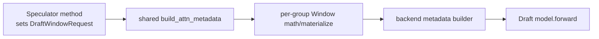
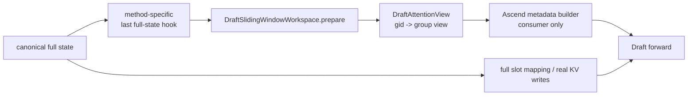
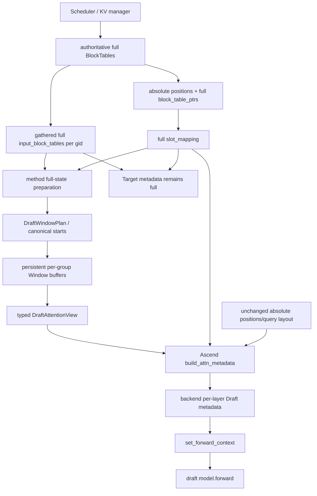

# MRV2 Speculative Draft Sliding Window Architecture Design

> 文档状态：Stage 8 架构设计稿；只做设计，不包含生产代码修改。  
> 源码基线：2026-10-08 本地当前 checkout。两个源码目录未携带可读取的 Git 元数据，因此本文以绝对路径、当前行号和关键文件内容为事实锚点。  
> 参考材料：`Sliding window原理_gpt.md`、`Sliding window源码_codex.md` 中的 Stage 1～7；若参考材料与当前源码冲突，以当前源码为准。

## Background

本任务要把 MRV1 已有的 speculative draft KV sliding window（配置名 `draft_window_size`）迁移到 MRV2。它解决的问题不是 KV cache 容量不足，而是 draft model 的长上下文分布外退化：Target 仍读取完整上下文，Draft Attention 只读取最近一个窗口，从而在不改变最终采样正确性的前提下恢复 draft acceptance，并减少 Draft KV read。

MRV1 已经形成了明确 Feature Contract：

- `SlidingWindowAdapter` 位于 [`vllm_ascend/spec_decode/utils.py:83`](/Users/wenqingzhang/Desktop/vllm/vllm-ascend/vllm_ascend/spec_decode/utils.py:83)，负责窗口数学、block-table 裁剪和 length 同步；
- 配置读取、MTP ignore、DSpark compatibility warning 和 adapter 构造位于 [`llm_base_proposer.py:410`](/Users/wenqingzhang/Desktop/vllm/vllm-ascend/vllm_ascend/spec_decode/llm_base_proposer.py:410)；
- 公共 MRV1 apply 点位于 [`llm_base_proposer.py:1119`](/Users/wenqingzhang/Desktop/vllm/vllm-ascend/vllm_ascend/spec_decode/llm_base_proposer.py:1119)，DSpark 则在 per-KV-group table 最终确定后单独 apply；
- Target attention 已经使用 full metadata 完成，real positions、physical KV allocation 和 slot mapping 不受窗口影响。需要注意：MRV1 随后会原地改写传给 Draft 的 common metadata 对象；“Target metadata 对象本身永远保持 full”是本 MRV2 设计刻意新增的隔离强化，而不是对 MRV1 对象生命周期的错误描述。

MRV2 当前没有消费 `draft_window_size`。它的 draft metadata 主入口 [`DraftModelSpeculator._build_attn_metadata()`](/Users/wenqingzhang/Desktop/vllm/vllm/vllm/v1/worker/gpu/spec_decode/speculator.py:295) 直接读取：

- `self.block_tables.input_block_tables`；
- `self.input_buffers.seq_lens`；
- 本轮计算出的 `seq_lens_cpu_upper_bound`；
- full `slot_mappings`。

Ascend 最终漏斗 [`build_attn_metadata()`](/Users/wenqingzhang/Desktop/vllm/vllm-ascend/vllm_ascend/worker/v2/attn_utils.py:220) 再按 KV-cache group 构造 `AscendCommonAttentionMetadata`，然后调用具体 backend builder。当前 MRV2 缺少的不是一个单独的 `apply()` 调用，而是一套同时满足 method timing、multi-group、backend-derived metadata、ACL Graph 和 async lifetime 的 Draft-only read plane。

当前源码中对设计影响最大的事实如下。

| 事实 | 当前源码证据 | 对设计的含义 |
|---|---|---|
| Target 与 Draft 共用一个 `BlockTables` owner | [`DraftModelSpeculator.set_attn():271-293`](/Users/wenqingzhang/Desktop/vllm/vllm/vllm/v1/worker/gpu/spec_decode/speculator.py:271) | 不能原地污染 shared full tables |
| `input_block_tables` 是 persistent forward buffers | [`block_table.py:71-75`](/Users/wenqingzhang/Desktop/vllm/vllm/vllm/v1/worker/gpu/block_table.py:71) | Window table 必须有独立 owner |
| slot mapping 直接读取 authoritative `block_table_ptrs` | [`block_table.py:190-221`](/Users/wenqingzhang/Desktop/vllm/vllm/vllm/v1/worker/gpu/block_table.py:190) | Window 永远不能参与 real KV write 地址计算 |
| Eagle/Eagle3 first pass 直接复用 Target metadata | [`autoregressive/speculator.py:303-322`](/Users/wenqingzhang/Desktop/vllm/vllm/vllm/v1/worker/gpu/spec_decode/autoregressive/speculator.py:303) | 只改公共 draft builder 漏斗会漏掉 first pass |
| DFlash/DSpark 在 metadata 前逐 group 用 full table 准备 slot | [`dflash/speculator.py:370-409`](/Users/wenqingzhang/Desktop/vllm/vllm/vllm/v1/worker/gpu/spec_decode/dflash/speculator.py:370) | Window materialization 必须晚于这段 full-state 操作 |
| DFlash FULL 同一步会先 live build、再由 graph manager build | [`dflash/speculator.py:451-472`](/Users/wenqingzhang/Desktop/vllm/vllm/vllm/v1/worker/gpu/spec_decode/dflash/speculator.py:451)、[`dflash/aclgraph.py:86-98`](/Users/wenqingzhang/Desktop/vllm/vllm-ascend/vllm_ascend/worker/v2/spec_decode/dflash/aclgraph.py:86) | 变换必须从 canonical full source 覆盖写，且可重复调用不二次裁剪 |
| ACL Graph wrapper 不管理业务 persistent input | [`acl_graph.py:82-88`](/Users/wenqingzhang/Desktop/vllm/vllm-ascend/vllm_ascend/compilation/acl_graph.py:82) | Window graph-visible storage 必须由 speculator/workspace 预分配 |
| GQA/MLA 能更新部分 graph 参数，但 DSA/SFA updater 是 no-op | [`dsa_v1.py:1622`](/Users/wenqingzhang/Desktop/vllm/vllm-ascend/vllm_ascend/attention/dsa_v1.py:1622)、[`sfa_v1.py:886`](/Users/wenqingzhang/Desktop/vllm/vllm-ascend/vllm_ascend/attention/sfa_v1.py:886) | 公共正确性不能依赖 replay 时 pointer rebind |

## Scope

本设计覆盖：

- 当前 Ascend MRV2 factory 已经能够实例化、且具有独立 Draft Attention 的 Eagle、Eagle3、DFlash、DFlash2、DSpark；
- MTP 及其所有 normalized aliases / model variants 的 MRV1 `warning + ignore` 行为；
- `extract_hidden_states` 和 token-only/non-attention methods 的“不适用/不额外启用”行为；
- eager、PIECEWISE（仅当前 method 已支持的路径）、FULL/FULL_DECODE_ONLY capture 与 replay；
- multi-KV-cache-group、不同 group table width / block granularity；
- GQA、MLA、DSA、SFA 当前 metadata 构建与 graph update 差异；
- device exact length、CPU exact mirror、CPU upper bound、DCP/local length、backend-derived max/list/index state；
- async scheduling 下 buffer reuse、CPU object lifetime 和 stream/event ordering；
- Week4 Flashcomm、SP/DSA-CP 和更深 async pipeline 的扩展接口。

设计覆盖所有相关 methods，不表示借此扩大 MRV2 method 支持面。当前 factory 不支持的方法仍保持原来的 factory error。

## Non-goals

本阶段明确不做以下事情：

- 不修改任何生产代码或测试代码；
- 不改变 Scheduler/KV Cache Manager 的物理 block 分配、回收、prefix cache 或 resume 语义；
- 不改变 Target forward、Target verification、rejection sampling 或最终输出分布；
- 不把 `draft_window_size` 扩展成 Target sliding window；
- 不改变 real positions、RoPE positions、query layout、request ordering 或 `idx_mapping`；
- 不把 DSA 原生 `dspark_swa_indices`、模型自带 native SWA 与本 feature 混为一件事；
- 不顺带为 Ascend MRV2 新增 `draft_model`、ngram、suffix、medusa、custom class 等 method；
- 不借本迁移改变 DFlash2 当前 eager-only 的 graph compatibility；
- 不在没有产品决定的情况下新增 `draft_window_size <= 0` 的 hard error；当前配置只有 `int | None` 类型约束；
- 不在本阶段实现或评测 Flashcomm / SP(DSA-CP)，只保留清晰扩展点；
- 不在本阶段承诺具体 acceptance/latency 数值。

## Existing MRV1 Contract

### 配置与用户可见行为

`draft_window_size` 定义在 [`AscendConfig:497`](/Users/wenqingzhang/Desktop/vllm/vllm-ascend/vllm_ascend/ascend_config.py:497)，默认 `None`。MRV1 当前行为是：

| 条件 | MRV1 行为 |
|---|---|
| `draft_window_size is None` | Window OFF |
| Eagle/Eagle3 | 启用，公共 apply，`future_offset=K` |
| DFlash/DFlash2 | 启用，公共 apply，`future_offset=0` |
| DSpark | 启用，per-group apply，`future_offset=0` |
| DSpark + native long-context DeepSeek-V4 target | warning，但继续启用 |
| 所有 normalized MTP variants | warning + ignore，不构造 adapter |
| token-only / extract methods | 不经过 adapter，当前为 silent no-op |
| 当前 runner/factory 本身不支持的方法 | 保持原 error，不因 Window 改变 |

`eagle` 和 generic `draft_model` 虽然不在 MRV1 设计文档的主要宣传范围内，但现有 base 条件会为它们构造 `future_offset=K` 的 adapter；这是代码级 contract 与测试覆盖等级之间的差异。MRV2 本设计支持当前已存在的 Eagle/Eagle3，不顺带新增 MRV2 `draft_model`。

### 窗口数学

设：

- `W = draft_window_size`；
- `b = 当前 KV-cache group 的 table-column token alignment`；在 MRV1、`cp_size=1` 时就是 attention kernel block size；
- `L = adapter apply 时的 full exact seq_len`；
- `K = future_offset`；
- `F = L + K`，即本次 proposal 需要保证窗口能够覆盖到的最终逻辑终点。

MRV1 核心数学为：

```text
start        = floor(max(F - W, 0) / b) * b
visible_len  = L - start
start_col    = start / b
max_cols     = ceil(W / b) + 1
```

随后从 full block table 的 `start_col` 开始 gather 到预分配 clone，并用 length 限制 backend 真实可读范围。例：`W=100, b=64, K=0, L=250` 时，`start=128`、`visible_len=122`。

`future_offset` 不是 method 名称的同义词，而是 apply timing 的函数：

- Eagle/Eagle3 的 MRV1 apply 时 `seq_lens` 还没有包含后续 K 个 AR draft positions，因此 `K=num_speculative_tokens`；
- DFlash/DSpark 的 prepare 已把整段 parallel query stretch 纳入 `seq_lens`，因此 `K=0`。

现有公式隐含一个合法域问题：若 AR 配置 `W < K`，则 `start` 可能大于当前 `L`，从而得到负的 `visible_len`。当前 MRV1 配置层没有显式拒绝这一组合；MRV2 不能假装该语义已经定义。推荐在实现前批准 `W >= max_future_offset` 的 AR 校验，否则必须另行定义并测试 clamp 语义。

### 必须保留的行为

MRV2 必须保持下列可观察 contract，并强化 metadata 对象隔离：

1. 只减少 Draft Attention 能读取的历史 KV；
2. Target attention 始终消费 full 语义；MRV2 进一步要求 Target metadata 对象本身也永远 full，Draft 使用独立 view；
3. absolute positions 永远 full，不重新从 0 编号；
4. slot mapping 永远基于 full authoritative block table；
5. 真实 KV cache allocation/write 不变；
6. Window block table 与所有被同一次 Draft Attention 消费的 length state 相容；
7. method 的 apply timing 与 `future_offset` 语义不被混淆；
8. Window OFF 不改变已有执行路径；
9. MTP 继续 warning + ignore；
10. DSpark native-long-context advisory 继续 warning 但不强制关闭。

### MRV1 CPU upper-bound 与 MRV2 的语义强化点

MRV1 [`SlidingWindowAdapter.apply():165-169`](/Users/wenqingzhang/Desktop/vllm/vllm-ascend/vllm_ascend/spec_decode/utils.py:165) 会对每一个存在的 CPU length 字段分别重新套用窗口公式。只要 CPU mirror 与 device exact 相等，它们得到完全相同的 `start` 和 visible length。

MRV2 的 async `seq_lens_cpu_upper_bound` 允许大于 exact。若对 upper 独立重算 `start`，它可能在 block boundary 上与 Window table 的 canonical `start` 不同。推荐设计因此采用：

```text
canonical_start = window_start(device/CPU exact full length)
visible_exact   = full_exact - canonical_start
visible_upper   = clamp(full_upper - canonical_start,
                        min=visible_exact,
                        max=window_capacity_tokens)
```

这不是改变 Draft Attention 的 exact 可见范围，而是让 upper 继续作为同一窗口坐标系中的安全上界。当 full exact mirrors 相等时，它与 MRV1 完全等价；当 upper 是 optimistic bound 时，它避免“table origin 与 upper origin 不同”的 MRV2 特有风险。该点必须有独立 parity/boundary 测试，并在实现评审中明确确认，不能作为无说明的重构混入。

## MRV2 Constraints

### Full physical plane 与 Draft read plane 必须分离

`BlockTables` 当前同时持有 authoritative table、gathered forward table 和 slot buffer。`compute_slot_mappings()` 直接读取 authoritative pointer，不经过候选 Window table。DFlash/DSpark 又会在自己的 prepare kernel 中读取 gathered full table计算 context/query slot。

因此 Window 只能从 full state **派生**，不能把 full state变成 Window state：

```text
full authoritative table ───────> absolute slot mapping ───────> real KV writes
           │
           └─ gather full input table ──(只读 source)──> Draft Window workspace
                                                    └──> Draft Attention reads
```

“full source”不能只是一张有固定 row width 的 tensor。当前 gather kernel只保证写入每个 active row 的真实 `[0, num_blocks)`，见 [`block_table.py:255-272`](/Users/wenqingzhang/Desktop/vllm/vllm/vllm/v1/worker/gpu/block_table.py:255)；row tail 可能保留旧值。因此 Window source contract还必须携带与本轮 request ordering 对齐的 `full_valid_num_blocks[gid][row]`（可从现有 `num_blocks` + `idx_mapping` 得到，或由 authoritative table重新 gather出等价边界）。有效条件必须同时满足：

```text
src_col < full_table_width
src_col < full_valid_num_blocks[row]
dst_col < planned_needed_columns[row]
```

只检查 tensor列宽和 window `needed` 不足以防止 stale block id 被复制。

### MRV2 没有一个对所有 method 都成立的单一 apply 行号

- Eagle/Eagle3 first pass 在 eager/PIECEWISE 下复用 Target metadata；Window ON 时必须改为构造独立 Draft metadata，不能修改 Target 对象；
- Eagle/Eagle3 后续 AR step 在 slot mapping 完成后、每次 Draft metadata build 前进入 Window read view；FULL merged graph 内还存在逐 step length 演进；
- DFlash/DSpark 必须等所有 per-group `prepare_dflash_inputs()` 完成，因为这里仍需要 full table 和 absolute positions；
- DFlash/DSpark 的 live build 与 graph-manager rebuild 都可能消费同一 view；
- MTP 即使复用 AR 基类，也没有合法 Window apply 点，因为 Feature Contract 明确 ignore。

### Per-group 不是“同一 tensor 放进 list”

当前 final builder 在 [`attn_utils.py:294-378`](/Users/wenqingzhang/Desktop/vllm/vllm-ascend/vllm_ascend/worker/v2/attn_utils.py:294) 按 group 选择 block table，但共用一份 `seq_lens`/CPU lengths。Window start 必须与每组 table-column alignment 对齐；当 group alignment 不同时，`start` 和 visible length也可能不同。

所以 MRV2 Window view 必须至少是：

```text
gid -> {
  start_tokens,
  window_block_table,
  window_seq_lens_device,
  window_seq_lens_cpu_exact,
  window_seq_lens_cpu_upper_bound,
  window_dcp_local_lengths,
  window_max_seq_len
}
```

不能只做 per-group block table，再把一份全局 windowed `seq_lens` 塞给所有 group。

### Capture correctness 是地址与值两个问题

当前 [`ACLGraphWrapper`](/Users/wenqingzhang/Desktop/vllm/vllm-ascend/vllm_ascend/compilation/acl_graph.py:66) 明确不替业务层持有输入。MRV1 adapter 除 block-table clone 外，还会临时创建算术 tensor；这些临时 tensor 不能原样进入 MRV2 graph-visible metadata。

MRV2 必须做到：

- capture 前分配所有 graph-visible Window backing；
- capture 和 replay 引用同一 base address；
- replay 前只更新内容，不替换 tensor 对象；
- 不把 GQA/MLA 可更新 pointer 的能力当成公共前提；
- DSA/SFA no-op updater 也能正确运行；
- dummy capture、较小 runtime batch、padding rows 和 tail columns 都没有 stale block id。

### Async correctness 不等于“有 persistent tensor”

V2 async scheduling 可能有多个 CPU-side/in-flight batch。device buffer 能否单份复用取决于 execution stream 上的 happens-before；CPU tensor/list 若被 updater 延迟读取，则必须拥有覆盖读取时段的 lifetime。新设计不能新增 module-global mutable Window state，也不能依赖当前 `build_attn_metadata_wrapper()` 的全局 monkeypatch 来传递 per-step Window 数据。

## Design Invariants

以下不变式是候选方案的硬门槛，不满足任一条就不能进入实现阶段。

1. **Target-full invariant**：Target metadata、Target verification 与 Target block-table view 永远 full。
2. **Absolute-position invariant**：`positions`、RoPE position、query layout 不被 Window 改写。
3. **Full-slot invariant**：所有 Target/Draft KV write slot 都在 Window 之前基于 full table确定。
4. **Read-only-source invariant**：authoritative tables、shared `input_block_tables` 和 target/draft canonical `InputBuffers` 只能作为 Window source，不能原地缩短。
5. **Draft-view invariant**：Window 只生成 Draft Attention read-side view。
6. **Single-math invariant**：absolute interval/start/visible 数学只有一份共享实现；标准 paged-table 的 interval-to-column 映射也只有一个 layout 实现，其他 layout 通过 provider扩展，所有 methods 不复制公式。
7. **Per-group invariant**：每个 active KV-cache group 使用自己的 layout/alignment、容量和 stable buffer。
8. **Canonical-origin invariant**：同一 group 的 table、exact、CPU mirror、upper、local length 都以同一个 `start_tokens` 为坐标原点。
9. **Derived-state invariant**：`max_seq_len`、length list、DCP/local lengths、DSA/SFA sparse/index metadata 从 Window view 派生，而不是继续从 full state 派生。
10. **Stable-address invariant**：所有可能被 capture 的 device tensor 在 `set_attn()` 后、capture 前分配；runtime 只做 `copy_`/out-kernel。
11. **Idempotence invariant**：每次都严格执行 `canonical full source -> window destination`；没有 API 接受 Window view 作为下一次 source。
12. **Padding/validity invariant**：padded rows、active-row unused columns 和上一步残留全部清零或写入 inert 值；gather还必须受本轮 per-row `full_valid_num_blocks` 限制，不能只按 source tensor宽度判断。
13. **Async-lifetime invariant**：任何 buffer 在最后 reader 完成前不被下一 epoch 覆盖；CPU object 不能靠 device stream ordering延长 Python lifetime。
14. **Window-OFF invariant**：`None` 时不分配 workspace、不运行 Window kernel、不重建 Eagle first-pass metadata，保留现有路径。
15. **Capability invariant**：method policy 由规范化 method/capability 解析一次，不在 ModelRunner 或 final builder 堆 method-specific `if`。
16. **No-model-name invariant**：公共 Window infrastructure 不认识模型名称；model-specific advisory 由模型/配置暴露语义 capability。
17. **Native-SWA separation invariant**：模型原生 SWA/DSA index 与外部 `draft_window_size` 分属不同对象和生命周期。
18. **Graph-mode parity invariant**：同一 method 的 eager、PIECEWISE、FULL 在相同输入上具有相同 Draft-visible KV 语义。

边界表如下。

| 必须始终 full | 可成为 per-group Window view | 保持原值但参与派生 |
|---|---|---|
| authoritative block tables | Draft block tables | query start locations |
| shared gathered source tables | Draft device exact lengths | absolute positions |
| Target metadata | Draft CPU exact lengths | request ordering / `idx_mapping` |
| Target/device input state | Draft CPU upper bounds | causal policy |
| slot mappings | Draft DCP/local lengths | query width / current draft step |
| KV allocation/write addresses | Draft max/list/sparse derived state | full exact/upper source |

## Candidate A

### 方案 A：在 shared `build_attn_metadata` 漏斗中完成 Window 变换

方案 A 把 Ascend 最终 builder 作为唯一激活点。各 method 只在一个显式/context-scoped `DraftWindowRequest` 中声明：

- 当前调用是 Draft，而不是 Target；
- `window_size`；
- `future_offset`；
- 当前 proposal/step id；
- 可使用的 workspace。

`build_attn_metadata()` 进入 per-group loop 时计算 start、写入 Window buffers，再把 Window table/length 填进 `AscendCommonAttentionMetadata`。



### Candidate A：预计修改文件

| 文件 | 修改 |
|---|---|
| `vllm_ascend/worker/v2/spec_decode/sliding_window.py`（新增） | request/context、common math、workspace |
| `vllm_ascend/worker/v2/attn_utils.py` | final funnel 识别 Draft Window request，并按 group materialize |
| `worker/v2/spec_decode/autoregressive/speculator.py` | 在 AR build/capture scope 提供 request；first pass 另加特殊入口 |
| `worker/v2/spec_decode/dflash/speculator.py` | prepare 完成后激活 request |
| `worker/v2/spec_decode/dspark/speculator.py` | 同 DFlash，并携带 per-group/backend context |
| 两类 draft ACL graph manager | capture/replay 时恢复同一 request scope |
| factory/config policy | 解析 support/ignore/advisory |

### Candidate A：ownership、allocation 与 lifetime

即使变换发生在 builder，buffer 也不能由 builder 临时创建。可行版本仍然必须让 speculator 在 `set_attn()` 后创建 workspace，builder 只能借用它。因此该方案实际上是：

```text
speculator owns storage
builder owns timing + transformation
```

workspace 生命周期为 speculator/runner lifetime；每次 build 创建一个轻量 request token。graph capture 和 replay 都必须恢复正确 token，且 token 不能泄漏到 Target builder。

### Candidate A：method integration

- DFlash/DSpark：在 prepare loop 后进入 scope，final funnel 的时机基本成立；
- Eagle/Eagle3 decode：每 step builder 可进入 scope；
- Eagle/Eagle3 first pass：当前直接复用 Target metadata，根本不进入该漏斗。为支持 Window，仍需在 AR speculator 增加“Window ON 时单独重建 Draft metadata”的旁路；
- MTP：policy resolver 不创建 request；
- DFlash2：沿 DFlash eager scope；
- extract/token-only：不创建 request。

这意味着 A 无法真正做到“只改一个漏斗”：最重要的 AR first pass 仍需 method-family 特例。

### Candidate A：capture/replay

为了 graph-safe，A 必须同时满足：

1. workspace 已在 capture 前分配；
2. capture helper、warmup、live build、graph-manager rebuild 都进入同一 Draft scope；
3. builder 每次从 canonical full source 覆盖写；
4. request同时携带本轮 per-row full-valid block counts，不能把 source row width当成有效列数；
5. Window materialization 完成后 graph 才能 replay；
6. request/context 是 task-local，不能用 module-global `current_window_state`；
7. DSA/SFA 看到的是 stable buffer，而不是依赖 pointer updater。

当前 `build_attn_metadata_wrapper()` 会临时替换 module-global 函数对象，见 [`attn_utils.py:1243-1281`](/Users/wenqingzhang/Desktop/vllm/vllm-ascend/vllm_ascend/worker/v2/attn_utils.py:1243)。A 若继续叠加全局可变 Window context，会放大 async/thread-safety 技术债。最低要求是 `ContextVar`；但即便如此，AR first-pass 和 graph helper 的 scope 覆盖仍很脆弱。

### Candidate A：error/warning、testability 与风险

配置 warning 可以在 speculator/factory 统一处理，而不是在 builder 发出。builder 只应在“request 与 group 数/shape不匹配”时 fail fast。

它的测试优点是 final funnel 测试集中；主要风险是：

- scope 泄漏会静默窗口化 Target；
- 某个 capture helper 忘记进入 scope，导致 eager 正确、FULL 错误；
- builder 重入容易触发 repeated-window；
- method 的“最后 full-state 时刻”被隐藏；
- AR proposal-level anchor 很难由 stateless builder 表达；
- buffer 的 owner 与 writer 分属两层，调试困难；
- per-group geometry、async lease 和 backend builder 交织在公共主干。

### Candidate A 结论

方案 A 可以作为短期单-method补丁，但不适合作为覆盖 Eagle/DFlash/DSpark、multi-group 和 graph 的公共架构。尤其 Eagle first pass 的真实调用链证明，final funnel 不是所有 Draft Attention 的天然总入口。

## Candidate B

### 方案 B：Speculator-owned persistent workspace + typed Draft read view

方案 B 将三个问题分开：

1. **什么时候 full state 已稳定**：由具体 method family 知道；
2. **怎样做 Window 数学并承载结果**：由公共 `DraftSlidingWindowWorkspace` 完成；
3. **怎样构造 backend metadata**：final builder 只消费 typed、只读、per-group view。



这里的 method-specific 只负责选择时机和提供 policy，不复制任何 Window 数学。

### Candidate B：新增对象

建议对象命名与职责如下。

| 对象 | 作用 | 是否持有 tensor |
|---|---|---:|
| `DraftWindowMath` | 唯一的 absolute interval、aligned start、visible length 数学 | 否 |
| `DraftWindowLayout` | 描述某 group 的 table-column token span、capacity、valid-column gather 和 CP/DCP 投影规则 | 否 |
| `DraftWindowCapability` | support policy、timing family、future extent provider、advisory | 否 |
| `DraftWindowPolicyResolver` | 从 normalized method + semantic model capability解析一次 policy | 否 |
| `DraftSlidingWindowWorkspace` | speculator-owned persistent storage；从 full source materialize | 是 |
| `DraftWindowPlan` | 一个 proposal/epoch 的 immutable anchor、num_reqs、future extent、per-row full valid block counts | 只引用 |
| `DraftWindowGroupView` | 一个 gid 的 stable table/length/start views | 只引用 |
| `DraftAttentionView` | `gid -> DraftWindowGroupView`，交给 builder | 只引用 |
| `DraftWindowLease` | epoch/lane/event lifetime，防止 async 过早复用 | 只引用/事件 |
| `AscendDraftAttentionInputProvider` | Window OFF 返回 canonical inputs；ON 返回 typed view | 否 |

`DraftAttentionView` 故意不提供 setter，也不拥有 `positions` 或 `slot_mappings` 字段。builder 必须继续从 canonical call arguments 取得它们，从类型边界上降低误窗口化风险。

### Candidate B：预计修改文件

| 文件 | 修改 |
|---|---|
| `vllm_ascend/spec_decode/sliding_window.py`（新增） | 跨 MRV1/MRV2 的纯数学与 table gather primitive |
| `vllm_ascend/spec_decode/utils.py` | MRV1 adapter 改为调用公共 primitive，保证数学只有一份；外部行为不变 |
| `worker/v2/spec_decode/sliding_window.py`（新增） | capability、layout、workspace、plan/view/lease、input provider |
| `worker/v2/attn_utils.py` | 接收 optional typed view；group loop 只选择 group input，不决定 timing |
| `worker/v2/spec_decode/__init__.py` | factory 后解析/注入 normalized method policy |
| AR/Eagle speculator | proposal anchor、Window ON first-pass metadata、per-step visible length、graph state |
| MTP speculator/factory policy | warning + ignore，不分配 workspace |
| DFlash speculator | full prepare 后 materialize；builder消费 view |
| DSpark speculator | 同 DFlash；per-group/DCP/backend derived state |
| DFlash2 | 继承 DFlash capability；通常只补测试，不加 Window 特例 |
| AR/DFlash ACL graph managers | capture dummy view、replay 前更新、消费 prepared epoch |
| Target model/config semantic capability | 声明 native-long-context advisory；resolver再与DSpark method policy组合，公共代码不检查模型名，也不把target属性误挂到draft model |

### Candidate B：ownership、allocation 与 lifetime

workspace 是 **speculator instance-owned**，不是 ModelRunner-owned、backend-global 或 module-global。推荐时序：

```text
speculator.__init__
  -> 只读取 config/policy；不分配 group buffers

load_model
  -> 读取 semantic compatibility capability；产生 warning/ignore 决策

set_attn
  -> 已知 active groups、table widths、kernel/CP layout
  -> Window ON 且 supported 时一次性分配 workspace
  -> 初始化 stable views

capture
  -> 写 dummy full source
  -> materialize 到同一 workspace addresses
  -> capture

each proposal
  -> acquire epoch/lease
  -> method full-state preparation
  -> seal full-valid counts and prepare/materialize
  -> one or more builder/graph readers acquire the same sealed view
  -> record each device reader completion event
  -> retire lease
```

Window OFF、MTP ignore、extract/non-attention path 都不分配 workspace。

### Candidate B：method integration

#### Eagle / Eagle3

- normalized policy：supported；AR timing family；proposal anchor 的 `future_offset=K`；
- `prepare_prefill_inputs()` 与可选 PCP layout 完成后建立一次 Window plan；
- Window ON 时从 full Target/Draft inputs构造独立 Draft first-pass metadata，绝不浅改 Target metadata；
- proposal 内保持 group `start_tokens` 与 Window table 不变；
- 后续 AR step 只把当前 full exact/upper 投影到同一 anchor；
- 若 proposal开始时 authoritative full table已经包含 planned-final blocks，可预填这些 block id，并由当前 visible length阻止提前读取；若尚未有效分配，则保持 table origin/address不变、在每个AR step从full source补齐新变为valid的列；两种方式都必须受 per-row full-valid count约束；
- eager/PIECEWISE 每 step builder 读取相应 group view；
- FULL merged decode 用 persistent per-step length buffers或把 window-relative increment捕获入图；
- Window OFF 完全保留 Target metadata reuse 快路径。

#### DFlash / DSpark

- normalized policy：supported；parallel-query timing；`future_offset=0`；
- 所有 group 的 `prepare_dflash_inputs()` 结束后，full positions、context/query slots和 device exact length已定型；
- CPU upper输入必须是现有 draft builder在该 apply time 使用的完整 upper语义（包括对应 `step` / parallel query stretch），不能直接拿未加增量的 Target/InputBatch upper；
- 此时从每组 full `input_block_tables[gid]` materialize；
- live builder 与 graph-manager builder只消费同一个 epoch/view；即使调用两次也不把 output 当 source；
- DSpark 的 DCP/local、DSA/SFA derived state在 Window group view确定后派生。

#### DFlash2

- 公开 normalized method仍为 `dflash`，自然继承 DFlash policy；
- 当前只验证 eager；graph mode仍按现有代码要求 `enforce_eager`，见 [`dflash2/speculator.py:121-139`](/Users/wenqingzhang/Desktop/vllm/vllm-ascend/vllm_ascend/worker/v2/spec_decode/dflash2/speculator.py:121)。

#### MTP / extract / unsupported methods

- 所有 normalized `mtp`：warning + ignore，policy 优先于 concrete class。即使 Gemma4/Step3.5 MTP 当前 factory 落到 `AscendEagleSpeculator`，也不能误继承 Eagle Window；
- `extract_hidden_states`：无独立 Draft Attention data plane，保持 silent no-op；
- factory 当前不支持的方法：仍由 factory 报原 error，Window resolver不截获。

### Candidate B：capture/replay

capture 和 replay 都只引用 workspace stable backing：

```text
capture:
  canonical dummy full inputs
    -> workspace.prepare(out=stable buffers)
    -> builder(view=stable slices)
    -> graph records these addresses

replay:
  current full inputs/slots ready
    -> workspace.prepare(out=same buffers)
    -> stream/event orders writes before replay
    -> builder/graph updater sees same addresses, new values
```

GQA/MLA 的 graph parameter update可以继续用于现有参数，但不是 Window pointer correctness 的前提。DSA/SFA no-op updater也安全，因为 graph-visible Window storage不换地址，backend-owned sparse buffers继续采用它们现有的 persistent/copy pattern。

### Candidate B：error/warning behavior

- policy/config warning 在 load/init 时只发一次；
- workspace 在 group count、shape、alignment、capacity、epoch mismatch 时 fail fast；
- builder 收到 Window view但 gid 缺失或 shape 与 padded batch不符时 fail fast；
- Target build 若收到 Draft-only view，在 debug/assert build 中直接拒绝；
- `draft_window_size <= 0` 暂不擅自改成 hard error，记录为独立 config-policy decision；
- DFlash2 graph error、unsupported factory error保持原样。

### Candidate B：testability 与风险

该方案可以把纯数学、workspace、builder selection、method timing、graph address分别单测；所有关键对象都有明确 owner 和 epoch，故障定位也更直接。

主要代价/风险：

- Eagle first-pass Window ON 不再复用 Target metadata，需要证明重建结果除 read view 外等价；
- AR FULL merged graph要专门实现 per-step relative length；
- final builder 当前接口是一份公共 length，需扩为 per-group optional view；
- CP/DCP 不能把 `[start,end)` 错当成从 0 开始的 `visible_len`；
- Window ON path需要绕开/收敛当前全局 metadata monkeypatch；
- capability、workspace 和 graph manager是新增模块，需要控制第一版范围。

这些风险都能以明确接口和测试隔离；不像 A 的 scope/timing 风险那样容易形成静默错误。

### Candidate B 结论

方案 B 满足 full/write plane 与 Draft/read plane 分离，并能自然表达 method timing、per-group、graph 和 async lifetime，是推荐方案。

## Comparison

| 维度 | Candidate A：funnel-owned transform | Candidate B：speculator-owned view |
|---|---|---|
| Common math | 可共享 | 可共享 |
| Method timing | 隐藏在 context，难表达 | concrete family在最后 full-state 点显式触发 |
| Eagle first pass | 漏过 shared funnel，仍需旁路 | Window ON 明确重建 Draft-only metadata |
| DFlash repeated build | builder重入风险高 | full source覆盖写，view可重复消费 |
| Multi-group | builder内可做，但职责膨胀 | workspace天然按 gid组织 |
| Target isolation | 依赖 scope绝不泄漏 | 独立对象/owner，边界更强 |
| Buffer owner | speculator持有、builder写，职责分裂 | speculator/workspace既持有又写 |
| Graph capture | 所有 capture helper必须正确恢复scope | capture显式请求workspace stable view |
| DSA/SFA no-rebind | 可做到，但易在builder临时分配 | 以stable backing为默认模型 |
| Async/thread safety | context/global monkeypatch风险 | instance state + epoch/lease；显式参数优先 |
| Window OFF | 仍可能经过额外 funnel逻辑 | provider直接返回现有路径；零分配/零kernel |
| Testability | 漏斗集中，但 timing/capture组合难隔离 | math、workspace、method hook、builder、graph可分层测 |
| 修改规模 | 表面小，补齐 AR/capture 后不再小 | 初始对象较多，但边界稳定、后续扩展成本低 |
| Week4 扩展 | 容易继续堆 backend if | layout/partitioner/view provider 可插拔 |
| 主要失败模式 | scope泄漏、漏调用、二次Window | epoch/shape错误，可 fail fast |

推荐 Candidate B。Candidate A 只保留一个思想：final builder 可以作为 **typed view 的公共消费漏斗**，但不能拥有 Window timing、数学或 buffer materialization。

## Recommended Design

推荐架构命名为：

> **Speculator-owned Draft KV Read View（由 persistent workspace materialize，按 KV-cache group 显式传给 Ascend metadata builder）**

### 核心决策

1. 抽取一份纯 Window 数学/拷贝 primitive，MRV1 adapter 与 MRV2 workspace共同调用，避免复制公式。
2. factory/init 根据 normalized speculative method解析 `DraftWindowCapability`；concrete class只提供 timing hook，公共 ModelRunner 不出现 method-name 分支。
3. `set_attn()` 后已知 group/layout，Window ON 时创建 speculator-owned workspace；capture前完成全部分配。
4. 每个 proposal创建一个 `DraftWindowPlan`/epoch；每个 group拥有自己的 canonical `start_tokens`。
5. method 在自己的最后 full-state 点调用 `workspace.prepare_from_full(...)`。
6. final builder只接收 optional `DraftAttentionView`，在 group loop中选择 read inputs；slot mapping、positions、query layout仍取 canonical arguments。
7. graph capture和replay都使用相同 workspace backing；不依赖 pointer rebind。
8. Window OFF不创建 workspace，也不改变 Eagle metadata reuse、现有 wrapper或graph dispatch路径。
9. MTP policy在 capability解析时终止 Window初始化并 warning；不是在 AR base里临时判断。
10. model-specific advisory通过语义 capability暴露，公共 Window代码不检查模型名/architecture字符串。

### 推荐 plumbing

第一版优先保持改动在 `vllm-ascend` 内，不要求修改上游 vLLM：

- `worker/v2/attn_utils.py` 新增一个 optional、typed、per-group read-view参数；默认 `None`；
- 新增统一的 Ascend draft metadata helper/input provider，Window ON 时显式调用它；
- Eagle/DFlash/DSpark现有 Ascend override只负责把当前 prepared view交给该 helper；
- 不新增 module-global `current_window_view`；
- 若为了兼容当前 wrapper 必须短期使用 scope，只能用 `ContextVar` + token reset，并把 scope缩到一次具体 draft metadata build。它只是运输层，不能在 scope里计算 Window。

长期如果上游愿意接受，可以把“Draft metadata input provider”抽成 vLLM 的中性 hook；但本任务的正确性不依赖上游改动。

### Canonical start 与 AR proposal anchor

对 parallel-query family，plan只有一个状态：prepare后的 exact end已经包含所有 query，`future_offset=0`。

对 AR family，plan是 proposal级而不是 builder调用级：

```text
base full exact L0
planned final end = L0 + K
group start = align_down(max(L0 + K - W, 0), group_alignment)

first pass visible = L0 - start
draft step s visible = full_exact_at_step_s - start
```

proposal内 table origin保持不变，避免每 step跨 block boundary时窗口跳动，也与 MRV1“一次 apply、随后 length前进”的 contract一致。

### 状态机

```text
DISABLED
  └─ Window OFF / ignored method：永远走 identity path

CONFIGURED
  └─ config + capability 已解析，尚不知道 group layout

ALLOCATED
  └─ set_attn 后 persistent buffers 已分配，可 capture

SEALED(epoch, lane, reader_count=0)
  └─ canonical full state 已 materialize 为 immutable DraftAttentionView
  └─ live builder 与 graph-manager builder 可多次 acquire 同一 epoch/view

IN_FLIGHT(readers/events)
  └─ 一个或多个 metadata/device reader 已提交；逐 reader release

RETIRED
  └─ 所有 reader release 且 completion event 证明 device读取结束，lane可复用
```

非法状态（未 `SEALED` 就 build、跨 epoch复用、最后一个 reader结束前覆盖、把 Window view作为 full source）必须 fail fast。这个多-reader语义专门覆盖 DFlash/DSpark 同一步 live build 与 graph-manager rebuild；第二次读取不是二次 materialize。

## Component Responsibilities

### `DraftWindowMath`

建议位于公共 `vllm_ascend/spec_decode/sliding_window.py`，只负责 tensor-friendly纯数学：

- `aligned_start(full_exact, W, alignment, future_offset, out=...)`；
- `visible_length(full_length, start, out=...)`；
- `absolute_interval(full_exact, start, future_extent)`；
- 合法域与 overflow/negative 检查。

所有 graph-visible结果必须支持 caller-provided `out`，禁止内部把临时 tensor作为最终返回 storage。实现可以使用一个 fused Triton/NPU kernel，也可以先用多个 out-op；接口先固定“写 caller-owned storage”。

### `DraftWindowLayout`

每个 KV-cache group的 layout由 `BlockTables`/KV spec/backend事实生成，而不是从模型名推测：

- group id；
- table row width；
- kernel block size；
- `tokens_per_table_column` / window alignment；
- interval到 start column / capacity / valid columns的唯一映射；
- 使用 per-row `full_valid_num_blocks` 的安全 materialization；
- CP size/rank/interleave；
- slot mapping enabled；
- backend需要的额外 interval projection capability。

`cp_size=1` 时 alignment等于 MRV1 kernel block size。CP/DCP 下不能未经证明沿用这一等式；layout provider必须表达真实 table-column token span。

### `DraftWindowCapability` / resolver

它只描述 policy，不持有本轮数据：

```text
support: ENABLED | WARN_AND_IGNORE | NOT_APPLICABLE
timing_family: AR_PROPOSAL | PARALLEL_QUERY_READY
future_extent_provider: proposal -> int
requires_per_group: true
compatibility_advisory: optional semantic callback
```

resolver先看 normalized method，因此 concrete class fallback不会改变 MTP ignore；随后读取已加载模型暴露的 semantic advisory。公共代码不出现 `if model_type.startswith(...)`。

### `DraftSlidingWindowWorkspace`

职责：

- 分配/持有 stable device buffers、必要 CPU snapshots和scratch；
- 从只读 full source、per-row valid block counts与apply-time lengths建立 proposal plan；
- 按 group materialize table/length；
- 为 AR更新同一 anchor下的 per-step visible lengths；
- 清理 active tail与padding；
- 返回 immutable、可被多个metadata reader acquire的sealed views；
- 维护 epoch/lane/reader count/completion事件；
- 在 debug模式检查 source/destination无storage alias、地址不变、upper≥exact、padding inert。

它不负责：

- 计算 slot mapping；
- 修改 positions；
- 调 backend builder；
- 决定当前 method是否支持；
- 发 model-specific warning。

### `DraftWindowGroupView`

每组至少携带：

```text
gid
epoch
start_tokens_device / start_tokens_cpu（需要时）
block_table
seq_lens_device_exact
seq_lens_cpu_exact / NumPy view（backend需要且method能证明等价来源时）
seq_lens_cpu_upper_bound
dcp_local_seq_lens_device / cpu（启用时）
max_visible_seq_len
num_reqs / num_reqs_padded
source_full_valid_num_blocks（debug/validity contract）
```

所有 tensor均为workspace backing的slice/view；view对象本身per-step创建没有问题，底层storage不能换。

这里不能假定 CPU exact 天然存在：DFlash/DSpark 的 device exact 由 prepare kernel最终写入。Stage 9必须逐method证明可由 Target CPU length + step/query width无D2H重建出完全等价值，或调整 builder让其不需要该 CPU exact；未证明前该字段是有条件能力，不是既定事实。

### `DraftAttentionView`

它是 group view的只读映射，并携带 plan/epoch。它不携带/不覆盖：

- positions；
- query start locations；
- slot mappings；
- KV cache；
- Target metadata。

### Ascend draft metadata helper / final builder

final builder的职责仅是：

```text
for gid:
    if draft_view is None:
        使用现有 full block table / common lengths
    else:
        使用 draft_view[gid] 的 read-side table/length/local/max

    始终使用原始 positions/query layout/slot_mappings
    调当前 backend metadata builder
```

它不重新计算 start，不写workspace，不解析method。

### Method integration hooks

- AR hook：在 proposal first-pass full state稳定后建立 anchor；每 draft step在 full slot mapping后刷新relative lengths；
- parallel hook：所有 per-group prepare结束后一次materialize；
- graph hook：capture准备dummy view；replay验证/消费当前epoch；
- compatibility hook：load/init阶段处理warning/ignore。

### Backend extension provider

对于 DCP/DSA/SFA/Flashcomm，不向 common view塞任意无类型 dict。定义窄协议，例如：

```text
project_interval(group_layout, absolute_start, absolute_end)
build_window_derived_state(group_view, persistent_backend_buffers)
```

这样 common Window层只描述绝对区间，backend负责生成 local length、sparse indices或通信计划。

## Runtime Data Flow

### 总数据流



### Eagle / Eagle3 eager 与 PIECEWISE

```text
Target forward output
  -> prepare_prefill_inputs
  -> optional PCP global-layout refresh
  -> full positions / full slots / full seq state稳定
  -> workspace.begin_ar_proposal(future_offset=K)
  -> Window ON: build independent Draft first-pass metadata from view
     Window OFF: reuse current Target metadata fast path
  -> draft first forward + sample token 0
  -> prepare_decode_inputs
  -> for step s = 1..K-1:
       compute_slot_mappings(full authoritative table)
       workspace.refresh_ar_step(full_exact_at_s, apply-time full upper,
                                 per-row full-valid blocks, same anchor)
       if a new authoritative block became valid:
         copy that column into the same persistent window table address
       build Draft metadata from view
       draft forward
       update full Draft inputs for next step
```

“Window apply”不在 `compute_slot_mappings` 前；它只发生在 full slot确定之后、Draft metadata消费之前。

### Eagle / Eagle3 FULL

```text
capture:
  workspace dummy buffers -> Window-aware prefill/decode metadata -> capture

runtime prefill:
  begin proposal/prepare view -> prefill graph replay

runtime merged decode:
  fixed proposal anchor/table
  + per-step persistent relative length state
  + full slot updates inside现有AR流程
  -> single graph replay
```

FULL decode必须选择一个明确实现：

- 把 `visible_len = full_len - start` 的更新捕获进 graph；或
- 预分配每个 draft step的 stable device/CPU length buffers，并让每个 captured step绑定对应buffer。

推荐优先复用现有 per-step graph metadata结构，使用 per-step stable length buffers；这样最容易检查每一步的数据地址和值。后续再评估将减法/increment融合进 graph的性能优化。

### DFlash / DSpark / DFlash2

```text
Target hidden states
  -> optional PCP full gather
  -> for each draft gid:
       prepare_dflash_inputs(full table, absolute positions)
       produce full context/query slots
  -> precompute_and_store_context_kv(full physical slots)
  -> workspace.begin_parallel_proposal(future_offset=0)
       using apply-time full upper after the same query/step stretch
       used by the existing draft metadata path
  -> materialize all group views
  -> build uniform Draft metadata
  -> eager forward OR FULL graph-manager consumes same epoch
  -> sample draft block
```

DSpark在 `prepare` 之后可能还要构造 DCP/local 和 DSA/SFA derived state；这些必须读取 group view，而不是重新回到 full length。

### Target 路径

Target路径不调用 Window workspace，也不接受 `DraftAttentionView`。Target builder继续得到：

```text
full input_block_tables
full device/CPU lengths
full slot mappings
absolute positions
```

因此 Target logits、verification与最终质量不因本feature改变。

## Buffer / Ownership / Lifetime

### 1. 所有权边界

推荐把数据分成三层，任何实现都不允许模糊这三层的所有权：

1. **Authoritative full state**：由 `InputBatch`、`AscendInputBuffers`、`AscendBlockTables` 及现有 speculator input buffers 持有。它描述完整物理 KV 世界，Window workspace 只能借用、不能修改。
2. **Draft Window workspace**：由具体 speculator 持有，runner 生命周期内常驻；它拥有 window table、window length、start 等地址稳定的 buffer。
3. **Backend-derived metadata**：由 attention metadata builder / backend metadata 对象持有，例如 DCP/local 长度、DSA/SFA indices、`max_seqlen_kv`。其值必须从同一份 `DraftAttentionView` 派生。

这里“speculator 持有”比“ModelRunner 持有”更合适，因为：

- Window 只服务 Draft；Target 路径不应感知；
- speculator 知道 method policy、proposal shape 与 apply timing；
- speculator 的生命周期覆盖 capture 与所有 replay；
- Window OFF 时 factory 可以完全不创建 workspace。

### 2. Device buffer 规划

下表中的 `R` 表示 runner 支持的最大请求数，`G` 表示 KV-cache group 数，`C_g` 表示 group `g` 的最大 window block 列数。

| Buffer | 建议 dtype / shape | Owner | 生命周期 | 地址要求 | 说明 |
|---|---|---|---|---|---|
| full block table source | 现有 dtype；`[R, full_cols_g]` | `AscendBlockTables` / speculator input | 现有 runner 生命周期 | 保持现状 | 只读借用；不能被 window 原地覆盖 |
| `full_valid_num_blocks[g]` | `int32[R]` 或等价CPU/device边界 | authoritative block state / proposal snapshot | proposal epoch | 跨异步读取时需保活 | 与本轮 request order对齐；禁止读取 active-row stale tail |
| `window_block_tables[g]` | 与 source 一致；`[R, C_g]` | Window workspace | speculator 生命周期 | capture/replay 固定 | 每 group 独立；有效列之外写 padding |
| `window_seq_lens[g]` | `torch.int32[R]` | Window workspace | speculator 生命周期 | 固定 | 每 group 一份，因为 block size / layout 可不同 |
| `window_start_tokens[g]` | `torch.int32[R]` | Window workspace | speculator 生命周期 | 固定 | 统一派生 CPU upper bound、DCP interval 和调试信息 |
| `window_num_blocks[g]` | `torch.int32[R]`（若 kernel 需要） | Window workspace | speculator 生命周期 | 固定 | 防止旧列或 clamped gather 被当成有效 block |
| gather index / valid mask scratch | implementation-defined | Window workspace | speculator 生命周期 | graph中使用时固定 | 禁止 replay 时临时 `new/clone` 后换引用 |
| AR per-step window lengths | `[K-1, G, R]` 或等价分片 | AR Window workspace | runner / capture 生命周期 | 每 step 固定 | FULL merged decode 必须明确每个 proposal step 的可见长度 |
| DCP/local window lengths | backend需要的 shape | metadata owner 或 workspace | capture生命周期 | 固定 | 由绝对 interval `[start, end)` 计算，不能只对 window length 做 prefix 公式 |

`window_block_tables[g]` 的列容量应按该 group 的 layout 计算，而不是写死统一 `block_size`：

```text
C_g >= ceil(max_visible_span_over_one_proposal / table_token_span_g)
max_visible_span_over_one_proposal <= W + alignment_slack_g
```

其中 `alignment_slack_g` 用来覆盖 block-aligned start 留下的前缀；`future_offset` 参与 start 的选择，不应再机械地加到容量上一次。实际容量公式由共享 Window math 与 layout provider 给出。经典单层 block table、token span 等于物理 block size 时，沿用 MRV1 的安全上界：

```text
C_g = ceil(W / block_size_g) + 1
```

以 `W=2048`、`block_size=128`、`R=256`、单 group、`int32` 为例，table payload 约为 `256 × 17 × 4 = 17 KiB`；长度和 start buffer 相比更小。它不是复制完整 block table，内存代价受 window 大小而不是 max model length 控制。

### 3. CPU / NumPy 状态

CPU 状态也必须是独立 Draft view，不能覆盖 `AscendInputBuffers` 中 authoritative mirror：

| State | 精确性 | 建议表示 | 生命周期 | 消费者 |
|---|---|---|---|---|
| `window_seq_lens_cpu_exact[g]` | exact（有条件） | pinned CPU tensor / NumPy view | 至少覆盖所有metadata readers | 仅当method可从CPU authoritative状态无D2H精确重建；否则需调整consumer |
| `window_seq_lens_cpu_upper_bound[g]` | upper bound | pinned CPU tensor / NumPy view | 同一 proposal epoch | `max_seqlen_kv`、graph metadata update |
| `window_max_seqlen_kv[g]` | derived bound | Python int 或已有 tensor字段 | 单 step / epoch | backend builder |
| AR per-step CPU mirrors | exact / bound | stable ring 或 `[K, G, R]` | capture/replay epoch | FULL AR metadata |

精确长度与 upper bound 必须共享同一个 `start_tokens[g]`，建议语义为：

```text
window_exact = clamp(full_exact - start, min=0)
window_upper = clamp(full_upper - start, min=window_exact)
```

第二个式子不是重新独立做一遍 Window 数学；它用 exact state 计算出的同一个绝对 start 去平移 upper bound。这样 exact 与 bound 表示同一绝对窗口，同时保持 `upper >= exact`。这是 MRV2 设计中应显式测试的语义收敛点：MRV1 的多个 CPU mirror 曾允许分别计算，而 MRV2 不应让它们落到不同 block-aligned start。

这里的 `full_upper` 必须是 **apply-time upper**。特别是 DFlash/DSpark，它要包含现有 `_build_attn_metadata` 在对应 step/query stretch 上增加的量；不能把 Target/InputBatch 的原始 upper直接代入。CPU exact是否能无D2H精确得到则按method单独证明，不能由 upper冒充 exact。

### 4. 分配、初始化与复用

推荐生命周期：

```text
speculator init
  -> resolve WindowPolicy
  -> Window OFF: workspace = None
  -> Window ON:
       延迟到 KV cache config / per-group layout 已知
       -> allocate once for every supported gid and graph lane
       -> initialize padding / sentinel
       -> capture consumes these exact addresses

each proposal epoch
  -> begin_epoch(request ordering, active rows)
  -> copy/materialize from full sources into existing buffers
  -> update CPU mirrors in owned staging slots
  -> seal DraftAttentionView(epoch)
  -> build/update metadata
  -> eager forward or graph replay
  -> release epoch/slot after stream completion
```

重要约束：

- materialize 必须始终从 **full source** 开始，不能对上一次的 window table 再 window；否则会出现 repeated-window 缩短。
- 每个 copied source column必须小于该 row本轮 `full_valid_num_blocks`；固定 tensor row width不是有效性证明。
- inactive / padding row 的 length、num blocks 与 table tail 每次都写确定值，不能依赖上一次请求留下的内容。
- 每 group 的 padding block id 沿用当前 backend 约定；同时通过 valid count/mask 保证 padding 不可见。
- `DraftAttentionView` 是“引用 workspace buffer 的只读描述”，不是新 tensor owner。
- 不把 window table 写回 `AscendBlockTables.input_block_tables`，也不改变 `input_block_table_ptrs`；后者仍代表 full table。

### 5. 异步安全所需的 epoch / lease

workspace 至少携带：

```text
epoch_id
request_order_version
active_rows
graph_lane_id
ready_event (device materialization completion)
release_event (consumer completion)
```

如果当前 runtime 保证同一 runner 的 device proposal 严格串行，一个 graph lane 的 device buffer 可以复用，但 CPU metadata 必须一直活到 updater 完成。若将来允许多个 batch 在 device 上重叠，则需要按 `max_concurrent_batches` 或真实 graph lane 数预分配 workspace slots，不能只靠 Python 对象隔离。

---

## Method Integration Matrix

### 1. 当前 methods 的政策与接入位置

这里的 method 名按 config/factory 的语义名归一化；不能因为 MTP 在某个 fallback 中复用了 Eagle 类，就按 Python concrete class 错误启用 Window。

| Method / aliases | MRV1 Window contract | MRV2 policy | Apply timing / anchor | `future_offset` | full state 必须保留 | graph mode / 特殊点 |
|---|---|---|---|---:|---|---|
| `eagle` | 支持 | 支持 | first-pass inputs 与 full slot/position 完成后；每个后续 AR step 在 full slot 更新后、Draft metadata build 前 | `K` | positions、slot mapping、Target metadata、source table | eager、PIECEWISE、FULL；Window ON 时 first pass 不能复用 Target metadata |
| `eagle3` | 支持 | 支持 | 同 Eagle；额外 hidden-state contract 不变 | `K` | 同上 | 同 Eagle；不触碰 Eagle3 hidden-state selection |
| `dflash` | 支持 | 支持 | `prepare_dflash_inputs` 与 context KV write slots完成后、uniform Draft metadata build前 | `0` | context/query slots、absolute positions、source table | eager / FULL decode；当前 live build 与 graph build 两处都必须消费同一 view |
| `dflash2` | 继承 DFlash policy | 支持 | 同 DFlash | `0` | 同 DFlash | 当前约束为 eager；不要虚构 FULL 支持 |
| `dspark` | 支持 | 支持 | 各 group `prepare_dflash_inputs` 完成后、DSA/SFA derived metadata前 | `0` | per-group full table、KV write slots、positions | eager / 当前 FULL graph；必须 per-KV-cache-group |
| `mtp` 及其当前 aliases / model-specific MTP variants | MRV1 warning 并忽略 | **warning 并忽略** | 不创建 view | N/A | 全部保持当前路径 | 即使 factory 返回 Eagle-compatible class也不能启用 |
| `extract_hidden_states` / extract path | 不执行 Draft Attention Window | no-op | N/A | N/A | 原状态 | 不分配 workspace、不 warning（除非现有配置政策另有要求） |
| `draft_model` | MRV1 非 MTP generic draft可按 AR contract支持 | MRV2 当前 factory不支持 | 保留现有 unsupported行为，不能用 Window设计顺带新增method | 潜在为 `K`，但当前不生效 | N/A | 继续由现有 factory error决定 |
| token-only methods（如 n-gram） | 不走 learned Draft Attention | no-op / 当前 factory行为 | N/A | N/A | 原状态 | Window config不应制造 attention workspace |
| `mlp_speculator` / custom unsupported method | 依现有 factory政策 | 保留 error / unsupported | N/A | N/A | 原状态 | 不静默映射到某个已支持 policy |

### 2. 每个 method 的最小接入接口

建议 concrete speculator 不直接实现数学，只选择 timing 与 policy：

| Family | 调用接口 | 提供给 workspace 的 full 输入 | 得到的输出 |
|---|---|---|---|
| AR：Eagle / Eagle3 | `begin_ar_proposal(...)`，后续 `refresh_ar_step(...)` | proposal anchor exact/apply-time upper、各 group full tables + per-row valid counts、request order、K | 每 step `DraftAttentionView` |
| Parallel：DFlash / DFlash2 | `begin_parallel_proposal(...)` | prepare后的 device full exact、已加query/step stretch的apply-time upper、full tables + valid counts、active rows | 单个 sealed epoch view，可多reader消费 |
| Parallel multi-group：DSpark | `begin_parallel_proposal(...)` | 每 group full table/layout/valid counts、device exact、apply-time upper与可证明的CPU exact（若需要） | `views_by_gid` |
| Unsupported MTP | 不调用 | 无 | 无 |

Eagle first pass 是一个必须显式处理的例外：Window OFF 保留“直接复用 Target attention metadata”的零回归路径；Window ON 必须用 full first-pass inputs 构造 **新的 Draft metadata**。这不是 model-specific hack，而是 AR family 的 metadata ownership差异。

### 3. metadata backend 消费矩阵

| Backend/derived field | Window view 供应内容 | 禁止行为 |
|---|---|---|
| GQA/common metadata | window seq lens、window table、full slot mapping | 从全局 input buffer偷读 full seq lens |
| MLA | window KV lengths/table及其 derived max | 修改 Target MLA metadata |
| DSA | window exact/local lengths、window table、method sparse inputs | `update_graph_params` no-op 时换 tensor 地址 |
| SFA | 同一 window interval派生的 indices / bounds | indices 使用 window length、table却仍用 full语义 |
| DCP/CP | `[start,end)` 的 local intersection长度及对应table layout | 把 `prefix(window_len)` 当成 `prefix(end)-prefix(start)` |

---

## Config / Compatibility Policy

### 1. Policy resolution

`draft_window_size` 的处理应拆成 config policy 和 runtime layout capability 两层：

```text
AscendConfig.draft_window_size
  -> normalize speculative method name
  -> WindowPolicyRegistry.resolve(method semantics)
       SUPPORTED_AR(future_offset=K)
       SUPPORTED_PARALLEL(future_offset=0)
       IGNORE_WITH_WARNING
       NOT_APPLICABLE
       EXISTING_UNSUPPORTED_METHOD
  -> after model load: query semantic model/backend capability
  -> after KV cache config: validate every group layout
  -> allocate workspace or keep exact Window-OFF path
```

Policy key必须是规范化 method semantic，而不是 model name或 concrete speculator class。建议的 capability字段包括：

```text
mode: AR | PARALLEL | NONE
future_offset_source: num_speculative_tokens | zero
supports_draft_window: bool
requires_first_pass_rebuild: bool
layout_provider_factory
model_advisory_checks[]
```

### 2. 保留 MRV1 compatibility 行为

- 未配置 `draft_window_size`：feature完全关闭，不分配 buffer、不增加 kernel、不改变任何分支。
- MTP：保留“warning + ignore”，不因其有时由 Eagle-compatible类承载而启用。
- DSpark + DeepSeek-v4 family 的现有 advisory warning：保留语义，但由 **target model/config** 暴露 capability/advisory，再与DSpark method policy组合；不在公共路径写 `if "deepseek" in model_name`，也不按draft model判断。
- 当前 MRV2 factory未支持的 method：继续现有 error；Window不能扩大method支持面。
- token-only / extract path：保持 no-op，不凭空构造 Draft Attention metadata。

### 3. 参数校验策略

当前读取点只确认 `int | None`，没有统一正数校验。Stage 8 建议在正式实现前明确以下政策，并用 compatibility test锁定：

- `None`：OFF。
- `> 0`：按method capability启用或 warning-ignore。
- `0` / `< 0`：建议 fail fast为配置错误；但这是对当前行为的收紧，合入前必须确认用户兼容性，不能在实现中悄悄改变。
- AR family还建议要求 `W >= max_future_offset(K)`；否则当前MRV1公式可能产生 `start > current exact` 和负visible length。这同样是待批准的compatibility收紧。若不采纳该校验，必须先定义显式clamp及其Feature Contract，不能沿用未定义行为。
- Window大于等于可见长度：数学返回 `start=0`，输出应与 full Draft view等价。
- 单个 KV group不支持 layout：整个 Window feature fail fast或按明确政策关闭；不能只对部分 group window，造成metadata语义分裂。

warning要求：每个 engine/speculator初始化最多一次；信息同时包含 method、配置值与实际行为（enabled / ignored / rejected），避免每 step刷日志。

### 4. Window OFF 的强约束

Window OFF 不仅要求数值相同，还要求控制流尽量保持相同：

- Eagle first pass继续复用 Target metadata；
- builder继续收到原 full inputs；
- 不创建 `DraftAttentionView` 包装层也可以，或使用零开销 identity sentinel；
- 不分配 persistent window buffers；
- 不增加 device materialization kernel；
- graph capture key和已有 graph数量不变。

---

## Graph Strategy

### 1. 总体原则

ACL Graph捕获的是执行与其输入地址关系，不是一个可以在 replay 前任意换 tensor对象的普通 Python调用。设计因此采用：

```text
capture uses workspace slot N addresses
replay updates contents of workspace slot N
metadata object keeps references to exactly those addresses
graph-parameter update changes permitted scalar/content state only
```

禁止：每 step `clone()` / `index_select()` 出新 tensor，再把 metadata字段改指向它；这在 eager可能正确，在 FULL replay会读 capture时期地址。

### 2. 各 graph mode

| Mode / family | Window materialize | metadata build/update | 地址策略 |
|---|---|---|---|
| eager | forward前同步或同stream执行 | 每 step正常 build | 仍复用workspace，便于和graph共用实现 |
| PIECEWISE Eagle | 在进入对应piece前 | 现有piece metadata路径读取view | capture绑定该piece/lane的workspace地址 |
| FULL Eagle prefill | graph replay前准备first-pass view | prefill metadata绑定window buffers | stable per capture size/lane |
| FULL Eagle merged decode | proposal开始确定anchor；各step长度必须预备 | 每captured step绑定自己的length slot或captured update | table通常共享anchor，step length不可错误共用 |
| FULL DFlash / DSpark | parallel proposal前一次materialize | live/capture两条builder入口均从同epoch view读取 | 每gid、每capture lane固定 |
| DFlash2 | 当前 eager | 正常 build | 不新增不存在的graph路径 |

### 3. Capture-time metadata

capture阶段使用与runtime完全相同 shape/dtype/layout 的 dummy content：

- active/padded row规则相同；
- 每 group table列容量相同；
- metadata中的 tensor object就是runtime replay前被更新内容的对象；
- `DraftAttentionView` 的结构字段（gid、layout、capacity）在 capture后不可漂移；
- graph cache key需纳入会改变 shape或语义的 Window属性，例如 enabled、window capacity/layout version。若 workspace统一按最大容量分配，则 `window_size` 可作为内容而非 shape，但必须证明 kernel launch shape不变。

### 4. Replay顺序

推荐明确为：

```text
CPU stage full exact/upper inputs
  -> device materialize window buffers on producer stream
  -> record ready event
  -> graph/update stream waits ready event
  -> update allowed host/device graph params
  -> graph replay
  -> record release event
  -> workspace slot may be reused
```

不能把 window materialize排在 graph replay之后，也不能仅依赖 Python语句先后而忽略跨stream依赖。

### 5. Backend update 能力差异

当前 backend实现并不统一：部分 GQA/MLA metadata支持 `update_graph_params`，而 DSA/SFA 路径存在 no-op或更严格的固定引用假设。因此第一版设计不能把正确性寄托在“replay前统一替换 metadata tensor”。共同基线应是：

- capture时就绑定 persistent window buffer；
- replay只写内容；
- scalar/list类 CPU字段按该 backend已支持的更新机制处理；
- 对没有动态更新能力的 derived state，预分配其 persistent output或把计算捕获在 graph 内；
- 每种 backend分别做 `data_ptr()` 稳定性测试与 replay值变化测试。

### 6. DFlash双构建入口

现有 DFlash/DSpark FULL 路径可能在普通 runtime和 graph manager/capture路径分别调用 metadata builder。设计必须让二者都显式接收 `DraftAttentionView`，不能只修 live `build_attn_metadata` 而让 graph manager仍从 full global buffers重建。单元测试应断言两个入口使用相同 epoch、gid与地址。

---

## Async Considerations

### 1. 两类并发必须区分

1. **CPU scheduling / preparation ahead-of-device**：下一批可能在当前 graph replay尚未完成时准备 NumPy/CPU metadata。
2. **device overlap**：不同 batch或stream可能真正同时读取不同 proposal epoch。

第一类已经足以禁止“全局一份可变 Python/NumPy数组立即复用”；第二类还要求多份 device workspace。

### 2. 推荐的两级存储

```text
CPU staging ring (depth >= allowed in-flight preparations)
  -> commit epoch
Device execution workspace per graph lane / concurrent stream
  -> materialize
  -> event-guarded consume
```

如果经源码和runtime断言确认一个 worker同一时刻只有一条device execution lane，device层可先保留单slot；但接口仍应带 `lane_id`，避免 Week4 async扩展时重写ownership。CPU ring slot只有在 metadata updater读取完毕后才能归还。

### 3. Epoch一致性检查

debug/UT模式建议在以下边界断言：

- `DraftAttentionView.epoch_id == proposal.epoch_id`；
- request ordering version一致；
- active row数和 `query_start_loc` 批次一致；
- `gid` 与 builder group一致；
- metadata build后source full table版本没有被误作为window table；
- live builder与graph-manager builder对同一sealed epoch可分别 acquire/read；
- workspace slot在所有reader release且最后一个 release event完成前未被复用。

### 4. 不采用隐式全局上下文

Candidate A若借助 module global 或普通 thread-local传 Window state，会在 async scheduling、多个 runner或嵌套 capture时混淆。即便未来为了减少签名传播引入 `ContextVar`，它也只能携带不可变的 `DraftAttentionView` 句柄，并必须在精确作用域设置/复位；推荐方案仍以显式参数为主。

### 5. rejection / correction

Target verification接受或拒绝 draft tokens会影响 **下一轮 authoritative full length**。当前 proposal的 Window epoch不得自行回写或预测该结果：

```text
proposal epoch N consumes immutable full snapshot N
  -> Target verifies
  -> Scheduler/runner updates authoritative state
  -> proposal epoch N+1 recomputes Window from new full snapshot
```

这同时避免 partial acceptance后重复沿用旧 `start`。

---

## Week4 Extension Points

### 1. 绝对 Window interval 作为扩展核心

不要只暴露 `window_seq_len`。公共数学结果应至少包含：

```text
WindowInterval {
  absolute_start_token
  absolute_end_token
  visible_length
  future_offset
}
```

Flashcomm、SP和DCP都更容易从绝对 `[start, end)` 求本rank交集；仅有相对长度会丢失分区位置。

### 2. `DraftWindowLayoutProvider`

建议接口负责：

- token interval到该 group table列范围的映射；
- alignment粒度和最大容量；
- full table到window table的materialization；
- padding/sentinel规则；
- CP/DCP rank-local interval映射；
- 是否需要额外 sparse/index metadata。

经典 paged-attention provider只是第一个实现。后续可以增加：

- `FlashcommWindowLayoutProvider`：输出通信所需 span / owner信息；
- `SequenceParallelWindowLayoutProvider`：计算 window 与SP shard交集；
- `DSACPWindowLayoutProvider`：统一 DSA sparse indices与CP-local长度；
- native sliding-attention组合 provider：明确模型原生局部窗口与 draft_window 的交集语义。

### 3. Backend derived-state hook

`DraftAttentionView` 可预留一个有类型的派生接口，而不是无约束字典：

```text
derive_backend_state(backend_kind, group_layout, interval, graph_lane)
```

返回值仍由backend定义，但必须带 source epoch/layout version，确保 sparse indices、max bound与table来自同一窗口。

### 4. Async lane扩展

workspace allocator应接受 `num_graph_lanes` / `max_in_flight`，即便首版值为1。未来增加并发时只扩大slot池和event管理，不改 Window数学和 speculator API。

### 5. Capability版本

建议给 layout/provider capability一个版本或 feature flags：

```text
supports_full_graph
supports_dcp
supports_sp
supports_flashcomm
supports_async_overlap
```

未验证组合应 fail fast，而不是落回一个数值看似合理、物理布局却错误的table slice。

---

## Test Plan

测试顺序遵循“先数学与数据不变式，再 method/graph，最后 E2E/性能”。任何 graph E2E 都不能替代纯数据单测。

### 1. Common math 单测

建议新增独立参数化测试，覆盖：

- `W=100, block=64, K=0, seq=250`：`start=128`、`visible=122`、`needed=2`；
- `seq <= W - K`：`start=0`，view与full等价；
- `W` 恰好/不恰好为 block倍数；
- `K=0` 与 `K>0`，特别是跨 block边界；
- 空/单 token、最大长度、padding row；
- 多请求不同长度和不同 request ordering；
- 多 group不同 block size / token span；
- 在批准的合法域（推荐 `W >= future_offset`）验证：`start % alignment == 0`、`0 <= start <= exact`、`visible=exact-start`；并单独覆盖 `W < future_offset` 的最终policy；
- property：每一步真正可见 token都位于当前 authoritative valid blocks与 `[start, current_end)` 的交集中；若预填 planned-final block，当前length仍禁止提前读取；
- exact/upper共用start且 `window_upper >= window_exact`；
- MRV1 adapter与新common math在MRV1合法输入上的 start/visible/可观察attention语义差分测试。若MRV2安全地预填 planned-final valid block ids，不能要求 raw table tail bytes与MRV1逐bit相同。

### 2. Workspace / materialization 单测

- full source table与full seq lens逐bit不变；
- 输出列和valid count正确，clamped source index不能泄漏为有效block；
- active row的full tensor tail预置旧block id，验证 `full_valid_num_blocks` 之外永不被复制；
- 连续100次对变化长度执行Window，结果始终等于“从full重算”，无 repeated-window；
- batch缩小后inactive rows与table tail被清理；
- request reorder后row映射正确；
- per-group输出独立，gid不可串用；
- Window OFF不分配、不调用materialization；
- capture前后每个persistent tensor `data_ptr()`不变；
- epoch/lease未释放时复用slot触发断言。
- 同一sealed epoch被live builder和graph-manager builder各读取一次，直到两个reader都release后才可复用。

### 3. Metadata 单测

对 GQA、MLA、DSA、SFA及当前实际启用的builder分别断言：

- Draft `seq_lens`、table、CPU upper、`max_seqlen_kv`属于同一窗口；
- DFlash/DSpark apply-time upper包含与现有step/query stretch完全相同的增量；
- 需要CPU exact的path验证其method-specific重建值与device prepare kernel结果一致，且不以upper冒充exact；
- slot mapping仍等于full路径产物；
- Target metadata对象和值完全未改变；
- DCP local length等于 `local_prefix(end) - local_prefix(start)` 或layout provider等价实现；
- sparse/SWA indices只引用window-visible范围；
- eager build与graph capture build消费同一view contract。

### 4. Method timing 单测

| Method | 必测行为 |
|---|---|
| Eagle / Eagle3 | `future_offset=K`；first pass Window ON重建Draft metadata；每个AR step长度正确；full slots不变 |
| DFlash | `future_offset=0`；prepare/context KV write之后才materialize；live与FULL入口一致 |
| DFlash2 | eager正确；不声称支持FULL |
| DSpark | 每gid独立table/layout；DSA/SFA derived state来自对应view |
| MTP variants | warning一次并忽略；即使落到Eagle-compatible class也不分配workspace |
| extract/token-only | no-op；无额外warning或buffer（遵循现有policy） |
| unsupported generic/custom | 保持现有factory错误 |

### 5. Compatibility / config 单测

- config absent / `None` 完全等同当前路径；
- 合法正数对支持method启用；
- MTP warning文本和ignore行为；
- DeepSeek-v4 advisory通过capability触发而非名字匹配；
- 0/负数按最终批准政策测试；
- 不支持的 group layout fail fast；
- 多次execute不重复warning。

### 6. Graph 测试

- eager、PIECEWISE、FULL分别覆盖当前真实支持组合；
- capture dummy和runtime active batch size不同；
- 同一graph replay多轮、长度跨window/block边界；
- DFlash/DSpark capture builder与runtime updater；
- Eagle FULL merged proposal每个step的window length；
- GQA/MLA的update路径和DSA/SFA no-op路径分别验证；
- graph replay输出与eager逐步输出比较；
- replay前后所有绑定buffer地址稳定；
- padding row不会读取旧KV。

### 7. Async / lifecycle 测试

- CPU prepare两个epoch交错，先提交的metadata不被后一个覆盖；
- 两个graph lane（若支持）交错materialize/replay；
- stream event缺失的负向测试能被debug assertion捕获；
- partial acceptance后下一epoch从更新后的full state重算；
- request完成、移除、row复用时旧window数据不可见。

### 8. E2E 与性能

验证阶梯：

```text
Window OFF regression
  -> single request short/long context
  -> multi request + reorder
  -> long context跨多个window
  -> Eagle/Eagle3/DFlash/DFlash2/DSpark支持组合
  -> eager
  -> PIECEWISE（真实支持者）
  -> FULL（真实支持者）
  -> DCP/CP组合
  -> correctness / acceptance rate
  -> latency / throughput / memory
```

关键验收指标：

- Window OFF输出、acceptance与性能无统计显著回退；
- Window ON target logits与不开Window的Target路径一致；
- Draft输出与MRV1 contract/独立reference一致；
- 长上下文不越界、不读旧block；
- graph/eager结果一致；
- Window内存按 `O(R × G × W/block)` 而非max sequence增长；
- materialization开销不抵消Draft Attention节省，最终给出method/backend分项benchmark。

### 9. 建议测试文件布局

```text
tests/ut/spec_decode/test_sliding_window_math.py
tests/ut/worker/v2/spec_decode/test_draft_window_workspace.py
tests/ut/worker/v2/spec_decode/test_draft_window_methods.py
tests/ut/worker/v2/spec_decode/test_draft_window_graph.py
tests/e2e/spec_decode/test_draft_window_v2.py
```

最终路径应服从仓库现有测试目录约定；上面是职责划分，不是本阶段创建文件。

---

## Risks / Open Questions

### 1. 风险清单

| ID | 风险 / 未决事实 | 影响 | 推荐消减方式 / 实现门禁 |
|---|---|---|---|
| R1 | Eagle first pass当前复用Target metadata | Window可能根本不生效或污染Target | Window ON显式重建Draft metadata；OFF保留复用；做对象身份和值测试 |
| R2 | Eagle FULL merged decode每个draft step长度不同 | 单一window length会让后续step越界/漏读 | per-step stable buffers或graph内captured update；实现前锁定现有graph内部step顺序 |
| R3 | MRV1 CPU mirror可分别算start，推荐设计改为canonical exact start | 边界上可能与历史偶然行为不同 | 做MRV1差分和边界测试；确认这是修正不一致而非改变预期contract |
| R4 | 各group table token span / alignment不一定等于物理block size | 错slice block table | layout provider从KV cache spec获取；禁止写死单一block size |
| R5 | DCP local length不能由相对window长度直接求 | rank-local可见KV错误 | 使用绝对interval的prefix差；加多rankreference测试 |
| R6 | DSA/SFA graph parameter update能力有限 | eager正确、replay读旧值 | capture绑定persistent derived buffers，或把派生计算捕获进graph |
| R7 | PCP下global与local layout转换时机 | Window可能在错误坐标系裁剪 | 在full global layout稳定后apply；layout provider显式标记坐标系 |
| R8 | 模型原生SWA与draft_window叠加语义 | 双重window或错误索引 | backend capability定义交集/优先级；未验证组合fail fast |
| R9 | AR `future_offset=K` 决定anchor，但MRV1初始`needed`不含future；MRV2若预填future valid blocks会与MRV1 raw table bytes不同 | 漏掉后续proposal block或误称逐bitparity | 保持同anchor；只从authoritative valid blocks预填/逐step补齐；current length限制读取；parity比较可观察attention语义而非无效tail字节 |
| R10 | 不同builder对 `max_seqlen_kv` 使用exact还是upper bound | kernel shape不足或过度padding | 字段级语义表与backend测试，不用一个模糊的`seq_len`变量代替 |
| R11 | async scheduling真实device并发度可能变化 | workspace被提前覆盖 | lane/epoch/lease API；runtime assertion；按实际并发配置slot池 |
| R12 | 当前 Ascend builder wrapper有module-global替换 | 多runner/测试隔离脆弱 | 本feature不再新增全局状态；长期以显式dependency或instance builder替换 |
| R13 | `draft_window_size <= 0` 当前未统一验证 | compatibility变化 | 合入前由maintainer确认政策，测试锁定 |
| R14 | 当前checkout可选attention backend组合较多 | 漏掉一个derived field | backend inventory test；capability未声明即拒绝Window |
| R15 | 每capture size/lane都分配workspace导致内存增加 | graph场景额外显存 | 最大容量复用、量化memory公式、只对Window ON分配 |
| R16 | full table active-row tail与inactive rows都可能保留旧block id | gather后旧block泄漏 | source contract携带per-row `full_valid_num_blocks`；valid mask同时检查它、needed与table width；padding/tail清理 |
| R17 | target model/config advisory capability应放在哪里尚需确认 | 出现新model-name if或挂到错误的draft对象 | 由target model/config暴露semantic advisory，再与DSpark method policy组合；评审时确认不循环依赖 |
| R18 | DFlash prepare后某些后端可能再次改写length/table | apply timing偏早 | 对每backend加“full-state sealed”断言/trace；hook紧邻最终builder |
| R19 | AR `W < K` 在当前数学中可能得到负visible length | 配置可启动但运行语义无效 | 推荐批准 `W >= K` fail-fast；否则先定义clamp contract；不能静默沿用 |
| R20 | DFlash/DSpark device exact由prepare kernel最终写，CPU exact重建尚未逐method证明 | CPU metadata可能与device/table origin不一致 | 证明 `target CPU exact + query/step` 与kernel等价，或移除该consumer；禁止把upper当exact |
| R21 | parallel path误用未stretch的Target CPU upper | `max_seqlen_kv`/graph shape不足 | workspace接口只接受apply-time full upper，并与现有builder的step/query增量差分测试 |

### 2. 实现开始前必须关闭的问题

以下不是推翻推荐架构的问题，而是进入Stage 9前应以小型源码/测试spike确认的细节：

1. Eagle FULL graph中每个 proposal step 的 length tensor究竟在哪里绑定，采用 per-step buffer还是捕获increment。
2. 每种当前启用 KV cache group spec 的 `table_token_span`、alignment和padding id来源。
3. GQA、MLA、DSA、SFA所有最终 kernel字段中，哪些读取exact、upper、local和max长度。
4. PCP gather完成与 `prepare_dflash_inputs`/AR input prepare之间的最终坐标系边界。
5. async scheduler下CPU metadata对象需要保活到哪个明确event/callback，实际最大in-flight数是多少。
6. `draft_window_size <= 0` 的兼容政策是否允许在MRV2收紧为error；AR是否批准新增 `W >= K` 校验。
7. DeepSeek-v4 advisory由target model/config的哪个语义接口声明，再如何与DSpark method policy组合。
8. Eagle proposal开始时planned-final block ids是否都已authoritative valid；若不是，哪个现有step最适合在不换地址的前提下补齐table内容。
9. DFlash/DSpark 如何从CPU authoritative state无D2H重建prepare kernel最终device exact；现有各backend是否真的需要CPU exact。
10. DFlash/DSpark传入workspace的apply-time upper如何复用现有 `_build_attn_metadata` 的step/query stretch，避免重复或漏加。

在上述问题未关闭时，正确行为是对未验证组合 fail fast，而不是静默回退到可能错误的Window view。Window OFF和MRV1现有路径不受此门禁影响。

---

## Expected File Changes

本节描述推荐方案进入实现阶段时的预期范围；**Stage 8 不执行这些修改**。

### 1. 新增文件

| 建议文件 | 职责 |
|---|---|
| `vllm_ascend/spec_decode/sliding_window.py` | backend无关的Window value objects与纯数学；供MRV1 adapter和MRV2 workspace共同调用 |
| `vllm_ascend/worker/v2/spec_decode/sliding_window.py` | `WindowPolicy`、`DraftSlidingWindowWorkspace`、`DraftAttentionView`、per-group layout/provider与epoch/lease |
| 相应 `tests/ut/.../test_sliding_window_math.py` | pure math、MRV1 start/visible/attention语义parity、边界/property测试 |
| 相应 `tests/ut/.../test_draft_window_workspace.py` | buffer、group、地址与生命周期测试 |
| 相应 method / graph / E2E测试文件 | policy、timing、capture/replay和回归测试 |

### 2. 修改文件（推荐方案）

| 当前文件 | 预期最小修改 |
|---|---|
| `vllm_ascend/spec_decode/utils.py` | 让MRV1 `SlidingWindowAdapter` 委托公共数学，保留公开行为与调用点；先用差分测试锁定 |
| `vllm_ascend/worker/v2/spec_decode/__init__.py` | method语义归一化、Window policy解析与compatibility行为；不按concrete class推断 |
| `vllm_ascend/worker/v2/spec_decode/eagle/speculator.py` | 声明Eagle/Eagle3 capability及必要family hook；不复制公共AR Window实现 |
| `vllm_ascend/worker/v2/spec_decode/dflash/speculator.py` | parallel proposal prepare后生成view并显式传builder |
| `vllm_ascend/worker/v2/spec_decode/dspark/speculator.py` | per-group view、DSA/SFA derived state从view构造 |
| `vllm_ascend/worker/v2/spec_decode/autoregressive/speculator.py` | 公共AR proposal anchor、Window ON first-pass metadata重建、per-step view；OFF复用路径及full slots/positions不变 |
| `vllm_ascend/worker/v2/attn_utils.py` | builder接受可选、typed Draft input view；Target调用仍传full input；禁止builder自行决定method timing |
| `vllm_ascend/worker/v2/spec_decode/autoregressive/aclgraph.py` | capture绑定AR workspace；per-steplength与replay更新 |
| `vllm_ascend/worker/v2/spec_decode/dflash/aclgraph.py` | capture/live两条路径显式消费同一view contract |
| target model/config capability声明位置（当前 DeepSeek-v4/v4.1 target对应实现或配置层） | 只声明semantic advisory；由DSpark method policy读取，不实现Window数学，不按draft model或公共model-name匹配 |
| `vllm_ascend/ascend_config.py` | 仅在批准后增加明确value validation / normalized accessor；保留现有config入口 |

实际实现时应再次用当前 checkout 确认文件名和类所在位置；若 Eagle公共实现仍主要来自upstream `vllm`，优先在Ascend subclass/adapter中完成，不在未必要时修改上游仓库。

### 3. 预计不需要修改

推荐架构下，下列组件保持完整物理KV职责，原则上无需为Window修改：

- Scheduler / KV Cache Manager；
- `ModelRunner` 的Target主链；
- `InputBatch` authoritative request state；
- `AscendBlockTables` 的full table owner与gather；
- slot mapping kernel及其输入；
- Target attention metadata builder调用；
- Target sampler / verification逻辑。

如果实现发现必须修改这些组件，应先回到设计评审解释为何 Draft-only view边界不足，而不是直接扩大patch。

### 4. 推荐实现拆分顺序

```text
Patch 1: common math + MRV1 parity tests（不改行为）
Patch 2: policy/capability + Window OFF tests
Patch 3: workspace + per-group materialization + metadata unit tests
Patch 4: DFlash/DSpark parallel eager integration
Patch 5: Eagle/Eagle3 eager + PIECEWISE integration
Patch 6: graph persistent buffers / replay
Patch 7: async lifecycle + DCP/CP verified combinations
Patch 8: E2E、性能与文档
```

每个patch都应保持Target、positions、slot mapping和authoritative block state不变；graph支持不能通过“先合入eager、graph静默走错”来延期，未实现组合必须有明确门禁。

---

本文档只完成 Stage 8 架构设计。它没有修改生产代码，也没有提前实施 Stage 9。
