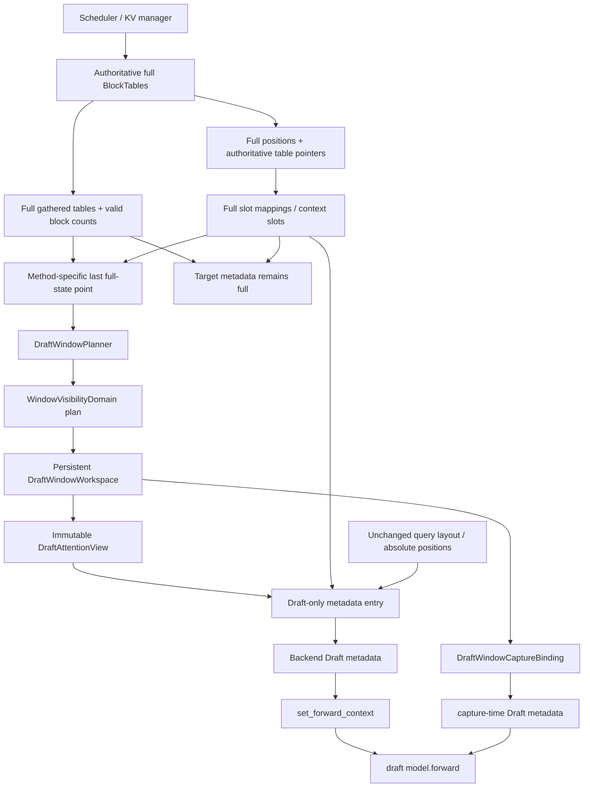

# MRV2 Speculative Draft Sliding Window Architecture Design — Codex v2

> 状态：Stage 8 设计复核版；只读源码，不修改生产代码  
> 日期：2026-10-08  
> 目标：把 MRV1 已有的 speculative draft `draft_window_size` 语义安全地适配到 MRV2  
> 设计输入：原始 Codex 设计、DeepSeek 攻击式 Review、Stage 1～7 事实文档，以及当前本地 `vllm` / `vllm-ascend` 源码

## 0. 基线、判定口径与最终结论

### 0.1 源码基线说明

本地源码目录是：

- `/Users/wenqingzhang/Desktop/vllm/vllm`
- `/Users/wenqingzhang/Desktop/vllm/vllm-ascend`

这两个源码快照当前没有可读取的 `.git` 元数据，因此本文不声称任何 branch 或 commit hash。所有结论均以当前文件内容和当前行号为准；后续 checkout 变化后必须重新核对行号和语义。

### 0.2 Review 判定口径

- **Accepted**：Review 指出的根因或缺口成立，v2 已据此修改设计。Review 给出的具体修法仍可能被修正。
- **Rejected**：Review 的事实、推导或“原设计缺失”判断不成立；本文给出当前源码或数学反例。
- **Needs Verification**：已经检查当前 checkout，但仅靠静态源码仍不能确定运行时事实；本文给出 fail-closed 策略和进入实现前的验证门禁。

### 0.3 最终结论

原设计的主方向保留：

> **Speculator-owned persistent Draft KV Read View，严格隔离 full physical/write plane 与 Draft attention/read plane。**

v2 的关键修正是：

1. Target 与 Draft 使用两个公开 metadata 构建入口，Target 入口在签名上无法接收 Window view。
2. 一个 visibility-sharing domain 使用一个 proposal-wide absolute start；per-group 只负责 table-column 映射与独立 buffer。
3. 保留窄 persistent table，但新增显式 `DraftWindowCaptureBinding`，让 capture 与 replay 绑定同一窄表 storage。
4. Window ON 时禁止 CPU length 走 full-length fallback；device exact、CPU exact、CPU upper、DCP local 和 backend-derived max 必须同源。
5. 每次 step refresh 都从 canonical full source 全量重写窄目标区，不采用增量补列。
6. 不使用新 ContextVar、`_EXTRA_CTX` 或 module-global monkeypatch 运输 Window view。
7. 第一版不改 MRV1 `SlidingWindowAdapter`；MRV1 作为 golden oracle，公共化重构另立 PR。
8. Window OFF 继续走当前完全相同的 speculator、metadata 和 graph 路径。

---

## 1. Decision Log

| ID | 决策 | 状态 | 主要理由 |
|---|---|---|---|
| D01 | 保留 Candidate B：speculator-owned workspace + typed Draft read view | Confirmed | method timing、Target 隔离、graph ownership 和 async lifetime 都应由 Draft owner 明确表达 |
| D02 | 新增 Draft-only metadata 入口；现有 Target/general 入口不接受 view | Revised | 当前 Target 与 Draft 最终都可到达 Ascend builder；optional view 参数存在误传面 |
| D03 | 默认一个 proposal 一个 `WindowVisibilityDomain`；domain 内共享 absolute start | Revised | DSA request metadata和 SFA top-k indices存在跨 group/layer共享 |
| D04 | alignment 取 domain 内 layout provider 声明值的 LCM | Revised | 不能裸用第一个 layer 的 block size，也不能无条件逐 gid 产生不同 origin |
| D05 | 保留窄 table；capture 通过显式 binding 使用同一 backing | Revised | Review 的 full-width 建议只解决 shape，不解决 pointer；窄表本身可 capture |
| D06 | Window ON 不再依赖 ContextVar / `_EXTRA_CTX` / 新增全局 monkeypatch | Revised | metadata build 早于部分 forward context 生效点，且隐式状态不满足 async 隔离 |
| D07 | 每个 step 从 full source 全量重写目标容量 | Revised | 消除增量补列、旧 epoch 残列和双 builder 重入歧义 |
| D08 | Window exact 与 upper 共用 canonical start；缺 CPU exact 时不得 fallback | Revised | 当前 funnel 会以 `max_seq_len` 填 CPU 长度，和窄表组合会读错 block |
| D09 | 拆分 capture capacity 与 runtime visible max | Revised | 当前 capture 与 live 本来就传不同类别的 max；不能用一个 `max_seq_len` 表达四种语义 |
| D10 | 第一版不修改 MRV1 adapter | Revised | 降低已上线 V1 行为和 Window-OFF 回归面；共享 pure math 重构延后 |
| D11 | AR 配置要求 `W >= K`，并保留 runtime non-negative assert | Confirmed | 这是对所有 `seq_len` 保证 `visible >= 0` 的必要且充分配置条件 |
| D12 | native SWA 与 draft window 定义为可见集合求交，不做两次 origin 平移 | Revised | GQA、DSA、SFA 的可见性表达不同，需从同一 Window plan派生 |
| D13 | padding 服从 backend 的“无可观察副作用”契约 | Revised | block 0 可与 active request重合；安全性来自 dummy output丢弃和 no-write |
| D14 | host staging ring 深度至少为 `max_concurrent_batches`；device slot由真实 execution lane决定 | Revised |源码证明 host/UVA in-flight 重叠，但尚未证明单 runner 多 device stream并行 |
| D15 | 每次 proposal无条件创建新 epoch，并快照 ordered request identity | Revised | 同一步可以 remove/preempt 后复用同一个 persistent row |
| D16 | Window 只覆盖 `window_consumer_group_ids` | Revised | 除直接 Draft attention group外，SFA index/cache dependency也可能决定 visibility |
| D17 | MTP warning-and-ignore；其他 unsupported method 保留当前 factory行为 | Confirmed | policy 按 normalized method，不按 concrete Python class |
| D18 | Week4 使用 `ParallelWindowProjector`，不建立 `FlashcommWindowLayoutProvider` | Revised | FlashComm 是 SP-MoE 通信开关，不定义 block-table layout |

---

## 2. Review Resolution Table

### 2.1 25 个攻击面逐项裁决

| # | Review 主题 | 风险 | 判定 | v2 裁决与修改 |
|---:|---|---|---|---|
| 1 | Target 被误 Window | Critical | **Accepted** | 不再设计“共享公开函数 + optional view”。新增 Draft-only 入口；Target 调用点只能导入无 view 参数的现有入口。 |
| 2 | positions 被改变 | Critical | **Accepted** | view 永不拥有 positions；materialize 前后只在局部 scope做 storage/content debug检查。AR 后续 step合法更新 positions，不能跨 proposal冻结它。 |
| 3 | slot mapping 读到 window table | Critical | **Accepted** | 保留 full-slot 不变量；测试 ON/OFF bitwise equality，并检查 storage byte ranges 不 alias。 |
| 4 | full block table 被污染 | Critical | **Rejected** | 原设计已经禁止写 full source；Review 要求 source pointer必须等于 `input_block_tables[g]` 过严，gather API允许 caller-provided output。v2 改用 typed `FullDraftKVSource` + no-alias/version校验。 |
| 5 | seq_lens 被重复 Window | Major | **Accepted（缩窄）** | “第二个 reader 再 Window seq_lens”并不成立；真实缺口是 AR 增量补列规则含糊。v2 删除增量优化，每 step 从 full source全量重写一次，随后多个 reader只 acquire sealed view。 |
| 6 | Window OFF 零回归 | Major | **Accepted（修正理由）** | Review 所称 pure helper必然改变 V1副作用并不成立，但第一版仍删除 MRV1重构以缩小 patch；OFF 不分配、不跑 kernel、不改 graph key、不重建 Eagle first pass。 |
| 7 | per-group block size | Critical | **Accepted** | 改为 visibility domain单一 absolute start；alignment来自 layout capability的 LCM，容量按 `W + A - 1` 重算。 |
| 8 | padding rows | Major | **Accepted（修正断言）** | 补 backend padding contract；拒绝“padding block id必须与 active不相交”。正确条件是 dummy read/write无可观察副作用。 |
| 9 | CPU upper 与 device exact | Critical | **Accepted** | view存在时 CPU exact、upper 均为强制字段；缺失即报错，不进入 `np.full(max_seq_len)` fallback。 |
| 10 | graph 地址稳定 | Major | **Rejected（所述缺陷）** | `x[:num_reqs]` 是零起点 prefix，storage offset不会随 descriptor漂移。仍把测试签名加强为 `data_ptr/shape/stride/dtype`；真正缺口归入 #11。 |
| 11 | capture/replay metadata一致 | Critical | **Accepted** | 确有 capture-time 第三入口。拒绝“full-width自动解决”；新增显式 capture binding，让 capture/live/replay使用同一窄 backing。 |
| 12 | eager / PIECEWISE / FULL | Major | **Accepted** | Eagle PIECEWISE capture也必须有真实 view；DFlash/DSpark当前没有 PIECEWISE，矩阵按真实 method/backend拆开。 |
| 13 | async 生命周期 | Critical | **Accepted（修正推论）** | host ring按 `max_concurrent_batches`；UVA多 slot不能单独证明多 device lane。device slot必须由 stream/event事实约束，未验证多 lane时禁止换 captured pointer。 |
| 14 | ContextVar/context泄漏 | Critical | **Accepted** | 设计明确选择显式路线；拒绝 Review 建议的 `_EXTRA_CTX` 运输，因为 metadata build时其 draft flag可能尚未设置。 |
| 15 | Eagle/DFlash/DSpark timing | Critical | **Accepted** | Eagle first-pass重建必须借用 Target本轮完整 query layout，只允许 read table与同源 length改变。 |
| 16 | unsupported method误启用 | Major | **Accepted** | 拆开 MRV1 silent non-applicable、MRV2 extract no-attention、MRV2 factory error和 MTP warning-ignore。 |
| 17 | native SWA 双重计算 | Critical | **Accepted（修正实现）** | 接受原设计 spec不完整；拒绝“DSA只裁表无效、必须再 clamp绝对 start”的结论。Window-relative table/length已使 native selector自然求交；SFA另需 relative visible count/index转换。 |
| 18 | DCP/PCP/SP/CP | Critical | **Accepted** | device与CPU local都用 `prefix(end)-prefix(start)`；缺 CPU exact或未证明 local table projection时 fail fast。 |
| 19 | FlashComm | Major | **Accepted** | 删除 FlashComm layout provider；保留其通信/异步性能测试维度，布局扩展改为通用 parallel projector。 |
| 20 | model-specific assumptions | Major | **Accepted** | advisory读取 target `self.vllm_config.model_config`；backend/layout能力在 `set_attn()` 后解析；只处理 consumer groups。 |
| 21 | 隐性性能回归 | Major | **Accepted** | 区分 capture capacity与runtime effective max；禁止新增无计划 D2H/`item()`；直接测 KV read/valid-index下降。 |
| 22 | persistent buffer内存 | Major | **Accepted（按窄表重算）** | 不采纳 full-width默认；内存按 lane × domain/group × capacity计算，不按 descriptor重复分配，并单列 sparse derived buffer。 |
| 23 | multi-request/dynamic batch | Major | **Accepted（加固）** | 增加 request-order fingerprint、不同 row的不同 needed、batch shrink和chunked prefill测试。 |
| 24 | preemption/request removal | Critical | **Accepted** | 每 proposal新 epoch；快照 ordered req_ids、idx_mapping、valid block counts和source generation，覆盖同 row/同 block-count复用。 |
| 25 | graph padding/different shapes | Major | **Accepted（修正 offset解释）** | 明确 `R_capacity/R_descriptor/R_actual`；同 descriptor/lane比较 capture/replay tensor signature，padding和tail确定性重写。 |

### 2.2 Rejected 项的源码或数学依据

#### R-04：不能要求 full source pointer 恒等于 `input_block_tables[g]`

`BlockTables.gather_block_tables()` 明确支持 caller-provided `out` / `out_ptrs`，因此 PCP、capture provider或显式 full snapshot都可能是合法 source；正确约束是 source带 authoritative generation且与 destination不 alias，而不是 pointer等于某一个固定对象。[`block_table.py:148`](/Users/wenqingzhang/Desktop/vllm/vllm/vllm/v1/worker/gpu/block_table.py:148)

#### R-10：prefix slice 的 storage offset 不随 descriptor改变

当前路径使用 `x[:num_reqs_padded]`，它始终从 row 0 开始；descriptor改变的是 shape，不是起始 offset。[`speculator.py:322`](/Users/wenqingzhang/Desktop/vllm/vllm/vllm/v1/worker/gpu/spec_decode/speculator.py:322)  
因此 Review 的 offset因果链不成立。不过 graph test仍应比较 `(data_ptr, shape, stride, dtype)`，因为 shape/stride同样属于 captured contract。

#### R-08：padding block无需和 active block不相交

GQA/FIA 会给 dummy request补 `seq_len=1` 和全零 table row。源码明确说明 dummy output会被裁掉，cache write只处理 `num_actual_tokens`，所以“任意正 KV length + zero row”可用。[`attention_v1.py:341`](/Users/wenqingzhang/Desktop/vllm/vllm-ascend/vllm_ascend/attention/attention_v1.py:341)  
因此 block 0即使恰好属于 active request，也不造成可观察输出；强制 block-id集合不相交既无源码依据，也未必有 reserved null block可用。

#### R-11：full-width 同 shape不能自动解决 capture

DFlash capture当前从 `BlockTables.input_block_tables` 取得 dummy table并构建 metadata。[`dflash/cudagraph.py:24`](/Users/wenqingzhang/Desktop/vllm/vllm/vllm/v1/worker/gpu/spec_decode/dflash/cudagraph.py:24)  
DSA与SFA的 graph updater是 no-op。[`dsa_v1.py:1621`](/Users/wenqingzhang/Desktop/vllm/vllm-ascend/vllm_ascend/attention/dsa_v1.py:1621) [`sfa_v1.py:885`](/Users/wenqingzhang/Desktop/vllm/vllm-ascend/vllm_ascend/attention/sfa_v1.py:885)  
因此把 runtime workspace做成同 shape的 full-width tensor仍然是地址 B，而 capture绑定的是地址 A。真正条件是 capture与replay使用同一个 backing；该 backing完全可以是窄表。

#### R-17：DSA并非“不读 table”

`build_dspark_swa_indices()` 读取 table并把逻辑位置翻译为物理 slot，[`dsa_v1.py:420`](/Users/wenqingzhang/Desktop/vllm/vllm-ascend/vllm_ascend/attention/dsa_v1.py:420)；最终 op同时拿到 `ori_block_table` 和 `ori_sparse_indices`。[`dsa_v1.py:2246`](/Users/wenqingzhang/Desktop/vllm/vllm-ascend/vllm_ascend/attention/dsa_v1.py:2246)

若 external start为 `S`，传给 DSA的是 shifted table和 `L'=L-S`，则 native start：

```text
relative_native_start = max((prefix - S) - native_W, 0)
absolute_native_start = S + relative_native_start
                      = max(S, prefix - native_W)
```

它已经是 draft window与 native window的交集。再把绝对 `S` clamp进 relative start会重复应用 origin。

#### R-m3 / Q-K：Review 对 `W < K` 的推导错误

令 `d=K-W`、`L=q·b+r`、`0<=r<b`。当 `d>0` 时：

```text
start > L
<=> floor((r+d)/b) * b > r
<=> r+d >= b
```

反例：

```text
L=63, b=64, K=2, W=1
start=align_down(64,64)=64
visible=63-64=-1
```

此时 `K-W=1<b`，仍然出现负长度。任意 `W<K` 都存在某个 block remainder触发问题；所以对所有长度做配置级保证时，`W>=K` 是正确条件，runtime assert只能作为第二道防线。

### 2.3 Critical / Major Issues 裁决

| Review ID | 判定 | Resolution |
|---|---|---|
| C1 capture链路遗漏 | **Accepted** | 补齐 live、replay rebuild、capture dummy三类入口；采用显式窄表 capture binding，不采用 full-width假修复 |
| M1 AR first-pass layout | **Accepted** | 新增字段级 layout不变量和 Target-vs-rebuilt差分测试 |
| M2 per-group start | **Accepted（修正为 visibility domain）** | domain内单一起点，alignment来自 provider LCM；不是简单按所有 `kernel_block_size` 硬算 |
| M3 CPU fallback | **Accepted** | view存在时 CPU exact/upper必填；backend需要而method无法提供则 fail fast |
| M4 native SWA | **Accepted（修正 backend规则）** | 定义可见集合交集；DSA不重复 clamp；SFA增加 relative visible state |
| M5 preemption | **Accepted** | request identity和block generation进入 epoch；每 proposal无条件换 epoch |

### 2.4 Minor Issues 裁决

| ID | 判定 | Resolution |
|---|---|---|
| m1 descriptor pointer检查 | **Rejected（原因）** | prefix offset不漂移；仍增强为 `data_ptr/shape/stride/dtype` |
| m2 MRV1 adapter重构 | **Accepted（scope）** | 第一版删除该生产修改；另立 prerequisite/refactor PR |
| m3 `W<K` 条件 | **Rejected** | 保留 `W>=K`，见数学反例 |
| m4 padding disjoint | **Rejected** | 改成 backend无可观察副作用 contract |
| m5 `window_num_blocks` | **Accepted** | 仅 workspace内部 mask/debug，不宣称 backend消费 |
| m6 group范围 | **Accepted（改名）** | 使用 `window_consumer_group_ids`，包含 derived-index依赖 group |
| m7 token-only语义 | **Accepted** | MRV1 silent non-applicable 与 MRV2 factory error分开 |
| m8 FlashComm provider | **Accepted** | 删除，改成 `ParallelWindowProjector` |
| m9 descriptor重复分配 | **Rejected** | v2明确最大容量按 lane复用，不按 descriptor分配 |
| m10 `max_seq_len` | **Accepted（拆分语义）** | capture capacity和runtime effective max分开 |
| m11 lease时点 | **Accepted** | 等最后 reader、graph task update和consumer-complete event |

### 2.5 Questions Requiring Source Verification 的关闭情况

| ID | 判定 | 当前 checkout 结论 / 门禁 |
|---|---|---|
| Q-A metadata入口 | **Accepted，已关闭** | 已找到 live build、DFlash replay rebuild、AR replay rebuild、DFlash capture、AR prefill/decode capture；Window ON都必须显式接 view |
| Q-B backend / causal | **Needs Verification** | 这是实际模型/每 group运行时属性，不存在仓库级唯一值；`set_attn()` 后绑定 capability，未声明组合 fail fast |
| Q-C group/layout | **Accepted，已关闭** | 当前测试已覆盖两个 group的 kernel block size为128/64；异构 group是现实结构，不是纯理论 |
| Q-D length consumer | **Accepted，已关闭** | GQA、MLA、SFA、DSA均已逐字段核对；见第 3.4 节及第 9.2 节 |
| Q-E capture固化点 | **Accepted，已关闭** | GQA可走 UpdatableGraph；MLA有event更新；DSA/SFA no-op或builder-owned persistent state |
| Q-F max必须一致？ | **Rejected** | 当前 capture传容量、runtime传dynamic draft max；正确做法是分离 capacity与effective max |
| Q-G update happens-before | **Accepted，已关闭** | 当前 ACL协议是 submit replay后由captured event等待graph task update；lease等最终consumer event |
| Q-H 多 device epoch | **Needs Verification** | 源码证明多 host in-flight，但未证明同 runner多 device stream；首版单 device slot必须有same-stream/event断言，多 lane未绑定 graph时 fail fast |
| Q-I same-step row reuse | **Accepted，已关闭** | execute内先 remove再 add，free-list可立即复用 row；epoch必须带 req identity |
| Q-J DCP projection | **Accepted（规则关闭，组合需测试）** | local必须用prefix差；若 table projection未证明则该组合 fail fast |
| Q-K `W>=K` | **Rejected** | Review推导错误；保留配置校验 |
| Q-L target/draft config | **Accepted，已关闭** | advisory读 `speculator.vllm_config.model_config`；draft backend能力读实际 draft builders/config |

### 2.6 Recommended Design Changes 的处理

| Review 建议 | 判定 | v2 处理 |
|---|---|---|
| 1. C1改成 full-width | **Accepted根因 / Rejected修法** | 新增显式 capture binding，保留窄表 |
| 2. AR layout硬不变量 | **Accepted** | 纳入 Invariants和method tests |
| 3. proposal单一 start | **Accepted（修正）** | 按 visibility domain统一；alignment来自 provider |
| 4. CPU fallback收口 | **Accepted** | view ON缺 exact/upper即报错 |
| 5. native SWA写成 spec | **Accepted（修正）** | backend matrix + SFA relative state；DSA不重复 clamp |
| 6. preemption失效规则 | **Accepted** | 每 proposal新 epoch + request identity snapshot |
| 7a. 删除 MRV1 Patch 1 | **Accepted（首期范围）** | MRV1保持不动，golden对拍 |
| 7b. 删除 FlashComm layout provider | **Accepted** | 改通用 parallel projector |
| 7c. 删除 `W>=K` | **Rejected** | 数学反例证明必须保留 |
| 7d. MVP只做 `{dspark,dflash}×{GQA,MLA}` | **Rejected** | 会丢失MRV1已支持的 Eagle/Eagle3语义；采用 capability门禁而非按method砍掉 |
| 8. 12项作为门禁 | **Accepted** | 已关闭的写入 contract；运行时特定项保留 fail-closed gate |

---

## 3. 当前源码证据摘要

### 3.1 Target 与 Draft 当前确实汇入同一底层 builder

Target `AscendModelState.prepare_attn()` 直接调用 Ascend `build_attn_metadata()`。[`default.py:95`](/Users/wenqingzhang/Desktop/vllm/vllm-ascend/vllm_ascend/worker/v2/model_states/default.py:95)  
Draft live path的上游 `_build_attn_metadata()` 也调用 module-level builder。[`speculator.py:295`](/Users/wenqingzhang/Desktop/vllm/vllm/vllm/v1/worker/gpu/spec_decode/speculator.py:295)  
当前 Ascend wrapper会临时替换上游 speculator模块变量。[`attn_utils.py:1240`](/Users/wenqingzhang/Desktop/vllm/vllm-ascend/vllm_ascend/worker/v2/attn_utils.py:1240)

这不代表 Target当前已经被污染；它说明新设计不能再扩大 optional/global transport面。

### 3.2 Slot mapping结构上读取 full authoritative table

upstream slot kernel读取 `block_table_ptrs`，这些指针绑定 persistent `block_tables[g].gpu`，不读取 gathered/window table。[`block_table.py:92`](/Users/wenqingzhang/Desktop/vllm/vllm/vllm/v1/worker/gpu/block_table.py:92) [`block_table.py:190`](/Users/wenqingzhang/Desktop/vllm/vllm/vllm/v1/worker/gpu/block_table.py:190)  
Ascend override沿用同一输入关系。[`block_table.py:82`](/Users/wenqingzhang/Desktop/vllm/vllm-ascend/vllm_ascend/worker/v2/block_table.py:82)

DFlash/DSpark额外 query/context slots在 Window timing之前读取 full gathered table。[`dflash/speculator.py:375`](/Users/wenqingzhang/Desktop/vllm/vllm/vllm/v1/worker/gpu/spec_decode/dflash/speculator.py:375)

### 3.3 Gather active-row tail确实可能残留

gather kernel仅写 active row的 `[0,num_blocks)`，只对 padding row整行清零。[`block_table.py:235`](/Users/wenqingzhang/Desktop/vllm/vllm/vllm/v1/worker/gpu/block_table.py:235)  
所以 source row width不是有效性证明；Window gather必须同时检查 `full_valid_num_blocks[g,row]`。

### 3.4 CPU fallback是可达危险路径

当 `seq_lens_np is None` 时，Ascend funnel用 `max_seq_len` 填满 CPU exact；upper缺失时再直接别名到它。[`attn_utils.py:253`](/Users/wenqingzhang/Desktop/vllm/vllm-ascend/vllm_ascend/worker/v2/attn_utils.py:253)  
Draft普通路径传入的是 `draft_max_seq_len`。[`speculator.py:346`](/Users/wenqingzhang/Desktop/vllm/vllm/vllm/v1/worker/gpu/spec_decode/speculator.py:346)

MLA优先消费 CPU length，[`mla_v1.py:500`](/Users/wenqingzhang/Desktop/vllm/vllm-ascend/vllm_ascend/attention/mla_v1.py:500)；DSA/SFA也有CPU辅助消费者。[`dsa_v1.py:837`](/Users/wenqingzhang/Desktop/vllm/vllm-ascend/vllm_ascend/attention/dsa_v1.py:837) [`sfa_v1.py:641`](/Users/wenqingzhang/Desktop/vllm/vllm-ascend/vllm_ascend/attention/sfa_v1.py:641)

### 3.5 Capture-time metadata是独立入口

- DFlash/DSpark dummy capture：[`dflash/cudagraph.py:24`](/Users/wenqingzhang/Desktop/vllm/vllm/vllm/v1/worker/gpu/spec_decode/dflash/cudagraph.py:24)
- 上游通用 AR capture helper：[`cudagraph_utils.py:766`](/Users/wenqingzhang/Desktop/vllm/vllm/vllm/v1/worker/gpu/cudagraph_utils.py:766)
- Ascend AR decode capture调用该 helper：[`autoregressive/aclgraph.py:103`](/Users/wenqingzhang/Desktop/vllm/vllm-ascend/vllm_ascend/worker/v2/spec_decode/autoregressive/aclgraph.py:103)
- DFlash模块符号在导入期被 Ascend重绑定：[`patch_dflash_speculator.py:18`](/Users/wenqingzhang/Desktop/vllm/vllm-ascend/vllm_ascend/patch/worker/patch_v2/patch_dflash_speculator.py:18)

### 3.6 Preemption后 row可在同一步复用

runner把 finished和preempted requests都移除，再处理新增请求。[`model_runner.py:1085`](/Users/wenqingzhang/Desktop/vllm/vllm/vllm/v1/worker/gpu/model_runner.py:1085) [`model_runner.py:1152`](/Users/wenqingzhang/Desktop/vllm/vllm/vllm/v1/worker/gpu/model_runner.py:1152)  
因此仅记录 `idx_mapping` 数字不够；新 request可复用同一 row index，必须记录 ordered request identity和generation。

---

## 4. Final Architecture

### 4.1 总体结构

推荐架构名称：

> **Explicit Draft Window Read Plane with Capture-Bound Persistent Workspace**



### 4.2 公共组件

#### `DraftWindowPolicyResolver`

输入 normalized speculative method、target config、实际 draft builders和graph capability；输出：

```text
support:
  ENABLED
  WARN_AND_IGNORE
  NOT_APPLICABLE
  EXISTING_FACTORY_ERROR

timing:
  AR_PROPOSAL
  PARALLEL_QUERY_READY

future_offset:
  num_speculative_tokens
  zero
```

它不按 model-name字符串决定主流程；model-specific advisory由 target model/config暴露语义能力。

#### `WindowVisibilityDomain`

一个 domain包含必须共享逻辑坐标原点的 consumer groups。满足任一条件即应处于同一 domain：

- 共享 request-level exact/CPU length；
- 共享 DSA `common_ratio_to_sas_metadata`；
- 共享 SFA/top-k indices；
- backend声明 derived metadata只允许一个 origin。

当前最安全默认是“一个 proposal 一个 domain”。未来只有 backend明确证明隔离后才能拆 domain。

#### `DraftWindowLayout`

每个 consumer group声明：

- `gid`；
- `table_column_span_tokens`；
- `start_alignment_tokens`；
- full row width；
- Window row capacity；
- absolute interval到table columns的映射；
- padding contract；
- CP/DCP/SP projection capability；
- graph/capture capability；
- native/sparse visibility capability。

#### `FullDraftKVSource`

这是只读 source描述，不要求固定 pointer等于 `input_block_tables`：

```text
tables_by_gid
full_device_exact
full_cpu_exact (when available)
full_cpu_upper
full_valid_num_blocks_by_gid
ordered_req_ids
idx_mapping
source_generation
layout_version
```

#### `DraftWindowPlan`

proposal/step内不可变的数学结果：

```text
epoch_id
proposal_id
step_id
future_offset
absolute_start_tokens
absolute_end_tokens
visible_exact
visible_upper
domain_alignment
request_order_fingerprint
```

#### `DraftSlidingWindowWorkspace`

由 concrete speculator持有，负责：

- capture前分配 persistent device/host buffers；
- 从 full source物化窄 table、exact、upper、local与scratch；
- 每次 refresh全量覆盖目标容量；
- padding/tail确定性清理；
- epoch、lease、event和lane管理；
- 返回只读 `DraftAttentionView`。

它不计算 slot mapping，不改 positions，不调用 model，不决定 method policy。

#### `DraftWindowCaptureBinding`

这是 v2 相比原设计新增的关键组件：

- owner是 speculator/graph manager；
- 以 `phase + gid + AR step slot + device lane` 为 key；
- capture dummy与runtime view使用同一 workspace backing；
- 向 Ascend-local capture helper提供 typed view；
- Window OFF时不存在，graph manager完整 delegate当前路径。

#### Draft-only metadata入口

公共 API边界应为：

```text
build_attn_metadata(...)                 # 当前 Target/general入口，无 view参数
build_draft_attn_metadata(..., view)     # Draft-only，view必填
```

二者可在私有实现中共享机械构造代码，但 Target公开签名不能接收 `DraftAttentionView`。

### 4.3 Window 数学

对 request row：

```text
L = apply-time full exact length
U = apply-time CPU upper bound, U >= L
W = draft_window_size
K = future_offset
A = lcm(start_alignment_tokens of layouts in the visibility domain)

F     = L + K
ideal = max(F - W, 0)
S     = floor(ideal / A) * A

window_exact = L - S
window_upper = max(U - S, window_exact)
```

AR proposal：

```text
anchor S = aligned_start(L0, W, A, K)
step s exact = Ls - S
```

Parallel proposal：

```text
K = 0
prepare kernel完成后的 L 已包含 query stretch
```

domain对齐的最大回退为 `A-1`，所以 group `g` 的安全容量是：

```text
max_visible_capacity <= W + A - 1
C_g = ceil((W + A - 1) / table_column_span_tokens[g])
```

仅当 `A == span_g` 时，才能退化到 MRV1风格 `ceil(W/b)+1`。

### 4.4 Table materialization

对每个 `g,row`：

1. 用 layout把 absolute `S[row]` 映射为 `start_col[g,row]`；
2. `needed[g,row] = ceil(window_exact[row] / span_g)`；
3. source index同时受以下条件约束：
   - 小于 full tensor row width；
   - 小于该 row本轮 `full_valid_num_blocks[g,row]`；
   - 小于当前 needed；
4. 写入 `window_table[g,row,0:C_g]`；
5. 所有无效列写 backend约定的确定值；
6. inactive/padding rows按 backend padding contract写确定值。

每个 refresh均全量重写 `C_g`，绝不从上一个 Window table作为 source，也不做增量补列。

---

## 5. Design Invariants

1. **Target isolation**：Target builder、Target metadata、Target logits和verification永远使用 full state。
2. **Absolute positions**：真实 positions值、storage和RoPE语义不因 `draft_window_size` 改变。
3. **Full write mapping**：所有 slot mapping、context slot和真实 KV write都从 full authoritative table计算。
4. **No full-state mutation**：authoritative tables、gathered full tables和canonical input lengths只读。
5. **One origin per visibility domain**：domain内所有 group共享同一 absolute `S`。
6. **Per-group physical materialization**：每个 consumer group有独立 table layout、capacity和persistent backing。
7. **Length coherence**：device exact、CPU exact、CPU upper、`_seq_lens_cpu`、DCP local和derived max都从同一 `S` 派生。
8. **No fallback under Window**：view存在时，任何必需 CPU field缺失都必须报错，不能退回 full `max_seq_len`。
9. **DCP interval semantics**：local Window长度为 `local_prefix(E)-local_prefix(S)`，不是 `local_prefix(E-S)`。
10. **Idempotence**：`full source + plan -> destination`；同一 sealed step的多个 reader不触发再次materialize。
11. **Stale-tail safety**：source访问受 per-row valid block count约束；row width不代表有效列数。
12. **Padding semantics**：padding必须满足 backend无可观察副作用 contract，而不是统一“全零即安全”假设。
13. **Capture identity**：同一 `descriptor/lane/phase/step` 的 capture与replay使用相同 backing和兼容的 shape/stride/dtype。
14. **Epoch identity**：每 proposal无条件递增 epoch；ordered req ids、idx mapping、valid counts和source generation属于 epoch。
15. **Lease safety**：最后 reader、graph task update和device consumer完成前不得覆盖 slot。
16. **Window OFF identity**：无 workspace、无 materialize、无新 metadata重建、无 graph key变化。
17. **Method policy by semantics**：不因 MTP落到 Eagle-compatible class而启用 Window。
18. **Native visibility intersection**：native SWA/top-k/DSA selector必须在同一 Window坐标系派生，禁止重复平移。
19. **AR legal domain**：`W>0` 且 `W>=K`；runtime仍断言 `S<=L`。
20. **Fail closed**：backend/layout/graph/parallel组合未声明能力时拒绝 Window，不静默使用可能错误的 view。

---

## 6. Ownership

| 对象 | Owner | 可写者 | 读者 | Window是否可修改 |
|---|---|---|---|---|
| persistent request block tables | `BlockTables` | scheduler/runner staged writes | slot kernel、gather | 否 |
| gathered full `input_block_tables` | `BlockTables` | full gather kernel | DFlash prepare、Window source、Target builder | 否 |
| full slot mappings | `BlockTables` / method buffers | slot/prepare kernel | KV write、forward context | 否 |
| full Draft device exact lengths | speculator `InputBuffers` | method prepare kernels | Window planner/source | 否 |
| Target CPU exact/upper | Target `InputBatch/InputBuffers` | runner | planner、Target builder | 否 |
| `DraftWindowWorkspace` | concrete speculator | Window materializer | Draft builder、capture binding | 是，仅写自有 buffer |
| `DraftAttentionView` | workspace epoch | 无；只读descriptor | Draft metadata入口 | 不适用 |
| backend derived Window state | backend provider/workspace | provider | attention op/graph | 是，仅写 persistent derived buffer |
| Target metadata | ModelState | Target builder/updater | Target forward | 否 |

Window source与destination的 debug no-alias检查应比较 storage identity和byte interval，而不是仅比较tensor对象或首地址。

---

## 7. Buffer / Ownership / Lifetime

### 7.1 Device buffers

设 `R` 为最大请求数、`G_c` 为 consumer group集合、`C_g` 为该group的窄表容量。

| Buffer | dtype / shape | 生命周期 | 地址要求 |
|---|---|---|---|
| `window_block_tables[g]` | source dtype，`[R,C_g]` | speculator/device lane | capture-stable |
| `window_seq_lens` | `int32[R]` | lane / AR step slot | capture-stable |
| `window_start_tokens` | `int32[R]` | lane / proposal | capture-stable |
| `full_valid_num_blocks[g]` snapshot | `int32[R]` | epoch | reader完成前保活 |
| `window_num_blocks[g]` | `int32[R]` | epoch | workspace内部mask/debug；当前不传backend |
| gather index/mask scratch | provider定义 | lane | graph使用时固定 |
| DCP local exact | `int32[R]` | lane/step | backend要求时固定 |
| SFA relative count/index scratch | backend定义 | lane/step | capture-stable |
| AR per-step CPU/device lengths | `[K,G_or_domain,R]` 或stable slots | graph lifetime | 每captured step固定 |

窄 table payload：

```text
table_bytes_per_device_lane =
  sum(g in consumer_groups, R * C_g * sizeof(int32))
```

总内存还必须加入：

```text
host_staging_depth
device_execution_lanes
AR step slots
DSA/SFA derived index buffers
```

它不按 graph descriptor数重复分配；不同 descriptor捕获同一最大容量 backing的不同 prefix-shaped view。

### 7.2 Host buffers

| State | 语义 | Owner | 要求 |
|---|---|---|---|
| full CPU exact | authoritative exact或明确重建值 | runner/method provider | 不得由upper冒充 |
| window CPU exact | `full_exact-S` | lane-owned pinned slot | view ON必填给需要它的backend |
| window CPU upper | `max(full_upper-S, exact)` | lane-owned pinned slot | 和exact同 origin |
| CPU start | canonical `S` mirror | lane-owned pinned slot | upper/local派生共用 |
| DCP CPU local | `prefix(E)-prefix(S)` | parallel projector | MLA/DCP缺失即fail |

如果 method的最终 exact只存在device：

- backend不需要CPU exact：capability必须明确证明所有consumer只读device exact；
- backend需要CPU exact：使用lane-owned pinned copy，在现有host-consuming边界完成同步；
- 不允许悄悄使用 `np.full(max_seq_len)`。

### 7.3 生命周期状态机

```text
DISABLED
  -> Window OFF / ignored method，无任何workspace

CONFIGURED
  -> policy已解析，尚未拿到实际layout

ALLOCATED
  -> set_attn后按domain/group/lane一次性分配；capture前完成

PREPARING(epoch, step)
  -> 从canonical full source全量重写

SEALED(epoch, step, request_fingerprint)
  -> immutable view；live/capture-manager readers可重复acquire

IN_FLIGHT(readers, events)
  -> metadata、graph update、attention consumer正在读取

RETIRED
  -> 最后reader和consumer completion event结束，slot可复用
```

epoch至少包含：

```text
proposal_id
step_id
ordered_req_ids fingerprint
idx_mapping snapshot
full_valid_num_blocks snapshot/version
source_generation
layout_version
domain start
descriptor
device lane
```

---

## 8. Runtime Data Flow

### 8.1 Target路径

```text
full persistent tables
  -> full gather
  -> full slot mapping
  -> existing build_attn_metadata
  -> Target forward / verification
```

Target路径不创建、不接收也不查询 `DraftAttentionView`。

### 8.2 AR：Eagle / Eagle3

```text
Target output
  -> prepare_prefill_inputs
  -> Target query layout / absolute positions / full slots稳定
  -> begin_ar_proposal(L0, K)
  -> canonical S = align_down(max(L0+K-W,0), A)
  -> materialize step-0 view from full source
  -> Window ON: 用 Target query layout + Draft read view重建Draft metadata
     Window OFF: 原样复用Target metadata
  -> draft first forward
  -> for each later step:
       prepare/update full positions
       compute full slot mappings
       refresh current step from full source using same S
       seal view
       build/update Draft metadata
       draft forward
```

first-pass重建必须借用 Target本轮：

- `query_start_loc` 与CPU/NumPy对应值；
- actual/padded `num_tokens`；
- actual/padded `num_reqs`；
- `is_prefilling`；
- metadata-builder使用的 positions；
- full slot mappings。

只允许替换 Draft read table及全部同-origin length字段。

### 8.3 Parallel：DFlash / DSpark / DFlash2

```text
Target hidden states
  -> prepare_dflash_inputs for every consumer group
  -> full query/context positions and slots稳定
  -> context KV physical write
  -> final full device exact length稳定
  -> begin_parallel_proposal(K=0)
  -> materialize domain/group views
  -> backend derived visibility
  -> Draft-only metadata
  -> eager forward or FULL graph
```

Window不得提前到 `prepare_dflash_inputs` 之前，因为该 kernel读取 full gathered table计算真实query/context slots。[`dflash/speculator.py:375`](/Users/wenqingzhang/Desktop/vllm/vllm/vllm/v1/worker/gpu/spec_decode/dflash/speculator.py:375)

---

## 9. Method Integration

### 9.1 Method matrix

| Method | MRV1 contract | MRV2 v2 policy | Timing | future offset | Graph |
|---|---|---|---|---:|---|
| Eagle | Window支持 | 支持 | Target layout/full slots完成后；每AR step full slot完成后refresh | `K` | eager / PIECEWISE / FULL |
| Eagle3 | Window支持 | 支持 | 同Eagle；hidden-state selection不变 | `K` | eager / PIECEWISE / FULL |
| DFlash | Window支持 | 支持 | `prepare_dflash_inputs` + context write之后 | 0 | eager / FULL_DECODE_ONLY；无PIECEWISE |
| DFlash2 | 继承DFlash政策 | 支持已验证的eager组合 | 同DFlash | 0 | 当前不宣称FULL |
| DSpark | Window支持 | 支持 | 每consumer group prepare后，DSA/SFA derived state前 | 0 | eager / 当前真实FULL组合 |
| MTP及variants | warning + ignore | warning一次并ignore | 不创建workspace | N/A | 保持当前路径 |
| extract_hidden_states | 无Draft attention Window | non-applicable | 无 | N/A | 保持当前路径 |
| MRV1 ngram/suffix/medusa | factory直接返回非base proposer，未读取config | 不作为MRV2 silent no-op规范 | 无 | N/A | N/A |
| MRV2当前unsupported方法 | N/A或MRV1另有实现 | 保留factory error | 无 | N/A | N/A |

当前 MRV2 factory对未知方法抛 `NotImplementedError`，[`__init__.py:23`](/Users/wenqingzhang/Desktop/vllm/vllm-ascend/vllm_ascend/worker/v2/spec_decode/__init__.py:23)；`use_eagle()` 同时包含 MTP/DFlash/DSpark，[`speculative.py:1936`](/Users/wenqingzhang/Desktop/vllm/vllm/vllm/config/speculative.py:1936)，所以 policy绝不能按 concrete class推断。

### 9.2 Backend × visibility matrix

| Backend | 真实可见性表达 | Window规则 | 首期门禁 |
|---|---|---|---|
| GQA/FIA | table + exact length + native band | shifted table/length；native band在relative坐标继续收紧 | metadata/graph tests通过 |
| MLA | table + CPU/device lengths | 所有length与table同 origin | CPU exact必须可用 |
| DSA causal | table/length + `ori_win_left` | common view后应用native band | derived max/local一致 |
| DSA non-causal | `build_dspark_swa_indices` 显式indices | 必须从Window table/relative lengths派生；不得再次加绝对 `S` | 集合交集reference测试 |
| SFA | top-k logical indices + table + top-k length | 保留absolute positions；增加relative visible count，过滤/平移indices到Window table坐标 | 未完成专用provider前fail fast |

SFA indices是 block-table逻辑列索引，测试reference直接执行 `block_table[request_idx, token_indices]`。[`test_sfa_nope_forward.py:129`](/Users/wenqingzhang/Desktop/vllm/vllm-ascend/tests/ut/attention/test_sfa_nope_forward.py:129)  
而当前 SFA state用 absolute positions计算top-k length。[`sfa_v1.py:297`](/Users/wenqingzhang/Desktop/vllm/vllm-ascend/vllm_ascend/attention/sfa_v1.py:297)  
因此不能修改真实positions；必须另传 `window_relative_position` 或 `visible_count_per_query`。

### 9.3 Padding matrix

| Backend | 当前padding事实 | v2 contract |
|---|---|---|
| GQA/FIA | 补 `seq_len=1` 与zero table row；dummy output裁掉，dummy不写KV | 保持该语义，不要求block-id与active不相交 |
| MLA | graph路径补zero table、padding positions/slots，具体length由builder控制 | capture/live使用同一确定性padding |
| DSA | padded request的start/table清零；显式indices有自身validity | valid count/indices使dummy无可观察输出 |
| SFA | padding token top-k length置0，并按actual token屏蔽 | table、top-k length和indices同时清理 |

---

## 10. Config / Compatibility Policy

### 10.1 Policy解析顺序

```text
AscendConfig.draft_window_size
  -> normalize method semantics
  -> preserve MRV1 compatibility policy
  -> inspect actual draft builders and visibility dependencies
  -> build WindowVisibilityDomain(s)
  -> validate layout/parallel/graph capabilities
  -> allocate or fail closed
```

### 10.2 参数

- `None`：OFF。
- `W>0`：进入method/capability检查。
- AR：`W>=num_speculative_tokens`。
- Parallel：`future_offset=0`，无 `W>=K` 的额外限制。
- `W<=0`：设计建议配置期报错；这是当前行为收紧，进入生产实现前需maintainer明确批准。
- 任一 consumer group不支持：整个 visibility domain拒绝Window，不能部分group悄悄启用。

### 10.3 Compatibility

- MTP：warning一次并ignore，即便factory返回 Eagle-compatible class。
- DeepSeek-V4/DSpark advisory：读取 target `speculator.vllm_config.model_config`，不读取draft config。
- token-only/extract：不分配attention workspace。
- 当前factory不支持的方法：保持原错误，不由Window resolver抢先改写。

### 10.4 Window OFF

OFF时必须满足：

- resolver在任何workspace分配前返回；
- Eagle first pass仍复用Target metadata；
- DFlash/DSpark仍走当前wrapper/capture路径；
- 不新增device kernel、host copy或Python对象包装；
- graph descriptor/key/数量不变；
- Target/Draft输出和性能基线无统计显著回退。

---

## 11. Graph Strategy

### 11.1 三类 metadata入口

Window graph设计必须同时覆盖：

1. live Draft metadata build；
2. replay前 metadata rebuild / graph-param source；
3. capture-time dummy metadata build。

原设计遗漏的是第3类的明确plumbing，不是“窄表天然不可capture”。

### 11.2 显式 capture binding

Window ON：

- `DFlashAclGraphManager.capture()` 使用 Ascend-local window-aware capture helper；
- `AutoRegressiveAclGraphManager.capture()` 的 prefill与decode都使用显式 dummy `DraftAttentionView`；
- helper从 speculator的 `DraftWindowCaptureBinding` 取得table/length；
- capture dummy内容可为确定性padding，但storage必须是runtime将更新的同一 backing；
- 不通过module-global函数替换、`_EXTRA_CTX` 或 ContextVar运输view。

Window OFF完整delegate现有实现。

### 11.3 Descriptor 与 shape

定义：

```text
R_capacity   = workspace最大row数
R_descriptor = 当前FULL graph固定padded row数
R_actual     = 本轮真实请求数
```

每个 descriptor捕获：

```text
window_table[g][:R_descriptor, :C_g]
window_lengths[:R_descriptor]
```

要求同一 `descriptor/lane/phase/step` 的 capture/replay签名一致：

```text
(data_ptr, shape, stride, dtype)
```

`storage_offset` 可作为诊断记录，但当前零起点prefix不会随descriptor改变offset。

### 11.4 Eager / PIECEWISE / FULL

| Family/mode | 规则 |
|---|---|
| eager | materialize完成后直接build；仍复用persistent workspace |
| Eagle PIECEWISE | capture期仍构造metadata并可能真实执行attention-like op；capture与piece replay都必须拿有效view |
| Eagle FULL prefill | Window ON用Target query layout + Draft capture view；OFF沿用Target dummy metadata |
| Eagle FULL decode | proposal anchor固定；每step stable length/derived slot；graph绑定对应step backing |
| DFlash/DSpark FULL | capture/live/replay rebuild使用同一binding；无PIECEWISE |
| DFlash2 | 当前只声明eager |

PIECEWISE仍构建metadata的当前说明见 [`cudagraph_utils.py:802`](/Users/wenqingzhang/Desktop/vllm/vllm/vllm/v1/worker/gpu/cudagraph_utils.py:802)。

### 11.5 Capture capacity 与 runtime effective max

不再用一个 `max_seq_len` 混合表达：

```text
capture_capacity_max_seq_len
runtime_window_exact_max
runtime_window_upper_max
backend_effective_max_seqlen_kv
```

- FULL capture capacity在capture/replay间固定，并且足以覆盖所有runtime view；
- eager可在backend支持时用runtime visible max；
- SFA plan等真正消费runtime max的derived state必须来自Window upper；
- 未完成capture binding改造的backend继续用原capacity并fail closed，不能谎称window已缩小tiling。

### 11.6 ACL replay真实事件顺序

当前 legacy/UpdatableGraph的Python代码先submit replay，再安排update；正确设备协议是：

```text
main stream materialize Window
  -> update_stream waits producer
  -> main stream submit replay
  -> captured ExternalEvent.wait 阻塞 replay consumer
  -> update_stream安装graph task参数并record event
  -> replay被解锁并读取Window buffers
  -> main stream record consumer-complete event
  -> release lease
```

源码入口：[`dflash/aclgraph.py:100`](/Users/wenqingzhang/Desktop/vllm/vllm-ascend/vllm_ascend/worker/v2/spec_decode/dflash/aclgraph.py:100) [`autoregressive/aclgraph.py:154`](/Users/wenqingzhang/Desktop/vllm/vllm-ascend/vllm_ascend/worker/v2/spec_decode/autoregressive/aclgraph.py:154)

DSA/SFA没有graph-param update，也仍须等attention consumer completion，不能在Python manager返回时立即复用buffer。

---

## 12. Async Strategy

### 12.1 已验证事实

async scheduling下 `max_concurrent_batches = pp_size + 1`。[`vllm.py:589`](/Users/wenqingzhang/Desktop/vllm/vllm/vllm/config/vllm.py:589)  
`UvaBufferPool` 默认至少两槽，并明确要求GPU reader retire后才能复用。[`buffer_utils.py:19`](/Users/wenqingzhang/Desktop/vllm/vllm/vllm/v1/worker/gpu/buffer_utils.py:19)

这证明 host/UVA state可能重叠，但不能单独证明同一runner在多个device stream并行执行两个Draft proposal。

### 12.2 两级策略

```text
Host staging ring:
  depth >= vllm_config.max_concurrent_batches

Device execution workspace:
  one capture-bound slot per verified device execution lane
```

当前首版允许一个 device slot的前提：

- materialize与consumer由同一main stream或明确event排序；
- debug overlap assertion证明旧consumer已完成；
- 下一host epoch只能准备到host ring，不能提前覆盖device slot。

若runtime trace证明多个device lane：

- 每lane独立workspace；
- 每lane图必须capture该lane的地址，或backend明确支持pointer update；
- 未完成lane-specific capture前fail fast，不能简单round-robin到未capture地址。

### 12.3 禁止的隐式运输

Window view不得通过：

- module-global mutable变量；
- 当前 `build_attn_metadata_wrapper` 的新一层monkeypatch；
- `_EXTRA_CTX` 新字段；
- thread-local；
- ContextVar。

当前 `_EXTRA_CTX` 在部分路径直到 model forward才设置draft flag，早于forward的metadata build无法可靠读取；它不是capture plumbing。

---

## 13. Week4 Extension

### 13.1 Absolute interval是扩展边界

公共计划必须暴露：

```text
WindowInterval {
  absolute_start
  absolute_end_exact
  absolute_end_upper
  visible_exact
  future_offset
}
```

不能只暴露相对 `window_seq_len`。

### 13.2 `ParallelWindowProjector`

统一扩展协议：

```text
project_interval(layout, absolute_start, absolute_end, rank)
derive_local_lengths(...)
derive_sparse_indices(...)
bind_capture_buffers(...)
```

capability flags：

```text
supports_dcp_interval_projection
supports_dsa_cp_token_projection
supports_pcp_replicated_layout
supports_sp_token_sharding
supports_full_graph
supports_async_device_lanes
```

FlashComm保留为通信、event lifetime和性能测试维度，不作为block-table layout provider。

### 13.3 DCP / DSA-CP

```text
local_exact = local_prefix(E) - local_prefix(S)
local_upper = local_prefix(U) - local_prefix(S)
```

若local table不是连续slice，projector负责显式gather。不能假设 `S` 对齐kernel block就一定对齐 `dcp_size × interleave` ownership cycle。

### 13.4 SFA

SFA扩展必须同时输出：

- absolute positions：供RoPE，保持不变；
- window-relative visible count：供top-k length；
- filtered/translated logical sparse indices：供shifted table；
- stable derived buffers：供ACL graph。

共享top-k indices的layers/groups必须属于同一 visibility domain。

---

## 14. Test Matrix

### 14.1 Common math

| 类别 | 用例 |
|---|---|
| 基础 | `W=100,A=64,K=0,L=250 -> S=128,V=122` |
| AR | `K>0`、跨block、每step同anchor |
| LCM | spans 128/64；`A=128`；每group column映射正确 |
| 容量 | `C_g=ceil((W+A-1)/span_g)` property |
| 短上下文 | `F<=W -> S=0`，view等同full |
| 非法域 | `W<K` 配置拒绝；runtime `S<=L` |
| exact/upper | 同一 `S` 且 `upper>=exact` |
| DCP | prefix差反例，禁止prefix(window_len) |

### 14.2 Workspace / isolation

- full table、full length、Target metadata逐bit不变；
- destination与authoritative/gathered/slot storage byte ranges不重叠；
- ON/OFF slot mappings逐bit相同；
- positions在一次materialize前后identity/content不变；
- source stale tail预填有效-looking block id，valid count外不得复制；
- 连续100次refresh均等于从full reference重算；
- 同一group不同row的needed不同；
- batch shrink、inactive row、padding tail确定性清理；
- live builder与graph manager读取同一sealed view，不触发第二次materialize。

### 14.3 Length / backend

| Backend | 必测 |
|---|---|
| GQA | device exact/window table同源；native band交集 |
| MLA | CPU exact/device exact/upper同源；缺CPU exact负向测试 |
| DSA causal | native band作用于relative坐标 |
| DSA non-causal |显式indices的绝对集合等于两个窗口交集 |
| SFA | absolute positions不变；relative top-k count不越Window；indices全部落在shifted table有效范围 |
| DCP MLA | device/CPU local均为prefix差 |

全backend断言：Window ON时任何实际消费的CPU长度均不允许落回full `max_seq_len`。

### 14.4 Method timing

| Method | 必测 |
|---|---|
| Eagle/Eagle3 | `future_offset=K`；first-pass Target layout字段等价；每AR step长度正确 |
| DFlash | `future_offset=0`；prepare/context slots后才materialize；eager/FULL一致 |
| DSpark | 每consumer group物化；DSA/SFA derived state来自同epoch |
| DFlash2 | eager正确；不声称未实现graph |
| MTP variants | warning一次并ignore；无workspace |
| extract | no attention workspace |
| unsupported | 保持factory error |

Eagle first-pass差分字段至少包括：

```text
query_start_loc
query_start_loc_cpu / NumPy source
num_tokens / num_input_tokens
num_reqs / padded num_reqs
is_prefilling
metadata-builder positions
slot mappings
```

只允许table与同-origin length相关字段不同。

### 14.5 Graph

- 每个 `method × backend × mode × descriptor × lane` 比较 capture/runtime `(data_ptr,shape,stride,dtype)`；
- DSA/SFA断言captured consumer读取Window backing，不是full `input_block_tables`；
- DFlash/DSpark capture helper与live/replay rebuild使用同一binding；
- Eagle PIECEWISE capture-time attention-like op拿到有效view；
- capture dummy和runtime actual batch不同；
- 长度跨Window/block边界重复replay；
- graph/eager数值一致；
- capture capacity不小于runtime effective max；
- consumer completion前复用slot触发断言。

### 14.6 Async / preemption

- 两个host epoch交错，旧CPU metadata不被覆盖；
- preempt/remove后same-step新增请求复用相同persistent row；
- 新旧请求恰好相同 `num_blocks`；
- 旧window tail含有效-looking block ids；
- old graph reader仍in-flight时新epoch不得覆盖device slot；
- 若启用多device lane，每lane图绑定各自capture地址。

### 14.7 Window OFF

- 不创建workspace；
- 不调用planner/materializer；
- Eagle继续复用Target metadata对象；
- graph key、capture数量和调用链不变；
- output/acceptance/correctness等价；
- latency/throughput无统计显著回退。

### 14.8 E2E / performance

```text
math UT
  -> workspace/metadata UT
  -> Window OFF regression
  -> method × backend eager
  -> PIECEWISE真实组合
  -> FULL真实组合
  -> single/multi request
  -> long context
  -> dynamic batch/preemption
  -> correctness/acceptance
  -> KV read count / valid-index count
  -> latency/throughput/memory
```

性能报告必须分别列：

- materialization kernel；
- CPU exact同步或重建；
- DSA/SFA derived state；
- table payload；
- host ring与device lane内存；
- Draft attention节省；
- 总体acceptance、latency和throughput。

---

## 15. Risks and Remaining Verification Gates

| Gate | 已有结论 | Stage 9前动作 |
|---|---|---|
| 实际 backend/causal组合 | 运行时按group决定，仓库无唯一答案 | 在 `set_attn()` 输出capability inventory并做模型级测试 |
| 同runner多device lane | 静态源码只证明host多in-flight | NPU runtime trace；未证明前单lane+event断言 |
| SFA index转换 | 逻辑index相对table，absolute positions不可改 | 实现专用provider/reference test后才启用 |
| DCP table projection | length prefix差已确定，table连续性未普遍证明 | 多rankreference；不支持组合fail fast |
| capture capacity | capacity/effective语义已分离 | 每backend capture-vs-runtime shape/plan测试 |
| 310P特殊graph manager | 存在独立capture实现；MTP本就ignore | 非MTP Window组合未专门接入前fail fast |
| `W<=0` compatibility | 当前只做类型读取，没有统一正数验证 | maintainer批准是否收紧为配置错误 |

这些 gate不会改变核心架构；它们决定具体 capability是否可以从“拒绝”切换为“启用”。

---

## 16. Expected File Changes

本节只描述 Stage 9 的预计范围；本文未修改任何生产代码。

### 16.1 新增

| 文件 | 职责 |
|---|---|
| `vllm_ascend/worker/v2/spec_decode/sliding_window.py` | policy、math、visibility domain、layout、workspace、view、epoch/lease |
| `vllm_ascend/worker/v2/spec_decode/window_capture.py` | explicit capture binding和Ascend-local dummy view helper |
| 对应 UT | math、workspace、method、backend、graph、async/preemption |

### 16.2 修改

| 文件 | 最小修改 |
|---|---|
| `worker/v2/spec_decode/__init__.py` | normalized method policy与compatibility |
| `worker/v2/attn_utils.py` | 保留现有Target/general入口；新增view必填的Draft-only入口；Window ON禁用CPU fallback |
| `worker/v2/spec_decode/autoregressive/speculator.py` | AR plan、first-pass重建、per-step refresh |
| `worker/v2/spec_decode/eagle/speculator.py` | Eagle/Eagle3 capability，不复制math |
| `worker/v2/spec_decode/dflash/speculator.py` | parallel timing hook与typed view |
| `worker/v2/spec_decode/dspark/speculator.py` | consumer groups、backend-derived visibility |
| `worker/v2/spec_decode/autoregressive/aclgraph.py` | prefill/decode capture binding与lease |
| `worker/v2/spec_decode/dflash/aclgraph.py` | DFlash/DSpark capture binding与event lifecycle |
| `attention/sfa_v1.py` 或窄provider hook | relative visible count / sparse-index translation |
| DCP/DSA provider位置 | interval projection与derived persistent state |
| `ascend_config.py` | 仅在compatibility政策批准后增加value validation |

### 16.3 明确不修改

- MRV1 `vllm_ascend/spec_decode/utils.py`；
- Scheduler / KV Cache Manager；
- Target ModelRunner主链；
- `BlockTables` authoritative owner与slot kernel；
- real positions生成；
- Target sampler / verification。

如果实现发现必须修改这些 full-world组件，应先回到设计评审解释边界为何不足。

---

## 17. 推荐实现顺序

```text
Patch 1: MRV2 pure math + MRV1 golden parity tests（不改MRV1生产代码）
Patch 2: policy/capability + Window OFF identity tests
Patch 3: visibility domain + narrow workspace + full-source rewrite
Patch 4: Draft-only metadata入口 + CPU length coherence
Patch 5: DFlash/DSpark eager
Patch 6: Eagle/Eagle3 eager + PIECEWISE
Patch 7: explicit capture binding + FULL
Patch 8: DSA/SFA/DCP projectors
Patch 9: async/preemption/E2E/performance
```

每个patch都必须保持 Target、absolute positions、slot mapping和authoritative block state不变。任何 graph/backend组合在正确binding完成前必须明确拒绝，不能“eager正确、graph静默读旧地址”。

---

## 18. 最终架构一句话

`draft_window_size` 在 MRV2 中不是对公共 InputBatch做原地裁剪，而是在每个 speculative method的最后 full-state 点，由 speculator从 canonical full source构造一个 proposal-scoped、visibility-domain一致、per-consumer-group物化、capture-bound且async-safe的 **Draft-only KV read plane**；Target、positions、slot mapping和真实KV allocation始终留在 full physical world。

本文没有修改生产代码。
