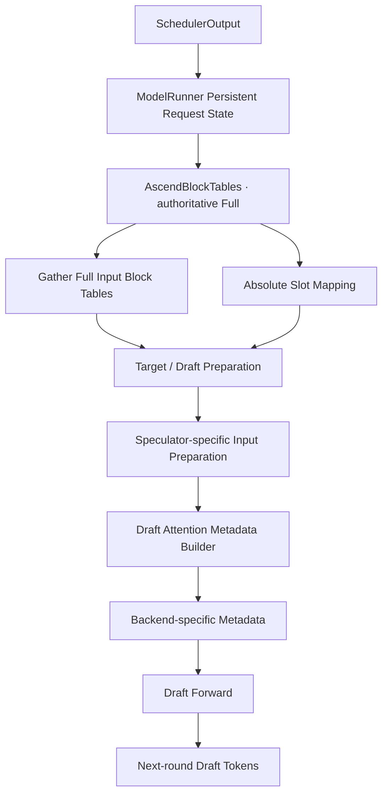
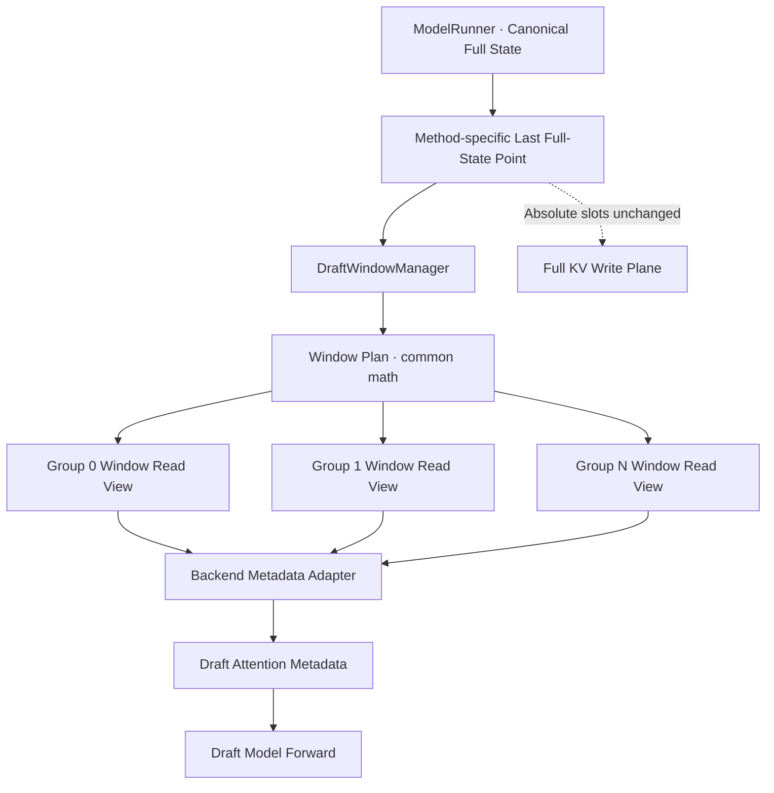
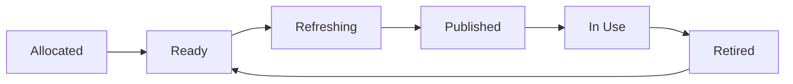
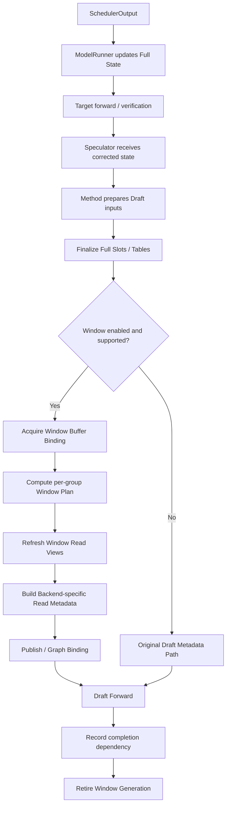

# Stage 8：MRV2 Speculative Draft Sliding Window 公共架构设计

*Architecture Design Review · 2026-10-08 · 设计阶段，不涉及生产代码实现*

## 设计评审结论

**我推荐 Candidate B：Speculator-owned Draft Window Manager + per-KV-group Persistent Read View + Method-specific Activation Policy。**

这套架构的核心是：

> 公共的是 Window 数学、状态表达、buffer 生命周期和安全约束；不同 Speculative Method 只负责决定何时激活 Window、需要什么长度语义，以及如何构建 backend-specific metadata。

它不是将 MRV1 的 `SlidingWindowAdapter` 简单复制到 MRV2，而是将其升级为一项具有明确数据所有权、生命周期和扩展边界的公共 Draft Attention 能力。

**推荐方向：Full State 不可变，Window State 独立派生**

**待验证：Graph 参数绑定、异步执行时序、DSA 索引语义**

### 本次设计的证据边界

先区分三种不同级别的结论：

- **[S] 本地源码研究**：你提供的 Codex Stage 1–7 笔记中记录的实际 checkout 行为。因为没有仓库 commit SHA，暂时将其视作可信的历史源码证据，而不是当前工作分支的最终事实。
- **[U] 公开上游验证**：此次检查的 vLLM-Ascend 官方文档与公开实现信息。它们不一定与你公司的开发分支完全一致。
- **[D] 架构判断**：我提出的设计选择、推荐接口、生命周期约束和扩展方案，不代表目前已经存在相应代码。

**公开上游核查的第一项重要结果：** 截至本次核查，官方 Speculative Decoding Guide 仍将 `draft_window_size` 标注为 MRV1 支持、MRV2 尚未支持；对外声明的支持方法是 Eagle3、DFlash、DSpark，而 MTP 明确忽略 Window。<Cite refs={['turn0search0','turn0search2']}/>

同时，最新文档已经描述 MRV2 DFlash2、DSpark adaptive verification、PCP speculative decoding 等能力，其中 DFlash2 在 MRV2 仍有 Draft eager-only 约束。你的架构必须为这些路径保留兼容性，而不能根据旧的 Stage 3 Matrix 假定所有 graph/method 组合都已可用。<Cite refs={['turn0search0','turn0search3']}/>

这意味着：**Stage 8 可以形成架构决策，但还不能声称已完成对你当前 checkout 的代码级验收。**

---

## 1. Design Goals

本次 Feature Migration 有八个设计目标。

| 优先级 | 目标 | 验收标准 |
|---|---|---|
| P0 | Correctness | Window ON 不改变 Target 计算与 KV write semantics |
| P0 | Compatibility | MRV1 已有支持/忽略行为不被意外改变 |
| P0 | Graph Safety | Capture/Replay 使用正确的 Window 内容和稳定的 storage |
| P0 | Async Safety | Window Buffer 不被尚未完成的消费者提前覆盖 |
| P1 | Modularity | Window 数学只有一份，method 差异不扩散到公共 Runner |
| P1 | Multi-group | 每个 KV cache group 可以独立使用其 block geometry |
| P1 | Extensibility | Flashcomm、CP、Async 可以复用当前设计的边界 |
| P2 | Performance | 禁止高频无意义分配、CPU/NPU 同步和重复计算 |

我认为应该把 **Correctness、Compatibility、Graph Safety 视为发布门槛，而不是可以通过性能收益抵消的指标。**

### 设计原则

整个设计应遵循：

`Canonical Full State → Draft-only Window Read View → Backend-specific Metadata`

不应当遵循：

`Full State → 临时改写共享数据 → 执行 Draft → 恢复原始数据`

后者容易实现最初的 eager 功能，但长期看维护成本与时序风险都更高。

## 2. Non-goals

本阶段不包含以下职责：

- 不修改 Scheduler、KV Cache Manager 的真实物理块分配、释放、复用或淘汰行为。
- 不修改 Target Attention 的可见范围。
- 不重新定义 speculative acceptance/rejection 算法。
- 不重新实现 EAGLE3、DFlash、DSpark 的输入准备和 token proposal 算法。
- 不把 MTP 或其他 unsupported method 擅自升级成 Window-supported。
- 不把模型原生 `sliding_window` 与本 Feature 合并成同一个配置。
- 不在 Week3 重构完整的 Ascend Attention Metadata 体系。
- 不在本阶段完成 Flashcomm、SP/DSA-CP 或 Async Scheduling 的所有实现。

还有一条特别重要：

**不要为了所谓的架构统一，重写所有 speculative method 的公共父类。**

我们需要的是一个足够稳定的小型公共能力，而不是另外造一套 speculative execution framework。

## 3. Invariants

这是整个设计中最重要的章节。我建议将其作为未来设计文档和 Code Review 的强制检查表。

### 3.1 Full/Window 隔离


*设计原则：[D] 两条数据路径独立。Window 不拥有也不改变 Full State 的物理语义。*

### 3.2 数学不变式

保留 MRV1 已有窗口行为。

定义：

- \(L\)：本次 Draft Read 需要表达的绝对 KV 终点，即输入 Window Transform 时的 exact `seq_lens`。
- \(K_f\)：`future_offset`，用于确定窗口的逻辑右边界。
- \(W\)：配置的 `draft_window_size`。
- \(B_g\)：KV cache group \(g\) 对应的 attention kernel block size。

公式：

\[
R=L+K_f
\]

\[
S_g=\left\lfloor\frac{\max(R-W,0)}{B_g}\right\rfloor B_g
\]

\[
L_{\mathrm{win},g}=L-S_g
\]

\[
C_g=\frac{S_g}{B_g}
\]

其中：

- \(S_g\)：对齐后的窗口起点，absolute token coordinate。
- \(L_{\mathrm{win},g}\)：Window 视角下的 KV 长度。
- \(C_g\)：从 Full Table 开始提取的列索引。

每个 group 的 Window Table 由 Full Table 从 \(C_g\) 列开始提取，而不是修改 Full Table 本身。

这套数学来自 MRV1 `SlidingWindowAdapter`，公共上游源码也仍保留对应公式。<Cite refs={['turn2view2','turn1search4']}/>

**必须强调两个容易忽略的边界：**

第一，Block Alignment 后实际可见的历史长度可以超过 \(W\)。这是 MRV1 的既有语义，不能在迁移时悄悄改成精确 token 截断。

第二，在 \(K_f>0\) 时，必须验证 `future_offset` 与窗口大小、实际 `seq_lens` 的组合合法。尤其当 \(W<K_f\) 时，现有公式可能得到负的 `windowed_seq_len`。这应该是独立的边界测试和策略评审项，而不能依赖运行时碰巧不触发。[D]

### 3.3 状态不变式

| 对象 | 不变式 |
|---|---|
| Full block table | 永远表示完整物理映射 |
| Absolute positions | 不因 Window 转换为局部位置 |
| Slot mapping | 永远使用 Full State |
| Target metadata | 不得被 Draft Window 修改 |
| Draft Window table | 永远从 Canonical Full Source 派生 |
| Window lengths | 与 Window table 表达同一个有效读取区间 |
| Backend derived metadata | 与 Window 的长度、表、坐标系相容 |
| Graph buffers | Capture 与 Replay 遵守地址绑定契约 |
| Padding | 无效行/列不得暴露旧请求的物理块 |
| Async | 写入与消费必须具有明确 happens-before 关系 |

这里有一个新的设计不变式，我认为尤其值得补充：

**Absolute position 与 Window-local position 是不同的坐标系。**

例如：

```text
Absolute KV positions:  128 ... 299
Window-local positions:   0 ... 171
```

对 GQA/Paged Attention 而言，局部长度加窗口表可能已经足以表达读取范围。

但对 DSA/SFA 而言，某些索引生成过程还会读取 absolute positions 或计算 `start_pos`。这时候不能简单地把 `seq_lens=300` 替换成 `172`，却让所有依赖长度计算绝对位置的逻辑保持不变。

因此 Window Read View 应同时知道：

`absolute_end / visible_start_abs / visible_length`

至于 backend 最终需要哪个字段，交给其 metadata adapter 转换。

## 4. Existing Architecture

### 4.1 MRV1 Feature Contract

[S] 你提供的笔记及公开实现表明，MRV1 的 `SlidingWindowAdapter` 主要负责：

1. 提取 Window BlockTable。
2. 更新 Draft-visible `seq_lens`。
3. 同步相应 CPU Length 表达。
4. 保持 `slot_mapping` 不变。

Eagle3 与 DFlash/DSpark 的主要区别是 `future_offset` 和激活时机，而不是窗口公式完全不同。<FileCite ref="turn0file0" line_range_start={205} line_range_end={237}/>

### 4.2 MRV2 的实际差异

[S] 根据你的 Stage 5–7：

- `AscendBlockTables` 由 Runner 持有，Speculator 引用同一对象。
- Target/Draft 各自有独立的 `InputBuffers.seq_lens`。
- `input_block_tables[gid]` 为共享的 persistent gathered buffer。
- Full `slot_mapping` 可通过 authoritative block-table pointers 得到。
- DFlash/DSpark 还会使用 gathered Full Tables 计算 context/query physical slots。
- MRV2 metadata 一旦经过 builder，可能立即转化为 backend-specific 长度、索引、图参数。

因此 MRV2 没有 MRV1 那种适合全局改写的单一 mutable metadata 边界。<FileCite ref="turn0file0" line_range_start={7155} line_range_end={7290}/>

### 4.3 Existing Data Flow



上述流程只是主线。实际系统中 Target Verification、Draft Proposal、Graph Manager 可能具有多次 metadata 构建及异步执行边界。不能把它理解成所有操作始终同步串行。

---
## 5. Candidate A：Scoped Metadata Transformation

*候选 A · 最小侵入 / 轻量 Adapter*

### 架构思路

沿用 MRV1 的 Adapter 思路。

在 method 已经准备好 Full State、即将构建 Draft Metadata 时，对输入做临时 Window Transformation。

```text
Speculator
  │
  ├── Prepare Full Draft Inputs
  │
  ├── Compute Physical Slots
  │
  ▼
Draft Metadata Scope
  │
  ├── 从 Full Table 生成 Window Table
  ├── 生成 Window Length
  ├── 暂时替换 Draft Builder Inputs
  │
  ▼
build_attn_metadata()
  │
  ▼
Draft Forward
```

### 设计特征

公共代码负责数学和 table extraction。

Method 负责创建适配作用域、决定 `future_offset`，并在自身 Builder 调用前启用。

对于 Window `seq_lens`，可以使用临时 private tensor 或预分配 scratch buffer；对于 Window block table，使用 clone 或 private persistent table。

但必须满足一个前提：

**不得对 shared Full Input Table 或 Target Metadata 进行原地修改。**

所以这里所说的 scoped transformation，不意味着允许使用危险的全局 save/restore。

### 优点

- 改动相对集中，容易映射到 MRV1 行为。
- 对 eager 模式比较直观。
- 对已有 Speculator 类的改动可能较少。
- 可快速搭建行为验证原型。

### 缺点

- Buffer 的 Owner 不够自然，容易散落于不同 Speculator。
- Live build 与 Graph Manager rebuild 可能重复 Window。
- Graph Capture 需要额外处理 Tensor 生命周期。
- Scoped 输入对象容易与原有 metadata 对象产生别名问题。
- Async 环境下，作用域结束不代表设备侧消费已经结束。
- 后续每个 method 都可能自己补一套 graph-safety 修复。

**评价：适合作为 eager proof of concept，不适合作为目标生产架构。**

---

## 6. Candidate B：Persistent Draft Window Read View

*候选 B · 公共 Runtime Infrastructure / 推荐*

### 架构思路

让每个真正具有独立 Draft Attention 的 Speculator 拥有一个 `DraftWindowManager`。

它负责：

- Window 数学；
- per-group Window Read View；
- dedicated persistent device buffers；
- Window length 的 exact / bound 语义；
- Graph Capture 与 Replay 的 buffer binding；
- Runtime generation / buffer lifetime。

Method 自身不负责维护具体窗口算法，而是提供 `WindowActivationSpec`，告诉公共能力什么时候、按照什么坐标语义生成 Window。



### 关键抽象

| 抽象 | 职责 |
|---|---|
| `DraftWindowPolicy` | method 是否支持 Window、future horizon 和 activation 规则 |
| `DraftWindowManager` | Window Runtime 的公共管理者 |
| `WindowPlan` | 纯数学描述：start、length、group geometry |
| `DraftWindowReadView` | 向 Builder 提供的 Draft-only Read State |
| `DraftWindowBufferPool` | persistent storage、graph binding 和 reuse 管理 |
| `BackendWindowAdapter` | 将逻辑 Read View 转换成特定 Attention Backend 所需格式 |

这些都是 [D] 推荐的逻辑抽象，不表示必须创建六个 Python 类。落地时应优先合并轻量对象，减少抽象层数。

### 特别强调

`DraftWindowReadView` 应该是一个**逻辑不可变的描述对象**，但它引用的 persistent Tensor 内容可以按受控生命周期更新。

即：

- Read View 的字段语义不变；
- Device storage 地址不变；
- 每次 refresh 更新当前 generation 的内容；
- 由运行时明确控制何时可再次复用。

### 优点

公共数学只有一份，并且天然支持 per-group、Graph Buffer、Backend Adapter 与 method policy 的扩展。

长期维护时，新增 speculative method 主要添加自己的 activation policy，而不是复制整套 Window 计算。

### 缺点

初始实现需要处理更多基础设施，特别是 AR multi-step、FULL Graph binding 和 CPU/Device Length 一致性。

如果过度设计，容易变成大量没有实际用途的抽象。因此建议先实现最小完整 Runtime，再按实际 backend 能力添加 adapter。

---

## 7. Trade-off Table

*5 = 更优；1 = 更差。分数属于架构判断 [D]，不是已完成测试的量化结果。*

| 维度 | Candidate A | Candidate B |
|---|---:|---:|
| Correctness | 3/5 | 5/5 |
| Modularity | 3/5 | 5/5 |
| Graph Safety | 2/5 | 4/5 |
| Async Safety | 2/5 | 4/5 |
| Code Intrusion | 4/5 | 3/5 |
| Method Extensibility | 3/5 | 5/5 |
| Week4 Extensibility | 2/5 | 5/5 |
| Testability | 4/5 | 5/5 |
| Initial Delivery Cost | 5/5 | 3/5 |


*示意性综合评价，不是按上述维度计算出的加权总分。*

候选 B 即便使用 dedicated persistent buffers，也不能自动获得满分的 Graph/Async Safety。它仍然需要证明 Capture 绑定正确、Backend Derived State 已刷新、设备执行已经完成，才能安全复用。

**最终选择 B，但采用分阶段落地：先完成完整的 eager data contract，再将相同 Runtime 接入 Graph，不单独维护两套 Window 数学。**

---

## 8. Recommended Architecture

### 8.1 总体设计

我的最终推荐是：

**Speculator owns policy and runtime；Window Manager owns transformation；Attention Backend owns final metadata interpretation。**

建议分为三个层次。


### 8.2 Window 数学放在哪里？

[D] 建议放在一个 MRV1/MRV2 都可以引用的、与 ModelRunner 无关的公共模块。

建议的逻辑归属：

`vllm_ascend/spec_decode/sliding_window.py`

负责：

`compute_window_plan / gather_window_table / materialize_window_lengths`

这个名字只是推荐，不是既有源码路径。

**不要把窗口数学放在：**

- `model_runner_v2.py`；
- `dspark/speculator.py`；
- 通用的 `build_attn_metadata()`；
- DSA/SFA Backend Builder 内部。

原因是这四个位置分别会导致 Runner 污染、DSpark 特化、Target/Draft 职责不清和 Backend 重复算法。

MRV1 现有 `SlidingWindowAdapter` 可以先保留；MRV2 复用等价数学和测试契约。若后续要统一两个版本的实现，建议单独重构，避免 Week3 同时改变旧版本行为。

### 8.3 Public API 应表达什么？

我推荐的核心输入不是简单的：

`apply(seq_lens, block_table, future_offset)`

而是语义明确的四部分：

| 输入概念 | 内容 |
|---|---|
| `FullReadSource` | Canonical full table、absolute length、当前 batch order、有效 block 范围 |
| `WindowHorizon` | Window size、logical right boundary、当前 step 的 exact end |
| `GroupGeometry` | gid、kernel block size、table width、CP layout |
| `ExecutionBinding` | eager/graph descriptor、generation、buffer slot、active rows |

输出 `DraftWindowReadView` 应描述：

| 字段 | 用途 |
|---|---|
| `visible_start_abs` | 窗口真实起点 |
| `absolute_end` | 绝对 KV 右边界 |
| `visible_seq_lens` | Window-local exact length |
| `window_block_tables[gid]` | per-group 读取目录 |
| `length_metadata` | exact CPU、upper、local 等语义化长度 |
| `backend_layout` | 传给 Backend Adapter 的必要布局信息 |
| `binding_token` | 本次 buffer generation / graph binding 身份 |

`positions` 和 `slot_mapping` 不应出现在这个对象的可修改字段里。它们留在原有 Full-State / Model Input 路径中。

### 8.4 future_offset 怎么设计？

我建议**内部优先表达 Logical Right Boundary，兼容层再表达 `future_offset`**。

原因是 `future_offset` 本身不具备固定的 method 语义，其值取决于 Apply Timing。

例如：

**Eagle3 · AR**

*MRV1：`K_f = K`*

seq_len 尚未包含所有未来 Draft 位置；需提前确定窗口右边界。

**DFlash / DSpark**

*MRV1：`K_f = 0`*

输入准备阶段已经把 parallel query stretch 纳入 seq_len。

这些差异来自你 Stage 6 的源码追踪。<FileCite ref="turn0file0" line_range_start={7062} line_range_end={7089}/>

更稳健的公共表达是：

`logical_right_abs = method 提供的本轮 Window horizon`

然后：

`future_offset = logical_right_abs - current_absolute_end`

这样未来若支持 adaptive K、每请求不同 K，或者 AR per-step refresh，就不需要改公共窗口数学。

但这里不能简单地将 Eagle3 的 MRV1 `K_f=K` 改为每一步 `K_f=0`。前者是面向整个 draft horizon 的窗口，后者可能产生每一步移动的窗口，属于语义改变。

**推荐 Eagle3 在 proposal 开始时冻结 horizon；per-step 使用当前 exact end materialize read length。** 是否所有现有 FULL AR Graph 都能承载这种 per-step view，需要验证后才能实施。

### 8.5 Window seq_lens：最终选择

| 方案 | 建议 | 原因 |
|---|---|---|
| 对 Draft 原始 `seq_lens` inplace | 不推荐 | 后续 input preparation / shared builder 可能继续依赖 absolute exact length |
| 每次返回新的临时 Tensor | 仅可用于 eager 原型 | FULL capture address/lifetime 不稳定 |
| 对原始 Tensor 建立 view | 不足以表达 Window 值变换 | 仅切片不会执行 `L-S`，也可能改变 pointer offset |
| Dedicated persistent Window length buffer | **推荐** | Full/Window 两套语义独立，Graph 地址可控 |

也就是：

```text
Draft InputBuffers.seq_lens
      │
      ├── 原始 exact absolute length 保留
      │
      └── WindowTransform
               │
               ▼
       WindowState.seq_lens
```

我不建议将 Target CPU Mirror 当成 Window exact 的权威来源。

如果 CPU mirror 是 optimistic upper，必须保留它的 upper-bound 类型；需要 exact 的 Backend，要么从经过正确 rejection correction 的 CPU exact state 派生，要么使用 device exact path。

**Upper bound 不能为了方便直接冒充 exact length。**

这一点尤其对应你 Stage 5 中发现的 `_seq_lens_cpu`、`seq_lens_cpu_upper_bound`、DCP local length 与 GQA/DSA consumer 的区别。

### 8.6 Window block table：最终选择

使用：

**per-KV-group dedicated persistent buffer。**

它应当具有以下属性：

- 一组一份，必要时一组多个 graph-generation slot；
- dtype 与当前 backend 所需 table 一致，当前笔记中的 Ascend 主要是 `int32`；
- 同一个 capture binding 的底层地址稳定；
- 始终从 Full Read Source refresh；
- 对 active row 的无效尾列进行显式 mask/清理；
- 对 padded row 采用 backend 认可的 inert 表达；
- 不参与 Full KV allocation 或 physical slot computation。

重要的是，不能只关注 `Tensor.data_ptr()`。

还要证明其 `shape / stride / row layout / valid length / operator binding` 与对应 Graph Descriptor 一致。

### 8.7 DSA Native Sliding Window 如何共存？

这是我认为 Stage 8 中**最需要单独做设计评审**的问题之一。

[S] 你的 Stage 5 已确认，`dspark_swa_indices` 由模型原生 `hf_config.sliding_window` 等数据构建，并由 DSA Attention 使用；它不是同一个 `draft_window_size` Feature。<FileCite ref="turn0file0" line_range_start={6008} line_range_end={6060}/>

两套概念：

| 功能 | 控制内容 |
|---|---|
| `draft_window_size` | Draft Attention 可以读取的历史 KV 范围 |
| Native DSA SWA / sparse indices | Attention 算子自身采用的可见位置和稀疏索引结构 |

理想语义是两种约束共同成立，但**不能直接对两个窗口大小取 `min()`，也不能在已经重排的 Window Table 上直接复用按 Full Absolute 坐标生成的 sparse indices。**

推荐的 Backend Contract 是：

`DraftWindowReadView + NativeAttentionPolicy → Backend-specific Valid Read Metadata`

它必须正确完成：

- Absolute / local coordinate translation；
- index-to-physical-slot mapping；
- native sparse constraints；
- Draft Window visibility constraints；
- operator 所需的 padded/captured derived buffers。

对于 Week3，如果当前 DSA Backend 无法证明正确处理这种组合，应将其列为明确的 compatibility blocker，而不是用模型名特判或静默关闭 DSA 索引。

另外，官方文档建议当 Draft 模型本身具备 native sliding window 时，配置的 `draft_window_size` 不小于训练/原生窗口，或关闭 Draft Window；较小配置可能降低接受率。<Cite refs={['turn0search0','turn0search6']}/>

这项建议属于性能与模型行为指导，不应代替数据面正确性验证。
## 9. Module Ownership

我建议按下面的归属划分模块职责。

| 模块 / Owner | 应拥有的职责 | 不应该拥有的职责 |
|---|---|---|
| Config Resolver | 读取 `draft_window_size`、校验 method support、warning | Window Runtime 数学 |
| `ModelRunner` | Full Request State、BlockTables、Target 执行 | Method-specific Window 数学 |
| `Speculator` | Window Runtime 生命周期、method activation | 独立的重复 Window math |
| `DraftWindowManager` | Plan、Read View、buffer refresh、generation | 物理 KV allocation |
| `DraftWindowBufferPool` | 持久内存、capacity、graph binding、retirement | 决定 Eagle/DSpark 时机 |
| Attention Metadata Adapter | exact/upper/local/sparse metadata 转换 | 决定 Speculative Method 是否支持 Window |
| Graph Manager | Capture、Replay、execution ordering | 从 method 名称重新推导 Window 语义 |

### 9.1 谁创建 WindowManager？

**由具有独立 Draft Attention 的 Speculator 在 Draft Attention Runtime 可用后创建。**

初始化流程推荐为：

```text
Resolve Config + Method Capability
           ↓
Construct Speculator
           ↓
Load / Bind Draft Attention Runtime
           ↓
Discover Active KV Groups
           ↓
Resolve per-group kernel geometry
           ↓
Initialize DraftWindowManager
           ↓
Allocate Persistent Window Buffers
           ↓
Capture Graphs (if enabled)
```

不能只在 `Speculator.__init__` 的最早时刻创建所有 Window Buffer，因为此时可能还没有完整的 Draft Attention Group 和 Kernel Block Size 信息。

也不能拖到第一次 `propose()` 时才初始化全部 persistent storage，因为 Graph Capture 有可能先于真实请求执行。

### 9.2 谁持有 Persistent Buffers？

我建议：

- `Speculator` 持有 `DraftWindowManager`；
- `DraftWindowManager` 持有 `DraftWindowBufferPool`；
- Pool 以 group、graph binding、必要的 step/generation 为维度管理底层 storage；
- Attention Builder 只借用有效 Window View；
- Graph Manager 对 capture binding 和消费完成时序进行管理。

这样不会把 Window 资源放进与 Target 共享的 `AscendBlockTables`，也不会使 Adapter 成为无主的临时工具对象。

### 9.3 需不需要 contextvar？

**不推荐使用 `contextvar` 传递本 Feature 的 Window State。**

建议使用显式 `DraftWindowExecutionContext` 或类似的 per-proposal/per-step 参数对象。

原因：

- contextvar 表示 Python task 的动态上下文，不自动等于设备执行生命周期；
- Graph replay 可能晚于 Python context 结束；
- Async callbacks 和 graph update 可能在不同执行边界消费状态；
- 隐式读取难以跟踪 owner 和 generation；
- 多个 Speculator / KV cache group 的可见性容易变得模糊。

现有的 `set_ascend_forward_context()` 可以继续作为 Attention 层取得最终 metadata 的机制；但不应让 Window 的初始化、refresh、activation 依赖额外隐式 contextvar。

更准确地说：

**使用 explicit context 传递 Window 执行状态，使用已有 Forward Context 交付最终 Attention Metadata。**

## 10. Method Integration Matrix

推荐建立一个集中式 Capability / Policy 表，而不是在通用 MRV2 主干中到处写：

`if method == "dspark" ...`

### 10.1 Method Policy

| Method | Feature policy | Window Activation | Horizon |
|---|---|---|---|
| Eagle3 | 支持 | AR first pass / per-step 的 Last Full-State Point | MRV1 等价的 K-horizon |
| DFlash | 支持 | 所有 group 完成 parallel input prep 后 | `0` |
| DSpark | 支持 | 所有 group Full preparation 完成，DSA/SFA derived metadata 构建前 | `0` |
| DFlash2 | 继承 DFlash 能力，需单独验证 | Parallel preparation 完成后 | `0` |
| Eagle | Legacy implicit support，需审计 | AR boundary | 视 MRV1 合同 |
| `draft_model` | Legacy implicit，取决于 MRV2 是否有独立实现 | 不能预设 | 待确认 |
| MTP / variants | Ignore + warning | 不激活 | N/A |
| `extract_hidden_states` | N/A | 不激活 | N/A |
| ngram / suffix / medusa 等 | N/A 或现有 unsupported | 不激活 | N/A |

这里有个重要细节：MRV1 对 Eagle 和 generic `draft_model` 存在通过公共 Proposer 隐式执行 Window 的代码路径，但对外正式支持声明只有 Eagle3、DFlash 和 DSpark。因此不能把“没有文档承诺”和“MRV1 实际没有行为”混为一谈。

对于这些 Legacy implicit 路径，推荐在 Feature Migration 的兼容性审计中单列。若 MRV2 已具有等价独立 Draft Attention，尽量保留有效行为；若没有，必须明确说明支持差异，而不能暗中扩大或缩小支持范围。

### 10.2 Activation Point

建议将所有方法统一到一个语义：

**Last Full-State Point 已到达。**

但具体位置由各自 method 确定。

对于 Eagle3：

`Full slot mapping → AR Window activation → Draft metadata`

对于 DFlash：

`All-group parallel prepare → Window activation → Uniform metadata`

对于 DSpark：

`All-group prepare → Window activation → DSA/SFA derived metadata → Draft forward`

其中 DSpark 的 `dspark_swa_indices` 等派生数据也必须从与 Window 语义一致的源生成。

### 10.3 什么可以共享，什么不能共享？

| 职责 | Shared infrastructure | Method-specific |
|---|---|---|
| Window 数学 | 是 | 否 |
| per-group table extraction | 是 | 否 |
| persistent buffer pool | 是 | 否 |
| graph binding/lifetime contract | 是 | 提供当前 execution scope |
| Method support policy | 公共 registry | Method 提供 capability |
| Future horizon | 公共数据表示 | Method 负责计算 |
| Last Full-State Point | 公共激活接口 | Method 负责触发 |
| Query preparation | 否 | 是 |
| Physical slot calculation | 保留既有 Full 实现 | 既有特殊分支 |
| Backend sparse metadata | 公共适配协议 | Backend-specific |
| Native DSA window | 否 | DSA backend policy |

这样可以避免新增 Feature 后每种 method 都拥有自己的“半套 SlidingWindowAdapter”。

---

## 11. Buffer Lifetime

这部分关系到 FULL Graph 和 Async 能不能真正安全。

### 11.1 三种生命周期

| 生命周期 | 示例 | 推荐 Owner |
|---|---|---|
| Runtime lifetime | `DraftWindowManager`、group geometry、persistent storage | Speculator |
| Capture binding lifetime | graph descriptor 与其固定引用的 Window Buffer | Buffer Pool + Graph Manager |
| Execution generation lifetime | step N 的数据 refresh、consume、retire | Execution Context + Graph Manager |

不要把这三者当成同一件事。

### 11.2 Graph-aware Buffer State

推荐每个参与 Graph 的 Window Buffer Binding 至少具备以下状态机：



核心约束：

\[
\text{Refresh}(N)
\prec \text{Consume}(N)
\prec \text{Refresh}(N+1)
\]

`≺` 表示必须存在执行顺序保证，不能仅靠 Python 调用顺序假设。

### 11.3 Eager / PIECEWISE / FULL 的统一策略

| Mode | 共同语义 | 额外要求 |
|---|---|---|
| Eager | Full → Window → Metadata → Forward | 数据/生命周期正确 |
| PIECEWISE | 同一 Window 语义 | 遵守被捕获区域的输入约束 |
| FULL | 同一 Window 语义 | Captured storage、parameter update 和 replay ordering 正确 |

**推荐统一 Data Contract，而不是强迫三种模式采用完全相同的 Python 调用链。**

[S] 你的 Stage 7 已指出，Ascend Graph 存在 legacy `update_graph_params` 和 `UpdatableGraph` 两类更新机制。尤其 DSA/SFA 部分路径的 update hook 为 no-op，不能推断重新创建一份 Window Tensor 就会被 captured graph 看到。<FileCite ref="turn0file0" line_range_start={7627} line_range_end={7725}/>

### 11.4 Graph Capture 具体要求

Capture 时应使用与 Runtime 同一绑定体系的 persistent Window storage。

Replay 时：

- 使用与 Capture 兼容的 shape 和地址；
- 在消费之前写入本轮 active rows；
- backend 所需的长度和 sparse derived buffers 同步刷新；
- 通过已有 Graph Manager 的 update/replay 机制完成绑定；
- 不在上一次 graph reader 完成前复用 storage。

特别注意：如果某个 backend 支持通过 graph task update 重绑参数，也必须明确证明**这个参数确实受到 update 机制管理**。不能把 GQA 的能力推断到 MLA/DSA/SFA。

### 11.5 Eagle3 的 FULL Multi-step

这里存在一个容易被普通架构图掩盖的风险。

Eagle3 的 AR 多个 Draft step 可能被合并到一个 FULL Graph 中，而每个 step 的 exact length 不同。

因此不能只创建一份 Window `seq_lens`，在 Python 中连续刷新 K 次，然后希望 Graph 内每个 step 自动读取对应历史值。

需要采用其中一种经过证明的机制：

- per-step capture-stable Window state；
- 或 captured graph 内按 step 正确更新 Window state；
- 或 Backend/Graph Manager 已提供等价的 per-step 参数更新能力。

我推荐以第一种作为易于推理的设计基线，再评估是否复用现有 AR graph buffers 降低内存与计算开销。

这不是说必须无条件分配 K 份所有 Tensor，而是每个捕获的消费点必须可以取得**属于它自己的正确 generation**。

### 11.6 Async-first MRV2

**Persistent address stability ≠ Async lifetime safety。**

假设：

```text
Step N:
  Graph 仍在读取 Window Buffer

Step N+1:
  CPU 已经准备下一轮
  Window Buffer 被覆盖
```

地址没有变化，却发生了数据竞争。

推荐让 `ExecutionBinding` 显式包含：

`generation / stream ownership / completion dependency / graph binding`

是否使用 double buffering 或多 slot pool，需要根据当前 engine 实际允许的 in-flight 深度确定。

不要直接假设两份 buffer 就一定够。若图任务更新、D2H correction 与多个 proposal 重叠，所需复用深度可能不同。

---
## 12. Runtime Data Flow

下面给出推荐方案的一次完整运行流程。

### 12.1 初始化阶段

```text
Config Validation
       ↓
Speculator Construction
       ↓
Draft Model / Attention Runtime Ready
       ↓
Collect KV Group Geometry
       ↓
Create DraftWindowManager
       ↓
Allocate Persistent Window Storage
       ↓
Register Graph Bindings
       ↓
Optional Graph Capture
```

注意，Window OFF 时不应创建不必要的大型 persistent device buffers。可以保留轻量 disabled policy，让原有执行路径零额外转换。

### 12.2 每轮 Runtime 阶段



其中 `Retire` 不一定表示同步等待设备执行完成。它可以是记录 event、将 buffer 放入待回收队列，或依赖现有 stream ordering。具体机制应由运行时保证，而不是由 Window 数学决定。

### 12.3 用数字完整走一遍

假设 DSpark 本轮某个请求已经完成所有 Full State preparation：

```text
draft_window_size = 128

KV group 0:
  kernel_block_size = 64

KV group 1:
  kernel_block_size = 32

absolute seq_len = 300
future_offset = 0
```


计算如下：

| 参数 | Group 0 | Group 1 |
|---|---:|---:|
| `kernel_block_size` | 64 | 32 |
| `ideal_start` | 172 | 172 |
| `aligned_start` | 128 | 160 |
| `start_block_index` | 2 | 5 |
| `windowed_seq_len` | 172 | 140 |
| 需要的 block 数 | 3 | 5 |

注意：上面 Group 1 的示意色块仅表示历史截断方向；**准确的 Group 1 窗口应从 Block 5 开始**，以表格计算为准。

这个例子说明一个极其重要的事实：

**不同 group 的 Block Size 不同，Window 的 aligned start 和 windowed length 也可能不同。**

因此，在实际实现中：

`WindowState[group_id]`

必须同时包含这个 group 自己的 table 和对应 length，而不能默认所有 group 共享唯一的 `windowed_seq_lens`。

这也意味着，即使 Draft 只有一份全局 absolute sequence end，其 backend read lengths 仍可能因每组对齐而不同。

最后，在上述所有转换之外：

- Absolute positions 仍是原来的 0–299 坐标；
- Slot mapping 仍按 Full BlockTable 计算；
- Target 仍使用完整上下文；
- Window 仅改变 Draft 的读取能力。

## 13. Compatibility Policy

我推荐将兼容策略集中管理成一个清晰的 `WindowCapabilityRegistry` 或等价配置解析结构。

**这里允许有 method 名称映射，但不允许将 model-name hardcode 分散到 Runner、Window 数学和 Backend Builder。**

### 13.1 Config Validation

建议分成两个阶段。

| 阶段 | 检查内容 | 原因 |
|---|---|---|
| Config Resolution | `draft_window_size` 类型、正数、method compatibility | 启动前尽早识别非法配置 |
| Runtime Initialization | per-group block geometry、backend capability、graph mode、CP layout | 这些信息需要 Draft Attention Runtime 就绪 |

### 13.2 Policy 行为

| 情况 | 推荐行为 |
|---|---|
| `draft_window_size` 未设置 | Feature disabled，保持原路径 |
| W 非正整数 | 配置错误，不启动 |
| Eagle3 / DFlash / DSpark | 在受支持的 Backend/Execution Mode 上启用 |
| MTP | warning + ignore，保持 MRV1 policy |
| 不具有独立 Draft Attention 的方法 | 不创建 Window Runtime |
| Legacy implicit method | 按已审计的 MRV1 实际行为处理，不擅自扩大承诺 |
| 不支持的 Backend/Graph/CP 组合 | 在初始化阶段明确报错或按已有明确 policy 处理，不能静默假装启用 |
| Native SWA 大于 Draft Window | 发出性能/接受率风险提示，不自行改变 W |

对 MTP 的 ignore 行为和 MRV2 尚未支持 Window 的公开状态，此次已再次通过官方文档确认。<Cite refs={['turn0search0','turn1search0']}/>

### 13.3 不要引入 Model Name Hardcode

例如，不应新增这样的架构依赖：

```text
if model_name contains "GLM":
    use special window path
```

真正有用的是：

`AttentionBackendCapability + ModelAttentionSpec + MethodPolicy`

因为 GLM、DeepSeek 或其他模型的 attention layout 可能随版本变化，而不同模型也可能复用相同 backend。

你 Stage 5 已发现部分已有 backend 代码存在 GLM-specific length 选择行为。迁移时必须针对这些真实差异进行兼容测试，但不应该把更多新的模型名称分支写入公共 Window Runtime。

## 14. Week4 Extension Points

Week3 架构设计最重要的价值之一，是 Week4 不需要推翻 Window 的基础数据契约。

### 14.1 Flashcomm

[D] 建议扩展在 Backend Metadata Adapter / Execution Adapter 层。

保留统一的 `DraftWindowReadView`，增加通信路径对 visible interval、local table 和通信 buffer 生命周期的转换。

Flashcomm 不应该重新实现 Window 数学，也不应该成为 Window Buffer 的物理 Owner。

需要单独验证通信发起和消费 Window State 的 stream/event ordering。

### 14.2 SP / DSA-CP

这是扩展成本可能最高的部分。

普通 Full Attention 中，Window 常可看作连续的逻辑 KV 区间。

但是 CP 将这段历史分布到多个 rank，且某些实现还涉及 interleave 或特殊 layout。

所以不应简单地执行：

`local_seq_len = global_window_seq_len / CP_size`

正确设计应抽象：

`Global Visible Interval → CP Layout Transform → Local Visible State`

即 CP Adapter 必须知道：

- 原始 absolute visible interval；
- rank 的分区规则；
- local block mapping；
- 当前 group 的 geometry；
- 与 backend sparse metadata 的关系。

特别是在 DSA native index generation 中，需要证明 logical-to-physical translation 没有因为 Window Rebase 和 CP Sharding 而出现两次偏移。

当前公开文档已说明 MRV2 PCP speculative decoding 有特定 method/backend 支持范围，并不能泛化为所有组合均可用。<Cite ref="turn0search3"/>

### 14.3 Async Scheduling

建议扩展的是 Buffer Pool 和 Runtime Binding，而不是改变 Window 数学。

Week3 即使使用单 in-flight generation，也应预留：

`generation_id / completion_event / pool_slot / graph_binding_id`

未来支持更深的并发时，增加 pool slots、event ordering 或 generation-aware reuse，而不需要重写每个 Method 的 Window Transform。

### 14.4 Week3 与 Week4 责任分界

| 能力 | Week3 | Week4 |
|---|---|---|
| Window 数学与 Multi-group | 完成 | 保持不变 |
| Full/Window 隔离 | 完成 | 保持不变 |
| Method Activation | 完成基础支持 | 补复杂组合 |
| Backend Metadata | 基础路径正确 | 扩展 Flashcomm/CP |
| Eager | 必须可验证 | 回归 |
| PIECEWISE / FULL | 按支持矩阵逐项验证 | 补复杂组合及问题修复 |
| Async 生命周期 | 建立安全契约，验证当前执行模型 | 扩展并发能力 |
| Performance | 基线与回归 | 调优 |

这里不建议将未经验证的 Graph 或 CP 组合直接写成“Week3 已支持”。**当某个组合尚未通过验证时，应将其标记为明确的缺口，而不是视作功能已经完成。**

## 15. Test Strategy

对于这种公共基础设施 Feature，我建议将测试分为六层。

### 15.1 Window Math Unit Tests

必须验证：

- 短序列 `L < W`；
- 恰好等于 W；
- 超过 W；
- 起点恰好 block-aligned；
- 起点不对齐；
- 不同 `kernel_block_size`；
- 不同 `future_offset`；
- `W < K_f` 的非法/边界组合；
- 极长序列与 table 尾部；
- zero-length / padded rows。

还应进行随机属性测试（Property-based Tests），验证 Window Table 等于从合法 Full Table 对应列提取的预期结果，而不是只验证几个硬编码的数字。

### 15.2 State Isolation Tests

这是优先级最高的一类测试。

检查：

`Full Before == Full After`

即 Window Transformation 执行前后的 canonical Full Tables、Target lengths、absolute positions 和 physical slot mappings 不应改变。

同时验证：

`Window(Full)`

在连续多次调用、不同 generation、不同 batch size 下始终从 Full Source 派生。

特别测试：

`Window(Window(Full))`

不应该成为实际运行的数据流。

### 15.3 Method × Backend Matrix

建议根据当前可用模型建立以下测试覆盖表。

| Method | GQA/FIA | MLA | SFA/DSA |
|---|---|---|---|
| Eagle3 | 重点 | 若有有效组合 | 若有有效组合 |
| DFlash | 重点 | 若支持 | 若支持 |
| DSpark | 若支持 | 若支持 | 重点 |
| DFlash2 | Eager-only 基线 | 依当前能力 | 依当前能力 |
| MTP | Window ignored regression | Window ignored regression | Window ignored regression |

“若支持”不意味着要求凭空构造不可能的模型组合；应从当前 checkout 的真实 model/backend support matrix 中选择合法组合。

同时，每种支持组合都需要覆盖 Window OFF 的 regression。

### 15.4 Graph Tests

至少包含：

| 场景 | 重点验证 |
|---|---|
| Eager | metadata value correctness |
| PIECEWISE | live metadata 与 captured region 一致 |
| FULL Capture | persistent storage 与 dummy binding 正确 |
| FULL Replay | 本轮值真正被 captured operator 消费 |
| 连续 Replay | Window 位置不断移动但地址稳定 |
| Batch 从大变小 | Padding rows 无 stale KV |
| Long → Short requests | 无效尾列不会读旧块 |
| AR K-step | 各步 exact length/visible window 正确 |
| 多 Graph Descriptor | 不同 captured shapes/bindings 不互相污染 |

测试不能仅依赖生成的最终字符串判断正确。

建议在测试运行时记录必要的：

- Window start；
- device/window lengths；
- Full/Window Table 的有效列；
- graph buffer pointer identity；
- backend derived sparse indices 的有效范围；
- read/write slot trace。

对于 Graph Pointer 和 stream/event 行为，需要真实 NPU 测试。纯 Mock 无法证明设备执行顺序安全。

### 15.5 Correctness 与 Performance Tests

建议分三个对照组：

| 组别 | 用途 |
|---|---|
| MRV1 Window ON | 迁移的行为基线 |
| MRV2 Window OFF | 原有 MRV2 regression 基线 |
| MRV2 Window ON | 新 Feature 验证 |

比较：

- Draft-visible KV 语义；
- Target verification 计算路径；
- output correctness；
- mean accepted tokens；
- latency / throughput；
- NPU memory；
- prefill/decode 性能变化。

对于正确性，不应期待 Window ON/OFF 每一步的 Draft Proposal 都相同。Window 本身就可能改变 Draft 的预测和接受率。

正确的验证目标是：**Target 未受到 Window 污染，并且原有 rejection sampler 的正确性契约不因迁移而破坏。** 若使用精确 speculative sampling，还应通过统计测试验证目标分布保持不变。

### 15.6 Async Race Tests

这部分要专门做压力测试：

- 多请求交替进入/退出；
- 不同 K 或动态 K；
- 连续 graph replay；
- 多 graph descriptor；
- CPU D2H correction 延迟；
- replay/update stream overlap；
- buffer reuse；
- Window Buffer Pool 的容量达到上限；
- CP 多 rank；
- 两次 Window refresh 之间的设备消费尚未完成。

测试需要证明：

`Window generation N` 在读者完成之前绝不会被 generation N+1 覆盖。

---

## 16. Risks / Open Questions

这部分我不建议全部视为普通的“以后再看”。

有些问题如果不先确认，架构实际上还不能冻结。

### 16.1 风险优先级

| ID | 风险 | 严重度 | 处理建议 |
|---|---|---|---|
| R1 | Draft Window 污染共享 Full Table | Critical | 架构必须天然禁止 |
| R2 | Absolute/Window-local 坐标系混用 | Critical | Backend 契约验证 |
| R3 | FULL Graph 捕获错误的 Tensor Storage | Critical | NPU Capture/Replay 验证 |
| R4 | DSA native sparse indices 与 Window 冲突 | Critical | 独立 DSA 专项验证 |
| R5 | Optimistic CPU upper 被当成 exact | High | Length Consumer 审计 |
| R6 | Multi-group block geometry 处理错误 | High | 单测和混合组 E2E |
| R7 | AR multi-step 使用错误的 Window generation | High | 分 step Graph 测试 |
| R8 | 异步 Buffer 提前复用 | Critical | stream/event ownership 证明 |
| R9 | unsupported method 被意外启用 | High | Capability policy 回归 |
| R10 | CP / Flashcomm 产生额外坐标偏移 | High | Week4 Adapter 专项 |

### 16.2 尚需当前 Checkout 实证回答的关键问题

**设计冻结前的核实清单**

- [ ] Q1 · 当前工作分支的 commit SHA，以及与官方 main 的相关差异是什么？
- [ ] Q2 · DSpark 当前实际激活了哪些 Attention Backend / KV cache group？
- [ ] Q3 · 不同 group 的 kernel block size、真实 table column 语义和 CP layout 是否一致？
- [ ] Q4 · Eagle3 FULL AR merged graph 中，各 step Window length/table 应如何被 captured consumer 读取？
- [ ] Q5 · DFlash/DSpark live build 与 graph-manager rebuild 中，哪一处实际更新 captured storage？
- [ ] Q6 · DSA/SFA no-op graph parameter update 路径下，derived Window state 应写进哪个 persistent buffer？
- [ ] Q7 · Native DSA SWA indices 能否正确使用 re-based Window table，还是需要 Absolute Coordinate Adapter？
- [ ] Q8 · 当前 MRV2 运行时允许多少 overlapping/in-flight speculative executions？
- [ ] Q9 · CPU exact、optimistic upper 和 device exact 在所有 Backend 下是否有可用且正确的转换路径？
- [ ] Q10 · W 与 speculative horizon K 的边界策略是否需要与 MRV1 保持完全一致？

其中 Q2、Q4、Q5、Q6、Q7、Q8 是我最建议优先验证的六项，因为它们可能影响最终架构，而不只是修改某个函数的实现细节。

---

## 最终推荐与设计冻结意见

经过 Stage 1–7 的事实梳理和本次架构比较，我的推荐可以浓缩为以下决策。

| 决策项 | 结论 | 依据类型 |
|---|---|---|
| 公共 Window 数学独立于 Runner | 采用 | [D] |
| `draft_window_size` 只限制 Draft Attention | 保留 | [S][U] |
| Full slot mapping 与 Window read view 隔离 | 必须 | [S] |
| Window Owner 为 Speculator Runtime | 采用 | [D] |
| Buffer 使用 dedicated persistent storage | 推荐 | [S][D] |
| per-group 独立 Window 几何 | 必须 | [S] |
| Method-specific activation | 必须 | [S][D] |
| Future horizon 统一语义表达 | 推荐 | [D] |
| MTP warning + ignore | 保留 | [S][U] |
| Backend-specific derived metadata adapter | 必须 | [S][D] |
| contextvar 作为 Window 数据通道 | 不采用 | [D] |
| FULL Graph 直接重绑临时 Tensor | 默认禁止，除非证明可更新 | [S][D] |
| Async buffer reuse | 必须具备消费完成依赖 | [S][D] |
| Native DSA Window 与 Draft Window 自动兼容 | **尚未证明** | [S] |

### 我建议的最终架构名称

**MRV2 Draft Window Read-View Architecture**

这个名称比 `SlidingWindowAdapter V2` 更准确，因为你要维护的已经不仅是一个 Adapter，而是一套具备：

- 逻辑读取范围；
- 物理存储隔离；
- Backend 数据适配；
- Graph Buffer 生命周期；
- Method activation policy；

的公共运行时能力。

### 设计冻结条件

我认为目前可以冻结**总体架构方向**：Candidate B。

但是不能立刻冻结以下实现细节：

1. AR FULL Multi-step 的具体 buffer binding 策略；
2. DSA Native SWA 与 Window 的索引转换；
3. Graph Manager replay/update 的精确消费时序；
4. Async In-flight 的 Buffer Pool 复用策略。

这些项目应当在正式实现前，结合你的真实 checkout 和 910 NPU 环境做针对性验证。

**下一步最有价值的工作不是立刻写代码，而是把 Candidate B 分别交给 Codex 和 DeepSeek 做源码定位式架构评审，要求它们对每个模块给出真实函数入口、数据 Owner、生命周期证据、预计修改范围以及当前设计中无法成立的地方。** 这样才能把这份逻辑架构转换为可以提交团队评审的、真正落到源码上的 Low-Level Design。
