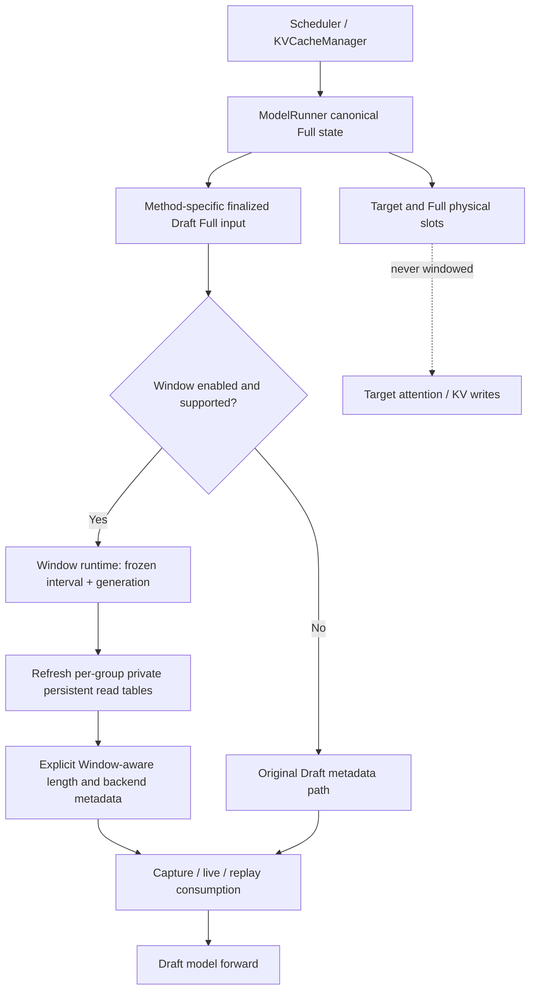
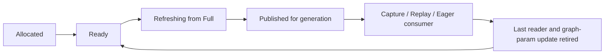

# MRV2 Speculative Draft Sliding Window — Architecture Design v2

> **文档状态：Conditional Design / Review Resolution（未达到当前 checkout 源码级冻结条件）**  
> 日期：2026-10-08  
> 输入：`MRV2_Speculative_Draft_Sliding_Window_Design_GPT.md`（v1）、`MRV2_Speculative_Draft_Sliding_Window_Design_gpt_dsReview.md`（Review）、`Sliding window原理_gpt(1).md`、`Sliding window源码_codex(1).md`  
> 范围：设计复审与低层接口/时序方案；**不提供生产实现代码**。

## 0. 阅读约定与证据边界

本版不是“收到 Review 就全部采纳”。对 Review 的 25 个攻击点、2 个 Critical、5 个 Major、12 个 Minor、13 个额外核查问题分别记录裁决；接受的部分已体现在后续架构条款中。

**本次实际可访问的内容**：以上四份完整 Markdown；在线公开的 `vllm-project/vllm` 与 `vllm-project/vllm-ascend` **main 分支**源文件和官方文档。**本次不可访问的内容**：用户 Mac 上 `/Users/wenqingzhang/Desktop/vllm/vllm-ascend` 与 `/Users/wenqingzhang/Desktop/vllm/vllm` 两个本地 checkout；上传资料没有 commit SHA 或源码快照。尝试直接访问上述本地目录未成功；容器无法解析 github.com，因此只通过在线网页代码视图交叉检索，不能在本次环境执行 git、NPU、pytest 或本地 checkout 对比。**任何“当前 checkout 已验证”的断言均不能成立**。Review 声称在评审人的本地 checkout 验证过；本版保留为 `[R]`，不冒充 `[V-local]`。

证据分级：

- `[V-web]` 本次确实打开了公开源码并核对相应函数/行为；**只适用于公开版本**，分支可能已相较 Review 变化。
- `[R]` 攻击式 Review 中报告的本地核查事实，尚未在用户 checkout 复现。
- `[S]` 两份 Stage 1–7 笔记记录的源码研究，未作为原始代码替身。
- `[D]` 本版的架构推断/决策，不代表上游既有实现。
- `[V-local]` 仅在取得 `git rev-parse HEAD`、真正检查用户 checkout 的函数以及必要测试后才可使用；**本版暂无任何 `[V-local]`**。

### 0.1 可直接核对的公开代码证据（精确到函数或代码行）

| Evidence | 公开来源 | 本次验证的范围 |
|---|---|---|
| E01 | [MRV1 SlidingWindowAdapter: `utils.py:115-193`](https://github.com/vllm-project/vllm-ascend/blob/main/vllm_ascend/spec_decode/utils.py#L115-L193) | `window_blocks+1`、`seq_len+future_offset-W`、gather/valid mask、`seq_lens` 等变换 `[V-web]` |
| E02 | [MRV2 DFlash capture: `cudagraph.py:21-67`](https://github.com/vllm-project/vllm/blob/main/vllm/v1/worker/gpu/spec_decode/dflash/cudagraph.py#L21-L67) | dummy block table 来自 `block_tables.get_dummy_block_tables`，capture 期直接调用模块级 `build_attn_metadata` `[V-web]` |
| E03 | [Ascend patch: `patch_dflash_speculator.py:17-27`](https://github.com/vllm-project/vllm-ascend/blob/main/vllm_ascend/patch/worker/patch_v2/patch_dflash_speculator.py#L17-L27) | `cudagraph_module.build_attn_metadata` 在模块层被替换为 Ascend funnel `[V-web]` |
| E04 | [Ascend metadata funnel: `attn_utils.py:299-362`](https://github.com/vllm-project/vllm-ascend/blob/main/vllm_ascend/worker/v2/attn_utils.py#L299-L362) | `seq_lens_np` 缺失时取 CPU upper，否则用 `np.full(max_seq_len)`；`dcp_local_seq_lens_cpu` 从该 CPU view 派生 `[V-web]` |
| E05 | [Ascend metadata group loop: `attn_utils.py:412-505`](https://github.com/vllm-project/vllm-ascend/blob/main/vllm_ascend/worker/v2/attn_utils.py#L412-L505) | backend 按每个 KV group 选择 table 与 slot；capture 分支进入 `build_for_cudagraph_capture` `[V-web]` |
| E06 | [Full BlockTables: `block_table.py:108-182,235-262`](https://github.com/vllm-project/vllm/blob/main/vllm/v1/worker/gpu/block_table.py#L108-L182) | per-row `num_blocks`、gather 只覆盖 active row 有效列、dummy table 使用 persistent input storage `[V-web]` |
| E07 | [Ascend AR prefill: `autoregressive/speculator.py:181-235,450-555`](https://github.com/vllm-project/vllm-ascend/blob/main/vllm_ascend/worker/v2/spec_decode/autoregressive/speculator.py#L181-L235) | 公开分支存在 Target metadata 复用，`replicated PCP` 条件下又存在可重建 Draft metadata 的特殊路径；不能说“所有 AR first-pass 永远没有 builder” `[V-web]` |
| E08 | [Ascend AR `_build_attn_metadata`: `speculator.py:482-534`](https://github.com/vllm-project/vllm-ascend/blob/main/vllm_ascend/worker/v2/spec_decode/autoregressive/speculator.py#L482-L534) | 已有一个可探索的 Draft metadata 入口，并通过 factory 补充 Ascend state `[V-web]` |
| E09 | [DSA SWA index: `dsa_v1.py:393-445`](https://github.com/vllm-project/vllm-ascend/blob/main/vllm_ascend/attention/dsa_v1.py#L393-L445) | explicit indices 源自 `prefix_lens=seq_lens-query_lens` 与 `start_pos=max(prefix-window,0)`；公开版本还有 `use_logical_indices` 分支 `[V-web]` |
| E10 | [DSA operator: `dsa_v1.py` `ori_sparse_indices`](https://github.com/vllm-project/vllm-ascend/blob/main/vllm_ascend/attention/dsa_v1.py#L2159-L2195) | non-causal DSpark 可见性可经 explicit `ori_sparse_indices` 进入算子，具体仍随分支变化 `[V-web]` |
| E11 | [SFA plan: `sfa_v1.py:96-129,198-228`](https://github.com/vllm-project/vllm-ascend/blob/main/vllm_ascend/attention/sfa_v1.py#L96-L129) | `ori_mask_mode=0`、`ori_win_left/right=-1`，以 sparse indices 和 block table 配合约束读取 `[V-web]` |
| E12 | [DFlash Ascend replay: `dflash/aclgraph.py:79-111`](https://github.com/vllm-project/vllm-ascend/blob/main/vllm_ascend/worker/v2/spec_decode/dflash/aclgraph.py#L79-L111) | graph manager 在 replay 前重建 Draft metadata，并有 replay/update 路径；精确 device 时序仍需实测 `[V-web]` |
| E13 | [官方 Speculative Decoding Guide](https://docs.vllm.ai/projects/ascend/en/latest/user_guide/feature_guide/speculative_decoding.html) | 对外 Window 支持 Eagle3/DFlash/DSpark，MRV2 尚未支持；MTP ignore；官方称配置窗口使用正整数 `[V-web]` |
| E14 | [当前 config `draft_window_size` 声明](https://github.com/vllm-project/vllm-ascend/blob/main/vllm_ascend/ascend_config.py#L535-L541) | 声明 `int | None`；不能仅据此断言 MRV1 对 0/负值在运行时的完整行为 `[V-web]` |

> 注意：链接中的 `main` 是**可变引用**。正式合入前须将所有关键 URL 固定为用户 checkout 的 SHA permalink。公开 `main` 中已有 Review 提到的路径变更迹象（例如 AR replicated-PCP first pass 具有显式 rebuild 分支、Ascend funnel 的 fallback 比 Review 所述更细）；本版明确记录版本差异。

## 1. Decision Log（决策日志）

| ID | v1 决策 / Review 挑战 | v2 裁决 | 当前设计决定与理由 | 证据等级 / 冻结状态 |
|---|---|---|---|---|
| DL01 | Candidate B 是否仍成立 | **Accepted（方向）** | 保留“Speculator 拥有 Window Runtime + 独立 Draft READ View”，但不宣称 graph/AR 插件细节已冻结 | `[D]` 方向冻结；implementation pending |
| DL02 | Window table 狭窄/全宽不明确 | **Accepted** | 默认**与目标 Full input table 同列宽**，且 dedicated backing；但需专门让 capture 绑定该 backing，**同 shape 不等于同 pointer** | E02/E06 `[V-web]`；capture 注入未冻结 |
| DL03 | AR first pass 的 Target metadata 复用 | **Accepted（有条件）** | OFF 保留复用；ON 先核对本地 AR / PCP 分支，在保持 query layout 的前提下创建独立 Draft metadata；不能浅修改 Target 对象 | E07/E08；具体实现需 `[V-local]` |
| DL04 | AR horizon 每步变化 | **Rejected（若建议重算）** | 保留 v1 的**proposal anchor / frozen start**；每个 AR step 更新可见终点，不能每步用新的 `L_s+K-W` 重新求起点 | E01 + Review MRV1 运行链 `[R]` |
| DL05 | 每 group 不同绝对起点 | **Accepted（纠错）** | 对**同一 proposal、同一可见性域**优先单一 absolute interval；group-specific 只负责 table geometry / metadata。跨 group 对齐策略须实测 | `[S][R][D]`；具体策略待验证 |
| DL06 | Review 建议无条件 `lcm(B_g)` | **Rejected（无条件兼容承诺）** | `lcm` 可提供公共可整除的 start，但不必然等于 MRV1 以首 layer block size 对齐得到的 start；需要标记潜在语义差异 | E01 + 数学反例（§6） |
| DL07 | CPU length 缺省 fallback | **Accepted** | Window ON 必须显式提供匹配的 CPU length / bound contract，**禁止落入 full `max_seq_len` 兜底**；exact/upper 不可伪装 | E04 `[V-web]` |
| DL08 | 源侧 stale `num_blocks` | **Accepted** | materialize mask 同时检查 Full Table 容量、本轮 per-row 有效块数与 Window needed 列数 | E06 `[V-web]` |
| DL09 | DSA native/SFA/GQA 的组合 | **Accepted（纠正 v1）** | 区间约束可取交集；但 backend 如何解释绝对/局部坐标不同。non-causal DSA 不能只裁 table | E09–E11 `[V-web]` |
| DL10 | 同宽 table 无需改 capture | **Rejected** | E02 当前 capture 直接取 Full dummy backing；即使 Window table 与 Full 同 shape，仍须新增显式 capture binding/参数桥梁或经验证的 graph update | E02/E03/E06 `[V-web]` |
| DL11 | Window OFF / config | **Accepted（部分）** | OFF 初始化第一时间短路，AR first pass 原样；保留 MRV1 配置兼容性，不私自将 `W<=0` 判 hard error。由产品决定是否收紧 | E01/E13/E14 |
| DL12 | Review 说 `W=0`≈完整历史 | **Rejected** | 对 `L=300,B=64,K=0,W=0`，start=256、visible=44，**不是**完整历史；不能将该说法作为兼容依据 | E01 `[V-web]` + 代入公式 |
| DL13 | `W<K` 会直接造成负长度 | **Rejected（充分条件）** | `W<K` 本身不充分；是否负值应按精确不等式与运行态参数测试。禁止引入未经证明的限制 | E01 + 数学证明（§6） |
| DL14 | 完整 Graph binding 校验 | **Accepted** | 每 descriptor 核对 pointer、storage offset、shape、stride、dtype 和算子最终绑定；不是仅比较四元组 | E02/E12 `[V-web]` |
| DL15 | contextvar | **Rejected（作为 Window state 运输机制）** | 显式 execution context；已有 Attention Forward Context 仅用于最终 metadata。捕获路径缺参数必须扩展显式签名/patch，不退回 contextvar | `[D]` |
| DL16 | Window Buffer 释放时点 | **Accepted** | 最后 reader **与**使用该 generation 的 graph update 都完成后才可复用；pool depth 由实测 in-flight 上界决定 | E12 `[V-web]`；时序需 NPU 验证 |
| DL17 | Window `max_seq_len` | **Accepted（区分语义）** | 作为 workspace/capture capacity scalar 的 `max_seq_len` 保持原容量；真正 read exact/window lengths 必须准确。不得以修改 scalar 冒充正确可见性 | E04/E02；backend-by-backend 需测 |
| DL18 | Flashcomm 与 block-table 布局 | **Needs Verification** | 不引入虚构的 Flashcomm Window 布局 Provider；Flashcomm 与 DSA-CP 联动及实际执行/通信契约需本地分支确认 | `[R]`，未 `[V-local]` |
| DL19 | 单一用户模型推断 | **Accepted** | 不以 GLM/DeepSeek 名称驱动窗口数学；只对 active draft attention group 启用，Target/Draft config 分清 | `[S][R][D]` |
| DL20 | v1 可冻结总体架构是否自相矛盾 | **Rejected（绝对化批评）** | 可以冻结**原则性边界**；不能冻结 shape binding/AR first-pass/DSA 索引等具体实施条件。两级设计冻结，不矛盾 | `[D]` |
| DL21 | Review 建议 MVP 仅 DFlash/DSpark | **Needs Verification** | 不能因为易实现就自动牺牲师傅要求的相关 method 兼容；可分里程碑验证，但 Eagle3 需明确责任/阻塞状态，不能悄悄移出 Feature | `[R][D]` |

## 2. Review Resolution Table — 25 个攻击点（逐项判定）

`Accepted` 表示接受其**有效问题并相应修订设计**，不代表 Review 的每个论证或具体修复建议都被接受；被拒绝的子断言写在“异议/证据”列。`Needs Verification` 因**本地 checkout 未提供**而不能假装已经完成。状态列避免用“已通过测试”之类未经执行的措辞。

| # | Review 攻击面 | Status | v2 采取的措施 | 异议 / 关键证据 |
|---:|---|---|---|---|
| 1 | Target 被误 Window / AR first-pass | **Accepted** | Window ON 私有 Draft metadata，OFF 复用；核对既有 replicated-PCP rebuild | E07 证明不能断言所有分支都无 build |
| 2 | `positions` 变化 | **Accepted** | 加 positions identity + value equality 负向测试 | v1 类型隔离原本正确；加强验证 |
| 3 | `slot_mapping` 读到 Window table | **Accepted** | Full 槽位路径、storage 非重叠断言、ON/OFF 比对 | E06，Review slot 路径 `[R]` |
| 4 | Full table 被污染 | **Accepted** | refresh 来源/目的地身份检查，禁止任何 Full 写回 | **不接受**“只检查 `data_ptr()==input_full` 就够”：PCP 有其他合法 Full source |
| 5 | repeated Window / 多次 refresh | **Accepted** | proposal generation key + 每次从 full 整行重写 + 明确 live/rebuild/capture 边界 | E02/E12 |
| 6 | OFF 零回归 | **Accepted** | 初始化首分支 OFF shortcut；AR first-pass 复用不变、分配计数对比 | E07/E13 |
| 7 | per-group block sizes 改变 Feature 语义 | **Needs Verification** | 暂时规定同一可见性域只用一个绝对窗口；本地确认 block 几何后选可整除 anchor | **拒绝**无条件 LCM=MRV1 兼容：有反例（§6） |
| 8 | padding / stale tail | **Accepted** | `src_col < valid_blocks` + 全表边界 + needed + backend-specific inert rows | **拒绝**“padding block ID 必须与 active ID 无交集”作为普遍断言：zero/null block 可共享编号，重要的是 padding 绝不被读取 |
| 9 | CPU upper / device exact | **Accepted** | funnel 必须显式收到 Window CPU view/upper，backend exact 需真正 exact | E04 表明若 CPU upper 存在，会优先用 upper，不能笼统说“必然 np.full” |
| 10 | Graph capture address stability | **Accepted** | shape/stride/offset/pointer/dtype + operation binding，全 mode 分开断言 | E02/E06 |
| 11 | Capture/Replay 元数据不一致 | **Accepted** | 三入口表：live / replay rebuild / capture；禁止只顾 live | E02/E03/E12 |
| 12 | Eager/PIECEWISE/FULL | **Accepted** | capture 期可能真实执行 attention 或类似算子；按 backend capability 验证 | Review PIECEWISE 推论属 `[R]`，需本地确认 |
| 13 | Async 生命周期 | **Accepted** | release 延后到最终 read/update retirement；记录 events/streams | E12；设备时序未证明 |
| 14 | contextvar 泄漏 | **Accepted** | 显式 ctx 贯穿 capture；无签名就修改显式桥梁 | v1 立场保留 |
| 15 | Eagle/DFlash/DSpark timing | **Accepted** | 分别写 first pass、AR decode、parallel prep 的 last-full point | E07/E08 |
| 16 | unsupported methods | **Accepted** | MRV1 与 MRV2 两列，单列 implicit behavior 与 factory unsupported | E13；本地 factory 要复查 |
| 17 | Native SWA 双重约束 | **Accepted** | 明确后缀区间的交集，DSA/SFA 分别用其真消费接口 | **拒绝**只写 `min(W,native)` 即可替代坐标和 off-by-one 审计（E09） |
| 18 | DCP/PCP/SP local lengths | **Accepted** | local(end)-local(start)；CPU local 同源；不能 `/CP_size` | E04；复杂 CP 索引仍待验 |
| 19 | Flashcomm 交互 | **Needs Verification** | 暂将通信与 CP layout 分离，但不声称所有 Flashcomm 模式绝不影响 execution lifetime | Review 的绝对断言缺本地版本认证 |
| 20 | Model-specific assumptions | **Accepted** | backend capability、Target/Draft config、active draft group IDs 明确 | `[R]` 条件项待本地核实 |
| 21 | Hidden performance regressions | **Accepted** | read length 真下降的 profiling、无额外 D2H、保留容量 scalar | E02/E04 |
| 22 | Persistent buffer memory | **Accepted** | 形状公式 + full-width/narrow 两方案内存量级 | §9 |
| 23 | Dynamic batch / multi-request | **Accepted** | per-row interval + 双请求数字例子 | §6 |
| 24 | Preemption / request removal | **Accepted** | request-id/row mapping/version/valid-blocks 改变时 invalidation | E06；同 step 复用频率待测 |
| 25 | Graph padding / multiple descriptors | **Accepted** | 逐 descriptor 完整 binding fingerprint；零化需符合 backend 协议 | E02/E06 |

## 3. Critical / Major / Minor Review Resolution

### 3.1 Critical Issues（G-C1、G-C2）

| Issue | Status | 本版最终处理 | 重要反驳/未解项 |
|---|---|---|---|
| **G-C1 Capture shape 与入口缺失** | **Accepted（问题）** | 定义容量/宽度、列举三种构建入口；推荐 full-width Draft-only backing；capture 明确绑定同一 Window storage | **Rejected（Review 具体推断）**：“同宽即无需改上游”不成立。E02/E03/E06 显示 capture 当前读取 `get_dummy_block_tables()` 的 Full backing；只让 runtime 改传同宽 Window buffer 会出现同 shape、不同 pointer。需明确 capture hook，或证明 UpdatableGraph 能在 operator 层安全重绑。 |
| **G-C2 AR first-pass metadata 复用** | **Accepted（核心风险）** | Window OFF 走原 Target metadata 复用；ON 不得原地改 Target metadata，需重建/专用 Draft metadata，并保留 query layout parity | **Needs Verification（“完全没有落点”）**。公开 Ascend AR 在 replicated-PCP 分支存在 `_prepare_replicated_prefill_attn()` → `_build_attn_metadata()`，但一般路径仍复用 Target。E07/E08。必须按用户 checkout 的不同分支分别核查。 |

**G-C1 的新增冻结门槛**：同宽 Buffer 只是空间容量决策，不是完整 Graph 方案；只有验证 `capture_data_ptr == replay_input_data_ptr == Window Pool slot backing`，或证明所有真正读这个参数的 task 均受 graph 更新机制管理，才可以将 FULL 标为 supported。对 SFA/DSA `update_graph_params()` 是 no-op 的分支尤须看最终底层算子指针/索引 buffer，不得只检查 metadata Python 属性。

**G-C2 的新增冻结门槛**：AR first pass Window ON 不得原地 mutate Target metadata；Query layout 完全复用 Target 的 padding/rejection 语义；合法 PCP/PP/Graph 特殊路径须逐个验证。若无法实现无损 Draft-only builder，应该显式阻止该组合启用而不是悄悄放行或首步不开 Window。

### 3.2 Major Issues（G-M1 至 G-M5）

| Issue | Status | 设计修订 | 裁决解释 |
|---|---|---|---|
| **G-M1 per-group distinct origin** | **Needs Verification** | 一个 proposal/window visibility domain 使用一个 absolute start；per-group 独立 table geometry。候选对齐条件见 §6 | 接受“不能无提示改变不同层的可见历史”，但 **lcm 对齐不必然等价于 MRV1 first-layer 对齐**；例如 `B0=64,B1=48,L=300,W=128`，MRV1 以 B0 start=128，LCM(64,48)=192 时 start=0（或取当前公式得 0），语义变化巨大。不能声称兼容而不测试。 |
| **G-M2 CPU fallback** | **Accepted** | Window ON 不允许从 full `max_seq_len` 生成可被误当 Window exact 的 CPU 长度；显式覆盖 CPU interface 并审计 alias | 公开 E04 说明 fallback 有两个优先级：`seq_lens_cpu_upper_bound` 若已给出，先把它作为 CPU view；缺失才 `np.full(max_seq_len)`。Review“只给 upper 仍会必然 np.full”表述不精确。 |
| **G-M3 stale source** | **Accepted** | 取数同时检查源表宽度、本轮 per-row 有效块数、窗口 needed；使用惰性安全索引+有效性 mask | E06 支持 active row 的 tail 可保持旧数值；不能只清 destination tail。 |
| **G-M4 native SWA** | **Accepted（有限）** | 同一绝对序列上的后缀可见区间先取交集；GQA/FIA、non-causal DSpark DSA、SFA 使用不同下游编码 | `min(window sizes)` 仅当二者同末端/同定义的窗口长度时才是区间交集的简写；不能以标量 `min` 取代 DSA sparse index 的绝对位置映射；公开 E09 还存在 logical-index 模式，反驳“DSA 完全不读表”的全称命题。 |
| **G-M5 OFF/config/math** | **Accepted（OFF）、Needs Verification（配置政策）、Rejected（数学前提）** | OFF 零额外路径；维持 MRV1 兼容性；runtime 断言 `visible_len>=0` 与范围有效 | Review 对 `W=0`“接近全量”的说法不成立，且不能推断 `W<K` 必负；不能随意将旧输入改 hard error。E01 数学反例见 §6。 |

### 3.3 Minor Issues（m1–m12）

| Minor | Status | Resolution |
|---|---|---|
| m1 命名 `C_g` 歧义 | **Accepted** | 改用 `start_col[r,g]` 与 `cap_cols[g]` 分别指代起始列/容量 |
| m2 单请求示例 | **Accepted** | §6 增加逐 row 两请求例 |
| m3 Graph tuple 缺失 | **Accepted** | 除 `data_ptr/storage_offset/shape/dtype` 还校验 stride、layout、真实 consumer |
| m4 SWA “不能取 min” | **Accepted（措辞纠正）** | 对同坐标同右端的后缀区间取交集；不得重用失配的索引 |
| m5 unsupported method 混合 | **Accepted** | §10 分别记录 MRV1 与 MRV2 behavior |
| m6 Flashcomm 伪布局耦合 | **Needs Verification** | §13 不创建假想布局 adapter；具体 CP/communication 影响复核实际配置和算子 |
| m7 active draft groups | **Accepted** | 只在 `draft_kv_cache_group_ids` / 实际 Draft Attention group 分配/执行 |
| m8 CPU length 风险指错机制 | **Accepted** | 同时包含“funnel 合成 full/max”与“optimistic upper 被当 exact”两个不同风险 |
| m9 多 Graph buffer overhead | **Accepted** | §9 全宽/窄宽算例及上界；graph descriptor 不自动意味着必须复制所有 storage |
| m10 `max_seq_len` | **Accepted** | §9/§11 明确容量标量不窗口化，性能通过真实 operator KV read/tiling 证实 |
| m11 graph update release | **Accepted** | release 需等待最后 consumer 和 graph param update retirement |
| m12 `[S]` 被误当源码 | **Accepted** | 本文证据分级；所有关键事实标 `[R]` / `[V-web]`，无 `[V-local]` |

### 3.4 Review 额外核实问题（QG-A 至 QG-M）

下列 **Needs Verification** 的用户 checkout 核验**尚未完成**。已可直接交叉确认的公开点，注明证据；不把“看过公开 main”写作“查过用户当前 checkout”。

| Q | 当前裁决 | 公开证据/当前不足 | 本地关闭条件 |
|---|---|---|---|
| QG-A draft metadata 三入口及潜在第四条 | **Needs Verification** | E02/E03/E07/E08/E12 支持 live/rebuild/capture 三类，不排除 DP/PP/新专用路径 | 本地查全部 `build_attn_metadata` 和 graph capture 调用，形成 exhaustiveness checklist |
| QG-B Backend capture shape 参数绑定 | **Needs Verification** | E02/E05/E06 表明 capture 使用固定对象，不足以推断每 backend 最终绑定 | 记录各 backend graph operand 的 pointer/shape/stride 与 update 能力 |
| QG-C AR first-pass 分叉/重建落点 | **Needs Verification** | E07/E08 公开分支已有 replicated-PCP 重建，但一般复用 | 本地核对普通、replicated PCP、FULL prefill、PP，并选定注入点 |
| QG-D 实际 Draft groups/block sizes | **Needs Verification** | 只有静态设计与笔记，缺用户运行配置和 layer/group dump | 导出每个 active draft layer/gid/kernel block size/capture backend |
| QG-E CPU exact/bound 各 backend 消费 | **Needs Verification** | E04 确认 funnel fallback，E11 确认 SFA length metadata；无法覆盖所有当前 backend | 精确追踪 GQA/MLA/DSA/SFA `_seq_lens_cpu` 的来源和消费 |
| QG-F DSA causal/backend 实际配置 | **Needs Verification** | E09–E11 确认多数据面，不知道目标 DSpark 使用哪条 | 导出 `cad.causal` / group backend / index mode 和真实算子路径 |
| QG-G `W<K` 与负窗口 | **Rejected（Review 充分性推断）/ 算法已复核** | E01；见 §6 严格条件。真正合法配置范围还须本地输入验证 | runtime 属性测试 `visible_len>=0`，产品配置政策决议 |
| QG-H `W<=0` 兼容性政策 | **Needs Verification** | E01 可演算行为；E13 文档只承诺正整数，不代表 MRV1 运行时 hard reject | 本地测试 W=0、负值、None，维护者书面决定范围 |
| QG-I stream happens-before | **Needs Verification** | E12 见 replay/update 调用路径，但不能仅由 Python 次序证明设备完成 | 910 NPU event trace、graph task pointer update/replay ordering |
| QG-J 实际 async in-flight 深度 | **Needs Verification** | Stage 7 `[S]` UvaBufferPool 有 round-robin 先例，不证明本 Feature 的具体深度 | engine/scheduler+trace 测实际 Window consumer depth |
| QG-K 抢占时 row reuse | **Needs Verification** | E06 明确 row 的有效块数，但无法证明同 step 回收策略 | 测 request remove/re-add/preemption、row reuse、slot/invalidations |
| QG-L DeepSeek-V4 advisory Target/Draft field | **Needs Verification** | Review 提供 `[R]` MRV1 使用 Target `vllm_config` 的判断 | 对照本地 warning 与 target/draft 配置，验证来源 |
| QG-M 笔记相对当前源码准确性 | **Needs Verification** | 公开分支部分行为与笔记的函数行号不同；SHA 未知 | 获取两仓 SHA 并逐条重放决策证据 |

---

## 4. Design Goals / Non-goals

### 4.1 P0 设计目标

1. **READ/WRITE 物理隔离**：Window 只控制 Draft Attention 的历史可见集合，不修改 Target、真实 KV allocation、absolute positions、physical `slot_mapping`。
2. **MRV1 行为兼容**：method support/ignore、AR proposal frozen anchor、块对齐过读、配置 warning 的既有可达行为均须审计。
3. **通用特性而非 DSpark 特判**：公共 Window 数学与 buffer 契约只有一套；Method 只负责适用性/激活时机与 Query 语义，Backend 只负责最终 Read metadata。
4. **三入口 Graph**：Capture dummy、Live propose、Replay rebuild 都必须拿到等价 window state；不会因为 Python 先后次序“碰巧”正确。
5. **Multi-group + CPU 长度完整性**：窗口从一个受控 absolute interval 派生，所有 Backend 读取的数据符合该可见区间与 origin。
6. **Async/Preemption 安全**：Buffer lease 与 request row validity 都必须显式，避免 stale/释放后 KV 泄漏。

### 4.2 Non-goals

- 不修改 Scheduler/KV allocator 的物理分配规则；不实现自动腾挪或释放 Window 外 KV。
- 不改变 Target verification 或 speculative sampler 的统计正确性契约。
- 不强制改造所有非 model-backed methods 为 Window-supported。
- 不在本次任务引入按模型名称 if/else 的通用 Runner hack。
- 不在 Week3 把 Flashcomm/DSA-CP/SP/所有 async 调度模式宣称已支持。
- 不通过创建新的 contextvar 隐式传输 Window 执行状态。
- **允许为了正确的 Capture 注入做最小必要的 Ascend wrapper / upstream 签名适配**；不可把“不碰上游任何接口”当成高于正确性的非目标。

## 5. Architecture Invariants（不可违反）

| ID | 不变式 | 证明义务 |
|---|---|---|
| I01 | Canonical Full Table 在每个活跃 group 中保持完整物理列语义 | hash/value check；没有 Window write alias |
| I02 | Target Attention metadata 不因 Window 而改变 | Target ON/OFF metadata diff 及 Target forward side effects |
| I03 | `slot_mapping` / context preinsert 只基于 Full Table + absolute position | write slot trace ON/OFF 相等、storage 无重叠 |
| I04 | `positions` / `query_start_loc` 语义不被窗口重定位 | first-pass Target/Draft 比较 absolute positions、query layout |
| I05 | AR proposal 的 window start/horizon 在本次 proposal 固定 | per-step start frozen；仅 exact end 随 step 演进 |
| I06 | Window 不可二次作用在已有 Window Table 上 | 每次 `refresh` 输入 Full Source，整行覆盖输出，有效 generation 唯一 |
| I07 | 同一个可见性域的所有 Draft layers 用同一 absolute visible interval | group 对齐策略须不会产生无意的跨层不同起点 |
| I08 | Window table/seq_len 描述相同的局部读取区间，保留 origin | `visible_start_abs + visible_length == absolute_end`（在对应语义下） |
| I09 | 源侧不能读取无效 Full block ID | `src_col < full_width ∧ src_col < valid_blocks[row] ∧ dst_col < needed[row]` |
| I10 | Padding row/尾列不可读到 stale 或其他 request 的 KV | backend-specific inert length, dummy slot, masked/zero table；证明 operator 不读 |
| I11 | CPU exact/upper、NPU exact 和 local CP 长度精度类别明确 | 缺可用 exact 则不允许消费 exact 的 Backend 路径 |
| I12 | Window ON 禁止 metadata funnel 构造 full 的 CPU fallback 当 read exact | CPU read metadata 必须来自显式的 Window-aware source |
| I13 | `max_seq_len` 作为 capacity 标量不因 Window 随意缩小 | workspace/capture param 的容量正确，真实读长度另证 |
| I14 | Capture/replay 的 Window backing 必须相同或由已证明的 graph task update 覆盖 | per descriptor `(ptr, storage_offset, shape, stride, dtype, binding)` |
| I15 | Async lease 在最后 device reader + graph update 完成后才归还 | event/wait dependency trace，不能只凭 Python scope 生命周期 |
| I16 | request-id/row mapping、有效块数或 Full table 版本改变会 invalidate 旧 Window | generation key 变化，不能 reuse 旧有效列 |
| I17 | DSA/稀疏 backend 的 final explicit indices 与 Window 绝对区间一致 | index min/max、validity mask、token → block translation |
| I18 | Window OFF 不进入新路径，不额外分配 device storage | allocation count/memory usage + method execution graph parity |
| I19 | Window Enabled 的 Unsupported Method 保留已审计的旧行为 | policy registry、warning、factory status 的回归测试 |

### 5.1 高危跨坐标问题

`absolute_end` 与 `visible_start_abs` 负责 global coordinate；`visible_length` 负责 re-based read length。DSA/SFA 的一些 plan/indexer 还依赖原始 absolute positions 与 `prefix_len = seq_len - query_len`，所以不能简单把 device seq_len 改小后无条件保留所有下游 `start_pos` 推导。必须在 Backend 消费点明确将 Window Interval 翻译成该算子的物理/逻辑索引。[V-web: E09–E11]

## 6. Window Mathematics / Per-group Semantics（修订）

### 6.1 纯数学 + 一个 frozen proposal anchor

针对每个 **request row `r`**、每个**一致可见性域 `d`**（通常同一 draft proposal），定义：

- `L0[r]`：proposal 首次 apply 时 Draft 的 exact absolute right end；
- `K_horizon[r]`：本 proposal 需覆盖的未来绝对 query 位置数，与将来的 adaptive K 要求相容；
- `W`：有效配置窗口大小；
- `A_d`：为当前可见性域选择的窗口对齐单位；
- `L_step[r,t]`：本次 AR sub-step 的 absolute exact end（DFlash/DSpark 单 parallel block 视作一个 step）。

冻结 proposal 起点：

\[
S_d[r] = A_d \left\lfloor \frac{\max(L_0[r]+K_{horizon}[r]-W,0)}{A_d}\right\rfloor
\]

每个 step 的可见长度：

\[
L_{win}[r,t]=L_{step}[r,t]-S_d[r].
\]

对 `g` 组，**只有当 `S_d[r]` 可以被实际 `kernel_block_size[g]` 整除**时，允许直接执行：

\[
start\_col[r,g]=S_d[r]/B_g,\qquad needed[r,g,t]=\lceil L_{win}[r,t]/B_g\rceil.
\]

特殊说明：如果某个 backend 在 rebase 前保留 absolute positions，而其 plan 需要 prefix 长度，不应把 `L_win` 当作 absolute end；必须同时携带 `S_d` 和 `L_step`。Stage 8 v1 的每组 `S_g=align(...,B_g)` 可以作为“不同组独立可见性”的研究候选，但**不是默认兼容迁移方案**。

### 6.2 对齐算法的兼容性条件（反驳 Review 的无条件 LCM 建议）

MRV1 `SlidingWindowAdapter` 的 `block_size` 是单个标量，Review `[R]` 指它由首个 Draft Attention Layer 提供，因此初始行为是按 `B_legacy` 对齐。对 MRV2 有多个 `B_g`：

1. 若每个 `B_g` 都整除 `B_legacy`，保持 `A_d=B_legacy` 可保证所有 group 的 `start_col` 整数，**不改 legacy anchor**。
2. 若出现任意 `B_g \nmid B_legacy`，不能直接拿旧 start 对该 group 解释 block table；此时可以研究 `A_d=lcm(B_g)` 以满足所有组整除，但需要单独标记为**可能扩大可见历史的 Feature 语义变化**，不能称完全向后兼容。
3. 不允许偷偷采用“最细粒度对齐”：若采用 min(B)，对较大组可能落在块内；也不能以“多看点历史无害”推断 acceptance/性能恒相同。
4. 如果组合超出已验证范围，优先 fail fast + 明确提示“不支持的 group geometry”，而不是静默生成错误 metadata。

**反例**：`L0=300, W=128, K=0, B_legacy=64, B_other=48`，ideal start=172。legacy `align_64(172)=128`，而 `lcm(64,48)=192`，`align_192(172)=0`。改成 LCM 后可见长度由 172 扩展到 300，绝不等价于原有 Window。这反驳 Review “LCM 能无条件保持 MRV1 一个窗口的语义”的结论。

### 6.3 两个 request + 两个 group 的例子

假设 `W=128`，`K=0`，`A=64`，两个 cache group 的 kernel block size 分别为 `B0=64` 和 `B1=32`，满足 `32 | 64`：

| Request | Absolute end `L` | Frozen start `S=align_64(max(L-W,0))` | `visible_len=L-S` | Group0 `start_col / needed` | Group1 `start_col / needed` |
|---|---:|---:|---:|---|---|
| req-0 | 300 | 128 | 172 | `2 / 3` | `4 / 6` |
| req-1 | 130 | 0 | 130 | `0 / 3` | `0 / 5` |

注意 req-0 的 group1 在 v1 原方案按自身 `B=32` 会得到 start 160 和 len 140；在本版兼容导向设计中统一 start 128、len 172。**这是有意识修正 v1 的跨层语义，不是单纯索引优化**；只有本地 checkout 确认 group geometry 与 MRV1 行为后才能最终冻结。

### 6.4 `W<K` 与负长度的严格条件

对于同一块粒度 `B` 的 MRV1 数学：

\[
S = B\left\lfloor \frac{\max(L+K-W,0)}{B}\right\rfloor,\quad L_{win}=L-S.
\]

令 `L = qB+r`，`0<=r<B`，在 `L+K-W>0` 情况下：

\[
L_{win}<0\iff K-W\ge B-r.
\]

因此 `W<K` **不是**负 `L_win` 的充分条件。例如 `L=100,B=64,W=3,K=4`：`S=floor(101/64)*64=64`，`Lwin=36>0`。若 `L=100,B=16,W=1,K=20`，`S=floor(119/16)*16=112`，`Lwin=-12`，才出现非法长度。

Review 还声称“当前 decode_threshold 限制下正常配置不可达”，但这一外部参数界限需要在用户 checkout 和真实 group geometry 上核实，不能代替正确性断言。**政策**：Window 计算结果 `visible_len<0` 或 `needed` 无法被 capacity 表达时 fail fast；是否额外拒绝 `W<=0` 是 MRV1 兼容性的独立决策。

### 6.5 `W=0` 不能叫做 Window OFF

由 E01：`L=300,K=0,B=64,W=0` → `S=floor(300/64)*64=256`、`Lwin=44`。真实 OFF 应当是 `draft_window_size is None`，而不是用数字 0 冒充。若旧代码允许 W=0，它代表一种特殊但不等价于 Full Attention 的 legacy 输入，是否拒绝必须明确写入兼容决策。

---

## 7. Final Architecture（候选架构与正式推荐）

### 7.1 Candidate A：Scoped Metadata Transformation（保留为对照）

方法在 last Full-State Point 前后对 Draft Metadata 做一次局部克隆/替换；eager 进入 backend Builder；graph 需要另行保证 capture input storage。一旦进入 MRV2 的 live/rebuild/capture 三入口，临时 clone 的作用域及异步生存期很容易失配。不建议作为最终架构；可用于轻量 eager mathematical prototype。

### 7.2 Candidate B：Draft-owned Persistent Window Read View（**方向维持推荐**）



**推荐只落实三种必要的逻辑职责**（不强制创建很多薄 Python 类）：

1. **`WindowPolicy`**：配置、method support、proposal horizon、activation readiness；属于 Speculator 的 method-specific 边界。
2. **`DraftWindowRuntime`**：纯数学、immutable Window Plan、per-group private storage、lease/generation/version、全表重新 materialize；生命周期属于具有独立 Draft Attention 的 Speculator。
3. **`Window-aware Metadata Boundary`**：用显式参数将 Window 表/长度/绝对 origin 交给既有 `build_attn_metadata`/backend builder；DFlash、DSpark、AR 根据自身 Last Full-State Point 提供输入。仅在确有差异的 backend 加适配，不预先建立一套与原 backend 并行的新 Metadata Framework。

### 7.3 为什么推荐 B 但不宣布全部细节冻结

| 维度 | A | B（此版） | 仍需证据 |
|---|---|---|---|
| 正确性 | 临时作用域容易 alias | 独立 Full/Window storage；明确 Source identity | Capture 时序 |
| 模块性 | 多 method 易重复 | 共享数学/资源，method 只传 policy | 需要哪些现有 hook |
| Graph Safety | 需额外临时 storage | graph-aware pool/绑定 | **同宽并不足够** |
| Async Safety | Python scope 不代表 device 完成 | generation lease + retirement | 真实 in-flight 深度 |
| Code Intrusion | eager 少 | 需要 capture/first-pass 最小 bridge | 是否需改 upstream 接口 |
| Method Extensibility | 易复制 helper | 公共 read contract | Eagle / legacy dispatch |
| Week4 Extensibility | 往各方法堆代码 | 保留 CP/stream capability 接口 | DSA-CP 实测 |
| Testability | 单次易测 | 独立单测 + 三入口 diff/graph trace | NPU 条件 |

**冻结等级**：总体职责边界及安全目标可以冻结；Window table 实际捕获方式、AR first-pass 注入、DSA sparse read 和 block alignment 细节在用户 checkout 经源码/硬件验证前**均未冻结**。

## 8. Ownership & Plumbing（真实代码入口映射）

### 8.1 Ownership

| Component | Owns | Must not own |
|---|---|---|
| Scheduler / KV manager | 真实 block allocation、request lifecycle | Draft-visible Window |
| `ModelRunner.block_tables` / `AscendBlockTables` | Authoritative Full Tables、Full gather / slot buffers | Draft-only window mutation |
| `DraftModelSpeculator` / Ascend 派生 | Draft InputBuffers、Window Runtime 生命周期、method policy | 自制物理 KV allocator |
| `DraftWindowRuntime`（概念） | Frozen proposal interval、private per-group tables/lengths、generation、leases | Target metadata、Full slot mapping |
| Existing Ascend metadata funnel | 将明确传入的 read view 翻译成 common metadata | 自行猜 method 或合成 Window 规则 |
| Backend metadata builder (GQA/MLA/DSA/SFA) | Operator-specific plan/index buffer | `draft_window_size` compatibility policy |
| Graph manager / buffer lease manager | Capture binding、stream/update/replay retirement | 多次增量 Window 数学 |

### 8.2 关键注入路径表（路径来自 Review `[R]`，标有 E 的已在公开源码复查）

| Path | 原入口 | Full-ready 位置 | v2 Window 注入约束 | 需新增/核实的 bridge |
|---|---|---|---|---|
| DFlash/DSpark live | upstream `vllm/v1/worker/gpu/spec_decode/dflash/speculator.py` `propose()` → Draft metadata | 所有 Draft KV groups `prepare_dflash_inputs()` 完成 full context/query slot writes，且 PCP regather 完成 | Method 发布一次 frozen interval + full valid counts，后由 Runtime materialize Read View | 在已存在的 `_build_attn_metadata`/Ascend wrapper 处显式传 view；不能替换 shared input tables |
| DFlash/DSpark replay rebuild | Ascend `worker/v2/spec_decode/dflash/aclgraph.py` `run_fullgraph()` / `build_draft_attn_metadatas` (E12) | 与 live step 的 Full inputs 同一版本 | **可重复、从 Full 全量重写**；且需要符合 captured backing | 通过 `speculator`/graph manager 的显式接口取 window binding，不依赖调用两次的副作用 |
| DFlash/DSpark capture | upstream `dflash/cudagraph.py::_prepare_dflash_inputs_to_capture` (E02)，Ascend patch (E03) | `get_dummy_block_tables()` 当前返回共享 Full backing | **必须**让 capture backend 看到 Window Pool 的稳定 backing/合法 dummy 值；仅同 shape 不够 | 在 Ascend capture manager/wrapper 传入 view，或签名改造；不可只改变 live funnel |
| AR Eagle3 non-graph first-pass | upstream `autoregressive/speculator.py` `propose()/_prefill`，Ascend `_prefill()` (E07) | 复用 Target metadata/slot；部分 PCP 可能再 gather | OFF 完全保留复用；ON 生成 Draft-private metadata，`slot/positions/query layout` 不变 | 复用已有 `_build_attn_metadata` 能力（E08）之前，须确认不会改变 rejected-tail padding |
| AR Eagle3 FULL prefill | Ascend `autoregressive/aclgraph.py` manager → `build_draft_attn_metadatas` (Review `[R]`) | Target capture metadata 和 Draft prefill 层名过滤 | ON 捕获与 replay 都消费相同语义的 Draft-private metadata | 先确认普通/replicated-PCP 分支中谁持有实际 captured tensor |
| AR Eagle3 decode (eager/PW/FULL) | Ascend AR `_build_attn_metadata`、merged draft graph (E08) | 每步 Full absolute slots 算毕 | **proposal start 冻结**，per-step exact end 更新；捕获的各 step 消费各自正确 Window lengths/tables | 显式 per-step lease/绑定或等价 graph-inside update |
| MTP | 共享 AR 代码 | N/A | 不构建 Window View，保持 MRV1 ignore/warn | policy 必须在 AR 公共路径前过滤 |

### 8.3 Explicit Window Execution Context

建议逻辑字段（**接口草案，非生产代码**）：

`{method_capability, proposal_generation, request_ids_or_row_version, idx_mapping_version, full_table_version, full_valid_num_blocks_by_gid, frozen_start_abs_per_req, absolute_end_per_req, group_geometry, graph_descriptor, buffer_lease, current_stream_completion}`。

交付方式是**显式参数**，不新增 `contextvar`。若 capture helper 当前签名无法携带该对象，必须调整 Ascend wrapper、Speculator/Graph Manager 显式依赖或上游函数签名。不能因为“改签名麻烦”退化到隐式线程/任务变量。既有 `set_ascend_forward_context()` 仍可在 metadata 物化后交付 Attention metadata，它不是 Window state 的 Owner。

---

## 9. Buffer Shape / Lifetime / Validity

### 9.1 Table Width：默认 full-width Draft-private Buffer

| 选项 | Tensor shape | 优势 | 局限 |
|---|---|---|---|
| **推荐初始方案：同 Full table 列宽** | `[max_reqs_or_descriptor_rows, full_cols[gid]]` | 少改变 backend table shape 假设、可依靠同 shape 进行捕获对照、copy 与 mask 更直观 | **必须单独让 capture 绑定 private backing**；需要明确 padded graph rows 和内存成本 |
| 窄 table | `[max_reqs, cap_cols[gid]]` | 小内存、少写零 | capture 入口需明确喂窄 table；backend shape/stride/算子参数逐个审计 |

对于 group `g` 的全宽推荐：`cap_cols[g]=full_table_width[g]`。它不意味着 capture 继续使用共享 Full Table；捕获时必须引用**私有 dedicated** table，而且与 replay graph consumer 一致。

狭窄方案：如果所有组按自身 `B_g` 独立对齐且 `K>=0`，常见保守容量是 `ceil(W/B_g)+1`（MRV1）；**若为了跨组统一 anchor 而用较大的 `A=lcm(B_g)`，该旧容量可能不够**。更一般在 `L_step<=L0+K` 且可见长度合理时，可选 `cap_cols[g] >= ceil((W + A - 1)/B_g)`，并以动态 `needed<=cap` 断言兜底。该公式不能在未审计 query width、K 的含义和 capture shape 前被宣称为任意模型通用上界。

**内存算例**：`max_reqs=256`、`full_cols=4096`、`dtype=int32`：一组全宽 `256×4096×4B = 4 MiB`；若 `W=1024,B=64,cap_cols=17`，一组窄表 `256×17×4B = 17 KiB`。多组、多 generation slot、多 graph descriptor 若分别分配，成本线性增加；若同一 pool 安全共享，不能直接乘所有 descriptor 数。CPU exact/upper、indexer persistent buffer 另计。

### 9.2 每次 Refresh 必须如何写入

输入仅允许**完整有效的本轮 Full Source**，必须带：`request row mapping`、`valid_num_blocks[row,g]`、`full_width[g]`、`absolute end`、`frozen start`。先基于全局 interval 与 group geometry 算 `start_col`/`needed`；对有效目的列写入从 Full 取得的物理块 ID；对无效目的列显式清理/写入 backend-safe padding；对无效 rows 填入 inert layout。**不做从上一轮 Window Table 向新一轮 Window Table 的增量补列**。

三重有效性：

`valid = (dst_col < needed[row,g]) AND (src_col < full_width[g]) AND (src_col < valid_num_blocks[row,g])`。

实际 gather 的硬件安全可用 clamp + valid mask 实现，但 clamp 的结果绝不能在 mask 失效时进入可读目录。`num_blocks` 不能直接取 persistent request row 的顺序：它必须经过当前 batch `idx_mapping` 映射，尤其在 batch reorder/删除/抢占后重算。**不要把 block id=0 一概断言为非法**：有实现将 zero/null block 作为合法 padding 目标，真正保证的是 padding row 的 operator-visible length/slot 使它无法访问业务 KV。

### 9.3 Window Length 的 Owner

| Length | 来源 | Owner/更新语义 | 消费规则 |
|---|---|---|---|
| Draft full device exact | 既有 Speculator `InputBuffers.seq_lens` | 保持 global absolute end，不 inplace 改成局部 | Full slot 和原始上下文仍能读取 |
| Window device exact | `DraftWindowRuntime` dedicated persistent tensor | 每 generation 从 exact global end 减 frozen start | 注意 group 是否同 interval；提供给 draft READ |
| Window CPU exact | 可信的、与 device exact 对齐的 CPU source | 独立 private CPU mirror / buffer；不得 `torch.from_numpy` alias Target source 后被误写 | 只交给需要 exact 的 backend |
| Window CPU upper | 基于明确的 full upper 与 frozen start 派生，标记 bound | 只用于容量/plan；不能被 exact consumer 当 exact | 需要按 backend audit |
| DCP local | 从正确 Window 绝对区间按 CP mapping 派生 | device/CPU local 分开，保持精度 | 不得 `/CP_size`；见 §13 |
| `max_seq_len` / workspace max | 保留 full/capture 容量上界（运行态必要时可选择更紧但须验证） | backend/capture contract | **不以此代替 `visible_seq_len`** |

### 9.4 Funnel fallback 必须如何处理

公开 Ascend funnel `build_attn_metadata()`（E04）在 `seq_lens_np is None` 时**优先**将 `seq_lens_cpu_upper_bound` 的 NumPy view 作为 CPU vector；如果连 upper 都没有，退化成 `np.full(num_reqs, max_seq_len)`。这两种都**不自动提供精确 Window CPU 长度**。因此 Window Enabled 的 funnel 入参必须显式标明：

- 是否存在真正可信的 Window CPU exact；
- 是否仅存在乐观 upper bound；
- 哪些 backend 允许 upper；
- 哪些 backend 必须 exact 而应 fail fast；
- 是否允许 backend 自己使用 device exact。

对本地目标 backend 建立字段消费链证据以后，再选择最小的参数/metadata 改动，不要将所有 `seq_lens_cpu` 类型都无差别标成 exact。需要特别审计 `AR` 对 `metadata.seq_lens_cpu.copy_(...)` 可能造成的 NumPy alias/shared pool 变异。[R]

### 9.5 Buffer Lease State Machine



`refresh(G)` happens-before `consume(G)` happens-before `refresh(G+1)` 必须在 NPU stream/event 层成立。重复 build 可以对**同一个 generation 从 Full 重写同一内容**，但绝不能在前一次 consumer 仍使用该 backing 时刷新。`proposal generation` 至少要识别 proposal epoch、request-to-row/idx mapping version、Full block-table/valid-count version、冻结 horizon 与 AR step；graph descriptor 只标识 buffer binding 的形状/编译类别，不能替代数据版本。

### 9.6 Request Removal / Preemption

删除请求、抢占、append/replace block、batch 重排、请求 row 重用、`num_blocks` 收缩任何一项发生，都必须提升对应 Full State version，invalidate Window View。只有当所有旧 generation readers 完成时才能把其 backing 重新投入可写状态。测试需包含物理块 id 被重新分配给另一个请求的场景，验证旧 Window 索引不可能读取到新租户 KV。

## 10. Method Integration / Compatibility Policy

**不能把“确保与所有 methods/models 不冲突”翻译成“所有 method 都必须启用 Window”。** 下面的 `[S][R]` 代表资料/Review 基线；`[V-web]` 仅对官方已公开的对外声明成立。凡 local factory 的具体异常类型和 method 分叉都须在本地 SHA 复查。

| Method | MRV1 实际行为（笔记/Review） | MRV2 当前公开/Review 路径 | Window v2 政策 | 激活点及 horizon |
|---|---|---|---|---|
| **Eagle3** | Adapter 一次 apply，frozen `K` horizon | AR first pass 复用 Target metadata，decode per-step；可有 PCP 特例 | **目标支持**；首步必须 Draft-private metadata | first pass 复用 Full Query layout；AR decode frozen start、per-step exact end |
| **DFlash** | `future_offset=0`，parallel query width 已进入 `seq_len` | `prepare_dflash_inputs` 多 group；Graph live/rebuild/capture 三入口 | **目标支持** | 全部 Full physical slots 完成后，Builder 前激活一次；capture/replay 独立桥梁 |
| **DSpark** | 和 DFlash 同时序但逐 group DSA-derived state | DFlash backbone + non-causal/DSA 或其他 backend | **目标支持**；显式 sparse-index 路径必须覆盖 | 全组 Full prepare 完成、DSA/SFA derived metadata 形成前 |
| **DFlash2** | 在 DFlash family 下，MRV1 专测不足 | MRV2 eager-only Draft（官方目前如此声明） | 不自动承诺 Graph；只在已验证 backend 上支持 Window | DFlash preparation 完成后；eager capability gate |
| **Eagle (generic)** | MRV1 base adapter 可能隐式启用 | MRV2 AR class/factory 需核实 | **Legacy-implicit / 需单独定责** | 仅确认具体 class 和独立 Draft Attention 后复用 AR hook |
| **draft_model** | MRV1 base 可能隐式启用 | MRV2 factory 可能 unsupported（Review `[R]`） | 不静默增加支持；保留当前 factory 拒绝或明确政策 | N/A，除非已有可承载的 model-backed class |
| **MTP（含变体）** | MRV1 warning + ignore；与 Target layer 复用 | MRV2 AR base 不代表 Window support | **强制不启用**；保持提示与既有行为 | N/A |
| **extract_hidden_states** | 不走独立 Draft Window path | 复用 Target/hidden-state 路径 | 不启用；保留原有能力 | N/A |
| **ngram / ngram_gpu / suffix / medusa 等** | 非该 model-backed Adapter 使用路径 | 各 factory support status 不相同 | method-by-method 区分“ignored / unsupported / token-only” | N/A |

### 10.1 Policy/validation 的分层

- **初始解析**：只解析 `draft_window_size is None` 是否 OFF、method capability 和 MRV1 已承诺/实际行为；OFF 立即短路，不加载几何、不建 Pool、不触碰 Target metadata/AR prefill。
- **模型加载后**：发现真正的 Draft Attention layers / `draft_kv_cache_group_ids` / backend capability / block geometry，确认 no-overlap Table Source、Window API 可消费性；只对 active Draft Attention Groups 创建资源。
- **Graph 初始化前**：验证 capture/replay 是否能绑定同一 Window source、该 Backend 用何种 length/index 表达，并据此明确支持 EAGER/PW/FULL。**不支持组合应 fail fast 并给出 backend/method/graph 信息，而不是静默降为 Full read。**
- **运行时**：对 `visible_len>=0`、`needed<=capacity`、`src_valid_blocks`、request-version 进行 assert/健壮性检查；不能用 kernel crash 来发现错误配置。
- **模型相关 warning**：Target/Draft 配置读取不同：DeepSeek-V4 advisory 等如果来自 Target hf_config，必须显式读取 Target，不要在 Draft 配置中猜同名 model；后续根据实际 capability 选择，与模型名称 if/else 解耦。[R]

### 10.2 AR first-pass 特殊规范（Critical）

**Window OFF**：保留原有 Target metadata/slot 复用及 Ascend replicated-PCP 行为，避免隐藏的 `query_start_loc`/rejection-tail 改动。[V-web: E07]

**Window ON**：先调查 Target metadata 与 Draft layer entries 的关系；构造新的 **Draft-scoped metadata 对象及独立 READ view**，绝对不修改 Target metadata 对象及其所引用的 Full backing。生成的新对象必须在以下字段上与合法的既有 first-pass 路径等价：

`query_start_loc`、`query_start_loc_cpu`、`positions`、`num_tokens / actual_num_tokens`、`is_prefilling`、`slot_mapping`、`batch padded dimensions`、`rejected-tail padding` 和 `active layer mappings`。

区别只允许发生在 Draft READ 能看到的 table / length / sparse-index visibility 上。不得把 Target first-pass query shape 重算为“去掉 rejected token 后的紧缩 Draft Query shape”而静默改变算子输入。FULL capture 的 first-pass metadata 也必须采用相同 Draft-private 的 READ contract。是否通过已有 `_build_attn_metadata()` override 完整承载，需要以用户 checkout 确定；公开 E07/E08 只是存在可用 hook 的证据。

### 10.3 Non-causal DSpark 与 Native SWA / Index Visibility

先明确**数学交集**：如果两个语义都能表达为同一绝对序列上的合法可见集合 `A`、`B`，有效读取应是 `A∩B`。当两者是有同一绝对右边界的后缀区间时，交集是起点更靠右的区间；在这些前提下可以把它描述为“较紧的窗口”，但**不能仅对两个 int 字段取 `min()` 就认为算子参数和索引也正确**。

| Backend | Read visibility 如何编码 | Window 生效落点 | 必须防止的问题 |
|---|---|---|---|
| GQA/FIA | block table + KV lengths；某些 native SWA path 另有 FIA band 参数 | Window table/visible exact length；native band 维持 backend contract | absolute/local origin 是否相容、CPU list 是否 fallback 为 full |
| MLA | CPU/decode length + block table + backend graph param | Window-visible CPU/device length、capture param 与 private table | full CPU fallback、replay pointer/shape 失配 |
| DSA non-causal DSpark | explicit `ori_sparse_indices` / `dspark_swa_indices`，底层构建可从 table 查 physical slot，也可存在 logical-index 模式（E09） | 在 **index generation 的 absolute `start_pos`/visible interval** 交汇处约束，刷新 captured sparse-index buffer | **仅裁 table 完全可能无效**；在 re-based table 上使用绝对 block index 可能查错块 |
| SFA sparse MLA | top-k / explicit indices + block table + operator metadata；公开 E11 的 native band 参数关闭 | Window 与 top-k/physical block mapping 的相交有效性必须证明 | 不能把 GQA native window 合成规则搬到 SFA |

对 DSA native window，公开 E09 采用 `prefix_len=seq_len-query_len`、`native_start=max(prefix_len-native_window,0)`，本 Feature 若得到 `draft_start=S`，逻辑候选是 `effective_start=max(native_start,S)`；但是还必须保持 DSpark 所需的整个 parallel query block 与 valid index width，并检查 `hf_config.sliding_window` 的边界/off-by-one、`use_logical_indices` 与 operator `ori_*` 参数。如果 native 与 draft Window 的**右边界不同**，仅靠 `min(native_window, draft_window_size)` 不是充分实现。

> Review 一度断言“DSA 不读 block table”；**更准确的事实**是 final attention op 的某些非因果路径通过 explicit sparse indices 约束可见性，**生成索引的 helper 本身可能读取 Full block table 并转换 physical slots**（E09）。不能将“operator 最后靠 indices”误写成“这条执行链任何环节都不读 table”。

---

## 11. Graph Strategy：Capture / Live / Replay 三入口为一个闭环

### 11.1 三类状态不能混淆

1. **Capture-time dummy metadata**：决定真正被捕获的 tensor backing、shape/stride、backend task handle/indexer plan；E02/E03 证明 DFlash 模块层有独立入口。
2. **Live step metadata**：消费本轮真实 request order、Full slots 和新的 Window generation，并准备本轮的 backend data。
3. **Replay-time metadata rebuild/update**：可以只用于 scalar/list task update，也可能需要更新 capture-stable storage 内容；E12 证明 Ascend DFlash manager 还有额外 rebuild。

三者的共同前提是**同一数据契约**，不意味着三者必须走同一个 Python 函数，也不意味着可以随意对同一 source 重复 inplace window。

### 11.2 各模式支持条件

| Mode | 需要证明的路径 | 何时可以声明支持 |
|---|---|---|
| **EAGER / NONE** | `full prepare → refresh Window → backend metadata → forward` | 输出、read/write、stale/padding、method parity 验证通过 |
| **PIECEWISE** | 除 eager 语义外，还要审计 capture 阶段哪些 Attention/Compressor op 真正执行或进入 graph | 所有 captured consumer 都看到正确 Window source，且对应 backend 支持该 graph mode |
| **FULL** | capture 创建/绑定 private Window backing，live/rebuild 将真实内容/params 送入相同 captured consumer | 对每 descriptor 的 storage+operator 参数+stream/order 有证明；DSA/SFA index buffers 同步 |

`use_updatable_graph` 应属于 backend capability，而不是通过 method 名称推断。如果 graph update 支持重新绑定某个实际被注册的参数，可使用该机制；若 backend update 是 no-op，则必须显式刷新已捕获的底层 storage。**“同 shape 但换了地址”不能满足 no-op 路径**。

### 11.3 Capture contract 与 binding fingerprint

Capture 与运行时按 descriptor `(method, backend, batch_shape, num_tokens, graph_mode, active_groups, step_layout)` 记录：

`(data_ptr, storage_offset, shape, stride, dtype, device, physical_storage_owner, real_backend_operand_or_task_binding)`。

比较方式不是盲目要求所有 runtime 临时 view 的 object id 相等，而是验证**最终算子实际消费的 backing**等价：同 captured pointer 且当轮数据已就绪，或明确存在合法图参数更新/重绑定并已完成对应 task update。

**默认同宽表具体策略**：以 `DraftWindowRuntime.window_tables[gid]` 作为 dedicated persistent backing；capture 期的 dummy metadata 必须拿到这份 backing 的有效 zero/inert rows；replay 期从 Full Source 刷新其内容。如果 capture 仍调用共享 `BlockTables.get_dummy_block_tables()` 取得 Full backing，而 runtime Builder 另传专用 Window Table，**这不是合格实现，哪怕列数相等**。E02/E03/E06 直接构成反例。

### 11.4 AR multi-step FULL graph

Eagle3 等 autoregressive path 的 proposal start 只计算一次；第 `t` 个 draft step 使用 frozen start，但 `L_step[t]` 变化。多个 step 若合入一个 graph，必须有 per-step capture-stable Window length/metadata 或在同一 captured graph 中按正确 step 更新的等价方案。不能在 graph replay 外循环改写同一单份 length buffer 后期待图内各 step 自动保留历史快照。具体 per-step table 是否可以共享取决于捕获的消费时间/图内 state update，而非“表内容恰好在某时相同”。

### 11.5 Replay/update 顺序与无法静态推断的部分

Review `[R]` 与 E12 的 Python 代码显示部分 legacy path **可能先调用 graph replay，再做参数更新**；UpdatableGraph 可能采用另一套 task update 顺序。单看 Python 调用顺序不能证明 update 对“当前图或下一图”生效，也不能证明 update stream 已完成。因此 FULL Graph 的 publish/retire 条件须以 910 NPU trace/event 或 backend 明确接口契约证实。

---

## 12. Async Strategy / Context Lifecycle

1. **Explicit context**：把 Window plan、generation、Graph binding/lease 保存在 Speculator-owned runtime；通过参数注入 backend 构建入口，不使用额外 `contextvar` 运输 Window 状态。
2. **Lease safety**：同一 backing 在上一次 consumer/event 完成前不允许下次 refresh。最后 consumer 包括 query graph、backend indexer/sparse op、参数更新任务；不能仅以“replay 已提交”作为 release。
3. **Pool slot 数**：不预设 `2` 或 `K`；依真实 in-flight depth 与 graph descriptor ownership 选定。多个 request generation 可以复用同一 backing 的条件须由 stream/event 严格序列化。
4. **CPU async**：不能在 Window transform 新增每步 `.item()`、`.tolist()`、隐式 D2H 同步；读取 CPU exact 时必须明确是否经过 rejection correction 事件， optimistic upper 不当作 exact。
5. **Graph/prefill context**：Python `with set_forward_context(...)` 是 Attention metadata 读取方式，但不是 device buffer lifetime 的最后 owner。Graph Manager 仍负责确保上下文指向有效 generation。
6. **Request changes**：Scheduler 切换请求、抢占、block replacement、row mapping 变化时，generation/version 必须改变；延迟 consumer 持有旧 generation 的专用 buffer 或在允许安全覆写前已完成。

### 12.1 典型竞态与要求

```text
Step N:   Full(N) -> Refresh Window(N) -> enqueue Graph(N) ----> device reads Window(N)
Step N+1: Full(N+1) -> [不得写 Window(N) backing] -> Refresh Window(N+1) on idle lease
                                          ↓
Release Window(N) only after last read + graph-param update retired
```

如果无法证明当前运行模式具备所需 fence，则该 Async Execution Capability 标为 unsupported，不得依靠“实际一般是串行”来宣称通过。

---

## 13. Week4 Extension — Flashcomm / SP / DSA-CP / Async

### 13.1 Flashcomm 与 CP 不是一个新 Window 算法

Review `[R]` 称 Flashcomm 是 SP-MoE 配置且不直接重排 BlockTable，这一判断需要**在用户 checkout 中验证具体配置与 Attention Backend 组合**。本版的初始设计是：**不创建凭空臆测的 `FlashcommWindowLayoutProvider`**；基础 Window 数学、private read state 与 slot mapping 仍然独立。若 Flashcomm 只影响通信/算子调度，则只新增设备消费/stream dependency 测试；真正修改 local token/KV 分配的，是 CP/DSA-CP 等 layout path，应为其单独定义转换。

### 13.2 CP local read interval

Global Window 表示绝对区间 `[start,end)`；若某 CP 布局下某 rank 对前缀 `[0,x)` 的 local token 数为 `local_prefix(rank,x)`，那么该 rank 的 Window-local count 应按：

\[
local\_visible(rank,[start,end))=local\_prefix(rank,end)-local\_prefix(rank,start).
\]

不能用 `(end-start)/CP_size`。要针对 PCP replicated draft、DCP interleave、DSA-CP token partition、compressor indexer 独立审计实际依赖的数据；如果 operator 还需要 absolute index 与 physical block table，就在后端 Adapter 对这两个坐标系执行**一次且仅一次**的重定位。`seq_lens_cpu` 若是 upper bound，其 CPU-local 派生也只能保持 upper 语义，不能让 MLA DCP exact consumer 误用。

### 13.3 Week4 扩展责任边界

| 特性 | 扩展点 | 不能改变 |
|---|---|---|
| Flashcomm | stream/event dependency / actual consumer capability | 公共 Window 公式 / Full physical slots |
| SP / DSA-CP | Global interval → rank-local layout、backend specific index/plan | single proposal frozen origin、绝对 KV write slots |
| Async Scheduling | Window Buffer Pool generation、lease depth、completion events | Full/Window 隔离和受控刷新纪律 |
| New spec method | Method capability + last-full point/horizon | Window math / buffer ownership |
| New backend | 新 backend metadata consumer adapter + graph capability | method name hardcode 和 canonical Full State |

### 13.4 Week3 / Week4 范围不是“自动声称通过”

Week3 优先完成通用 READ View 和在真实支持的 method/backend 上的 eager correctness，再逐一测试能够实现的 Graph Mode；Week4 扩展 CP、Flashcomm 影响的同步与 Async overlap。**Eagle3 作为师傅的公共 feature 要求中相关 method，必须有清晰进度、阻塞结论与回归标准，不能未经团队批准私自删掉。** DFlash2 eager-only、DSA native sparse 和其他未验证组合均依 capability gate 保守处理。

---

## 14. Test Matrix（完成条件，而非已执行结果）

### 14.1 Static/Unit Contract Tests

| Test ID | 输入/情形 | 断言 |
|---|---|---|
| T01 | `L < W`、`L=W`、`L>W` | MRV1 对齐窗口公式正确、visible end 不变 |
| T02 | 对齐/非对齐边界 | `start` 合法，block-alignment 额外读取在预期范围 |
| T03 | AR K-step `L0=100,K=4,W=32,B=16` | frozen `start=64`；`L_step=100..104` 时 visible len=36..40；**不是每步重新计算 start** |
| T04 | `W<K`、小 B、非法参数 | 精确验证 `Lwin>=0`；不存在用 W<K 直接判负的错误规则 |
| T05 | W=0/负值/None | 单独记录 MRV1 兼容行为、产品批准的校验政策 |
| T06 | `B0=64,B1=32` 与 request 300/130 | 一致 proposal origin；列起点/needed 和每 row 数学表匹配 |
| T07 | `B0=64,B1=48` | 不得把 LCM 对齐默认为 MRV1 等价；不支持则明确 fail fast |
| T08 | full table 变小、源尾列为旧非零 ID | 三重 valid mask 不读 stale tail |
| T09 | dummy/padding row | 符合 Backend inert 约定，不能误用 block 0/过长长度读取 KV |
| T10 | 同 generation 两次 refresh | 始终从 Full 重建；输出相同、无 Window(Window(Full)) |

### 14.2 Source/Ownership Negative Tests

| Test ID | 目标 |
|---|---|
| T11 | Window ON/OFF 的 physical slot mapping 逐位一致，`positions` / `query_start_loc` 的绝对语义不变 |
| T12 | private Window buffer 与 canonical `input_block_tables`、authoritative table、Target CPU mirror、slot buffer 无 storage overlap |
| T13 | Eagle3 first-pass Window ON 的 Draft metadata 非 Target 对象别名；query layout / rejected-tail / is-prefilling 等字段与原路径完全一致 |
| T14 | Window OFF：零新增 NPU 分配、零 Window hook、AR first-pass 复用路径不变 |
| T15 | idx_mapping 改变 / request row 复用 / preemption / block release：旧 generation 失效且不读别人的 KV |

### 14.3 Backend / Method / Graph Capability Matrix

| Method/backend | Eager | PIECEWISE | FULL | 重点风险 |
|---|---|---|---|---|
| Eagle3 / GQA-FIA | 必须验证 | 如果真实支持 | 若实际支持必须三入口测 | First-pass Target reuse、AR K-step frozen origin、UpdatableGraph |
| Eagle3 / MLA | 真实存在才测 | 同上 | 同上 | CPU exact、legacy parameter update |
| DFlash / GQA-FIA | 必须验证 | 按既有 mode policy | 按既有 mode policy | DFlash capture dummy backing 误绑定 |
| DFlash / MLA | 若模型/backend 组合存在 | 按 capability | 按 capability | CPU metadata fallback、graph params |
| DSpark / DSA non-causal | 必须验证 | 不能凭 GQA 类推 | 如果支持必须测试 captured sparse buffers | 只裁 table 不生效 / `ori_sparse_indices` |
| DSpark / SFA | 若真实存在 | 按 capability | 按 capability | top-k indices、page/absolute mapping |
| DFlash2 | Eager-only baseline | **默认不宣称支持** | **默认不宣称支持** | 独立架构 capability |
| MTP | Window ignore 回归 | ignore | ignore | 不得因 AR base 而窗口化 Target |
| token-only / unsupported | 保持原有 behavior | 原行为 | 原行为 | 不误判为支持 |

### 14.4 Graph / Async Regression

| Test ID | 场景 | 关键断言 |
|---|---|---|
| T16 | Capture dummy、live build、replay rebuild 连续 | 三处读取的 Read View 逻辑一致、每个 backend operand 绑定正确 |
| T17 | 多个 graph descriptor（不同 padded rows、tokens、steps） | `(ptr,storage_offset,shape,stride,dtype,binding)` 对应 descriptor 正确 |
| T18 | 连续 FULL Replay，window start 右移 | captured Window backing 只按 generation 正确刷新，无二次裁剪 |
| T19 | DSA/SFA no-op update graph | 真正的 captured sparse-index / metadata buffer 已原地更新，op 不读旧索引 |
| T20 | PIECEWISE capture 含 attention-like op | Capture 当时也有合法 Window metadata，而不是只有 Replay 合法 |
| T21 | 多请求大→小，序列长→短 | active row/tail/padding stale 不泄漏 |
| T22 | Async 同时有 Graph(N) 与 N+1 准备 | lease 复用须等最后 reader + param update 完成；event trace 无 race |
| T23 | CPU rejection correction / optimistic upper | exact/bound 区分；没有因为 Window 产生新的 D2H 同步 |
| T24 | PCP/DCP/DSA-CP rank/layout | `local_prefix(end)-local_prefix(start)` 与真实可读 indices/slots 一致 |

### 14.5 Functional & Performance A/B

对照三组：**MRV1 Window ON**（旧行为）、**MRV2 Window OFF**（原功能）、**MRV2 Window ON**（新迁移）；还应加入禁用 graph 的相同请求 batch 做参照。测 read visibility、True Target forward/verification、一致的真实 KV write、接受长度、TTFT/TPOT、吞吐量、HBM/cache 工作量、Window buffer memory、graph capture/update 开销。

**特别要验证**：窗口开启后真实 operator 的 KV 有效读取长度/访问量确实下降；否则即使 metadata 的 Python `seq_lens` 变化，也不能认定性能收益实现。`max_seq_len` 作为 workspace/capture capacity 不缩小并不妨碍真实 read length 减少，但需 profiler 证据。保证没有新增每 token NPU→CPU 同步、重复 `tolist()` 或临时大 Tensor allocate。

---

## 15. Risks, Blockers & Open Questions

### 15.1 Blocking（设计尚不能标为“可直接实现并合入”）

| Blocker | 等级 | 当前状态 | 关闭标准 |
|---|---|---|---|
| B01 用户本地 checkout 缺失，无法对 Review 本地事实逐项重验 | **Blocker** | Open | 取得两仓 SHA、源码或可访问仓库；按源文件引用逐条确认 |
| B02 Full-width dedicated Window capture backing 未连通 | **Blocker** | Open | 捕获期确实绑定私有 pool 或 task 更新可证明重绑 |
| B03 AR first-pass Window ON 的独立 Draft metadata builder 未落地 | **Blocker** | Open | 首步 target metadata parity + nonalias + graph prefill 验证 |
| B04 实际 backend/group geometry 与 native DSA index 模式未知 | **Blocker** | Open | 启动期 dump layer/gid/B、causal、operator consumer；审计 read interface |
| B05 CPU exact/bound 的完整 Backend consumer 闭环 | **Blocker** | Open | 给所有 active backend 的长度来源、真实消费类型与 source parity |
| B06 Graph stream/update 与 Async lease retirement 尚无 NPU 证据 | **Blocker（FULL/Async）** | Open | graph trace + event ordering + in-flight stress 通过 |

### 15.2 其他重要风险

- 全宽 Window 表提高显存与每 step memset/拷贝开销；但不能以窄表替代 Graph contract，而不审计 capture。
- 统一绝对起点改变 MRV1 某些未知 hybrid group 组合的实际可见性；需要 Legacy parity 或明确 Feature contract change。
- DSA Native SWA 显式 index mode 与新的 Window 很可能不通过普通 BlockTable 改写实现；必须由 backend indexer 数学与 physical mapping 联合证明。
- CPU upper 与 exact 混用既可能导致错误 read，也可能只是过大 workspace；只有沿具体 consumer 路径才能判定。
- Review `[R]` 的行号来自其本机，与公开 `main` 部分不一致，不应直接拿来执行 `sed` 就认为找到完全相同行为。

## 16. Next-step Source Verification（交给本地 Codex 的只读核验任务）

首先记录并固定：

```bash
cd /Users/wenqingzhang/Desktop/vllm/vllm-ascend && git rev-parse HEAD && git status --short
cd /Users/wenqingzhang/Desktop/vllm/vllm && git rev-parse HEAD && git status --short
```

然后**只读**核验并把证据（commit + relative file + function + line + 关键代码片段 + caller/callee）填入 Review Resolution Table：

```bash
# Ascend 仓库
rg -n 'draft_window_size|SlidingWindowAdapter|build_draft_attn_metadatas|build_attn_metadata_factory' vllm_ascend
rg -n 'get_dummy_block_tables|build_attn_metadata|_prepare_replicated_prefill_attn|_prefill|run_fullgraph' vllm_ascend/worker/v2 vllm_ascend/patch/worker/patch_v2
rg -n 'build_dspark_swa_indices|dspark_swa_indices|ori_sparse_indices|ori_mask_mode|seq_lens_np|seq_lens_cpu_upper_bound' vllm_ascend/attention vllm_ascend/worker/v2

# 上游 vllm 仓库
rg -n 'get_dummy_block_tables|gather_block_tables|num_blocks|compute_slot_mappings' vllm/v1/worker/gpu/block_table.py
rg -n '_prepare_dflash_inputs_to_capture|build_attn_metadata|prepare_inputs_to_capture' vllm/v1/worker/gpu/spec_decode vllm/v1/worker/gpu/cudagraph_utils.py
rg -n 'prepare_prefill_inputs|_prefill|_build_attn_metadata|_multi_step_decode' vllm/v1/worker/gpu/spec_decode/autoregressive
```

需从运行态导出（不要求本次修改生产代码）：`method`、`num_speculative_tokens`、window config、实际 Draft attention group/layer/backend、各 `B_g`、`full_width_g`、DFlash/DSpark 的 `draft_kv_cache_group_ids`、Graph Mode、PCP/DCP/SP flags、是否 non-causal DSA、活跃 Request Row 和 version。若不能运行则明确记为“运行态未验证”。

**关闭 `[Needs Verification]` 的规则**：先拿本地源码证据，必要时 910 NPU 上做 Test Matrix 对应测试，再将状态改为 `Accepted` 或 `Rejected`。本次文件没有权限访问用户 Mac checkout，因此目前无法满足“Needs Verification 必须实际查当前 checkout 才作最终裁决”；已将这些点保留为阻塞，不会虚构一个结论。

---

## 17. Final Architecture Decision（提交团队讨论用结论）

**Conditional Recommendation**：维持 Candidate B 的基本边界——`Speculator-owned Draft Window Runtime`、`Canonical Full State → Draft-only private Window Read View`、`Method-specific Last Full-State Activation`、`Backend-specific read metadata`。但把 v1 未说清的几件事变成**先决设计项**：

1. **三入口**：Window 的 capture dummy、live、rebuild 都需要有显式 backing/数据契约；“全宽”不自动解决 graph capture。
2. **AR first pass**：Window ON 不使用/修改 Target 的共享 metadata read state；Window OFF 走零回归。
3. **一个 frozen proposal interval**：不能 per-step 重算 AR Window start；不能让不同 Draft group 未经声明就读到不同 absolute intervals。
4. **src validity + lengths**：源侧 `num_blocks`、CPU/device exact/upper、backend final indices 都有强制约束。
5. **Graph + Async safety**：storage/capture binding 与 stream generation lifetime 需要独立证明；Window enabled 不能以 silent fallback 伪装支持。
6. **方法兼容**：MRV1 的 supported、legacy implicit、ignore、unsupported 明确分层；不以“公共”之名扩大 window 支持。

**可冻结**：安全不变式、Module Ownership 边界、数学基础和兼容审计机制。  
**尚未冻结**：用户 checkout 的全部真实注入点、full-width private capture bridge、AR 首步 Builder 方案、跨 group 对齐的兼容选择、DSA/SFA backend 特例、Async Buffer 复用数量。  
**合入前门槛**：取得 `[V-local]` 源码证据及真实 NPU 通过的测试，再把此条件设计转成最终 LLD/实施计划。

*文档结束。*
