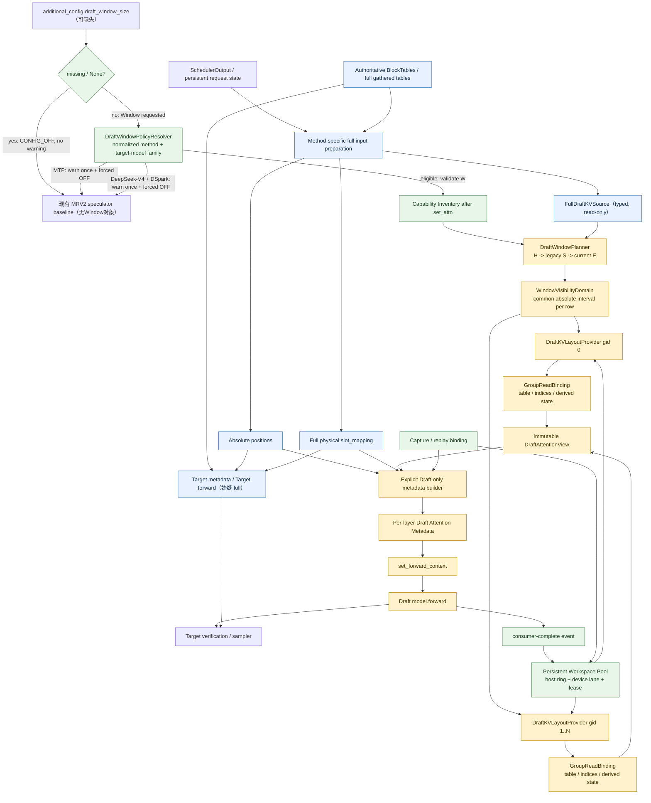

# MRV2 Speculative Draft Sliding Window Final Design — Codex

> 状态：**等待人工设计 Review；禁止据此直接进入实现**  
> 日期：2026-10-09  
> 目标：把 MRV1 已有的 speculative draft `draft_window_size` Feature Contract 安全迁移到 MRV2  
> 证据优先级：当前本地 checkout 源码 > Stage 1～7 已核验事实 > Agent 设计/Review > 通用知识

## 文档基线与证据约定

本文综合以下材料，但不把任何 Agent 的一致意见当作源码事实：

- `Sliding window原理_gpt.md` 与 `Sliding window源码_codex.md`：Stage 1～7 事实记录；
- `MRV2_Speculative_Draft_Sliding_Window_Design_Codex_v2.md`；
- `MRV2_Speculative_Draft_Sliding_Window_Design_DS_v2.md`；
- `MRV2_Speculative_Draft_Sliding_Window_Design_GPT_v2.md`：仅吸收经本地源码或数学重新验证的优点。

另有一项高于旧 advisory/support-scope 说明的产品策略输入：**2026-10-09 maintainer policy**。它规定非 `None` Window 请求下 MTP 与 DeepSeek-V4 + DSpark 的强制 OFF 行为，以及 EAGLE3/其余 parallel speculative methods 的 switch-following 行为；缺失/`None` 保持普通无warning baseline。本文把它标为产品决策，而不伪装成当前 checkout 已实现的源码事实；与旧文档冲突时以该策略为准。

本地源码目录为：

- `/Users/wenqingzhang/Desktop/vllm/vllm`
- `/Users/wenqingzhang/Desktop/vllm/vllm-ascend`

这两个源码快照当前没有可读取的 `.git` 元数据，所以本文不声称 branch 或 commit hash。文中的行号只对应 2026-10-08 的当前文件快照；checkout 变化后必须重新核对。

决策状态统一使用：

- **Frozen**：实现和 Review 不得自行改变；改变需重新过架构 Review。
- **Conditional**：推荐设计已给出，但必须先满足列出的源码/运行时证据。
- **Open**：静态源码不足以闭合；有明确关闭标准和未关闭时行为。
- **Rejected**：已明确不采用，并记录理由。

---

## 1. Executive Summary

最终推荐架构是：

> **由 speculator 持有 proposal-scoped Window Plan 和 capture-safe persistent workspace；在所有物理 KV 写地址已经由 full state 确定之后，把同一绝对 Draft 可见区间投影成 backend-specific 的 Draft Attention Read View，并通过显式 Draft-only metadata 入口交给 attention builder。**

它不是“把 MRV2 的 `seq_lens` 和 `input_block_tables` 原地改短”，也不是“在公共 `build_attn_metadata` 中根据上下文偷偷套窗口”。核心边界是：

```text
完整物理 KV / 写入世界                         Draft Attention 可见世界
------------------------------------          ---------------------------------
Target metadata            full               WindowInterval[S, E)
absolute positions         full               per-group DraftKVLayoutProvider
authoritative block state  full, read-only  -> GroupReadBinding
slot_mapping               full               window exact / CPU exact / upper
真实 KV allocation         full               backend derived sparse/SWA state
```

最终方案吸收三份设计中被源码支持的部分，同时明确拒绝以下过度推断：

- 不以 full-width Draft-private block table 作为全局默认；默认是窄、持久、capture-bound 的 backing。
- 不无条件使用所有 group column span 的 LCM 重新计算 Window 起点；先保持 MRV1 legacy anchor，无法表达时 fail closed。
- 不假定 device workspace 数量等于 `max_concurrent_batches`；host ring 按最大未 retire reader generation 定容（`max_concurrent_batches` 只是已知下界之一），并与 device execution lane 分开建模。
- 不把 DSA/SFA 简化为“只改 indices 就一定正确”；在集合语义和真实算子输入闭合前保持 capability gate。
- 不用 ContextVar、module-global 或 `_EXTRA_CTX` 传递 Window view。

策略解析先判断 Window switch：`draft_window_size` 缺失或为 `None` 时直接 `CONFIG_OFF`，所有 method/model 都走无新增 warning 的既有 baseline。只有用户配置了非 `None` 值、实际请求 Window 时，才执行 method/model policy：MTP（含落入 Eagle class 的特殊 MTP）warning once 并强制 Window OFF；DeepSeek-V4 + DSpark 因 drafter 与 target co-trained，warning once 并强制 Window OFF。这两类不得进入数值校验、inventory、planner、workspace 或 Draft Window metadata。EAGLE3 严格跟随 Window switch；DFlash、DFlash2、非 DeepSeek-V4 的 DSpark 及其他已由 factory 支持且适用的 parallel speculative methods/models同样严格跟随 switch，但 ON 仍受本文既有 backend/layout/graph/runtime gates 约束。plain Eagle、DSA/SFA、DCP/SP/CP、native recycling SWA 等组合不能因共用基类而自动启用。

本文只完成架构设计。生产代码、测试代码、配置行为均未修改。

## 2. Problem Statement

`draft_window_size=W` 的目的，是让 Draft Attention 只读取最近一段历史 KV，避免短上下文训练的 drafter 在长上下文上 acceptance collapse，同时保证 Target 模型、真实 KV cache 和最终输出质量不被窗口化。

MRV1 已有 `SlidingWindowAdapter`：它在 Draft per-layer metadata 构建之前，把 Draft-visible block table 和各类 KV length 改写为同一窗口语义，而 slot mapping 始终基于完整物理表。[`utils.py:83`](/Users/wenqingzhang/Desktop/vllm/vllm-ascend/vllm_ascend/spec_decode/utils.py:83)

MRV2 不能机械复制这段逻辑，原因包括：

1. Target 与 Draft 最终都会进入 Ascend metadata funnel，但入口与时机不同；
2. block table、slot mapping、device exact length、CPU mirror、CPU upper bound 已被拆成多个 owner；
3. BlockTables 天然是 per-KV-cache-group，group 的 layout/backend 可能不同；
4. DFlash/DSpark 的 slot mapping 会读取 full gathered table，而不总是读取 authoritative pointers；
5. eager、PIECEWISE、FULL 的 capture/live/replay metadata 入口不同；
6. DSA/SFA 具有 capture-stable 派生 buffer，且 graph updater 是 no-op；
7. async scheduling、preemption、dynamic batch 会使 persistent row 和请求身份解耦。

因此，真正问题不是“在哪里调用一次 adapter”，而是建立一个显式、类型安全、backend-aware、graph-safe 的 Draft read plane。

## 3. Scope

本设计覆盖：

- MRV2 `draft_window_size` 的读取、method policy、能力验证和 warning/error；
- 2026-10-09 maintainer policy 的优先解析：缺失/`None`先无warning OFF；非`None`请求下MTP与DeepSeek-V4 + DSpark强制OFF；EAGLE3与其余适用parallel methods跟随switch；
- 公共 Window 数学及 proposal/step 语义；
- EAGLE3/AR、DFlash、DSpark、DFlash2 的 method-specific timing；
- per-KV-cache-group table/layout 投影；
- device exact、CPU exact、CPU upper、DCP/local、backend effective max 的一致性；
- full block state、gathered block tables、slot mapping 与 Draft read view 的隔离；
- eager、PIECEWISE、FULL 的 capture/live/replay binding；
- dynamic batch、preemption、request row reuse 和 async buffer lifetime；
- native SWA / sparse visibility 的组合语义和 capability gate；
- Week4 的 Flashcomm、SP、DSA-CP、async scheduling 扩展接口；
- 单测、E2E、性能、Window-OFF 和 rollback 验证方案。

## 4. Non-goals

本阶段不做：

- 不修改任何生产代码或测试代码；
- 不重构 MRV1 `SlidingWindowAdapter`；MRV1 暂作为 golden oracle；
- 不改变 Scheduler、KV Cache Manager、真实 KV allocation 或 eviction policy；
- 不改变 Target Attention、Target verification、sampling/rejection sampler；
- 不改变 positions、RoPE、query layout 或 slot mapping 的绝对坐标语义；
- 不把 unsupported speculative method 顺便升级为受支持；
- 不承诺当前未闭合的 DSA/SFA/DCP/SP/CP 组合已经可实现；
- 除 DeepSeek-V4 + DSpark 这一条明确的 maintainer product-policy exception 外，不以 model name hardcode 代替 backend/layout capability；该例外只能存在于 policy resolver，不能渗入数学、builder 或 backend provider；
- 不在本设计中给出性能阈值的最终数值，阈值需要目标硬件基线；
- 不解决 native KV recycling 本身的分配策略。

## 5. Terminology

| 术语 | 含义 |
|---|---|
| `W` | 配置的 `draft_window_size`，只约束 Draft Attention read plane |
| `K` | MRV1 `future_offset`；AR proposal 尚未体现在首个 `seq_lens` 中的未来 Draft query 数 |
| `L0[r]` | AR proposal 开始时请求 `r` 的 full context end |
| `H[r]` | proposal horizon；AR 为 `L0+K`，DFlash/允许ON的DSpark为 input preparation 后的 full end；forced-OFF组合不创建 `H` |
| `E_s[r]` | 当前 Draft step `s` 的绝对 KV end；不等于 Window-relative length |
| `S[r]` | proposal-frozen 的绝对 Window start；同一 visibility domain 的所有 group 共享同一向量 |
| `visible_exact_s` | `E_s-S`，attention 当前真正可读的 Window-relative exact KV length |
| `full table` | authoritative 或完整 gathered block table；属于物理 KV 世界，禁止原地窗口化 |
| `window table` | Draft-only read view 使用的 table backing；可以是 shifted/narrow table，也可以由 backend provider 替代 |
| `table column span` | 某 group 的一个 table column 在其真实 layout 中覆盖的 token 范围；不能只靠类名推断 |
| `slot_mapping` | 绝对 token position 到物理 KV slot 的写地址；永远由 full state 产生 |
| `visibility domain` | 必须共享一套绝对 `[S,E)` 语义与公共 length 的 group 集合；默认一个 proposal 一个 domain |
| `GroupReadBinding` | 某 global KV-cache-group 对 WindowInterval 的 backend-specific 表达 |
| `CaptureCapacity` | graph/capture backing 的静态容量，不是 runtime exact/upper |
| `CpuUpper` | 当前 CPU optimistic upper bound，Window 后仍必须 `>= DeviceExact` 且不能超过已材料化容量 |
| `generation` | proposal/request-order/layout/step/descriptor/lane 的不可混用身份 |
| `lease` | workspace 从写入、sealed、被 consumer 读取到 retire 的所有权周期 |

必须区分五套坐标：绝对 token position、Window-relative token offset、block-table column、物理 KV slot、backend sparse/logical index。任何转换都由 layout provider 明确声明，禁止靠整数除法的偶然一致性。

## 6. MRV1 Feature Contract

### 6.1 公开契约

当前仓库自己的设计文档和用户文档给出的**历史 MRV1 基线**是：

- 默认关闭；缺少配置或值为 `None` 即 OFF；
- MRV1 公开支持 EAGLE3、DFlash、DSpark；
- 只限制 Draft Attention 读取，Target 始终读取 full context；
- MTP 在请求 Window 时强制忽略并告警；
- DSpark + DeepSeek-V4 给出 acceptance 风险 warning，但仍可启用（**仅历史事实；已被下述 maintainer policy 覆盖**）；
- native/training SWA 比 `W` 更大时给 advisory；
- MRV2 当前明确尚未支持。

依据见 [`speculative_kv_sliding_window.md:1`](/Users/wenqingzhang/Desktop/vllm/vllm-ascend/docs/source/developer_guide/Design_Documents/speculative_kv_sliding_window.md:1) 与 [`speculative_decoding.md:468`](/Users/wenqingzhang/Desktop/vllm/vllm-ascend/docs/source/user_guide/feature_guide/speculative_decoding.md:468)。

上述两点中的旧 warning/advisory 不能直接决定 MRV2 的最终开启策略。2026-10-09 maintainer policy 对本次迁移作出以下覆盖性裁决：

1. `draft_window_size` 缺失或为 `None` 时先返回 `CONFIG_OFF`；不再解析 forced-OFF method/model policy，也不为 MTP 或 DeepSeek-V4 + DSpark 发 warning。
2. 只有配置为非 `None`、实际请求 Window 时，MTP（包括任何 concrete class 伪装）才在 speculator/engine 初始化时 warning once，并强制 Window OFF。
3. 只有配置为非 `None` 时，DeepSeek-V4 + DSpark 才 warning once；因 draft 与 target co-trained，Window 强制 OFF。旧文档中的“warning 后仍可启用”不再适用。
4. EAGLE3 严格跟随 Window switch：OFF 走现有 baseline，ON 才进入后续 capability/runtime gates。
5. 其余已受支持且适用的 parallel speculative methods/models 严格跟随 switch；ON 不绕过既有 backend、layout、graph、parallel 或 async gates。

“强制 OFF”是对非 `None` Window 请求的显式产品策略，不是配置错误，也不是 capability 失败后的静默 fallback。resolver 顺序必须是 `CONFIG_OFF` 判断 → method/model forced-OFF 判断 → Window 数值校验；forced-OFF 必须在 capability inventory、planner 和 workspace 构造之前结束路径。

### 6.2 MRV1 数学

MRV1 对每个请求使用：

```text
S_legacy      = floor(max(L + K - W, 0) / B_legacy) * B_legacy
visible_len   = L - S_legacy
start_block   = S_legacy / B_legacy
needed_blocks = ceil(visible_len / B_legacy)
```

其中 `B_legacy` 是 MRV1 从第一个 Draft attention layer 取得的 kernel block size。`SlidingWindowAdapter` 创建固定容量 clone，将 full table 的 suffix gather 到 clone，更新 NPU `seq_lens` 以及存在的 `seq_lens_cpu`、`_seq_lens_cpu`、`seq_lens_cpu_upper_bound`。[`utils.py:120`](/Users/wenqingzhang/Desktop/vllm/vllm-ascend/vllm_ascend/spec_decode/utils.py:120) [`utils.py:149`](/Users/wenqingzhang/Desktop/vllm/vllm-ascend/vllm_ascend/spec_decode/utils.py:149)

MRV1 `future_offset`：

- EAGLE3/AR：`K=num_speculative_tokens`；首个 length 是 context-only，horizon 在其后；
- DFlash/DSpark：`K=0`；input-preparation 已把 parallel query stretch 写进 length。

配置与 adapter 构造见 [`llm_base_proposer.py:415`](/Users/wenqingzhang/Desktop/vllm/vllm-ascend/vllm_ascend/spec_decode/llm_base_proposer.py:415) 和 [`llm_base_proposer.py:437`](/Users/wenqingzhang/Desktop/vllm/vllm-ascend/vllm_ascend/spec_decode/llm_base_proposer.py:437)。

### 6.3 必须保持的行为不变量

1. Target metadata 与 Target read set 永远 full。
2. positions 是真实绝对位置，Window 不拥有也不修改它。
3. slot mapping 由 full block state 与绝对 positions 决定。
4. full block table、真实 KV allocation 和 cache ownership 不被 Window 修改。
5. Draft table 与所有被 backend 消费的 KV length 表达同一可见集合。
6. Window 只在 Draft metadata 构建作用域可见。
7. EAGLE3 的 proposal horizon 与 DFlash/DSpark 的 baked-query length 语义不同。
8. Window OFF 不引入新的 buffer、kernel、graph key 或 metadata 重建。

### 6.4 公开契约与偶然代码可达性

当前 MRV1 基类会给所有非 MTP base proposer 构造 adapter，因此 plain Eagle 或 generic draft-model 路径可能“机械可达”；但仓库公开文档、docstring 和专门测试只声明 EAGLE3/DFlash/DSpark。最终设计把两者分开：公开支持面是历史迁移输入，最终行为还要经过上述 maintainer policy 过滤；偶然可达路径必须经 maintainer 决策和 golden test 后才能在 MRV2 开放，不能因共用基类自动启用。特别地，历史公开支持 DSpark 不等于 DeepSeek-V4 + DSpark 可以 Window ON。

## 7. MRV2 Existing Architecture

### 7.1 Speculator factory 与方法分支

Ascend MRV2 factory 是显式分支，不是通用 registry：`extract_hidden_states`、DSpark、DFlash/DFlash2、普通 MTP、Eagle/use_eagle；未知组合抛 `NotImplementedError`。[`spec_decode/__init__.py:23`](/Users/wenqingzhang/Desktop/vllm/vllm-ascend/vllm_ascend/worker/v2/spec_decode/__init__.py:23)

因此 policy resolver 必须先读取 Window switch：缺失/`None` 直接 `CONFIG_OFF`。仅非 `None` 请求才在 concrete class 之前读取 normalized method，并取得稳定的 target-model family identity；先关闭 MTP 与 DeepSeek-V4 + DSpark，再决定是否需要数值校验和实际 backend inventory。当前checkout可把target `hf_config.model_type.startswith("deepseek_v4")`集中封装成该identity predicate；不得在planner/backend中散落`"deepseek" in model_name`式模糊判断。不能根据某个 Python 基类或 `use_eagle()` 推断，因为特殊 MTP 也可能落入 Eagle 类路径。只有 switch-following 且请求 ON 的路径才进入 capability inventory。

### 7.2 Target 与 Draft metadata 入口

Target 由 `DefaultModelState.prepare_attn()` 调用 Ascend `build_attn_metadata()`。[`default.py:44`](/Users/wenqingzhang/Desktop/vllm/vllm-ascend/vllm_ascend/worker/v2/model_states/default.py:44)

Draft 的公共基类从 `_build_draft_attn_metadata()` 进入 builder；Ascend 当前通过 context manager 临时替换上游模块函数，并且 DSpark/AR 存在各自 override。[`speculator.py:295`](/Users/wenqingzhang/Desktop/vllm/vllm/vllm/v1/worker/gpu/spec_decode/speculator.py:295) [`attn_utils.py:1240`](/Users/wenqingzhang/Desktop/vllm/vllm-ascend/vllm_ascend/worker/v2/attn_utils.py:1240)

Target 与 Draft 可以汇入同一底层实现，但新 Window view 不能通过同一个公开 optional 参数进入；否则 Target 被误传 view 的风险无法在类型/调用边界上消除。

### 7.3 BlockTables、gather 与 slot mapping

`BlockTables` 按 global KV-cache-group 持有不同的 storage/kernel block size、列宽、input table 和 valid block count。[`block_table.py:17`](/Users/wenqingzhang/Desktop/vllm/vllm/vllm/v1/worker/gpu/block_table.py:17)

普通/AR `compute_slot_mappings()` 读取 authoritative `block_table_ptrs`；Ascend override 同样如此。[`block_table.py:190`](/Users/wenqingzhang/Desktop/vllm/vllm/vllm/v1/worker/gpu/block_table.py:190) [`vllm_ascend/worker/v2/block_table.py:82`](/Users/wenqingzhang/Desktop/vllm/vllm-ascend/vllm_ascend/worker/v2/block_table.py:82)

但 DFlash/DSpark 的 query/context slot mapping 由 `prepare_dflash_inputs()` 读取 full gathered `input_block_tables[gid]`。因此“不让 slot mapping 看见 Window”不仅要求不改 authoritative pointers，还要求 DFlash/DSpark 在全部 slot 计算完成之前保持 gathered table 为 full。[`dflash/speculator.py:375`](/Users/wenqingzhang/Desktop/vllm/vllm/vllm/v1/worker/gpu/spec_decode/dflash/speculator.py:375) [`dflash/speculator.py:513`](/Users/wenqingzhang/Desktop/vllm/vllm/vllm/v1/worker/gpu/spec_decode/dflash/speculator.py:513)

`gather_block_tables(out=...)` 支持 caller-provided destination，这为独立 persistent Draft workspace 提供自然接口，但 destination 不能重新注册为 authoritative owner。[`block_table.py:148`](/Users/wenqingzhang/Desktop/vllm/vllm/vllm/v1/worker/gpu/block_table.py:148)

### 7.4 Length funnel

Ascend builder 的外层 length 是所有 group 共享的；它再逐 group 选择 table 和 backend builder。[`attn_utils.py:220`](/Users/wenqingzhang/Desktop/vllm/vllm-ascend/vllm_ascend/worker/v2/attn_utils.py:220)

当前若 `seq_lens_np` 缺失，会用 `max_seq_len` 填满；upper 缺失时又等于该 CPU 数组。[`attn_utils.py:253`](/Users/wenqingzhang/Desktop/vllm/vllm-ascend/vllm_ascend/worker/v2/attn_utils.py:253) 对 full path 这可能是合法 fallback，但 Window table 下会制造“窄表 + full length”错配，所以 Window ON 必须禁止该 fallback。

DCP local length 不是简单除以 world size；当前 helper 包含 interleave 和 rank remainder。[`utils.py:1088`](/Users/wenqingzhang/Desktop/vllm/vllm/vllm/v1/attention/backends/utils.py:1088)

### 7.5 Graph 与 persistent state

capture helper 当前使用 persistent dummy block table/slot mapping，并明确依赖 capture 与 runtime 地址契约。[`block_table.py:177`](/Users/wenqingzhang/Desktop/vllm/vllm/vllm/v1/worker/gpu/block_table.py:177)

- DFlash capture：[`dflash/cudagraph.py:24`](/Users/wenqingzhang/Desktop/vllm/vllm/vllm/v1/worker/gpu/spec_decode/dflash/cudagraph.py:24)
- 普通/AR capture：[`cudagraph_utils.py:766`](/Users/wenqingzhang/Desktop/vllm/vllm/vllm/v1/worker/gpu/cudagraph_utils.py:766)
- AR replay：[`autoregressive/aclgraph.py:132`](/Users/wenqingzhang/Desktop/vllm/vllm-ascend/vllm_ascend/worker/v2/spec_decode/autoregressive/aclgraph.py:132)
- DFlash replay：[`dflash/aclgraph.py:86`](/Users/wenqingzhang/Desktop/vllm/vllm-ascend/vllm_ascend/worker/v2/spec_decode/dflash/aclgraph.py:86)

GQA/FIA 可向 UpdatableGraph 注册 block-table 参数；MLA 有 runtime 参数更新；DSA/SFA 的 `update_graph_params()` 当前是 no-op。[`attention_v1.py:652`](/Users/wenqingzhang/Desktop/vllm/vllm-ascend/vllm_ascend/attention/attention_v1.py:652) [`dsa_v1.py:1621`](/Users/wenqingzhang/Desktop/vllm/vllm-ascend/vllm_ascend/attention/dsa_v1.py:1621) [`sfa_v1.py:885`](/Users/wenqingzhang/Desktop/vllm/vllm-ascend/vllm_ascend/attention/sfa_v1.py:885)

### 7.6 Request row 与 async 事实

一次 execute 内会先 remove finished/preempted request，再 add 新 request；free row 可在同一步复用。[`model_runner.py:1085`](/Users/wenqingzhang/Desktop/vllm/vllm/vllm/v1/worker/gpu/model_runner.py:1085) [`states.py:88`](/Users/wenqingzhang/Desktop/vllm/vllm/vllm/v1/worker/gpu/states.py:88)

`max_concurrent_batches` 和 UVA pool 证明 host-side in-flight state 需要轮换，并要求 reader retire 后才能复用；它们不能证明同一 worker 上有同等数量的 device execution lane。[`vllm.py:589`](/Users/wenqingzhang/Desktop/vllm/vllm/vllm/config/vllm.py:589) [`buffer_utils.py:19`](/Users/wenqingzhang/Desktop/vllm/vllm/vllm/v1/worker/gpu/buffer_utils.py:19)

## 8. Design Invariants

| ID | Frozen invariant | 可验证判据 |
|---|---|---|
| I01 | Target-full | 在固定相同 Target tokens/candidates 的受控测试中，Target metadata与logits逐位等价；Window view不可达Target。Draft proposal本身允许因Window而变化 |
| I02 | Absolute-position | Window view 不拥有 positions；有效 token positions 的值保持绝对坐标 |
| I03 | Full-slot | 所有slot mapping在Window materialization前由full state完成；固定相同positions/full block state时ON/OFF逐位相等 |
| I04 | Full-source read-only | authoritative/gathered full tables 不被原地写；source/destination storage 区间不 alias |
| I05 | Single origin vector | 同一 visibility domain 的所有 consumer group 对每个 row 使用同一 `S[r]` |
| I06 | Legacy-first alignment | 优先精确保留 `S_legacy`；layout 不能表达时 fail closed，不静默换成 LCM 语义 |
| I07 | Proposal-frozen AR anchor | AR 只在 proposal 开始用 `H=L0+K` 求 `S`；后续 step 复用 `S`，不重复加固定 K |
| I08 | Same-set visibility state | 所有标记为Window visibility的device exact、CPU exact、upper、local和backend effective max均来自同一`[S,E)`；若backend为索引映射保留full-coordinate length，必须使用不同类型并证明它不能扩大最终read set |
| I09 | Upper safety | `visible_exact <= visible_upper <= materialized_capacity` |
| I10 | Per-group correctness | group 用 global gid 查 binding；不把第一个 group 的 block size推广到其他 group |
| I11 | Deterministic padding/tail | 每 step 完整重写 active capacity、active tail 与 padded rows；旧 generation 不可见 |
| I12 | No repeated Window | materializer 只接受 typed full source；sealed view 不能再次作为 source |
| I13 | Explicit Draft transport | view 只经实例参数/typed object传递；不用 ContextVar、module-global、thread-local 或 `_EXTRA_CTX` |
| I14 | Capture/live/replay parity | 同一 binding key 的真实 backend operand 指向同一合法 backing 或经验证地重绑 |
| I15 | Lease-before-reuse | 最后一个 metadata/graph/backend reader retire 前，workspace 不得被下一 generation 覆盖 |
| I16 | Window-OFF identity | `CONFIG_OFF` 不发新增 policy warning；它与 policy-forced OFF 均不执行 inventory/materialization/binding、不改变当前已有 wrapper/factory/path；只有非 `None` 请求触发的 forced-OFF 允许一次性 warning |
| I17 | Native intersection | 最终可见集合是 Draft interval、native visibility 与物理 resident 集合的交集 |
| I18 | Fail closed | 仅对允许跟随 switch 且请求 ON 的组合适用：method/layout/backend/graph 不能证明安全时，不静默回 full 或部分 Window；非`None`请求上MTP与DeepSeek-V4 + DSpark的强制OFF是先验产品策略，不是错误或fallback |
| I19 | Config-before-policy-before-allocation | 先判断缺失/`None`并返回 `CONFIG_OFF`；仅非 `None` 请求解析 normalized method/target family；MTP 与 DeepSeek-V4 + DSpark 在数值校验、inventory、planner、workspace 之前结束，且绝不创建 Window generation |

## 9. Method Support / Compatibility Matrix

“Contract”与“首期 readiness”必须分开：前者是迁移必须覆盖的行为，后者必须等测试和 Open Question 关闭后才能打勾。

| Method / variant | 当前 MRV2 factory | MRV1 公开 Window contract | Timing / horizon | Graph mode 事实 | 最终 policy | 首期 readiness |
|---|---|---|---|---|---|---|
| EAGLE3 | Eagle/AR speculator | 支持 | proposal `H=L0+K`；anchor 冻结 | prefill 可 NONE/PIECEWISE/FULL；decode 为 eager/FULL | **严格跟随 switch**：OFF baseline；ON 才过 gates | **Conditional**：first-pass parity、AR multi-step graph 关闭后启用 |
| DFlash | DFlash speculator | 支持 | preparation 后 `K=0` | eager/FULL；不走 PIECEWISE | **严格跟随 switch**；ON 不放宽现有 gates | dense backend 可优先实现；逐 backend gate |
| DSpark（非 DeepSeek-V4 target） | DSpark speculator | 支持 | 所有 group preparation 后 `K=0` | eager/FULL；不走 PIECEWISE | **严格跟随 switch**；ON 不放宽现有 gates | **Conditional**：DSA/SFA/多 group capability逐项开放 |
| DeepSeek-V4 + DSpark | DSpark speculator | 历史文档允许 warning 后开启 | 不进入 Window timing | 保持当前 baseline mode | 缺失/`None`无warning baseline；非`None`请求 **warning once + forced OFF**；co-trained；不进入planner/workspace | 两种配置状态均做baseline regression；Window ON明确不得启用 |
| DFlash2 | DFlash2 variant | DFlash 家族继承行为 | `K=0` | 当前 Ascend 要求 eager | **严格跟随 switch**；保持 eager-only，不为 Window 改 graph | eager dense backend验证后启用 |
| MTP（含特殊 use_eagle class） | MTP 或 Eagle class | warning-and-ignore | 不适用 | 保持当前路径 | 缺失/`None`无warning baseline；非`None`请求 **warning once + forced OFF**；不分配workspace | baseline regression；需CONFIG_OFF无warning与请求Window一次warning测试 |
| plain Eagle | factory 可达 | MRV1 基类机械可达，但非公开契约 | AR | 取决于 AR | 不自动启用 | **Open product decision**；默认配置 Window 时 fail closed |
| generic `draft_model` | 当前 factory 不支持对应普通路径 | 可能有 MRV1 偶然可达性 | 未定义 | 未定义 | 保留当前 factory error | 不支持 |
| `extract_hidden_states` | 有独立分支 | 无 Draft Attention read plane | 不适用 | 当前行为 | Window policy 不介入 | 不适用 |
| ngram/ngram_gpu/suffix/medusa | 不经过当前 Ascend neural-draft factory或不具该 read plane | 非公开 contract | 不适用 | 当前行为 | 不误启用、不吞原错误 | 不适用/unsupported |
| 未知/custom | factory error | 无保证 | 未定义 | 未定义 | 原错误优先 | 不支持 |

Backend readiness 是第二道 gate：GQA/FIA、MLA、DSA、SFA、native recycling KV spec、DCP/SP/CP 都必须分别声明 provider capability。Method 被支持不代表其所有 backend 组合自动支持。

这里的“其余 parallel speculative methods/models 跟随 switch”只约束已由当前 factory 支持、且 Feature Contract 判定适用的组合；它不把未知/custom method 自动升级为支持。跟随 switch 也只意味着 ON 请求进入 gates，不意味着 gates 已通过。

## 10. Architecture Overview

### 10.1 选定方案

采用以下组合，而不是完整照搬任一 Agent 方案：

```text
Codex v2 骨架
  explicit Draft-only boundary
  speculator ownership
  narrow persistent workspace
  capture binding + generation/lease

DeepSeek v2 的有效补充
  backend capability projector
  typed length states
  CpuUpper capacity clamp
  staged enablement

GPT v2 的有效补充
  coordinate terminology
  legacy-anchor vs LCM 反例
  graph actual-operand fingerprint
  Open Question closure criteria
```

### 10.2 逻辑组件

| 组件 | 责任 | 不负责 |
|---|---|---|
| `DraftWindowPolicyResolver` | 先解析配置 switch 并短路 `CONFIG_OFF`；仅非 `None` 请求解析 normalized method/target-model family、warning/error 和 forced-OFF | Window 数学、backend layout |
| `DraftWindowCapabilityInventory` | `set_attn()` 后收集 gid/backend/KV spec/layout/graph/parallel capability | 热路径推断 |
| `FullDraftKVSource` | 对 full seq/table/valid counts/request order 的 typed read-only snapshot | 持有 Window destination |
| `DraftWindowPlanner` | 纯数学：horizon、legacy anchor、interval、capacity、generation | 写 tensor、调 builder |
| `WindowVisibilityDomain` | 规定共享 origin/length 的 consumer group 集合 | 假设所有 group layout相同 |
| `DraftKVLayoutProvider` | 判断 legacy origin能否表达；将绝对 interval投影为 group binding | 改 positions/slot mapping |
| `ParallelWindowProjector` | 把 `[S,E)` 投影到 DCP/SP/CP local ownership | 定义全局 Window 数学 |
| `DraftWindowWorkspacePool` | persistent backing、host ring、device lane、lease/retire | authoritative block ownership |
| `DraftAttentionView` | immutable、sealed、global-gid keyed 的本 step bindings | 再次 materialize |
| `DraftWindowCaptureBinding` | capture key、真实 operand fingerprint、capture/live/replay一致性 | 隐式 graph fallback |
| Draft-only metadata入口 | 将 view 显式交给内部 builder，Target API无 view | 判断 method policy |

这些是职责边界，不是“每个名词必须新建一个类”。实现时优先使用 immutable dataclass、Protocol 和现有 owner；只有独立生命周期、ownership 或 type-safety 需要时才落成类。

### 10.3 API 边界

推荐的概念接口：

```python
# Target/general public entry: signature cannot carry a Draft view.
build_attn_metadata(full_inputs, ...)

# Draft-only entry: called only by a speculator.
build_draft_attn_metadata(full_inputs, draft_view, absolute_positions, ...)
```

两者可以调用共享 private implementation，但 Target call site 在类型和函数签名上拿不到 `DraftAttentionView`。

Window OFF 时不切换到新路径：继续执行当前 speculator、现有 wrapper/factory、metadata builder 和 graph 路径。这里的“零回归”不是移除当前已有 wrapper，而是不新增 Window 相关副作用。缺失/`None` 的 `CONFIG_OFF` 不发 warning；仅非 `None` 请求的 policy-forced OFF 允许规定的一次性 warning。forced OFF 不是错误，也不得先构造 Window 对象再回退。

### 10.4 Runtime 状态机

```text
CONFIG SWITCH RESOLVED
   ├─ key missing / None ────────────────> CONFIG_OFF -> BASELINE (no warning)
   └─ non-None Window request
          ▼
      METHOD/TARGET RESOLVED
          ├─ MTP ────────────────────────> FORCED_OFF + warn once -> BASELINE
          ├─ DeepSeek-V4 + DSpark ───────> FORCED_OFF + warn once -> BASELINE
          └─ switch-following method
                 │ validate W
                 ▼
             CONFIGURED -> INVENTORIED -> ALLOCATED
                                │ acquire generation + lane
                                ▼
                            PREPARING
                                │ full rewrite + checks
                                ▼
                              SEALED
                                │ metadata/graph/backend readers
                                ▼
                             IN_FLIGHT
                                │ consumer-complete event
                                ▼
                              RETIRED -> reusable
```

只有 `CONFIGURED` 分支可以创建 capability inventory、plan、workspace 或 generation。`CONFIG_OFF` 不发新 warning；两条 `FORCED_OFF` 只在非 `None` 请求上 warning once，且都不产生 Window 对象或 error。任何 generation mismatch、source alias、capacity overflow 或 capture fingerprint mismatch 都是 correctness error，不允许继续使用该 view。

## 11. Common Sliding Window Infrastructure

### 11.1 Canonical Window Plan

公共数学只实现一次，并且只处理绝对区间，不直接假设 table layout。

对每个 active request `r`：

```text
AR proposal:
    H[r] = L0[r] + K

DFlash / eligible DSpark parallel proposal:
    H[r] = E_prepared[r]          # query stretch 已包含，K=0

S_legacy[r] = align_down(max(H[r] - W, 0), B_legacy)
```

AR 的 `S_legacy` 在 proposal 开始时计算一次。后续 step 只更新 `E_s`：

```text
visible_exact_s[r] = E_s[r] - S_legacy[r]
```

禁止在每个 step 使用固定 `K` 重新求起点；如果某 helper 必须用 offset 表达，其值应是剩余 horizon `H-E_s`，而不是始终为 `K`。

DFlash/允许 Window ON 的 DSpark 的 `E_prepared` 已包含本轮 parallel query，所以 `H=E_prepared`，等价于 MRV1 的 `future_offset=0`。

### 11.2 Legacy anchor 与多 group 可表达性

MRV1 只用首个 Draft layer 的 `B_legacy`。MRV2 group 可能有不同 column span。最终规则是：

1. 先按 MRV1 公式得到每个 request 的 `S_legacy`；
2. visibility domain 中每个 provider 调用 `can_represent_origin(S_legacy)`；
3. 所有 consumer group 都能表达时，**精确保留该 anchor**；
4. 任何一个 group 不能表达时，首版对该 geometry fail closed；
5. 不自动用 LCM 重新对齐。

原因：LCM 能解决“每组 start column 为整数”，但不保证 MRV1 parity。反例：

```text
ideal_start = 172
B_legacy = 64       -> S_legacy = 128
group spans = 64,48 -> LCM = 192 -> S_lcm = 0
```

无条件 LCM 会让 Draft 多读 128 个 token，既改变 acceptance 语义，也可能让窗口退化。当前 checkout 已测试的异构组合是 128/64，它们可整除；不能据此推断所有未来 geometry 都可整除。[`test_dspark_proposer.py:1015`](/Users/wenqingzhang/Desktop/vllm/vllm-ascend/tests/ut/spec_decode/test_dspark_proposer.py:1015)

未来若产品决定允许 common-alignment 新语义，必须作为显式 feature revision，具备 expansion budget、correctness、acceptance 和 performance 评审，不能藏在迁移实现里。

### 11.3 Capacity

对 legacy block alignment，最终 horizon 的最大可见长度满足：

```text
V_capacity = W + B_legacy - 1
```

只有当 provider 要求 `S` 与其 table column span 对齐、因而 `first_token_offset=0` 时，标准 contiguous table provider 才可以用：

```text
C_g = ceil(V_capacity / table_column_span_g)
```

如果 provider 有显式 non-zero first-token-offset carrier，一般容量至少为：

```text
C_g = ceil((first_token_offset_max + V_capacity) / table_column_span_g)
```

`first_token_offset_max` 的合法范围、逐row offset及最终operator消费字段都必须由provider声明；没有该carrier字段的paged backend只能接受span-aligned origin。`C_g` 最终始终由provider给出，因为 first-page offset、CP interleave、sparse layout 可能需要不同表示。每 step 必须断言：

```text
0 <= visible_exact_s[r] <= V_capacity
needed_g[r] <= C_g
```

MRV1 的 clone 容量可能比这个紧上界多一列；迁移要求可见集合一致，不要求浪费空间也完全一致。

### 11.4 Full source 与 immutable plan

`FullDraftKVSource` 至少快照：

```text
proposal_id
ordered request identity / request-order generation
idx_mapping or source-row generation
actual_num_reqs / padded_num_reqs
full device seq_lens and optional CPU states
global gid -> full table source
global gid -> valid_num_blocks
layout/backend version
phase / graph descriptor / device lane
```

`valid_num_blocks` 不能直接用本轮 batch row `r` 去索引 persistent request row。它必须和 full block-table gather 使用同一份 `idx_mapping` 与 request-order generation：

```text
batch_valid_num_blocks[gid, r]
    = persistent_num_blocks[gid, idx_mapping[r]]
    for r < actual_num_reqs

batch_valid_num_blocks[gid, r] = 0
    for actual_num_reqs <= r < padded_num_reqs
```

结果写入该 generation/lane 的 capture-safe persistent destination，并与 full gathered table、ordered request identity和mapping generation作为一个逻辑快照一起 seal。preemption或same-step row reuse导致任一generation变化时，整份source失效。

它是 typed read-only source，不要求指针恒等于某个固定 `input_block_tables[g]`；PCP、capture 或 caller-provided gather destination 都可能是合法 full snapshot。正确约束是：来源具有 authoritative generation、有效列边界明确、与 Window destination 不 alias。

`DraftWindowPlan` 是 immutable proposal/step snapshot，包含 `H`、`S`、`E_s`、typed lengths、consumer groups、binding key 和 generation。planner 不持有 positions 或 slots。

本节所有公式都位于 resolver 的 Window-ON 分支之后；MTP 与 DeepSeek-V4 + DSpark 没有 `H/S/E` Window plan，也不能为了复用代码而创建空 plan。

### 11.5 Materialization 纪律

每个 step 都从 canonical full source 完整刷新，不做“上一 step Window table + 新增一列”的增量优化：

```text
for each active row r and destination column c in [0, C_g):
    provider maps (S[r], c) -> source column / offset / logical index
    copy is valid iff:
        c < needed_g[r]
        mapped source is within source row width
        mapped source is within batch_valid_num_blocks[gid, r]
    otherwise write deterministic inert value

for rows [actual_num_reqs, padded_num_reqs):
    write deterministic inert state for the complete captured region
```

这同时消除：

- active row 的旧 tail；
- batch shrink 后的旧请求；
- preemption/removal 后 row identity 复用；
- repeated-window/window-of-window；
- descriptor padding 的非确定内容。

padding 不要求 dummy block id 与 active block 集合绝对不相交；真正契约是该 backend 的 length/index/write mask 使 padding 无可观察读写，且 padded output 被裁掉。

## 12. Method-specific Integration

### 12.1 EAGLE3 / AR

EAGLE3 严格跟随 Window switch。OFF 时完整沿用 baseline；只有 ON 时才执行以下 first-pass/multi-step 流程，并继续受 AR first-pass、backend 与 graph gates 约束。

#### Proposal first pass

当前 AR prefill 可以复用 Target metadata。Window ON 后不能修改被复用的 Target 对象，必须：

1. 保留 Target metadata 和 Target forward 完全不变；
2. 取得本轮合法的 full query layout、absolute positions 和 full slots；
3. 以 `H=L0+K` 计算并冻结 `S`；
4. 构造独立 Draft view；
5. 通过 Draft-only builder 重建 Draft first-pass metadata；
6. 逐字段证明与当前合法路径一致，唯一允许变化的是 Draft KV read visibility carriers。

需要对拍的字段至少包括：`query_start_loc(_cpu)`、actual/padded token/request counts、prefill/decode flags、absolute positions、slot mapping、active-layer mapping、rejection-tail/bonus-token 语义。只比较有效区间；不要求 Target 与 Draft positions 使用同一 storage，因为当前 AR 会合法复制其值。[`autoregressive/speculator.py:303`](/Users/wenqingzhang/Desktop/vllm/vllm/vllm/v1/worker/gpu/spec_decode/autoregressive/speculator.py:303)

#### Subsequent draft steps

每个 step：

```text
prepare full absolute positions / full per-step seq state
-> compute physical slot mapping from full state
-> refresh view using frozen S and current E_s
-> build Draft-only metadata
-> draft forward
```

当前 AR 在 slot mapping 后构建 metadata 的位置为 [`autoregressive/speculator.py:515`](/Users/wenqingzhang/Desktop/vllm/vllm/vllm/v1/worker/gpu/spec_decode/autoregressive/speculator.py:515)。Window integration 只能在 full slot 已稳定之后。

### 12.2 DFlash

DFlash 属于 switch-following parallel method：OFF 走 baseline；ON 才进入下述时序及既有 backend/graph gates。

顺序必须是：

```text
prepare_dflash_inputs(full gathered tables)
  -> absolute positions
  -> query/context physical slot mappings
  -> full prepared seq_lens (parallel query 已 baked in)
  -> context KV physical write（若当前路径需要）
  -> freeze plan with K=0
  -> materialize Draft view
  -> build Draft metadata
  -> forward / proposal tokens
```

不能在 `prepare_dflash_inputs()` 前替换 `input_block_tables`，因为 kernel 真实读取它来计算 slots。metadata build 发生在 preparation 之后。[`dflash/speculator.py:451`](/Users/wenqingzhang/Desktop/vllm/vllm/vllm/v1/worker/gpu/spec_decode/dflash/speculator.py:451)

### 12.3 DSpark

在 `draft_window_size` 非 `None`、用户实际请求 Window 后，resolver 才区分 target model：

- **DeepSeek-V4 + DSpark**：因 draft 与 target co-trained，warning once 并强制 Window OFF；直接进入现有 DSpark baseline。配置缺失/`None` 时则早已按无 warning 的 `CONFIG_OFF` 返回。forced-OFF 分支不得收集 Window capability inventory，不得创建 `FullDraftKVSource`、plan、workspace/lease、view 或 backend derived Window state。
- **其他 DSpark model**：严格跟随 switch；OFF 走 baseline，ON 才继续以下 parallel timing 和 capability gates。

允许 ON 的 DSpark 必须等待：

- 所有 Draft consumer group 的 full table 已 gather；
- 各 group query/context slot mapping 已计算；
- DSpark-specific query layout、absolute positions 与 prepared length 已稳定；
- context KV write 所需 full state 已消费。

之后创建共享 absolute Window plan，并让每个 global gid 的 provider 生成 `GroupReadBinding`。DSA/SFA derived visibility 必须从该 plan 生成，不能先 window table，再拿 full absolute index 机械叠加一次。

非 DeepSeek-V4 DSpark 的历史 public contract 是 required target，但 backend 组合按能力开放：

- dense GQA/FIA/MLA：可优先走 shifted/narrow table + typed lengths；
- DSA non-causal：需要 DSA-specific visibility projector；
- SFA/NoPE：需要 index/filter/top-k translation spec；
- 未闭合的 causal、recycling、DCP/CP 组合 fail closed。

### 12.4 DFlash2

DFlash2 同样严格跟随 switch。ON 时复用 DFlash 的 `K=0` 与 full-slot-before-window 时序，但保持当前 Ascend eager-only 约束；Window 不应借机启用其 graph path。[`dflash2/speculator.py:121`](/Users/wenqingzhang/Desktop/vllm/vllm-ascend/vllm_ascend/worker/v2/spec_decode/dflash2/speculator.py:121)

### 12.5 MTP 与其他方法

Policy 必须在 concrete class 之前按 normalized method 判定：

- 配置缺失或 `draft_window_size=None`：先返回 `CONFIG_OFF`，包括 MTP 在内均不发 Window policy warning；
- MTP + 非 `None` Window 请求：warning once + forced OFF；rationale 是 draft 与 target co-trained。它不做 Window 数值校验、不 inventory、不创建 planner/workspace/generation；warning 去重范围为 engine/speculator 实例；
- `extract_hidden_states`：不适用，不介入；
- factory 当前不支持的方法：保留原 factory error，Window resolver 不吞错；
- plain Eagle：架构可表达 AR 语义，但支持政策仍 Open；未批准前 fail closed；
- token-only proposer：不创建神经 Draft read view。

## 13. Runtime Data Flow

### 13.1 Window OFF

OFF 有两类来源：

1. `CONFIG_OFF`：任意 method/model 的 key 缺失或值为 `None`；不发新增 Window policy warning；
2. policy-forced OFF：仅当值非 `None`、用户实际请求 Window 时命中的 MTP 或 DeepSeek-V4 + DSpark。

两类都只走下述 baseline。第一类无 warning；第二类只允许额外发出规定的一次性 warning。forced OFF 不是配置错误、capability error 或 ON 失败后的 fallback。

```text
ModelRunner
  -> existing speculator path
  -> existing input preparation
  -> existing metadata wrapper/factory
  -> existing attention builder
  -> existing graph/eager forward
```

不得创建 capability inventory、Window plan、`FullDraftKVSource`、workspace/lease、Window tensor 或 backend derived Window state，不运行 materialize kernel，不改变 graph key，不重建 AR first-pass metadata。尤其不得让 DeepSeek-V4 + DSpark 或 MTP “先进入 planner/workspace，再关闭”。

### 13.2 Window ON：公共主线

本主线只对 resolver 判定为 switch-following 且配置请求 ON 的组合可达：EAGLE3、DFlash、DFlash2、非 DeepSeek-V4 的 DSpark，以及未来经 factory/contract 明确支持的其他 parallel combinations。所有现有 backend/layout/graph/parallel/async gates 继续生效。

```text
ModelRunner / Speculator.propose
  -> method-specific full input preparation
  -> full positions finalized
  -> full physical slot_mapping finalized
  -> FullDraftKVSource snapshot
  -> DraftWindowPlanner: H / frozen S / current E
  -> acquire workspace lease
  -> per-group DraftKVLayoutProvider.project([S,E))
  -> exact / CPU exact / upper / local / derived-state refresh
  -> seal immutable DraftAttentionView
  -> explicit build_draft_attn_metadata(..., view, absolute_positions)
  -> backend builder consumes GroupReadBinding
  -> set_forward_context(Draft per-layer metadata)
  -> draft model.forward
  -> reader/graph completion event
  -> retire lease
```

### 13.3 Target verification

Draft tokens 回到 Target verification 后，继续使用 Target full metadata、full positions 和 full physical cache。`DraftAttentionView` 不传入 verification/sampler，也不能存进 Target persistent state。

## 14. Full State vs Draft Window View

| 数据 | Full owner / producer | Draft Window 是否拥有副本 | Window 可否修改 | 最终 consumer |
|---|---|---:|---:|---|
| Target metadata | ModelRunner/model state | 否 | **禁止** | Target forward/verification |
| absolute positions | method input preparation | 否，只读借用 | **禁止** | Draft/Target positional logic |
| authoritative block state / pointers | BlockTables/KV manager | 否 | **禁止** | ordinary/AR slot mapping、gather |
| full gathered `input_block_tables[g]` | BlockTables gather | 只作为 typed source | **禁止** | DFlash/DSpark slots、Window materializer |
| slot mapping | full table + positions | 否，只读借用 | **禁止** | 真实 KV write |
| full device `seq_lens` | method input preparation | 只读 source | **禁止原地改** | full path / plan |
| Window device exact | workspace | 是 | 仅 owner写入 | Draft metadata/backend |
| CPU exact / upper | input buffers/host producer | Window host lane有独立值 | 仅 lane owner写入 | Draft builder/backend tiling |
| window block table | workspace/provider | 是 | generation 内 single writer | Draft Attention read |
| sparse/SWA indices | backend provider或backend-owned workspace | 视 route | 仅同 generation owner | DSA/SFA operator |
| real KV cache | KV cache manager | 否 | Window 不改变 allocation/write | Target + Draft read |

物理写世界和 Draft 可见世界的唯一连接是：Window view 从 full source读取 block IDs/length 状态；不存在反向写回。

## 15. Buffer Ownership / Lifetime

### 15.1 Owner

`DraftWindowWorkspacePool` 归 concrete speculator（或其组合对象）所有，因为 speculator掌握：

- method timing；
- proposal horizon/step；
- Draft consumer group；
- graph manager与execution lane；
- proposal结束与reader retire时机。

不能归 Target ModelRunner 的公共 InputBatch 所有，也不能归 module-global builder 所有。

### 15.2 Persistent device backing

默认直接 table route 的容量按：

```text
M_table = sum(device_lanes)
          sum(visibility_domains)
          sum(groups)
          R_capacity(binding) * C_g * sizeof(int32)
```

再加 exact lengths、valid-count snapshot、provider derived buffers。默认不按 model max-context width 分配 full-width plane，也不为每个动态 batch shape重复分配整块 backing。

一个 graph binding key 至少含：

```text
method family
phase (prefill/decode/parallel)
graph mode
capture descriptor/bucket
global gid / visibility domain
AR draft step（若真实 graph 分步绑定）
device execution lane
```

不同 descriptor 可以使用同一 backing 的 row-0 prefix view，但同一 key 的 capture/replay 必须保持其预期 `(data_ptr, storage_offset, shape, stride, dtype, device)`；是否可跨 key 复用物理 storage，必须由不重叠 lifetime 证明。

### 15.3 Host/UVA state

host-side CPU exact、upper、request-order fingerprint、valid counts/plan staging 使用 ring。容量必须覆盖“同时仍被 metadata、graph update task 或 device consumer 引用、尚未 retire 的 host generations”最大值；`max_concurrent_batches` 只是源码给出的初始下界之一，AR多step和延迟reader仍需trace。

pool exhaustion时只能等待最早retire event，或在不破坏capture/reader地址契约的安全边界扩容；禁止round-robin覆盖仍在使用的slot。每个slot都有generation和retire状态，不以row index或batch size判断新旧。

### 15.4 Lease 状态

```text
FREE -> WRITING -> SEALED -> IN_FLIGHT -> RETIRING -> FREE
```

- `WRITING`：唯一 writer 从 full source完整刷新；
- `SEALED`：任何 reader只能读，不能二次 Window；
- `IN_FLIGHT`：metadata、captured graph task和backend persistent derived state可能仍引用 backing；
- `RETIRING`：等待 stream/event 与 graph update task完成；
- 只有最终 consumer event 后才能 `FREE`。

### 15.5 Request identity 与 invalidation

generation 至少包含：

```text
proposal_id
step_id
ordered req-id fingerprint
request-order/idx_mapping generation
actual/padded counts
per-group valid_num_blocks generation
layout/capability version
descriptor id
lane id
```

preemption、removal、batch reorder、row reuse、layout rebuild 或 proposal结束都会使旧 view失效。不得因为“row index和block count碰巧相同”复用旧内容。

## 16. Per-KV-Cache-Group Handling

### 16.1 Consumer group inventory

inventory 发生在 attention layers/backend 已建立之后，按 global gid记录：

```text
backend family and causal mode
KV cache spec / physical retention behavior
storage block size
kernel/layout column span
origin alignment / first-token-offset support
Draft table representation capability
native SWA/sparse visibility carrier
graph binding capability
parallel ownership/projector
```

`window_consumer_group_ids` 不只包含明显的 Draft attention layer；任何为 Draft attention生成 derived index/cache 的 group也属于该集合。

### 16.2 Visibility domain

当前 builder 对各 group 共用一份 seq length，DSA 还可能共享 derived common metadata，因此初版安全默认是：一次 proposal 一个 visibility domain，所有 consumer group共享每个 row 的绝对 `S`/`E`。

未来只有在源码证明两个 group集合没有共享 length/derived consumer时，才可拆多个 domain。未证明前禁止局部启用：一个 domain 内任一必要 group不支持，就整域 fail closed。

### 16.3 GroupReadBinding 表达

provider 可以选择：

- `RELATIVE_PAGED`：narrow/shifted table + Window-relative exact/upper；若origin不对齐，还必须有被实际operator消费的first-token-offset carrier；
- `ABSOLUTE_INDEXED`：保留 full coordinate table，以受限 absolute/logical index表达可见集合；
- `BACKEND_DERIVED`：写入 backend-owned capture-stable buffer；
- `UNSUPPORTED`：附原因，阻止启用。

公共层规定最终集合，不强迫所有 backend机械修改同一组三个字段。

### 16.4 Origin representability

provider 必须明确：

```text
can_represent_origin(S)
project_origin(S) -> start_col, first_token_offset, mapping descriptor
capacity_for(V_capacity)
```

不能假定 `start_col=S//kernel_block_size`，也不能把 DFlash 某条 CP 公式推广到所有 backend。`first_token_offset` 必须进入 `GroupReadBinding`、capture fingerprint和slot-set oracle；如果最终metadata/operator没有消费它，provider就不得声称可表达该非对齐origin。

## 17. seq_lens / CPU Upper Bound Strategy

### 17.1 类型化长度

| 类型 | 语义 | Owner | 是否必需 |
|---|---|---|---|
| `DeviceFullExact` | full path当前绝对 end `E` | method input preparation | 必需，只读 |
| `DeviceWindowExact` | canonical `E-S` | device workspace | 计划中必需；是否直接传算子由provider决定 |
| `CpuFullExact` | full exact 的CPU镜像 | 当前 input/state owner | backend按需 |
| `CpuWindowExact` | 与 device exact 同一语义的CPU值 | host lane | consumer需要时必需 |
| `CpuFullUpper` | full optimistic upper `U` | runner/input owner | 当前路径按需 |
| `CpuWindowUpper` | Window-relative、容量安全的upper | host lane | Window ON 必需 |
| `CaptureCapacity` | 静态tensor/bucket容量 | graph binding | graph时必需，不能充当exact |
| `BackendEffectiveMax` | backend tiling/indices实际可消费上界 | provider | backend按需 |
| `DcpLocalExact/Upper` | `[S,E)` 在本rank的投影长度 | parallel projector | DCP时必需 |

某些absolute-index backend可能仍需要 full-coordinate prefix length来完成物理映射。它必须以独立的 `BackendFullCoordinateLength`（或等价强类型）存在，不能冒充Window exact/upper；provider必须证明受限indices使最终read set仍等于第21节的集合。公共层仍总是计算canonical `DeviceWindowExact` 供验证和derived-state生成。

### 17.2 Canonical derivation

对每个 row：

```text
visible_exact = E - S
raw_upper     = max(U - S, visible_exact)
visible_upper = min(raw_upper, V_capacity)

assert 0 <= visible_exact <= visible_upper <= V_capacity
```

如果实际 provider 的本 generation可材料化容量更小，则用其 domain capacity 替代 `V_capacity`；不能让 upper 指向未写的 table tail。

CPU exact 若存在，必须从同一 `S` 得到，并与 device exact在合法同步边界校验。若 backend需要 CPU exact而当前 method不能在不新增 hot-path D2H 的情况下生产，则该组合 fail closed；禁止用 `np.full(max_seq_len)` 或 upper伪装 exact。

### 17.3 DCP/local length

对非线性 local-prefix 函数：

```text
local_window_len = local_prefix(E) - local_prefix(S)
```

禁止写成 `local_prefix(E-S)` 或简单除以并行度。upper/local table projection必须由同一个 `ParallelWindowProjector` 给出。

### 17.4 Padding

padding row 的 Window exact/CPU exact/upper/local 和 derived valid count必须显式写成 backend定义的 inert值，通常为0；若某 capture backend要求 dummy positive length，则 provider必须同时证明它不会读写 active KV，也不得复用普通 active语义作默认猜测。

## 18. BlockTable / SlotMapping Strategy

### 18.1 Full physical path

```text
Scheduler/KV manager block state
  -> BlockTables authoritative storage/pointers
  -> gather full input_block_tables[gid]
  -> absolute positions
  -> ordinary AR slots from authoritative pointers
     OR DFlash/DSpark slots from full gathered table
  -> physical KV write addresses fixed
```

Window 不能出现在这条链中。

### 18.2 Draft read path

只有物理 slots稳定后：

```text
typed full table source + batch_valid_num_blocks + WindowInterval
  -> provider projection
  -> Draft-only table/index/derived binding
  -> Draft metadata
  -> Draft Attention KV reads
```

`input_block_tables[gid]` 本身继续保持 full；默认创建独立 destination。禁止：

- `copy_` 回 full table；
- 把 Window table注册回 `BlockTables`；
- 让 slot kernel接收 `GroupReadBinding.table`；
- 用 Window-relative positions计算 slots；
- 从 active source tail读取 stale block IDs。

### 18.3 No-alias 与 source validity

debug/test 使用 storage byte interval 检测 alias，而不只比较 `data_ptr()`；带 offset 的 view也必须覆盖。每次复制受 source row width、经同一 `idx_mapping` gather 的 `batch_valid_num_blocks[gid,r]` 和 provider mapping共同约束。

## 19. Graph Capture / Replay

### 19.1 三个必须闭合的入口

每个 Window-enabled graph组合都必须覆盖：

1. capture-time dummy metadata；
2. eager/live metadata build；
3. replay-time metadata rebuild / graph parameter update。

只修改 speculator live path 是不完整实现。

### 19.2 Binding strategies

| Strategy | 说明 | 默认地位 |
|---|---|---|
| `DIRECT_CAPTURE_BOUND` | capture时直接让真实 backend operand引用 dedicated narrow persistent backing；replay只更新内容 | **默认推荐** |
| `BACKEND_OWNED_DERIVED` | provider写 backend已有的 capture-stable indices/table buffer | 条件支持；必须证明集合与lane安全 |
| `TASK_REBIND` | capture与runtime通过 UpdatableGraph/legacy update换 operand | 可选；逐 backend证明shape/pointer/task时序后启用 |
| full-width private plane | capture/replay始终相同full shape | 非默认 fallback；需内存/写带宽收益证明 |

“capture时full shape、replay时narrow shape”不允许，除非 backend graph API明确证明支持；同 shape但不同地址也不等价。

### 19.3 Actual-consumer fingerprint

同一 binding key 至少核验：

```text
data_ptr
storage_offset
shape / stride
dtype / device
physical workspace owner and generation
provider mapping descriptor / first-token offset carrier
actual backend operand or registered graph task binding
```

Python metadata里看见正确 Tensor 只是辅助证据。必须追到算子 operand、builder-owned buffer或 `register_task` 实际绑定。

### 19.4 Capture capacity vs runtime state

必须分开：

- graph bucket/captured row/column capacity；
- runtime actual request/token count；
- runtime exact KV length；
- runtime CPU upper；
- backend effective max。

不得用一个 `max_seq_len` 同时表达它们。capture dummy也必须通过同一 provider/capture binding构造合法 Window carrier，而不是先 capture full table再期待 runtime自动变窄。

### 19.5 Method/mode matrix

下表只描述 switch-following method 的 ON 分支；OFF 均走baseline，MTP与DeepSeek-V4 + DSpark不进入本表的capture/view路径。

| Method phase | eager | PIECEWISE | FULL |
|---|---|---|---|
| EAGLE3 first pass/prefill | live view | capture/live view均需闭合 | capture/live/replay均需闭合 |
| EAGLE3 decode step | 支持目标 | 当前不走该模式 | 每step binding/frozen anchor需闭合 |
| DFlash/允许ON的DSpark | 支持目标 | 当前不支持；不得因Window启用 | capture/live/replay需闭合 |
| DFlash2 | 当前目标 | 不支持 | 当前保持不支持 |

### 19.6 Update ordering

若使用 task rebind，必须证明：Window内容写完并sealed → graph task绑定本 generation → captured event看到该task → replay consumer开始 → completion event → lease retire。静态阅读只能确认当前存在 ExternalEvent/registered task机制，无法证明所有 backend/多lane时序；设备 trace 是合入门禁。[`updatable_graph.py:79`](/Users/wenqingzhang/Desktop/vllm/vllm-ascend/vllm_ascend/compilation/updatable_graph.py:79)

## 20. Async Safety

### 20.1 显式状态，不用隐式上下文

`DraftAttentionView` 作为普通 typed object 从 speculator传给 Draft-only builder。禁止 ContextVar/thread-local/module-global，原因是：

- async task copy context并不等于 device lifetime；
- module-global wrapper在交错线程/重入时可能串扰；
- graph capture可能在不同调用栈重建 metadata；
- 请求身份、lane和retire event无法靠一个布尔 `is_draft` 表达。

现有 wrapper/factory在 Window OFF 保持不变；新 view不再借它们隐式运输。

### 20.2 两级并发策略

- Host/UVA staging ring：`max_concurrent_batches` 只作为初始下界；最终深度由最大未retire host-reader generations决定，耗尽时等待retire或安全扩容，绝不覆盖。
- Device workspace：按**经运行时验证的 execution lane**分配。一个slot只有在 same-stream或event严格串行时才安全。

不得从 UVA pool深度推导 NPU lane数量，也不得假定单个device buffer天然安全。

### 20.3 Backend-owned buffer

SFA/DSA已有 persistent buffer并不自动意味着 async-safe；如果存在两个同时被device读取的 lane，backend-owned buffer也必须 lane化，或强制由event串行。provider capability必须声明其 concurrency model。

### 20.4 Dynamic batch / preemption

每个 proposal重新建立 generation并完整重写：

- multi-request不同 `S`/`needed`；
- batch扩张/收缩；
- request reorder；
- preemption后恢复；
- remove后同step row复用；
- graph padded shape切换。

任何旧请求ID、旧valid block count或旧layout version都必须触发 mismatch，而不是读旧Window内容。

## 21. Native SWA Interaction

### 21.1 集合定义

对每个 Draft query `q`，最终允许读取的 KV 集合定义为：

```text
V_final(q)
  = V_draft_interval(q)        # draft_window_size 产生的 [S,E)
  ∩ V_native(q)                # 模型原生 dense band / sparse selector
  ∩ V_physically_resident(q)   # KV spec 当前仍持有的物理内容
```

positions 始终保留绝对值。Window provider只改变“哪些 KV 可见”，不平移 query position 或 RoPE basis。

### 21.2 Dense native SWA

GQA/FIA 当前可在算子层应用 native band。[`attention_v1.py:595`](/Users/wenqingzhang/Desktop/vllm/vllm-ascend/vllm_ascend/attention/attention_v1.py:595) 对 shifted table + relative length route，数学上通常可自然得到交集；但必须用集合级 golden test验证每个 query的实际物理slot集合，不能只看最终长度。

### 21.3 DSA

`build_dspark_swa_indices()` 同时读取 block table、query layout/seq length并产生逻辑/物理 index；最终 op仍同时收到 table、length和indices。[`dsa_v1.py:420`](/Users/wenqingzhang/Desktop/vllm/vllm-ascend/vllm_ascend/attention/dsa_v1.py:420) [`dsa_v1.py:2246`](/Users/wenqingzhang/Desktop/vllm/vllm-ascend/vllm_ascend/attention/dsa_v1.py:2246)

因此两种实现理论上都可能成立：

- shifted table + Window-relative indices；
- full absolute table + clipped absolute/logical indices。

但不能把两种坐标混合，也不能再应用两次 `S`。在真实算子优先级、index坐标和可见slot集合测试闭合前，DSA provider保持 `UNSUPPORTED`；设计不宣称“只提高start_pos”或“只裁表”已经被源码证明。

### 21.4 SFA / NoPE

SFA `prepare()` 把 common table复制到自身 persistent buffer，并由 absolute positions派生 top-k length；最终算子同时消费indices、table、seq length和top-k state。[`sfa_v1.py:297`](/Users/wenqingzhang/Desktop/vllm/vllm-ascend/vllm_ascend/attention/sfa_v1.py:297) [`sfa_v1.py:1898`](/Users/wenqingzhang/Desktop/vllm/vllm-ascend/vllm_ascend/attention/sfa_v1.py:1898)

SFA provider必须明确：

- absolute position如何映射到Window-relative candidate range；
- logical index如何filter/translate；
- top-k length如何被Window容量限制；
- backend-owned buffer在capture和async lane下如何绑定。

公式与设备结果未闭合前 fail closed。

### 21.5 Physical retention / recycling KV spec

`FullAttentionSpec.sliding_window` 可能只在计算层限制band，而仍保留full物理块；`SlidingWindowSpec` / `SlidingWindowMLASpec` 可能回收窗口外块。[`kv_cache_interface.py:811`](/Users/wenqingzhang/Desktop/vllm/vllm/vllm/v1/kv_cache_interface.py:811)

不能把所有情况简化成 `effective_window=min(W, retention)`：额外保留token、in-flight query、first-page offset和回收布局都会影响物理映射。capability必须证明请求的 `[S,E)` 是 resident集合子集，或提供正确的recycling-aware projector；否则拒绝启用。

### 21.6 User-facing advisory

对允许 Window ON 的组合，如果 `W` 小于 Draft 的训练/native attention window，记录一次acceptance风险warning；这不是正确性错误。

DeepSeek-V4 + DSpark 不再沿用“仅 advisory、仍可开启”的旧策略。配置缺失/`None` 时无 warning 走 baseline；仅非 `None` Window 请求在 policy resolver 中 warning once 并强制 OFF，原因是 draft 与 target co-trained；因此不会计算 Draft/native visibility 交集，也不会到达 layout/builder。model-family 分支只能存在于 resolver，公共数学、layout和builder不得出现该判断。

## 22. Config / Validation / Warning Policy

### 22.1 Policy-first 分层验证

| 阶段 | 可验证内容 | 失败行为 |
|---|---|---|
| Config switch（先执行） | key 缺失或值为 `None` | `CONFIG_OFF` baseline；无新增warning，不分配Window对象 |
| Method/model policy | 仅非`None`请求解析normalized method、target-model family、forced-OFF/跟随switch | forced-OFF发一次warning后走baseline；不是error，不分配Window对象 |
| Eligible numeric validation | 仅switch-following method解析值类型/范围 | 配置错误；不分配buffer |
| Model/attention load 后 | 实际gid、backend、KV spec、layout、native/sparse、parallel capability | capability error；列出具体gid与原因 |
| Graph初始化前 | mode、descriptor、binding strategy、容量、lane模型 | 启动/capture失败；不静默换模式 |
| Runtime cheap checks | generation、counts、capacity、no-alias、lease、fingerprint | fail fast；不回退到错误full/window混合状态 |

逻辑顺序固定为：`missing/None -> CONFIG_OFF`；否则 `normalize method/target -> resolve forced OFF ->（仅eligible）validate value -> inventory -> graph/runtime gates`。不得在 `CONFIG_OFF` 上发 MTP/DeepSeek-V4 warning，也不得因现有配置读取代码方便而把非 `None` 请求的 forced-OFF 延迟到数值校验、inventory 或 planner 后处理。

### 22.2 OFF 语义

- 任意 method/model 的 key 缺失或值为 `None`：`CONFIG_OFF`，无新增 Window policy warning；
- MTP + 非 `None` Window 请求：forced OFF，并在 engine/speculator 实例内 warning once；
- DeepSeek-V4 + DSpark + 非 `None` Window 请求：forced OFF，并在 pair 解析时 warning once；
- 不创建Window policy热路径之外的对象；
- 不分配Window workspace；
- 不运行Window kernel；
- 不改变graph descriptor/key；
- 不重建本可复用的AR first-pass metadata；
- 保留当前已有的speculator wrapper/factory和错误行为。

`CONFIG_OFF` 是无 warning 的普通 baseline。forced OFF 是对非 `None` Window 请求成功解析出的 baseline policy outcome，不记录为配置/能力错误，也不表示 capability 失败；它与“eligible ON 在 gate 失败后静默回 full”完全不同，后者仍被禁止。

### 22.3 `W<=0` 与 `W<K`

用户文档声称任意正值可用，但当前 config source未做范围校验；MRV1 因此可能机械接受0/负值。这是“文档契约”和“代码偶然行为”的冲突。

最终推荐：

- 对 switch-following 且适用的method，`W<=0` 明确配置错误；OFF只能用缺失/`None`；
- 对AR，要求 `W>=K`，并保留运行时 `S<=E_s` 断言；任意 `W<K` 都存在block remainder令Window-relative length为负；
- 非 `None` 请求上的 MTP 与 DeepSeek-V4 + DSpark 先解析 forced-OFF policy，并跳过以上 Window 数值校验；给出某个 Window 值也不得因此进入 planner/workspace。缺失/`None` 则更早按 `CONFIG_OFF` 返回。

这是对MRV1无范围校验的兼容性收紧，状态为 **Conditional**，需maintainer在实现前确认；未确认时不得偷偷选择clamp或把0当OFF。

### 22.4 Warning与日志

warning按engine/speculator实例去重，至少包括：

- MTP drafter与target co-trained，非 `None` Window 请求 forced OFF 并发一次；缺失/`None` 不发；
- DeepSeek-V4 + DSpark drafter与target co-trained，非 `None` Window 请求 forced OFF 并在pair解析时发一次；缺失/`None` 不发；
- 对允许ON的组合，`W` 小于已知training/native window；
- 配置合法但某组合仅支持eager/某graph mode时，不应只warning后静默变更执行模式，而应明确error或要求用户显式选择。

forced-OFF warning 必须明确这是产品策略而非错误；不得打印“capability failed”或暗示用户可以通过改 backend/graph 打开。只有 eligible Window-ON 路径才在初始化时记录不含请求/token隐私的 capability inventory：method、gid、backend、KV spec、column span、origin capability、route、graph mode、lane depth、未支持原因。

## 23. Error Handling

### 23.1 Fail-closed 原则

resolver 判定为 switch-following 且 Window 已被用户显式请求 ON 时，以下情况必须报带上下文的错误：

- method不是支持/ignore/not-applicable集合之一；
- visibility domain有group无法表达legacy origin；
- CPU exact/upper/local的必需producer缺失；
- provider容量不足或source valid blocks不足；
- native/recycling集合无法证明；
- graph capture与replay binding不一致；
- device lane没有安全workspace；
- generation/lease/request-order不匹配；
- source和destination发生storage alias。

非 `None` 请求上的 MTP 与 DeepSeek-V4 + DSpark 不适用这组 ON 错误：它们在配置值校验和 capability inventory 前按 maintainer policy forced OFF，warning once 后走 baseline；缺失/`None` 则已无warning `CONFIG_OFF`。这些行为都不是“遇到不支持后静默回 full”，不得把它实现或记录成 error/fallback。

不得静默：

- 让部分group Window、另一部分full；
- 把upper当exact；
- 用full table配Window length或反之；
- 在FULL失败时自动改eager；
- 在Window失败时自动回full Draft；
- 用padding/stale tail继续运行。

### 23.2 错误信息

错误至少携带：method、phase、gid、backend、KV spec、graph mode/descriptor、请求数量、要求的origin/capacity、失败capability。默认不打印请求ID、token或完整block IDs。

### 23.3 Debug-only assertions

高成本的full-source checksum、positions/slots bytewise快照、storage interval alias扫描和actual operand trace仅用于debug/test；生产热路径保留generation、capacity、counts和lease等廉价断言。

## 24. Week4 Feature Extension

本章只扩展 resolver 已允许进入 Window ON 的组合。即使 Flashcomm、DSA/SFA、SP/CP 或 async gates 后续全部通过，也不得据此重新开启 MTP 或 DeepSeek-V4 + DSpark；改变这两条 forced-OFF policy 需要新的 maintainer 决策，而不是 capability 证据。

### 24.1 Flashcomm

Flashcomm是通信/执行能力，不是BlockTable layout owner，因此不新增 `FlashcommWindowLayoutProvider`。接口边界是：Window planner给出global absolute interval；并行/通信层声明本rank拥有和需要交换的read set。

需要验证：

- Window后KV通信量是否同步下降；
- collective input长度与local exact/upper一致；
- capture/update event与Window lease的happens-before；
- Window OFF通信图完全不变。

在数据面证据完成前，Flashcomm组合fail closed；“控制面正交”不能推导“数据面无需处理”。

### 24.2 SP / DSA-CP

`ParallelWindowProjector` 接收绝对 `[S,E)`、rank topology和group layout，输出：

```text
local exact / upper
owned table columns or logical indices
first-token offset
communication read set
backend derived-state descriptor
```

DCP/local length冻结为 `prefix(E)-prefix(S)`。`column_span=kernel_block_size*cp_size` 只可能是某个已验证provider的实现，不是公共公式。

DSA-CP 还必须关闭：index坐标、ownership cycle、remote/local物理slot映射、native可见集合和graph persistent index buffer。

### 24.3 Async Scheduling

未来扩展点不是增加隐式上下文，而是：

- execution-lane inventory；
- lane-aware workspace allocator；
- generation/lease与scheduler epoch对接；
- host/UVA ring与device retire event对接；
- backend-owned derived buffer lane化；
- capability日志和并发压力测试。

任何增加并行lane的改动，都必须重新计算显存预算和graph binding数量。

## 25. Testing Matrix

以下均为实现后的完成条件，不代表当前已执行。

### 25.1 Common math / MRV1 golden

| 类别 | 用例 | 断言 |
|---|---|---|
| 边界 | `L=0,1,W-1,W,W+1` | `S/visible/needed`与golden一致 |
| block边界 | `H-W` 在 `b-1,b,b+1` | align-down准确 |
| AR | 多个 `K`，`W=K`，`W<K` | proposal anchor冻结；非法配置失败 |
| large context | 接近max model length | 无overflow/OOB |
| randomized | 随机 `L,W,K,b` | MRV1可定义域内逐行对拍 |
| multi-step AR | `E_s`从`L0`增长到`H` | `S`恒定，visible逐step正确 |

### 25.2 Per-group/layout

| geometry | 期望 |
|---|---|
| 单group、标准paged | exact MRV1 parity |
| 128/64 divisible groups | 同一legacy origin，各group投影正确 |
| 64/48 non-divisible反例 | provider能表达则exact；否则明确fail closed，不改成LCM |
| 大LCM潜在geometry | 不发生隐式历史扩张 |
| 不同valid block count | 不读active tail/stale列 |
| first-token offset provider | 容量覆盖`offset+V_capacity`；offset被最终operator消费；绝对可见slot集合与oracle一致 |

### 25.3 State isolation / negative tests

- 在固定相同Target tokens/candidates的受控输入下，Target metadata/logits与Window OFF/ON对拍；不要求自然运行时两边产生相同Draft proposal；
- positions有效区间逐位相等；
- 固定相同positions与full block state时，ordinary AR、DFlash与允许ON的DSpark slot mapping在Window ON/OFF逐位相等；DeepSeek-V4 + DSpark仅做forced-OFF baseline parity；
- authoritative/gathered full table前后checksum相同；
- Window destination与full tables/slots storage interval不alias；
- sealed view不能再次作为materializer source；
- 故意缺CPU exact、错upper、错generation、错gid、容量溢出均fail closed。

### 25.4 Length/backend tests

- device exact、CPU exact、upper同源；
- 反例 `exact=150, upper=200, W=100, b=64` 不允许独立求两个start；
- upper被正确夹到materialized capacity；
- padding length/index为inert；
- DCP验证 `prefix(E)-prefix(S)`，包含rank remainder；
- GQA/MLA/DSA/SFA每个实际消费字段有专门断言；
- Window ON不触发隐式D2H/`.item()`。

### 25.5 Method timing

| Method | 必测点 |
|---|---|
| EAGLE3 switch | OFF完整baseline；ON才进入first-pass/multi-step gates，不因class复用绕过switch |
| EAGLE3 first pass（ON） | Target metadata未变；Draft重建字段级parity；`H=L0+K` |
| EAGLE3 multi-step（ON） | full slots先算；frozen `S`；每stepview刷新 |
| DFlash | OFF baseline；ON时preparation前table full、slots后才Window、`K=0` |
| DSpark（非DeepSeek-V4） | OFF baseline；ON时全group slots/context write后Window、per-gid binding |
| DeepSeek-V4 + DSpark | 缺失/`None`时无warning `CONFIG_OFF`；非`None`请求warning once、forced OFF；两者planner/inventory/workspace/derived-state spy均零调用且baseline parity |
| DFlash2 | OFF baseline；ON仅eager通过；graph保持明确拒绝 |
| MTP | config缺失/`None`时无warning `CONFIG_OFF`；非`None`请求warning once并forced OFF；两者数值planner/inventory/workspace零调用且baseline parity |
| unsupported | 原factory/error不被policy吞掉 |

### 25.6 Native/sparse visibility

对每个query直接比较“实际被算子读取的physical KV slot集合”与：

```text
DraftInterval ∩ NativeVisibility ∩ PhysicallyResident
```

至少覆盖：dense native band、无native band、DSA causal/non-causal、SFA/NoPE、recycling spec、`W`小于/等于/大于native window。没有集合级oracle的组合不得从unsupported改为supported。

### 25.7 Graph

- capture/live/replay三入口均使用同一capability route；
- 每个descriptor/bucket、actual/padded count、batch shape；
- binding fingerprint含真实operator/task operand；
- alternating origins A/B/A replay，确保无旧内容；
- AR不同step、DFlash FULL与允许Window ON的DSpark FULL；DeepSeek-V4 + DSpark只做baseline/零Window-binding负测；
- EAGLE3 PIECEWISE prefill；
- DSA/SFA no-op updater路径；
- GQA/MLA task-rebind仅在声明支持时测试；
- capture capacity与runtime exact/upper不混用。

### 25.8 Async / dynamic batch

- 超过`max_concurrent_batches`的延迟reader/AR多step压力场景，验证host ring按未retire generation安全定容；
- pool exhaustion只等待retire或安全扩容，绝不覆盖仍被读取的slot；
- device同lane串行与多lane（若存在）并发；
- reader未retire时拒绝复用；
- multi-request每row不同`S/needed`；
- batch shrink/grow/reorder；
- preempt/resume；
- remove+same-step row reuse；
- `batch_valid_num_blocks = persistent_num_blocks[idx_mapping]` 与full gather使用同一mapping/generation，padding为0；
- graph padded rows与不同descriptor交替；
- backend-owned derived buffer的lane隔离。

### 25.9 End-to-end matrix

至少按以下维度组合，不要求笛卡尔积全跑，但每个开放capability都有覆盖：

```text
method: EAGLE3 / DFlash / DSpark(non-DeepSeek-V4) / DeepSeek-V4+DSpark(forced OFF on non-None request) / DFlash2 / MTP(forced OFF on non-None request)
mode: eager / PIECEWISE(where legal) / FULL
switch: missing / None（CONFIG_OFF、无warning）/ non-None request（policy或ON gates）
batch: 1 / multi / dynamic / preemption
context: short / near W / long / max-supported
group: single / heterogeneous
backend: GQA/FIA / MLA / DSA / SFA (only when opened)
parallel: baseline / DCP / SP / CP (only when opened)
native: none / compute-band / recycling
```

正确性标准分开定义：

- greedy/确定性解码：与 non-spec Target baseline 做最终 generated-token parity；
- sampling：按项目既有固定RNG协议验证算法正确性，并做分布/统计一致性测试，不要求Window ON/OFF逐token相同；
- 固定相同Target tokens/candidates：Target logits与verification结果不变；
- Draft proposal和acceptance允许因Window而变化，但不得出现非法内存访问或改变Target分布。

### 25.10 Policy / delivery acceptance

新 maintainer policy 把“Window feature coverage”和“forced-OFF baseline coverage”分开验收；后者不需要、也不得通过开启 Window 来证明。

| 组合 | Required behavior | Delivery classification | 必须通过的 gate |
|---|---|---|---|
| MTP（所有 concrete class）+ 缺失/`None` | `CONFIG_OFF`；无warning；baseline；无inventory/planner/workspace | **Mandatory CONFIG_OFF regression** | 零warning、Window owner零构造、baseline parity |
| MTP（所有 concrete class）+ 非`None`请求 | warning once + forced OFF；baseline；无numeric validation/inventory/planner/workspace | **Mandatory policy regression** | warning去重、Window owner零构造、baseline parity |
| DeepSeek-V4 + DSpark + 缺失/`None` | `CONFIG_OFF`；无warning；baseline；无inventory/planner/workspace | **Mandatory CONFIG_OFF regression** | 零warning、Window owner/derived-state零构造、baseline parity |
| DeepSeek-V4 + DSpark + 非`None`请求 | warning once + forced OFF；baseline；无numeric validation/inventory/planner/workspace | **Mandatory policy regression**；Window ON 不属于允许交付面 | pair识别、warning去重、Window owner/derived-state零构造、baseline parity |
| EAGLE3 OFF | 严格baseline | **Mandatory regression** | metadata/graph/memory/latency基线 |
| EAGLE3 ON | 进入Window read plane | **Conditional feature delivery** | AR first-pass、CPU producer、backend、capture/replay、lease gates |
| DFlash OFF / ON | OFF baseline；ON按parallel flow | **Regression / Conditional feature delivery** | 对应dense/sparse、graph、native、parallel gates |
| DSpark（非DeepSeek-V4）OFF / ON | OFF baseline；ON按per-group parallel flow | **Regression / Conditional feature delivery** | DSA/SFA、多group、native/parallel/graph gates |
| DFlash2 OFF / ON | OFF baseline；ON仅eager | **Regression / Conditional eager delivery** | eager dense provider；FULL仍拒绝 |
| 其他当前factory支持且适用的parallel组合 | 严格跟随switch | **TBD by existing contract/factory；不得据本策略扩面** | 所有既有method/backend/graph gates |

两条非 `None` forced-OFF 行通过只证明 policy/baseline 行为正确，不能计作 Window-ON backend/graph capability 已通过；两条 `CONFIG_OFF` 行还必须分别证明零 warning。反之，其他 method 的 Window-ON gate 通过也不能取消这两条 forced-OFF 产品策略。

## 26. Performance Validation

### 26.1 必测指标

- Window planning/materialization耗时；
- Draft metadata build耗时；
- 实际KV bytes/blocks/indices读取量，而非只看Python length；
- Draft attention kernel时间；
- acceptance length/rate；
- 固定相同Target输入时的单次Target kernel时间无回归；整体Target调用次数因acceptance变化而单独记录；
- E2E latency、throughput；
- graph replay/update开销；
- async overlap与stall；
- device/host persistent内存；
- Window OFF的CPU/NPU开销和内存。

### 26.2 A/B 基线

至少比较：

1. 当前checkout Window OFF；
2. 新代码 Window OFF；
3. Window ON eager；
4. Window ON graph；
5. 对应MRV1 golden行为（能运行的method/config）；
6. 长上下文acceptance collapse workload；
7. 原本长上下文稳定的drafter，确认不会误宣传收益。
8. MTP与DeepSeek-V4 + DSpark：缺失/`None`的无warning `CONFIG_OFF` baseline，以及非`None`请求的forced-OFF baseline（含一次性warning开销）；两者均确认没有Window allocation/kernel/graph key。

“metadata变短”不等于feature有效。必须证明真实operator read set或有效index数量下降。

### 26.3 预算与门槛

实现PR前为目标硬件确定：

- Window OFF允许的CPU/NPU噪声阈值；
- materialization占Draft step比例；
- persistent memory上限；
- task-rebind与direct-capture的分界；
- acceptance下降红线；
- 实际KV read reduction目标。

门槛数值目前是Open Question，禁止在本文中伪造。

## 27. Rollback / Window-OFF Regression

### 27.1 软件回滚面

Window功能必须由单一resolved policy控制。缺失/`None`先产出无warning的`CONFIG_OFF`；只有非`None`请求才可能由resolver产出带一次warning的forced OFF。两者都必须满足：

- 不实例化workspace/provider runtime state；
- 不注册新增Window graph binding/task；
- 不改变existing metadata签名的实际调用路径；
- 不改变Target/Draft当前buffer owner；
- 不改变scheduler/KV manager；
- 不影响原有unsupported错误。

只有非 `None` Window 请求命中 MTP 或 DeepSeek-V4 + DSpark 时，一次性 policy warning 才是 maintainer 允许的额外可观察行为；`CONFIG_OFF` 不得新增 warning。forced-OFF 不能注册 Window owner，也不能依赖后续数值校验或 capability 失败来实现。

### 27.2 分阶段合入

建议独立PR顺序：

1. types/pure math/capability inventory，默认完全OFF；
2. eager direct dense provider + unit/golden；
3. method integration逐一开放；
4. capture binding与graph modes；
5. sparse/native/recycling provider；
6. parallel/async扩展。

每个PR都可通过删除/关闭该capability恢复当前行为。不要把MRV1重构、Scheduler修改或Week4功能混入第一批迁移PR。

### 27.3 Window-OFF release gate

要求：输出correctness、acceptance、latency/throughput、graph数量、显存/host内存与当前基线一致；任何新增常驻大buffer或graph key都是失败。缺失/`None`时初始化日志也必须与基线一致、不得新增warning；只有非`None`请求命中MTP或DeepSeek-V4 + DSpark时允许规定的一次性forced-OFF warning，且不得重复到request/step粒度。

## 28. Risks

| 风险 | 等级 | 触发条件 | 缓解/门禁 |
|---|---|---|---|
| Target误用Window view | Critical | 共享optional API/隐式状态 | Draft-only签名；Target负测 |
| slots读到Window table | Critical | DFlash/DSpark过早替换gathered table | full-slot-before-window时序；ON/OFF slot对拍 |
| full table污染 | Critical | alias/in-place写 | typed source、storage interval no-alias、checksum |
| repeated Window | Critical | view再次当source | type/state机、full refresh |
| group origin不一致 | Critical | per-group独立对齐 | visibility domain共享legacy `S` |
| LCM改变MRV1语义 | Major | 无条件common alignment | legacy-first；不可表达fail closed |
| length/table错配 | Critical | CPU fallback、upper越capacity | typed lengths、mandatory fields、clamp |
| capture pointer错误 | Critical | 只匹配shape/Python对象 | actual-consumer fingerprint |
| backend sparse坐标双算 | Critical | shifted table + absolute index同时使用 | provider单一坐标spec、集合级测试 |
| native recycling读已释放块 | Critical | 仅按逻辑window裁剪 | resident capability，未证明拒绝 |
| async覆盖in-flight backing | Critical | slot过早复用/derived buffer单例 | lane lease、retire event、trace |
| host ring低估reader lifetime | Critical | 只按batch数定容、AR多step/graph task延迟retire | outstanding-generation trace；耗尽等待/安全扩容，绝不覆盖 |
| preemption读旧row | Critical | 仅按row缓存 | request-order generation + full rewrite |
| persistent memory膨胀 | Major | full-width/每descriptor重复分配 | narrow capacity、pool、预算 |
| materialization抵消收益 | Major | 小W/短上下文/大量groups | actual-read与E2E benchmark |
| acceptance下降 | Major | W小于training/native需要 | advisory、workload A/B |
| forced-OFF路径误入Window owner | Critical | MTP或DeepSeek-V4+DSpark在class/config解析后才关闭 | policy-first resolver；inventory/planner/workspace零调用断言 |
| CONFIG_OFF误发warning | Major | method/model policy早于缺失/`None`判断 | config switch先行；MTP与DeepSeek-V4+DSpark的OFF零warning测试 |
| forced OFF误报成错误/fallback | Major | 复用unsupported/capability错误路径 | 仅非`None`请求进入独立`FORCED_OFF` outcome；warning once；baseline parity |
| model-specific hack扩散 | Major | DeepSeek-V4判断渗入公共数学/backend | 仅policy resolver保留明确例外；其余路径capability驱动 |
| checkout变化使行号/假设过期 | Major | rebase/upstream变更 | 实现前重新运行source audit |

## 29. Open Questions

Open Question 必须有关闭标准；对 switch-following ON 路径，未关闭时统一 fail closed 或保持用户选择的当前 Window-OFF 路径。MTP 与 DeepSeek-V4 + DSpark 的非`None`请求已由 maintainer policy 关闭为forced OFF，不受下表backend/graph gate重新开放；缺失/`None`仍是无warning `CONFIG_OFF`。

原 OQ-11（特殊 MTP 是否会因 Eagle class 误启用）已关闭：配置缺失/`None`先无warning `CONFIG_OFF`；非`None`请求再按normalized method warning once + forced OFF。旧 DeepSeek-V4 + DSpark advisory 是否仍允许 ON 的问题也已关闭：仅非`None`请求warning once + forced OFF，且不得进入planner/workspace。

| ID | 风险 | 当前已知 | 需要的证据 / 关闭标准 | 未关闭行为 |
|---|---|---|---|---|
| OQ-01 Graph operand | Critical | 各backend更新机制不同，DSA/SFA updater no-op | 对每个开放backend做capture/replay pointer/task trace，证明实际operand绑定本generation | 对该backend graph Window拒绝；eager可独立评估 |
| OQ-02 Device lanes | Critical | host可多in-flight；device并发数未知 | NPU timeline/stream/event trace证明最大同时reader数和retire点 | 仅允许有严格event串行证明的单lane；否则拒绝async Window |
| OQ-03 DSA semantics | Critical | op同时收table/length/indices | 构造小型slot-set oracle，覆盖causal/non-causal/native并与设备结果一致 | DSA组合unsupported |
| OQ-04 SFA translation | Critical | absolute positions、top-k、logical index、table共同作用 | 写出并验证index/filter/top-k转换公式与slot-set oracle | SFA组合unsupported |
| OQ-05 Physical retention | Critical | recycling spec可释放旧块 | inventory提供resident interval/layout API，证明`V_final`均resident | recycling组合unsupported |
| OQ-06 AR first pass | Critical | 当前可复用Target metadata | 所有合法query shape字段级parity + E2E + graph验证 | EAGLE3 Window不开放 |
| OQ-07 AR FULL multi-step | Critical | step metadata/graph binding复杂 | 每step真实operand、frozen anchor、lease和A/B/A replay通过 | AR graph Window不开放；eager单独评估 |
| OQ-08 Legacy origin across groups | Major | 当前只明确128/64用例 | 目标模型inventory全部provider可表达`S_legacy`；否则产品批准新语义 | 不可表达geometry拒绝 |
| OQ-09 CPU exact producer | Critical | builder fallback可达 | 每开放method/backend列出无hot-path D2H producer并测试 | 需要exact的组合拒绝 |
| OQ-10 DCP/SP/CP projection | Critical | local length可用prefix差，table/index未闭合 | rank-by-rank table/first-offset/slot-set oracle | parallel组合拒绝 |
| OQ-12 Plain Eagle policy | Major | MRV1机械可达但非公开contract | maintainer明确是否承诺 + MRV1/MRV2 golden | 配置Window时报unsupported |
| OQ-13 `W<=0`/`W<K` policy | Major | docs要求positive，代码未校验 | maintainer确认兼容性收紧与错误文案 | 不实现隐式clamp；实现前必须关闭 |
| OQ-14 Native/training metadata | Minor | 不总有可信training window | 明确字段来源和缺失策略 | 仅在可信时warning，不阻断普通dense |
| OQ-15 Performance gates | Major | 尚无目标硬件阈值 | 选定模型/硬件跑基线并由owner签字 | 不宣布production-ready |
| OQ-16 Capture padding | Critical | bucket、padding、shape组合多 | 所有descriptor的address/shape/valid mask矩阵通过 | 未覆盖descriptor不开放Window graph |
| OQ-17 Upstream hook necessity | Major | Ascend override可承载多数plumbing | 原型证明无需改upstream；若不能，评审最小显式hook | 不用隐式duplicate/monkeypatch绕过 |
| OQ-18 Host reader depth | Critical | `max_concurrent_batches`只给出并发下界，reader可能跨AR step/graph task存活 | trace每类method/mode的最大未retire host generations与retire event；压力测试pool exhaustion | 预分配保守容量并在耗尽时等待；未证明前不允许覆盖或无界热路径扩容 |

## 30. Expected File Changes

以下是设计预估，不是已经修改的文件。

### 30.1 新增（优先集中在 Ascend）

- `vllm-ascend/vllm_ascend/worker/v2/spec_decode/sliding_window.py`
  - policy/result types（含无warning的 `CONFIG_OFF`、独立 `FORCED_OFF` outcome、normalized method/target-family输入和warning-once语义）；
  - pure planner/math；
  - visibility domain；
  - provider protocols；
  - source/plan/view/generation types；
  - workspace/lease。
- 可选 `vllm-ascend/vllm_ascend/worker/v2/spec_decode/window_capture.py`
  - 仅当capture binding职责足够独立时新增；否则放进现有graph manager附近。
- 对应UT：math、policy、workspace、provider、method timing、graph binding。

### 30.2 修改

- `vllm-ascend/vllm_ascend/worker/v2/spec_decode/__init__.py`
  - 先以缺失/`None`短路无warning `CONFIG_OFF`；非`None`请求在Window数值校验和capability/owner构造前resolve method/model policy；不按class误启用MTP；DeepSeek-V4 + DSpark forced OFF直接baseline。
- `vllm-ascend/vllm_ascend/worker/v2/attn_utils.py`
  - 增加显式Draft-only入口或等价实例方法；Window ON禁用length fallback；内部按gid消费binding。
- AR/Eagle speculator文件
  - first-pass独立Draft metadata、proposal anchor、per-step view。
- DFlash/DSpark/DFlash2 speculator文件
  - switch-following路径在full slots和context write之后创建view；DeepSeek-V4 + DSpark forced-OFF分支不得创建view/owner。
- AR/DFlash ACL graph manager与capture helper
  - 显式capture binding、replay generation/lease。
- 必要的GQA/MLA/DSA/SFA backend文件
  - 只加入capability/provider hook和经过证明的derived-state更新；不散落method-name判断。
- Ascend config校验/文档
  - 记录MTP与DeepSeek-V4 + DSpark forced-OFF策略；`W<=0`/`W<K`范围仍仅在OQ-13批准后修改。

### 30.3 首批明确不修改

- MRV1 `SlidingWindowAdapter` 与 proposer；
- Scheduler / KV Cache Manager；
- `BlockTables` authoritative owner与普通slot kernel；
- Target `DefaultModelState`公开行为；
- positions生成、RoPE、sampling/rejection sampler；
- native KV allocation/eviction policy。

如果最终证明必须增加上游vLLM hook，应先记录OQ-17关闭证据，采用最小的显式Draft metadata参数；不得复制大段上游builder或引入隐式全局状态。

## 31. Design Decision Log

### 31.1 Cross-design Conflict Resolution

| 冲突主题 | Codex v2 | DeepSeek v2 | GPT v2 | 最终采用与理由 |
|---|---|---|---|---|
| 总体owner | speculator-owned typed view/workspace | backend route分流 | execution context + private plane | **采用Codex骨架**，吸收DS的provider分流；speculator最了解method timing和lifetime |
| Table宽度/graph | narrow capture-bound默认 | Route P full-width、Route B backend buffer | full-width默认 | **narrow direct-capture默认**；full-width/task-rebind仅条件fallback。同shape不等于同地址，full-width还有内存/写带宽成本 |
| 多group对齐 | visibility domain + LCM | LCM | 指出LCM破坏legacy parity | **采用GPT反例修正两者**：先保留MRV1 legacy anchor；不可表达则fail closed |
| Length upper | 同源typed lengths | 明确capacity clamp | 区分exact/upper/capacity | **采用DS clamp**：`min(max(U-S, exact), capacity)`，并保留Codex类型边界 |
| Async buffer深度 | device按真实execution lane；host原提议以下界定容 | host/device均按`max_concurrent_batches`复制 | execution snapshot/lease | **修正后采用Codex分层**：host按最大未retire generation、device按真实lane；`max_concurrent_batches`只是一项下界，lease吸收GPT表达 |
| DSA/SFA | provider投影候选 | indices/backend-buffer route被写成较确定 | 要求实际operand验证 | **不接受任一未证实公式**；采用backend provider边界，集合级设备测试前fail closed |
| Native/recycling | 集合交集 | 提出`min(W, retention)` | 强调坐标/物理边界 | **采用风险发现、拒绝简单通式**；使用`draft ∩ native ∩ resident` capability |
| 方法范围 | MRV1方法都纳入目标 | 首期收窄DFlash/DSpark | 分阶段门禁 | **由2026-10-09 maintainer policy最终裁决**：EAGLE3及非例外parallel组合跟随switch并保留gates；MTP与DeepSeek-V4+DSpark仅在非`None`请求上forced OFF，不以历史可达性/支持表自动开启 |
| Window OFF | 保留当前完整路径 | 初始化短路 | 强调字段/路径parity | **采用Codex定义并补充forced-OFF**：缺失/`None`零warning；仅非`None`请求命中forced-OFF时policy warning是允许差异；均不新增Window副作用或删除现有wrapper/factory |
| 配置范围 | `W>=K` + runtime assert | 同意正值/AR约束 | 对单个L提出例外 | **保留全域安全条件**；因MRV1未校验而标Conditional，交maintainer确认 |

### 31.2 Detailed Decision Log

| ID | 决策 | 状态 | 冲突与采用理由 |
|---|---|---|---|
| D01 | speculator-owned Draft read plane | **Frozen** | 三方案方向一致，且method timing/lifetime属于speculator；不放Target/InputBatch公共owner |
| D02 | Target API不能接收Window view，另设Draft-only入口 | **Frozen** | 采用Codex；比“共享函数+optional view”更能结构性阻止Target误Window |
| D03 | Window view显式传参，不用ContextVar/module-global/`_EXTRA_CTX` | **Frozen** | 采用Codex/GPT；异步、capture和重入下隐式状态不可审计 |
| D04 | 公共层定义absolute WindowInterval，backend provider决定carrier | **Frozen** | 采用Codex骨架+DS capability分流；拒绝所有backend统一机械裁表 |
| D05 | 默认narrow persistent `DIRECT_CAPTURE_BOUND` | **Conditional** | 采用Codex；拒绝GPT/DS把full-width当默认。每backend仍需capture trace |
| D06 | full-width/task-rebind仅为经验证fallback | **Conditional** | GQA/MLA有更新机制，但shape和真实operand仍需证明 |
| D07 | legacy anchor优先，不无条件LCM | **Frozen** | 采纳GPT的数学反例，修正Codex/DS v2；LCM会改变MRV1可见集合 |
| D08 | provider不能表达legacy origin时fail closed | **Frozen** | 不以“迁移”名义偷偷采用新窗口语义 |
| D09 | AR proposal开始以`H=L0+K`冻结`S` | **Frozen** | 修正“每step固定future_offset K”；符合MRV1一次apply语义 |
| D10 | DFlash/允许ON的DSpark在full slots/context write后，以`K=0`应用 | **Frozen** | 当前prepare kernel已把query stretch写入length并读取full gathered table；DeepSeek-V4+DSpark若为非`None`请求则在此之前forced OFF，否则更早CONFIG_OFF |
| D11 | 每step从typed full source完整重写 | **Frozen** | 消除repeated-window、stale tail、row reuse；暂不做增量优化 |
| D12 | typed lengths且upper夹到capacity | **Frozen** | 吸收DS修正：`min(max(U-S,exact),capacity)`；禁止builder full fallback |
| D13 | host ring按最大未retire reader generation定容，device按真实lane | **Frozen原则 / Open数量** | QA修正Codex的下界假设；拒绝DS“host/device都固定等于max_concurrent_batches”的无源码推断 |
| D14 | backend-owned buffer也受lane/lease约束 | **Frozen** | 修正DS对SFA/DSA单buffer天然async-safe的过度推断 |
| D15 | DSA/SFA在集合级证明前fail closed | **Frozen gate** | 两份方案各有合理候选，但源码无法静态确定算子可见性优先级 |
| D16 | final visibility=`draft ∩ native ∩ resident` | **Frozen** | 比简单`min(W,retention)`更准确；覆盖compute-band和recycling差异 |
| D17 | EAGLE3、DFlash、非DeepSeek-V4 DSpark及适用parallel组合严格跟随switch，ON仍逐gate开放 | **Frozen** | 2026-10-09 maintainer policy覆盖旧support-scope歧义；不等于未知factory method自动受支持，也不把Conditional gate改成通过 |
| D18 | MTP在缺失/`None`时无warning `CONFIG_OFF`；仅非`None`请求按normalized method warning once + forced OFF | **Frozen** | maintainer policy与当前source顺序；防止特殊MTP因落Eagle类误启用；co-trained rationale；forced OFF在数值校验/inventory/planner/workspace前结束 |
| D19 | plain Eagle/generic偶然可达性不自动升级为contract | **Conditional** | 公开文档与代码可达性冲突，交maintainer；默认fail closed |
| D20 | `CONFIG_OFF`与policy-forced OFF均完全沿当前baseline路径 | **Frozen** | `CONFIG_OFF`零新增warning；forced-OFF仅在非`None`请求上额外warning once，且不是error/fallback；两者都不删除当前已有wrapper/factory |
| D21 | padding要求无可观察副作用，不要求dummy block disjoint | **Frozen** | 采用Codex review结论；后者无reserved-null-block源码保证 |
| D22 | `W<=0`错误、AR `W>=K` | **Conditional** | 数学安全且符合positive文档，但收紧MRV1代码偶然行为，需批准 |
| D23 | DeepSeek-V4 + DSpark model-specific forced-OFF仅留在policy resolver | **Frozen** | 缺失/`None`先零warning `CONFIG_OFF`；maintainer将非`None`请求的旧advisory升级为warning once + forced OFF；不污染math/builder/backend，也不进入planner/workspace |
| D24 | Flashcomm不是layout provider；用ParallelWindowProjector | **Frozen** | Codex/DS共同结论；通信数据面仍需验证 |
| D25 | 第一版不重构MRV1 | **Frozen** | 降低回归面，MRV1作为golden；公共化另立PR |
| D26 | 逻辑组件不等于每项新建类 | **Frozen** | 采纳GPT可维护性意见；按ownership/type边界选择dataclass/protocol/class |
| D27 | graph正确性看actual backend operand | **Frozen** | 采纳GPT；Python metadata tensor正确不足以证明captured op正确 |
| D28 | 不修改Scheduler/KV allocation/Target主链 | **Frozen** | 功能只建立Draft read view，避免扩大scope |
| D29 | Policy precedence固定为missing/`None` → `CONFIG_OFF`；否则method/target resolve → forced-OFF short-circuit → eligible numeric validation → capability/runtime gates | **Frozen** | 保证普通OFF零warning，并结构性阻止非`None`请求上的MTP/DeepSeek-V4+DSpark创建Window对象；forced OFF不是配置错误 |
| D30 | `CONFIG_OFF`/forced-OFF baseline验收与Window-ON capability验收分离 | **Frozen** | MTP/DeepSeek-V4+DSpark必须分别证明OFF零warning、非`None`请求warning once、零Window副作用和baseline parity；不能用其baseline通过宣称backend Window ON已支持 |

---

## 附录 A：总架构图



图中的关键顺序是：**缺失/`None`先无warning返回baseline；非`None`请求的policy forced-OFF先于数值校验/inventory/planner/workspace；只有eligible ON才在full positions/slots稳定后生成Window view；Target从不经过Window view。**

## 附录 B：Method Integration Matrix

| Method | Contract | Full input稳定点 | Anchor / future语义 | Window apply位置 | Required carrier | eager | PIECEWISE | FULL | 未关闭门禁 |
|---|---|---|---|---|---|---:|---:|---:|---|
| EAGLE3 first pass | 严格跟随switch | Target query layout、positions、slots完成 | ON时`H=L0+K`，proposal冻结`S` | ON时独立Draft first-pass metadata前 | provider view + same legal query layout | Conditional | Conditional | Conditional | OFF baseline；ON first-pass字段parity、CPU producer、capture binding |
| EAGLE3 step | 同上 | 每step full position/slot完成 | ON时复用`S`，`E_s`增长 | ON时每step Draft metadata前 | exact/upper/table或backend carrier | Conditional | N/A | Conditional | multi-step graph、lane lease |
| DFlash | 严格跟随switch | `prepare_dflash_inputs`及context slots/write后 | ON时`K=0` | metadata build前 | per-group dense/sparse provider | Conditional | 不支持 | Conditional | OFF baseline；ON backend/graph inventory |
| DSpark（非DeepSeek-V4） | 严格跟随switch | 所有group preparation、slots、context write后 | ON时`K=0` | per-group builder前 | global-gid keyed bindings | Conditional | 不支持 | Conditional | OFF baseline；ON DSA/SFA、多group、native/parallel |
| DeepSeek-V4 + DSpark | 缺失/`None`无warning；非`None`请求warning once + forced OFF（co-trained） | baseline | 不建立Window anchor | 不调用 | 无 | 原路径 | 原路径 | 原路径 | 两种配置状态、pair识别、warning去重、planner/workspace零调用 |
| DFlash2 | 严格跟随switch；DFlash variant | 同DFlash | ON时`K=0` | 同DFlash | 同DFlash | Conditional | 不支持 | 当前拒绝 | OFF baseline；ON eager-only保持 |
| MTP | 缺失/`None`无warning；非`None`请求warning once + forced OFF（co-trained） | baseline | 不建立Window anchor | 不调用 | 无 | 原路径 | 原路径 | 原路径 | 两种配置状态、normalized method、warning去重、planner/workspace零调用 |
| plain Eagle | 非公开、代码机械可达 | AR语义 | `H=L0+K`候选 | 未批准 | AR provider | Open | Open | Open | maintainer policy + golden |
| extract/token-only | 不适用 | 原路径 | 不适用 | 不调用 | 无 | 原路径 | 原路径 | 原路径 | 不误拦截 |
| unsupported/custom | 不支持 | 原factory判定 | 未定义 | 不调用 | 无 | 原错误 | 原错误 | 原错误 | 不吞错误 |

---

**最终状态：等待人工设计 Review。本文完成后停止，不进入生产代码实现。**
