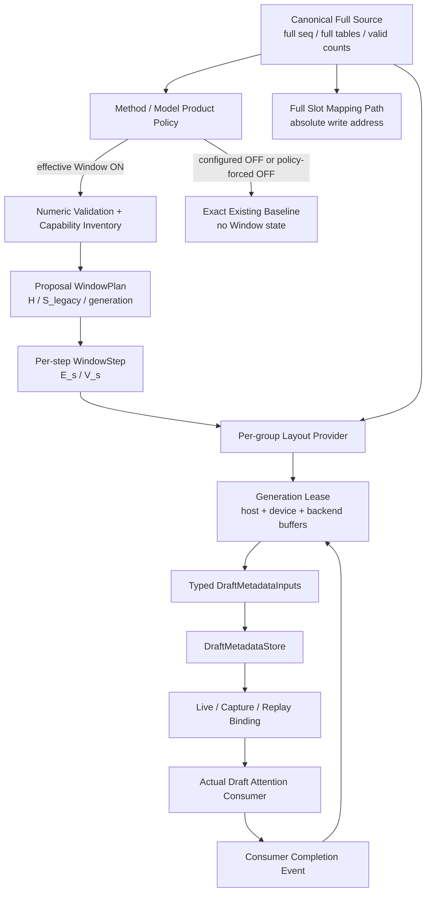
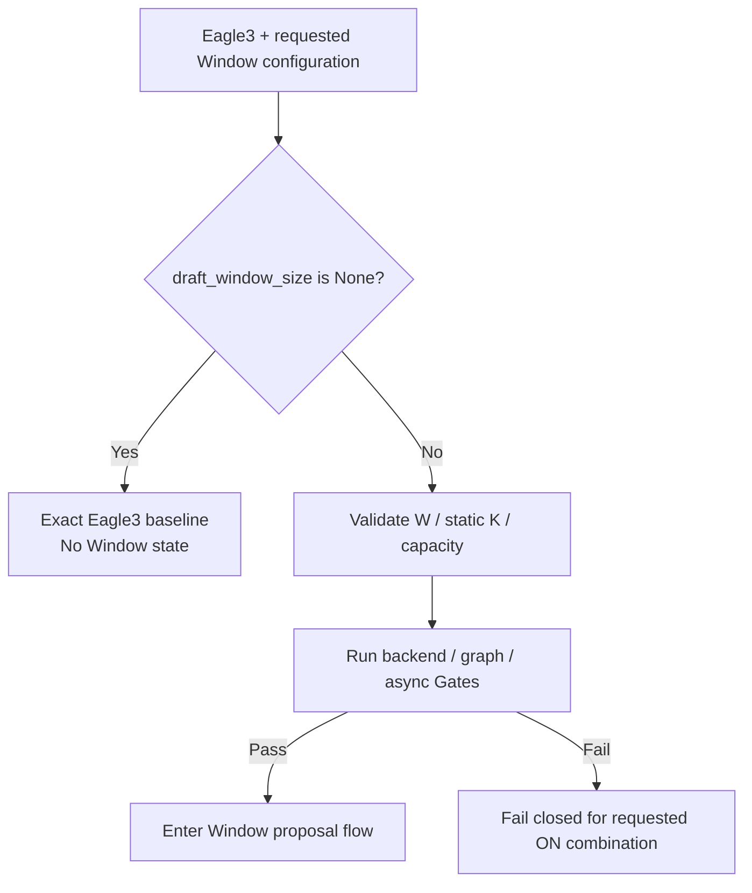
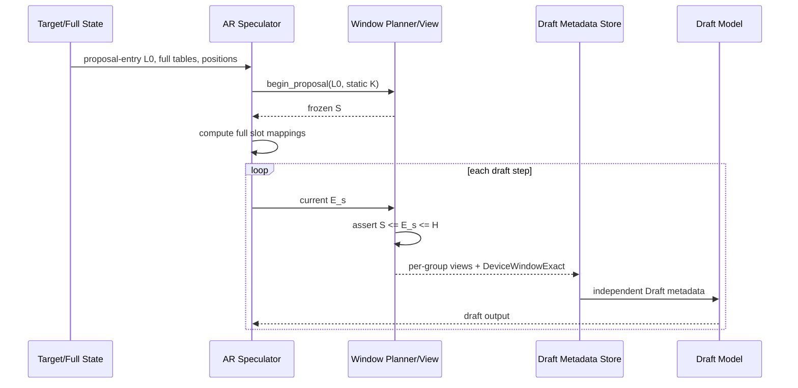
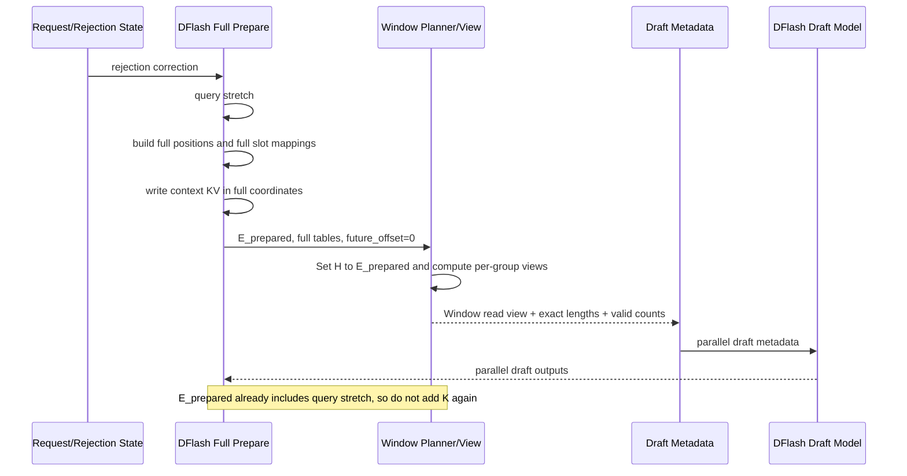
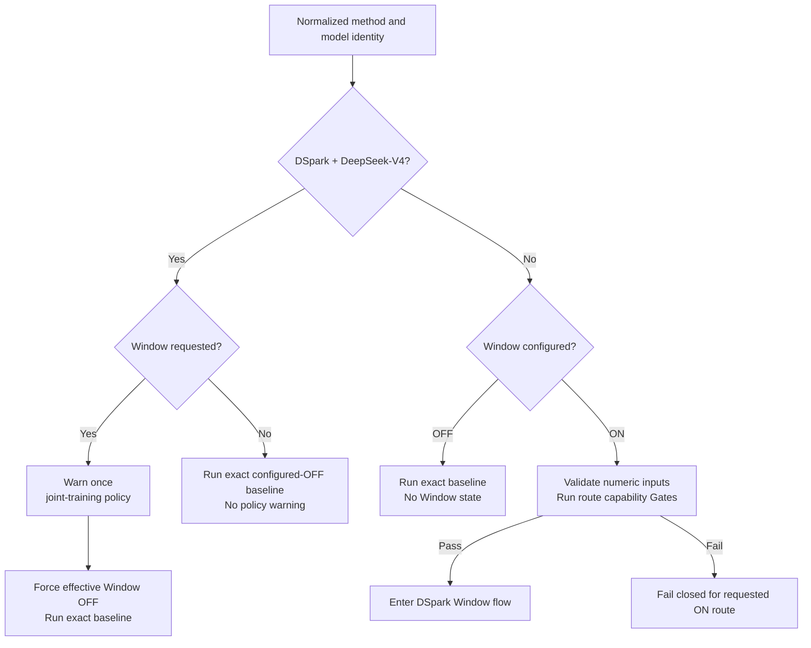
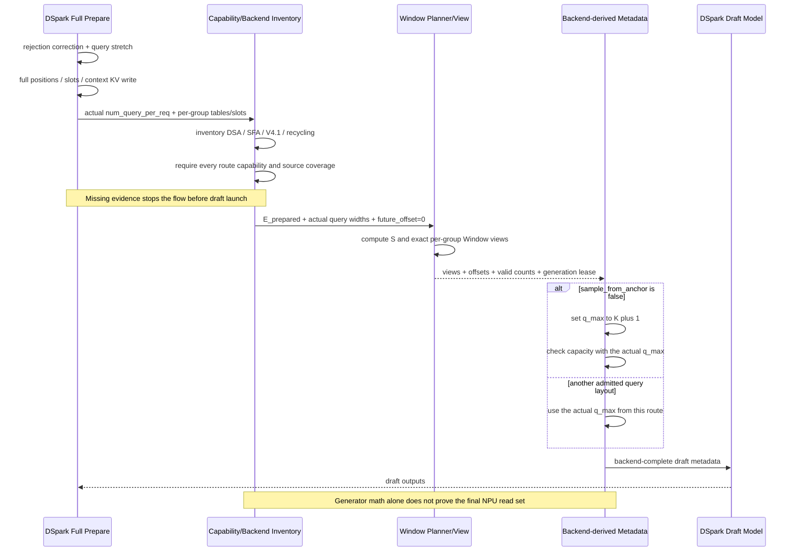
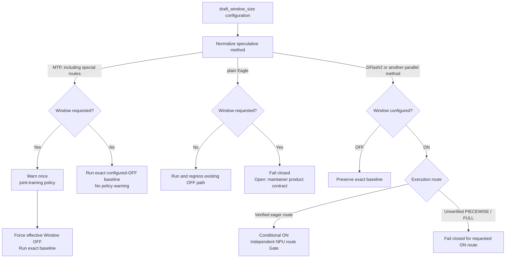
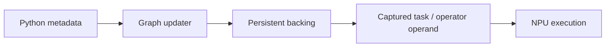
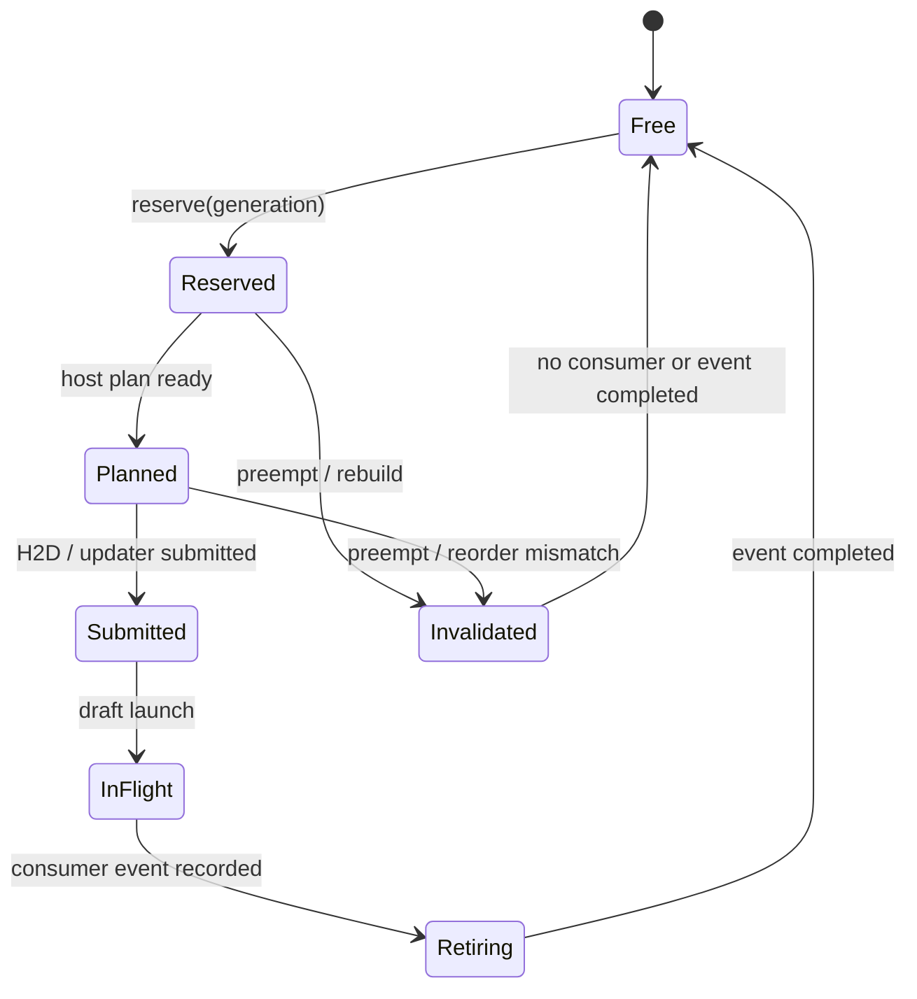

# MRV2 Speculative Draft Sliding Window

> 对应正式设计：`MRV2_Speculative_Draft_Sliding_Window_Final_Design.md`  
> 文档日期：2026-10-09  
> 适用代码：`/Users/wenqingzhang/Desktop/vllm/{vllm,vllm-ascend}` 当前 checkout  
> Architecture Freeze：**CONDITIONAL**  
> Required Delivery Coverage：**NOT YET ESTABLISHED**

这份文档和正式 Final Design 的技术结论、状态、支持边界完全等价。区别只是：

- 正式版偏“规范、审计、追踪”；
- 本版偏“讲清楚为什么这样设计、代码准备落在哪里、怎样验证”；
- 本版增加了 MRV2 实际编码风格、代码组织与 Review 注意事项；
- 本版没有把任何 Conditional 或 Open 项改写成已支持。

如果两份文档未来同时维护，架构状态、Gate 和 Delivery Matrix 必须同步更新。

---

## 1. 先讲结论：这次到底要做什么

我们不是把 MRV1 的 `SlidingWindowAdapter` 原样搬到 MRV2。

MRV2 中没有一个安全的、可在所有 method/Graph/backend 下统一原地修改的 `common_attn_metadata`。因此最终方案是：

> **保持 Target 和所有 canonical full state 不变，由 Speculator 单独拥有一套 Draft read view。**

唯一主链：

```text
Canonical Full State
    -> Method/Model Product Policy
    -> effective Window ON: Window Plan
    -> Draft-only Persistent Read View
    -> Backend-specific Metadata / Graph Binding
    -> Draft Forward
```

一句话解释每一层：

1. **Canonical Full State**：完整长度、完整 block table、绝对 positions 和物理 slot mapping。-原始
2. **Method/Model Product Policy**：先决定baseline、显式forced OFF或effective Window ON。-分流
3. **Window Plan**：只为effective ON计算“Draft 这次从哪个绝对 token 开始看”。-计算
4. **Draft-only Read View**：把完整 table 投影为每个 KV group 的窄读取视图。-投图
5. **Backend Metadata**：GQA、MLA、DSA、SFA 各自把这个视图变成算子真正消费的数据。-包装
6. **Draft Forward**：只有effective ON的Draft attention读取窗口；Target始终读取完整上下文。-应用

### 1.1 最终不变式

```text
Target read                    = full
Draft read                     = windowed
positions / query layout       = full and absolute
KV write / slot_mapping        = full and absolute
canonical block tables         = full and immutable to Window
Draft metadata when Window ON  = independent from Target metadata
```

### 1.2 本设计当前允许什么

- 可以进入 Week3 公共基础设施实现；
- 可以把 single-group dense GQA serialized eager 作为首个实现候选；
- 配置 OFF、MTP 强制 OFF、DeepSeek-V4 + DSpark 强制 OFF 的基线行为已经定义清楚；
- Eagle3 严格跟随 Window 配置；其他并行 speculative 组合按配置开关并继续受 backend/Graph Gate 约束；
- Graph、Async、MLA、DSA、SFA、V4.1、recycling、异构 multi-group 都必须过各自 Gate 后才能打开。

### 1.3 本设计当前不能声称什么

- 不能声称任何 Window ON NPU 组合已经测试通过；
- 不能声称 FULL/PIECEWISE 已经安全；
- 不能声称本次真实 Required Delivery 已覆盖，因为 owner 尚未给出唯一验收组合；
- 不能把已有 Window OFF E2E 当成 Window ON 证据。

---

## 2. 为什么不能直接搬 MRV1 Adapter

### 2.1 MRV1 的思路

MRV1 在 attention metadata 已经形成后，直接把：

- `block_table_tensor` 换成窄表；
- `seq_lens` 换成窗口内长度；
- CPU length mirror 一并改成窗口值；
- `slot_mapping` 继续使用保存下来的 full table。

这在单 group、特定 backend、特定执行时序下能工作。

### 2.2 MRV2 的结构变化

MRV2 的 metadata 是从输入直接构造的：

```text
input_buffers.seq_lens
block_tables.input_block_tables
slot_mappings
    -> build_attn_metadata(...)
    -> per-group backend metadata
```

当前主要入口：

- `vllm/vllm/v1/worker/gpu/spec_decode/speculator.py`
- `vllm-ascend/vllm_ascend/worker/v2/attn_utils.py`
- `vllm-ascend/vllm_ascend/worker/v2/spec_decode/...`

MRV2 里直接改 shared input buffer 会产生三个问题：

1. Target、Draft、下一 step 可能共享 owner；
2. `slot_mapping` 必须从 full table 算，不能看到窄表；
3. Graph capture 可能已经绑定了另一个 storage 或 backend-owned buffer。

### 2.3 MRV1 自身也不是所有情况的 golden

当前 MRV1 DSpark multi-group 路径存在可复核的问题：

- 只创建一个 adapter 和一个 clone；
- block size 取第一个 draft attention layer；
- 每个 group 循环内对上一次已经 windowed 的 metadata 做 shallow copy；
- 后一个 group 可能覆盖前一个 group alias 的同一 clone；
- 异构 `span_g` 时，`S/B_legacy` 不是该 group 的正确列号。

所以最终兼容原则是：

> 迁移 MRV1 的 Feature Contract 和正确的绝对可见集合，不复制已识别的 legacy defect。

异构 multi-group 在 maintainer 明确批准“修 defect”前必须 fail closed。

---

## 3. Feature Contract：哪些行为绝对不能变

### 3.1 已公开的方法范围与产品策略

当前公开文档明确覆盖：

| Method / Model | Window Contract |
|---|---|
| Eagle3 | 严格跟随配置：OFF 走 baseline；ON 按既有 backend/Graph/Async Gates 开放 |
| DFlash | 按配置开关；ON 按既有 backend/Graph/Async Gates 开放 |
| DSpark + DeepSeek-V4 | 非`None`请求时warning once，然后由产品策略强制 Window OFF，走 exact baseline |
| DSpark + 其他模型 | 按配置开关；ON 按实际 query width 与 backend/Graph/Async Gates 开放 |
| MTP（含特殊分支） | 非`None`请求时warning once，然后由产品策略强制 Window OFF，走 exact baseline |
| plain Eagle | 代码可达，但没有公开 Window contract |
| DFlash2 / 其他并行 speculative | 按配置开关；ON 仍需对应 route Gate，DFlash2 当前仅有 eager 候选 |

这里必须区分三件事：

- **Feature Contract**：设计最终要解释的公开行为；
- **Implementation Readiness**：某个 backend/mode 现在能不能安全打开；
- **Required Delivery**：本次项目真实要验收的具体 model/backend/mode。

三者不能合成一张“支持/不支持”表。

### 3.2 Policy 必须先于数值验证和资源初始化

实现必须区分：

```text
requested_window = AscendConfig.draft_window_size
effective_window = product policy处理后的实际Window开关
```

统一顺序必须是：

```text
normalize method and model identity
    -> apply product forced-OFF policy
    -> if effective Window is OFF, return baseline
    -> validate W / K / capacity
    -> inventory backend and graph capabilities
    -> initialize plan / workspace / lease
```

因此 MTP 与 DeepSeek-V4 + DSpark 的强制 OFF 必须发生在 `W>0`、`W>=K`、dynamic-K、capacity 等任何 Window 数值验证之前，也必须发生在 plan、workspace、lease、DraftMetadataStore 等 Window 专用状态初始化之前。

### 3.3 Window OFF baseline

`draft_window_size=None` 表示用户配置 OFF。产品策略还可以把非 `None` 请求解析为显式的 `effective_window=None`：MTP，以及 DeepSeek-V4 + DSpark 都属于这种情况。

OFF 时必须：

- 不创建 Window plan；
- 不分配 Window workspace；
- 不改变当前 `build_draft_attn_metadata_factory` / wrapper；
- 不改变 AR 对 Target metadata 的现有过滤/复用；
- 不改变 Graph descriptor、capture 数量和 key；
- 不增加性能回归。

产品策略强制 OFF 不是错误，也不是 silent fallback：当用户请求了非 `None` Window 时必须 warning once，说明共同训练约束和 effective Window OFF；随后明确执行 baseline。用户本来就配置 OFF 时不需要额外 warning。

### 3.4 MTP：共同训练，强制 Window OFF

MTP 的处理顺序必须是：

```text
normalize method
    -> identify MTP
    -> if Window was not requested, return exact configured-OFF baseline
    -> otherwise warning once
    -> force effective Window OFF
    -> return exact baseline
```

MTP draft与主模型一起训练，产品策略不允许在 Draft attention 上单独施加该Window。不能先校验 `W`，也不能因为某个特殊 MTP 走了 Eagle speculator class 就误开启 Window。

### 3.5 Eagle3：严格跟随配置

- 配置 OFF：完整执行现有 Eagle3 baseline，不创建任何 Window 状态；
- 配置 ON：进入既有 static-K数学、backend、Graph、Async capability Gates；
- Gate 未通过时 fail closed，不能把 ON 偷偷改成 OFF；
- Eagle3 不继承 MTP 或 DeepSeek-V4 + DSpark 的强制 OFF 策略。

### 3.6 并行 speculative 策略

并行方法先按 normalized method 与模型身份做产品策略判断：

- DeepSeek-V4 + DSpark：共同训练，Window 请求触发 warning once，然后强制 OFF并执行baseline；
- 其他 DSpark 模型：严格按配置开关，ON 继续受actual query width、backend、Graph、Async Gates约束；
- DFlash、DFlash2及其他并行方法/模型：严格按配置开关，ON继续受各自route Gates约束。

不得根据“使用了DSA/SFA”“方法属于DSpark family”等backend特征扩大DeepSeek-V4 + DSpark例外；policy必须由normalized method和明确模型身份共同决定。当前checkout可集中复用target `hf_config.model_type.startswith("deepseek_v4")`这一精确predicate，但不得在planner/backend中散落`"deepseek" in model_name`之类模糊判断。

### 3.7 不允许改变的物理语义

Window 只能裁 Draft 读取集合，不能改变：

- Target full-context attention；
- 绝对 token position；
- query 数量和 query layout；
- scheduler/request 的 canonical length；
- KV cache 写入位置；
- block allocation 或 recycling policy。

---

## 4. 总体架构图



![[Pasted image 20261008183514.png]]
### 4.1 为什么 owner 放在 Speculator

Window 是 speculative method 的 Draft read policy，不是 Target model 的全局 cache policy。

因此：

- Speculator 拥有 plan、workspace、lease 和 Draft metadata store；
- Graph manager 拥有 descriptor、phase、step、lane，并向 Speculator 请求 capture binding；
- Backend provider 负责把公共 read view转换成算子自己的 metadata；
- Target model state 完全不知道 Window ON 的 mutable state。

### 4.2 不要求每个名词都是一个 class

最终设计中的 Policy、Planner、Provider、Lease 是职责边界。

实现时可以是：

- 少量 frozen dataclass；
- pure functions；
- 一个 per-group protocol；
- 一个集中 workspace owner。

不要为了“和架构图一一对应”制造大量只有一两个方法的 Python class。

---

## 5. 当前源码的接入地图

### 5.1 公共 metadata funnel

`vllm-ascend/vllm_ascend/worker/v2/attn_utils.py::build_attn_metadata()` 当前：

1. 接收一份 shared `seq_lens`；
2. 构造 CPU exact/upper；
3. 遍历 KV cache groups；
4. 每个 group 选择自己的 block table、slot mapping 和 builder。

这是 Window read inputs 最合适的公共漏斗。

### 5.2 upstream Speculator

`vllm/vllm/v1/worker/gpu/spec_decode/speculator.py::_build_attn_metadata()` 当前直接读取：

- `self.block_tables.input_block_tables`；
- `self.input_buffers.seq_lens`；
- full slot mappings；
- `target upper + step`。

因此需要一个 default-`None` 的可选 typed input，让 Window ON 只覆盖 Draft read fields。

### 5.3 AR/Eagle3 特殊点

当前非 FULL prefill会复用 Target metadata；FULL replay又会从 `model_state.attn_metadata` 过滤 Draft layer。

Window ON 时这两条路径都不安全：

- 直接复用会让 Draft 第一次 forward 根本没有窗口；
- 原地修改会污染 Target。

所以必须有独立的 `DraftMetadataStore`。

该独立store只在Eagle3配置ON且policy允许后创建。Eagle3配置OFF必须保留现有baseline；特殊MTP即使复用AR/Eagle class，也必须先由policy强制OFF并在到达这里之前返回。

### 5.4 DFlash / DSpark 特殊点

它们会先完成 full-coordinate 输入准备、query stretch、context KV write 和 slot mapping，然后再构建 Draft attention metadata。

但进入这些数据准备之前，必须先完成产品policy：DeepSeek-V4 + DSpark强制OFF并直接走baseline；只有其他按配置得到effective Window ON的并行组合，才执行下述Window插入时序。

正确插入位置是：

```text
full prepare + full slots
    -> Window plan/materialize
    -> draft metadata build
    -> draft forward
```

不能在 full slot mapping 之前裁 table。

---

## 6. 窗口数学：用一个例子讲清楚

### 6.1 Canonical 公式

定义：

- `W`：用户配置的 window size；
- `B`：MRV1 legacy alignment block size；
- `H`：一次 proposal 冻结的最右 horizon；
- `S`：proposal 内冻结的窗口起点；
- `E_s`：当前 step 的真实 full-coordinate end；
- `V_s`：当前 step 的窗口内精确长度。

```text
S   = floor(max(H-W, 0) / B) * B
V_s = E_s - S
```

必须始终成立：

```text
0 <= S <= E_s <= H
```

### 6.2 Eagle3

以下数学只在Eagle3配置ON时执行。配置OFF严格走现有baseline；配置ON但任一capability Gate未通过时fail closed，不能改成effective OFF。

静态 K 下：

```text
L0 = proposal 开始时、尚未扣本轮 rejection 的 device seq_len
H  = L0 + K
S  = proposal 开始时只算一次
```

后续 step 只更新 `E_s` 和 `V_s`，不能重算 `S`。

动态 K 当前有 legacy 冲突：adapter 在构造时捕获 configured K，而 proposal 会覆盖 scheduled K。没有产品决定和 golden 前，dynamic-K + Window 必须拒绝。

### 6.3 DFlash / eligible DSpark

以下公式只适用于按配置得到effective Window ON的并行组合。DeepSeek-V4 + DSpark已在产品policy阶段强制OFF，不进入该数学。其余DFlash/DSpark的prepare已把query stretch写入 `seq_lens`：

```text
H = E_prepared
future_offset = 0
```

如果再加 K，会把 horizon 重复右移。

### 6.4 数值例子

```text
L0 = 300
K  = 4
W  = 128
B  = 64

H = 304
S = floor((304-128)/64)*64
  = floor(176/64)*64
  = 128
```

如果某个 step 的真实 `E_s=298`：

```text
V_s = 298-128 = 170
Draft 可见绝对区间 = [128, 298)
```

Target 仍然读取 `[0,298)`，Draft KV write 仍写到绝对位置 297 对应的物理 slot。

### 6.5 为什么不能用 LCM 对齐

```text
L=300, W=128, B_legacy=64, group_span=48

legacy S = 128
lcm(64,48)=192
lcm S = 0
```

LCM 方案让 Draft 多读 128 个 token，已经改变 Feature Contract。

最终规则：先算唯一的 absolute `S_legacy`；每个 group 再判断自己能不能表达它。

### 6.6 `W >= K` 不能讲错

- 对某一个固定 `L`：`W>=K` 充分，但不一定必要；
- 对所有可能的 `L`/block residue：`W>=K` 才是必要且充分的统一保证；
- 即使 `W>=K`，rejection 后仍要逐 step 检查 `S<=E_s`。

因此配置 policy 和 runtime invariant 是两层不同的保护。

### 6.7 容量

proposal 全生命周期：

```text
V_capacity = W + B - 1
```

zero-offset、uniform span 的 group：

```text
C_g >= ceil((W+B-1) / span_g)
```

一般offset-aware provider必须把最坏首块offset算进去：

```text
C_g >= max_r ceil((o_max_g[r] + W+B-1) / span_g)
```

不能化简成 `ceil(W/B)`。例如 `W=64,B=64` 时需要 2 列，不是 1 列。

---

## 7. Per-group Layout：共享绝对语义，不共享错误列映射

### 7.1 Direct-prefix provider

对 group `g`：

```text
start_col_g = floor(S / span_g)
offset_g    = S - start_col_g * span_g
needed_g    = ceil((offset_g + V_s) / span_g)
```

必须检查：

```text
needed_g <= capacity_g
start_col_g + needed_g <= source_row_width_g
start_col_g + needed_g <= valid_num_blocks_g
```

### 7.2 first-token offset

如果 `offset_g != 0`，只把 `start_col_g` 之后的 block复制出来还不够。

必须证明最终 operator 知道第一个 block 从 `offset_g` 开始读。否则只能：

- 要求 `S % span_g == 0`；
- 使用 absolute-indexed/backend-derived表达；
- 或 fail closed。

### 7.3 valid block count

`BlockTables` 的 active row tail 可能是旧值，只有 `[0, valid_num_blocks)` 是真实来源。

所以：

> source coverage 不足时必须报错；把缺失列写成 0 或 inert 只能防 OOB，不能证明读集合正确。

### 7.4 每个 group 必须提供什么

| Capability | 问题 |
|---|---|
| Layout | `S` 如何映射到列？是否有offset？ |
| Source | `[S,E)` 所需block是否真实存在？ |
| Native visibility | backend自己的mask/top-k/SWA如何求交？ |
| Resident set | 物理KV是否仍驻留？ |
| Length | exact/upper最终被谁消费？ |
| Padding | tail/padded row的inert合同是什么？ |
| Graph | actual operand是captured、rebound还是derived？ |
| Lifetime | backend自有buffer何时才能复用？ |

---

## 8. Typed Length：不要再把所有长度都叫 seq_lens

| Type | 含义 |
|---|---|
| `DeviceFullExact` | 当前真实 full-coordinate end `E_s` |
| `DeviceWindowExact` | `E_s-S`，Draft read canonical length |
| `CpuWindowExact` | 同一 exact 值的 CPU producer；没有就明确 absent |
| `LegacyCpuMirror` | `_seq_lens_cpu`；必须为 None 或 Window exact |
| `CpuWindowUpper` | planning/tiling upper，不一定能用于实际读取 |
| `CaptureCapacity` | backing 的最大shape，不是当前read length |
| `BackendEffectiveMax` | backend经过证明的最终max field |

### 8.1 为什么必须类型化

最危险的错误是：

```text
narrow block table + full length
```

它通常不会立刻报错，而是读取窄表尾部的0/stale block id，造成静默错误。

### 8.2 CPU upper

`U` 必须是 apply-time upper，已经包含：

- AR 当前 step；
- DFlash 的 query stretch；
- policy允许Window ON的DSpark实际 `K` 或 `K+1` query width。

统一推导：

```text
raw_upper = max(U-S, DeviceWindowExact)
safe_cap  = min(all group safe materialized extents)
CpuWindowUpper = min(raw_upper, safe_cap)
```

如果某 backend 把 upper 当真实 read length，它就必须获得 exact，不能继续用 planning upper。

---

## 9. Method-specific 数据流

### 9.1 Eagle3 / AR

Eagle3先严格执行配置开关，只有effective Window ON且Gate通过才进入后面的Window序列：





关键点：

- first-pass Window ON 必须重建 Draft metadata；
- 每 step view从 immutable full source刷新，不能对上一步窄表再裁；
- MRV1 future-column 缺列是已识别 defect，MRV2 不能复制；
- FULL merged graph要有每 step独立的device-visible length。

### 9.2 DFlash

DFlash属于按配置开关的并行方法。配置OFF直接执行baseline；配置ON且route Gates通过后才进入以下序列，Gate失败时拒绝该ON组合而不是强制OFF。



```text
rejection correction
-> query stretch
-> full positions / full slots / context KV write
-> Window plan with future_offset=0
-> draft metadata
-> parallel draft forward
```

### 9.3 DSpark

DSpark必须先执行产品policy，再决定是否进入“先full prepare，再Window read view”的时序：



DeepSeek-V4 + DSpark是共同训练组合。其forced OFF路径在任何Window数值验证、backend inventory和workspace初始化前结束；这不是错误或silent fallback。其他DSpark模型配置ON时，必须先拿到：

- 实际 `num_query_per_req`；
- per-group table和slot；
- DSA/SFA/V4.1/recycling inventory。



对policy允许Window ON的DSpark，`sample_from_anchor=False` 时query width是`K+1`；当前部分DSA buffer只按`W+K`规划，修复前对应ON组合拒绝。DeepSeek-V4 + DSpark forced OFF不进入该容量检查。

### 9.4 MTP / plain Eagle / DFlash2



- MTP：Window请求时warning once，然后显式强制OFF；
- plain Eagle：OFF回归，ON等maintainer产品决定；
- DFlash2与其他并行方法/模型：按配置开关；ON可复用已证明的公共语义，但不自动获得backend或Graph支持。

---

## 10. Native SWA、DSA、SFA、Recycling 怎么组合

唯一正确的抽象是集合交：

```text
V_final(q) = V_draft(q) ∩ V_native(q) ∩ V_resident(q)
```

不能一般化为：

```text
effective_window = min(W, retention)
```

原因：

- native window可能只是计算mask，物理KV并未回收；
- recycling可能临时保留额外in-flight blocks；
- R-SWA可能保留prefix+tail，中间有gap；
- DSA/SFA还可能通过explicit indices/top-k表达可见集合。

### 10.1 DSA-v1

`build_dspark_swa_indices()` 的局部数学可以静态证明，但最终NPU op还同时消费：

- block table；
- seq lengths；
- native band；
- explicit indices；
- SAS；
- compressor/QLI metadata。

所以“generator正确”不等于“DSA operator正确”。

### 10.2 DeepSeek-V4.1

V4.1 使用 logical indices、`ori_topk_length`、SMLA/QLI derived state，是独立 capability，不能直接继承DSA-v1结论。

产品policy优先于backend capability：如果normalized组合是DeepSeek-V4 + DSpark，effective Window已被强制OFF，不得为了“已有V4.1 Gate”而继续初始化这些Window能力。V4.1相关Gate只服务于未来明确允许Window ON的其他组合或policy变更，不能反向覆盖当前forced-OFF决定。

### 10.3 SFA

SFA top-k基于absolute positions，builder还会复制到backend-owned persistent buffers。

Window支持必须补齐：

- per-token window-visible count；
- logical index filter/translation；
- absolute positions保持不变；
- main/indexer groups一致；
- backend buffers加入generation lease。

在接口和operator oracle完成前，SFA Window ON是Open / Blocker。

---

## 11. Graph Capture / Replay：地址稳定只是起点

### 11.1 必须覆盖三个入口

只有产品policy得到effective Window ON时才进入Window Graph路径。MTP和DeepSeek-V4 + DSpark强制OFF时继续使用现有baseline Graph，不创建Window capture binding、persistent Window operand或Draft Window metadata store。

Window ON不能只改live proposal。三个入口必须共用同一份typed contract：

1. **Capture-time dummy metadata**：capture时创建固定shape、固定dtype、固定stride的占位operands；
2. **Live proposal metadata**：eager或第一次执行时按当前batch生成Window plan；
3. **Replay-time rebuild / update**：replay前把本代数据写入capture绑定的persistent storage。

如果只改第2项，Python日志可能看起来正确，但Graph仍可能读取capture时的full table或旧buffer。

### 11.2 Capture Binding由谁拥有

Capture Binding由**具体Graph manager / updater实例**拥有，不由module-global变量拥有。它记录的不是一个抽象“table存在”，而是实际consumer绑定信息：

```text
CaptureBinding
  - backend / method / graph mode
  - group id and operand name
  - data_ptr
  - shape / stride / dtype
  - storage_offset
  - capacity
  - capture generation
  - actual operator/task consumer
```

Window数据在replay前只允许复制到该绑定的backing storage；不得用新Tensor替换捕获对象。

### 11.3 为什么不能只看Python metadata

Graph真正捕获的是operator/task的输入地址和更新路径。必须沿真实链路证明：



因此，以下证据都不能单独关闭Graph Gate：

- metadata字段值正确；
- replay前Python对象已替换；
- `data_ptr`只检查一次；
- eager输出正确；
- capture成功但未做跨代污染测试。

### 11.4 当前route的分别处理

| Route | Window ON策略 | 开放条件 |
|---|---|---|
| GQA updater | 使用instance-scoped typed hook写入persistent table/lengths | actual operand trace + A/B/A |
| MLA updater | 独立审计，不能由GQA结果推导 | MLA actual operand trace + oracle |
| DSA/SFA no-op updater | 当前不能假设“无需更新” | 证明task从何处取得indices/lengths及其生命周期 |
| AR merged graph | 每一步的device length必须从该代lease更新 | multi-step replay trace + per-step oracle |
| DFlash graph | 独立Graph manager与query shape，单独capture/replay | DFlash专属A/B/A |
| DFlash2 graph | 当前禁止 | 明确graph route、capture owner和验证结果 |

### 11.5 `enable_enpu`顺序

必须记录两种路径的实际顺序：

```text
copy/update Window operands
-> task update（如有）
-> replay/launch
-> consumer event record
```

若`enable_enpu`改变task update与replay的先后，必须分别验证，不能把一个分支的结果外推到另一个分支。

### 11.6 Graph的最小Runtime Gate

每个method/backend/graph mode至少执行：

1. capture时打印并保存operand fingerprint；
2. replay前后检查`data_ptr/shape/stride/dtype/storage_offset`；
3. A/B/A三代使用不同窗口和不同batch排列；
4. A2必须复现A1，且不能残留B的数据；
5. eager Window oracle与graph结果逐token比较；
6. 检查实际operator/task绑定，而不止metadata builder；
7. `enable_enpu`开关分别跑；
8. capacity越界必须在launch前fail closed。

在这些证据存在前，PIECEWISE和FULL均保持Conditional，不得默认启用。

上述A/B/A Gate不适用于policy-forced OFF组合的Window route，因为该route根本不应被构造；它们需要的是baseline Graph identity、warning once和“零Window资源初始化”回归测试。

---

## 12. Async与Buffer Lifetime：复用的是lease，不是“一个固定地址”

### 12.1 四种生命周期必须分开描述

| 对象 | 生命周期 | 释放条件 |
|---|---|---|
| Host plan ring | CPU生成到H2D提交完成；异步copy时还要等copy consumer | 对应copy event完成 |
| Device execution lane | 本代Window operands被draft kernel消费期间 | consumer completion event完成 |
| Workspace lease | 覆盖本代所有共享/派生buffer | 最后一个consumer完成 |
| Backend-owned derived buffer | DSA/SFA/QLI/SAS等实际operator消费期间 | 同一generation lease退休 |

`device_slots == max_concurrent_batches`没有源码保证，不能作为容量公式。lane数由实测并发与event回收机制决定。

### 12.2 Lease状态机



### 12.3 Generation identity

每次proposal必须带逻辑代标识，而不是依赖row或指针身份：

```text
(request identity, sequence generation, proposal step,
 batch mapping version, lease id)
```

下列事件都必须使旧plan不可复用，或重新验证映射：

- preemption / resume；
- batch reorder / compaction；
- same-step row reuse；
- request完成后row被新request占用；
- valid block counts变化；
- graph capacity bucket变化。

### 12.4 Week3和Week4的边界

- Week3可以先做**serialized eager lane**，同一时刻只允许一个Window generation在flight；
- MTP和DeepSeek-V4 + DSpark forced OFF不得reserve Window lease；即使配置给出非`None`数值，也必须在lane/workspace初始化前返回baseline；
- async scheduling、多个device lanes、SP/CP/Flashcomm属于Week4；
- Week3代码仍应使用lease API，而不是写死单buffer假设，否则Week4会被迫重写ownership。

---

## 13. 兼容性和Fail-closed策略

### 13.1 总规则

| 情况 | 行为 |
|---|---|
| `draft_window_size is None` | 配置OFF：baseline exact，不warning，不创建Window副作用 |
| normalized method为MTP且请求Window | warning once；产品策略强制effective Window OFF；在数值验证和资源初始化前走baseline |
| DeepSeek-V4 + DSpark且请求Window | warning once；共同训练产品策略强制effective Window OFF；在数值验证和资源初始化前走baseline |
| Eagle3配置ON | 严格进入Window数学与既有capability Gates；未过Gate时fail closed |
| 其他并行method/model配置ON | 严格进入各自Window route与backend/Graph Gates；未过Gate时fail closed |
| Window ON且capability已通过 | 使用draft-only Window read view |
| Window ON但capability未知/不支持 | launch前报可操作错误，不能silent fallback |
| Window ON遇到capacity越界 | launch前fail closed |
| Window ON遇到dynamic-K或缺失layout | fail closed |
| Graph Gate未通过 | 可允许已验证eager组合；拒绝该graph mode |
| Async Gate未通过 | 可允许serialized eager；拒绝async |

禁止两种“看似兼容”的行为：

1. Window ON时偷偷退化成full context；
2. Window ON时只改某些group，让其他group继续读full table。

前者破坏Feature语义，后者制造跨层不一致。

这里的silent fallback专指“policy允许Window ON、用户请求ON，却因capability不足偷偷改跑full context”。MTP和DeepSeek-V4 + DSpark是已经冻结、会warning once的显式产品policy；它们的forced OFF不是错误，也不是silent fallback，不能进入通用Window fail-closed分支。

Policy优先级是Frozen语义：

```text
forced-OFF product policy
    > Window numeric validation
    > backend / graph capability Gate
    > workspace and lease initialization
```

### 13.2 错误必须可定位

错误信息至少包含：

```text
normalized method, attention backend, global group id,
graph mode, parallel mode, requested W/K/capacity,
failed capability or gate name
```

这样用户能判断是配置问题、容量问题，还是尚未开放的组合。

forced-OFF warning至少应包含normalized method、模型身份、共同训练原因、requested Window值和`effective Window OFF`，但不得使用“unsupported”“invalid”或“fallback failed”等错误措辞。

---

## 14. MRV2写代码时的风格与工程注意事项

这一节不是额外架构，而是把本设计落到MRV2代码时必须遵守的实现纪律。原则来源于当前vLLM与vLLM-Ascend仓库约定，以及本Feature对Graph/Async特别敏感的事实。

### 14.1 依赖显式传递，不新增可变全局状态

推荐：

```python
def build_draft_metadata(
    full_state: FullDraftState,
    window_inputs: DraftWindowInputs | None,
) -> DraftMetadata:
    if window_inputs is None:
        return build_full_metadata(full_state)
    return build_window_metadata(full_state, window_inputs)
```

不推荐：

```python
CURRENT_WINDOW_TABLE = None

def build_draft_metadata(full_state):
    # 隐式读取module-global，capture实例和并发请求会互相污染。
    ...
```

要求：

- Window hook是typed、optional、instance-scoped；
- `None`必须严格走baseline；
- 不新增module-global mutable Tensor、全局monkeypatch或“最近一次plan”缓存；
- 构造函数注入owner和capability，函数参数传递每代状态。

### 14.2 用小型数据结构表达契约，不为名词堆类

可以用`dataclass(frozen=True)`承载不可变plan和binding描述；只有确实拥有资源、事件或状态机的对象才需要独立class。

```python
@dataclass(frozen=True)
class WindowPlan:
    window_start: int
    exact_tokens: int
    valid_num_blocks: tuple[int, ...]
    generation_id: int
```

避免把Policy、Planner、Layout、Workspace每个名词都机械地做成一层wrapper。判断标准是：是否有清晰的owner、可独立测试的边界或不同生命周期。

### 14.3 名称必须区分exact、upper和capacity

推荐命名：

- `window_exact_tokens`；
- `required_span_tokens`；
- `cpu_upper_bound_tokens`；
- `allocated_capacity_tokens`；
- `valid_num_blocks`；
- `global_group_id`。

避免`length2`、`real_len`、`max_len`这类量词不清的名字。`max_len`尤其容易把数学上界与已分配容量混为一谈。

### 14.4 不修改Canonical Full State

- full block tables、full slot mapping、target metadata都视为只读source；
- Window plan写入独立workspace；
- 只有当前lease独占的buffer才允许in-place更新；
- 不允许为了省一次copy就原地裁剪共享block table；
- Target forward不得观察到Window专用长度或table。

### 14.5 NPU hot path禁止隐式同步和临时分配

特别检查：

- 避免NPU Tensor上的`.item()`；
- 避免hot path里的`.cpu()`、`.numpy()`和同步D2H；
- 避免每步创建形状变化的Tensor、Python标量驱动的device sync；
- capture route的operands在capture前预分配，replay只更新内容；
- 避免用`torch.cat`拼接捕获operand；需要拼接时写入预分配slice；
- 优先batch/vectorized计算request rows；group数量静态且很小时，清晰的per-group Python循环可以接受；
- in-place操作必须确认storage由当前lease独占且无alias consumer。

### 14.6 Graph代码先写fingerprint和断言

Graph相关代码必须把以下字段集中成一个可审计fingerprint：

```text
data_ptr, shape, stride, dtype, storage_offset, capacity
```

capture与replay路径不能各自手写一套不同的shape逻辑。capacity检查、有效长度写入、尾部清理策略必须由同一个binding owner维护。

### 14.7 Async代码以generation/event为真值

- 不能用“row没变”推导request没变；
- 不能用“地址没变”推导buffer未被覆盖；
- 不能在launch之后立刻把lane放回free list；
- backend-owned derived buffers必须登记在同一lease；
- cancellation/preemption路径也必须完成event或安全invalidate。

### 14.8 Import、注释、docstring和格式

- import放文件顶部；只有循环依赖、可选依赖或明确的lazy-load理由才允许局部import，并写明原因；
- 类型专用import使用`TYPE_CHECKING`；
- 行宽遵守88字符；
- public API使用Google风格docstring；
- 注释解释“为什么必须这样”，不要翻译代码本身；
- 避免magic number，尤其是`K+1`、block size、capacity bucket；
- 命名使用仓库现有术语，不在同一数据流中混用`window_len/context_len/visible_len`表示不同含义。

### 14.9 配置和方法名只保留一个真值来源

- 复用`AscendConfig.draft_window_size`；
- 先走既有normalized method和明确模型身份逻辑，再做产品policy；
- 产品policy必须先处理MTP、DeepSeek-V4 + DSpark forced OFF，再做任何Window数值校验或capability判断；
- Eagle3严格跟随配置；其他并行method/model除明确forced-OFF组合外也严格跟随配置；
- 不新增同义环境变量或第二个Window配置；
- eager/PIECEWISE/FULL、async、SP/CP等能力通过capability判断，不靠散落的`if`猜测；
- Window OFF分支不能因为初始化Window对象而改变内存、Graph签名或日志行为。

### 14.10 测试与提交纪律

- 先写contract/oracle，再写backend实现；
- 优先扩展已有相邻测试，保持测试最小且确定；
- 数学和planner逻辑做CPU UT；
- Graph、DSA/SFA、async正确性必须在NPU上验证；
- 未执行的NPU测试只能写“待验证”，不能写“通过”；
- vLLM仓库命令使用项目的`uv`或`.venv`，不要使用系统`python3`或裸`pip`；
- vLLM-Ascend提交前运行其格式/静态检查与相关UT，并补真实NPU路径；
- 若分别向upstream与plugin提交，先检查是否已有重复PR，并按仓库要求签署commit、披露AI辅助。

### 14.11 Code review时优先找这十类问题

1. full source被原地改写；
2. `None`路径不再等价baseline；
3. local group index误当global gid；
4. exact、upper、capacity混用；
5. 尾块offset被丢掉；
6. 未传`valid_num_blocks`却让padded blocks可见；
7. Graph只更新Python对象，未更新实际operand；
8. async lane在consumer event前复用；
9. NPU hot path出现`.item()`或同步D2H；
10. 未通过Gate的组合被默认开放或silent fallback。

---

## 15. 建议的最小API形态

下面的名字是实现草图，不要求逐字采用；语义边界是Frozen/Conditional决策的一部分。

```python
@dataclass(frozen=True)
class DraftWindowPolicyDecision:
    effective_window_size: int | None
    forced_off_reason: str | None
    warn_once: bool


@dataclass(frozen=True)
class DraftWindowRequest:
    method: str
    window_size: int
    proposal_horizon: int
    query_widths: tuple[int, ...]
    generation_id: int


@dataclass(frozen=True)
class DraftWindowPlan:
    starts: Tensor
    exact_lengths: Tensor
    per_group_block_tables: tuple[Tensor, ...]
    per_group_slot_mapping: tuple[Tensor, ...]
    per_group_valid_num_blocks: tuple[Tensor, ...]


class DraftWindowWorkspace:
    def reserve(self, generation_id: int) -> DraftWindowLease: ...
    def retire(self, lease: DraftWindowLease, event: Event) -> None: ...


def build_draft_metadata(
    full_state: FullDraftState,
    window_plan: DraftWindowPlan | None,
    layout: DraftLayoutProvider,
) -> DraftMetadata: ...
```

调用顺序必须类似：

```python
decision = resolve_draft_window_policy(
    normalized_method=normalized_method,
    model_identity=model_identity,
    requested_window_size=ascend_config.draft_window_size,
)
if decision.effective_window_size is None:
    if decision.warn_once:
        logger.warning_once(decision.forced_off_reason)
    return run_existing_baseline()

validate_window_numbers(decision.effective_window_size, proposal_shape)
check_window_capabilities(runtime_inventory)
lease = window_workspace.reserve(generation_id)
```

`resolve_draft_window_policy()`不得分配Tensor、读取NPU状态或触发Graph capture。MTP和DeepSeek-V4 + DSpark必须从上面的baseline分支返回；只有effective ON才能构造`DraftWindowRequest`和reserve lease。

API边界的五个检查点：

1. `DraftWindowPolicyDecision`在任何数值验证和资源初始化前产生；
2. `DraftWindowRequest`只为effective ON构造，且不持有backend buffer；
3. `Plan`描述可见域，不修改canonical full source；
4. `Workspace/Lease`拥有可变buffer和event；
5. `build_draft_metadata(..., None, ...)`等价旧路径。

对实际代码，应尽量复用已有MRV2类型和builder；若一个现有结构增加2—3个字段即可表达契约，不需要为了匹配图中的名词创建同名class。

---

## 16. 逐文件落地地图

| 路径 | 当前角色 | 预计改动 | 不应承担的职责 |
|---|---|---|---|
| `vllm-ascend/vllm_ascend/ascend_config.py` | `draft_window_size`配置 | 保持requested值的单一入口；数值校验不得抢在method/model policy前执行 | backend table构造或forced-OFF workspace |
| `vllm-ascend/vllm_ascend/worker/v2/attn_utils.py` | vLLM metadata bridge/patch | 增加optional typed Window inputs；`None`保持baseline | 保存全局Window状态 |
| `vllm/vllm/v1/worker/gpu/spec_decode/speculator.py` | 通用speculator、Eagle3 proposal | 接受显式draft-only hook/inputs（若upstream同意） | Ascend backend数学 |
| `vllm-ascend/vllm_ascend/worker/v2/spec_decode/autoregressive/speculator.py` | AR集成与独立metadata store | MTP先forced OFF；Eagle3严格按配置；effective ON后才调用plan和lease | 修改Target full state或为MTP初始化Window状态 |
| `vllm-ascend/vllm_ascend/worker/v2/spec_decode/dflash/speculator.py` | DFlash proposal | 按配置开关；effective ON时在full prepare后、draft forward前构造Window view | 复用未验证Graph结果 |
| `vllm-ascend/vllm_ascend/worker/v2/spec_decode/dspark/speculator.py` | DSpark proposal | DeepSeek-V4组合先warning once并forced OFF；其他模型按配置并传actual query widths | forced OFF后继续校验W或初始化workspace；用固定K掩盖`K+1` |
| `vllm-ascend/vllm_ascend/worker/v2/spec_decode/autoregressive/aclgraph.py` | AR Graph capture/replay | instance-scoped binding、persistent backing、A/B/A trace | module-global hook |
| `vllm-ascend/vllm_ascend/worker/v2/spec_decode/dflash/aclgraph.py` | DFlash Graph | 独立binding与shape验证 | 自动代表DFlash2 |
| `vllm-ascend/vllm_ascend/attention/dsa_v1.py` | DSA indices和operator metadata | generator oracle、operator Gate、derived buffer lease | 仅凭indices UT宣称端到端正确 |
| `vllm-ascend/vllm_ascend/attention/dsa_v41.py` | V4.1/SMLA/QLI | 独立capability与`K+1`审计 | 继承DSA-v1能力 |
| `vllm-ascend/vllm_ascend/attention/sfa_v1.py` | SFA top-k/positions | 先补接口和oracle，再开放 | 在接口未定时silent enable |
| 新增相邻UT/E2E文件 | 证明contract和route | CPU oracle + NPU gate cases | 把mock通过写成NPU通过 |

若upstream不接受通用speculator hook，eager plugin-local路径可以继续推进；需要该hook的Graph route保持Open，而不是回退到mutable global patch。

---

## 17. 实施顺序：先建立安全边界，再扩大组合

### Phase 0：基线与manifest

- 锁定源码commit/dirty state；
- owner确认Mandatory模型、method、backend、group、graph、parallel组合；
- 固定Window OFF golden；
- 固定MTP与DeepSeek-V4 + DSpark“请求ON但policy强制OFF”的warning/baseline/零Window资源golden；
- 固定Eagle3与其他并行组合严格跟随配置的policy manifest；
- 建立CPU reference oracle。

### Phase 1：纯数学与planner

- normalized method + model product policy，先产出effective Window；
- forced-OFF短路测试，证明发生在数值校验和workspace初始化前；
- `K`/query width输入；
- `S`、exact visible lengths；
- per-group trim、offset、valid count；
- capacity preflight和错误上下文。

### Phase 2：Week3最小eager read plane

- 单group dense GQA；
- serialized eager lease；
- Eagle3、DFlash、policy允许ON的DSpark按各自时序接入；
- MTP与DeepSeek-V4 + DSpark只接显式forced-OFF baseline/warning路径，不接Window planner；
- independent Draft metadata store；
- 配置OFF与policy-forced OFF逐项对比。

这一步可以进入实现，但只有owner确认其覆盖Mandatory manifest后，才能称为“Required Delivery完成”。

### Phase 3：多group与MLA

- 完成真实layout inventory；
- 同质多group可直接按per-group plan；
- 异质组若无端到端证据，保持Conditional；
- MLA单独operator oracle。

### Phase 4：Graph

- capture dummy、live、replay三入口统一；
- actual operand fingerprint；
- A/B/A和`enable_enpu`双路径；
- 分别开放PIECEWISE与FULL。
- 对forced-OFF组合只验证现有baseline Graph identity和零Window binding，不执行Window A/B/A。

### Phase 5：Week4 backend/parallel/async

- DSA-v1、V4.1、SFA、recycling逐项过Gate；
- Flashcomm、SP、CP、DSA-CP；
- multi-lane async、preemption/resume；
- 性能与内存回归。

---

## 18. 验证设计

### 18.1 Policy-first contract

必须先用CPU/spy测试证明policy顺序：

- MTP配置非`None` Window时只warning once，effective Window为OFF，输出/metadata/Graph path等同配置OFF；
- DeepSeek-V4 + DSpark配置非`None` Window时只warning once，effective Window为OFF，输出/metadata/Graph path等同配置OFF；
- 上述两类用`0`、负数、`W<K`等本应被Window数值验证拒绝的值时，仍先命中forced-OFF policy，不运行数值校验；
- forced-OFF路径没有planner调用、workspace分配、lease reserve、DraftMetadataStore创建或Window Graph binding；
- 多次proposal只产生一次policy warning；
- Eagle3配置OFF走baseline，配置ON不得被forced OFF；数值非法或Gate失败时按ON规则报错；
- 其他并行method/model配置OFF走baseline，配置ON进入对应capability Gate；DeepSeek-V4 + DSpark例外不得按backend类型扩散到其他模型。

### 18.2 CPU数学Oracle

对每个query `q`构造token级集合，再比较metadata可见集合：

```text
expected(q) = full_legal(q)
              ∩ draft_window(q)
              ∩ native_attention(q)
              ∩ physically_resident(q)
```

覆盖：

- block-aligned与非对齐start；
- `L < W`、`L = W`、`L > W`；
- `W = K`、`W > K`、`W < K`；
- Eagle3 frozen anchor与DFlash/policy允许ON的DSpark `future_offset=0`；
- hetero block sizes；
- `K+1` query width；
- padded table与`valid_num_blocks`；
- capacity exact boundary和overflow。

### 18.3 Window OFF与policy-forced OFF回归

必须比较：

- metadata values、shape、dtype、stride；
- Graph signature与capture次数；
- Target logits/output；
- proposal/acceptance结果（允许既有随机容差时按原测试口径）；
- 内存与初始化副作用；
- MTP warning once + forced OFF行为，且发生在Window数值验证和资源初始化前；
- DeepSeek-V4 + DSpark warning once + forced OFF行为，且发生在Window数值验证和资源初始化前；
- 两种forced-OFF输出均与配置OFF baseline一致，唯一额外可观察行为是规定的warning once。

### 18.4 NPU Eager

对每个policy允许effective Window ON且通过Gate的组合，比较full baseline、Window实现和token-level reference，至少覆盖短上下文、长上下文、边界长度、多request、batch reorder。forced-OFF组合只做baseline identity，不作为Window ON NPU候选。

### 18.5 NPU Graph

每个effective Window ON route执行A/B/A，记录actual operand fingerprints，检查Graph更新顺序和输出oracle；PIECEWISE与FULL分别验收。forced-OFF组合验证没有Window capture binding且baseline Graph签名不变。

### 18.6 Async与故障注入

- lane数大于1；
- producer快于consumer；
- same-step row reuse；
- preemption/resume；
- request cancellation；
- batch reorder；
- capacity overflow；
- 故意延迟event，确认lease不会提前复用。
- forced-OFF组合在async调度下仍不得reserve Window lane或lease。

### 18.7 组合级测试表

| 维度 | 最小覆盖 |
|---|---|
| Window | OFF、`W=K`、非对齐、超过1 block、capacity边界 |
| Method / Policy | Eagle3严格配置；DFlash和非DeepSeek-V4 DSpark按配置+Gate；MTP forced OFF；DeepSeek-V4 + DSpark forced OFF；plain Eagle ON拒绝 |
| Groups | 单group、同质多group、异质多group（有Gate时） |
| Backend | dense GQA；MLA/DSA/V4.1/SFA按独立Gate |
| Graph | eager、PIECEWISE、FULL，各自不互相替代 |
| Runtime | serialized、async（Week4） |
| Parallel | TP baseline；SP/CP/Flashcomm/DSA-CP（Week4） |

---

## 19. Delivery Acceptance Matrix

这张表刻意把“Feature应支持”“当前可以实现”“本次必须交付”分开。由于owner尚未给出完整验收manifest，不能把推测写成Mandatory。

| ID | Model | Method | Backend | KV Groups | Graph | Parallel | 分类 | 当前状态 | 开放/验收Gate |
|---|---|---|---|---:|---|---|---|---|---|
| D1 | 实际交付模型 | Eagle3/DFlash/DSpark/MTP待owner确认 | 待owner确认 | 待确认 | 待确认 | 待确认 | **Mandatory?** | TBD — Owner Confirmation Required | 提供启动脚本/CI/模型清单；先应用forced-OFF policy，再判断effective ON组合需要哪些Gate |
| D2 | dense GQA代表模型 | Eagle3 | dense GQA | 1 | eager | TP baseline | Week3候选 | 可进入实现，未做NPU验证 | 配置OFF baseline；配置ON做CPU oracle + NPU eager + Gate |
| D3 | dense GQA代表模型 | DFlash | dense GQA | 1 | eager | TP baseline | Week3候选 | 可进入实现，未做NPU验证 | `future_offset=0` + full-prepare顺序 + NPU oracle |
| D4 | 非DeepSeek-V4 dense GQA代表模型 | DSpark | dense GQA | 1 | eager | TP baseline | Week3候选 | Conditional | 按配置开关；ON验证actual query width、`K+1`与backend inventory |
| R1 | 既有MTP模型 | MTP | 既有backend | 既有 | 既有 | 既有 | Mandatory regression | 产品policy Frozen；测试待执行 | 非`None`请求warning once + forced OFF；先于数值验证；零Window状态；输出等同OFF |
| R2 | DeepSeek-V4 | DSpark | 既有backend | 既有 | 既有 | 既有 | Mandatory regression | 产品policy Frozen；测试待执行 | 非`None`请求warning once + forced OFF；先于数值/backend/Graph Gate；零Window状态；输出等同OFF |
| R3 | 既有spec模型 | 任意既有 | 既有backend | 既有 | 既有 | 既有 | Mandatory regression | 配置OFF必须exact baseline | metadata/Graph/output无副作用 |
| R4 | plain Eagle模型 | Eagle | 既有backend | 既有 | 既有 | 既有 | Regression + policy pending | ON不开放 | maintainer决定contract；此前fail closed |
| G1 | 任意已过eager模型 | 已过eager方法 | GQA | 1 | PIECEWISE | TP | Conditional | 未开放 | actual operand trace + A/B/A + `enable_enpu` |
| G2 | 任意已过eager模型 | 已过eager方法 | GQA | 1 | FULL | TP | Conditional | 未开放 | merged/per-step lengths + A/B/A |
| B1 | MLA模型 | 已支持方法 | MLA | ≥1 | eager | TP | Conditional | 未开放 | layout/operand oracle，不继承GQA结果 |
| B2 | policy允许ON的DSA模型 | DSpark/实际并行方法 | DSA-v1 | ≥1 | eager | TP | Conditional | 未开放 | 先排除forced-OFF组合，再做set-level operator oracle + derived buffer lease |
| B3 | policy允许ON的V4.1 backend组合 | 实际方法 | DSA-v4.1 | ≥1 | eager | TP | Conditional/Open | 未开放 | 先排除forced-OFF组合，再做SMLA/QLI oracle + `K+1` capacity修复 |
| B4 | SFA模型 | 实际方法 | SFA | ≥1 | eager | TP | Open / Blocker | 未开放 | 接口、visible-count语义、operator oracle |
| B5 | recycling模型 | 实际方法 | physical recycling | ≥1 | eager | TP | Conditional | 未开放 | physical resident-set oracle |
| M1 | hetero KV模型 | 已支持方法 | 任意 | >1异质 | eager | TP | Conditional/Open | 未开放 | owner policy + per-group layout/集合级验证 |
| A1 | 已过eager模型 | 已支持方法 | 已过Gate backend | ≥1 | eager | async | Week4 | 未开放 | multi-lane lease/event + preemption/reorder |
| P1 | 实际并行模型 | 已支持方法 | 已过Gate backend | ≥1 | 任意 | SP/CP/Flashcomm/DSA-CP | Week4 | 未开放 | 分布式layout、通信与generation oracle |
| X1 | DFlash2模型 | DFlash2 | dense/实际backend | ≥1 | eager | TP | Conditional variant | 未开放 | 独立eager路径验证 |
| X2 | DFlash2模型 | DFlash2 | dense/实际backend | ≥1 | PIECEWISE/FULL | TP | 不支持（当前） | 禁止 | 明确Graph route和binding owner后重评 |

结论：Week3最小组合可开始实现；但D1未知，所以`Required Delivery Coverage`仍是`NOT YET ESTABLISHED`。

### 19.1 当前checkout能够恢复出的真实Regression清单

上表强调分类，下面补充可直接拿现有测试向师傅说明的模型级入口。它们是**回归面**，不是自动等于本次Mandatory delivery。

| ID | Model / Method | Backend / Mode | 当前能证明什么 | Window ON要求 |
|---|---|---|---|---|
| R-01 | Qwen3-8B、Qwen3.5-9B / Eagle3 | GQA；NONE / FULL_DECODE_ONLY；TP1/TP2及async variants | 已有OFF测试 | OFF identity；ON按Eagle3 static-K和对应Graph Gate |
| R-02 | Llama3.1-8B / plain Eagle | GQA；NONE/FULL/PIECEWISE；async | OFF支持 | ON仍是O3，必须明确拒绝 |
| R-03 | Qwen3-8B、Qwen3.6-35B-A3B / DFlash | GQA；current default/FULL；TP1/TP2及async | 已有OFF测试 | `future_offset=0`，Graph/async分别过Gate |
| R-04 | Qwen3-8B、Qwen3.6-27B / DSpark | GQA；current default/FULL；TP1/TP2及async/adaptive | 已有OFF测试 | 非DeepSeek-V4，按配置开关；ON做actual query width、`K+1`边界与route Gate |
| R-05 | DeepSeek-V4 Flash / DSpark | DSA SWA + derived state；multi；FULL/default；TP/DP/PP/PCP及async | 已有OFF测试 | 显式产品forced OFF：请求ON时warning once，跳过数值/DSA/Graph Gate和Window资源，结果等同OFF |
| R-06 | GLM-5.2 + separate DSpark checkpoint | target SFA；draft backend待inventory；target FULL/draft eager；TP8/DP2及async/KVPP | 已有OFF测试 | 非DeepSeek-V4 policy例外，按配置开关；ON先做draft inventory，不把target SFA推断成draft SFA |
| R-07 | Qwen3.8-27B / DFlash2 | GQA；single；NONE；TP2 | eager-only baseline | eager单独验证；Graph保持NotImplemented |
| R-08 | DeepSeek/Gemma4/Step3.5等 / MTP | various | forced-OFF product contract | 请求ON时warning once、先于数值验证、无Window state、输出等同OFF |

对应测试入口以正式Final Design §21的精确路径和当前checkout为准；实现前必须做source-anchor drift check。

---

## 20. 状态清单：哪些已冻结，哪些仍需Gate

### 20.1 Frozen的核心架构决策

- Codex设计为合并骨架，吸收DeepSeek的数学/backend修正；
- Speculator-owned Draft Window Read Plane；
- canonical full source只读，Target保持full context；
- requested/effective Window分离，method/model产品policy先于数值验证、capability和资源初始化；
- 配置OFF exact baseline；MTP和DeepSeek-V4 + DSpark请求ON时warning once并显式forced OFF；
- Eagle3严格跟随配置，ON使用frozen proposal anchor；DFlash和policy允许ON的DSpark使用`future_offset=0`；
- per-group exact plan，不用LCM；
- 保留first-token-offset与`valid_num_blocks`；
- host/device/backend生命周期不同，但由一个generation lease退休；
- actual operator/task binding是Graph正确性的证据边界；
- effective Window ON但不支持的组合fail closed；forced-OFF policy不是错误或silent fallback。

“Frozen”表示可以按此架构写实现，不表示NPU测试已经通过。

### 20.2 Conditional Gates

为保持和正式Final Design等价，Gate使用同一组名字与关闭规则：

| Gate | 缺失证据 | Consumer | 通过方式 | 未通过行为 |
|---|---|---|---|---|
| G-HOOK | optional typed hook的可合并signature和完整入口 | upstream speculator/capture helpers | source spike + OFF call snapshot + live/capture/replay spy | 受影响Graph拒绝；不得改用global workaround |
| G-GQA-EAGER | actual FIA read set、padding/upper语义 | dense GQA/FIA op | CPU token/physical-slot oracle + boundary/reorder NPU矩阵 | Window ON拒绝 |
| G-MLA | CPU exact producer、upper consumer、padding/derived operand | MLA op/builder | eager oracle + operand trace，且无hot D2H | MLA ON拒绝，不继承GQA |
| G-OFFSET | 非零`o_g`的actual consumer | layout/backend op | offset=1/span-1 slot-set test + op trace | offending gid拒绝 |
| G-UPPER | upper究竟是planning length还是read length | 每个backend consumer | instrument final args/tiling/read set | 无exact contract则拒绝 |
| G-AR-STEP | rejection与future-column refresh | Eagle3 | 多step semantic golden，含边界future block | 边界proposal/组合拒绝 |
| G-GRAPH | actual binding和timeline | 每个method/backend/mode的Graph task/op | 三入口 + fingerprint + A/B/A + `enable_enpu` variants | 该mode拒绝，已验eager不受影响 |
| G-MIXED | updater aggregation是否覆盖所有executable backend | hybrid FULL | provider/task inventory + 每op fingerprint | FULL拒绝 |
| G-ASYNC | 未retire generations、device lanes、derived readers | async/PP/Graph所有consumer | delayed streams、pressure、preempt/reuse trace | serialized/wait或拒绝 |
| G-DSA1 | policy允许ON组合的DSA完整可见集合 | DSA-v1 op | physical-slot oracle + SAS/QLI/compressor/native/graph | DSA ON拒绝；forced-OFF组合不进入Gate |
| G-V41 | policy允许ON组合的logical index/top-k/SMLA/QLI与resident语义 | V4.1 DSA op | 独立operator oracle + A/B/A | V4.1 ON拒绝，不继承DSA-v1；forced-OFF组合不进入Gate |
| G-RECYCLING | `[S,E)` resident集合和slot稳定 | recycling cache/attention | resident-set snapshot + reuse stress | 对应gid拒绝 |
| G-PARALLEL | rank-local span/projection/communication read set | TP/DP/PP/PCP/DCP/SP routes | per-rank oracle | 对应parallel mode拒绝 |
| G-CONFIG | effective ON后的`W>0`、`W>=K`兼容政策 | config/policy | maintainer决定 + negative tests/docs | interim fail closed；MTP与DeepSeek-V4 + DSpark先forced OFF并跳过该Gate |

DFlash2 eager仍需要独立NPU route验证，但它是method readiness条件，不替代上述公共Gate。Gate通过后，应在capability registry、对应NPU测试和Decision Log中同时更新，不能用口头结论直接开默认值。

### 20.3 Open / Blocker

| ID | Blocker | 影响范围 | 关闭条件 | 是否阻塞Week3基础设施 |
|---|---|---|---|---|
| O1 | Mandatory delivery manifest未知 | Required Delivery结论 | owner提供模型/脚本/backend/graph/parallel清单 | 否；阻止宣称交付覆盖 |
| O2 | 异质multi-group产品策略未确认 | hetero groups | owner确认允许/拒绝策略并完成oracle | 否 |
| O3 | plain Eagle Window ON contract未确认 | plain Eagle | maintainer决定；实现相应测试 | 否 |
| O4 | dynamic proposal horizon `K` | dynamic-K方法 | runtime K传播到plan/capacity/graph | 否；该方法拒绝 |
| O5 | SFA Window接口未定义 | SFA | index/count/position契约和operator oracle | 否；若D1含SFA则阻塞交付 |
| O6 | DSA/V4.1 `K+1`容量风险 | policy允许Window ON的对应route | 修复/证明buffer宽度并做边界NPU测试 | 否；该ON route拒绝；forced-OFF组合不受影响 |
| O7 | upstream graph hook可能不接受 | 需upstream hook的Graph | 接受typed hook或找到同等instance-scoped入口 | 否；Graph route拒绝 |

原正式Final Design的统计口径保持不变：

- Conflict Resolution Table：32项，11 Frozen / 15 Conditional / 6 Open；
- Final Decision Log：37项，20 Frozen / 11 Conditional / 6 Open。

本讲解版没有把任何Conditional/Open升级成Frozen。

---

## 21. 给师傅演示时的15分钟讲解顺序

### 0—2分钟：先讲结论

“我们不改Target、不裁KV物理槽，只给Draft构造一个独立read view。这样MRV1契约保留，MRV2 ownership也清楚。”

紧接着讲产品policy：“MTP与DeepSeek-V4 + DSpark因为共同训练，在任何Window校验和资源初始化前warning once并forced OFF；Eagle3和其他并行组合严格按配置，ON才进入Gate。”

### 2—5分钟：讲数学

用一个例子：`L=20, W=12, K=4`，所以`S=12`。强调proposal内所有Eagle3 draft token都用同一个anchor。然后展示非对齐block为什么需要offset和valid count。

### 5—8分钟：讲模块和数据流

沿着：

```text
full state -> policy -> planner -> per-group layout
-> lease/workspace -> metadata -> backend -> draft forward
```

每一步只回答一个问题：支持吗、看哪些token、怎么映射、buffer谁拥有、何时释放。

先画policy分叉：forced-OFF直接去baseline；只有effective ON继续进入planner和workspace。

### 8—11分钟：讲最危险的两个问题

1. Graph：Python metadata正确不代表captured operand正确；
2. Async：固定地址不代表不会被下一代覆盖。

展示A/B/A和lease状态机即可。

### 11—13分钟：讲如何落地

Week3先做single-group dense GQA serialized eager，先把read plane、数学、配置OFF和forced-OFF回归做稳；Eagle3、DFlash、eligible DSpark按配置接入，Graph/DSA/SFA/Async按Gate逐项打开。

### 13—15分钟：主动讲未决项

明确展示O1—O7，尤其是Mandatory delivery manifest。这样“架构可以实现”和“验收已经覆盖”不会被混为一谈。

### 常见追问的简短回答

**为什么不用LCM？**  因为会把不该可见的历史token放进窗口，per-group exact才保持MRV1语义。

**为什么不直接改block table？**  因为它还是Target与其他consumer的canonical source；原地改会污染full-context语义。

**为什么Graph不能直接开？**  因为需要证明实际task/op绑定到Window persistent storage，并通过A/B/A排除跨代污染。

**为什么要lease？**  因为host plan、device table和backend indices的consumer结束时间不同，不能用Python函数返回或固定地址推导安全复用。

**forced OFF是不是silent fallback？**  不是。它是冻结的method/model产品策略：请求ON时会warning once，并在任何Window校验、Gate和资源初始化前明确执行baseline。silent fallback是本应effective ON却因能力不足偷偷改跑full context，仍被禁止。

**Week3到底能不能写？**  能。可以实现policy-first分流、common infrastructure与gated eager候选；但没有owner manifest，不能宣称Required Delivery已经覆盖。

---

## 22. 风险登记

| 风险 | 典型症状 | 预防/检测 | 状态 |
|---|---|---|---|
| Window污染Target | Target输出随W变化 | source只读 + OFF/Target oracle | Frozen防线 |
| 旧代buffer被覆盖 | A/B/A中A2不同 | lease/event + generation id | Conditional验证 |
| Graph绑定旧table | eager正确、Graph错误 | actual operand fingerprint | Conditional验证 |
| LCM扩大可见集合 | 低层看到额外历史token | per-group exact set oracle | Frozen防线 |
| offset丢失 | 非对齐边界错误 | first-token-offset UT/NPU | Frozen防线 |
| padded block泄漏 | 尾部读到无效KV | valid count + capacity assert | Frozen防线 |
| `K+1`溢出 | policy允许ON的DSpark/V4.1边界写越界 | actual query width preflight | Open O6 |
| SFA语义错误 | top-k包含窗口外token | visible-count/index oracle | Open O5 |
| `.item()`同步 | 吞吐下降、Graph break | hot-path review/profiling | 实现期检查 |
| forced-OFF短路过晚 | MTP或DeepSeek-V4 + DSpark仍触发W校验/分配workspace | policy-order spy + zero-allocation assertion | Frozen防线，测试待执行 |
| silent fallback | effective ON但实际full context | capability fail closed；与显式forced-OFF policy分开 | Frozen防线 |
| 验收范围误判 | 设计通过但目标模型不支持 | owner manifest | Open O1 |

---

## 23. 与正式Final Design的对照关系

| 本讲解版 | 正式Final Design对应主题 |
|---|---|
| §1—§3 | Executive Summary、Scope、MRV1 Feature Contract |
| §4—§5 | Architecture Overview、MRV2 Existing Architecture、Ownership |
| §6—§8 | Invariants、Window Mathematics、Visibility Domain、Lengths |
| §9—§10 | Method Integration、DSA/SFA/SWA/Recycling |
| §11—§12 | Graph Capture/Replay、Async、Buffer Lifetime |
| §13 | Compatibility & Fail-closed Policy |
| §14—§16 | API Boundaries、Expected File Changes、实现规范补充 |
| §17—§19 | Implementation Phases、Test Matrix、Delivery Acceptance Matrix |
| §20—§22 | Decision Log、Conditional Gates、Open Blockers、Risk Register |

发生歧义时，以正式Final Design中的完整Conflict Resolution Table和Final Decision Log为准；本文件的作用是更容易讲清楚，不是建立第二套规范。

---

## 24. 最终结论

### Architecture Freeze：**CONDITIONAL**

核心架构、数学边界、ownership、fail-closed策略可以冻结并进入实现。Graph、Async、MLA、DSA/V4.1、SFA、recycling和异质multi-group只能在各自Gate通过后启用。

产品policy已经冻结：MTP与DeepSeek-V4 + DSpark显式forced OFF；Eagle3严格跟随配置；其他并行method/model按配置开关，effective ON继续受既有Gate约束。

### Required Delivery Coverage：**NOT YET ESTABLISHED**

原因不是核心架构不可实现，而是Mandatory模型/backend/graph/parallel manifest仍缺owner确认。manifest中的MTP或DeepSeek-V4 + DSpark按forced-OFF regression验收，不要求Window ON；其他真实交付组合若只要求已定义的Week3 dense eager候选，可以在NPU Gate通过后覆盖；若effective ON范围包含DSA/SFA/Graph/Async，则必须先关闭对应Gate或Blocker。

### 是否可以进入Week3基础Feature实现：**YES，按Gate推进**

允许开始：

- common policy/planner；
- policy-first短路与warning once：MTP、DeepSeek-V4 + DSpark；
- per-group exact layout接口；
- draft-only workspace/lease基础；
- single-group dense GQA serialized eager候选；
- Eagle3、DFlash、policy允许ON的DSpark显式时序接入；
- CPU oracle、配置OFF和forced-OFF回归。

当前不得默认启用：

- PIECEWISE / FULL Graph；
- async multi-lane；
- MLA、DSA-v1、V4.1、SFA、recycling；
- hetero multi-group；
- dynamic-K；
- plain Eagle Window ON；
- DFlash2 Graph。

这就是最终设计的演示版结论：**架构方向已收敛，基础实现可以开始；能力必须按consumer逐项验证，交付覆盖必须等owner manifest才能最终宣布。**

---

## Appendix A：证据基线

### A.1 输入文档完整性

以下六份材料均存在且可读；DOC-C与DOC-D已同步2026-10-09产品策略，两份Review与Stage材料保持原始内容：

| ID | 文件 | SHA-256 |
|---|---|---|
| DOC-C | `MRV2_Speculative_Draft_Sliding_Window_Final_Design_Codex.md` | `b11e4f7fb19c8df0d17ac79c26c8c0148e5c85e5d351c012a7d8526430dcfd27` |
| DOC-D | `MRV2_Speculative_Draft_Sliding_Window_Final_Design_DS.md` | `6540fe78bdae6062c9d15291c6ea1250e71aa2e5544995d02842e6144c9867a2` |
| REV-DC | `MRV2_Final_Design_Codex_Review_By_DS.md` | `676a753cf4c413e7b395b9185de11853e6717b300a33537ba7d5307b39f769e7` |
| REV-CD | `MRV2_Final_Design_DS_Review_By_Codex.md` | `7d6ba78dd1777819152a6e462691e263dc1e44e11ba9e836f86e63b08af8ec14` |
| STAGE-G | `Sliding window原理_gpt.md` | `99b97a64d17a06bb5851ad29e18ee20acc50656c5f65da5ba6ab9711f3ae2796` |
| STAGE-C | `Sliding window源码_codex.md` | `29ea0faf45ebe01180bffb52c2260b891bd10210059d7efc51bcffa4eda75e35` |

实现事实的证据优先级保持为：当前checkout源码 > 可复核数学 > Stage 1—7 > Review > 推断；应用范围以2026-10-09 maintainer产品策略为准。当前源码快照没有可用的Git commit identity，实施前必须重新检查source anchors。

### A.2 核心源码锚点

| 主题 | 当前checkout入口 |
|---|---|
| MRV1 adapter/math | `vllm-ascend/vllm_ascend/spec_decode/utils.py:83-169` |
| MRV1 policy/future offset | `vllm-ascend/vllm_ascend/spec_decode/llm_base_proposer.py:390-452` |
| DeepSeek-V4 target predicate / old advisory | 同文件`:415-448`；P01将该DSpark pair改为warning+forced OFF |
| MRV1 DSpark multi-group | 同文件`:2553-2618` |
| dynamic K conflict | 同文件`:950-989`对照`:437-452` |
| MRV2 metadata funnel | `vllm-ascend/vllm_ascend/worker/v2/attn_utils.py:220-378` |
| current wrapper/factory | 同文件`:1240-1281` |
| upstream speculator metadata | `vllm/vllm/v1/worker/gpu/spec_decode/speculator.py:271-369,514-533` |
| upstream AR metadata | `vllm/vllm/v1/worker/gpu/spec_decode/autoregressive/speculator.py:303-344,501-549` |
| Ascend AR FULL/update | `vllm-ascend/vllm_ascend/worker/v2/spec_decode/autoregressive/speculator.py:654-776` |
| DFlash capture helper | `vllm/vllm/v1/worker/gpu/spec_decode/dflash/cudagraph.py:24-71,78-120` |
| AR/DFlash Graph replay | `vllm-ascend/vllm_ascend/worker/v2/spec_decode/{autoregressive,dflash}/aclgraph.py` |
| Target metadata store | `vllm-ascend/vllm_ascend/worker/v2/model_states/default.py:44-121` |
| first-backend updater | `vllm-ascend/vllm_ascend/worker/v2/aclgraph_utils.py:122-135` |
| `enable_enpu` order | `vllm-ascend/vllm_ascend/compilation/acl_graph.py:284-320` |
| UVA pool lifecycle | `vllm/vllm/v1/worker/gpu/buffer_utils.py:19-26,61-106` |
| valid block counts | `vllm/vllm/v1/worker/gpu/block_table.py:41-75,112-187` |
| DSA-v1 indices | `vllm-ascend/vllm_ascend/attention/dsa_v1.py:420-503` |
| V4.1 DSA/SMLA | `vllm-ascend/vllm_ascend/attention/dsa_v41.py:823-891` |
| config | `vllm-ascend/vllm_ascend/ascend_config.py:482-498` |

行号只对应2026-10-08读取快照；代码漂移后以符号和数据流重新定位。

---

## Appendix B：32项冲突裁决索引

这是正式Final Design Conflict Resolution Table的讲解版索引，状态与正式版完全一致。

| ID | Topic | 最终裁决 | Status |
|---|---|---|---|
| CR-01 | Graph默认binding | typed hook方向保留；按actual consumer分DIRECT/TASK/BACKEND，A/B/A前不开Graph | Conditional |
| CR-02 | AR Target metadata alias | effective ON使用独立DraftMetadataStore；配置OFF/forced OFF保留现有复用 | Frozen |
| CR-03 | Eagle3 `L0` | proposal入口未扣rejection的device length，static K内冻结 | Frozen |
| CR-04 | `_seq_lens_cpu` | None或与CpuWindowExact同源 | Frozen |
| CR-05 | CPU upper | apply-time U、canonical S、shared safe cap；consumer逐项证明 | Conditional |
| CR-06 | DSA/SFA Gate粒度 | DSA-v1/V4.1/SFA/derived/resident/graph/async分别设Gate | Conditional |
| CR-07 | Required Delivery | owner manifest先应用forced-OFF policy，再列effective ON Gates；未知不编造 | Open / Blocker |
| CR-08 | Host ring vs UVA | 统一GenerationLeasePool和retirement source；max concurrency只作下界 | Conditional |
| CR-09 | 异构multi-group parity | canonical S + per-group projection；批准修legacy defect前拒绝 | Open / Blocker |
| CR-10 | Window OFF factory | 配置OFF与policy-forced OFF完整走现有factory/wrapper/store；forced OFF除warning once外无Window副作用 | Frozen |
| CR-11 | native/resident | 使用集合交；只有证明连续同端suffix才可用min | Frozen |
| CR-12 | DS §16.3容量 | 保留有前提上界，删除错误恒等式，offset用一般式 | Frozen |
| CR-13 | `W>0`、`W>=K` | 仅对effective ON区分数学量词与兼容政策；forced-OFF组合在该验证前短路 | Conditional |
| CR-14 | LCM / first-token-offset | 禁止LCM改anchor；operator消费offset需Gate | Conditional |
| CR-15 | valid block count | source coverage硬断言；inert不能替代真实来源 | Frozen |
| CR-16 | DSA自然求交证明范围 | generator algebra可冻结，完整operator仍需Gate | Conditional |
| CR-17 | SFA scalar contract | 需per-token count、index transform与lease；否则拒绝 | Open / Blocker |
| CR-18 | DeepSeek-V4.1 | 产品policy优先；只为policy允许ON的组合做独立capability/Gate，不继承DSA-v1 | Conditional |
| CR-19 | Padding泛化 | 冻结确定性重写；inert/read/write逐backend验证 | Conditional |
| CR-20 | Graph padding/mixed updater | updater聚合前mixed FULL拒绝；实际R+1 operand纳入A/B/A | Conditional |
| CR-21 | DSA query width | policy允许ON时用actual `q_max`；`K+1`修复前相关non-causal ON组合拒绝 | Open / Blocker |
| CR-22 | `span_g`推广 | provider定义；禁止block×CP跨backend推广 | Conditional |
| CR-23 | plain Eagle | OFF回归；ON待maintainer产品决定 | Open / Blocker |
| CR-24 | short-context | 明确short/active两分支，统一capacity上界 | Frozen |
| CR-25 | compressor/QLI可达性 | Gate只覆盖inventory实际consumer；不可达写N/A | Conditional |
| CR-26 | Target logits oracle | 同input/seed/schedule/state才比较；metadata/slots/logits为核心 | Frozen |
| CR-27 | 状态标签 | 只用Frozen/Conditional/Open；未做runtime证据不得Frozen | Frozen |
| CR-28 | Expected File Changes | 明列policy-first dispatch、三speculator、两Graph manager和optional upstream hooks | Conditional |
| CR-29 | Eagle3 dynamic K | 决定configured/scheduled K并有golden前拒绝 | Open / Blocker |
| CR-30 | AR未来跨block列 | 每step从full刷新或预物化horizon；需semantic golden | Conditional |
| CR-31 | method/model product policy | MTP与DeepSeek-V4 + DSpark warning once并forced OFF；Eagle3严格配置；其他并行组合按配置+Gate | Frozen |
| CR-32 | 目标模型是否DSA/SFA | forced-OFF policy先行；只有effective ON组合由runtime inventory决定并前移相应Gate | Conditional |

统计：**11 Frozen / 15 Conditional / 6 Open / Blocker，共32项。**

---

## Appendix C：37项Final Decision Log

| ID | Decision | Status |
|---|---|---|
| DL-01 | 唯一主架构为speculator-owned Draft Window Read Plane | Frozen |
| DL-02 | Target/full tables/positions/query/slot mapping永远不窗口化 | Frozen |
| DL-03 | 配置`None`为OFF，完整保留现行factory/store/graph path | Frozen |
| DL-04 | 产品policy先于Window验证/Gate/资源；Eagle3严格配置，其他并行组合除明确例外外按配置 | Frozen |
| DL-05 | MTP与DeepSeek-V4 + DSpark非`None`请求warning once并forced OFF，且不创建Window state | Frozen |
| DL-06 | Eagle3配置ON的static-K AR使用legacy公式并proposal内冻结S | Frozen |
| DL-07 | `L0`是未扣本轮rejection的proposal-entry device length | Frozen |
| DL-08 | DFlash与policy允许ON的DSpark使用`future_offset=0` | Frozen |
| DL-09 | 禁止用LCM改写legacy anchor | Frozen |
| DL-10 | 多group共享absolute S，由global-gid provider分别投影 | Frozen |
| DL-11 | 异构multi-group修复legacy defect需maintainer批准 | Open / Blocker |
| DL-12 | `V_capacity=W+B-1`，capacity与exact分离 | Frozen |
| DL-13 | 非零offset只有actual operator消费后才可启用 | Conditional |
| DL-14 | effective ON的`W<=0`、`W<K` interim fail closed；forced-OFF组合跳过该验证 | Conditional |
| DL-15 | 每active row/step检查`0<=S<=E_s<=H` | Frozen |
| DL-16 | Device/CPU exact、legacy mirror、CPU upper、capacity类型化 | Frozen |
| DL-17 | `valid_num_blocks`参与source coverage | Frozen |
| DL-18 | effective ON使用独立DraftMetadataStore；配置OFF/forced OFF可复用Target过滤结果 | Frozen |
| DL-19 | Window transport typed、instance-scoped；禁止新增global patch | Frozen |
| DL-20 | default-None最小upstream live/capture hook | Conditional |
| DL-21 | Graph consumer分类并记录actual operand fingerprint | Frozen |
| DL-22 | effective ON的PIECEWISE/FULL需三入口和A/B/A；forced OFF只做baseline identity | Conditional |
| DL-23 | AR merged FULL必须有per-step DeviceWindowExact | Conditional |
| DL-24 | host/device/backend buffers由同一generation lease退休 | Frozen |
| DL-25 | host depth/device lanes由trace确定，max concurrency只作下界 | Conditional |
| DL-26 | native/recycling使用集合交，不用通用min | Frozen |
| DL-27 | policy允许ON的dense GQA serialized eager是首个候选，不是已验证支持 | Conditional |
| DL-28 | MLA需CPU exact/upper和actual operand Gate | Conditional |
| DL-29 | policy允许ON时DSA-v1只冻结generator数学，完整ON需operator Gate | Conditional |
| DL-30 | 产品policy优先，DeepSeek-V4.1只在eligible ON组合中作为独立capability | Conditional |
| DL-31 | SFA缺typed index/count接口前ON拒绝 | Open / Blocker |
| DL-32 | plain Eagle OFF回归、ON待产品决定 | Open / Blocker |
| DL-33 | Eagle3 dynamic-K的K来源决定前拒绝 | Open / Blocker |
| DL-34 | DSA/V4.1 `K+1` width修复前相关eligible ON组合拒绝 | Open / Blocker |
| DL-35 | Required Delivery exact manifest由owner确认 | Open / Blocker |
| DL-36 | Week3可做policy-first短路、公共infra与gated dense eager，不能称feature complete | Conditional |
| DL-37 | Week4继续复用provider/lease/typed binding边界 | Frozen |

统计：**20 Frozen / 11 Conditional / 6 Open / Blocker，共37项。**
