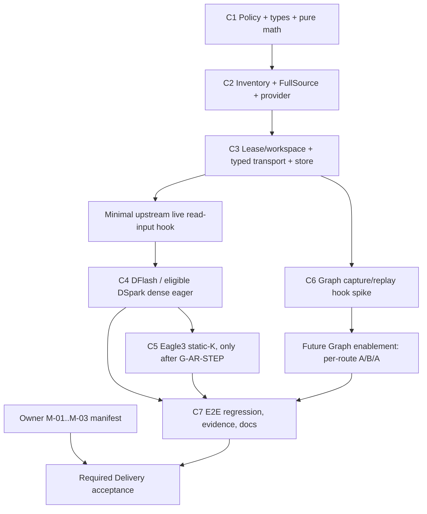

# MRV2 Speculative Draft Sliding Window Implementation Plan

> 当前状态：P1 Final PASS；P2 Final PASS；P3 Final PASS；P4a Ascend-only
> DFlash / eligible DSpark dense-GQA serialized eager **STATIC FINAL PASS**；
> `G-ASCEND-ONLY-INTEGRATION` static evidence已关闭并完成independent review裁决，
> `G-GQA-EAGER`仍因未运行真实NPU physical-read/profiler oracle而OPEN；
> P4b Eagle3 static-K serialized eager **STATIC FINAL PASS**；`G-AR-STEP`为
> **STATIC CONTRACT PASS / NPU RUNTIME OPEN**；Feature release仍HOLD。
> P3 实施完成时间：2026-10-10 11:19:13 +0800（Asia/Shanghai）。
> 独立 Review 事实裁决：2026-10-10（固定基线不变）。
> P2 实施提交：`83579675a997a44b293ff0ee1cb088a2eef0ed13`；review-fix：
> `fac84121ddf84fe5a76cd739432cea3b61365a9b`。
> P3/C3：`feab28f573b973a6b970cef56d1baa35191ab319`；review-fix：
> `16727882744c935d9e899f7775353b57738852bc`。
> 历史P4a upstream-hook prototype：`0403469280c3d0f19c55cd1768e7e9d9e566a719`；
> 历史upstream-dependent Ascend prototype：
> `e0dd8e8d14a287e4d5a69c54d7a617a6ae160529`；二者均已SUPERSEDED且
> 不可作为delivery dependency。
> 当前Ascend-only C4：`0dd83e9f75d4b2d766126af3a7f92352e342f756`，
> 唯一parent为P3 Final `16727882744c935d9e899f7775353b57738852bc`。
> P4a review-fix：`4c1f69146915f4f0ae5a6a61371ebfe181237d8f`，
> parent为Ascend-only C4；未改写C4历史。
> P4b C5：`d0c8883816f0e1fe333dc9f3197d3c4e47c475a5`；P4b review-fix：
> `1011e2c2fa99729a46efde5b5bbaf6daed975a2c`；均只修改vllm-ascend。
> 权威设计：`MRV2_Speculative_Draft_Sliding_Window_Final_Design.md`。
> `R-REPO-01`：production feature只允许修改vllm-ascend；vLLM必须保持精确
> `84030bbe3d74d99bad477a3d2e37a973ccd8865c`且clean。
> 当前约束：P4a DFlash / eligible DSpark与P4b normalized Eagle3 static-K已建立Ascend-only
> CPU/static read-input contract；Target、slot mapping与KV write仍为full。所有pure scheduler-
> prefill chunk显式走baseline full bypass且zero Window state；mixed prefill/decode与Window化
> chunked/function prefill仍fail closed。Graph、Async、prefix cache、parallel、complex backend
> 继续fail closed；没有NPU correctness或release结论。

## 0. Preflight 结论

1. P0初始preflight时`vllm`与`vllm-ascend`均在`lucian-dev`且工作区干净；当前交付状态为
   vLLM `lucian-dev@84030bbe…` clean，vLLM-Ascend
   `feature/p4b-eagle3-static-k@1011e2c…` clean。
2. Final Design 的核心架构仍成立：必须采用 **speculator-owned Draft Window
   Read Plane**；Target metadata、canonical full block tables、positions、query
   layout 和写侧 slot mapping 均保持 full、保持原 owner、保持原主流程。
3. 源码存在实质漂移，但没有阻塞 P1–P3：
   - upstream 入口已是 `_build_draft_attn_metadata()`，不是设计文档中部分位置写的
     `_build_attn_metadata()`；
   - MRV2 AR/DFlash ACL Graph 现在固定为 Python 层先提交 replay、后
     `update_full_graph_params()`；Final Design 对 `enable_enpu` 改变该顺序的精确
     假设不再适用于当前 MRV2 manager；
   - `attention/dsa_v41.py` 已不存在，DeepSeek-V4/V4.1 的相关职责分散到
     `dsa_v1.py`、`sfa_v1.py`、`indexer.py` 和 `models/deepseek_v4/*`。
4. P1、P2、P3 可以按 Frozen 边界开始；P4 只能在以下条件同时满足后打开：
   - 最小 live typed read-input hook 获得接受，不使用 upstream 已弃用的
     `CommonAttentionMetadata._seq_lens_cpu`，并通过 OFF identity 测试；
   - 单 group、dense GQA、serialized eager、静态 query width、无未经验证 parallel
     mode；
   - GQA 最终物理 read-set 与 CPU oracle 一致；
   - Window ON 的 prefill/prefix-cache 组合按各自 Gate 明确支持或明确拒绝。
   O-01 未关闭不阻止这一 **gated P4 candidate**，但阻止宣称 Required
   Delivery complete，并可能要求正式重排后续 backend/parallel 范围。G-CONFIG
   未关闭时只允许有效 `W > 0 and W >= K` 候选继续，其他数值显式 fail closed。
5. Graph Window ON 当前被阻塞。FULL、FULL_DECODE_ONLY、PIECEWISE 不能因 eager
   路径完成而自动开放。Graph 需要另外的 capture/replay provider hook、独立 Draft
   sink、actual operand fingerprint 和 NPU A/B/A。
6. 对“尽量不改原始主要流程、在流程中增量接入”的判断是正确的，也是更容易合入的
   方向，但准确边界不是“代码改得少”，而是：
   - 默认 `None` 完整走现有分支、对象和调用链；
   - Window ON 只替换 Draft attention 的 **read inputs**；
   - 不原地改共享 owner，不复制 upstream 主 builder，不新增隐式全局运输；
   - 未经证明的组合在 forward/capture 前 fail closed，而不是 silent fallback。

因此，本计划建议先提交 P1–P3，再提交受 Gate 约束的 P4；不能以“源码路径可达”宣称
Graph、Async、MLA、DSA、SFA、recycling、heterogeneous group、dynamic-K 或 plain
Eagle 已受支持。

## 1. 审计输入与优先级

### 1.1 文档输入

| 角色 | 文件 | SHA-256 | 行数 |
|---|---|---:|---:|
| 权威设计 | `/Users/wenqingzhang/Desktop/Note/MRV2/MRV2_Speculative_Draft_Sliding_Window_Final_Design.md` | `4eb1f768f542c6e2c2d2ccd1b981dd93cd778a39f2b073ee2c9561c4e98e2354` | 1324 |
| 参考 | `..._Final_Design_Codex.md` | `b11e4f7fb19c8df0d17ac79c26c8c0148e5c85e5d351c012a7d8526430dcfd27` | 1631 |
| 参考 | `..._Final_Design_DS.md` | `6540fe78bdae6062c9d15291c6ea1250e71aa2e5544995d02842e6144c9867a2` | 1444 |
| 参考 | `..._Final_Design_Mentor_Presentation.md` | `b5ca567a1f2e2d15f90ee3d19c068d6190bff5d17e35dc34489f8753a5d0476e` | 1725 |

裁决优先级：当前 checkout 源码事实 > Final Design 的 Frozen 决策和数学证明 > 三份
参考材料。参考材料不得覆盖 Final Design 的 P01 产品策略。

### 1.2 本轮明确未做的事

- 未修改 `vllm/` 或 `vllm-ascend/` 下任何文件；
- 未修改 MRV1、Scheduler、KV Cache Manager、Target ModelRunner 或 attention kernel；
- 未执行 NPU E2E；
- 未声称 M-01～M-03 Required Delivery manifest 已建立；
- 未因为发现 source drift 而反向修改设计文档。

## 2. Exact Source Baseline

### 2.1 vLLM

| 字段 | 值 |
|---|---|
| 路径 | `/Users/wenqingzhang/Desktop/vllm/vllm` |
| branch | `lucian-dev` |
| HEAD | `84030bbe3d74d99bad477a3d2e37a973ccd8865c` |
| subject | `[Bugfix][Core] Stop zero-progress preemption cascades for deferred KV frees (#49675)` |
| author date | `2026-09-11T08:40:10+08:00` |
| commit date | `2026-09-11T00:40:10Z` |
| upstream tracking | `origin/lucian-dev`，ahead `0` / behind `0` |
| status | clean；没有 staged、unstaged 或 untracked 文件 |
| shallow | `true` |
| origin | `https://github.com/LucianWQZ/vllm.git` |
| upstream | `https://github.com/vllm-project/vllm.git` |

### 2.2 vLLM-Ascend

| 字段 | 值 |
|---|---|
| 路径 | `/Users/wenqingzhang/Desktop/vllm/vllm-ascend` |
| branch | `lucian-dev` |
| HEAD | `841dc6ccdb134eab7ad09008859834d0572ee83f` |
| subject | `[Performance][Attention] Use native scatter for GLM-5.3-Flash NoPE KV cache writes (#16756)` |
| author / commit date | `2026-09-17T16:46:43+08:00` |
| upstream tracking | `origin/lucian-dev`，ahead `0` / behind `0` |
| status | clean；没有 staged、unstaged 或 untracked 文件 |
| shallow | `true` |
| origin | `https://github.com/LucianWQZ/vllm-ascend.git` |
| upstream | `https://github.com/vllm-project/vllm-ascend.git` |

### 2.3 基线限制

两个仓库都是 shallow checkout，当前可见 HEAD 没有可遍历 parent。因此本报告能够精确
记录当前内容和 origin 对齐状态，但不能从本地历史证明“Final Design 审查时 commit →
当前 HEAD”的逐 commit 演化。下面的 drift 结论来自当前源码逐锚点复核，而不是 ancestry
diff。

## 3. SOURCE DRIFT REPORT

状态定义：

- **COMPATIBLE**：行号或局部组织变化，但设计依赖的语义仍成立；
- **CHANGED**：入口、签名或时序发生变化，实施计划必须改用当前源码；
- **INVALIDATED**：设计中的精确路径/假设在当前源码不成立；
- “阻塞”只描述该 anchor 对哪个实施阶段或组合造成阻塞，不把局部 Gate 扩大成整个
  Feature 阻塞。

### 3.1 Final Design S01–S24 复核

| Anchor | Design assumption | Current source | 状态 | Implementation blocked? |
|---|---|---|---|---|
| S01 MRV1 adapter | 单一 adapter clone；三种 CPU mirror 共同裁剪 | `vllm_ascend/spec_decode/utils.py:83-169` 仍由 `SlidingWindowAdapter` 保存 `full_block_table`，生成 clone，并更新 `seq_lens_cpu`、`_seq_lens_cpu`、upper | COMPATIBLE | 否；只作为 oracle，不改 MRV1 |
| S02 MRV1 method policy | 第一 draft layer 的 kernel block size；Eagle3 `future_offset=K`，DFlash/DSpark 为 0 | `llm_base_proposer.py:393-438` 仍如此；DeepSeek-V4 DSpark 当前仅 warning，随后仍创建 adapter | COMPATIBLE（P01 只约束新 MRV2） | 否；不得照搬 MRV1 的 DeepSeek 行为 |
| S03 MRV1 apply/write | 通用 apply；slot mapping 仍基于 full table | apply 移至 `:1042-1050`；slot 选择 full source 在 `:2006-2025` | COMPATIBLE | 否 |
| S04 MRV1 DSpark group | per-group copy/repeated apply，存在 hetero legacy defect | 当前在 `:2490-2508`；重复 apply 风险仍存在 | COMPATIBLE | 只阻塞 heterogeneous multi-group ON |
| S05 dynamic K | runtime K 改变，但 adapter 捕获 configured K | runtime 覆盖在 `:906`，adapter offset 在 `:432` 固定 | COMPATIBLE | 阻塞 dynamic-K + Window ON |
| S06 MRV2 factory | 按 method 分派 speculator；`use_eagle()` 是宽泛兜底 | `worker/v2/spec_decode/__init__.py:25-78`：extract → DSpark → DFlash/DFlash2 → ordinary MTP → `use_eagle()` | COMPATIBLE（行号漂移） | 否；policy 必须在分派前按 normalized method 判定 |
| S07 shared funnel | 一份 lengths，逐 global gid 选 table/slot/builder | `worker/v2/attn_utils.py:223-364` 保持该结构；CPU upper 仍可 fallback 到 CPU exact | COMPATIBLE | P4 前必须禁止 ON 路径 fallback |
| S08 wrapper/factory | Ascend 通过临时 module function replacement 选择 builder，并注入 positions/prefill | 当前在 `attn_utils.py:1233-1269`；`finally` 恢复 | COMPATIBLE | 否；但禁止把 Window generation/state 再塞入该全局 closure |
| S09 upstream live builder | 从 canonical full tables、full seq lengths、full slots 构建 Draft metadata | 当前函数名/范围是 `speculator.py:252-330` 的 `_build_draft_attn_metadata()`；仍硬编码 `input_block_tables`、`slot_mappings`、`input_buffers.seq_lens` | CHANGED | P1–P3 否；P4 live typed hook 是 Gate |
| S10 upstream AR reuse | first pass 复用 Target metadata；decode step rebuild | first pass reuse 仍在 `autoregressive/speculator.py:303-320`；decode rebuild 在 `:484-567` | COMPATIBLE（行号漂移） | Window ON Eagle3 必须独立 rebuild/store |
| S11 Ascend AR store/update | FULL 从 Target store 起步；DSA/SFA 特殊；per-step CPU update | `vllm-ascend/vllm_ascend/worker/v2/spec_decode/autoregressive/speculator.py:507-634`；`build_draft_attn_metadatas()` 仍在 `:514` 从 `model_state.attn_metadata` 起步 | COMPATIBLE（范围变化） | 阻塞 AR Window ON，直到独立 DraftMetadataStore |
| S12 DFlash capture | helper 内部创建 full dummy tables，签名无 provider/binding | `vllm/.../dflash/cudagraph.py:24-120` 仍如此 | COMPATIBLE | 阻塞 DFlash/DSpark Graph Window ON |
| S13 MRV2 replay | AR/DFlash replay 重建 metadata 并更新 graph params | AR `aclgraph.py:127-183`，DFlash `aclgraph.py:81-118`；两者当前均 `super().run_fullgraph()` 后再 update | COMPATIBLE，但时序需按当前代码重画 | 阻塞 Graph enablement，非 eager |
| S14 Target store | Ascend `prepare_attn()` 写 `model_state.attn_metadata` | 真正 sink 是 `vllm-ascend/vllm_ascend/worker/v2/model_states/default.py:44-121`，赋值在 `:97`；upstream `vllm/v1/worker/gpu/model_states/default.py:166-231` 只返回 metadata，不写 store | COMPATIBLE（原引用缺 repo 前缀，已消除歧义） | Window ON capture 不得调用该 Ascend Target sink |
| S15 first backend | graph updater 只取首个 executable backend | `vllm-ascend/vllm_ascend/worker/v2/aclgraph_utils.py:103-111` 的 `_get_graph_update_backend()` 如此；DFlash 也直接 `list(...)[0]` | COMPATIBLE | 阻塞 mixed-backend FULL |
| S16 `enable_enpu` | generic wrapper 可能改变 update/replay 次序 | 当前 `compilation/acl_graph.py:268-292` 中 `enable_enpu` 只影响 replay 前同步；没有在 MRV2 manager 中形成 update→replay 分支；两个 MRV2 manager 固定 replay→update | INVALIDATED（对当前 MRV2 精确假设） | Graph 全部继续 fail closed，直到 fresh timeline trace |
| S17 UVA pool | round-robin pool 要求 caller 在复用前 retire reader | `vllm/.../buffer_utils.py:53-98` 仍明确该约束 | COMPATIBLE | 否；P3 必须增加 generation lease，而非盲复用 |
| S18 concurrency/recycling | PP/async 决定并发 batch；recycling 保留 in-flight blocks | `vllm/config/vllm.py:580-602` 仍成立 | COMPATIBLE | Async/recycling ON 分别受 Gate 约束 |
| S19 BlockTables | per-group `num_blocks`；gather 清 padding；slots 读 canonical table | upstream `block_table.py:17-230`；Ascend subclass `worker/v2/block_table.py:30-141`，slot dtype 为 int32 | COMPATIBLE | 否；valid counts 必须按同一 `idx_mapping` gather |
| S20 DSA-v1 indices | DSpark non-causal physical/logical index generator 局部可证 | `attention/dsa_v1.py:420-499` 仍有 generator；完整 consumer 还包括 SAS/native/compressor/QLI | COMPATIBLE（仅局部代数） | 阻塞 DSA Window ON，不阻塞 dense GQA |
| S21 V4.1 backend | `attention/dsa_v41.py` 承担 logical indices/SMLA | 该文件不存在；职责分散在 `dsa_v1.py`、`sfa_v1.py`、`indexer.py`、`models/deepseek_v4/{model,indexer,compressor,dspark}.py` | INVALIDATED（路径与 owner） | 阻塞 V4.1 Gate；DeepSeek-V4 co-trained DSpark 更早 forced OFF |
| S22 public contract | MRV1 EAGLE3/DFlash/DSpark；MTP ignore；MRV2 未覆盖 | developer doc 当前 `:17-30,83-98`，user guide `:356-410`；仍明确 MRV2 sliding window 未支持 | COMPATIBLE（行号漂移） | 否；文档只能在 Gate 通过后更新 |
| S23 config | `int-or-None`，没有正数/`W>=K` validator | `ascend_config.py:468` 仍只有类型 | COMPATIBLE | G-CONFIG 未关闭；不得在 AscendConfig 提前校验 |
| S24 target identity | 用 target `model_type.startswith("deepseek_v4")` 识别 co-trained route | MRV1 在 `vllm-ascend/vllm_ascend/spec_decode/llm_base_proposer.py:407-417`，精确 predicate 在 `:409`。KV-cache patches 使用 `KVCacheSpec.model_version`，`patch_speculative_config.py:54-85` 又使用 **draft** `hf_config.model_type`；两者都不是 P1 的 target-policy predicate | COMPATIBLE（删除原“patch 也保留”模糊表述） | 否；policy 只集中使用 target `vllm_config.model_config.hf_config.model_type.startswith("deepseek_v4")` |

### 3.2 关键实现路径的当前事实

#### Factory 与 method identity

- `SpeculativeConfig.use_eagle()` 当前包含 `eagle`、`eagle3`、`mtp`、`dflash`、
  `dspark`（`vllm/config/speculative.py:1868-1885`）。因此不能按最终实例 class 或
  `use_eagle()` 判产品策略。
- MTP 的 Gemma4/Step3.5 特殊路径会落到 factory 的 `use_eagle()` 分支。MTP
  forced-OFF 必须在任何 class branch 前完成。
- DeepSeek-V4 + DSpark 的 target identity 在 speculator 实例化前已可由
  `vllm_config.model_config.hf_config.model_type` 得到，不需要加载模型或读取 NPU。

#### AR target metadata reuse

- upstream first pass 复用 Target metadata 的理由仍是 query shape 与 rejection 补位；
  这对 OFF 是正确 baseline，但对 Window ON 会把 full read domain 带进 Draft。
- Ascend `_prefill()` 目前只过滤 layer names；FULL path 也从
  `self.model_state.attn_metadata` 过滤后起步。Window ON 必须重建 Draft-only metadata，
  同时保留传入的 full slot mapping。

#### DFlash / DSpark prepare 与 slot mapping

- upstream DFlash 在 `dflash/speculator.py:391-425` 对每个 Draft KV group 调用
  `prepare_dflash_inputs()`，输入是 full `input_block_tables[gid]`，输出写入共享 full
  `slot_mappings[gid]`。
- context KV 预写在 `:427-444`，metadata build 在 `:468-481`。正确的 Window read
  materialize 点是：所有 full prepare/slot 写和 context KV 写完成之后、Draft forward
  metadata build 之前。
- DFlash 固定 `num_query_per_req=K+1`，并拒绝
  `sample_from_anchor=True`。DSpark 的 `sample_from_anchor` 默认为 `True`，因此默认
  query width 是 `K`；显式为 `False` 时才是 `K+1`（upstream
  `dspark/speculator.py:46-55`、`dflash/speculator.py:50-75`）。不能用 configured K
  代替本 proposal 的实际 query width。
- Window 实现不改 `prepare_dflash_inputs()` 的 block table 输入，也不改其 slot 输出。

#### ACL Graph capture/replay

- AR generic capture 经过 `prepare_inputs_to_capture()`，内部创建 full dummy tables，
  并调用 Target `model_state.prepare_attn()`；该调用会写 Target store。
- DFlash capture helper自行创建 full dummy tables，无 provider 参数。
- replay manager 虽在 Python 层 rebuild Draft metadata，但 forward context 仍使用
  `model_state.attn_metadata`，且 actual operator 可能读 captured pointer、task rebound
  参数或 backend-owned buffer。
- 当前无法仅凭“Python metadata 里看到窄 table”证明 Graph 正确。

#### BlockTables 与 valid counts

- `input_block_tables[gid]` 是按当前 batch row gather 后的 canonical full table；
  `num_blocks.gpu[gid]` 仍按 persistent request slot 排列。
- Window valid count 必须用同一个 `idx_mapping` 将
  `num_blocks.gpu[gid, request_slot]` gather 到 batch-row 顺序。
- `start_col + needed_cols <= valid_num_blocks` 是语义 coverage 断言；将缺失列写成 0
  只能避免 OOB，不能把缺失 source 变成正确上下文。
- `compute_slot_mappings()` 必须继续读取 canonical full table。不会修改 upstream 或
  Ascend `BlockTables` owner、gather kernel、slot kernel。

#### Relevant backend builders

- dense GQA builder 位于 `attention/attention_v1.py:218-416`。parallel drafting 当前
  强制使用 device `common.seq_lens`；block table 来自 common metadata。
- builder 为 FIA padding 可能在 `:372-384` 对 seq/table 做 `torch.cat`，Graph 中实际
  operand 不一定等于 provider backing 地址。这是 Graph 不能从 eager 结论继承的原因。
- MLA、DSA、SFA/indexer 各有独立 length/table/derived-state 路径；不能以 GQA 测试
  通过推断其可用。

### 3.3 Drift 对阶段的影响

| 阶段 | 结论 | 原因 |
|---|---|---|
| P1 | UNBLOCKED | policy、数学、类型均可纯实现；不依赖变化的 Graph/backend 路径 |
| P2 | UNBLOCKED | 当前 `set_attn()`、`AttentionGroup`、`BlockTables` 足以建立只读 inventory/source |
| P3 | UNBLOCKED | lease/store/typed transport 可先独立实现；不要求 Graph enablement |
| P4 DFlash/eligible DSpark dense eager | CONDITIONAL | 需要 live read-input hook、G-GQA-EAGER、serialized/eager/mode Gate |
| P4 Eagle3 static-K | CONDITIONAL, later than DFlash/DSpark | 还需 first-pass rebuild、frozen anchor、future-column refresh 与 G-AR-STEP |
| Graph | BLOCKED | capture helper、Target store alias、当前 replay/update 时序和 actual binding 均未闭合 |
| DSA/V4.1/SFA/recycling | BLOCKED per route | backend owner/derived operands 已变化或未有 operator oracle |

## 4. Implementation Scope 与不可跨越边界

### 4.1 唯一允许的阶段顺序

1. **P1**：policy / pure math / types；
2. **P2**：inventory / FullSource / valid counts / single-group direct-prefix provider；
3. **P3**：lease/workspace / typed transport / DraftMetadataStore；
4. **P4**：只打开经过 Gate 的 single-group dense GQA serialized eager；
5. 后续单独处理 Eagle3 static-K、Graph hook 和扩展 Gate。

不得因为某个 backend“看起来只需要换 tensor”跳过前一阶段，也不得在 P4 顺带打开：

- FULL、FULL_DECODE_ONLY、PIECEWISE；
- async scheduling；
- MLA、DSA、V4.1、SFA；
- recycling / R-SWA resident-set 组合；
- heterogeneous multi-group；
- Eagle3 dynamic-K；
- plain Eagle；
- DSA-CP/DCP/SP/PCP/Flashcomm 等未经 per-rank oracle 验证的 parallel route。

### 4.2 Forced-OFF 必须先于一切 Window 工作

固定顺序：

```text
read requested value
  -> missing / None: CONFIG_OFF, 直接现有 baseline，无 warning
  -> normalized method + target identity
       -> MTP: FORCED_OFF，成功构造的每个 speculator warning 一次
       -> DeepSeek-V4 co-trained DSpark: FORCED_OFF，每实例 warning 一次
       -> eligible request
            -> numeric validation
            -> method/runtime capability checks
            -> set_attn inventory
            -> workspace/store allocation
            -> per-proposal planner/materialize
```

强制要求：即使 configured value 是 `0`、负数或 `W<K`，MTP 和 DeepSeek-V4
co-trained DSpark 也必须先 forced OFF，不能被 Window 数值错误拦截；它们不得创建
inventory、planner、workspace、lease、DraftMetadataStore 或 Graph binding。

### 4.3 主流程增量接入原则

建议保留的主链：

```text
Target scheduler / full state
  -> existing speculator input preparation
  -> existing full slot mapping and KV writes
  -> [new, eligible ON only] derive Draft read view
  -> existing metadata builder with explicit read-input override
  -> existing Draft forward / sampling / verification
```

不能做的“少改代码”捷径：

- 临时覆写 `self.block_tables.input_block_tables` 或 `self.input_buffers.seq_lens`；
- 从 Target metadata 原地改 table/length 后再改回；
- 为 Window 再加 ContextVar、module global、嵌套 monkeypatch 或隐式 singleton；
- 复制整段 upstream `_build_draft_attn_metadata()` 到 Ascend；
- 修改 full table 后继续用它计算 slot；
- backend 不支持时悄悄退回 full attention；
- Graph capture 使用 full dummy、replay 使用 window tensor却仍宣称支持。

### 4.4 Implementation phases 与 exit summary

| Phase | Production behavior | Exit criterion | 下一阶段依赖 |
|---|---|---|---|
| P1 | 只增加纯 policy/math/types；OFF/forced-OFF 仍是 baseline | P1-owned T01–T12 scalar/policy 部分、T18A–T18C CPU/static；forced-OFF zero Window allocation | 无 backend/NPU 依赖；T04 runtime 与 T10 source 分别归 P4/P2 |
| P2 | 只建立 read-only inventory/source/provider，不接 forward | global gid/layout/valid-count 可诊断；single dense GQA candidate 唯一 | P1 decision |
| P3 | 只建立 owner/lifetime/typed transport/store，不接 attention | Target isolation、event retirement、no-global-state UT | P2 source/provider |
| P4a | gated DFlash / eligible DSpark dense eager Window ON | live hook + G-GQA-EAGER + NPU physical-slot oracle | P1–P3 |
| P4b | gated Eagle3 static-K eager Window ON | first-pass store + G-AR-STEP + multi-step/future-column oracle | P4 infrastructure；不依赖 DFlash 语义 |
| Graph spike | 只建立 capture/replay binding 与 trace | 三入口 spy；仍不代表 mode enabled | P3；enablement另需 G-GRAPH |

### 4.5 Exact file change map

| Phase/commit | Repository | File | Change kind |
|---|---|---|---|
| P1/C1 | vllm-ascend | `vllm_ascend/worker/v2/spec_decode/draft_window.py` | new：policy、types、pure math |
| P1/C1 | vllm-ascend | `vllm_ascend/worker/v2/spec_decode/__init__.py` | policy-first factory，baseline dispatch preserved |
| P1/C1 | vllm-ascend | `vllm_ascend/worker/v2/spec_decode/{autoregressive,dflash,dspark}/speculator.py` | private instance policy receiver only |
| P1/C1 | vllm-ascend | `tests/ut/spec_decode/test_draft_window.py` | new：policy/math/factory spies |
| P2/C2 | vllm-ascend | `vllm_ascend/worker/v2/spec_decode/draft_window.py` | inventory、FullSource、valid counts、provider |
| P2/C2 | vllm-ascend | three speculator files above | eligible-only `set_attn()` inventory hook |
| P2/C2 | vllm-ascend | `tests/ut/spec_decode/test_draft_window.py`、`tests/ut/worker/v2/test_v2_block_table.py`、`tests/ut/worker/test_attn_utils_v2.py` | provider/source/group contracts |
| P3/C3 | vllm-ascend | `vllm_ascend/worker/v2/spec_decode/draft_window.py` | lease/workspace/typed inputs/store |
| P3/C3 | vllm-ascend | `vllm_ascend/worker/v2/attn_utils.py` | optional explicit CPU exact + validation；只写 Ascend 的 non-deprecated `seq_lens_cpu` |
| P3/C3 | vllm-ascend | three speculator files above | eligible-only runtime ownership |
| P3/C3 | vllm-ascend | `tests/ut/spec_decode/test_draft_window.py`（必要时拆 lifetime 文件） | lifetime/isolation tests |
| P4/C4 | vllm | `vllm/v1/worker/gpu/spec_decode/speculator.py` | optional live `DraftAttentionReadInputs` + protected builder-adapter hook；default `None` |
| P4/C4 | vllm | `tests/v1/spec_decode/test_eagle_draft_attn_metadata.py` | default-None parity / override contract |
| P4/C4 | vllm-ascend | `vllm_ascend/worker/v2/attn_utils.py` | consume explicit CPU exact |
| P4/C4 | vllm-ascend | `.../dflash/speculator.py`、`.../dspark/speculator.py` | DFlash/eligible DSpark live eager integration |
| P4/C4 | vllm-ascend | existing/new UT + one-card model-runner-v2 E2E | semantic/negative/NPU gates |
| P4b/C5 | vllm-ascend | `.../autoregressive/speculator.py` | Eagle3 first-pass rebuild + per-step refresh |
| P4b/C5 | vllm-ascend | AR metadata UT + Qwen Eagle3 one-card E2E | static-K/rejection/future-column tests |
| Graph/C6 | vllm | `.../spec_decode/dflash/cudagraph.py`、`.../worker/gpu/cudagraph_utils.py` | optional capture provider/sink spike |
| Graph/C6 | vllm-ascend | `.../{autoregressive,dflash}/aclgraph.py` | instance binding/trace only；no default enable |
| C7 | vllm-ascend | existing E2E suites + speculative window docs | complete evidence/support matrix |

显式 **not modified owner**：
`vllm-ascend/vllm_ascend/worker/v2/model_states/default.py:44-121` 仍是 Target
`attn_metadata` store owner，P4b/C5 只验证 Draft store 不与它 alias，不修改该文件。
P4 默认不修改 upstream `vllm/v1/worker/gpu/attn_utils.py`；只有 maintainer
明确选择一个 non-deprecated 的通用 common-metadata replacement 时，才能另立范围。

第一版明确不修改：MRV1 `vllm_ascend/spec_decode/*`、Scheduler、KV Cache Manager、
Target ModelRunner 主链、production `BlockTables`、slot kernel、positions/query generation、
Target sampler/verification 和 model weights。

## 5. 建议的内部 API 与不变量

以下名字是基于当前 checkout 的 Patch Plan，均为 MRV2 内部接口，不构成用户 public
API。实施时可按项目命名意见微调，但不能改变语义边界。

### 5.1 P1 value types

```python
class DraftWindowPolicyState(Enum):
    CONFIG_OFF = auto()
    FORCED_OFF = auto()
    ELIGIBLE_ON = auto()


@dataclass(frozen=True)
class DraftWindowPolicyDecision:
    state: DraftWindowPolicyState
    requested_window_size: int | None
    effective_window_size: int | None
    normalized_method: str
    target_model_type: str
    reason: str | None


@dataclass(frozen=True)
class DraftWindowScalarPlan:
    anchor_start: int
    end: int
    exact_visible_len: int
    capacity_tokens: int
```

核心纯函数：

- `resolve_draft_window_policy(...) -> DraftWindowPolicyDecision`
- `validate_eligible_window_numbers(W, query_width, configured_k) -> None`
- `compute_legacy_anchor(context_len, future_offset, W, legacy_block_size) -> int`
- `compute_visible_length(end, start) -> int`
- `project_direct_prefix(start, visible, block_span) -> (start_col, offset, needed)`

### 5.2 P2 source/inventory/provider types

```python
@dataclass(frozen=True)
class DraftWindowGroupInventory:
    global_group_id: int
    layer_names: tuple[str, ...]
    backend_classes: tuple[type, ...]
    builder_classes: tuple[type, ...]
    logical_block_size: int
    kernel_block_size: int
    block_span_tokens: int
    causal: bool


@dataclass(frozen=True)
class DraftWindowInventory:
    consumer_group_ids: tuple[int, ...]
    groups: tuple[DraftWindowGroupInventory, ...]
    architecture: str
    capability_failures: tuple[str, ...]


@dataclass(frozen=True)
class FullDraftKVSource:
    input_block_tables: tuple[Tensor, ...]   # references only
    persistent_num_blocks: Tensor            # references only
    kernel_block_sizes: tuple[int, ...]
    idx_mapping: Tensor
    generation_id: int
```

`SingleGroupDirectPrefixProvider` 第一版只接受：一个 executable consumer gid、dense
`AscendAttentionBackend`、同一 canonical anchor、可证明的 table span；如果 offset
非零而 consumer 未通过 G-OFFSET，则明确拒绝。

### 5.3 P3 transport/lifetime/store types

```python
@dataclass(frozen=True)
class DraftMetadataInputs:
    generation_id: int
    phase: str
    step: int
    lane_id: int
    request_fingerprint: int
    block_tables: tuple[Tensor, ...]
    valid_num_blocks: tuple[Tensor, ...]
    device_window_exact: Tensor
    cpu_window_exact: Tensor | None
    cpu_window_upper: Tensor
    legacy_cpu_mirror: Tensor | None
    dcp_local_window: Tensor | None
    max_seq_len: int


class DraftWindowLease:
    # immutable generation/lane identity + owned buffers + retire event
    ...


class DraftWindowWorkspace:
    def acquire(self, generation_id: int) -> DraftWindowLease: ...
    def retire(self, lease: DraftWindowLease, completion_event: Event) -> None: ...


class DraftMetadataStore:
    # Window ON only; never aliases model_state.attn_metadata
    ...
```

### 5.4 必须保持的 invariants

1. `CONFIG_OFF` 走当前 factory/wrapper/store/graph 调用链，不创建 Window tensor。
2. Forced-OFF 只增加规定的 warning once；其余行为与 `CONFIG_OFF` 相同。
3. Target metadata identity/content、full tables、positions、query layout 不变。
4. slot mapping 永远来自 full table；typed read inputs 中不提供 slot override 字段。
5. 同 proposal 的 Eagle3 `anchor_start` 冻结；step 只能推进 `end` 和 exact length。
6. DFlash/eligible DSpark `future_offset=0`，不得再加 K。
7. 每 gid source coverage 使用同 generation、同 row order 的 valid count。
8. 所有输出 workspace 在写入 active rows 前清 stale tail；padding rows 的 write 必须为 0。
9. `cpu_window_exact` 缺失只允许 consumer 明确声明不读取它；禁止用 full mirror 或
   `np.full(max_seq_len)` 代替。
10. lease 在最后一个 device/backend reader 完成后才 retire；地址稳定不等于生命周期正确。
11. Window ON metadata 只能写 `DraftMetadataStore`，不能写 Target store。
12. unsupported route 必须在 capture/forward 前抛包含 method/model/backend/group/mode 的
    可诊断错误。

## 6. P1 Patch Plan — Policy + Types + Pure Math

### 6.1 `vllm-ascend/vllm_ascend/worker/v2/spec_decode/draft_window.py`（新增）

- **目的**：建立唯一的 MRV2 policy、数值语义、纯数学和 value types；不导入 NPU
  runtime，不分配 tensor。
- **新类型/函数**：§5.1 的 policy state/decision/scalar plan；集中 predicate
  `_is_deepseek_v4_target()`；pure anchor/projection/capacity functions。
- **public/private**：包内 internal；不在 `vllm_ascend` 顶层 export，不是用户 API。
  policy resolver 可在 `worker/v2/spec_decode` 内复用；model predicate 保持 private。
- **输入**：normalized `speculative_config.method`、target `hf_config.model_type`、requested
  W、configured/runtime K、legacy block size、context length/query width。
- **输出**：不可变 decision/plan 或带完整上下文的 `ValueError`/
  `NotImplementedError`。
- **invariants**：policy 先于 numeric；不读取 NPU；不依赖 speculator class；不用模型名
  substring；不产生 workspace。
- **tests**：P1 可表达的 T01–T12 scalar/policy 部分；MTP/DeepSeek-V4 invalid W 仍 forced OFF；Eagle3 与 eligible
  DFlash/DSpark 非 `None` 才进入数值 Gate；plain Eagle/dynamic K 明确拒绝。

### 6.2 `vllm-ascend/vllm_ascend/worker/v2/spec_decode/__init__.py`

- **目的**：在现有 factory class dispatch 之前调用 policy resolver。
- **新函数**：private `_init_speculator_baseline()` 保留现有分支，private
  `_configure_eligible_draft_window()` 只向 eligible Ascend speculator 传不可变 decision。
- **public/private**：`init_speculator()` public signature 不变；新 helper 全部 private。
- **输入/输出**：输入仍是 `VllmConfig, device`；输出仍是原 speculator 实例。
- **invariants**：
  - `None` 不改变分支顺序和构造参数；
  - MTP（包括 Gemma4/Step3.5/fall-through route）先 forced OFF；
  - DeepSeek-V4 + DSpark 先 forced OFF；
  - forced-OFF 不调用 `_configure_eligible_draft_window()`；
  - `use_eagle()` 只用于原 factory dispatch，不用于 policy。
- **tests**：constructor/configure spy；warning once；CONFIG_OFF 无 warning；forced-OFF
  不调用 validator/inventory/workspace；现有 factory methods 仍返回同 class。

### 6.3 三个 Ascend speculator owner

文件：

- `worker/v2/spec_decode/autoregressive/speculator.py`
- `worker/v2/spec_decode/dflash/speculator.py`
- `worker/v2/spec_decode/dspark/speculator.py`

共同改动：

- **目的**：提供一个 instance-scoped private policy 接收点，避免改 constructor/MRO，也
  避免 module global。Eagle3 从 AR owner 继承，DFlash2 从 DFlash owner 继承。
- **新函数**：`_configure_draft_window(decision) -> None`，只保存 frozen decision；重复
  配置或 forced/off decision 传入时断言失败。
- **public/private**：private；不改变 `__init__`、`propose()`、`set_attn()` signature。
- **输入/输出**：输入 eligible decision，无返回值。
- **invariants**：P1 只保存纯对象，不建 tensor、不调用 backend、不改变 OFF propose。
- **tests**：eligible attach 一次；OFF/forced route 不存在该 instance state；DFlash2
  MRO 能继承该方法但尚不因此宣称 Window ON supported。

### 6.4 P1 明确不修改

- `ascend_config.py`：不能在 Pydantic/config parse 阶段增加 `W>0` 或 `W>=K` validator，
  否则会破坏 forced-OFF precedence；
- MRV1 `spec_decode/*`；
- attention builders、BlockTables、Graph manager；
- docs：待能力 Gate 和 W policy 获批后在 C7 更新。

### 6.5 P1 exit criteria

- T01–T12 中 P1 可表达的 policy/scalar contract 与 T18A–T18C CPU/static contract
  通过；T04 proposal/rejection runtime 归 P4，T10 source shortage 归 P2，不在 P1
  伪造 provider/runtime 证据；
- 代码检查证明 forced-OFF 之前没有 numeric/inventory/workspace 调用；
- factory OFF route 的构造 class、参数和 warning 行为与当前 baseline 一致；
- 尚不运行任何 Window attention。

## 7. P2 Patch Plan — Inventory + FullSource + Valid Counts + Provider

### 7.1 `worker/v2/spec_decode/draft_window.py`

- **目的**：把当前 checkout 的真实 cache-group/backend/layout 变成可诊断 inventory，
  并建立 canonical full source 的只读视图。
- **新类型/函数**：§5.2 的 inventory/source；
  `build_draft_window_inventory(...)`；`gather_valid_num_blocks(...)`；
  `SingleGroupDirectPrefixProvider.plan/materialize(...)`。
- **public/private**：均为 MRV2 package internal；provider protocol 对后续 backend
  extension 可见，但不顶层 export。
- **输入**：`attn_groups`、`kv_cache_config.kv_cache_groups`、`BlockTables`、active draft
  layer names、method/runtime flags、`idx_mapping`、P1 plan、caller-owned output buffers。
- **输出**：immutable inventory/source；每 row 的 `start_col/offset/needed`；按 batch row
  gather 的 valid counts；窄 read table。
- **invariants**：
  - inventory 在 `set_attn()` 完成后建立；
  - 遍历所有 global gid 和所有 executable backend，不能只看 first backend；
  - FullSource 只持引用，禁止写 canonical table/num_blocks；
  - valid count 与 input table 使用同一 `idx_mapping`/generation；
  - source shortage 立即错误；padding/tail 清零；
  - 第一版只接受一个 executable dense GQA consumer group；
  - nonzero offset 在 G-OFFSET 前拒绝；heterogeneous group 拒绝。
- **tests**：T05–T12、T21 的 CPU/table 部分；batch reorder；valid count shortage；
  R+1 padding；stale tail；多个空 global group + 一个 consumer gid；mixed backend 拒绝。

实现选择：P2 不新增 Triton kernel。先使用 caller-supplied/preallocated tensor 与
`index_select`/`gather` 的显式 `out` 路径，建立正确性和 owner 边界；只有 C4 profiling
证明需要时，才另提窄 NPU kernel，并以相同 oracle 验证。这样避免在数学/ownership 尚未
稳定时提前固化 kernel ABI。

### 7.2 `autoregressive/speculator.py`

- **目的**：eligible decision 存在时，在当前 `set_attn()` 完成并识别全部 draft
  groups 后建立 inventory/source；OFF 不执行。
- **新函数**：private `_initialize_draft_window_inventory(...)`。
- **public/private**：`set_attn()` signature 不变；helper private。
- **输入/输出**：消费 `self.attn_groups`、KV config、BlockTables；保存 immutable
  inventory/source，无 proposal tensor。
- **invariants**：不以当前 `self.attn_backend` 的 first-backend 结果替代完整 inventory；
  MTP 不可到达；plain Eagle/dynamic K fail closed。
- **tests**：GQA single group accepted；MLA/DSA/SFA/mixed/multi-group 拒绝；OFF 不调用。

### 7.3 `dflash/speculator.py` 与 `dspark/speculator.py`

- **目的**：在各自 `set_attn()` 已完成 active-layer/backend 枚举后建立相同 inventory。
- **新函数**：与 AR 相同的 private initialization，尽量由 `draft_window.py` 共享实现，
  不新增共同继承层以避免 MRO 风险。
- **输入/输出**：现有 ordered `draft_kv_cache_group_ids`、`attn_groups`、
  `attn_backends`、BlockTables → inventory/source。
- **invariants**：保留 cache-group order；target backend（例如 GLM target SFA）不能被
  误判为 draft backend；DeepSeek-V4 forced-OFF 不进入；DFlash2 只完成 inventory，
  不自动 enable。
- **tests**：DSpark non-DeepSeek dense GQA accepted；DeepSeek-V4 spy 不调用；target
  SFA / draft GQA 分类正确；DFlash2 保持独立 capability 状态。

### 7.4 P2 tests 文件

- 新增 `tests/ut/spec_decode/test_draft_window.py`：继续承载 pure plan、inventory、
  provider 和 source-coverage tests，避免在早期制造多个极小测试文件。
- 扩展 `tests/ut/worker/v2/test_v2_block_table.py`：只增加“valid count gather 与现有
  row mapping 一致”的 contract test；不改 production BlockTables。
- 复用 `tests/ut/worker/test_attn_utils_v2.py` 的多 group fixture，验证 global gid
  顺序和空 group。

### 7.5 P2 exit criteria

- 每个拒绝都有 method/model/backend/global gid/block sizes/mode 诊断；
- source/provider tests 不改 canonical tensor；
- valid count 与 reordered batch 逐元素一致；
- 只有 single executable dense GQA group 标记为 P4 candidate；尚未接 forward。

## 8. P3 Patch Plan — Lease/Workspace + Typed Transport + Draft Store

### 8.1 `worker/v2/spec_decode/draft_window.py`

- **目的**：建立唯一的 mutable owner 和 generation 生命周期，并将 Window read state
  封装成显式 typed inputs。
- **新类型/函数**：§5.3 的 `DraftMetadataInputs`、`DraftWindowLease`、
  `DraftWindowWorkspace`、`DraftMetadataStore`；private request fingerprint/hash helper。
- **public/private**：package internal；lease acquire/retire 是 provider 与 speculator
  之间的内部协议。
- **输入**：max requests、single-group capacity、dtype/device、generation id、execution
  lane、ordered request identity、completion event。
- **输出**：独占 lease；持有预分配 table、valid count、device/CPU exact/upper、scratch；
  独立 Draft metadata 条目。
- **invariants**：
  - 一个 generation 只有一个 retirement owner；
  - pool 不盲 round-robin；event 未完成不得复用；
  - pressure 下扩容或给出确定错误，不覆盖 active lane；
  - serialized P4 初始只允许一条 execution lane，但 API 不把“一条 lane”伪装成
    async 已支持；
  - request fingerprint 在 reorder/finish/add 时变化；
  - store 不引用/写入 `model_state.attn_metadata`；
  - reset 清 active tail 和 backend-derived references。
- **tests**：fake event 延迟；acquire/retire；generation mismatch；same-row finish+add；
  reorder；exception cleanup；store 与 Target identity 隔离；重复 build 幂等。

### 8.2 `worker/v2/attn_utils.py`

- **目的**：让 shared funnel 能接收明确的 Draft exact CPU length，而不是在 Window ON
  时触发 `np.full(max_seq_len)` 或 upper fallback。
- **新参数/函数**：为内部 `build_attn_metadata()` 增加可选
  `seq_lens_cpu: torch.Tensor | None = None`；private validation helper 检查 exact/upper
  shape、dtype、row count、`upper >= exact`。
- **public/private**：现有函数的默认值和所有 OFF caller 不变；新参数只由 typed
  Draft hook 传入。
- **输入/输出**：Window ON 传 `DraftMetadataInputs.cpu_window_exact`；构造
  `AscendCommonAttentionMetadata.seq_lens_cpu`。不新写 upstream 已弃用的
  `CommonAttentionMetadata._seq_lens_cpu`。
- **invariants**：
  - `None` 完整保持当前 fallback；
  - Window ON marker 存在时 `seq_lens_cpu`/upper 不得缺失；
  - Window ON 如遇到 inherited `_seq_lens_cpu`，它只能为 `None` 或经验证与
    `cpu_window_exact` 同源/逐值相等；任何 full/stale mirror 立即报错，不作为新 transport；
  - 不接收 positions/query/slot override；
  - 不新增 module global 或 context manager。
- **tests**：扩展 `test_attn_utils_v2.py`，验证 exact 被所有 group 看到、upper 不倒置、
  Window ON 缺 exact 报错、deprecated mirror 为 full/stale 时报错、OFF fallback snapshot
  不变。

### 8.3 三个 speculator owner

- **目的**：仅对 P2 inventory 标记为 candidate 的实例创建 workspace/store；建立单调
  generation id，但尚不替换 live metadata。
- **新成员**：private `_draft_window_workspace`、`_draft_metadata_store`、
  `_draft_window_generation`；只在 eligible `set_attn()` 后存在。
- **public/private**：现有 signatures 不变。
- **输入/输出**：inventory + configured max batch/capacity → owned runtime objects。
- **invariants**：forced/OFF 没有这些成员或 allocation；init 失败不留下半初始化 state；
  graph/async/parallel capability 在分配前检查。
- **tests**：allocation spy；OFF/forced zero allocation；unsupported mode 在 workspace 前
  报错；speculator 销毁/异常后 lease 可回收。

### 8.4 P3 明确不接通的路径

- 不把 typed inputs 塞进现有 `build_draft_attn_metadata_factory()` closure；
- 不修改 graph capture helper；
- 不使任何 backend 读取窄 table；
- 不把 store 接到 Target forward context；
- 因此 P3 merge 后用户仍看不到 Window ON 执行，属于可独立 review 的基础设施。

### 8.5 P3 exit criteria

- T13/T19/T20/T28/T34–T36 的无 NPU owner/lifetime 部分通过；
- 没有 module-global Window state；
- OFF/forced 路径 allocation spy 为 0；
- store/lease API 能表达 generation/phase/step/lane，但 Async 仍明确 unsupported。

## 9. P4 Patch Plan — Eligible Single-Group Dense GQA Serialized Eager

P4 分成 P4a（DFlash/eligible DSpark）和 P4b（Eagle3 static-K）。P4b 不得为了和 P4a
同一 PR 而跳过 G-AR-STEP；证据不足时推迟到 C5。

### 9.1 为什么当前 checkout 需要 upstream live hook

当前 upstream `_build_draft_attn_metadata()` 在方法内部硬编码：

- `self.block_tables.input_block_tables`；
- `self.block_tables.slot_mappings`；
- `self.input_buffers.seq_lens`；
- 从 caller upper 加 `step` 后的新 CPU upper。

Ascend 侧不能安全完成 live 替换的原因：

1. 临时交换 `self.block_tables`/`self.input_buffers` 会改共享 owner，并在异常、并发和
   graph 下产生不可证明的恢复时序；
2. 扩展当前 module function replacement 以闭包携带 Window generation，违反 Final
   Design 的 instance-scoped transport；
3. 唯一剩余的 Ascend-only **vendor fork alternative** 是在已有 AR/DFlash/DSpark
   override 中复制约 50 行 upstream metadata assembly；它会造成长期 source drift，
   并容易遗漏 query-start、DCP、padding、版本兼容修复，所以在当前 Frozen
   约束下明确拒绝；若 upstream hook 被拒，需由 maintainer 在“小型显式
   hook”与“vendor fork + 长期同步负担”之间重新裁决；
4. Target/full slot mapping 必须继续由 upstream 原路径取用，不能允许任意 override。

因此，基于当前源码，本计划判定：**P4 live eager 需要最小 vendor-neutral upstream
hook**。如果该 hook 被 maintainer 拒绝且没有同等显式 instance-scoped 方案，P4
Window ON 暂停；P1–P3 不受影响。Graph hook 是后续更大的独立 Gate，不与 live hook
混写。

### 9.2 vLLM 最小 live hook（F-02 修订后）

#### `vllm/v1/worker/gpu/spec_decode/speculator.py`

- **目的**：允许 caller 只覆盖 Draft attention 的 read inputs，default `None` 精确保持
  baseline。
- **新类型**：小型 vendor-neutral frozen `DraftAttentionReadInputs`，字段仅含：
  `block_tables`、device `seq_lens`、CPU exact、CPU upper、可选 DCP local lengths、
  `max_seq_len`。不含 Ascend 类型、不含 slot/positions/query、不含 policy。
- **签名**：`_build_draft_attn_metadata(..., *, read_inputs: DraftAttentionReadInputs |
  None = None)`。
- **新 protected adapter**：`_call_draft_attn_metadata_builder(*, read_inputs,
  builder_kwargs)`。base implementation 仍调用当前 module-level
  `build_attn_metadata(**builder_kwargs)`；Ascend override 只把 typed CPU exact 作为显式
  `seq_lens_cpu` kwarg 交给 Ascend builder。typed state 是 method argument，不由
  context-manager closure 携带。精确命名/签名仍需 G-LIVE-HOOK review，该语义边界不变。
- **行为**：
  - `None` 执行当前逐行等价逻辑；
  - 非 `None` 使用 caller 已算好的 final exact/upper，不再二次加 `step`；
  - slot mappings 仍无条件来自 `self.block_tables.slot_mappings`；
  - query-start、causal、positions factory、DCP fallback 的 baseline 逻辑保留。
- **tests**：扩展 `vllm/tests/v1/spec_decode/test_eagle_draft_attn_metadata.py`：
  OFF call snapshot；read fields 被覆盖；slot identity 不能覆盖；upper 不重复加 step；
  zero req/padding/DCP 现有 tests 不回归；Ascend 现有
  `build_draft_attn_metadata_factory()` 对 `positions`/`is_prefilling` 的注入仍存在，
  `read_inputs`/CPU exact 经 `**kwargs` 透传且不丢失。

P4 不修改 `vllm/v1/worker/gpu/attn_utils.py`，也不向
`CommonAttentionMetadata._seq_lens_cpu` 写新值；该字段在当前基线
`vllm/v1/attention/backend.py:455-457` 已标注将在 v0.15.0 移除。若
maintainer 不接受上述 protected adapter，不得用 deprecated field 作备选；
G-LIVE-HOOK 保持未关闭。`dflash/cudagraph.py` 和 generic
`cudagraph_utils.py` 不在 P4 修改，它们属于 C6 Graph hook spike。

### 9.3 Ascend protected adapter + `worker/v2/attn_utils.py`

- **目的**：通过 Ascend protected adapter 接收 optional CPU exact，并只把它传到
  `AscendCommonAttentionMetadata.seq_lens_cpu`。
- **owner/方法**：P4a 在 Ascend DFlash speculator 实现
  `_call_draft_attn_metadata_builder(...)`，DSpark 沿用其继承路径；C5 在 Ascend AR
  speculator 实现同一小型 override。override 只将
  `read_inputs.cpu_seq_lens_exact` 放入 `builder_kwargs["seq_lens_cpu"]`，再在现有
  `build_draft_attn_metadata_factory()` 范围内调用 base adapter；不重写 metadata
  assembly。
- **输入/输出**：P3 typed transport → common metadata；OFF 仍走当前
  `seq_lens_np/max_seq_len` fallback。
- **invariants**：Window ON 下 exact 和 upper 必须来自同一个 plan；禁止 full mirror；
  inherited `_seq_lens_cpu` 必须是 `None` 或同源 exact；group loop 共用同一绝对
  visibility domain。
- **tests**：T19；多 group 虽不 enable，也验证相同 common lengths 被传给每 gid。

### 9.4 `dflash/speculator.py` — P4a

- **目的**：在现有 full prepare/context KV 写之后构造 generation plan/lease/read inputs，
  并只在 eager `_generate_draft()` 前传给 upstream live hook。
- **新函数**：private `_prepare_draft_window_read_inputs(...)`、
  `_retire_draft_window_generation(...)`；`build_draft_attn_metadatas()` 在 P4 仍只供
  baseline Graph，Window ON graph 入口不可达。
- **输入**：runtime `input_batch.seq_lens`、`idx_mapping`、实际
  `num_query_per_req`、P2 FullSource、full prepared slot mappings。
- **输出**：P3 `DraftMetadataInputs` 与 upstream neutral subset；metadata 写入独立 store。
- **invariants**：
  - `future_offset=0`；
  - materialize 点晚于所有 per-gid `prepare_dflash_inputs()` 和 context KV write；
  - full slot mapping identity/content 与 OFF 相同；
  - graph mode、async、multi executable group、非 GQA、TP>1（首版）在 workspace 前拒绝；
  - proposal 完成后以 current stream event retire。
- **tests**：T13/T14/T17/T21/T28；long prompt、W 边界、batch reorder；OFF source-level
  call snapshot；NPU one-card DFlash eager ON/OFF oracle。

### 9.5 `dspark/speculator.py` — P4a

- **目的**：复用 DFlash timing，但只允许 policy eligible 的非 DeepSeek-V4 co-trained
  route；使用 actual query width。
- **新函数**：与 DFlash 共用 provider/runtime helper，避免复制 plan/materialize。
- **输入**：`num_query_per_req` 的当前值；DSpark 默认
  `sample_from_anchor=True` 因而为 K，显式 `False` 时才为 K+1。
  ordered draft group/backend inventory。
- **输出**：同 P4a DFlash。
- **invariants**：
  - DeepSeek-V4 target 不可到达任何 Window helper；
  - target SFA 不能推导 draft SFA；
  - dense GQA 之外全部拒绝；
  - adaptive/dynamic verify 不得改变 proposal query width 语义；
  - DSA/SFA/V4.1 derived-state helper 不被调用。
- **tests**：T17 必须分别锁定 DSpark 默认配置 `True -> K`、显式
  `False -> K+1`，以及 DFlash 固定 `K+1`；T18B/T21/T24 的 width-only
  negative case；non-DeepSeek Qwen
  DSpark one-card eager；DeepSeek-V4 warning/baseline/zero allocation；GLM target-SFA
  inventory negative/positive 按真实 draft backend。

### 9.6 `autoregressive/speculator.py` — P4b / C5

- **目的**：为 Eagle3 static-K 重建 first-pass Draft metadata，不再复用 Target
  metadata；proposal 内冻结 anchor，每 step 从 full source 刷新未来列和 lengths。
- **新函数**：private `_begin_eagle3_window_generation(...)`、
  `_build_windowed_prefill_metadata(...)`、`_refresh_windowed_decode_step(...)`。
- **输入**：未扣 rejection 的 proposal `L0`、configured static K、每 step positions/full
  slots、P2 source。
- **输出**：每 step 独立 typed inputs/metadata；同 generation/anchor，不同 end/exact。
- **invariants**：
  - 只允许 normalized `eagle3`，plain `eagle` 拒绝；
  - `uses_dynamic_speculative_decoding()` 为真时拒绝；
  - anchor `S=align_down(max(L0+K-W,0),B)` 在 proposal 内冻结；
  - first pass 不 alias Target store；
  - 跨 block future column 每 step 从 full source 重写，不依赖 MRV1 stale clone；
  - full slots/positions/query layout 保持现有路径；
  - fused/FULL graph 不可达。
- **tests**：T13–T16、T19/T20；rejection crossing；K≥3 multi-step；future block
  `B=16,W=64,K=3,L0=64`；Target logits/metadata/slots 在受控输入下不变；Qwen3
  Eagle3 one-card eager NPU。

证据不足时，C5 不提交，P4a 可独立 review；不能以 DFlash/DSpark 通过代替 Eagle3
first-pass/multi-step 证明。

### 9.7 P4 runtime fail-closed 点

Window ON 时，以下检查在 workspace 分配或 capture 前完成：

| 维度 | P4 allowed | 其他行为 |
|---|---|---|
| method | DFlash；eligible non-DeepSeek DSpark；C5 后 static-K Eagle3 | MTP/DSV4 DSpark forced OFF；plain Eagle/dynamic K error |
| backend | single executable dense `AscendAttentionBackend` | MLA/DSA/V4.1/SFA/mixed error |
| group | single consumer gid，verified direct-prefix layout | homogeneous multi-group 也暂不开放；heterogeneous error |
| graph | effective Draft `CUDAGraphMode.NONE` | FULL/FULL_DECODE_ONLY/PIECEWISE error；target 可有 graph 但 draft 必须 `enforce_eager` 后为 NONE |
| scheduler | serialized，`async_scheduling=False` | async error |
| parallel | 首版 TP1，无 CP/PCP/DCP/SP/DSA-CP/Flashcomm | 其他 mode error，直到 G-PARALLEL |
| recycling/native SWA | 无未证明 resident/native intersection | fail closed |
| DFlash2 | C4 默认不 enable；完成独立 eager selector/MRO test 后再评估 | graph 保持现有 `NotImplementedError` |

Draft eager / Target graph 分离的当前机制已由静态调用链证明，不依赖
`apply_draft_overrides`：

1. upstream `ModelRunner.initialize_kv_cache()` 在
   `vllm/v1/worker/gpu/model_runner.py:688-695` 先以 target resolved mode 创建 Target
   `ModelCudaGraphManager`，再在 `:701-713` 把该 mode 传给 speculator；
2. Ascend AR、DFlash、DSpark 的 `init_cudagraph_manager()` 分别在
   `autoregressive/speculator.py:215-218`、`dflash/speculator.py:61-64`、
   `dspark/speculator.py:68-71` 只将 **local argument** 在
   `speculative_config.enforce_eager` 为真时改成 `CUDAGraphMode.NONE`；已创建的
   Target manager 和 target compilation config 没有被修改；
3. upstream speculator manager 保存该 local mode；`CudaGraphManager._init_candidates()`
   在 mode NONE 时不创建 candidate（`cudagraph_utils.py:214-218`），
   `dispatch()` 返回 `cg_mode=NONE`（`:439-470`）。

C4 仍增加防回归 UT：target manager 保持配置 mode；draft manager 的
`cudagraph_mode` 为 NONE；dispatch descriptor 为 NONE；`_generate_draft()` 入口看到
effective NONE。这是对已证明机制的锁定，不是一个待 NPU 才能回答的 Gate。

### 9.8 Prefix cache 与 prefill

用户提到的 “fuction prefill” 在当前源码和文档中没有同名开关；最接近且实际存在的是
`enable_chunked_prefill`、AR draft prefill 和 DFlash 的 chunked-prefill bonus-token 分支。
计划不猜测其精确含义，按下面三个面分别保护：

1. **Window OFF / forced OFF**：prefix cache ON、chunked prefill ON、普通 prefill 均必须
   跑现有路径，作为 mandatory regression；
2. **Window ON + prefix cache**：物理 full table 理论上可支持共享 prefix，但必须增加
   shared-prefix、不同 tail、eviction/reorder 的 valid-count/slot oracle；通过前若检测到
   `enable_prefix_caching` 则 fail closed，不能静默关 prefix cache；
3. **Window ON + chunked/mixed prefill**：必须证明 query layout、bonus token、exact/upper
   和 first-pass store；通过前对含 prefill row 的 proposal fail closed。普通“长 prompt 已
   prefill 完成后进入 decode”仍可作为 P4 long-context 场景。

## 10. Graph Hook 判断与 C6 边界

### 10.1 P4 暂时不需要修改的文件

- `vllm/.../spec_decode/dflash/cudagraph.py`
- `vllm/.../worker/gpu/cudagraph_utils.py`
- `vllm_ascend/.../spec_decode/{autoregressive,dflash}/aclgraph.py`
- relevant backend `update_graph_params()`

原因不是这些路径已支持，而是 P4 对 Window ON 明确要求 Draft graph mode 为 NONE。

### 10.2 C6 最小 Graph hook spike

只有进入 Graph spike 时才提出：

1. upstream DFlash capture helper增加 optional `DraftCaptureBindingProvider`；default
   `None` 继续 full dummy tables；
2. generic `prepare_inputs_to_capture()` / AR capture 增加 Draft-only builder/sink，避免
   `model_state.prepare_attn()` 写 Target store；
3. Ascend graph manager 已持有 speculator reference，由 descriptor/phase/step/lane 获取
   binding；
4. capture、live、replay 三入口使用同 generation/schema 的 backing；
5. 按 actual consumer 标记 `DIRECT_CAPTURED`、`TASK_REBOUND` 或
   `BACKEND_DERIVED`，记录 table/length/derived buffer fingerprint；
6. 重新 trace 当前 checkout 的 replay→update 时序，不能沿用 Final Design S16 的旧
   `enable_enpu` 假设；
7. mixed backend 在 updater aggregation 前保持拒绝。

C6 只是 hook/trace spike，不等于开放 Graph。真正 enable 还需每 method/backend/mode
NPU A/B/A，并证明 A′ 重现 eager A、无 one-step lag、无 stale pointer。

### 10.3 如果 upstream capture hook 暂时不接受

以下 Window ON 必须继续 fail closed：

- AR Eagle3 FULL、FULL_DECODE_ONLY、PIECEWISE；
- DFlash/DSpark FULL/FULL_DECODE_ONLY/PIECEWISE；
- DFlash2 所有 graph mode（同时保留它当前的 baseline rejection）；
- mixed executable backend FULL；
- 任何依赖 backend-owned derived buffer 的 DSA/SFA/V4.1 graph route。

CONFIG_OFF 和 forced-OFF 的现有 Graph 路径不得受影响。

## 11. Compatibility / Non-regression Matrix

### 11.1 Window OFF 与 forced-OFF

| 场景 | 期望 | 证明 |
|---|---|---|
| MRV1 任意现有 window/OFF 用法 | production source 完全不改 | MRV1 existing UT/E2E golden |
| MRV2 `draft_window_size=None` | 现有 factory、wrapper、Target reuse、Graph、async、prefix cache、prefill 全部不变 | call snapshot + existing E2E |
| MTP + 任意非 None W | warning once，baseline；无 Window validation/resource | invalid W spy + MTP model matrix |
| DeepSeek-V4 co-trained DSpark + 任意非 None W | warning once，baseline；不进入 DSA/V4.1/Graph Gate | DeepSeek-V4 E2E + allocation spy |
| plain Eagle + None | baseline | existing Llama3.1 Eagle E2E |
| DFlash2 + None | baseline eager；graph 仍按当前代码拒绝 | existing two-card DFlash2 E2E |

### 11.2 P4 Window ON candidate

| 场景 | 状态 | 必要证据 |
|---|---|---|
| DFlash, Qwen dense GQA, single gid, eager, sync, TP1 | P4a candidate | full prepare timing、read/slot oracle、NPU long prompt |
| non-DeepSeek DSpark, dense GQA, single gid, eager, sync, TP1 | P4a candidate | actual K/K+1 width、read/slot oracle、NPU long prompt |
| Eagle3 static-K, dense GQA, single gid, eager, sync, TP1 | C5 conditional | independent first-pass store、多 step/future block/rejection oracle |
| prefix cache ON | local Gate | shared prefix/eviction/reorder/valid-count/slot oracle |
| chunked or mixed prefill row | local Gate | query/bonus-token/exact-upper/store oracle |
| DFlash2 eager | separate conditional | MRO/selector/current eager-only route tests |

### 11.3 明确不由 P4 打开的组合

| 组合 | 行为 |
|---|---|
| Async scheduling | Window ON fail closed；OFF 回归 |
| FULL / FULL_DECODE_ONLY / PIECEWISE | Window ON fail closed；OFF 回归 |
| MLA | Window ON fail closed；独立 G-MLA |
| DSA / V4.1 / SFA / DSA-CP | Window ON fail closed；forced-OFF route甚至不进入这些 Gate |
| recycling/R-SWA resident cache | Window ON fail closed；独立 resident-set oracle |
| homogeneous multi-group | 第一版也不开放；后续可复用 provider 扩展 |
| heterogeneous multi-group | fail closed，需 maintainer批准修复 legacy defect |
| Eagle3 dynamic-K | fail closed，需 owner 决定 K source |
| plain Eagle | fail closed，需产品契约 |
| TP>1/DP/PP/PCP/DCP/SP/Flashcomm | Window ON fail closed，逐 mode per-rank oracle |

## 12. Test Design

### 12.1 单元测试映射

| Test area | Cases | Commit |
|---|---|---|
| policy precedence | None；MTP；DSV4+DSpark；invalid W；warning once；no allocation | C1 |
| scalar math | P1-owned T01/T02/T03/T05–T09/T11/T12；short/active；offset；capacity | C1；T04 runtime 归 C5/P4，T10 source shortage 归 C2 |
| inventory | global gid order；target/draft backend 区分；mixed/empty group；mode gates | C2 |
| provider | valid count gather；reorder；padding；stale tail；canonical source immutable | C2 |
| lifetime/store | delayed event；pressure；reorder/preempt identity；Target store isolation | C3 |
| upstream live hook | None parity；override read fields；full slot immutable；CPU exact/upper；不写 deprecated mirror；Ascend `**kwargs` passthrough | C4 |
| DFlash/DSpark integration | T13/T14/T17/T21/T28；DSpark default K / explicit K+1；DFlash K+1；timing | C4 |
| graph/eager separation | target manager mode 不变；draft manager/dispatch/`_generate_draft` effective NONE | C4 |
| Eagle3 | T15/T16；rejection；future block；static-K multi-step | C5 |
| Graph hook spy | capture/live/replay source；Target sink isolation；route fingerprint | C6 |
| final matrix | OFF full regression；long prompt；prefix/prefill gates；perf accounting | C7 |

### 12.2 现有测试复用入口

优先扩展而不是复制以下 fixtures/contracts：

- `tests/ut/spec_decode/test_autoregressive_draft_metadata.py`
- `tests/ut/spec_decode/test_dspark_speculator.py`
- `tests/ut/spec_decode/test_dspark_graph_contract.py`
- `tests/ut/worker/test_attn_utils_v2.py`
- `tests/ut/worker/v2/test_v2_block_table.py`
- `tests/e2e/pull_request/one_card/model_runner_v2/test_qwen3_8B.py`
- `.../test_qwen3_8b_dflash.py`
- `.../test_qwen3_8b_dspark.py`
- `.../test_llama3_1_8b_eagle.py`
- `tests/e2e/pull_request/four_card/model_runner_v2/test_deepseek_v4.py`
- `tests/e2e/pull_request/two_card/spec_decode/test_spec_decode.py`

新增主 UT 建议：

- `tests/ut/spec_decode/test_draft_window.py`
- 如单文件超过可维护规模，C3 时再拆
  `tests/ut/spec_decode/test_draft_window_lifetime.py`；不提前制造空骨架。

upstream 复用：

- `vllm/tests/v1/spec_decode/test_eagle_draft_attn_metadata.py`

### 12.3 NPU semantic oracle

对每个 query token 比较：

```text
expected_read_set
  = full_legal_set
  ∩ draft_window_set
  ∩ native_attention_set
  ∩ physically_resident_set
```

P4 dense GQA 没有 native/recycling 收缩时，后两项等于 full resident set，但测试仍使用
physical slot 集合，不只比较 metadata shape。必须同时断言：

- Draft read physical slots 与 oracle 相等；
- write slots ON/OFF 逐元素相等；
- Target metadata/slots/logits 在相同 input、seed、schedule 下相等；
- proposal/acceptance 使用项目现有容差；
- long prompt `>W`，并覆盖 block boundary、W=K、W>B、短上下文；
- batch reorder、finish+add、shared prefix（开放 prefix Gate 时）。

### 12.4 Regression matrix

至少覆盖：

- Eagle3 Qwen3/Qwen3.5：NONE/FULL_DECODE_ONLY、TP1/TP2、async variants，先做 OFF；
- DFlash Qwen3/Qwen3.6：existing default/FULL、TP1/TP2、async，先做 OFF；
- DSpark Qwen3/Qwen3.6：default/FULL、TP1/TP2、async/adaptive，先做 OFF；
- DeepSeek-V4 DSpark：TP/DP/PP/PCP、async、graph 的 forced-OFF baseline；
- MTP DeepSeek/Gemma4/Step3.5/multi-KV：forced-OFF baseline；
- plain Eagle：OFF baseline，ON rejection；
- DFlash2：eager OFF baseline、graph existing rejection；
- prefix cache、chunked prefill：OFF baseline，不因新代码被关闭或改配置；
- DSA-CP：OFF baseline；Window ON 明确拒绝。

### 12.5 性能与资源记录

C7 报告分别记录：planner、valid-count gather、table materialize、metadata build、Draft
forward、acceptance、端到端；同时记录 Window OFF 额外 allocation、capture count、peak
memory 和 latency。OFF 路径目标是无新 tensor/Graph descriptor，性能变化在噪声范围内。

## 13. Dependency Graph



依赖解释：

- live hook 是 C4 的一部分或其前置 upstream commit；Graph hook 仍是 C6，二者不能混称；
- C5 可晚于 C4，不阻塞 DFlash/eligible DSpark 的独立 review；
- C6 完成只代表 transport spike，Graph enablement 还需 G-GRAPH；
- owner manifest 不阻塞公共 P1–P3，但阻塞“Required Delivery complete”。

## 14. Commit Plan

每个代码 commit 都必须同时带对应 tests；C7 不是把前面欠下的 UT 一次补齐。按
vLLM-Ascend 规范使用 Conventional Commit，并带 `Signed-off-by`。

### C1 — Policy + types + pure math

建议标题：`feat(spec-decode): add MRV2 draft-window policy and math`

- 新增 `draft_window.py` 的 policy/scalar math/types；
- factory policy-first 与三个 private instance configure 点；
- MTP/DeepSeek-V4 DSpark 按 engine/speculator 实例 warning once + forced OFF；
- plain Eagle/dynamic-K fail-closed policy；
- tests：P1-owned T01–T12 scalar/policy cases、T18A–T18C CPU/static、factory class
  parity、zero Window allocation spy；T04/T10 由 owning phase 补齐。

独立 review 点：没有 NPU tensor，没有 backend 变化，没有 forward 行为变化。

### C2 — Inventory + provider

建议标题：`feat(spec-decode): inventory MRV2 draft-window read layouts`

- inventory、FullSource、valid counts、single-group direct-prefix provider；
- 三个 `set_attn()` 只在 eligible decision 下建立只读 inventory；
- tests：group/order/backend 分类、reorder、coverage、padding、source immutable；
- 不接 forward，不修改 BlockTables。

### C3 — Read plane + store + lifetime

建议标题：`feat(spec-decode): add MRV2 draft-window read-plane lifetime`

- workspace/lease/event retirement、typed metadata inputs、independent store；
- Ascend funnel 的 explicit CPU exact optional input，只写
  `AscendCommonAttentionMetadata.seq_lens_cpu`，不新写 deprecated upstream mirror；
- tests：lifetime pressure、stale generation、Target isolation、OFF zero allocation；
- 仍不 enable attention Window ON。

### C4 — Eligible dense eager integration

建议标题：`feat(spec-decode): enable gated MRV2 draft windows for dense eager`

- upstream live typed-input + protected builder-adapter hook 可作为一个先行 vLLM
  commit；若跨仓库 review 要求，拆成
  `feat(spec-decode): allow explicit draft attention read inputs`；
- vLLM-Ascend DFlash + eligible non-DeepSeek DSpark single-GQA eager integration；
- graph/async/parallel/backend/prefill/prefix gates；
- tests：upstream None parity、Ascend wrapper `**kwargs` 透传、DSpark default-K /
  explicit-(K+1)、draft-NONE/target-graph 分离、T13/T14/T17/T19/T21/T28、
  one-card NPU ON/OFF、
  forced-OFF full regression。

独立 review 点：只替换 Draft read inputs；full write slots 和 Target 全部不变。

### C5 — Eagle3 static-K integration（证据充分才提交）

建议标题：`feat(spec-decode): add gated Eagle3 static draft windows`

- first-pass independent rebuild/store；
- proposal frozen anchor 与 per-step future-column refresh；
- static-K only；
- tests：T15/T16、rejection crossing、多 step、Target oracle、one-card NPU。

如果 G-AR-STEP 未关闭，C5 不创建“半支持”分支，保持明确 rejection。

### C6 — Graph hook spike

建议标题：`refactor(spec-decode): prototype explicit draft graph bindings`

- upstream DFlash/generic AR optional capture provider/sink；
- Ascend descriptor/phase/step/lane binding 与 trace；
- capture/live/replay spy、Target store isolation、actual operand fingerprints；
- 不默认开放 Graph；NPU A/B/A 证据后再另 commit enable 某个精确 route。

### C7 — Tests / evidence / docs

建议标题：`test(spec-decode): validate MRV2 draft-window compatibility`

- 完整 OFF/forced-OFF regression、prefix/prefill gates、长上下文 E2E、性能拆账；
- 根据真实已通过组合更新 developer/user docs support matrix；
- 记录 commit、模型、backend、groups、mode、parallel、CANN/NPU、seed、命令和结果；
- 未通过的组合继续写为 unsupported，不以 future tense 声称支持。

## 15. 建议验证命令（进入实现后执行）

具体环境按两个仓库各自 AGENTS 规范使用 `uv`/已有 `.venv`，不新增临时依赖。

### C1–C3 CPU UT

```bash
uv run pytest -q tests/ut/spec_decode/test_draft_window.py
uv run pytest -q tests/ut/worker/v2/test_v2_block_table.py
uv run pytest -q tests/ut/worker/test_attn_utils_v2.py
```

### upstream hook

```bash
uv run pytest -q tests/v1/spec_decode/test_eagle_draft_attn_metadata.py
```

### Existing Ascend regression UT

```bash
uv run pytest -q tests/ut/spec_decode/test_autoregressive_draft_metadata.py
uv run pytest -q tests/ut/spec_decode/test_dspark_speculator.py
uv run pytest -q tests/ut/spec_decode/test_dspark_graph_contract.py
```

NPU E2E 命令需在 C4 前由 owner manifest 固定模型和启动参数；不能仅根据现有文件名
猜测 Required Delivery 组合。

## 16. Unresolved Gates / Owner Inputs

| ID | 未决项 | 影响 | 关闭证据 | 未关闭行为 |
|---|---|---|---|---|
| O-01 | M-01～M-03 真实 model/backend/groups/graph/parallel manifest | 交付覆盖与优先级；不是代码事实 | 师傅/owner 给出启动和验收清单 | 可做 P1–P3 与当前 gated P4 candidate，不宣称 delivery complete；若 manifest 是 MLA/TP>1/DSA/其他范围，先正式重排计划 |
| G-CONFIG | 最终 `W>0`、`W>=K` 兼容政策与现有“any positive”文档关系 | invalid-value public contract；不是源码可自行决定 | maintainer 决策 + docs/tests | P1–P3 和有效 `W>0 and W>=K` 的 gated P4 candidate 可继续；`W<=0`/`0<W<K` 显式 fail closed；forced-OFF 先短路 |
| G-LIVE-HOOK | upstream live typed hook signature/版本可用性 | P4 Window ON | vLLM review + non-deprecated carrier + None parity/透传 tests | P4 暂停；不得写 `_seq_lens_cpu`，禁止 global/copy workaround |
| G-VERSION | vLLM main 与 0.28 compatibility 分支是否都含 hook | plugin support range | capability probe + 两版本 CI | 缺 hook 的版本 Window ON 明确拒绝，OFF 正常 |
| G-GQA-EAGER | FIA actual read set、padding、CPU upper 语义 | P4 dense eager | physical-slot oracle + NPU boundary/reorder | Window ON 拒绝 |
| G-AR-STEP | rejection/future-column semantics | Eagle3 C5 | T04/T16 + multi-step NPU + maintainer确认 defect repair | Eagle3 ON 拒绝 |
| G-PREFIX | prefix cache shared/evicted block semantics | Window ON + prefix cache | shared-prefix/eviction/reorder oracle | 组合拒绝，不静默关闭 prefix cache |
| G-PREFILL | “fuction prefill”精确含义；chunked/mixed/AR first-pass | Window ON prefill rows | owner术语确认 + query/length/store oracle | 含 prefill row 的 ON proposal 拒绝 |
| G-GRAPH | capture/live/replay binding 与当前 replay/update timeline | 所有 Graph Window ON | provider hook + fingerprints + per-route NPU A/B/A | mode 拒绝 |
| G-ASYNC | lane 数、event retire、preempt/reorder | Async Window ON | delayed-stream pressure tests | async 拒绝 |
| G-PARALLEL | TP>1/DP/PP/PCP/DCP/SP/Flashcomm/DSA-CP read projection | parallel Window ON | per-rank physical-slot/comm oracle | 对应 mode 拒绝 |
| O-02 | heterogeneous multi-group 是否批准 canonical-S defect repair | hetero ON | maintainer approval + semantic golden | 拒绝 |
| O-03 | plain Eagle 产品契约 | plain Eagle ON | owner decision + docs/golden | 拒绝 |
| O-04 | Eagle3 dynamic K 使用 configured 还是 scheduled K | dynamic-K ON | owner decision + changing-K boundary golden | 拒绝 |
| G-MLA | CPU exact/upper 和 actual operand | MLA ON | backend trace + no-hot-D2H NPU oracle | 拒绝 |
| G-DSA1 | table/length/indices/SAS/native/compressor 完整交集 | DSA-v1 ON | operator physical-slot oracle | 拒绝 |
| G-V41 | 当前分散 owner 下 logical/topk/SMLA/QLI 语义 | V4.1 ON | 重新 inventory + 独立 oracle | 拒绝；DSV4 co-trained route更早 forced OFF |
| O-05 | SFA per-token visible count/index translation API | SFA ON | backend owner API + lease/graph tests | 拒绝 |
| G-RECYCLING | physical resident set、block reuse | recycling ON | resident snapshot + reuse stress | 拒绝 |
| G-DFLASH2 | DFlash2 selector/MRO 与 Window read-plane 组合 | DFlash2 eager ON | dedicated eager oracle | C4 默认拒绝；Graph继续现有拒绝 |

Owner 需要回答的具体问句：

- **O-01**：“请确认 M-01～M-03 的 target/draft model、method、draft backend、
  consumer group 数、必须支持的 graph mode、parallel mode，以及
  prefix-cache/chunked-prefill 要求；若不是 single-gid dense-GQA eager TP1，
  是否批准在 P4 前正式重排范围？”
- **G-CONFIG**：“对 eligible route，`draft_window_size <= 0` 和
  `0 < draft_window_size < static K` 的最终公开契约是否保持显式报错，
  还是需要兼容行为？”

两个问题未回答时，P1–P3 仍可继续；P4 只能开发并验证 Final Design
已经授权的有效 dense-GQA eager candidate，不得宣称 Required Delivery complete，
也不得对 invalid W 建立默认兼容行为。

## 17. Required Delivery Manifest 模板

在进入最终验收前，请 owner 对每个 Mandatory 场景填满以下字段；现有 regression 文件
不能替代该清单。

| ID | target model | draft model/method | backend | global/consumer groups | W/K/query width | graph mode | scheduler | parallel | prefix/prefill | exact command | oracle |
|---|---|---|---|---|---|---|---|---|---|---|---|
| M-01 | TBD | DSpark | TBD by inventory | TBD | TBD | TBD | TBD | TBD | TBD | TBD | TBD |
| M-02 | TBD | Eagle3 | TBD by inventory | TBD | TBD | TBD | TBD | TBD | TBD | TBD | TBD |
| M-03 | TBD | DFlash | TBD by inventory | TBD | TBD | TBD | TBD | TBD | TBD | TBD | TBD |

如果 M-01 实际是 DeepSeek-V4 co-trained DSpark，它的 Required 行为是 warning once +
forced OFF + baseline identity，不是实现 Window ON。

## 18. DeepSeek Independent Review 事实裁决

裁决日期为 2026-10-10，仍严格固定在：

- vLLM `84030bbe3d74d99bad477a3d2e37a973ccd8865c`；
- vLLM-Ascend `841dc6ccdb134eab7ad09008859834d0572ee83f`。

重新检查时两个 nested repository 仍为 `lucian-dev`、HEAD 精确匹配、
working tree clean。裁决优先级为当前 checkout 源码 > 数学证明 > Final Design
Frozen 决策 > independent review 推断。

### 18.1 需要拆分说明的裁决

**F-01 — PARTIALLY ACCEPTED**

接受部分：原 S14 没有 repo 前缀，在两仓库同名文件下会误导 reviewer；
Target store 的真正 owner 是
`vllm-ascend/vllm_ascend/worker/v2/model_states/default.py` 的
`AscendModelState.prepare_attn()`，在 `:97` 写 `self.attn_metadata`，AR
`AscendAutoregressiveSpeculator.build_draft_attn_metadatas()` 在
`vllm-ascend/vllm_ascend/worker/v2/spec_decode/autoregressive/speculator.py:507-515`
读它，`ModelAclGraphManager.run_fullgraph()` 又在
`vllm-ascend/vllm_ascend/worker/v2/aclgraph_utils.py:146-173` 使用它。

拒绝部分：“语义错/错文件”不成立。原引用 `model_states/default.py:44-121`
正好是 Ascend override 的完整方法范围，且包含 `:97`；错误只是路径不够唯一。
upstream `DefaultModelState.prepare_attn()`（
`vllm/vllm/v1/worker/gpu/model_states/default.py:166-231`）只构造并返回 metadata，
不写 store。本计划已改成完整路径，并把 Ascend Target owner 列为
explicitly-not-modified file。

**F-03 — PARTIALLY ACCEPTED**

接受部分：C4 必须锁定 Ascend 现有
`build_draft_attn_metadata_factory()` 的 `**kwargs` 透传，证明新 typed input 与
`positions`/`is_prefilling` 注入同时保留。源码链是 upstream
`DraftModelSpeculator._build_draft_attn_metadata()`（
`vllm/vllm/v1/worker/gpu/spec_decode/speculator.py:252-330`）→ Ascend
`AscendAutoregressiveSpeculator._build_draft_attn_metadata()`（`:472-505`）→
`build_draft_attn_metadata_factory()`（
`vllm-ascend/vllm_ascend/worker/v2/attn_utils.py:1243-1264`）。

拒绝部分：“未命名剩余方案”不成立。原计划 §9.1 第 3 点已明确写了
“在三个 speculator 中复制 upstream builder”及 source-drift 代价。修订后将其
显式命名为 **vendor fork alternative**，但这是表述加强，不是原架构缺口。

**F-04 — PARTIALLY ACCEPTED**

接受部分：S24 原“patch 也保留精确 identity”过于模糊，已删除。P1
唯一合法 predicate 是 target
`vllm_config.model_config.hf_config.model_type.startswith("deepseek_v4")`，对应 MRV1
`vllm-ascend/vllm_ascend/spec_decode/llm_base_proposer.py:407-417`。

拒绝部分：“patches 都以 `model_version` 为 key”不完整。
`patch_kv_cache_utils.py:534-545` 和 `patch_kv_cache_coordinator.py:53-70` 确实读
KV-spec `model_version`，但 `patch_speculative_config.py:54-85` 读的是 **draft**
`hf_config.model_type` 与 `dspark_target_layer_ids`。这三者都不可替代 P1 的
target-policy identity。

**F-08 — REJECTED**

DeepSeek 的“无法验证 draft 可以 NONE 而 target 保持 graph”在固定基线上不成立。
当前文件/类/函数与调用链为：

```text
vllm/v1/worker/gpu/model_runner.py:688-713
  ModelRunner.initialize_kv_cache()
  -> 先用 target mode 创建 self.cudagraph_manager
  -> 再调 self.speculator.init_cudagraph_manager(cudagraph_mode)

vllm-ascend/.../{autoregressive,dflash,dspark}/speculator.py
  -> Ascend *Speculator.init_cudagraph_manager()
  -> speculative_config.enforce_eager 时只把局部 cudagraph_mode 改为 NONE
  -> super().init_cudagraph_manager(NONE)

vllm/v1/worker/gpu/cudagraph_utils.py:137-186,214-218,439-470
  CudaGraphManager.__init__() 保存该 mode
  -> NONE 不创建 candidates
  -> dispatch() 返回 cg_mode=NONE
```

因为 Target manager 在这个局部 override 之前已创建，且 Ascend 方法没有改
target compilation config，所以 target graph 保留、draft eager 是静态可证的现行机制；
`apply_draft_overrides` 不在该调用链上。接受“增加防回归测试”作为测试加强，
但这不把已证明的源码事实降级为 NPU/runtime Gate。

**F-09 — PARTIALLY ACCEPTED**

接受部分：如果 owner manifest 最终指定 MLA、TP>1、DSA/SFA/V4.1 或其他
Week4 组合，当前 GQA/single-gid/TP1 P4 不能满足该 Required Delivery；必须先由
owner/maintainer 正式重排范围，不能临时顺手扩展。

拒绝部分：“Final Design 第一阶段是 GQA+MLA”是对权威文档的误读。
Final §17 是 backend interaction，不是 first-phase scope；§19 行 925、§21.1
行 1040-1047、§23 行 1093-1103 都明确 Week3/P4 为 **single-group dense GQA
serialized eager**，MLA 是独立 Gate/扩展。Final §23 还明确说 P0 未知不阻止
gated P4；§18.4 为 `W<=0` 和 `0<W<K` 给了 interim fail-closed 行为。因此
O-01 和 G-CONFIG 阻止交付声明/无效参数契约，不是有效 W 的 gated P4
candidate 的全局 blocker。

## P0 Review Resolution Table

| Finding | DeepSeek Claim | Codex Recheck | Evidence | Resolution | Plan Change |
|---|---|---|---|---|---|
| F-01 | S14 语义对但引用了错误 repo/file | Ascend 范围和赋值语义本来对，但缺 repo 前缀有歧义；upstream 只 return | Ascend `model_states/default.py:44-121` / `:97`；upstream `model_states/default.py:166-231`；AR `speculator.py:514` | **PARTIALLY ACCEPTED** | S14 改为完整双仓库路径；file map 新增 Target-store owner 的 not-modified 说明 |
| F-02 | P4 计划错误地依赖 deprecated `_seq_lens_cpu` | 完全成立；新 hook 不得固化已宣布删除的 upstream field | `vllm/v1/attention/backend.py:455-483`；Ascend `attention/utils.py:248-263`；`attention_v1.py:323-340`；`attn_utils.py:258-302` | **ACCEPTED** | 删除 upstream `attn_utils.py` deprecated-field 方案；改为 typed read input + protected builder adapter；只填 Ascend `seq_lens_cpu`；G-LIVE-HOOK 要求 non-deprecated carrier |
| F-03 | upstream live hook 必要；应命名 vendor-fork 备选并测 wrapper passthrough | hook 必要性与 passthrough test 成立；但原 §9.1 已明确拒绝复制 upstream builder | upstream `speculator.py:252-330`；Ascend `attn_utils.py:1229-1264`；AR override `:472-505` | **PARTIALLY ACCEPTED** | 显式命名 vendor-fork alternative；C4 增 `**kwargs` + positions/prefill/read-input 共存测试；不改架构结论 |
| F-04 | S24 patch identity 模糊；patch 使用 `model_version` 而非 target model type | 模糊表述应删；但并非所有 patch 只用 `model_version`，还有 draft `hf_config.model_type` | MRV1 `llm_base_proposer.py:407-417`；KV patches `:534-545` / `:53-70`；`patch_speculative_config.py:54-85` | **PARTIALLY ACCEPTED** | S24 只保留 target `hf_config.model_type.startswith(...)`；区分 target/draft/KV-spec 三种 identity |
| F-05 | DSpark 默认 `sample_from_anchor=True -> K`；False 才 K+1；DFlash 固定 K+1 | 成立 | upstream DSpark `speculator.py:46-55`；DFlash `speculator.py:50-75` | **ACCEPTED** | §3.2/§9.5 补默认值；T17 分别锁定 DSpark K、DSpark K+1、DFlash K+1 |
| F-06 | drift triad、S16/S19、builder padding 等承重事实均被正确识别 | 重新逐项确认，无新 drift | `_build_draft_attn_metadata:252`；AR graph `:143/:173`；DFlash graph `:90/:108`；`block_table.py:149-190`；`attention_v1.py:376-381` | **ACCEPTED** | 在本表固化二次确认；阶段/Gate 不变 |
| F-07 | S11/S15 内容对但缺 repository prefix | 成立 | Ascend AR `speculator.py:507-634`；Ascend `aclgraph_utils.py:103-111` | **ACCEPTED** | S11/S14/S15 全部改为 repo-qualified path |
| F-08 | 无证据说明 draft 可被 force NONE 且 target graph 保留 | 当前调用链已静态证明；Ascend 只改 speculator 的 local mode，Target manager 已先创建 | upstream `model_runner.py:688-713`；Ascend AR `:215-218`、DFlash `:61-64`、DSpark `:68-71`；`cudagraph_utils.py:137-218,439-470` | **REJECTED** | §9.7 写入完整机制与 C4 防回归 UT；不新增 runtime Gate |
| F-09 | Final 首阶段含 GQA+MLA；O-01/G-CONFIG 应阻塞 P4 | manifest 可改变交付范围的后果成立；但 Final 明确把 MLA 放在扩展 Gate，且允许 gated P4 | Final §19:925-934；§21.1:1040-1049；§23:1093-1103；§18.4:910-919 | **PARTIALLY ACCEPTED** | §9/§16 增“manifest 命中扩展则正式重排”；明确 O-01/G-CONFIG 不全局阻塞有效-W P4 candidate |
| Gate/O-01 | owner manifest 才能决定交付目标 | 这是产品/验收契约，不是代码事实；Final 只让它阻塞 delivery conclusion | Final §21.1:1049、§23:1103、§27.2:1249-1257 | **NEEDS MAINTAINER/OWNER DECISION** | §16 加入 owner 的精确问句；未回答时 P1–P3 和当前 gated P4 candidate 可继续，不宣称 delivery complete |
| Gate/G-CONFIG | `W<=0` / `0<W<K` 的最终行为需决策 | 这是 public contract；静态源码只能证明当前无 validator，不能代 owner 选兼容策略 | `ascend_config.py:468`；Final §18.4:910-919 | **NEEDS MAINTAINER/OWNER DECISION** | §16 加精确问句；未回答时 invalid W fail closed，valid `W>=K` candidate 不受阻 |
| Gate/runtime set | G-GQA-EAGER、G-PREFIX、G-GRAPH、G-ASYNC、G-PARALLEL、G-MLA、G-DSA1、G-V41、G-RECYCLING、G-DFLASH2 不能靠静态源码关闭 | 成立；静态 metadata/tensor identity 不证明 NPU operator 最终 read set、captured operand、stream lifetime 或 per-rank projection | §12.3 NPU semantic oracle；各 Gate 的 actual-slot/fingerprint/event 要求 | **NEEDS RUNTIME VERIFICATION** | 最小实验是单卡 dense-GQA eager ON/OFF/full-oracle 的物理 slot-set 比较；其他组合各自做 per-route NPU oracle/A-B-A。证据前仅拒绝对应组合，不扩大为 P1–P3 blocker |
| Gate summary | 所有列出 Gate 真实，且 O-01/G-CONFIG 会阻塞 P4 | Gate 本身真实；但 O-01 只阻塞交付结论，G-CONFIG 只阻塞 invalid-value 契约，prefix/prefill/graph/async/parallel 只阻塞它们的组合 | Final §18.4、§21.1、§23、§27.2 | **PARTIALLY ACCEPTED** | 保留所有 Gate，缩准 scope；G-VERSION 仍可用 capability probe/CI 静态关闭 |

### 18.2 Runtime 验证的最小实验与 fail-closed 边界

静态源码可证明 owner、参数传递和 Python tensor 身份，但不能证明 FIA/NPU
kernel 实际解引的 KV slots、padding 后的真正 operand、graph capture 指针、backend-owned
derived buffer 或 stream/event lifetime。因此：

1. **首个最小 runtime experiment**：单卡、single-gid dense GQA、serialized eager、
   TP1，固定 seed 与同一 batch，对 full baseline / Window OFF / Window ON 记录并比较
   CPU expected visible token set、provider table、slot mapping、kernel 实际 physical read-set、
   logits/proposals；覆盖 block boundary、batch reorder、K 和 K+1。该实验只关闭
   G-GQA-EAGER。
2. **Graph 最小实验**：完成 C6 typed capture/live/replay binding 后，对一个精确
   method/backend/mode 执行 full → window → full A/B/A，记录 actual operand fingerprint、
   replay/update timeline 与 Target-store identity。该证据前所有 Window ON Graph mode 继续
   fail closed。
3. MLA、DSA/SFA/V4.1、async、parallel、recycling、prefix cache 不从 GQA 或 Graph
   结果继承支持；各自的 Gate 未关闭前只拒绝对应组合。

## 19. Post-review Phase Status

| Area | Status | 结论 |
|---|---|---|
| P1 | **FINAL PASS** | C1 + 独立 review-fix 已冻结 policy / pure math / immutable scalar types；forced-OFF-first、instance-scoped warning、baseline parity 与 separator-preserving target predicate 已由 CPU UT 固化 |
| P2 | **READY TO START；NOT STARTED** | inventory / FullSource / valid counts / single-group provider 的源码 anchor 不变；按本阶段 stop condition 等待用户确认 |
| P3 | **NOT STARTED；UNBLOCKED AFTER P2** | lease/workspace/typed transport/store 尚未实现；Ascend CPU exact 通道仍不得写 deprecated field |
| P4 | **CONDITIONAL；NOT STARTED** | 有效-W、single-gid dense-GQA serialized eager candidate 可按顺序准备；真正 enable 前必须关闭 G-LIVE-HOOK 与 G-GQA-EAGER，并通过 method/mode gates；O-01/G-CONFIG 不是该 candidate 的全局 blocker |
| Graph | **BLOCKED / FAIL CLOSED FOR WINDOW ON** | C6 只允许 hook/trace spike；FULL、FULL_DECODE_ONLY、PIECEWISE 不开放；OFF/forced-OFF baseline graph 不变 |
| Backend-extension | **BLOCKED PER ROUTE** | MLA、DSA-v1、V4.1、SFA、recycling、heterogeneous multi-group、async、parallel、DFlash2 各自关 Gate；不阻塞 dense-GQA base candidate |

`P1 FINAL: PASS`

`P2 READY TO START`

Architecture escalation：**NOT REQUIRED**。P0 与 P1 两轮 DeepSeek Review 都没有找到
需要改写 Final Design Frozen read-plane、owner isolation、phase ordering 或 fail-closed
架构的事实。P1 的 DFlash2 finding 混淆了 eligibility/inventory 与 enablement；真实修复均
留在 P1 policy/math/test 边界内。

## 20. P1 Implementation Record

### 20.1 Exact implementation baseline and commit

- vLLM baseline：`84030bbe3d74d99bad477a3d2e37a973ccd8865c`；未修改。
- vLLM-Ascend implementation parent：`841dc6ccdb134eab7ad09008859834d0572ee83f`。
- C1：`b12399ad915415ce45105df5b0601848e7b70f6f`，
  `feat(spec-decode): add MRV2 draft-window policy and math`，包含
  `Signed-off-by: Lucian <2207456347@qq.com>`。
- C1 review-fix：`c58daea0df34d1a6253dc34221d2a084b13affd5`，
  `fix(spec-decode): address P1 draft-window review findings`，父提交为 C1，包含
  `Signed-off-by: Lucian <2207456347@qq.com>`；C1 历史未改写。

### 20.2 Actual P1 file map

| File | P1 result |
|---|---|
| `vllm-ascend/vllm_ascend/worker/v2/spec_decode/draft_window.py` | 新增纯 Python policy、method horizon、numeric Gate、legacy anchor、visible length、capacity、direct-prefix projection 与 frozen value objects；Review 后禁止 model separator rewrite，并令 zero-offset capacity 对 `span ∤ B` fail closed；不导入 Torch/NPU/backend |
| `vllm-ascend/vllm_ascend/worker/v2/spec_decode/__init__.py` | 原 dispatch 原样提取为 `_init_speculator_baseline()`；dispatch 前执行 policy；OFF/forced-OFF 返回 baseline；eligible 只做 numeric Gate 并附加 immutable decision；Review 后 warning 按成功创建的 speculator 实例发出，unknown reason fail closed，并记录 AscendConfig lifecycle precondition |
| `vllm-ascend/vllm_ascend/worker/v2/spec_decode/autoregressive/speculator.py` | 新增一次性 private policy receiver；不改 constructor、`set_attn()`、`propose()` 或 Graph |
| `vllm-ascend/vllm_ascend/worker/v2/spec_decode/dflash/speculator.py` | 同上；DFlash2 仅通过既有 MRO 继承 receiver，不因此开放 Window capability |
| `vllm-ascend/vllm_ascend/worker/v2/spec_decode/dspark/speculator.py` | 同上 |
| `vllm-ascend/tests/ut/spec_decode/test_draft_window.py` | 新增 P1 policy/order/baseline-owner/math/projection/capacity CPU contracts；Review 后增加 public wrapper parity、per-instance warning、unknown reason、separator、geometry 与 T01 residue regressions |
| `vllm-ascend/tests/ut/spec_decode/test_dflash2_v2.py` | 固化 OFF baseline dispatch 与 receiver MRO；明确 configured DFlash2 只有 P1 decision、没有 inventory/workspace/store，不开放 runtime Window ON |
| `vllm-ascend/tests/ut/worker/test_extract_hidden_states_speculator_v2.py` | 显式提供 Window OFF config，证明既有 extract-hidden-states dispatch 保持 baseline |

没有修改 upstream vLLM、MRV1 `spec_decode/*`、AscendConfig validator、attention
builder、BlockTables、slot mapping、positions、Target metadata/store、Scheduler、KV
allocation、workspace、lease 或 Graph hook。

### 20.3 Policy and math actually frozen by C1

- `None -> CONFIG_OFF`，无 warning、无 `_draft_window_policy` instance state，原 factory
  constructor 和参数不变。
- MTP 与 target `hf_config.model_type` 的明确 `deepseek_v4*` family + DSpark：任意非
  `None` W（包括 `0`、负数、`W<K`）先 `FORCED_OFF`，成功创建 baseline 后按
  engine/speculator 实例 warning 一次，不调用 eligible
  numeric validator 或 policy receiver。
- Eagle3、DFlash、eligible non-DeepSeek-V4 DSpark：`ELIGIBLE_ON` 后才做数值验证；
  `W<=0`、Eagle3 `W<K`、dynamic-K fail closed。
- plain Eagle 与未知 configured method fail closed；OFF 时不升级为错误。
- Frozen math 是 `H=E+K`、`S=B*floor(max(H-W,0)/B)`、`V=E-S`、
  `V_capacity=W+B-1`；DFlash/DSpark `K=0`，Eagle3 static K 使用 configured K；没有
  LCM alignment。
- zero-offset direct-prefix capacity 只允许 `span ∣ B`；非默认 offset geometry 在 P2
  provider proof 前拒绝。
- P1 的 `ELIGIBLE_ON` 只是一份不可变资格契约；Attention 尚未读取 Window。

### 20.4 Verification evidence

实际执行结果：

- P1 + 受影响 factory regression：`85 passed`。
- `tests/ut/spec_decode` 去除本机不可构造的 VWN Eagle3 文件：`307 passed, 13 skipped,
  2 subtests passed`。
- extract-hidden-states worker regression：`4 passed`。
- 完整 `tests/ut/spec_decode` 也已执行：`309 passed, 13 skipped, 7 failed,
  2 subtests passed`。7 个失败全部位于
  `test_speculators_vwn_eagle3.py`，共同在 upstream attention selector 报
  `Invalid attention backend for None`；父基线 detached worktree 运行同一文件得到完全相同
  的 `7 failed, 2 passed` 与 stack，调用链未进入任何 P1 文件，属于本机无 Ascend
  platform/backend 的环境限制，不作为 NPU correctness 证据。
- targeted Ruff check/format、Mypy（7 个直接相关 source/test files）与 Python compileall
  通过。把整个既有 AR 文件加入 Mypy 时还会命中其未改动的 `issubclass(type | None)`
  baseline errors；P1 新增行无 Mypy error。
- 仓库检查中 Ruff、Ruff format、codespell、typos、clang-format、actionlint、PNG、
  文件名、Python package、logger、forbidden imports、context-manager、long-function、
  symbolic-meta 与 suggestion hooks 全部通过。review-fix 复跑时 markdownlint 环境安装被
  本机 npm `EALLOWGIT` 阻断，gitleaks/shellcheck 无本机二进制；三项未执行，不记为通过。
- 未执行、也未声称任何 NPU、Window ON、Graph、Async、prefix cache、function prefill
  或性能 correctness。

### 20.5 P1 exit criterion

P1 CPU/static 功能与代码范围 exit criterion：**SATISFIED**。

- policy precedence、baseline parity、immutable types、pure scalar math 与 fail-closed
  contracts 均有 CPU UT；
- OFF/forced-OFF 不创建 Window state，eligible 也只附加 frozen scalar decision；
- production execution 仍未改变 attention visibility；
- P2/P3/P4、Graph 与 backend extension 均未提前实现。
- Final Test Matrix 的 T04 proposal/rejection runtime 由 P4 owning test 完成，T10 source
  shortage 由 P2 provider test 完成；P1 不再把这两项误报为已执行。

环境级完整 CI 仍需在标准 CI/NPU 主机补跑 markdownlint、gitleaks、shellcheck 与 VWN/NPU 项；这些不把
P1 的静态/CPU 结果升级成 runtime support。

## 21. P1 Stop Condition

P1/C1 与实现说明完成后停止。只有用户 Review 并明确确认后才进入 P2。当前不得新增
inventory、FullSource、valid counts、provider、workspace、lease、DraftMetadataStore、
attention integration、Graph hook，亦不得修改 production BlockTables。

## 22. P1 Final Review Adjudication

### 22.1 Review identity and result

- Independent Review：`Code Review — MRV2 Draft Window P1 (b12399ad)`；附件没有独立
  version/timestamp，Codex 于 `2026-10-10T04:38:50+08:00` 在固定源码基线上裁决。
- 裁决 10 条编号 finding 与 8 条 documentation observation：9 accepted、4 partially
  accepted、1 rejected、4 optional-style-only；无 unresolved test/source finding。
- Review-fix commit：`c58daea0df34d1a6253dc34221d2a084b13affd5`；C1
  `b12399ad915415ce45105df5b0601848e7b70f6f` 保持不变。
- Architecture escalation：**NOT REQUIRED**。

### 22.2 Resolution table

| Finding | Resolution | Evidence / Plan change |
|---|---|---|
| F-01 DFlash2 false eligibility | **REJECTED** | Final §12 与本 Plan §6.3/§7.3 明确允许 P1 decision 和 P2 inventory，但 G-DFLASH2 前不 enable；新增 P1-only/no-runtime-state regression，未加 architecture guard。 |
| F-02 misleading DFlash2 test | **ACCEPTED** | test 改为诚实名称，并拆出 policy-vs-runtime contract test。 |
| F-03 vacuous CONFIG_OFF state assertion | **ACCEPTED** | 删除自造 `SimpleNamespace.hasattr`；增加 public wrapper → real helper/constructor parity，state 由 integrated dispatch + real owner rejection 联合证明。 |
| F-04 unconditional AscendConfig lookup | **PARTIALLY_ACCEPTED** | coupling 真实并文档化；正常 serving 由 platform/worker 在 `NPUModelRunner` 前初始化，故不是 supported lifecycle bug。 |
| F-05 model separator rewrite | **PARTIALLY_ACCEPTED** | 删除 `- -> _`；保留 Final 要求的 trim/lower normalized identity；加 regression。 |
| F-06 warning reason catch-all | **ACCEPTED** | exhaustive reason helper；unknown reason 在 constructor 前报错。 |
| F-07 zero-offset capacity contract | **PARTIALLY_ACCEPTED** | supported geometry 数学正确；API 现强制 `span ∣ B`，valid/counterexample tests 完成；offset-aware route 仍 gated。 |
| F-08 public factory parity gap | **ACCEPTED** | 新增 DSpark/ordinary MTP/Eagle3 public CONFIG_OFF integration tests。 |
| F-09 pass-through helper | **OPTIONAL_STYLE_ONLY** | 保留可 spy 的单一 policy-owner seam。 |
| F-10 scalar naming | **OPTIONAL_STYLE_ONLY** | 不做无行为收益 rename。 |
| DOC-01 line/path wording | **OPTIONAL_STYLE_ONLY** | Implementation Notes 随最终源码刷新。 |
| DOC-02 DFlash2 wording tension | **PARTIALLY_ACCEPTED** | 明确 eligibility/inventory 与 runtime enablement 两层，不改变 Frozen phase design。 |
| DOC-03 exit overclaim | **ACCEPTED** | P1 exit 改为 CPU/static；T04 归 P4、T10 归 P2。 |
| DOC-04 CONFIG_OFF evidence | **ACCEPTED** | 改用可失败的 integrated/owner assertions。 |
| DOC-05 test-ID mapping | **ACCEPTED** | Notes 新增 T01–T12/T18A–C mapping；T01 四个 residue oracle 补齐。 |
| DOC-06 warning dedup scope | **ACCEPTED** | Final §18.3 要求 per engine/speculator；process-global `logger.warning_once` 改为成功构造一次普通 warning，无全局 dedup state。 |
| DOC-07 invariant citations | **ACCEPTED** | Notes §13 绑定具体 spies/tests。 |
| DOC-08 clarity suggestions | **OPTIONAL_STYLE_ONLY** | 增加 `span ∤ B` 数值反例；其余由已有 flow/mental-model sections 覆盖。 |

详细 claim/re-check/source/control-flow/action 见
`P1_Policy_Math_Types_Implementation_Notes.md` 的 `P1 Review Resolution`。

### 22.3 Final phase status and unresolved gates

| Area | Final status after P1 review |
|---|---|
| P1 | **FINAL PASS**；无 unresolved P1 blocker |
| P2 | **READY TO START；NOT STARTED**；T10/source coverage 与 DFlash2 inventory 必须在本阶段保持 read-only/gated |
| P3 | **NOT STARTED；UNBLOCKED AFTER P2** |
| P4 | **CONDITIONAL；NOT STARTED**；只允许 Gate 后的 single-gid dense-GQA serialized eager candidate |
| Graph | **BLOCKED / FAIL CLOSED FOR WINDOW ON** |
| Backend extensions | **BLOCKED PER ROUTE**：MLA、DSA/V4.1、SFA、recycling、heterogeneous multi-group、async、parallel、DFlash2 runtime enablement |

仍未关闭的主要 Gate 保持 §16 定义：G-CONFIG、G-LIVE-HOOK、G-GQA-EAGER、G-AR-STEP、
G-GRAPH、G-ASYNC、G-PARALLEL、G-MLA、G-DSA1、G-V41、G-RECYCLING、
G-DFLASH2 与 owner manifest O-01。P1 Review 没有把任何 Gate 偷换成“已支持”。

`P1 FINAL: PASS`

`P2 READY TO START`

按用户 stop condition，本轮在此停止，不进入 P2。

## 23. P2 Implementation Record

> 本节是 P2 完成后的最新实施状态；§21～§22 的“停止于 P1 / P2 尚未开始”保留为
> 当时的历史记录，不再代表当前阶段。

### 23.1 Baseline、commit 与范围

| Item | Exact value |
|---|---|
| vLLM source baseline | `84030bbe3d74d99bad477a3d2e37a973ccd8865c` |
| vLLM-Ascend P2 parent | `c58daea0df34d1a6253dc34221d2a084b13affd5` |
| P2/C2 commit | `83579675a997a44b293ff0ee1cb088a2eef0ed13` |
| Commit title | `feat(spec-decode): add MRV2 draft-window source inventory` |
| Production repository changed | only `vllm-ascend` |
| Upstream vLLM changed | no |
| P3/P4 entered | no |

P2 实现了 runtime inventory、borrowed canonical FullSource、按当前 batch mapping gather
valid counts，以及只返回 read descriptor 的 single-group direct-prefix provider。真实
Attention 的 table、length、position、query、slot mapping 与 Target metadata 均未改变。

### 23.2 Implemented file map

| File | P2 change | Boundary |
|---|---|---|
| `vllm_ascend/worker/v2/spec_decode/draft_window.py` | inventory/layout/runtime types；FullSource/source identity；valid-count gather；single-group descriptor provider；capability builder | 不创建 Window table，不接 Attention |
| `vllm_ascend/worker/v2/spec_decode/autoregressive/speculator.py` | eligible Eagle3 在既有 `set_attn()` 完成后建立 P2 capability | OFF/forced-OFF 无 P2 state；forward 不变 |
| `vllm_ascend/worker/v2/spec_decode/dflash/speculator.py` | eligible DFlash/DFlash2 在既有 `set_attn()` 完成后按实际 route inventory | DFlash2 inventory 后硬拒绝 runtime Window |
| `vllm_ascend/worker/v2/spec_decode/dspark/speculator.py` | eligible DSpark 在实际 attention groups 建立后接 P2 capability | DeepSeek-V4 co-trained route 仍在 P1 forced-OFF |
| `tests/ut/spec_decode/test_draft_window.py` | 新增 48 个 P2 cases，覆盖 inventory/source/mapping/provider/gates/T10 | CPU/static oracle；不是 NPU enablement |
| `tests/ut/spec_decode/test_dflash2_v2.py` | 固化 DFlash2 继承 P2 receiver 但不获得 runtime support | 不改变 DFlash2 baseline OFF |

没有修改 production `BlockTables`、metadata builder、attention backend、ACL Graph manager、
Scheduler、KV cache manager 或 MRV1。

### 23.3 P2 source drift resolution

实现时重新核查 proposal 调用链，确认 P0 Plan 中“所有 route 都可从继承的
`self.idx_mapping` 取得当前 mapping”的隐含假设不成立：

- AR/Eagle3 通过 upstream `_copy_request_inputs()` 把
  `input_batch.idx_mapping` 复制到 `self.idx_mapping`；
- DFlash/DSpark 的 `prepare_dflash_inputs()` 直接读取
  `input_batch.idx_mapping`，并不以 `self.idx_mapping` 作为 canonical current-batch
  mapping；
- `BlockTables.gather_block_tables()` 同样由调用者传入当前 mapping；因此 P2 不能在
  `set_attn()` 时猜测或缓存一个“未来 batch mapping”。

Plan 调整为两层对象：

1. `set_attn()` 创建静态 `FullDraftKVSource`，只绑定 persistent owner、full gathered
   buffers、persistent `num_blocks.gpu` 与 block geometry；
2. proposal scoped caller 以后必须用 `FullDraftKVSource.bind_batch(exact_idx_mapping)`
   绑定**同一对象引用**，再调用 `gather_valid_num_blocks()`。

`bind_batch()` 不复制 mapping。generation/lane/lease 仍归 P3，P2 没有越界实现。

### 23.4 Runtime inventory and candidate rule

Inventory 遍历当前 `set_attn()` 产生的二维 `attn_groups[global_gid][local_consumer]`，记录：

- global gid 与 local consumer index；
- layer names；
- 实际 backend class 与 metadata builder class；
- logical block size、kernel block size、direct-table span；
- causal flag；
- dense GQA / MLA / DSA / SFA / native-or-recycling / unknown layout；
- group failure 与 runtime/topology failure。

P2 candidate 必须同时满足：

- P1 decision 为 `ELIGIBLE_ON`；
- runtime route 与 policy method 一致；DFlash2 仅允许 `dflash -> dflash2` 的 inventory
  特例，但总是带 runtime rejection；
- exactly one executable `AttentionGroup`；
- exact prefix-resident `FullAttentionSpec`；
- `AscendAttentionBackend` + `AscendAttentionMetadataBuilder` dense route；
- positive geometry，`kernel_block_size` 整除 logical block size；
- eager/no-graph、non-async、TP/DP/PP/PCP/DCP 均为 1、SP/DSA-CP/FlashComm 关闭；
- direct-prefix zero-offset geometry满足 `block_span_tokens ∣ legacy_block_size`。

拒绝信息包含 method、target model、runtime route、gid、backend、layout 与 reason，不做
silent Window OFF。

### 23.5 Canonical FullSource contract

`FullDraftKVSource` 是 frozen、package-internal、borrowed view：

- 引用 `BlockTables.input_block_tables` 的 persistent gathered-full buffers；
- 引用 request-slot order 的 `BlockTables.num_blocks.gpu`；
- 保存 logical/kernel block sizes；
- 保存 owner identity、tensor data pointers 与可选 batch mapping pointer；
- public API 只公开 geometry、identity/reference checks、batch binding 与 valid-count
  gather；不公开可写 table 属性。

P2 额外硬化：

- owner 替换任何 canonical table/count tensor 后立即报错；
- inventory 与 source gid/block geometry 不一致时报错；
- caller-supplied valid-count output 不得与 full tables、persistent counts 或 current
  mapping 共享 storage，避免借 gather API 破坏只读 source；
- block id `0` 不被当成 sentinel；valid count 只来自 persistent count gather。

P2 不承诺 Tensor 本身具有语言级 immutable storage；它通过不暴露写接口、alias 检查和
owner identity 检查建立内部只读契约。真正的 generation ownership 与 reader lifetime
仍由 P3 完成。

### 23.6 Provider and T10 coverage

`SingleGroupDirectPrefixProvider.describe()` 不分配或裁剪 table，只返回：

- `global_group_id`；
- `source_start_column`；
- `first_token_offset`；
- `required_columns`；
- `safe_extent_tokens`；
- 本 row 的 `valid_num_blocks` 与 source row width。

它先重新证明输入 plan 是 P1 canonical plan：`H>=E`、method future-offset 语义正确、
`S` 等于 legacy anchor、`V=E-S`、capacity 等于 `W+B-1`。随后验证 zero offset、provider
capacity、row width，最后执行 T10：

```text
source_start_column + required_columns <= valid_num_blocks
```

等号允许；缺一列也硬错误。padding 由 valid-count gather 确定性写 0，但 padding 不会被
伪装成有 source 的 active row。

### 23.7 Gate changes

P2 只关闭了“能否建立 single-group dense direct-prefix **source candidate**”这一静态 Gate；
没有打开任何 Attention/runtime support Gate。

| Gate / route | Status after P2 | Change |
|---|---|---|
| single-group dense GQA source inventory | **CLOSED for CPU/static contract** | 可建立只读 candidate；Attention 仍 full |
| T10 source coverage | **CLOSED for provider descriptor** | valid-count equality/shortage/stale-tail 已测 |
| DFlash2 runtime | **BLOCKED / fail closed** | 现在可被准确识别为 route `dflash2`，但 capability build 报错 |
| Graph/FULL/FULL_DECODE_ONLY/PIECEWISE | **BLOCKED** | 无 hook、无 capture/replay binding |
| Async | **BLOCKED** | 无 lease/generation retirement |
| MLA/DSA/V4.1/SFA/recycling/native | **BLOCKED PER ROUTE** | inventory 可诊断，不产生 provider |
| homogeneous/heterogeneous multi-group | **BLOCKED** | 多 gid 或同 gid 多 consumer 均拒绝 |
| TP/DP/PP/PCP/DCP/SP/DSA-CP/FlashComm | **BLOCKED** | runtime context 逐项拒绝 |
| dynamic-K/plain Eagle | **BLOCKED IN P1** | 未改变 |
| MTP/DeepSeek-V4 co-trained DSpark | **FORCED OFF IN P1** | 不进入 P2 |
| G-LIVE-HOOK / G-GQA-EAGER / G-AR-STEP | **OPEN** | P4 前必须关闭 |

Prefix cache、function/chunked prefill、Target graph 与既有 OFF behavior 没有被 P2
改写；Window ON 的这些组合仍需 P4/NPU Gate，不能从本阶段 CPU tests 推断支持。

### 23.8 Verification evidence

| Command scope | Result | Limitation |
|---|---|---|
| P2 target: `test_draft_window.py` + `test_dflash2_v2.py` | `129 passed` | CPU/static |
| locally runnable `tests/ut/spec_decode` excluding VWN | `355 passed, 13 skipped, 2 subtests passed` | 无 NPU backend |
| relevant BlockTables/attn-utils/extract-hidden-state worker UT | `52 passed` | CPU/static |
| full `tests/ut/spec_decode` | `357 passed, 13 skipped, 7 failed, 2 subtests passed` | 7 failures均为父基线已复现的 VWN `Invalid attention backend for None` |
| Ruff check / Ruff format | pass | 6 changed files |
| targeted Mypy: P2 module | pass | `--follow-imports skip` |
| owner-file Mypy | 4 baseline AR `issubclass(type \| None)` errors | DFlash/DSpark 与 P2 module无新增 error |
| compileall / `git diff --check` | pass | changed files |
| `format.sh ci` 可执行 hooks | pass | markdownlint 被 npm `EALLOWGIT` 阻断；本机无 gitleaks/shellcheck |

没有运行 NPU E2E、Window ON Attention、Graph replay、Async stress、prefix-cache、function
prefill 或性能 benchmark；这些不能写成 PASS。

### 23.9 Final phase status

| Area | Status after C2 |
|---|---|
| P1 | **FINAL PASS** |
| P2 | **IMPLEMENTED / CPU-STATIC PASS**；commit `83579675a997a44b293ff0ee1cb088a2eef0ed13` |
| P3 | **NOT STARTED；UNBLOCKED AFTER USER CONFIRMATION** |
| P4 | **CONDITIONAL；NOT STARTED** |
| Graph | **BLOCKED / FAIL CLOSED FOR WINDOW ON** |
| Backend extensions | **BLOCKED PER ROUTE** |

`P2 IMPLEMENTATION: PASS`

`P3 READY TO START AFTER CONFIRMATION`

### 23.10 P2 stop condition

本轮在 C2、Plan 更新与
`P2_Inventory_FullSource_Provider_Implementation_Notes.md` 完成后停止。没有创建 P3
workspace/lease/generation pool/typed transport/DraftMetadataStore，也没有接入 P4
Attention read plane 或 Graph hook。

## 24. P2 Final Review Adjudication

> 本节覆盖 §23 的 pre-review 状态。P2 原提交不改写；所有 production/test 修复位于独立
> review-fix commit。

### 24.1 Exact reviewed baseline

| Item | Value |
|---|---|
| vLLM | `84030bbe3d74d99bad477a3d2e37a973ccd8865c` |
| P1 Final / P2 parent | `c58daea0df34d1a6253dc34221d2a084b13affd5` |
| P2/C2 | `83579675a997a44b293ff0ee1cb088a2eef0ed13` |
| P2 review-fix | `fac84121ddf84fe5a76cd739432cea3b61365a9b` |
| Review-fix title | `fix(spec-decode): address P2 draft-window review findings` |
| Upstream vLLM changes | none |
| P3/P4 changes | none |

### 24.2 Plan changes from accepted findings

1. **Runtime mode source**：P2 runtime context 必须读取并验证
   `additional_config.enable_flashcomm1`，同时读取
   `VLLM_ASCEND_ENABLE_FLASHCOMM1`；任一入口或 DSA-CP 使 FlashComm Gate 为真。SP 的
   authority 是 `parallel_config.use_sequence_parallel_moe`，不能用 compiler pass flag
   代替实际 parallel mode。
2. **Batch binding honesty**：`idx_mapping_ptr` / object identity 只证明同一 allocation，
   对原地 rewrite 无感知。P2 API 只命名为
   `references_same_idx_mapping_tensor()`；batch-bound source 禁止跨 proposal缓存。
3. **P3 mandatory mapping epoch**：C3 的 generation fingerprint 必须新增 caller-owned、
   monotonic `mapping_epoch`（或同等不可复用 batch id），并在 bind/materialize/store/read
   全链路校验。pointer、request row、block count 均不能替代 epoch。没有该字段，P3 exit
   criterion 不成立。
4. **Provider K provenance**：`SingleGroupDirectPrefixProvider` 必须保存由真实
   `SpeculativeConfig` 独立解析的 `expected_future_offset`。Eagle3 为 configured static K，
   DFlash/DSpark 为 0；`plan.full_horizon_end - plan.full_exact_end` 必须与其相等。
5. **Real owner contract**：P2 UT 必须至少一次执行真实 `AscendBlockTables` constructor
   contract（允许 CPU storage shim），不能只靠 `SimpleNamespace` 保证字段存在。
6. **Production dtype**：valid-count reorder/subset/stale-tail oracle 同时覆盖 int32/int64
   `idx_mapping`。
7. **Exception taxonomy**：unsupported capability 为 `NotImplementedError`；内部
   source/inventory invariant 为 `RuntimeError`；invalid caller value/type 为
   `ValueError`/`TypeError`。显式 `raise AssertionError` 虽不会被 `python -O` 删除，也不再
   用作该 production invariant signal。

### 24.3 Eligible-but-inert release rule

DeepSeek F-02 正确指出：若将仅含 C1～C3 的 build 当成 Feature 发版，eligible supported
candidate 会建立只读 capability、但 Attention 仍读取 full，这与 Final I23/§18.2 不兼容。
它不构成当前 P2 phase implementation bug，因为 P2 的用户任务与 §4.4/§23 明确禁止
Attention binding，P4 才是首次 enablement。

因此计划冻结如下 release rule：

- C1/C2/C3 可独立 code review，但必须作为同一未完成 feature branch 的内部 staged
  infrastructure；
- 在 P4 接通并关闭相应 Gate 前，不得发布或宣称 `draft_window_size` 在 MRV2 已生效；
- 若 maintainer 要在 P4 前单独发版这些 commit，需先回答：
  “是否允许含 P1～P3、但尚无 Attention Window consumer 的构建进入 release？若允许，
  eligible path 应临时 hard reject、warning，还是继续 hold release？”
- 当前任务没有“P4 前单独发版”的授权，故选择 hold release；不向 production 添加随后
  必须删除的临时 warning/error，也不阻塞 P3。

该裁决是 phase/release sequencing 的澄清，没有改变 Frozen read-plane、owner或 transport
架构：`ARCHITECTURE ESCALATION: NO`。

### 24.4 Finding resolution summary

| Finding | Resolution | Plan effect |
|---|---|---|
| F-01 FlashComm env bypass | **ACCEPTED** | runtime Gate source修复，P3继承同一 context |
| F-02 supported candidate silent | **PARTIALLY_ACCEPTED** | 增 release hold；不在 P2 越界接 Attention或临时信号 |
| F-03 mapping pointer freshness | **PARTIALLY_ACCEPTED** | P2 contract改名/写实；P3 mapping epoch升为 exit blocker |
| F-04 Eagle3 K tautology | **ACCEPTED** | provider独立保存 configured K/offset |
| F-05 real BlockTables coverage | **ACCEPTED** | C2 UT补 real-class contract |
| F-06 int64 coverage | **ACCEPTED** | C2 valid-count UT补 production dtype |
| F-07 AssertionError | **PARTIALLY_ACCEPTED** | 拒绝 `-O` 前提；接受 RuntimeError taxonomy |
| F-08 module split | **OPTIONAL_STYLE_ONLY** | Final §10允许同模块，保持现状 |
| F-09 duplicated formatting | **OPTIONAL_STYLE_ONLY** | 无 correctness change |
| F-10 synthetic gid | **OPTIONAL_STYLE_ONLY** | 文档说明 `none` 非真实 gid |
| Documentation findings | **8 accepted/partial decisions，已同步 Notes** | counts、operator overclaim、pointer consequence、release outcome、exception split、historical evidence均修订 |

完整逐项 source/evidence/action 表位于
`P2_Inventory_FullSource_Provider_Implementation_Notes.md` 的 `P2 Review Resolution`。

### 24.5 Final verification delta

| Scope | Result |
|---|---|
| review selected regressions | 修复前 `5 failed, 2 passed`；修复后 `7 passed` |
| P1/P2 targeted + DFlash2 | `134 passed, 1 warning` |
| locally runnable spec_decode（排除已知 VWN host failures） | `360 passed, 13 skipped, 2 subtests passed` |
| relevant BlockTables / attn-utils / speculator worker UT | `52 passed` |
| full spec_decode | `362 passed, 13 skipped, 7 failed, 2 subtests passed`；7 failures在 P1-final 父基线同文件精确复现 |
| Ruff / format / Mypy / compileall / diff-check | PASS |
| locally executable repository hooks | PASS；markdownlint/actionlint依赖环境失败，gitleaks/shellcheck本机无 binary，未误报 PASS |

### 24.6 Final phase status

| Area | Status after P2 final review |
|---|---|
| P1 | **FINAL PASS**；policy与forced-OFF ordering未改 |
| P2 | **FINAL PASS**；C2 + independent review-fix；无 P2 blocker |
| P3 | **READY TO START；NOT STARTED**；mapping epoch/generation identity是 mandatory exit criterion |
| P4 | **CONDITIONAL；NOT STARTED**；Attention仍 full；feature release held |
| Graph | **BLOCKED / FAIL CLOSED FOR WINDOW ON** |
| Backend extensions | **BLOCKED PER ROUTE**：MLA、DSA/V4.1、SFA、recycling、multi-group、parallel、Async、DFlash2 |

`P2 FINAL: PASS`

`P3 READY TO START`

### 24.7 Stop condition

P2 final review 到此停止。没有创建 workspace、lease、generation pool、typed transport、
`DraftMetadataStore`、Attention binding 或 Graph hook；没有进入 P3。

## 25. P3 Final Implementation and Review Record

> 本节覆盖 §24.7 的 pre-P3 状态，并记录 C3、DeepSeek Independent Review、Codex事实裁决
> 与独立review-fix。P3 contract 已 Final PASS；这不表示 Window ON，P4仍未开始。

### 25.1 Exact implementation baseline

| Item | Value |
|---|---|
| vLLM | `84030bbe3d74d99bad477a3d2e37a973ccd8865c`；无修改 |
| vLLM-Ascend parent / P2 Final | `fac84121ddf84fe5a76cd739432cea3b61365a9b` |
| P3 / C3 | `feab28f573b973a6b970cef56d1baa35191ab319` |
| title | `feat(spec-decode): add MRV2 draft-window runtime ownership` |
| P3 review-fix | `16727882744c935d9e899f7775353b57738852bc` |
| review-fix title | `fix(spec-decode): address P3 draft-window review findings` |
| production files | `draft_window.py` + AR/DFlash/DSpark 三个 owner helper |
| tests | 新增 `test_draft_window_runtime.py`；扩展 `test_draft_window.py` |
| P4 files / upstream hook | 无 |

### 25.2 Final P3 implementation shape

P3 没有为每项职责制造独立子系统；一个 `DraftWindowRuntimeState` 是 speculator-owned
retirement owner，内部组合：

```text
DraftWindowGenerationIdentity
    ↓
DraftWindowLease + one-lane pool
    ↓
DraftWindowWorkspace
    ↓
DraftMetadataInputs
    ↓
DraftMetadataStore
```

`DraftWindowGenerationIdentity` 绑定：internal generation id、caller-owned monotonic
`mapping_epoch`、ordered stable request IDs、actual/padded counts、global gid、完整
read-descriptor/valid-count fingerprint、provider identity/version、FullSource identity、
execution lane、phase 和 step。pointer/`id()` 只作为 owner/provider diagnostics，不能替代
epoch。

workspace 使用固定 request/column capacity，不支持 resize：

- table、valid counts、device exact、CPU exact、CPU upper 一次分配；
- active rows、row tail、padding 和旧 batch tail 每代确定性重写/清零；
- input length 与 workspace/canonical source 不得 alias；
- pressure、lane 非 0、capacity 超限均 deterministic fail closed；
- incomplete completion token 阻止下一 generation acquire，不 blind round-robin。

### 25.3 File change map

| File | P3 change | Boundary |
|---|---|---|
| `worker/v2/spec_decode/draft_window.py` | generation identity、workspace、lease pool、typed inputs、Draft store、runtime owner | 不调用 Attention builder/backend |
| `autoregressive/speculator.py` | eligible `set_attn()` 结束后原子创建 P2 capability + P3 runtime state | 不改 prefill/decode/propose |
| `dflash/speculator.py` | 同一 owner attachment | 不改 prepare/slot/forward |
| `dspark/speculator.py` | 同一 owner attachment | 不改 metadata/forward |
| `tests/ut/spec_decode/test_draft_window_runtime.py` | 29 cases：epoch、fingerprint、workspace、lease、store、Target alias、cleanup | CPU fake token，不声称 NPU Async |
| `tests/ut/spec_decode/test_draft_window.py` | OFF/forced/unsupported zero allocation、atomic init regressions | P1/P2 policy preserved |

`worker/v2/attn_utils.py` 暂不修改：P3 没有真实 consumer。CPU exact typed seam应与 P4
vendor-neutral live hook 一起引入和审查，避免无人消费的半接线。Graph capture/replay helper
同样未修改。

### 25.4 Mapping epoch exit criterion

mandatory oracle 已实现：同一个 `idx_mapping` Tensor 和 pointer，generation A 使用
`epoch=10, mapping=[17,93]`；原地改写后 generation B 使用
`epoch=11, mapping=[4,17]`。测试证明：

- A lease 不能冒充 B；
- A typed inputs 不能以 B identity读取；
- A store entry 不能以 B identity读取；
- A retire 后即使 workspace 地址被 B 复用，A stale handle仍失败；
- descriptor/valid-count fingerprint变化也会触发 stale identity；
- duplicate epoch和 ABA generation id均 fail closed。

### 25.5 Lifecycle and isolation decisions

- 当前 execution lanes 固定为 1；这只支持未来 serialized eager，不表示 Async。
- double retire 为 hard error，不采用 silent idempotency。
- materialize/store异常自动 cleanup；caller body使用 instance-scoped
  `generation_guard()`；reader pending时异常只退休 ownership，不提前覆盖 backing。
- `DraftMetadataStore` 一次只允许一个 active entry，不允许重复 overwrite。
- publish 必须传真实 Target metadata做 nested mutable/Tensor storage disjointness 检查；
  省略或传`None`均拒绝；Target root/nested identity和内容均不被Draft修改。
- alias traversal覆盖当前Ascend dataclass metadata、dict/list/set、`__dict__` object、
  non-dataclass `__slots__` holder和Tensor storage；未来未知buffer-like backend仍走extension Gate。
- 三个 speculator 只有在 P2 `require_single_group_direct_prefix()` 和所有 runtime Gate成功后
  才分配 P3 state；CONFIG_OFF、FORCED_OFF、DFlash2/unsupported route 分配次数为 0。

### 25.6 Dependency graph

```text
P1 eligible policy + canonical scalar math
                ↓
P2 single-group dense FullSource/provider
                ↓
P3 generation identity
                ↓
P3 lease -> fixed workspace -> typed inputs -> Draft store
                ↓
              STOP
                ↓
P4 live Attention hook (still conditional/not started)
```

### 25.7 Verification evidence

| Scope | Result | Limitation |
|---|---|---|
| review-before focused regressions | `2 failed, 2 passed` | 原C3准确暴露optional Target与slotted alias漏洞 |
| review-fix focused regressions | `4 passed` | CPU/static |
| P3 runtime | `29 passed` | CPU/fake token |
| P1/P2/P3 targeted + DFlash2 | `166 passed` | CPU/static |
| locally runnable spec_decode excluding known VWN host failures | `392 passed, 13 skipped, 2 subtests passed` | no NPU backend |
| relevant BlockTables / attn-utils / extract-hidden-state | `52 passed` | CPU/static |
| full spec_decode | `394 passed, 13 skipped, 7 failed, 2 subtests passed` | same VWN `Invalid attention backend for None` class reproduced at P2 Final、C3与DeepSeek review；stack bypasses P3；不是PASS |
| Ruff / format / compileall / diff-check | PASS | changed files |
| targeted Mypy P3 + DFlash/DSpark | PASS | `--follow-imports=skip` |
| AR Mypy | 4 existing `issubclass(type | None)` errors | no new P3-line error |
| selected repository hooks | PASS | 12项本机可执行hooks |
| full pre-commit | environment-blocked | actionlint Go proxy timeout；gitleaks缺binary/wget；不记录为PASS |

完整 buffer、state-machine、exception、Target isolation 和 test-by-test 说明位于
`P3_Lease_Workspace_Transport_Store_Implementation_Notes.md`。

### 25.8 P3 phase-boundary audit

- canonical FullSource：untouched；
- slot mapping / positions / query layout：untouched；
- Target metadata/store：untouched；
- `attn_utils.py` / upstream `_build_draft_attn_metadata()`：untouched；
- no module-global transport / ContextVar / owner swap；
- no Attention read binding；
- no Graph capture/replay；
- no Async claim；
- no MLA/DSA/SFA/recycling/multi-group/parallel enablement；
- no NPU Window ON；
- Attention before P3 = full；Attention after P3 = full。

没有 `PHASE BOUNDARY VIOLATION`，也没有 `ARCHITECTURE ESCALATION`。

### 25.9 Phase status after C3

| Area | Status |
|---|---|
| P1 | **FINAL PASS** |
| P2 | **FINAL PASS** |
| P3 | **FINAL PASS**；C3 + review-fix `16727882744c935d9e899f7775353b57738852bc` |
| P4 | **CONDITIONAL / NOT STARTED** |
| Graph Window ON | **BLOCKED / FAIL CLOSED** |
| Async | **BLOCKED**；CPU fake token不是 runtime proof |
| Backend extensions | **BLOCKED PER ROUTE** |
| Feature release | **HOLD**；Attention仍full |

### 25.10 Independent Review adjudication

DeepSeek共给出8条finding，最终分类：1 ACCEPTED、3 PARTIALLY_ACCEPTED、2
DEFERRED_TO_P4、2 OPTIONAL_STYLE_ONLY、0 ARCHITECTURE_ESCALATION。

- F-01接受：Target alias guard从optional改为mandatory，省略/None均拒绝；
- F-06部分接受：补non-dataclass `__slots__` traversal；未知buffer-like对象不属于当前
  Ascend typed metadata contract，未来backend extension继续fail closed；
- F-07部分接受：补empty batch和completion-token query异常/retry状态测试；保留用于隔离
  单个identity字段的`replace()` unit contracts，不把它们冒充scheduler scenario；
- F-02部分接受：P3明确caller-owned epoch契约，production provenance由P4 live caller证明；
- F-03/F-04 defer到P4：当前无consumer，不误enable；但P4开始前必须关闭host-sync策略和
  唯一消费点`validate_for()` Gate；
- F-05/F-08为style-only，不改变P3 correctness或architecture。

完整逐条证据与表格位于
`P3_Lease_Workspace_Transport_Store_Implementation_Notes.md#p3-review-resolution`。

### 25.11 New source facts and P4 prerequisites

Independent Review确认三个会阻止P4直接接线、但不阻止P3 Final的source facts：

1. `DraftWindowWorkspace.materialize()`当前用`.cpu()`比较device/CPU exact；
   `DraftMetadataInputs.__post_init__()`对device padded tail调用`count_nonzero()`。P3无live
   caller，因此现在不在hot path；P4必须先决定移除、debug-only或同源producer方案，并以
   eager NPU trace证明每proposal无未批准D2H。Graph继续fail closed。
2. workspace tensor是borrowed view；Python无法撤销已返回的Tensor引用。P4必须只设一个
   read-input adapter，并在它消费前调用`inputs.validate_for(expected_identity)`；regression
   必须spy真实production call path。
3. P3只能验证`mapping_epoch`为mandatory且严格单调，无法证明caller语义诚实。P4必须从
   同一个batch/proposal generation产生epoch、ordered request IDs和idx_mapping，并测试
   req_ids/mapping改变时epoch必增。

另外，P4 publish必须传真实`model_state.attn_metadata`；空dict只能用于没有Target owner的
P3 unit payload，不能作为production绕过。

### 25.12 Remaining blockers and stop condition

- `G-LIVE-HOOK`、`G-GQA-EAGER`仍是P4a blocker；`G-AR-STEP`仍是P4b blocker；
- P4 epoch provenance、single validate boundary、host-sync policy新增为启动前review items；
- Graph、Async、backend extensions、parallel继续fail closed；
- NPU correctness未验证；Feature release继续HOLD；
- Final Design Frozen architecture未修改，无Architecture Escalation。

P3在review-fix、Plan和Notes更新后停止；不进入P4。

`P3 FINAL: PASS`

`P4 IMPLEMENTATION REVIEW REQUIRED BEFORE START`

---

## 26. P4a Implementation Record — DFlash / Eligible DSpark Dense-GQA Serialized Eager

记录时间：2026-10-10 13:40:07 +0800。

本节记录P4a实现后的当前事实。它不会反向修改Final Design Frozen决策，也不会把P4a扩张到
Eagle3、Graph、Async或complex backend。

### 26.1 Fixed parents and commits

| Repository / phase | Commit | Parent / dependency | Title |
|---|---|---|---|
| vLLM fixed baseline | `84030bbe3d74d99bad477a3d2e37a973ccd8865c` | — | fixed source baseline |
| vLLM P4 live hook | `0403469280c3d0f19c55cd1768e7e9d9e566a719` | parent `84030bbe…` | `feat(spec-decode): allow explicit draft attention read inputs` |
| vLLM-Ascend P3 Final | `16727882744c935d9e899f7775353b57738852bc` | P4a parent | `fix(spec-decode): address P3 draft-window review findings` |
| vLLM-Ascend P4a / C4 | `e0dd8e8d14a287e4d5a69c54d7a617a6ae160529` | parent `167278…`; requires vLLM `04034692…` | `feat(spec-decode): enable gated MRV2 draft windows for dense eager` |

两仓commit独立可review。upstream commit只含vendor-neutral hook与None-parity tests；Ascend
C4不复制upstream metadata assembly，并在commit body显式记录required vLLM SHA。

### 26.2 P4 Implementation Review result

| Required review | Rechecked current-source evidence | Resolution |
|---|---|---|
| Epoch provenance | upstream `gather_batch_req_state()`从同一ordered `req_ids`生成`idx_mapping_np`；Ascend `prepare_inputs()`把req IDs、CPU mapping和device mapping放入一个`AscendInputBatch`；outer DFlash/DSpark `propose()`是真实proposal边界 | **UNBLOCKED**；speculator-owned epoch source每outer proposal发一个严格递增epoch，同proposal重复read不增代，冻结batch object/request order/mapping content |
| Single validate boundary | P3 tensors是可复用workspace views | **UNBLOCKED**；唯一`_validated_draft_attention_read_inputs()`在builder前调用一次`validate_for()`后才构造upstream read type；stale不能进入builder |
| Hot D2H policy | baseline Ascend parallel-drafting metadata最终需要host length list；P3 debug path会额外`.cpu()`/device-tail sync | **UNBLOCKED for implementation**；production做一次prepared full-exact CPU snapshot，host同源计算exact/upper/descriptor，P3 same-source materialize跳过debug validators，explicit CPU exact避免builder第二次device length D2H；真实NPU profiler证据仍OPEN |
| G-LIVE-HOOK | baseline upstream hard-coded full table/full lengths/full slot mappings | **CLOSED** by `04034692…`；optional vendor-neutral read hook + protected adapter；None path parity tested |

没有`P4A BLOCKED: EPOCH PROVENANCE`、`NO SINGLE VALIDATION BOUNDARY`或
`HOT D2H POLICY`；也没有Architecture Escalation。实现可以落地，但NPU runtime gate不能关闭。

### 26.3 Production epoch contract

```text
ordered scheduler req_ids
    ↓ same ordering
req_id_to_index -> idx_mapping_np
    ↓ prepare_inputs
AscendInputBatch(req_ids, idx_mapping_np, idx_mapping)
    ↓ one outer propose
DraftWindowProposalEpochSource.begin()
```

- caller不能传任意epoch；source内部生成并严格递增；
-一个真实proposal只生成一次epoch；
- begin冻结`id(input_batch)`、ordered request IDs和active mapping contents；
- materialize前后validate；同Tensor pointer的in-place mapping rewrite仍被检测；
- reorder、finish/add、same-row replacement在next proposal获得新epoch；若在active proposal中突变
  则fail closed；
- outer scope是materialize后所有validation/build/store/forward exception的唯一cleanup owner。

### 26.4 Live hook and single consumer boundary

upstream新增frozen `DraftAttentionReadInputs`，只含：

- Draft read block tables；
- device exact read lengths；
- CPU exact；
- CPU upper（已经是final，不再加step）；
- max read length；
- optional DCP-local read lengths。

它不含slot mapping、positions、query start/layout、policy、Ascend object、workspace、lease或
Target state。`read_inputs=None`保持baseline；explicit时也仍无条件从canonical
`self.block_tables.slot_mappings`获取write mapping。

Ascend唯一正式边界：

```text
DraftMetadataInputs
  -> _validated_draft_attention_read_inputs()
  -> validate_for(expected_identity) exactly once
  -> DraftAttentionReadInputs
  -> upstream metadata builder
```

P4a拒绝外部直接传入read inputs，避免绕过P3 owner。

### 26.5 Hot-D2H final policy

- existing full prepare先在device产生prepared exact；
- production只做一次受控slice-to-CPU snapshot；
- descriptor、Window exact/upper和valid counts均在host从同一generation计算；
- `device_window_exact=None`触发P3同源H2D写入fixed workspace，跳过P3 debug `.cpu()` exact
  compare与device `count_nonzero()` tail validation；
- Ascend `build_attn_metadata(..., seq_lens_cpu=None)`默认完全baseline；P4a explicit CPU exact经过
  dtype/device/shape/active-row/`upper >= exact`校验；
- `seq_lens_cpu_is_explicit`让parallel-drafting builder用CPU exact生成list，不从device做第二次
  length D2H；
- CPU tests保留strict debug validator；NPU profiler必须验证真实同步次数/性能，Graph继续fail
  closed。

### 26.6 P4a production flow

```text
existing full prepare
  -> positions/query unchanged
  -> canonical full slot mapping / KV write unchanged
  -> proposal epoch
  -> P1 plan (future_offset=0)
  -> P2 descriptor + CPU valid counts
  -> P3 lease/workspace/materialize
  -> DraftMetadataInputs
  -> single validation adapter
  -> upstream live read hook
  -> Ascend metadata with explicit CPU exact
  -> independent Draft metadata
  -> Target nested/storage isolation
  -> DraftMetadataStore publish(real model_state.attn_metadata) + read
  -> Draft forward/sample
  -> same-stream serialized retire or exception abort
```

DFlash使用真实`num_query_per_req=K+1`；DSpark默认
`sample_from_anchor=True -> K`，显式False为`K+1`。P4a读取真实属性，不复制method猜测。

### 26.7 New source fact: valid-count owner

当前Ascend `block_tables.num_blocks.gpu`是rotating UVA transport view，不是稳定persistent owner。
C4把P2 `FullDraftKVSource` identity收紧为稳定`num_blocks.cpu`：

- CPU owner replacement会fail closed；
- rotating GPU view只验证geometry，不作为freshness identity；
- valid counts使用相同`idx_mapping_np`从CPU owner gather；
- block id 0仍是合法block，不是sentinel。

该修正不改变Frozen architecture；它使P2/P3 identity符合当前checkout真实ownership。

### 26.8 File change map

vLLM：

| File | Change |
|---|---|
| `vllm/v1/worker/gpu/spec_decode/speculator.py` | vendor-neutral type、optional live hook、protected adapter、None parity |
| `vllm/v1/worker/gpu/spec_decode/dflash/speculator.py` | DFlash override透传optional read inputs |
| `tests/v1/spec_decode/test_eagle_draft_attn_metadata.py` | 8 hook/parity/read-only contract tests |

vLLM-Ascend：

| File | Change |
|---|---|
| `vllm_ascend/worker/v2/spec_decode/draft_window_eager.py` | production epoch、host materialization plan、single adapter、store/lifecycle、Target isolation |
| `.../draft_window.py` | stable CPU valid-count owner、same-source no-debug-D2H materialize |
| `.../dflash/speculator.py` | proposal scope与live metadata integration |
| `.../dspark/speculator.py` | proposal scope与live metadata integration；保留positions/is_prefilling wrapper |
| `worker/v2/attn_utils.py` | optional explicit CPU exact seam，default None parity |
| `attention/utils.py` | explicit CPU exact marker与unpadded propagation |
| `attention/attention_v1.py` | parallel-drafting builder使用explicit CPU exact |
| 5个test files | P4a、P1/P2/P3 regression、builder seam与backend tests |

### 26.9 Fail-closed coverage

以下route不会在P4a中被静默降级后继续：

- MTP、DeepSeek-V4/V4.1 co-trained DSpark：warning once + forced OFF + zero Window state；
- plain Eagle、unknown、dynamic K：P1 explicit rejection；
- Eagle3：保留P4b；DFlash2：inventory only，runtime rejected；
- multi-group、MLA、DSA、SFA、V4.1、native/recycling、unknown geometry/backend；
- Graph FULL/FULL_DECODE_ONLY/PIECEWISE、async；
- TP/DP/PP/PCP/DCP > 1、SP、DSA-CP、FlashComm；
- prefix cache；
- mixed/chunked/function prefill；dummy/profile eligible proposal；
- source shortage、stale epoch/generation、active workspace pressure。

CONFIG_OFF、FORCED_OFF和所有source/runtime unsupported routes在workspace/materialize/forward前
停止；OFF/forced-OFF没有production epoch/P2/P3/P4 state。

### 26.10 CPU/static evidence

| Scope | Result | Limitation |
|---|---|---|
| upstream hook module | `8 passed, 1 warning` | 使用`--confcutdir`绕过本机root conftest缺`tblib`；测试本身通过 |
| P4a eager targeted | `25 passed, 1 warning` | CPU/static |
| P4a + attn funnel/backend | `110 passed, 1 warning, 2 subtests passed` | no NPU kernel |
| P1/P2/P3/P4 + DFlash2/DSpark | `214 passed, 1 warning` | CPU/static |
| final focused Window | `196 passed, 1 warning` | CPU/static |
| BlockTables + attn-utils/backend | `99 passed, 1 warning, 23 subtests passed` | CPU/static |
| locally runnable full spec_decode excluding known VWN file | `422 passed, 13 skipped, 1 warning, 2 subtests passed` | no NPU |
| full spec_decode | `424 passed, 13 skipped, 7 failed, 2 subtests passed` | 7个既有VWN `Invalid attention backend for None`；baseline/P3 Final同样`7 failed, 2 passed`；不是PASS |
| Ruff / format / targeted Mypy / compileall / diff-check | PASS | changed scope |
| selected relevant pre-commit hooks | PASS | 本机可执行项 |
| full pre-commit | environment-blocked | actionlint Go dependency网络超时；不是PASS |
| gitleaks | NOT RUN | 本机无gitleaks/wget；不是PASS |

完整commands、test-by-test含义和NPU case matrix位于
`P4_Draft_Attention_Eager_Integration_Implementation_Notes.md`。

### 26.11 Frozen invariant audit

- Draft read table/length是唯一有意变化；
- slot mapping、positions、query start/layout、canonical FullSource、physical KV allocation不变；
- Target metadata使用真实owner做nested/storage disjointness检查，identity/content不变；
- Draft metadata独立build，经独立DraftMetadataStore publish/read；
- no global、ContextVar、owner swap或upstream assembly copy；
- P1 policy、P2 provider、P3 generation/lease/store contract保留；
- no P4b、Graph、Async、complex backend、parallel、prefix/prefill enablement；
- no NPU correctness或performance claim。

### 26.12 NPU runtime gate

公司服务器必须对相同model/prompt/config/seed执行Window OFF vs ON，覆盖：

- short `L <= W`、exact boundary、non-boundary、long context；
- DFlash `K+1`、DSpark default `K`、DSpark explicit `K+1`；
- batch reorder、finish/add、same persistent row replacement；
- source coverage/capacity；
- forced-off与unsupported fail-closed routes。

必须采集CPU visible-set oracle、P2 descriptor、materialized table/length、slot/positions/query、真实
Draft physical read-set、Draft proposal/logit（可取时）、Target metadata/logit/output、NPU stream和
D2H/H2D trace。只有physical read-set、Target invariants和lifecycle全部通过才关闭
`G-GQA-EAGER`。

### 26.13 Status after C4

| Area | Status |
|---|---|
| P1 | **FINAL PASS** |
| P2 | **FINAL PASS** |
| P3 | **FINAL PASS** |
| P4a code | **IMPLEMENTED；waiting for independent review** |
| `G-LIVE-HOOK` | **CLOSED** |
| `G-GQA-EAGER` | **OPEN**；real NPU oracle未运行 |
| P4b / `G-AR-STEP` | **NOT STARTED / OPEN** |
| Graph Window ON | **BLOCKED / fail closed** |
| Async Window ON | **BLOCKED / fail closed** |
| prefix/prefill/parallel/backend extensions | **BLOCKED per route** |
| Feature release | **HOLD** |

P4a完成CPU/static implementation后停止，不进入P4b，不把full-suite环境失败写成PASS，也不以
metadata shape代替真实NPU physical-read evidence。

`P4a IMPLEMENTED — G-GQA-EAGER RUNTIME GATE OPEN`

---

## 27. P4a Ascend-only Integration Rescue（Current）

记录时间：2026-10-10 15:42:37 +0800。本文前述§26作为upstream-hook prototype
历史保留；本节覆盖当前实施状态，但不篡改历史。

### 27.1 Frozen repository constraint

`R-REPO-01`：

- production feature只能修改`vllm-ascend`；
- vLLM必须精确保持
  `84030bbe3d74d99bad477a3d2e37a973ccd8865c`；
- 不允许配套upstream PR、私有vLLM patch、site-packages改写或conditional import
  prototype API；
- prototype branches只作证据归档：
  - vLLM `archive/p4a-upstream-hook-prototype` ->
    `0403469280c3d0f19c55cd1768e7e9d9e566a719`；
  - vLLM-Ascend `archive/p4a-upstream-dependent-prototype` ->
    `e0dd8e8d14a287e4d5a69c54d7a617a6ae160529`。

状态变更：

| Old gate/status | Current resolution |
|---|---|
| `G-LIVE-HOOK = CLOSED` | **SUPERSEDED**；技术原型成立，但upstream修改不可交付 |
| upstream C4 `e0dd8e8…` | **SUPERSEDED PROTOTYPE**；不能cherry-pick为最终C4 |
| `G-ASCEND-ONLY-INTEGRATION` | **STATIC CLOSED；independent review adjudicated** |
| `G-GQA-EAGER` | **OPEN**；仍需真实NPU physical-read/lifecycle/profiler |

### 27.2 Candidate decision

| Candidate | Correctness | Explicit transport | No shared mutation | OFF parity | Drift surface | Verdict |
|---|---|---|---|---|---|---|
| A. 完整Ascend subclass override | 可实现 | 是 | 是 | OFF可super | 复制较多upstream assembly | 不选 |
| B. 用现有factory/wrapper隐式携带instance Window state | 并发/嵌套风险 | 否 | 可能形成global/context state | 难证明 | 高 | 拒绝 |
| C. Ascend mixin + 最小vendor-local read assembly | 是 | 是；typed kwargs | 是 | OFF直接exact `super()` | 仅一段builder kwargs assembly | **选择** |
| D. 临时proxy/fake-self调用upstream | MRO/super与owner语义脆弱 | 部分 | 表面无swap | 难保证 | 隐式且难测 | 拒绝 |

现有`build_attn_metadata_wrapper()`/
`build_draft_attn_metadata_factory()`仍用于Ascend backend函数选择和DSpark positions注入；
它们是baseline已有机制。Window table/length不通过global、closure或ContextVar查找，而只
通过当前speculator instance的local typed object和显式builder kwargs传递。

### 27.3 Chosen call path

```text
AscendDFlashSpeculator / AscendDSparkSpeculator
  -> DraftWindowEagerMixin._draft_window_proposal_scope()
  -> production proposal epoch
  -> P1/P2 plan + descriptor
  -> P3 lease/workspace/materialize
  -> DraftMetadataInputs
  -> _validated_draft_attention_read_inputs()
       validate_for(expected_identity) exactly once
  -> AscendDraftAttentionReadInputs
  -> _build_ascend_draft_attn_metadata()
       Window block_tables + Window lengths
       canonical full slot_mappings
       baseline query layout / causal / positions factory
  -> existing Ascend metadata builder
  -> Target alias isolation
  -> DraftMetadataStore.publish(real model_state.attn_metadata)
  -> Draft forward
  -> same-stream serialized retirement
```

Window OFF、profile/dummy或terminal pure-prefill bypass：

```text
DraftWindowEagerMixin._build_draft_attn_metadata()
  -> exact super()._build_draft_attn_metadata(...)
  -> unchanged upstream vLLM baseline
```

### 27.4 Current commits and file map

| Item | Commit / file | Current fact |
|---|---|---|
| vLLM delivery baseline | `84030bbe3d74d99bad477a3d2e37a973ccd8865c` | clean；无production/test diff |
| Ascend-only C4 | `0dd83e9f75d4b2d766126af3a7f92352e342f756` | parent精确为P3 Final `167278…` |
| review-fix | `4c1f69146915f4f0ae5a6a61371ebfe181237d8f` | parent为C4；C-02/F-02/F-03/F-04/F-05 |
| eager owner | `worker/v2/spec_decode/draft_window_eager.py` | epoch、single validation、local assembly、Target isolation |
| route owners | `dflash/speculator.py`、`dspark/speculator.py` | instance mixin与proposal scope |
| read plane | `draft_window.py` | CPU canonical valid-count owner、same-source materialize、prefix Gate |
| CPU exact seam | `worker/v2/attn_utils.py` | optional `seq_lens_cpu=None` baseline parity |
| backend metadata | `attention/{utils.py,attention_v1.py}` | explicit marker避免第二次device length D2H |

### 27.5 Review findings incorporated

- **C-01 profile/dummy**：旧prototype直接抛
  `NotImplementedError`；归档worktree regression为`1 failed`。当前instance-local
  bypass不发epoch、不materialize、不publish，走baseline metadata；新test为
  `3 passed`。
- **M-01 real Target owner**：Window ON在materialize/builder前要求
  `model_state.attn_metadata`为真实非空Mapping；builder期间owner replacement也
  hard fail；publish始终传真实Target。
- **M-02 D2H**：静态路径中baseline parallel-drafting builder有一次device
  lengths到host list；feature以一次prepared exact D2H snapshot替代，并用explicit
  CPU exact消除builder的该次device读取，静态净增为0。真实同步数、H2D与性能仍由NPU
  profiler关闭。
- **C-02 terminal prefill**：upstream真实ModelRunner每个target step后都调用speculator；
  原C4会使普通请求首个prefill proposal直接失败。现在仅当所有row都在本step完成prompt时
  explicit baseline bypass；不发epoch、不materialize。mixed或仍需下一chunk的prefill继续
  在Window state之前hard fail。
- **F-02 assembly equivalence**：新增full-equivalent read differential；vendor assembly除
  explicit CPU exact外与upstream kwargs/query/slot/positions/causal/kv contract一致；当前不可达的
  nonuniform query branch改为显式拒绝。
- **F-03/F-04/F-05**：补NumPy ndarray storage alias隔离与Store审计；区分stable CPU count owner和
  rotating current GPU view命名；用AST test固化无global/ContextVar transport。

### 27.6 Static evidence

| Scope | Result | Limitation |
|---|---|---|
| C-01 archived prototype regression | `1 failed`，精确为dummy/profile `NotImplementedError` | 历史red证据 |
| C-01 current | `3 passed` | CPU/static |
| P4a eager | `40 passed` | CPU/static |
| P1/P2/P3/P4a + DFlash2/DSpark + BlockTables/attention | `328 passed, 2 subtests passed` | CPU/static |
| spec_decode excluding host-known VWN | `439 passed, 13 skipped, 2 subtests passed` | 无NPU |
| full spec_decode | `441 passed, 13 skipped, 7 failed, 2 subtests passed` | 7个既有VWN host backend failures；不是PASS |
| Ruff check/format, targeted Mypy, compileall, diff-check | PASS | changed scope |
| selected repository hooks | PASS | codespell、typos、filename、package、logger、imports、boolean-with、long-function、symbolic-meta |
| full `format.sh ci` | environment-blocked | markdownlint npm `EALLOWGIT`；不是PASS |

Compatibility guard同时证明：

- 原版vLLM没有`DraftAttentionReadInputs` prototype symbol；
- baseline upstream method signature与AST contract hash保持固定；
- no conditional import/fallback；
- OFF path与直接DFlash upstream super在table/length/query/slot/positions/causal/kwargs
  上differential parity；
- `UPSTREAM_DRIFT_GUARD`会在相关upstream assembly、DCP或step语义改变时失败。

### 27.7 Gate status after rescue

| Gate | Status |
|---|---|
| P1 / P2 / P3 | **FINAL PASS** |
| `R-REPO-01` | **SATISFIED** |
| `G-ASCEND-ONLY-INTEGRATION` | **STATIC CLOSED；review adjudicated** |
| P4a code | **ASCEND-ONLY STATIC FINAL: PASS** |
| `G-GQA-EAGER` | **OPEN**；NPU oracle/profiler未运行 |
| P4b / `G-AR-STEP` | **NOT STARTED / OPEN** |
| Graph / Async | **BLOCKED / fail closed** |
| terminal pure prefill | **baseline-full bypass only；zero Window state** |
| mixed/chunked Window prefill / prefix / parallel / complex backend | **BLOCKED per route** |
| Feature release | **HOLD** |

当前NPU清单必须继续覆盖short/boundary/non-boundary/long context、DFlash
`K+1`、DSpark `K`与`K+1`、reorder、finish/add、same-row replacement，并采集
physical read-set、Target invariant、stream/lifecycle及D2H/H2D profiler。CPU metadata
shape不能关闭`G-GQA-EAGER`。

`P4a ASCEND-ONLY STATIC FINAL: PASS`

`G-GQA-EAGER: OPEN — NPU REQUIRED`

`P4b NOT STARTED`

---

## 28. P4a Ascend-only Final Adjudication（Current）

裁决时间：2026-10-10 16:34:39 +0800。DeepSeek review以C4
`0dd83e9f75d4b2d766126af3a7f92352e342f756`为对象；最终review-fix为
`4c1f69146915f4f0ae5a6a61371ebfe181237d8f`。vLLM在裁决前后均为exact baseline
`84030bbe3d74d99bad477a3d2e37a973ccd8865c`，status与baseline diff为空。

### 28.1 Adjudication summary

| ID | Resolution | Plan effect |
|---|---|---|
| C-02 | **ACCEPTED** | terminal pure-prefill baseline bypass；后续decode Window；mixed/continuing chunked仍fail closed |
| F-02 | **ACCEPTED** | 增加vendor-vs-upstream正向differential；nonuniform dead branch显式拒绝 |
| F-03 | **PARTIALLY_ACCEPTED** | 修已举证的NumPy ndarray storage alias；保留Draft clone和Store audit两个独立信任边界 |
| F-04 | **ACCEPTED** | GPU method重命名为current-view语义，CPU方法保留persistent owner语义 |
| F-05 | **OPTIONAL_STYLE_ONLY** | 增加无global/ContextVar静态AST guard |
| C-01 | **ACCEPTED（closed）** | eligible profile/dummy三例继续baseline且zero Window state |
| M-01 | **ACCEPTED（closed）** | None/empty/replaced Target regression继续通过 |
| M-02 | **NEEDS_NPU_VERIFICATION** | 不新增hot-path同步；由NPU profiler关闭 |
| A-01 | **REJECTED** | 不需要在“全部prefill bypass”和“windowed prefill”二选一；真实InputBatch字段支持terminal-only baseline bypass，同时保持mixed/continuing chunked fail closed |

没有`INCOMPATIBLE_WITH_REPOSITORY_BOUNDARY` finding，没有
`ARCHITECTURE_ESCALATION`。有限vendor-local assembly仍是
**ACCEPTED TRADEOFF UNDER ASCEND-ONLY CONSTRAINT**。

### 28.2 New source fact: prefill boundary

原计划把“含prefill row”整体视为不可进入P4a，但原版vLLM
`model_runner.py:2040-2065`在每个target step后无条件调用speculator；因此普通请求完成prompt
的首个proposal也会经过该入口。最终contract使用InputBatch真实字段区分：

```text
all(is_prefilling)
and computed_prefill + scheduled >= prefill_len for every active row
    -> baseline-full metadata bypass
       no epoch / no workspace / no DraftMetadataStore publish

mixed prefill/decode
or any active row remains before prefill_len
    -> fail closed before epoch/workspace

decode-only
    -> normal P1/P2/P3/P4a Window path
```

这不关闭`G-PREFILL`，不宣称windowed prefill，也不改变Final Design的read-vs-write
Frozen invariant。

### 28.3 Final evidence

| Evidence | Result |
|---|---|
| review-before focused red | `5 failed` on C4 |
| focused green | `10 passed` |
| P4a eager | `40 passed` |
| combined P1-P4a/backend regressions | `328 passed, 2 subtests passed` |
| locally runnable spec_decode | `439 passed, 13 skipped, 2 subtests passed` |
| full spec_decode | `441 passed, 13 skipped, 7 known host failures, 2 subtests passed`；不是PASS |
| Ruff / format / targeted Mypy / compileall / diff-check | PASS |
| selected executable hooks | PASS |
| original vLLM prototype symbol absent + drift guard | PASS |
| OFF exact-super and full-equivalent vendor differential | PASS |

### 28.4 Final gates

| Gate | Final status |
|---|---|
| P1 / P2 / P3 | **FINAL PASS** |
| `R-REPO-01` | **SATISFIED** |
| `G-ASCEND-ONLY-INTEGRATION` | **STATIC CLOSED** |
| P4a CPU/static | **PASS** |
| `G-GQA-EAGER` | **OPEN — NPU REQUIRED** |
| `G-PREFILL` | **OPEN**；terminal baseline bypass不等于Window prefill支持 |
| P4b / `G-AR-STEP` | **NOT STARTED / OPEN** |
| Graph / Async / prefix / parallel / backend extensions | **BLOCKED per exact route** |
| release | **HOLD** |

下一步只允许进入公司NPU P4a exact-route oracle/profiler；不得直接进入P4b，也不得用CPU
metadata equality代替physical read-set证据。

---

## 29. P4b Eagle3 Static-K Eager Implementation and Final Adjudication（Current）

更新时间：2026-10-11 14:06:33 +0800。新的owner指令已明确授权P4b CPU/static开发与最终
Review裁决；本节覆盖此前“P4b不得开始”的current-state限制，不改写P4a历史结论，也不把
P4a或P4b的NPU Gate视为已关闭。

### 29.1 Baseline and commit

| Item | Current fact |
|---|---|
| vLLM | exact `84030bbe3d74d99bad477a3d2e37a973ccd8865c`；HEAD clean；baseline diff empty |
| P4a Final parent | `4c1f69146915f4f0ae5a6a61371ebfe181237d8f` |
| P4b C5 | `d0c8883816f0e1fe333dc9f3197d3c4e47c475a5` |
| C5 title | `feat(spec-decode): integrate MRV2 draft windows for Eagle3 eager` |
| C5 lineage | direct parent is exact P4a Final |
| repository rule | `R-REPO-01` preserved；production diff only in vllm-ascend |
| review-fix | `1011e2c2fa99729a46efde5b5bbaf6daed975a2c` |
| review-fix title | `fix(spec-decode): address P4b Eagle3 window review findings` |
| P4b static state | **STATIC FINAL: PASS** |
| `G-AR-STEP` | **STATIC CONTRACT PASS / NPU RUNTIME OPEN** |

### 29.2 Source preflight facts

1. 原版`DraftModelSpeculator.__init__`令
   `num_speculative_steps = speculative_config.num_speculative_tokens`，这是configured static K
   的真实来源。
2. upstream `AutoRegressiveSpeculator.propose()`是proposal边界；
   `prepare_prefill_inputs()`在first pass前建立full Draft state。
3. proposal-entry `input_batch.seq_lens_np`是未扣本proposal rejection的Target prepared CPU
   exact，因此是Frozen设计要求的`L0`。
4. baseline Eagle3 first pass直接复用Target metadata和Target/full slot mappings。
5. first pass之后，upstream `prepare_decode_inputs()`执行
   `target_seq_len - num_rejected + 1`（advance positions route），产生真实`E1`。
6. non-fused `_multi_step_decode()`每一步先稳定full positions/query/physical slot，再调用
   `_build_draft_attn_metadata()`，随后forward；成功forward后`update_draft_inputs()`把下一步
   seq/position严格`+1`。
7. fused multi-step只构建一次metadata并原地更新，不满足每step FullSource refresh；Window ON
   因此只对eligible instance关闭fused decode，Window OFF保持baseline。
8. scheduler prefill状态与名为`_prefill()`的Eagle3 first pass不是同一概念；所有pure
   scheduler-prefill chunk（continuing或terminal）显式使用baseline full bypass且zero Window
   state，mixed拒绝；真实decode proposal first pass必须Window化。

相关upstream constructor/proposal/prepare/step/update source通过AST hash和signature guard固定。
任何上述source contract drift都会导致P4b UT失败，而不是silent semantic drift。

### 29.3 Frozen math and provenance

```text
proposal entry:
  L0 = prepared full exact before rejection correction
  K  = configured num_speculative_tokens (dynamic K rejected)
  H  = L0 + K
  S  = B * floor(max(H - W, 0) / B)

per step:
  E0 = L0
  E1 = post-prepare_decode_inputs exact
  Es = clamp(E1 + (s - 1), max_model_len), s >= 1
  require S <= Es <= H
  Vs = Es - S
  capacity = W + B - 1
```

`S`封装于immutable `Eagle3FrozenProposalPlan`，整个proposal不变。每步planner验证
`S <= E_s <= H`。`V_s`不clamp到`W`，对齐余量由`W+B-1` capacity承载。rejection不重算当前
proposal的S；next proposal使用新epoch和新L0重新计算。若rejection令`E_s<S`，按Final I24/
T04运行期fail closed；不降级为`V=0`，也不使用会误拒安全residue的全局更强gate。

P4b step 0不增加D2H；step 1在rejection correction后做一次controlled exact D2H；后续step
由已pin的upstream `+1`语义在CPU推导。真实NPU同步/性能影响仍须profiler，不能由静态计数关闭。

### 29.4 First-pass strategy

Window OFF继续使用baseline Target metadata reuse。Window ON执行：

```text
real Target metadata (full, immutable owner)
  + full query layout / absolute positions / full slot mappings
  + P1/P2/P3 Window read table and lengths
  -> independent Draft first-pass metadata
  -> Target Tensor/NumPy nested storage isolation
  -> DraftMetadataStore.publish(real Target owner)
  -> Draft forward
```

只允许Draft read table、device exact、CPU exact/upper和max read length变化。Target metadata、
positions、query-start、slot mapping、canonical FullSource和physical KV write不变。

### 29.5 Per-step lifecycle and P3 extension

```text
proposal epoch N
  -> generation G0 / phase PROPOSAL / step 0 -> forward -> retire
  -> generation G1 / phase STEP     / step 1 -> forward -> retire
  -> generation G2 / phase STEP     / step 2 -> forward -> retire
  -> verify consumed steps == K -> finish epoch N
```

P3原`materialize()`继续要求新proposal epoch严格递增。新增
`materialize_serialized_step()`只允许Eagle3在同一proposal epoch内，从“最近成功retire”的
identity严格继续下一step；request fingerprint、padded geometry、lane和FullSource identity必须
不变。abort、active reader、stale/ABA predecessor、reorder、same-row replacement或step跳跃均
fail closed。

每step都从canonical FullSource重新materialize。`B=16,W=64,K=3,L0=64`测试证明step 1
可以取得新增physical column；故意污染上一Window workspace后，下一step仍恢复canonical
FullSource数据，排除window-of-window。

当前serialized eager在model forward返回后retire backing。CPU state machine不等于真实NPU
event/completion证明，因此Async保持BLOCKED，serialized NPU lifecycle仍在`G-AR-STEP`内。

### 29.6 Ascend-only integration and file map

| File | P4b change | Boundary |
|---|---|---|
| `vllm_ascend/worker/v2/spec_decode/draft_window_eagle3.py` | new proposal plan、step plan、epoch/lifecycle mixin、single validation adapter | no model forward；no global transport |
| `vllm_ascend/worker/v2/spec_decode/draft_window.py` | frozen-step provider projection；Eagle3-only serialized continuation | ordinary P3 monotonic epoch unchanged |
| `vllm_ascend/worker/v2/spec_decode/autoregressive/speculator.py` | proposal scope、first-pass private build、per-step refresh/store/retire | OFF direct baseline；vLLM untouched |
| `tests/ut/spec_decode/test_draft_window_eagle3.py` | P4b math/source/lifetime/integration/drift tests | CPU/static oracle |
| `tests/ut/spec_decode/test_draft_window.py` | P2 owner test accounts for P4b init | P1/P2 semantics unchanged |

chosen seam：

```text
DraftMetadataInputs
  -> _validated_eagle3_read_inputs()       # exactly one formal validation boundary
  -> AscendDraftAttentionReadInputs
  -> _build_eagle3_private_attn_metadata()
  -> existing Ascend-patched build_attn_metadata(**explicit kwargs)
```

无vLLM修改、无prototype import、无module-global或ContextVar Window transport、无full owner
swap、无slot mapping override。vendor-local duplication只限query-layout和builder kwargs assembly，
由upstream drift guard和read/write invariant tests保护。

### 29.7 Test evidence

| Scope | Result | Interpretation |
|---|---|---|
| review focused CB-01/FB-01/FB-02 | `4 passed` | red/green与新增static evidence |
| P4b targeted | `31 passed` | math、future block、rejection、lifetime、Target isolation、phase/drift |
| P4a targeted | `40 passed` | shared pure-prefill classifier regression |
| P1-P4b + DFlash2/DSpark + BlockTables/attn_utils/attention | `367 passed, 23 subtests passed` | backend regressions green |
| attention_v1 | `41 passed, 2 subtests passed` | CPU exact-vs-upper metadata regression |
| locally runnable spec_decode | `470 passed, 13 skipped, 2 subtests passed` | VWN host file excluded |
| full spec_decode | `472 passed, 13 skipped, 7 failed, 2 subtests passed` | 7 VWN host backend failures；不是PASS |
| P4a parent comparison | same VWN `7 failed, 2 passed` | failures pre-exist and occur before P4b path |
| Ruff / format / compileall / diff-check | PASS | final changed scope |
| targeted Mypy | PASS | `draft_window_eager.py` + `draft_window_eagle3.py`；source PYTHONPATH |
| selected executable hooks | PASS | ruff、codespell、typos、filename、init、logger、imports、boolean-with、long-function、symbolic-meta |
| aggregate pre-commit | environment-blocked | actionlint Go archive EOF；gitleaks unavailable and no `wget`；not PASS |

### 29.8 Current gates

| Gate | Current status |
|---|---|
| P1 / P2 / P3 | **FINAL PASS** |
| P4a CPU/static | **STATIC FINAL PASS** |
| P4b CPU/static implementation | **STATIC FINAL: PASS** |
| `R-REPO-01` | **SATISFIED** |
| `G-ASCEND-ONLY-INTEGRATION` | **STATIC CLOSED** |
| `G-GQA-EAGER` | **OPEN — NPU REQUIRED** |
| `G-AR-STEP` | **STATIC CONTRACT PASS / NPU RUNTIME OPEN** |
| Graph / Async | **BLOCKED** |
| prefix/mixed/Window化chunked prefill | **BLOCKED**；pure scheduler-prefill（continuing/terminal）baseline bypass only |
| parallel / complex backend / DFlash2 runtime | **BLOCKED per exact route** |
| release | **HOLD** |

### 29.9 DeepSeek final-review resolutions and new source facts

| ID | Resolution | Plan change |
|---|---|---|
| CB-01 | **ACCEPTED** | pure scheduler-prefill的continuing与terminal chunk统一显式baseline bypass；zero epoch/workspace/store；mixed仍拒绝 |
| FB-01 | **PARTIALLY_ACCEPTED** | 接受carrier parity测试/文档缺口；拒绝把planning upper作为FIA exact，也拒绝把post-forward mutation视为下一step输入 |
| FB-02 | **ACCEPTED** | drift guard增加三个真实Triton kernel AST hash |
| FB-03 | **PARTIALLY_ACCEPTED** | 接受该runtime边界真实且补文档；拒绝改成`V=0`或过强全局gate，继续按Final I24/T04逐step fail closed |
| FB-04 | **ACCEPTED** | 文档公式修为`V_s=E_s-S`，capacity为`W+B-1` |
| FB-05 | **ACCEPTED** | NPU phase oracle明确pure-prefill A/B均full，Window从pure decode proposal开始 |
| FB-06 | **OPTIONAL_STYLE_ONLY** | 保持vendor-internal private helper，不扩大public API |

新增current source facts：

1. upstream eager AR `_multi_step_decode()`在每个step forward前重新build metadata；Ascend
   baseline `_generate_draft()`之后的`_update_decode_attn_metadata()`不会被下一step eager
   forward消费。P4b Window builder应继续提供exact read carrier。
2. `AscendAttentionMetadataBuilder`在Window path的`_seq_lens_cpu is None`时，以显式
   `cpu_window_exact`构造`seq_lens`/`seq_lens_cpu`/`seq_lens_list`；`cpu_window_upper`只做
   planning/capacity语义。新增`69 exact / 74 upper` regression固定该事实。
3. 定义`E_s`的真正source不仅是三个launcher，还包括
   `_prepare_prefill_inputs_kernel`、`_prepare_decode_inputs_kernel`与
   `_update_draft_inputs_kernel`；三者现在全部进入drift guard。
4. default chunked prefill下，speculator会收到long prompt的continuing pure-prefill proposal。
   这类phase不建立Window generation，显式baseline bypass后才能安全进入后续decode；它不关闭
   `G-PREFILL`，也不宣称Window化prefill。

没有`ARCHITECTURE_ESCALATION`：read/write boundary、L0/K/H/S、P3 owner/lifetime与
R-REPO-01均未改变。真实physical read-set、stream ordering、logits与D2H/latency仍为
`NEEDS_NPU_VERIFICATION`。

P4b NPU oracle必须记录proposal `L0/K/H/S`、每step `E_s/V_s`、FullSource columns、
materialized tables、full slot/positions/query、actual Draft physical read-set、Target metadata/logits、
final output、stream completion和D2H/H2D profiler。CPU metadata equality不能关闭`G-AR-STEP`。

Canonical implementation notes：
`P4b_Eagle3_StaticK_Eager_Integration_Implementation_Notes.md`。

Review artifact：
`P4b_Eagle3_StaticK_Eager_Integration_Full_Diff.patch`（P4a Final → review-final HEAD）。

`P4b STATIC FINAL: PASS`

`G-AR-STEP: STATIC CONTRACT PASS / NPU RUNTIME OPEN`
